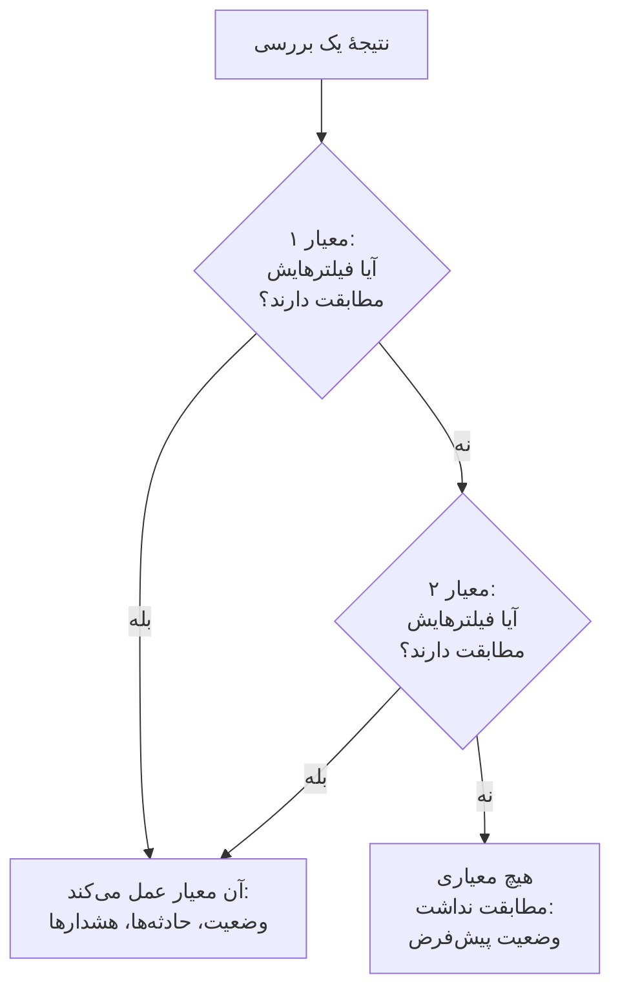
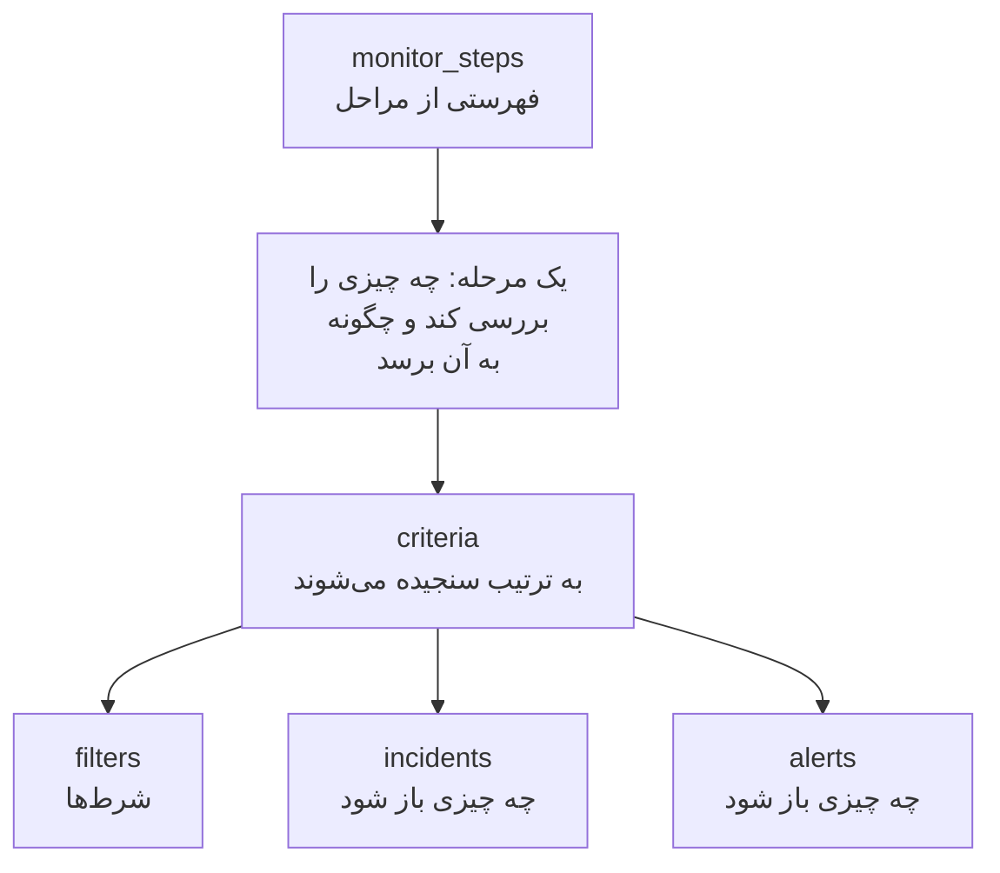

# مراحل مانیتور

`monitor_steps` ویژگی‌ای از `oneuptime_monitor` است که می‌گوید مانیتور چه چیزی را بررسی می‌کند و هر نتیجه چگونه سنجیده می‌شود: نشانی‌ای که باید بررسی شود، درخواستی که باید فرستاده شود، و معیارهایی که یک نتیجه را به وضعیت مانیتور، حادثه یا هشدار تبدیل می‌کنند. این صفحه همهٔ بخش‌های آن را توضیح می‌دهد.

:::cards
- [یک بررسی چگونه سنجیده می‌شود](#یک-بررسی-چگونه-سنجیده-میشود): معیارها به ترتیب، و نخستین معیاری که مطابقت دارد.
- [نوشتن مراحل](#نوشتن-مراحل): شکل آن‌ها، یک نمونهٔ کامل، و دو قاعده برای مقدارها.
- [مرجع فیلترها](#مرجع-فیلترها): یک فیلتر چه چیزی را می‌تواند بررسی کند، و چگونه مقایسه می‌کند.
- [اشتباه‌های رایج](#اشتباههای-رایج): آنچه بیشتر از همه اشتباه می‌شود، و راه رفع آن.
:::

## یک بررسی چگونه سنجیده می‌شود

هر بررسی یک نتیجه می‌دهد: پاسخ یک پراب، مقدار برگشتی یک اسکریپت، یا تله‌متری‌ای که بررسی می‌خواند. سپس معیارهای مرحله آن را به ترتیب خودشان می‌سنجند. نخستین معیاری که فیلترهایش مطابقت داشته باشند تصمیم می‌گیرد چه رخ دهد: می‌تواند وضعیت مانیتور را تغییر دهد، حادثه باز کند و هشدار باز کند. معیارهای پس از آن برای آن بررسی دیده نمی‌شوند.



پس ترتیب معیارها مهم است: معیارهایی را که هشدار می‌دهند اول بگذارید، شدیدترین را پیش از همه، و معیار سالم را در آخر. [ویژگی‌های معیار](#ویژگیهای-معیار) توضیح می‌دهد چرا، و تنها استثنا چیست.

## نوشتن مراحل

`monitor_steps` فهرستی از اشیای نوع‌دار است که مستقیم در HCL نوشته می‌شوند. نه `jsonencode()` در کار است، نه پوشش `{_type, value}`، نه کلید camelCase و نه IDای برای نوشتن: ارائه‌دهنده HCL شما را به قالب API تبدیل می‌کند، و سرور به هر مرحله، معیار، قالب حادثه و قالب هشدار ID می‌دهد. سرور این IDها را در هر apply نگه می‌دارد و هر معیار و قالب را با همانی که جایگزینش می‌شود جفت می‌کند، با نام، وگرنه با جایگاه، تا نتیجه‌های پراب کنار مرحلهٔ خودشان بمانند و حادثه‌ها همچنان به معیارهایی اشاره کنند که آن‌ها را باز کرده‌اند.



کوچک‌ترین مرحلهٔ مفید یک نشانی را بررسی می‌کند و یک معیار با یک فیلتر دارد:

```hcl
resource "oneuptime_monitor" "example" {
  name         = "Example"
  description  = "The smallest monitor_steps"
  monitor_type = "Website"

  monitor_steps = [{
    monitor_destination      = "https://example.com"
    monitor_destination_type = "URL"
    request_type             = "GET"

    criteria = [
      {
        name             = "Check if online"
        description      = "The website responds"
        filter_condition = "All"

        filters = [
          {
            check_on    = "Is Online"
            filter_type = "True"
          }
        ]
      }
    ]
  }]
}
```

دو قاعده در همه‌جای `monitor_steps` برقرار است:

- **آنچه را به کار نمی‌برید ننویسید.** ویژگی‌ای که تعیین نکنید به API فرستاده نمی‌شود. هرگز `[]`، `{}` یا `""` را به‌عنوان جای‌نگهدار ننویسید: ارائه‌دهنده رشته‌ها، فهرست‌ها و mapهای خالی را رد می‌کند، تا نبودن یک مقدار همیشه به معنای «تعیین‌نشده» باشد.
- **مقدار فیلترها رشته است.** `value` یک فیلتر رشته است، حتی برای یک عدد: `value = "200"`، نه `value = 200`. تنظیمات عددی مانند `port` عدد هستند.

:::details گذار از ارائه‌دهندهٔ 1.x که در آن monitor_steps از نوع JSON بود
در ارائه‌دهندهٔ 1.x، `monitor_steps` یک رشتهٔ JSON بود که با `jsonencode({ _type = "MonitorSteps", value = { ... } })` نوشته می‌شد. آن را با ویژگی‌های نوع‌دار این صفحه بازنویسی کنید: پوشش‌های `_type` و `value` را بردارید، کلیدهای camelCase را به snake_case بنویسید (`monitorDestination` به `monitor_destination` و `monitor_destination_type`، `filterCondition` به `filter_condition`، و `checkOn` به `check_on` تبدیل می‌شود)، و هر `id` را حذف کنید. اکنون همهٔ IDها را سرور می‌دهد، که به IDهای تصادفی ثابت‌شده در issue [#2291](https://github.com/OneUptime/oneuptime/issues/2291) هم پایان می‌دهد. stateی که به‌صورت رشتهٔ JSON ذخیره شده است خودبه‌خود ارتقا نمی‌یابد: پیکربندی تازه را اعمال کنید.
:::

### یک نمونهٔ کامل

این مانیتور وب‌سایت همان چیزی را بررسی می‌کند که مانیتور وب‌سایتِ تست‌های سرتاسری ارائه‌دهنده بررسی می‌کند (تست `35-monitor-with-steps`): وقتی سایت پاسخ ندهد offline، و وقتی با 200 پاسخ دهد online.

```hcl
resource "oneuptime_monitor_status" "operational" {
  name                 = "Operational"
  description          = "Monitor is operational"
  color                = "#2ecc71"
  priority             = 1
  is_operational_state = true
}

resource "oneuptime_monitor_status" "offline" {
  name                 = "Offline"
  description          = "Monitor is offline"
  color                = "#e74c3c"
  priority             = 3
  is_operational_state = false
}

resource "oneuptime_monitor" "website" {
  name         = "Website"
  description  = "Website monitor with explicit steps"
  monitor_type = "Website"

  monitor_steps = [{
    monitor_destination      = "https://example.com" # what to check
    monitor_destination_type = "URL"                 # URL, Hostname or IP
    request_type             = "GET"                 # the HTTP method

    criteria = [ # judged in order: the first match decides
      {
        name                  = "Offline"
        description           = "Check if website is offline"
        filter_condition      = "Any"
        change_monitor_status = true
        create_incidents      = false
        create_alerts         = false
        monitor_status_id     = oneuptime_monitor_status.offline.id

        filters = [
          {
            check_on    = "Is Online"
            filter_type = "False"
          }
        ]
      },
      {
        name                  = "Online"
        description           = "Check if website is online"
        filter_condition      = "All" # All: every filter, Any: at least one
        change_monitor_status = true
        create_incidents      = false
        create_alerts         = false
        monitor_status_id     = oneuptime_monitor_status.operational.id

        filters = [
          {
            check_on    = "Is Online"
            filter_type = "True"
          },
          {
            check_on    = "Response Status Code"
            filter_type = "Equal To"
            value       = "200" # a string, even for a number
          }
        ]
      }
    ]
  }]
}
```

یک معیار با منبع یک وضعیت به آن ارجاع می‌دهد، همان‌طور که `oneuptime_monitor_status.offline.id` اینجا انجام می‌دهد، یا با یک [منبع داده](/docs/terraform/complete-guide#خواندن-آنچه-از-قبل-وجود-دارد) به وضعیتی که پروژهٔ شما از قبل دارد.

## ویژگی‌های مرحله

هر مورد از `monitor_steps` یک چیز برای بررسی است:

| ویژگی | نوع | به کار رفته در | یادداشت‌ها |
| --- | --- | --- | --- |
| `monitor_destination` | string | وب‌سایت، API، Ping، IP، پورت، گواهی SSL، NTP | URL، نام میزبان یا نشانی IP که باید بررسی شود. به `monitor_destination_type` نیاز دارد. |
| `monitor_destination_type` | string | همان‌ها | `URL`، `Hostname` یا `IP`، بسته به آنچه نوع مانیتور می‌پذیرد: برای مانیتورهای وب‌سایت، API و گواهی SSL یک URL؛ برای مانیتورهای Ping، IP، پورت و NTP یک نام میزبان یا نشانی IP. |
| `port` | number | پورت، NTP | پورت TCP برای بررسی، مانند `443`. برای NTP، پورت UDP که سرور زمان روی آن پاسخ می‌دهد: وقتی تعیین نشده باشد `123`. |
| `request_type` | string | وب‌سایت، API | متد HTTP: `GET`، `POST`، `PUT`، `DELETE`، `HEAD` یا `PATCH`. وقتی تعیین نشده باشد سرور `GET` را به کار می‌برد. |
| `request_headers` | map(string) | وب‌سایت، API | سرآیندهایی که فرستاده می‌شوند: `{ "Accept" = "application/json" }`. |
| `request_body` | string | API | بدنهٔ درخواست، به‌صورت متن. |
| `do_not_follow_redirects` | bool | وب‌سایت، API | به‌جای دنبال کردن تغییر مسیرها، در نخستین پاسخ بایستد. |
| `allow_self_signed_certificates` | bool | وب‌سایت، API | گواهی TLS خودامضا را بپذیرد. |
| `tls_client_certificate` | string | وب‌سایت، API | یک گواهی کلاینت برای TLS دوطرفه: PEM، یا یک ارجاع `{{monitorSecrets.name}}`. |
| `tls_client_key` | string (حساس) | وب‌سایت، API | کلید خصوصی گواهی کلاینت. آن را همراه با گواهی تعیین کنید. |
| `tls_client_key_passphrase` | string (حساس) | وب‌سایت، API | عبارت عبور کلید خصوصی. |
| `request_timeout_in_ms` | number | بررسی‌هایی که یک پراب انجام می‌دهد | هر تلاش چقدر می‌تواند طول بکشد، به میلی‌ثانیه. پراب هر مقدار بالاتر از ۶۰٬۰۰۰ را به ۶۰٬۰۰۰ کاهش می‌دهد. |
| `retry_count` | number | بررسی‌هایی که یک پراب انجام می‌دهد | تلاش‌های دوباره پس از شکست نخستین تلاش: `0` یک بار بررسی می‌کند، `3` تا چهار بار. پراب هر مقدار بالاتر از ۳ را به ۳ کاهش می‌دهد. |
| `custom_code` | string | Custom JavaScript Code، Synthetic | اسکریپتی که مرحله اجرا می‌کند. |
| `screen_size_types` | list(string) | Synthetic | `Mobile`، `Tablet` و `Desktop`. |
| `browser_types` | list(string) | Synthetic | `Chromium` و `Firefox`. |
| `retry_count_on_error` | number | Synthetic | تلاش‌های دوباره وقتی اسکریپت شکست می‌خورد: `0` آن را یک بار اجرا می‌کند. |
| `criteria` | list (الزامی) | همه | هر نتیجه چگونه سنجیده می‌شود: [ویژگی‌های معیار](#ویژگیهای-معیار) را ببینید. |

### تنظیمات هر نوع مانیتور

نوع‌های مانیتوری که چیزی بیش از یک نشانی برای تعیین دارند، تنظیماتشان (یک کوئری لاگ، یک اتصال پایگاه داده، یک کلاستر برای پایش) را در ویژگی خودشان نگه می‌دارند، به‌صورت JSON خام که با `jsonencode()` نوشته می‌شود: `log_monitor`، `trace_monitor`، `llm_monitor`، `metric_monitor`، `exception_monitor`، `profile_monitor`، `dns_monitor`، `domain_monitor`، `dnssec_monitor`، `sql_monitor`، `database_monitor`، `external_status_page_monitor`، `network_device_monitor`، `kubernetes_monitor`، `docker_monitor`، `docker_swarm_monitor`، `host_monitor`، `podman_monitor`، `proxmox_monitor`، `vmware_monitor`، `ceph_monitor`، `storage_array_monitor`، `iot_monitor` و `probe_status_monitor`.

JSON آن‌ها همان JSON داشبورد است، با کلیدهای camelCase. یک ID در آن همان‌طور نوشته می‌شود که API می‌نویسد: `{ _type = "ObjectID", value = "..." }`. یک مانیتور Logs که خطاهای یک سرویس را می‌شمارد:

```hcl
resource "oneuptime_service" "checkout" {
  name = "checkout"
}

resource "oneuptime_monitor" "checkout_errors" {
  name         = "Checkout errors"
  monitor_type = "Logs"

  monitor_steps = [{
    log_monitor = jsonencode({
      attributes          = {}
      body                = "error"
      severityTexts       = ["Error"]
      telemetryServiceIds = [{ _type = "ObjectID", value = oneuptime_service.checkout.id }]
      lastXSecondsOfLogs  = 300
    })

    criteria = [
      {
        name             = "Errors found"
        filter_condition = "Any"

        filters = [
          {
            check_on    = "Log Count"
            filter_type = "Greater Than"
            value       = "0"
          }
        ]
      }
    ]
  }]
}
```

> [!TIP]
> ساده‌ترین راه برای درست نوشتن این JSON: مانیتور را در داشبورد تنظیم کنید، سپس بخش **توسعه‌دهنده** و **Terraform** آن را باز کنید. آن صفحه `monitor_steps` مانیتور را می‌نویسد، همراه با `jsonencode()` و همه‌چیز.

## ویژگی‌های معیار

هر مورد از `criteria` یک قاعده است: وقتی فیلترهایش مطابقت داشته باشند، آنچه می‌گوید انجام شود.

معیارها از بالا سنجیده می‌شوند، و نخستین معیاری که مطابقت داشته باشد تصمیم می‌گیرد، پس معیارهایی را که هشدار می‌دهند اول بگذارید، شدیدترین را پیش از همه (بحرانی، سپس هشدار)، و معیار سالم را در آخر. گذاشتن یک معیار سالم در بالا رایج‌ترین راه ساختن مانیتوری است که هرگز هشدار نمی‌دهد: یک قاعدهٔ گسترده مانند `Is Online` برابر `True`، یا یک مقدار متریک `Greater Than` `0`، تقریباً با هر بررسی مطابقت دارد، و معیارهای زیر آن هرگز دیده نمی‌شوند. اگر آخر گذاشته شود، فقط وقتی مطابقت دارد که هیچ‌چیز بالای آن مطابقت نداشته باشد، و این همان چیزی است که می‌خواهید.

مانیتورهای متریک گروه‌بندی‌شده تنها استثنا هستند. وقتی کوئری یک مانیتور متریک گروه‌بندی شده باشد (`groupByAttributeKeys` در JSON مربوط به `metric_monitor`، در `metricViewConfig.queryConfigs[].metricQueryData.groupByAttributeKeys` تعیین شده باشد)، مانیتور برای هر گروه (هر میزبان، کانتینر یا نقطهٔ اتصال) یک هشدار یا حادثه باز می‌کند، و همهٔ معیارها سنجیده می‌شوند، بنابراین یک معیار بحرانی و یک معیار هشدار می‌توانند در یک بررسی برای میزبان‌های متفاوت فعال شوند. میزبانی که هر دو را نقض کند باز هم فقط یک بار فراخوانده می‌شود، با نخستین معیاری که مطابقت دارد، پس شدیدترین همچنان اول می‌آید. [مانیتور متریک‌ها](/docs/monitor/metrics-monitor) را ببینید.

| ویژگی | نوع | چیست |
| --- | --- | --- |
| `name` | string (الزامی) | نامی که داشبورد نشان می‌دهد. |
| `description` | string | توضیحی که داشبورد نشان می‌دهد. |
| `filter_condition` | string (الزامی) | `All`: همهٔ فیلترها باید مطابقت داشته باشند. `Any`: یکی کافی است. |
| `filters` | list (الزامی) | شرط‌ها، دست‌کم یکی: [مرجع فیلترها](#مرجع-فیلترها) را ببینید. |
| `change_monitor_status` | bool | اینکه آیا یک مطابقت وضعیت مانیتور را تغییر می‌دهد. |
| `monitor_status_id` | string | ID آن `oneuptime_monitor_status` که باید به آن تغییر کند. وقتی `change_monitor_status` برابر `true` است آن را تعیین کنید. |
| `create_incidents` | bool | اینکه آیا یک مطابقت حادثه باز می‌کند. |
| `incidents` | list | حادثه‌هایی که باید باز شوند. آن را ننویسید مگر با `create_incidents = true`. |
| `create_alerts` | bool | اینکه آیا یک مطابقت هشدار باز می‌کند. |
| `alerts` | list | هشدارهایی که باید باز شوند. آن را ننویسید مگر با `create_alerts = true`. |
| `is_enabled` | bool | وقتی تعیین نشده باشد روی سرور `true`. برای نگه داشتن یک معیار بدون سنجیدن با آن، `false` را تعیین کنید. |
| `incident_grouping` | string (JSON) | فقط مانیتورهای درخواست ورودی: یک حادثه برای هر مقداری که در درخواست پیدا شود، مانند `jsonencode({ groupByJSONPath = "..." })`. |
| `open_for_every_email` | bool | فقط مانیتورهای ایمیل ورودی: با `true` برای هر ایمیلی که مطابقت داشته باشد یک حادثه (و یک هشدار) باز می‌شود، نه هر بار فقط یکی. |

### حادثه‌ها و هشدارها

هر مورد از `incidents`، `title` و `description` (هر دو الزامی)، `incident_severity_id`، `auto_resolve_incident`، `remediation_notes`، `on_call_policy_ids`، `label_ids`، `owner_team_ids`، `owner_user_ids`، `show_incident_on_status_page` و `is_private` را می‌پذیرد. هر مورد از `alerts` همین‌ها را می‌پذیرد، با `alert_severity_id` و `auto_resolve_alert`، و بدون `show_incident_on_status_page`.

این معیار مانیتور را offline علامت می‌زند، حادثه‌ای باز می‌کند که سیاست آنکال را فرامی‌خواند، و وقتی سایت برگشت آن را حل می‌کند:

```hcl
criteria = [
  {
    name                  = "Offline"
    description           = "The site is unreachable"
    filter_condition      = "Any"
    change_monitor_status = true
    monitor_status_id     = oneuptime_monitor_status.offline.id
    create_incidents      = true

    filters = [
      {
        check_on    = "Is Online"
        filter_type = "False"
      }
    ]

    incidents = [
      {
        title                 = "Website is down"
        description           = "The website did not respond to the probe."
        incident_severity_id  = oneuptime_incident_severity.critical.id
        auto_resolve_incident = true
        on_call_policy_ids    = [oneuptime_on_call_policy.primary.id]
      }
    ]
  }
]
```

## مرجع فیلترها

هر فیلتر `check_on` (به چه چیزی نگاه کند)، `filter_type` (چگونه مقایسه کند) و `value` (با چه چیزی مقایسه کند، به‌صورت رشته؛ برای بررسی‌های درست‌یا‌نادرست مانند `True` و `False` آن را ننویسید) دارد.

یک فیلتر می‌تواند به‌جای آخرین بررسی، یک بازهٔ زمانی را هم بسنجد: `evaluate_over_time = true` را تعیین کنید، طول بازه را در `evaluate_over_time_minutes`، و در `evaluate_over_time_type` اینکه بازه چگونه خوانده شود: `Average`، `Sum`، `Maximum Value`، `Minimum Value`، `All Values` یا `Any Value`.

`All Values` یعنی همهٔ بررسی‌های بازه قاعده را نقض کرده‌اند، پس فقط وقتی مطابقت دارد که بازه با داده پوشیده شده باشد: مانیتوری که تازه ساخته شده است به‌جای مطابقت در نخستین بررسی، منتظر پر شدن بازه‌اش می‌ماند. بازه‌ای دست‌کم دو برابر `monitoring_interval` مانیتور به آن بدهید؛ وگرنه بازه یک بررسی را در خود دارد، و «همهٔ مقدارها» همان معنای «هر مقداری» را می‌دهد. `Any Value` عمداً با یک بررسیِ ناقضِ قاعده مطابقت دارد.

`evaluate_over_time_no_data_policy` می‌گوید فیلتر تا وقتی بازه دادهٔ کافی ندارد چه کند: `Ignore` (پیش‌فرض) مطابقت ندارد، `Trigger` نبود داده را مانند یک heartbeat خرابی به حساب می‌آورد، و `Treat As Zero` بازه را به‌صورت یک صفر تنها مقایسه می‌کند.

### یک فیلتر چه چیزی را می‌تواند بررسی کند

مقدارهای `check_on` که هر نوع مانیتور بیشتر از همه به کار می‌برد. ویرایشگر معیارهای داشبورد همین‌ها را پیشنهاد می‌دهد، و همه را فهرست می‌کند:

| نوع مانیتور | مقدارهای `check_on` |
| --- | --- |
| وب‌سایت / API | `Is Online`، `Response Time (in ms)`، `Response Status Code`، `Response Body`، `Response Header`، `Response Header Value`، `JavaScript Expression`، `Is Request Timeout` |
| Ping / IP | `Is Online`، `Response Time (in ms)`، `Packet Loss (in %)`، `Jitter (in ms)`، `Is Request Timeout` |
| پورت | `Is Online`، `Response Time (in ms)` (کل زمان اتصال در داشبورد)، `Port DNS Lookup Time (in ms)`، `Port TCP Connect Time (in ms)`، `Is Request Timeout` |
| گواهی SSL | `Is Valid Certificate`، `Is Not A Valid Certificate`، `Is Self Signed Certificate`، `Is Expired Certificate`، `Expires In Days`، `Expires In Hours` |
| درخواست ورودی | `Incoming Request`، `Request Body`، `Request Header`، `Request Header Value`، `JavaScript Expression` |
| ایمیل ورودی | `Email Received`، `Email Subject`، `Email From Address`، `Email To Address`، `Email Body` |
| سرور | `Is Online`، `CPU Usage (in %)`، `Memory Usage (in %)`، `Disk Usage (in %)` (با `disk_path`)، `Server Process Name` |
| لاگ‌ها | `Log Count` |
| تریس‌ها | `Span Count` |
| استثناها | `Exception Count` |
| پروفایل‌ها | `Profile Count`، `Function Share (in %)` |
| هوش مصنوعی / LLM | `Bad AI Answers (in %)`، `Bad AI Answers`، `AI Answers` |
| متریک‌ها | `Metric Value` (فیلترهای متریک می‌توانند JSON در `metric_monitor_options` بگیرند) |
| کد سفارشی / Synthetic | `Result Value` (می‌تواند یک فیلد از دادهٔ برگشتی را مقایسه کند که در JSON مربوط به `custom_code_monitor_options` نام برده می‌شود، مثلاً `jsonencode({ resultValuePath = "status" })` — پایین‌تر را ببینید)، `Error`، `Execution Time (in ms)` |
| DNS | `DNS Is Online`، `DNS Response Time (in ms)`، `DNS Record Value`، `DNS Record Exists` |
| دامنه | `Domain Expires In Days`، `Domain Is Expired`، `Domain Registrar`، `Domain Name Server` |
| DNSSEC | `DNSSEC Chain Is Valid`، `DNSSEC DS Record Exists At Parent`، `DNSSEC Signature Expires In Days` |
| کوئری SQL | `SQL Is Online`، `SQL Query Row Count`، `SQL Query Scalar Value` |
| سلامت پایگاه داده | `Database Is Online`، `Database Metric` (با JSON در `database_monitor_options` که سری را نام می‌برد، مثلاً `jsonencode({ metricType = "oneuptime.monitor.database.connections.used.percent" })`)، `Database Collection Error` |
| صفحهٔ وضعیت بیرونی | `External Status Page Is Online`، `External Status Page Active Incidents`، `External Status Page Component Status` |
| NTP | `NTP Is Online`، `NTP Is Synchronized`، `NTP Stratum`، `NTP Clock Offset (in ms)`، `NTP Response Time (in ms)`، `NTP Root Dispersion (in ms)` (`NTP Is Online` و `NTP Is Synchronized` هیچ `value` نمی‌گیرند) |
| دستگاه شبکه (SNMP) | `SNMP Device Is Online` (به ping یا SNMP پاسخ می‌دهد)، `SNMP Walk Is Succeeding` (false وقتی پاسخ می‌دهد ولی نمی‌توان آن را پیمایش کرد)، `SNMP OID Value` (فیلترهای SNMP می‌توانند JSON در `snmp_monitor_options` بگیرند) |

### یک فیلتر چگونه مقایسه می‌کند

| گونه | مقدارهای `filter_type` |
| --- | --- |
| درست یا نادرست | `True`، `False` |
| عددها | `Equal To`، `Not Equal To`، `Greater Than`، `Less Than`، `Greater Than Or Equal To`، `Less Than Or Equal To` |
| متن | `Contains`، `Not Contains`، `Starts With`، `Ends With`، `Is Empty`، `Is Not Empty` |
| Heartbeatها | `Recieved In Minutes`، `Not Recieved In Minutes` (همان‌طور که API می‌نویسد) |
| فرایندهای سرور | `Is Executing`، `Is Not Executing` |
| اسکریپت‌ها | `Evaluates To True` |
| ناهنجاری‌ها، برای متریک‌ها، لاگ‌ها و تریس‌ها | `Anomalously High`، `Anomalously Low`، `Anomalous` |

فیلتری که وقتی یک گواهی SSL ظرف ۱۴ روز یا کمتر منقضی شود مطابقت دارد:

```hcl
filters = [
  {
    check_on    = "Expires In Days"
    filter_type = "Less Than Or Equal To"
    value       = "14"
  }
]
```

ارائه‌دهنده هنگام پلن، `check_on`، `filter_type` و دیگر فهرست‌های ثابت را بررسی می‌کند، پس یک غلط تایپی پیش از اینکه چیزی به API فرستاده شود شکست می‌خورد. این مقدارها نام‌هایی هستند که API به گزینه‌های ویرایشگر معیارهای داشبورد می‌دهد.

### مقایسه یک فیلد از نتیجه اسکریپت

اسکریپت یک مانیتور کد سفارشی یا Synthetic مقدار `data` را برمی‌گرداند، و یک فیلتر `Result Value` آن را مقایسه می‌کند. وقتی `data` یک شیء یا آرایه باشد، `custom_code_monitor_options` آن یک فیلدی را که باید مقایسه شود نام می‌برد: **مسیر فیلد** در فیلتر Result Value داشبورد. برای فیلدهای تودرتو از نقطه و برای اعضای آرایه از `[n]` استفاده کنید، و برای مقایسهٔ کل مقدار این ویژگی را ننویسید:

```hcl
monitor_steps = [{
  custom_code = <<-EOT
    const response = await axios.get("https://api.example.com/health");
    // For example { status: "UP", checks: [{ name: "db", latency: 12 }] }
    return { data: response.data };
  EOT

  criteria = [
    {
      name             = "Unhealthy"
      filter_condition = "Any"
      filters = [
        {
          check_on                    = "Result Value"
          filter_type                 = "Not Equal To"
          value                       = "UP"
          custom_code_monitor_options = jsonencode({ resultValuePath = "status" })
        },
        {
          check_on                    = "Result Value"
          filter_type                 = "Greater Than"
          value                       = "500"
          custom_code_monitor_options = jsonencode({ resultValuePath = "checks[0].latency" })
        }
      ]
    }
  ]
}]
```

`Greater Than` و دیگر شرط‌های عددی فقط با فیلدی مطابقت دارند که عدد باشد، و فیلدی که در دادهٔ برگشتی نباشد فقط با `Is Empty` مطابقت دارد. برای اینکه مسیرها و شرط‌ها چگونه کار می‌کنند، [هشدار روی دادهٔ بازگشتی](/docs/monitor/custom-code-monitor#هشدار-روی-داده-بازگشتی) را ببینید.

## اشتباه‌های رایج

1. **جای‌نگهدارهای خالی.** `incidents = []`، `request_headers = {}` و `description = ""` رد می‌شوند: به‌جای آن ویژگی را ننویسید.
2. **عدد به‌جای رشته.** `value` یک فیلتر رشته است، حتی برای یک عدد: `value = "200"`. تنظیمات عددی مانند `port`، `retry_count`، `request_timeout_in_ms` و `evaluate_over_time_minutes` عدد می‌گیرند.
3. **نوع مقصد نادرست.** `monitor_destination_type = "URL"` با یک نام میزبان خالی، یا `Hostname` با یک URL کامل، باعث شکست بررسی می‌شود. مانیتورهای وب‌سایت و API نشانی URL می‌گیرند؛ مانیتورهای Ping، IP و پورت نام میزبان یا نشانی IP می‌گیرند.
4. **تغییر وضعیت بدون وضعیت.** `change_monitor_status = true` بدون `monitor_status_id` مطابقت دارد، ولی وضعیتی برای تغییر به آن ندارد.
5. **IDها.** هیچ موردی از `monitor_steps` ویژگی `id` ندارد. اگر از JSON قدیمی می‌آیید، آن‌ها را حذف کنید: IDها را سرور می‌دهد.
6. **JSON دست‌نویس.** `log_monitor` و دیگر تنظیمات را با `jsonencode()` بنویسید، تا Terraform آن‌ها را در نقل‌قول بگذارد و JSON را هر بار به یک شکل بنویسد. برای `metric_monitor`، کل شیئی را بدهید که داشبورد می‌نویسد: سرور آن را نرمال می‌کند.

## وقتی هیچ معیاری مطابقت ندارد

بررسی‌ای که با هیچ معیاری مطابقت نداشته باشد، مانیتور را در وضعیت پیش‌فرضش می‌گذارد: وضعیت عملیاتی پروژه، همانی که داشبورد برای یک مانیتور تازه برمی‌گزیند. حادثه‌های باز آن که معیارهایشان حل خودکار را برگزیده‌اند هم حل می‌شوند. برای اینکه هر نتیجه را خودتان تعیین کنید، فهرست را با یک معیار سالم گسترده تمام کنید، همان‌طور که نمونه‌های این صفحه می‌کنند.

## مانیتور بدون مرحله

`monitor_steps` اختیاری است، ولی مانیتوری که بدون آن ساخته شود معیاری برای سنجیدن نتیجه ندارد: پراب‌ها از مانیتور بدون مرحله می‌گذرند، و مانیتور در همان وضعیتی می‌ماند که با آن شروع کرده است. state شما ویژگی را خالی نگه می‌دارد، و پلن تمیز می‌ماند. یک مانیتور دستی هرگز به مرحله نیاز ندارد: وضعیت آن را خودتان تعیین می‌کنید. هر نوع دیگر برای بررسی هر چیزی دست‌کم به یک مرحله نیاز دارد.

## قالب انتقال

پشت ارائه‌دهنده، API هنوز به JSON خودش سخن می‌گوید، که در آن هر شیء غنی به‌صورت `{_type, value}` بسته‌بندی شده است:

```json
{
  "_type": "MonitorSteps",
  "value": {
    "monitorStepsInstanceArray": [
      {
        "_type": "MonitorStep",
        "value": {
          "monitorDestination": { "_type": "URL", "value": "https://example.com" },
          "requestType": "GET",
          "monitorCriteria": {
            "_type": "MonitorCriteria",
            "value": { "monitorCriteriaInstanceArray": [ { "_type": "MonitorCriteriaInstance", "value": { "...": "..." } } ] }
          }
        }
      }
    ]
  }
}
```

ارائه‌دهنده هنگام نوشتن این را از HCL شما می‌سازد، و آن را دوباره به HCL می‌خواند، و آنچه را سرور مدیریت می‌کند (IDها و مقدارهای پیش‌فرضی که اضافه می‌کند) کنار می‌گذارد. فقط وقتی با آن روبه‌رو می‌شوید که پاسخ‌های API را خودتان بخوانید، برای نمونه در اسکریپتی که `monitorSteps` را می‌خواند.

## گام‌های بعدی

:::cards
- [نمونه‌ها](/docs/terraform/examples): مانیتورهای Ping، پورت، گواهی SSL و API، آمادهٔ استفاده.
- [راهنمای کامل](/docs/terraform/complete-guide): منبع‌های داده، state و ارتقا.
- [مانیتور متریک‌ها](/docs/monitor/metrics-monitor): کوئری‌های متریک، گروه‌بندی و ناهنجاری‌ها.
- [رفع اشکال](/docs/terraform/troubleshooting): از جمله نتیجهٔ ناسازگار پس از apply روی یک مانیتور.
:::
