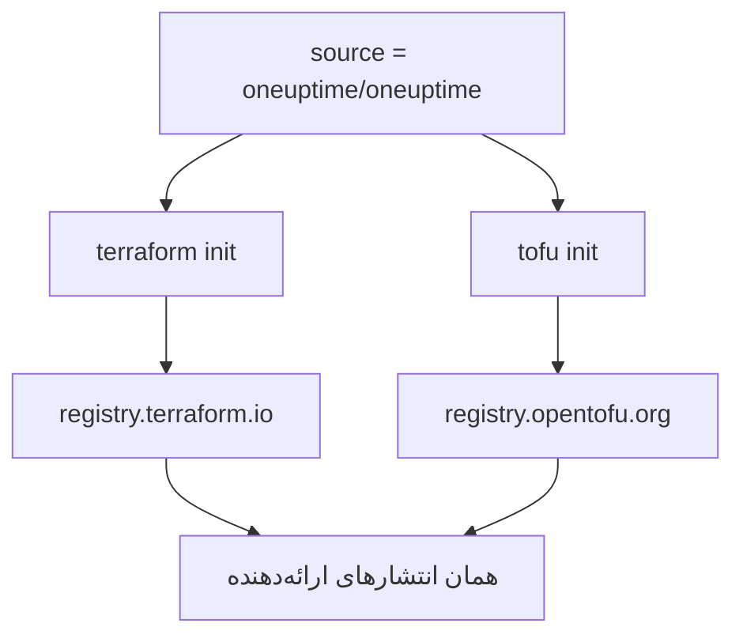

# OpenTofu

ارائه‌دهندهٔ OneUptime با [OpenTofu](https://opentofu.org) همان‌طور کار می‌کند که با Terraform. در [OpenTofu Registry](https://search.opentofu.org/provider/oneuptime/oneuptime/latest) منتشر می‌شود، و هر انتشار پیش از انتشار همان آزمون‌های سرتاسری را زیر هر دو می‌گذراند. پیکربندی شما تغییر نمی‌کند: هر جا این مستندات `terraform` را اجرا می‌کنند، `tofu` را اجرا کنید.

:::cards
- [استفاده از ارائه‌دهنده با OpenTofu](#استفاده-از-ارائهدهنده-با-opentofu): همان پیکربندی، اجراشده با `tofu`.
- [تفاوت‌ها با Terraform](#تفاوتها-با-terraform): رجیستری‌ها، فایل‌های قفل، فایل‌های `.tofu` و نسخه‌ها.
- [انتقال یک پیکربندی به OpenTofu](#انتقال-یک-پیکربندی-به-opentofu): یک پیکربندی موجود را در چهار گام جابه‌جا کنید.
- [یک ماژول بازاستفاده‌پذیر](#یک-ماژول-بازاستفادهپذیر): مانیتورها، یک سیاست آنکال و یک صفحهٔ وضعیت برای یک سرویس.
:::

## استفاده از ارائه‌دهنده با OpenTofu

به OpenTofu 1.6 یا جدیدتر نیاز دارید. ارائه‌دهنده را همان‌طور که برای Terraform اعلام می‌کنید اعلام کنید:

```hcl title="main.tf"
terraform {
  required_providers {
    oneuptime = {
      source  = "oneuptime/oneuptime"
      version = "{{TERRAFORM_PROVIDER_VERSION}}"
    }
  }
}

provider "oneuptime" {
  # The API key comes from the ONEUPTIME_API_KEY environment variable.
  # On a self-hosted OneUptime, add your OneUptime's address:
  # oneuptime_url = "https://oneuptime.example.com"
}
```

سپس آن را با `tofu` اجرا کنید:

```bash
export ONEUPTIME_API_KEY="<your-api-key>"
tofu init
tofu plan
tofu apply
```

`tofu init` ارائه‌دهنده را از OpenTofu Registry بارگیری می‌کند. هر آنچه در [شروع سریع](/docs/terraform/quick-start)، [راهنمای کامل](/docs/terraform/complete-guide)، [مراحل مانیتور](/docs/terraform/monitor-steps)، [نمونه‌ها](/docs/terraform/examples) و [وارد کردن منابع](/docs/terraform/importing-resources) آمده است همان‌طور که هست به کار می‌آید، و پیکربندی‌ای که صفحه‌های **Terraform** داشبورد می‌نویسند بدون تغییر کار می‌کند.

### رجیستری را بیرون از نشانی منبع نگه دارید

`source = "oneuptime/oneuptime"` هیچ رجیستری‌ای را نام نمی‌برد، پس هر موتور آن را از رجیستری خودش می‌خواند:



نام میزبان را کنار بگذارید. با آن، هر موتور از همان رجیستری استفاده می‌کند: با `registry.terraform.io/oneuptime/oneuptime`، OpenTofu هم از Terraform Registry بارگیری می‌کند، و Terraform نسخهٔ OpenTofu Registry را با `authentication signature from unknown issuer` رد می‌کند.

## تفاوت‌ها با Terraform

| موضوع | زیر OpenTofu |
| --- | --- |
| رجیستری | `oneuptime/oneuptime` همان `registry.opentofu.org/oneuptime/oneuptime` است، که همان نسخه‌های Terraform Registry را منتشر می‌کند. |
| امضاها | `tofu init` می‌گوید اعتبارسنجی امضا رد شد: OpenTofu Registry هیچ کلید امضایی برای این ارائه‌دهنده ندارد، پس OpenTofu بارگیری را با checksumهای رجیستری بررسی می‌کند. |
| بلوک `terraform` | همان `terraform` می‌ماند: بخشی از زبان است، و OpenTofu آن را همان‌طور که هست می‌خواند. |
| فایل‌های `.tofu` | OpenTofu 1.8 و جدیدتر فایل‌های `.tofu` را هم می‌خواند، و از فایل `.tf` که فایلی `.tofu` با همان نام کنارش هست می‌گذرد. Terraform فقط فایل‌های `.tf` را می‌خواند. |
| `required_version` | نسخه‌های OpenTofu از 1.6.0 شروع می‌شوند، پس `>= 1.5.0` که برای Terraform نوشته شده است هر OpenTofu را می‌پذیرد. |
| فایل قفل | `registry.opentofu.org/oneuptime/oneuptime` را نام می‌برد. جابه‌جا کردن موتور آن مدخل را بازنویسی می‌کند: تغییر را commit کنید. |
| State | OpenTofu stateی را که Terraform نوشته است همان‌طور که هست می‌خواند. |
| متغیرها | `TF_VAR_name` زیر OpenTofu هم یک متغیر را تنظیم می‌کند. |
| فایل پیکربندی CLI | `~/.tofurc` یا `~/.terraformrc`، یا فایلی که `TF_CLI_CONFIG_FILE` نام می‌برد. |
| بلوک `removed` | بلوک `lifecycle` آن به OpenTofu 1.10 یا جدیدتر نیاز دارد. بدون آن، OpenTofu منبع را فراموش می‌کند و رکورد را نگه می‌دارد، جایی که Terraform آن را نابود می‌کند. |
| رفتن به نوع منبعی که نامش تغییر کرده است | بلوک `moved` از `oneuptime_io_t_fleet` به `oneuptime_iot_fleet`، یا میان نوع‌های دیگری که نامشان تغییر کرده است، به OpenTofu 1.12 یا جدیدتر نیاز دارد. |

## انتقال یک پیکربندی به OpenTofu

پیکربندی‌ای که Terraform مدیریتش می‌کند همان‌طور که هست، با state خود، به OpenTofu منتقل می‌شود:

:::steps
### OpenTofu را نصب کنید

OpenTofu را نصب کنید: نسخهٔ 1.6 برای ارائه‌دهنده بس است، و 1.12 یا جدیدتر منبعی را به نوعی که نامش تغییر کرده است هم جابه‌جا می‌کند، مانند `oneuptime_io_t_fleet` به `oneuptime_iot_fleet`.

### با tofu راه‌اندازی کنید

در پوشهٔ پیکربندی، `tofu init` را اجرا کنید. ارائه‌دهنده را از OpenTofu Registry بارگیری می‌کند، و می‌گوید که فایل قفل را تغییر داده است: مدخل ارائه‌دهنده اکنون OpenTofu Registry را نام می‌برد.

### پلن

`tofu plan` را اجرا کنید. stateی را که Terraform به جا گذاشته است می‌خواند، و با `No changes.` پاسخ می‌دهد.

### فایل قفل را commit کنید

`.terraform.lock.hcl` را commit کنید، و از این پس پیکربندی را با `tofu` اجرا کنید، در CI هم.
:::

## یک ماژول بازاستفاده‌پذیر

[`Examples/opentofu/`](https://github.com/OneUptime/oneuptime/tree/master/Examples/opentofu) در مخزن OneUptime پیکربندی‌های قابل اجرا دارد، و ماژولی که یک سرویس را راه می‌اندازد: یک مانیتور وب‌سایت برای هر نشانی‌ای که به آن می‌دهید، یک برچسب روی هر چیزی که می‌سازد، یک سیاست آنکال با یک قاعدهٔ تشدید، و یک صفحهٔ وضعیت که مانیتورها را فهرست می‌کند. HCL ساده است، پس زیر Terraform هم کار می‌کند.

```hcl title="main.tf"
module "storefront" {
  source = "github.com/OneUptime/terraform-provider-oneuptime//modules/monitoring-and-incident-response?ref=vX.Y.Z"

  service_name          = "storefront"
  status_page_is_public = true

  monitors = {
    homepage = { url = "https://example.com" }
    checkout = { url = "https://example.com/checkout" }
    api      = { url = "https://api.example.com/health", expected_status_code = "204" }
  }
}
```

`vX.Y.Z` را با یک نسخهٔ منتشرشدهٔ ارائه‌دهنده جایگزین کنید، مانند تازه‌ترین در [انتشارهای ارائه‌دهنده](https://github.com/OneUptime/terraform-provider-oneuptime/releases): ماژول همراه ارائه‌دهنده منتشر می‌شود، و مخزن آن با هر انتشار تغییر می‌کند.

ماژول وضعیت مانیتور یا شدت حادثه نمی‌سازد. آن‌هایی را که هر پروژه با آن‌ها شروع می‌شود با نامشان جست‌وجو می‌کند: `Operational`، `Offline` و `Critical Incident`. اگر پروژهٔ شما نام آن‌ها را تغییر داده است، `operational_monitor_status_name`، `offline_monitor_status_name` یا `incident_severity_name` را تنظیم کنید.

قاعدهٔ تشدید آن هیچ‌کس را فرانمی‌خواند تا بگویید چه کسی را: با خروجی‌های ماژول یک تیم به آن بیفزایید:

```hcl title="main.tf"
resource "oneuptime_team" "storefront" {
  name = "Storefront"
}

resource "oneuptime_team_on_call_duty_escalation_rule" "storefront" {
  on_call_duty_policy_id                 = module.storefront.on_call_policy_id
  on_call_duty_policy_escalation_rule_id = module.storefront.escalation_rule_id
  team_id                                = oneuptime_team.storefront.id
}
```

## گام‌های بعدی

:::cards
- [شروع سریع](/docs/terraform/quick-start): یک کلید API بسازید و نخستین منابع خود را اعمال کنید.
- [استفاده از رجیستری](/docs/terraform/registry): نسخه‌ها چگونه شماره می‌خورند، و فایل قفل.
- [راه‌اندازی خودمیزبان](/docs/terraform/self-hosted): OneUptime خودتان، و یک آینه برای ماشین‌های بدون اینترنت.
- [رفع اشکال](/docs/terraform/troubleshooting): خطاهای رایج و چگونگی رفع آن‌ها.
:::
