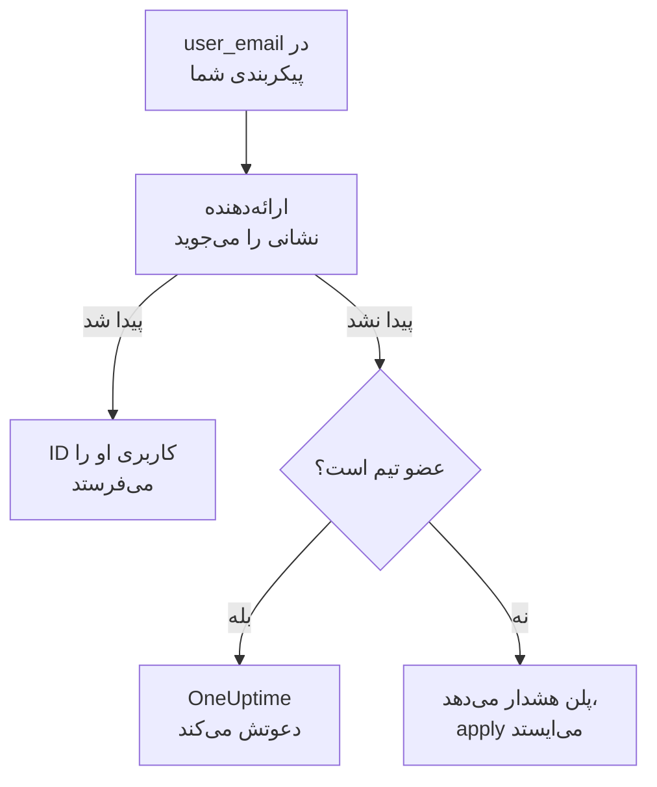

# افراد و تیم‌ها

اینکه چه کسانی در پروژهٔ شما هستند را در پیکربندی Terraform نگه دارید: تیم‌ها و اعضایشان، چه کسی آنکال است، و چه چیزی مال چه کسی است. هر کس را با نشانی ایمیلش نام ببرید: ارائه‌دهنده او را پیدا می‌کند، و هر کسی را که در پروژه تازه است دعوت می‌کند.

:::cards
- [نام بردن افراد با نشانی ایمیل](#نام-بردن-افراد-با-نشانی-ایمیل): ویژگی‌ای که کنار هر ID کاربری است.
- [آوردن یک نفر به پروژه](#آوردن-یک-نفر-به-پروژه): کسی را دعوت کنید، و به او یک تیم، نوبت‌های آنکال و چیزی برای مالکیت بدهید.
- [بیرون بردن یک نفر از پروژه](#بیرون-بردن-یک-نفر-از-پروژه): کسی را بردارید، و آنچه OneUptime همراه او برمی‌دارد.
- [import اعضایی که از قبل دارید](#import-اعضایی-که-از-قبل-دارید): با تیم و نشانی‌شان.
:::

## چگونه کار می‌کند

ارائه‌دهنده نشانی را میان افراد پروژهٔ کلید API می‌جوید: اعضای آن، و کسانی که به آن دعوت شده‌اند. ID کسی را که پیدا کند به API می‌فرستد. عضو تیمی که با نشانی‌ای نام برده شود که هیچ‌کس در پروژه ندارد، به جای آن همان نشانی را دعوت می‌کند.



فقط خود پروژهٔ کلید API جست‌وجو می‌شود. هیچ‌کس بیرون از آن هرگز پیدا نمی‌شود، و ارائه‌دهنده نمی‌تواند بفهمد که آیا یک نشانی جای دیگری حساب دارد یا نه.

## پیش از شروع

- **کلید API‌ای که بتواند تیم‌های پروژه را بخواند.** ارائه‌دهنده افراد را از راه آن‌ها پیدا می‌کند.
- **برای افزودن کسی تازه، کلیدی که بتواند افراد را دعوت کند.** [دعوت از افراد](/docs/permissions/inviting-people) را ببینید.

## نام بردن افراد با نشانی ایمیل

هر منبعی که از یک شخص نام می‌برد، نشانی ایمیل او را هم کنار ID کاربری‌اش می‌پذیرد. یکی از این دو را بدهید:

| ID کاربری | نشانی ایمیل |
| --- | --- |
| `user_id` | `user_email` |
| `owner_users` | `owner_user_emails` |
| `assigned_to_user_id` | `assigned_to_user_email` |
| `override_user_id` | `override_user_email` |

نشانی بدون توجه به کوچکی و بزرگی حروف پیدا می‌شود، و همان‌طور که نوشته‌اید در state می‌ماند. ID کاربری پر می‌شود تا منابع دیگر بتوانند به آن ارجاع دهند.

## آوردن یک نفر به پروژه

این پیکربندی Alice را که در پروژه تازه است به یک تیم می‌افزاید، از روز اول به او نوبت‌های آنکال می‌دهد، و Bob را که از قبل در پروژه است مالک یک مانیتور می‌کند:

```hcl title="people.tf"
resource "oneuptime_team" "sre" {
  name        = "SRE"
  description = "Site reliability engineering"
}

# New to the project: OneUptime invites her.
resource "oneuptime_team_member" "alice" {
  team_id    = oneuptime_team.sre.id
  user_email = "alice@example.com"
}

resource "oneuptime_on_call_policy_schedule" "weekly" {
  name     = "SRE weekly"
  timezone = "UTC"
}

resource "oneuptime_on_call_schedule_layer" "weekly" {
  on_call_duty_policy_schedule_id = oneuptime_on_call_policy_schedule.weekly.id
  name                            = "Weekly"
  starts_at                       = "2030-01-07T09:00:00Z"
  hand_off_time                   = "2030-01-14T09:00:00Z"
}

# Named through her membership, so she is invited first.
resource "oneuptime_on_call_schedule_layer_user" "alice" {
  on_call_duty_policy_schedule_id       = oneuptime_on_call_policy_schedule.weekly.id
  on_call_duty_policy_schedule_layer_id = oneuptime_on_call_schedule_layer.weekly.id
  user_id                               = oneuptime_team_member.alice.user_id
}

resource "oneuptime_monitor" "api" {
  name         = "Public API"
  monitor_type = "Manual"
}

# In the project already: named by his address.
resource "oneuptime_monitor_user_owner" "api" {
  monitor_id = oneuptime_monitor.api.id
  user_email = "bob@example.com"
}
```

`terraform apply` مانند دعوتی از داشبورد، Alice را با ایمیل دعوت می‌کند. اگر حسابی نداشته باشد، OneUptime برایش می‌سازد. `has_accepted_invitation` تا زمانی که بپذیرد `false` می‌ماند، و پذیرفتنش تغییری در پلن نیست. کسی که از قبل در پروژه است، بی‌درنگ به تیم تازه می‌پیوندد.

برای آنکال کردن کسی که این پیکربندی دعوت می‌کند، یا مالک کردنش، با `user_id = oneuptime_team_member.<name>.user_id` به عضویتش ارجاع دهید: آن‌گاه Terraform پیش از آنکه جای دیگری از او نام ببرد، دعوتش می‌کند. نشانی‌ای که هیچ‌کس در پروژه ندارد، در پلن یک هشدار است و در apply یک خطا.

## پیدا کردن کسی

منبع داده `oneuptime_user` کسی را با `email`، `name` یا `id` پیدا می‌کند، و ID کاربری، نام، اینکه پیوسته است یا نه، و تیم‌هایی را که در آن‌هاست می‌خواند:

```hcl
data "oneuptime_user" "alice" {
  email = "alice@example.com"
}

output "alice_teams" {
  value = data.oneuptime_user.alice.team_ids
}
```

## بیرون بردن یک نفر از پروژه

عضویت‌های آن شخص را از پیکربندی بردارید و آن را اعمال کنید. وقتی از آخرین تیمش در پروژه بیرون برود، از پروژه بیرون است، و OneUptime او را از هر برنامهٔ آنکال، قاعدهٔ escalation و جانشینی، و از آنچه مالکش است برمی‌دارد: از همه چیز، جز حادثه‌ها، هشدارها و رویدادهای نگهداری‌ای که تمام شده‌اند. بلوک‌هایی را که از او نام می‌برند در همان تغییر بردارید، وگرنه پلن بعدی آن‌ها را دوباره برای کسی می‌سازد که دیگر در پروژه نیست.

حساب OneUptime او مال خودش می‌ماند: فقط پروژه را ترک می‌کند. تیمی که باید عضوی نگه دارد، نمی‌گذارد آخرین عضوی که پذیرفته است برود.

## import اعضایی که از قبل دارید

هیچ صفحه‌ای ID یک عضویت را نشان نمی‌دهد، پس آن را با ID تیمش و نشانی آن شخص import کنید:

```bash
terraform import oneuptime_team_member.alice 6b1d1c2e-4f3a-4b5c-8d6e-7f8091a2b3c4/alice@example.com
```

نشانی همان‌طور که نوشته‌اید می‌ماند، پس آن را همان‌گونه بنویسید که پیکربندی‌تان می‌نویسد. ID خود عضویت هم آن را import می‌کند، و آن‌گاه نشانی از OneUptime و با حروف کوچک خوانده می‌شود.

## وقتی کسی نشانی‌اش را عوض می‌کند

کسی که نشانی‌اش را در OneUptime عوض کند، برای Terraform همان شخص می‌ماند: تا وقتی نشانی تازه را ننوشته‌اید چیزی عوض نمی‌شود، و آن‌گاه فقط `user_email` عوض می‌شود.

## رفع اشکال

:::details پلن می‌گوید نشانی‌ای هنوز در این پروژه نیست
هیچ‌کس در پروژه، یا دعوت‌شده به آن، آن نشانی را ندارد. نخست او را با یک `oneuptime_team_member` دعوت کنید. اگر آن عضویت در همان پیکربندی است، به جای نشانی با `user_id = oneuptime_team_member.<name>.user_id` به آن ارجاع دهید. اگر نشانی‌اش را در OneUptime عوض کرده است، نشانی تازه را به کار ببرید.
:::

:::details apply می‌گوید کاربر از قبل به این تیم دعوت شده است
آن شخص از قبل در تیم است. به جای ساختن آن عضویت، آن را import کنید، همان‌طور که در [import اعضایی که از قبل دارید](#import-اعضایی-که-از-قبل-دارید) آمده است.
:::

## گام‌های بعدی

:::cards
- [وارد کردن منابع](/docs/terraform/importing-resources): بقیهٔ پروژه‌تان را هم زیر مدیریت Terraform بیاورید.
- [دعوت از افراد](/docs/permissions/inviting-people): دعوت‌ها در OneUptime چگونه کار می‌کنند.
- [نمونه‌ها](/docs/terraform/examples): پیکربندی‌های آمادهٔ استفاده برای منابع رایج.
:::
