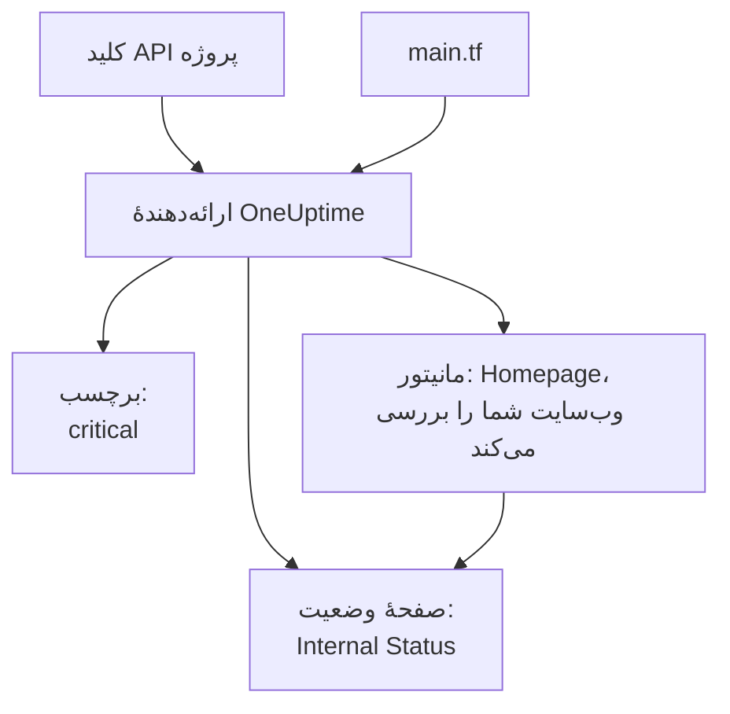

# شروع سریع

این راهنما شما را در حدود ده دقیقه از هیچ به یک پروژهٔ OneUptime می‌رساند که Terraform مدیریتش می‌کند. یک کلید API می‌سازید، Terraform را به پروژه‌تان وصل می‌کنید، و یک برچسب، یک مانیتور که وب‌سایت شما را بررسی می‌کند، و یک صفحهٔ وضعیت خصوصی که آن را نشان می‌دهد اعمال می‌کنید. سپس یکی از آن‌ها را تغییر می‌دهید و همه‌چیز را پاک می‌کنید.

:::cards
- [پیش از شروع](#پیش-از-شروع): Terraform، یک پروژه، و طرحی که کلید API دارد.
- [نخستین منابعتان را بسازید](#نخستین-منابعتان-را-بسازید): از یک کلید API تا یک پلن اعمال‌شده، در شش گام.
- [تغییر یک منبع](#تغییر-یک-منبع): پیکربندی را ویرایش کنید، پلن بگیرید و اعمال کنید.
- [رفع اشکال](#رفع-اشکال): خطاهایی که نخستین اجرا ممکن است روی آن‌ها متوقف شود.
:::



## پیش از شروع

- **Terraform 1.5 یا جدیدتر، یا OpenTofu 1.6 یا جدیدتر.** با OpenTofu، هر جا این راهنما `terraform` را اجرا می‌کند، `tofu` را اجرا کنید.
- **یک پروژهٔ OneUptime** در [oneuptime.com](https://oneuptime.com) یا روی OneUptime خودتان، که بتوانید در آن کلید API بسازید.
- **در OneUptime Cloud، طرح Growth یا بالاتر.** کلیدهای API یک پروژه فقط روی آن کار می‌کنند.

## نخستین منابعتان را بسازید

:::steps
### ساخت کلید API پروژه

در داشبورد OneUptime، **تنظیمات پروژه** > **پیشرفته** > **کلیدهای API** را باز کنید و روی **ساخت کلید API** کلیک کنید. به آن یک **نام** بدهید، مانند `terraform`، و در **دسترسی**، **مدیر پروژه** را انتخاب کنید: Terraform هر نوع رکوردی را که مدیریت می‌کند می‌سازد، می‌خواند، تغییر می‌دهد و حذف می‌کند، و **مدیر پروژه** اجازهٔ همهٔ این کارها را دارد. برای یک کلید محدودتر، **دسترسی‌ها را بعداً انتخاب کنید** را برگزینید و در صفحهٔ کلید فقط دسترسی‌هایی را که لازم دارید اضافه کنید.

این کلید یک سال پس از امروز منقضی می‌شود. برای انتخاب تاریخی دیگر، پیش از ساختن آن **فیلدهای بیشتر** را باز کنید، یا بعداً تاریخ را در صفحهٔ کلید تغییر دهید. پس از ساخته شدن کلید، صفحه‌اش باز می‌شود: **کلید API** را از کارت **جزئیات کلید API** کپی کنید.

### کلید را در دسترس Terraform بگذارید

کلید را در متغیر محیطی `ONEUPTIME_API_KEY` در پوسته‌ای که Terraform را در آن اجرا می‌کنید بگذارید، تا هرگز در یک فایل نماند:

:::tabs
@tab Linux
```bash
export ONEUPTIME_API_KEY="<your-api-key>"
```
@tab macOS
```bash
export ONEUPTIME_API_KEY="<your-api-key>"
```
@tab Windows
```powershell
$env:ONEUPTIME_API_KEY = "<your-api-key>"
```
:::

### Terraform را به OneUptime وصل کنید

یک پوشهٔ خالی بسازید، و در آن فایلی به نام `main.tf`:

```hcl title="main.tf"
terraform {
  required_providers {
    oneuptime = {
      source  = "oneuptime/oneuptime"
      version = "{{TERRAFORM_PROVIDER_VERSION}}"
    }
  }
}

provider "oneuptime" {
  # The API key comes from ONEUPTIME_API_KEY.
  # On a self-hosted OneUptime, add your OneUptime's address:
  # oneuptime_url = "https://oneuptime.example.com"
}
```

روی OneUptime خودمیزبان، پیش از انتخاب نسخهٔ ارائه‌دهنده [راه‌اندازی خودمیزبان](/docs/terraform/self-hosted) را بخوانید.

### منابعتان را توصیف کنید

این بلوک‌ها را به `main.tf` اضافه کنید. این‌ها دو تا از وضعیت‌های مانیتوری را می‌خوانند که هر پروژه با آن‌ها شروع می‌شود، و یک برچسب، یک مانیتور که `https://example.com` را هر پنج دقیقه بررسی می‌کند (وب‌سایت خودتان را آنجا بگذارید)، و یک صفحهٔ وضعیت خصوصی که مانیتور را نشان می‌دهد می‌سازند:

```hcl title="main.tf"
data "oneuptime_monitor_status" "operational" {
  name = "Operational"
}

data "oneuptime_monitor_status" "offline" {
  name = "Offline"
}

resource "oneuptime_label" "critical" {
  name        = "critical"
  description = "Resources that page on-call when down"
  color       = "#FF5733"
}

resource "oneuptime_monitor" "homepage" {
  name                = "Homepage"
  description         = "Checks that the homepage responds"
  monitor_type        = "Website"
  monitoring_interval = "*/5 * * * *"
  labels              = [oneuptime_label.critical.id]

  monitor_steps = [{
    monitor_destination      = "https://example.com"
    monitor_destination_type = "URL"
    request_type             = "GET"

    criteria = [
      {
        name                  = "Offline"
        description           = "The homepage does not respond"
        filter_condition      = "Any"
        change_monitor_status = true
        monitor_status_id     = data.oneuptime_monitor_status.offline.id

        filters = [
          {
            check_on    = "Is Online"
            filter_type = "False"
          }
        ]
      },
      {
        name                  = "Online"
        description           = "The homepage responds"
        filter_condition      = "All"
        change_monitor_status = true
        monitor_status_id     = data.oneuptime_monitor_status.operational.id

        filters = [
          {
            check_on    = "Is Online"
            filter_type = "True"
          }
        ]
      }
    ]
  }]
}

resource "oneuptime_status_page" "internal" {
  name                  = "Internal Status"
  description           = "Status of our internal services"
  page_title            = "Service Status"
  is_public_status_page = false
}

resource "oneuptime_status_page_resource" "homepage" {
  status_page_id = oneuptime_status_page.internal.id
  monitor_id     = oneuptime_monitor.homepage.id
  display_name   = "Homepage"
}

output "monitor_id" {
  value = oneuptime_monitor.homepage.id
}
```

`monitor_steps` مانیتور می‌گوید چه چیزی را بررسی می‌کند و هر نتیجه چه معنایی دارد: پس از هر بررسی، نخستین معیاری که مطابقت داشته باشد وضعیت آن را تعیین می‌کند. [مراحل مانیتور](/docs/terraform/monitor-steps) هر بخش را توضیح می‌دهد.

### پلن بگیرید و اعمال کنید

:::tabs
@tab Terraform
```bash
terraform init
terraform plan
terraform apply
```
@tab OpenTofu
```bash
tofu init
tofu plan
tofu apply
```
:::

`init` ارائه‌دهنده را دانلود می‌کند. پلن با `Plan: 4 to add, 0 to change, 0 to destroy.` تمام می‌شود. برای اعمال آن `yes` را تایپ کنید؛ وقتی کار تمام شد، Terraform شناسهٔ مانیتور تازه را چاپ می‌کند.

### داشبورد را بررسی کنید

در داشبورد OneUptime:

- **مانیتورها** `Homepage` را با برچسب `critical` فهرست می‌کند. نخستین بررسی آن ظرف چند دقیقه انجام می‌شود.
- **صفحات وضعیت** `Internal Status` را فهرست می‌کند که `Homepage` را نشان می‌دهد.
- **تنظیمات پروژه** > **پایه** > **برچسب‌ها** `critical` را با رنگی که تعیین کرده‌اید فهرست می‌کند.

دوباره `terraform plan` را اجرا کنید. پاسخ می‌دهد `No changes.`: OneUptime دقیقاً همان چیزی را دارد که پیکربندی می‌گوید.
:::

## تغییر یک منبع

پیکربندی را تغییر دهید، نه داشبورد را. در `main.tf` مقدار `color` برچسب را `"#2ECC71"` بگذارید، سپس پلن بگیرید و اعمال کنید:

```bash
terraform plan
terraform apply
```

پلن با `Plan: 0 to add, 1 to change, 0 to destroy.` تمام می‌شود: برچسب در جا تغییر می‌کند. تغییری که کسی در داشبورد روی منبعی که Terraform مدیریت می‌کند بدهد، در پلن بعدی دیده می‌شود، و اعمال آن همان چیزی را برمی‌گرداند که پیکربندی می‌گوید.

## پاک‌سازی

اگر این فقط یک آزمایش بود، آنچه را پیکربندی ساخته است حذف کنید:

```bash
terraform destroy
```

این کار برچسب، مانیتور، صفحهٔ وضعیت و منبع آن را حذف می‌کند. دو وضعیت مانیتور باقی می‌مانند: منبع‌های داده فقط آن‌ها را می‌خوانند.

## رفع اشکال

:::details پیام «Missing API Key»
ارائه‌دهنده هیچ کلید API پیدا نکرد. `ONEUPTIME_API_KEY` را در پوسته‌ای که Terraform را در آن اجرا می‌کنید export کنید، یا `api_key` را در بلوک ارائه‌دهنده تعیین کنید، و دستور را دوباره اجرا کنید.
:::

:::details پیام «the OneUptime API returned status 400: Invalid API Key»
کلید اشتباه تایپ شده، منقضی شده یا حذف شده است، یا به OneUptime دیگری تعلق دارد، نه به آنکه `oneuptime_url` به آن اشاره می‌کند. کلید را دوباره از صفحه‌اش کپی کنید، یا یک کلید تازه بسازید.
:::

:::details پیام «the OneUptime API returned status 402: API keys need the Growth plan»
در OneUptime Cloud، کلیدهای API یک پروژه فقط در طرح Growth یا بالاتر کار می‌کنند. پروژه را در **تنظیمات پروژه** > **صورت‌حساب و فاکتورها** > **صورت‌حساب** ارتقا دهید، و همان کلید دوباره کار می‌کند.
:::

:::details پیام «the OneUptime API returned status 422: You do not have permissions to create Monitor»
کلید هیچ دسترسی‌ای برای آن نوع رکورد ندارد. در صفحهٔ کلید به آن **مدیر پروژه** را بدهید، یا دسترسی‌ای را که پیام نام می‌برد.
:::

:::details پیام «No monitor status matches {name = "Offline"}»
وضعیت‌های مانیتور پروژهٔ شما نام‌های دیگری دارند. نام‌هایی را که در **مانیتورها** > **تنظیمات** > **وضعیت مانیتور** می‌بینید به کار ببرید، یا به‌جای آن وضعیت را با `is_offline_state = true` پیدا کنید.
:::

## گام‌های بعدی

:::cards
- [راهنمای کامل](/docs/terraform/complete-guide): احراز هویت، چیدمان پروژه، منبع‌های داده، state و ارتقا.
- [مراحل مانیتور](/docs/terraform/monitor-steps): تعیین کنید مانیتور چه چیزی را بررسی می‌کند و هر نتیجه چه معنایی دارد.
- [نمونه‌ها](/docs/terraform/examples): پیکربندی‌های آماده برای منابع رایج.
- [وارد کردن منابع](/docs/terraform/importing-resources): آنچه را در داشبورد ساخته‌اید زیر مدیریت Terraform بیاورید.
:::
