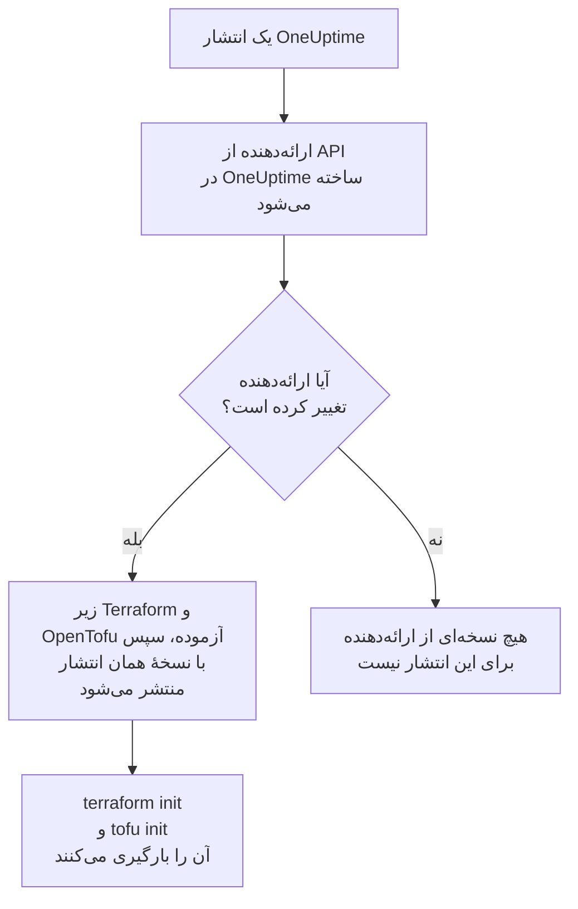

# استفاده از رجیستری

ارائه‌دهندهٔ OneUptime در [Terraform Registry](https://registry.terraform.io/providers/oneuptime/oneuptime) و [OpenTofu Registry](https://search.opentofu.org/provider/oneuptime/oneuptime/latest) منتشر می‌شود. `terraform init` و `tofu init` آن را از آنجا بارگیری می‌کنند: چیزی برای نصب دستی نیست. این صفحه می‌گوید چه چیزی منتشر می‌شود، نسخه‌ها چگونه شماره می‌خورند، و چگونه به نسخه‌ای جدیدتر بروید.

:::cards
- [چه چیزی منتشر می‌شود](#چه-چیزی-منتشر-میشود): ارائه‌دهنده برای هر سکو، مرجع آن، و نسخه‌هایش.
- [نسخه‌ها چگونه شماره می‌خورند](#نسخهها-چگونه-شماره-میخورند): نسخهٔ یک ارائه‌دهنده همان انتشاری از OneUptime است که آن را منتشر کرده است.
- [فایل قفل](#فایل-قفل): نسخه و checksumهایی که هر ماشین نصب می‌کند.
- [رفتن به نسخه‌ای جدیدتر](#رفتن-به-نسخهای-جدیدتر): بخوانید چه تغییر کرده است، آن را بارگیری کنید، و پلن بگیرید.
:::

## چه چیزی منتشر می‌شود

هر انتشار OneUptime ارائه‌دهنده را از API خود OneUptime می‌سازد. اگر ارائه‌دهنده تغییر کرده باشد، انتشار آن را با نسخهٔ همان انتشار منتشر می‌کند، پس از آنکه آزمون‌های سرتاسری‌اش را زیر Terraform و زیر OpenTofu گذرانده باشد:



| چه چیزی | کجا |
| --- | --- |
| ارائه‌دهنده، برای Linux، macOS، Windows، FreeBSD، OpenBSD و Solaris | با `terraform init` و `tofu init` بارگیری می‌شود، با checksumهایی که OneUptime امضا می‌کند |
| مرجع هر منبع و منبع داده، با هر یک از ویژگی‌هایش | مستندات رجیستری، گروه‌بندی‌شده بر اساس محصول: مانیتورها، صفحه‌های وضعیت، حادثه‌ها، آنکال و بقیه |
| راهنمایی برای استفاده از ارائه‌دهنده با OpenTofu | راهنماهای رجیستری |
| هر نسخه، تازه‌ترین نخست | فهرست نسخه‌های رجیستری |

مرجع می‌گوید هر ویژگی چیست. این مستندات نشان می‌دهند چگونه آن‌ها را با هم به کار ببرید: از [نمای کلی Terraform](/docs/terraform/index) شروع کنید.

## نسخه‌ها چگونه شماره می‌خورند

نسخهٔ یک ارائه‌دهنده نسخهٔ همان انتشاری از OneUptime است که آن را منتشر کرده است: ارائه‌دهندهٔ {{TERRAFORM_PROVIDER_MAJOR}}.0.20 با OneUptime {{TERRAFORM_PROVIDER_MAJOR}}.0.20 آمد. انتشاری که ارائه‌دهنده‌اش تغییر نکرده است هیچ منتشر نمی‌کند، پس نسخه‌ها فاصله دارند، و قیدی که دقیقاً یک نسخه را نام می‌برد ممکن است نسخه‌ای را نام ببرد که وجود ندارد. به‌جای آن یک بازه بنویسید:

| آنچه استفاده می‌کنید | قید | آنچه Terraform نصب می‌کند |
| --- | --- | --- |
| OneUptime Cloud | `{{TERRAFORM_PROVIDER_VERSION}}` | تازه‌ترین ارائه‌دهندهٔ {{TERRAFORM_PROVIDER_MAJOR}}.x |
| یک OneUptime خودمیزبان | بازه‌ای که به نسخهٔ OneUptime شما ختم می‌شود، مانند `>= {{TERRAFORM_PROVIDER_MAJOR}}.0, <= {{TERRAFORM_PROVIDER_MAJOR}}.0.40` | تازه‌ترین ارائه‌دهنده‌ای که از OneUptime شما جدیدتر نیست |

در یک OneUptime خودمیزبان، ارائه‌دهنده‌ای که از OneUptime شما جدیدتر است ممکن است تنظیماتی بفرستد که OneUptime شما هنوز ندارد: [راه‌اندازی خودمیزبان](/docs/terraform/self-hosted#نسخهٔ-ارائهدهنده-را-برگزینید) نشان می‌دهد بازهٔ آن را چگونه بنویسید.

```hcl title="main.tf"
terraform {
  required_providers {
    oneuptime = {
      source  = "oneuptime/oneuptime"
      version = "{{TERRAFORM_PROVIDER_VERSION}}"
    }
  }
}
```

نشانی منبع هیچ رجیستری‌ای را نام نمی‌برد: Terraform آن را از Terraform Registry می‌خواند، و OpenTofu از OpenTofu Registry، که همان نسخه‌ها را منتشر می‌کنند.

## فایل قفل

`terraform init` نسخه‌ای را که برگزیده است، و checksumهای بارگیری‌هایش را، در `.terraform.lock.hcl` ثبت می‌کند. آن فایل را commit کنید: آن‌وقت هر ماشین و هر اجرای CI دقیقاً همان نسخه را نصب می‌کند، تا وقتی نسخهٔ دیگری برگزینید. checksumها هر سکویی را که رجیستری منتشر می‌کند پوشش می‌دهند، پس یک فایل قفل به ماشین‌های Linux، macOS و Windows یکسان خدمت می‌کند.

```hcl title=".terraform.lock.hcl"
provider "registry.terraform.io/oneuptime/oneuptime" {
  version     = "{{TERRAFORM_PROVIDER_MAJOR}}.0.20"
  constraints = "{{TERRAFORM_PROVIDER_VERSION}}"
  hashes = [
    "h1:...",
    "zh:...",
  ]
}
```

فایل قفل رجیستری را نام می‌برد. OpenTofu `registry.opentofu.org/oneuptime/oneuptime` را می‌نویسد جایی که Terraform `registry.terraform.io/oneuptime/oneuptime` را می‌نویسد، پس جابه‌جا کردن موتور فایل قفل را تغییر می‌دهد: `init` مدخل را جایگزین می‌کند، و از شما می‌خواهد تغییر را commit کنید.

## رفتن به نسخه‌ای جدیدتر

:::steps
### بخوانید چه تغییر کرده است

[انتشارهای OneUptime](https://github.com/OneUptime/oneuptime/releases) می‌گویند هر انتشار چه چیزی را تغییر داده است، از جمله ارائه‌دهنده را. [انتشارهای ارائه‌دهنده](https://github.com/OneUptime/terraform-provider-oneuptime/releases) به تغییرهای پس از انتشار پیشین پیوند می‌دهند.

### آن را بارگیری کنید

```bash
terraform init -upgrade
```

`init -upgrade` تازه‌ترین نسخه‌ای را که قید شما اجازه می‌دهد برمی‌دارد، آن را چاپ می‌کند، و `.terraform.lock.hcl` را به‌روز می‌کند. قید `{{TERRAFORM_PROVIDER_VERSION}}` هر انتشار {{TERRAFORM_PROVIDER_MAJOR}}.x را برمی‌دارد؛ یک نسخهٔ اصلی تازه به قیدی تازه نیاز دارد.

### پیش از اعمال پلن بگیرید

`terraform plan` را اجرا کنید، و فقط وقتی اعمال کنید که خالی باشد یا تغییرهایی را نشان دهد که انتظار دارید. فایل قفل به‌روزشده را commit کنید.
:::

در یک OneUptime خودمیزبان، نخست OneUptime را ارتقا دهید، سپس انتهای بازهٔ ارائه‌دهنده را بالا ببرید.

## کد کجاست

ارائه‌دهنده از API در OneUptime در [مخزن اصلی OneUptime](https://github.com/OneUptime/oneuptime) ساخته می‌شود، و هر نسخه از همان انتشاری ساخته می‌شود که آن را منتشر کرده است. مخزن خود آن، [OneUptime/terraform-provider-oneuptime](https://github.com/OneUptime/terraform-provider-oneuptime)، آنچه را مولد نوشته است نگه می‌دارد، پس تغییرها در مخزن اصلی انجام می‌شوند: مشکل‌ها، از جمله مشکل‌های مستندات، را در [github.com/OneUptime/oneuptime/issues](https://github.com/OneUptime/oneuptime/issues) گزارش کنید.

## گام‌های بعدی

:::cards
- [راه‌اندازی خودمیزبان](/docs/terraform/self-hosted): بازهٔ نسخه برای OneUptime خودتان، و یک آینه برای ماشین‌های بدون اینترنت.
- [OpenTofu](/docs/terraform/opentofu): همان ارائه‌دهنده و پیکربندی، با `tofu`.
- [راهنمای کامل](/docs/terraform/complete-guide): احراز هویت، چیدمان پروژه، منبع‌های داده، state و ارتقاها.
- [رفع اشکال](/docs/terraform/troubleshooting): خطاهای رایج و چگونگی رفع آن‌ها.
:::
