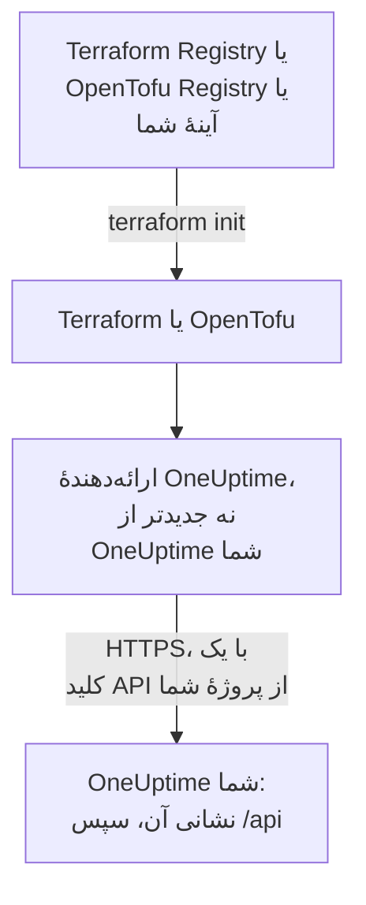

# راه‌اندازی خودمیزبان

ارائه‌دهنده با OneUptime خودتان همان‌طور کار می‌کند که با OneUptime Cloud: همان منابع، همان ویژگی‌ها و همان کلیدهای API پروژه. آنچه تنظیمش با شماست: نشانی OneUptime شما، نسخهٔ ارائه‌دهنده‌ای که با آن جور است، و هر جا لازم دارید، یک آینه برای ماشین‌های بدون دسترسی به اینترنت و اعتماد به یک مرجع صدور گواهی خصوصی.

:::cards
- [ارائه‌دهنده را به OneUptime خود نشانه بگیرید](#ارائهدهنده-را-به-oneuptime-خود-نشانه-بگیرید): نشانی آن، و یک کلید API از پروژهٔ شما.
- [نسخهٔ ارائه‌دهنده را برگزینید](#نسخهٔ-ارائهدهنده-را-برگزینید): تازه‌ترین ارائه‌دهنده‌ای که از OneUptime شما جدیدتر نیست.
- [بدون دسترسی به اینترنت](#بدون-دسترسی-به-اینترنت): ارائه‌دهنده را در شبکهٔ خود آینه کنید.
- [TLS و گواهی‌ها](#tls-و-گواهیها): یک مرجع صدور گواهی خصوصی، پراکسی‌ها و HTTP ساده.
:::



## ارائه‌دهنده را به OneUptime خود نشانه بگیرید

`oneuptime_url` را به نشانی‌ای تنظیم کنید که داشبورد را با آن باز می‌کنید: scheme و میزبان، بدون مسیر. اگر نشانی scheme نداشته باشد ارائه‌دهنده `https://` را می‌افزاید، و در انتها `/api` را، پس `https://oneuptime.example.com` هر درخواست را به `https://oneuptime.example.com/api` می‌فرستد.

```hcl title="main.tf"
terraform {
  required_providers {
    oneuptime = {
      source  = "oneuptime/oneuptime"
      version = "{{TERRAFORM_PROVIDER_MATCHING}}"
    }
  }
}

provider "oneuptime" {
  oneuptime_url = "https://oneuptime.example.com"
  # The API key comes from the ONEUPTIME_API_KEY environment variable.
}
```

نشانی می‌تواند به‌جای آن از متغیر محیطی `ONEUPTIME_URL` بیاید، تا یک پیکربندی بتواند به چند نصب اشاره کند:

```bash
export ONEUPTIME_URL="https://oneuptime.example.com"
export ONEUPTIME_API_KEY="<your-api-key>"
```

نشانی همان میزبانی است که نصب شما روی آن سرو می‌شود: `HOST` و `HTTP_PROTOCOL` در `config.env` با Docker Compose، و `host` و `httpProtocol` در مقدارهای چارت Helm.

کلید، یک کلید API از پروژه‌ای است که مدیریت می‌کنید، ساخته‌شده در داشبورد OneUptime شما در **تنظیمات پروژه** > **پیشرفته** > **کلیدهای API**، مانند OneUptime Cloud. کلید API اصلی یک OneUptime خودمیزبان به هیچ پروژه‌ای تعلق ندارد، پس ساختنی که با آن انجام شود با `ProjectId required` شکست می‌خورد.

> [!TIP]
> OneUptime شما این بلوک را برایتان می‌نویسد. هر منبع یا فهرستی را در داشبورد باز کنید، سپس **توسعه‌دهنده** و **Terraform** را در منوی کناری آن: بلوک ارائه‌دهنده‌ای که نشان می‌دهد نشانی OneUptime شما را دارد، و بازهٔ نسخه‌ای که با آن جور است.

## نسخهٔ ارائه‌دهنده را برگزینید

از تازه‌ترین ارائه‌دهندهٔ منتشرشده‌ای استفاده کنید که از OneUptime شما جدیدتر نیست. نسخه‌های ارائه‌دهنده از نسخه‌های OneUptime پیروی می‌کنند: انتشاری از OneUptime که ارائه‌دهنده را تغییر می‌دهد، آن را با شمارهٔ نسخهٔ خود همان انتشار منتشر می‌کند، و ارائه‌دهنده‌ای که از OneUptime شما جدیدتر است ممکن است تنظیماتی بفرستد که OneUptime شما هنوز ندارد.

پس بازه‌ای بنویسید که به نسخهٔ OneUptime شما ختم شود، همان کاری که داشبورد می‌کند. بلوک بالا `{{TERRAFORM_PROVIDER_MATCHING}}` را می‌گیرد، بازه برای OneUptimeای که این مستندات از آن می‌آید: وقتی آن‌ها را روی OneUptime خودتان می‌خوانید، آن بازه از آنِ شماست. وگرنه، نسخهٔ خودتان را بنویسید:

:::steps
### نسخهٔ OneUptime خود را پیدا کنید

آن را از OneUptime خود بپرسید:

```bash
curl https://oneuptime.example.com/version
```

پاسخ JSON است، مانند `{"version":"{{TERRAFORM_PROVIDER_MAJOR}}.0.40","commit":"..."}`. به‌عنوان مدیر اصلی، می‌توانید برچسب نسخه را در سرصفحهٔ داشبورد مدیریت هم باز کنید: [نسخهٔ فعلی خود را پیدا کنید](/docs/installation/upgrading#نسخهٔ-فعلی-خود-را-پیدا-کنید) را ببینید.

### آن را در بازه بنویسید

بازه از نسخهٔ اصلی شروع می‌شود و به نسخهٔ شما ختم می‌شود. برای یک OneUptime {{TERRAFORM_PROVIDER_MAJOR}}.0.40:

```hcl title="main.tf"
terraform {
  required_providers {
    oneuptime = {
      source  = "oneuptime/oneuptime"
      version = ">= {{TERRAFORM_PROVIDER_MAJOR}}.0, <= {{TERRAFORM_PROVIDER_MAJOR}}.0.40"
    }
  }
}
```

Terraform تازه‌ترین ارائه‌دهندهٔ درون بازه را برمی‌دارد. انتشاری از OneUptime که ارائه‌دهنده را تغییر نداده است هیچ منتشر نمی‌کند، و بازه از روی نسخه‌هایی که وجود ندارند می‌گذرد.

### ارائه‌دهنده را بارگیری کنید

`terraform init` را اجرا کنید. نسخه‌ای را که نصب کرده است چاپ می‌کند و آن را در `.terraform.lock.hcl` ثبت می‌کند.
:::

هنگام ارتقا، نخست OneUptime را ارتقا دهید. سپس انتهای بازه را به نسخهٔ تازهٔ آن برسانید، و `terraform init -upgrade` را اجرا کنید.

## بدون دسترسی به اینترنت

وقتی ماشین‌هایی که Terraform را اجرا می‌کنند به رجیستری دسترسی ندارند، ارائه‌دهنده را یک بار در شبکهٔ خود کپی کنید، و Terraform را به آن نسخه نشانه بگیرید.

:::steps
### ارائه‌دهنده را آینه کنید

روی ماشینی با دسترسی به اینترنت، در پوشه‌ای که پیکربندی شما در آن است، ارائه‌دهنده را برای هر سکویی که ماشین‌هایتان اجرا می‌کنند بارگیری کنید. بدون `-platform`، فرمان ارائه‌دهنده را فقط برای سکوی خودش بارگیری می‌کند:

:::tabs
@tab Terraform
```bash
terraform providers mirror -platform=linux_amd64 -platform=darwin_arm64 /srv/terraform-mirror
```
@tab OpenTofu
```bash
tofu providers mirror -platform=linux_amd64 -platform=darwin_arm64 /srv/terraform-mirror
```
:::

پوشه ارائه‌دهنده را زیر نشانی رجیستری نگه می‌دارد، مانند `registry.terraform.io/oneuptime/oneuptime/`. آن را در شبکهٔ خود کپی کنید.

### Terraform را به آینه نشانه بگیرید

یک فایل پیکربندی CLI بنویسید که ارائه‌دهندهٔ OneUptime را از پوشه نصب کند، و هر چیز دیگر را مانند همیشه:

:::tabs
@tab Terraform
```hcl title="mirror.tfrc"
provider_installation {
  filesystem_mirror {
    path    = "/srv/terraform-mirror"
    include = ["registry.terraform.io/oneuptime/oneuptime"]
  }
  direct {
    exclude = ["registry.terraform.io/oneuptime/oneuptime"]
  }
}
```
@tab OpenTofu
```hcl title="mirror.tfrc"
provider_installation {
  filesystem_mirror {
    path    = "/srv/terraform-mirror"
    include = ["registry.opentofu.org/oneuptime/oneuptime"]
  }
  direct {
    exclude = ["registry.opentofu.org/oneuptime/oneuptime"]
  }
}
```
:::

نام آن را در `TF_CLI_CONFIG_FILE` بگذارید، که هم Terraform و هم OpenTofu آن را می‌خوانند: `export TF_CLI_CONFIG_FILE=/etc/terraform/mirror.tfrc`.

### راه‌اندازی اولیه

`terraform init` را اجرا کنید: ارائه‌دهنده را از آینه نصب می‌کند. هشدار می‌دهد که فایل قفل اکنون فقط برای این سکو checksum دارد. برای ثبت آن‌ها برای هر سکو، `terraform providers lock` را با همان گزینه‌های `-platform` روی ماشینی که به اینترنت دسترسی دارد اجرا کنید، و `.terraform.lock.hcl` را همراه پیکربندی خود commit کنید.
:::

هر بار که بازهٔ نسخه را بالا می‌برید، دوباره آینه کنید.

## TLS و گواهی‌ها

ارائه‌دهنده گواهی OneUptime شما را با انبارهٔ اعتماد ماشینی که Terraform را اجرا می‌کند بررسی می‌کند، و هیچ تنظیمی برای رد شدن از این بررسی وجود ندارد. وقتی گواهی از یک مرجع صدور گواهی خصوصی می‌آید، آن مرجع را به انبارهٔ اعتماد هر ماشین و اجراکنندهٔ CI که Terraform را اجرا می‌کند بیفزایید:

:::tabs
@tab Debian / Ubuntu
```bash
sudo cp my-ca.crt /usr/local/share/ca-certificates/
sudo update-ca-certificates
```
@tab RHEL / Fedora
```bash
sudo cp my-ca.crt /etc/pki/ca-trust/source/anchors/
sudo update-ca-trust
```
:::

در Linux، جایی که نمی‌توانید انبارهٔ اعتماد را تغییر دهید، مانند یک کانتینر CI، `SSL_CERT_FILE` را به فایلی تنظیم کنید که مرجع شما و مرجع‌های عمومی را دارد. در macOS و Windows، مرجع را به انبارهٔ گواهی سیستم بیفزایید.

- **پراکسی‌ها.** ارائه‌دهنده درخواست‌هایش را از راه پراکسی‌ای که در `HTTPS_PROXY` است می‌فرستد، جز به میزبان‌های `NO_PROXY`. یک پراکسی معکوس جلوی OneUptime باید هر مسیر `/api` و سرآیند `APIKey` را بدون تغییر عبور دهد.
- **HTTP ساده.** یک نشانی `http://` برای یک نصب آزمایشی کار می‌کند. کلید API با هر درخواستی سفر می‌کند، پس برای هر چیز دیگر از HTTPS استفاده کنید.

## رفع اشکال

:::details پیام «x509: certificate signed by unknown authority»
ماشینی که Terraform را اجرا می‌کند به گواهی OneUptime شما اعتماد ندارد: مرجع صدور گواهی خود را همان‌طور که [TLS و گواهی‌ها](#tls-و-گواهیها) نشان می‌دهد بیفزایید.
:::

:::details پیام «invalid character '<' looking for beginning of value»
یک صفحهٔ وب به‌جای API پاسخ داده است: `oneuptime_url` مسیری دارد، یا یک پراکسی پاسخ داده است. آن را فقط به نشانی OneUptime خود تنظیم کنید.
:::

:::details پیام «no available releases match the given constraints»
هیچ ارائه‌دهندهٔ منتشرشده‌ای با قید نسخه جور نیست، برای نمونه قیدی که تنها نسخه‌ای را نام می‌برد که OneUptime هرگز منتشر نکرده است. یک بازه بنویسید، همان‌طور که [نسخهٔ ارائه‌دهنده را برگزینید](#نسخهٔ-ارائهدهنده-را-برگزینید) نشان می‌دهد.
:::

:::details پیام «ProjectId required»
کلید، کلید API اصلی است که به هیچ پروژه‌ای تعلق ندارد. یک کلید API پروژه بسازید، در **تنظیمات پروژه** > **پیشرفته** > **کلیدهای API**.
:::

[رفع اشکال](/docs/terraform/troubleshooting) خطاهای دیگر را دارد، و اینکه هر کدام چه معنایی دارد.

## گام‌های بعدی

:::cards
- [شروع سریع](/docs/terraform/quick-start): یک کلید API بسازید و نخستین منابع خود را اعمال کنید.
- [استفاده از رجیستری](/docs/terraform/registry): ارائه‌دهنده کجا منتشر می‌شود، و نسخه‌ها چگونه شماره می‌خورند.
- [رفع اشکال](/docs/terraform/troubleshooting): خطاهای رایج و چگونگی رفع آن‌ها.
- [ارتقا](/docs/installation/upgrading): OneUptime خود را ارتقا دهید، پیش از آنکه بازهٔ ارائه‌دهنده را بالا ببرید.
:::
