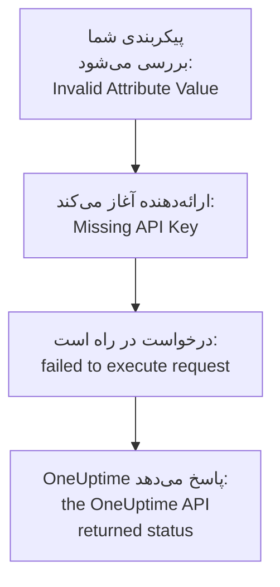

# رفع اشکال

پیامی را که Terraform چاپ کرده است، یا آنچه را دیده‌اید رخ داده است، در جدول زیر پیدا کنید: هر ردیف به راه‌حل خود می‌رسد. بخش‌های پس از جدول هر خطا را توضیح می‌دهند، گروه‌بندی‌شده بر اساس اینکه از کجا می‌آید.

:::cards
- [خطای خود را پیدا کنید](#خطای-خود-را-پیدا-کنید): هر پیام و نشانه‌ای در این صفحه، و راه‌حل آن.
- [کلیدهای API، دسترسی‌ها و طرح‌ها](#کلیدهای-api-دسترسیها-و-طرحها): وقتی OneUptime کلید ارائه‌دهنده را رد می‌کند.
- [پلن‌هایی که آرام نمی‌گیرند](#پلنهایی-که-آرام-نمیگیرند): تغییرهایی که برمی‌گردند، و منابعی که از state بیرون می‌روند.
- [اتصال به یک OneUptime خودمیزبان](#اتصال-به-یک-oneuptime-خودمیزبان): نشانی، گواهی‌ها و پراکسی‌ها.
:::

## خطای خود را پیدا کنید

| پیام یا نشانه | چه باید کرد |
| --- | --- |
| `Missing API Key` | کلید ارائه‌دهنده را به آن بدهید: [`Missing API Key` یا `Invalid API Key`](#missing-api-key-یا-invalid-api-key) را ببینید |
| `Invalid API Key` | کلید را دوباره کپی کنید، یا یکی تازه بسازید: [`Missing API Key` یا `Invalid API Key`](#missing-api-key-یا-invalid-api-key) را ببینید |
| `ProjectId required` | از کلید API پروژه استفاده کنید، نه کلید اصلی: [`ProjectId required`](#projectid-required) را ببینید |
| `You do not have permissions to create Monitor` | دسترسی‌ای را که پیام نام می‌برد به کلید بدهید: [کلید یک دسترسی کم دارد](#کلید-یک-دسترسی-کم-دارد) را ببینید |
| `API keys need the Growth plan` | پروژه را به طرح Growth برگردانید: [نیاز به پرداخت](#نیاز-به-پرداخت) را ببینید |
| `402` برای یک منبع یا یک تنظیم | طرح را ارتقا دهید، یا تنظیم را روی پیش‌فرضش بگذارید: [نیاز به پرداخت](#نیاز-به-پرداخت) را ببینید |
| `This project has been blocked` | از یک مدیر اصلی بخواهید پروژه را از مسدودی درآورد: [پروژهٔ مسدودشده](#پروژهٔ-مسدودشده) را ببینید |
| `references records that are not in this project` | از شناسهٔ رکوردی از پروژهٔ خودتان استفاده کنید: [شناسه‌هایی از پروژه‌ای دیگر](#شناسههایی-از-پروژهای-دیگر) را ببینید |
| `Not Found` یا `Ambiguous Match` از یک منبع داده | آرگومان‌های جست‌وجو را درست کنید: [جست‌وجوهایی که هیچ یا چند تا پیدا می‌کنند](#جستوجوهایی-که-هیچ-یا-چند-تا-پیدا-میکنند) را ببینید |
| `Cannot import non-existent remote object` | شناسه و دسترسی‌های کلید را بررسی کنید: [وارد کردن منابع](/docs/terraform/importing-resources#رفع-اشکال) را ببینید |
| `Provider produced inconsistent result after apply` | ارائه‌دهنده را ارتقا دهید: [نتیجهٔ ناسازگار پس از apply](#نتیجهٔ-ناسازگار-پس-از-apply) را ببینید |
| پلنی منبعی را می‌سازد که شما اضافه نکرده‌اید | کلید دیگر نمی‌تواند آن را بخواند، و OneUptime با `404` پاسخ داده است: دسترسی خواندن کلید را برگردانید، سپس منبع را با `terraform import` وارد کنید: [منبعی از state بیرون می‌رود و apply بعدی دوباره آن را می‌سازد](#منبعی-از-state-بیرون-میرود-و-apply-بعدی-دوباره-آن-را-میسازد) را ببینید |
| یک `priority` یا `order` پس از apply تغییر می‌کند | به هر کدام عددی بدهید که هیچ‌کدام دیگر ندارد: [اولویت یا ترتیبی که جابه‌جا می‌شود](#اولویت-یا-ترتیبی-که-جابهجا-میشود) را ببینید |
| `Invalid Configuration for Read-Only Attribute` | ویژگی را از پیکربندی حذف کنید: [ویژگی‌های فقط‌خواندنی](#ویژگیهای-فقطخواندنی) را ببینید |
| `has been renamed to` | نوع منبع را با یک بلوک `moved` تغییر نام دهید: [نوع منبعی که نامش تغییر کرده است](#نوع-منبعی-که-نامش-تغییر-کرده-است) را ببینید |
| مانیتوری که با Terraform ساخته شده هرگز بررسی‌هایش را نشان نمی‌دهد | OneUptime را ارتقا دهید: [مانیتورهای ساخته‌شده پیش از شناسهٔ مراحل](#مانیتورهای-ساختهشده-پیش-از-شناسهٔ-مراحل) را ببینید |
| `must contain at least 1 elements` | ویژگی را کنار بگذارید، نه اینکه خالی بگذارید: [مقدارهای خالی](#مقدارهای-خالی) را ببینید |
| JSON از داشبورد در یک فایل `.tf` | آن را به‌صورت HCL بنویسید: [JSON از داشبورد](#json-از-داشبورد) را ببینید |
| `no available releases match the given constraints` | از بازه‌ای از نسخه‌ها استفاده کنید، نه یک نسخهٔ دقیق: [نسخه‌ای که هرگز منتشر نشده است](#نسخهای-که-هرگز-منتشر-نشده-است) را ببینید |
| `x509: certificate signed by unknown authority` | به مرجع صدور گواهی خود اعتماد کنید: [گواهی‌ها](#گواهیها) را ببینید |
| `invalid character '<' looking for beginning of value` | `oneuptime_url` را به خود OneUptime خود نشانه بگیرید: [یک صفحهٔ وب به‌جای API](#یک-صفحهٔ-وب-بهجای-api) را ببینید |
| `connection refused` یا `Client.Timeout exceeded` | نشانی، شبکه و هر پراکسی را بررسی کنید: [اتصال‌هایی که شکست می‌خورند](#اتصالهایی-که-شکست-میخورند) را ببینید |

## چگونه یک خطا را بخوانیم

یک خطا گامی را که شکست خورده است نام می‌برد، و پیامش می‌گوید از کجا آمده است:



- خطایی که پیش از هر درخواستی می‌آید، مانند `Invalid Attribute Value`، دربارهٔ پیکربندی شماست: ارائه‌دهنده آن را پیش از گفت‌وگو با OneUptime بررسی می‌کند.
- `failed to execute request` یعنی درخواست هرگز پاسخی نگرفت: [اتصال به یک OneUptime خودمیزبان](#اتصال-به-یک-oneuptime-خودمیزبان) را ببینید.
- `the OneUptime API returned status` پاسخ OneUptime است: وضعیت و پیام پس از آن می‌گویند OneUptime چه چیزی را رد کرده است.

ارائه‌دهنده می‌گوید چه می‌کرد: `Unable to create monitor` و `Unable to update monitor` برای یک تغییر، و `Unable to parse label response` وقتی منبعی را می‌خواند. خواندنی که OneUptime رد کند با خلاصهٔ `Parse Error` گزارش می‌شود، اما پیام پس از آن پاسخ OneUptime است، نه مشکلی در تجزیه.

## کلیدهای API، دسترسی‌ها و طرح‌ها

### `Missing API Key` یا `Invalid API Key`

`Missing API Key` ارائه‌دهنده را پیش از هر درخواستی متوقف می‌کند: نه `api_key` در بلوک ارائه‌دهنده تنظیم شده است و نه متغیر محیطی `ONEUPTIME_API_KEY`. متغیر را در پوسته‌ای که Terraform را در آن اجرا می‌کنید export کنید، یا کلید را در متغیری بدهید که `sensitive` علامت خورده است.

`Invalid API Key` پاسخ OneUptime به کلیدی است که آن را نمی‌شناسد: کلیدی که اشتباه تایپ شده، منقضی یا حذف شده است، یا کلیدی از OneUptime دیگری جز آنی که `oneuptime_url` به آن اشاره می‌کند. کلید را دوباره از صفحه‌اش در **تنظیمات پروژه** > **پیشرفته** > **کلیدهای API** کپی کنید، یا یکی تازه بسازید.

### `ProjectId required`

ارائه‌دهنده به کلید API پروژه‌ای نیاز دارد که مدیریتش می‌کند: پروژه از همین‌جا می‌آید. کلید API اصلی یک OneUptime خودمیزبان به هیچ پروژه‌ای تعلق ندارد، پس هر ساختنی که با آن انجام شود با `ProjectId required` شکست می‌خورد. یک کلید API پروژه بسازید، مانند [ساخت کلید API پروژه](/docs/terraform/quick-start#ساخت-کلید-api-پروژه)، و به‌جای آن از این استفاده کنید.

### کلید یک دسترسی کم دارد

`You do not have permissions to create Monitor` و پیام‌هایی مانند آن با وضعیت `422` می‌آیند: کلید اجازه ندارد آن کار را با آن نوع رکورد انجام دهد. این پیام‌ها دسترسی‌هایی را نام می‌برند که اجازهٔ آن را می‌دهند. صفحهٔ کلید را در **تنظیمات پروژه** > **پیشرفته** > **کلیدهای API** باز کنید و یکی از آن‌ها را به آن بدهید، یا **مدیر پروژه** را. import فقط به دسترسی خواندن نیاز دارد.

### نیاز به پرداخت

- **402 Payment Required در هر درخواست** — `API keys need the Growth plan...`: در OneUptime Cloud، پروژه زیر **Growth** است، و کلیدهای API یک پروژه - از جمله کلید ارائه‌دهنده - زیر آن از کار می‌افتند. هر فراخوانی ارائه‌دهنده رد می‌شود، `terraform plan` هم، تا وقتی پروژه دوباره روی Growth باشد؛ آن‌وقت همان کلید دوباره کار می‌کند، بی‌آنکه چیزی در پیکربندی شما تغییر کند. در **تنظیمات پروژه** > **صورت‌حساب و فاکتورها** > **صورت‌حساب** ارتقا دهید، یا تا آن زمان پروژه را در داشبورد مدیریت کنید. [کلیدهای API و SCIM زیر طرحشان](/docs/api-reference/api-reference#کلیدهای-api-و-scim-پایینتر-از-طرحشان) را ببینید.
- **402 Payment Required** — به سقفی از طرح OneUptime خود رسیده‌اید، یا پیکربندی تنظیمی را روشن می‌کند که طرح شما ندارد (یک صفحهٔ وضعیت خصوصی، گزارش‌های ایمیلی، یک داشبورد عمومی، فهرست مجاز IP...)، چه `terraform apply` منبع را با آن بسازد و چه بعداً تغییرش دهد. Terraform پیام OneUptime را همان‌طور که هست نشان می‌دهد. طرح را ارتقا دهید، یا پیکربندی را کوتاه کنید.

برگرداندن چنین تنظیمی به پیش‌فرضش، یعنی خاموش کردن آن قابلیت، در هر طرحی کار می‌کند، پس پیکربندی‌ای که قابلیت‌های پولی را خاموش می‌کند پس از پایان دورهٔ آزمایشی یا پایین آمدن طرح هم اعمال می‌شود.

همین برای منابعی صادق است که طرح شما می‌فروشد و پروژه پس از پایین آمدن طرح نگهشان می‌دارد - ارائه‌دهندگان SSO، اتصال‌های SCIM، کلیدهای API، برنامه‌های آنکال، و قاعده‌ها و خلاصه‌های Slack و Microsoft Teams: زیر طرح (تا وقتی پروژه هنوز روی Growth است، که کلید API خود ارائه‌دهنده به آن نیاز دارد)، آن‌هایی که پروژه از قبل دارد هنوز خوانده می‌شوند (پس `terraform plan` و `import` کار می‌کنند)، حذف می‌شوند (پس حذفشان از پیکربندی، یا `terraform destroy`، اعمال می‌شود)، و هر جا ویژگی `is_enabled` دارند خاموش می‌شوند. ساختن، تغییر دادن یا دوباره روشن کردنشان همچنان با 402 پاسخ می‌گیرد.

منابع دیگری که طرح شما می‌فروشد، مانند قالب‌ها، فیلدهای سفارشی و گروه‌های مانیتور، برای خوانده شدن همچنان به طرح نیاز دارند، پس پلنی که آن‌ها را تازه می‌کند با 402 پاسخ می‌گیرد؛ با این حال هنوز حذف می‌شوند، برای نمونه با `terraform destroy -refresh=false`.

دسترسی‌های یک کلید API زیر Growth یکی‌یکی حذف نمی‌شوند، چون حذف یک دسترسی مسدودکننده به کلید دسترسی بیشتری می‌داد: `terraform state rm` را روی منابع دسترسی اجرا کنید، سپس کلید را نابود کنید، و دسترسی‌هایش همراه آن می‌روند.

### پروژهٔ مسدودشده

`This project has been blocked. Please contact your administrator.` با وضعیت `403` می‌آید: یک مدیر اصلی پروژه را مسدود کرده است، و تا وقتی آن را از مسدودی درنیاورد، هیچ‌کس جز یک مدیر اصلی در آن کاری انجام نمی‌دهد، از جمله کلیدهای API پروژه.

## رکوردها و جست‌وجوها

### شناسه‌هایی از پروژه‌ای دیگر

هر شناسه‌ای که یک منبع نام می‌برد - برچسب‌های یک مانیتور، صفحهٔ وضعیت یک گروه صفحهٔ وضعیت، سایت یک دستگاه شبکه، تیم‌های یک قاعدهٔ تشدید - باید رکوردی از پروژه‌ای باشد که کلید API شما به آن تعلق دارد. شناسهٔ رکوردی از پروژه‌ای دیگر، شناسه‌ای که وجود ندارد و شناسهٔ رکوردی که کلید اجازهٔ خواندنش را ندارد، همه یک پاسخ می‌گیرند، که فیلد و شناسه را نام می‌برد:

```text
This network device references records that are not in this project: Network Site "…". Please pick values from this project and try again.
```

معمولاً یعنی شناسه‌ای از پیکربندی یا state پروژه‌ای دیگر کپی شده است، یا رکورد بیرون از Terraform حذف شده است. به‌جای یک شناسهٔ لفظی، از راه منبع آن یا یک منبع داده در همان پیکربندی به رکورد ارجاع دهید (`oneuptime_label.critical.id`)، و دوباره اعمال کنید. کسی که به‌عنوان کاربر نام برده می‌شود باید عضو پروژه باشد.

### جست‌وجوهایی که هیچ یا چند تا پیدا می‌کنند

یک منبع داده دقیقاً یک رکورد پیدا می‌کند، وگرنه پلن را متوقف می‌کند. `Not Found` می‌گوید هیچ رکوردی آن `id` را ندارد، یا هیچ‌کدام با آرگومان‌هایی که تعیین کرده‌اید جور نیست؛ `Ambiguous Match` می‌گوید چند تا جورند. آرگومان‌ها را درست کنید، آرگومان‌های بیشتری تعیین کنید تا جست‌وجو به یکی برسد، یا رکورد را با `id` جست‌وجو کنید. [خواندن آنچه از قبل وجود دارد](/docs/terraform/complete-guide#خواندن-آنچه-از-قبل-وجود-دارد) قاعده‌ها را می‌گوید.

## پلن‌هایی که آرام نمی‌گیرند

### نتیجهٔ ناسازگار پس از apply

`Provider produced inconsistent result after apply` یعنی ارائه‌دهنده مقدارهایی جز آنچه پلن کرده بود برگردانده است. ارائه‌دهنده‌های قدیمی‌تر این کار را با مقدارهایی می‌کردند که کارساز به دست می‌آورد: پیش‌فرض‌هایی که کارساز درون `monitor_steps` می‌افزاید، برچسب‌های زمانی‌ای که کارساز جور دیگری نوشته بود، مقدارهای پیچیده‌ای مانند `probe_version`، و ویژگی‌هایی که کارساز به‌روز نگه می‌دارد، مانند اینکه یک مانیتور درخواست ورودی آخرین بار کی ضربانش را گرفت. آن‌ها همچنین عدد اعشاری را وقتی API آن را به‌صورت متن می‌فرستاد null می‌خواندند، پس هر apply یک قاعدهٔ رنگ نوار صفحهٔ وضعیت روی `uptime_percent_greater_than_or_equal_to` شکست می‌خورد. ارائه‌دهنده‌های کنونی همهٔ این‌ها را مدیریت می‌کنند: برچسب‌های زمانی به‌صورت لحظه مقایسه می‌شوند، فهرست برچسب‌ها مجموعه است، عددها همان‌طور که نوشته‌اید خوانده می‌شوند، و ویژگی‌ای که تنظیم نکرده‌اید مقدار پلن‌شده‌اش را نگه می‌دارد تا refresh بعدی مقدار کارساز را بخواند.

:::steps
1. ارائه‌دهنده را ارتقا دهید: `version = "{{TERRAFORM_PROVIDER_VERSION}}"` را در نیازمندی ارائه‌دهنده نگه دارید، و `terraform init -upgrade` را اجرا کنید.
2. دوباره اعمال کنید. منبعی که apply شکست‌خورده آن را tainted علامت زده است یک بار جایگزین می‌شود، و پس از آن پلن‌ها خالی‌اند. برای اینکه منبع همان‌طور که هست بماند، نخست علامتش را با نشانی‌اش بردارید: `terraform untaint oneuptime_status_page_history_chart_bar_color.operational`.
:::

اگر ارائه‌دهندهٔ کنونی هنوز این‌طور شکست می‌خورد، آن را در [github.com/OneUptime/oneuptime/issues](https://github.com/OneUptime/oneuptime/issues) گزارش کنید، با نسخهٔ ارائه‌دهنده، نوع منبع، کوچک‌ترین بلوک `resource` که شکست می‌خورد، و کل خطا. خطا ویژگی‌ای را نام می‌برد که مقدارش تغییر کرده است، و این سودمندترین چیزی است که می‌توانید بفرستید.

### منبعی از state بیرون می‌رود و apply بعدی دوباره آن را می‌سازد

خواندن با شناسه هم برای رکوردی که وجود ندارد و هم برای رکوردی که کلید API اجازهٔ خواندنش را ندارد `404` پاسخ می‌دهد: API دربارهٔ رکوردی که به شما نشان نمی‌دهد چیزی نمی‌گوید. Terraform یک `404` هنگام refresh را منبعی می‌داند که بیرون از Terraform حذف شده است. منبع را از state کنار می‌گذارد، و `terraform apply` بعدی آن را دوباره می‌سازد، کنار همانی که هنوز هست.

این زمانی رخ می‌دهد که کلیدی که منبعی را مدیریت می‌کند دیگر نتواند آن را بخواند: دسترسی خواندنش به برچسب‌هایی محدود شد که منبع ندارد، یا به منابعی که تیم‌هایش مالک آن‌اند، یا یک مسدودسازی منبع را از آن می‌گیرد - یا برچسب‌ها یا مالکان منبع تغییر کردند.

**پیش از پلن:**

- به کلید برای هر نوع منبعی که مدیریت می‌کند دسترسی خواندنی بدهید که به همهٔ منابعی که مدیریت می‌کند برسد: در دامنهٔ **همه**، یا محدود به برچسب‌هایی که آن منابع دارند. دسترسی‌های به‌روزرسانی و حذف کلید فقط به آنچه می‌تواند بخواند می‌رسند.
- پیش از اعمال، پلن را بخوانید: منبعی که برای ساخت برنامه‌ریزی شده و شما اضافه‌اش نکرده‌اید، منبعی است که کلید دیگر نمی‌تواند بخواند.

**وقتی state منبعی را از دست داده است:** دسترسی خواندن کلید را برگردانید، سپس منبع را به‌جای اعمال [وارد کنید](/docs/terraform/importing-resources) تا Terraform همانی را که هست بپذیرد و دومی نسازد. اگر نسخه‌ای از آن ساخته شده است، آنی را که نمی‌خواهید حذف کنید.

### اولویت یا ترتیبی که جابه‌جا می‌شود

وضعیت‌های مانیتور، وضعیت‌ها و شدت‌های حادثه و هشدار، و فهرست‌های دیگری که در داشبورد مرتب می‌کنید، هر عدد را یک بار نگه می‌دارند. عددی که هیچ‌کدام دیگر ندارد همان‌طور که نوشته شده می‌ماند. عددی که دیگری از قبل دارد گرفته می‌شود، و آن‌هایی که سر راه‌اند یک جایگاه پایین می‌روند، همان کاری که کشیدن در داشبورد می‌کند. پس دو مورد که با یک عدد پیکربندی شده‌اند در هر apply جایشان را با هم عوض می‌کنند.

به هر کدام عددی جداگانه با فاصله میان آن‌ها بدهید، مانند `101`، `102` و `103`، و ترتیب آن‌هایی را که Terraform مدیریت می‌کند در Terraform عوض کنید، نه با کشیدن در داشبورد.

### ویژگی‌های فقط‌خواندنی

`Invalid Configuration for Read-Only Attribute` پلن را وقتی پیکربندی ویژگی‌ای را تنظیم کند که فقط OneUptime می‌نویسد متوقف می‌کند. اینکه چه کسی یک رکورد را ساخته است، و چه کسی آن را بایگانی کرده، حل‌شده علامت زده یا تأیید کرده است، از خود درخواست ثبت می‌شود: کسی که وارد شده است، و هیچ‌کس برای درخواستی که با کلید API فرستاده می‌شود، که Terraform با آن وارد می‌شود. پس `created_by_user_id`، و هر ویژگی دیگری که به `_by_user_id` ختم می‌شود، از یک منبع یا یک منبع داده خوانده می‌شود، اما تنظیم نمی‌شود. `archived_at` هم چنین است: تنظیم `is_archived` زمان بایگانی شدن منبع را ثبت می‌کند، و اعمال دوبارهٔ آن بدون تغییر همان زمان را نگه می‌دارد. ویژگی را از بلوک منبع حذف کنید؛ چیز دیگری در منبع تغییر نمی‌کند.

### نوع منبعی که نامش تغییر کرده است

`has been renamed to` هشدار می‌دهد که یک نوع منبع نام تازه‌ای دارد. نوع‌های منبع اکنون واژه‌هایی مانند IoT و vCenter را یکپارچه نگه می‌دارند: `oneuptime_iot_fleet` و `oneuptime_vcenter`، جایی که ارائه‌دهنده‌های قدیمی‌تر آن‌ها را جدا می‌کردند (`oneuptime_io_t_fleet`، `oneuptime_v_center`). نام‌های قدیمی همچنان به‌عنوان نام‌های مستعار منسوخ کار می‌کنند. برای جابه‌جایی بی‌آنکه چیزی جایگزین شود، منبع را در پیکربندی خود تغییر نام دهید و به Terraform بگویید جابه‌جا شده است:

```hcl
resource "oneuptime_iot_fleet" "factory" {
  name = "Factory floor"
}

moved {
  from = oneuptime_io_t_fleet.factory
  to   = oneuptime_iot_fleet.factory
}
```

آن‌وقت `terraform plan` جابه‌جایی را نشان می‌دهد و هیچ تغییر دیگری را. جابه‌جایی میان نوع‌های منبع به Terraform 1.8 یا جدیدتر، یا OpenTofu 1.12 یا جدیدتر نیاز دارد؛ با نسخه‌ای قدیمی‌تر، نام قدیمی را نگه دارید، که همچنان کار می‌کند. منبع‌های داده هم به همین شیوه تغییر نام داده‌اند: نام را عوض کنید، و چیز دیگری را نه.

### مانیتورهای ساخته‌شده پیش از شناسهٔ مراحل

شناسه‌های درون مراحل یک مانیتور - شناسهٔ هر مرحله، هر معیار، و هر قالب حادثه و هشدار - را کارساز می‌دهد. نسخه‌های قدیمی‌تر OneUptime فقط به معیارها شناسه می‌دادند، و در هر نوشتن مجموعهٔ تازه‌ای، پس مانیتوری که از راه API نوشته می‌شد، مانند هر مانیتوری که ارائه‌دهنده می‌ساخت، با مرحله‌ای بی‌شناسه ذخیره می‌شد. کاوشگرهایش همچنان آن را بررسی می‌کردند و وضعیتش همچنان تغییر می‌کرد، اما صفحهٔ مانیتور بررسی‌هایش را پیدا نمی‌کرد، حادثه‌هایش خودشان حل نمی‌شدند، و هر `terraform apply` که `monitor_steps` را تغییر می‌داد حادثه‌های باز را از معیارهایشان جدا می‌کرد.

OneUptime کنونی به هر یک از این‌ها هنگام ساخت شناسه می‌دهد، آن‌ها را در هر apply نگه می‌دارد، و هنگام ارتقا شناسه‌های جاافتادهٔ مانیتورهای موجود را پر می‌کند. در پیکربندی شما چیزی تغییر نمی‌کند: همچنان شناسه‌ای برای نوشتن نیست. حادثه‌ای که رفتار قدیمی باز گذاشته است در بازیابی بعدی مانیتور بسته می‌شود، به شرطی که معیاری که آن را باز کرد هنوز باشد؛ حادثه‌ای که معیارش را یک apply پیشین جایگزین کرده است یک بار باید با دست حل شود.

## پیکربندی‌ای که ارائه‌دهنده رد می‌کند

### مقدارهای خالی

ارائه‌دهنده فهرست، نگاشت یا متن خالی را در `monitor_steps` و بخش‌های آن رد می‌کند، مانند `monitor_steps = []`، `request_headers = {}` یا `request_body = ""`:

```text
Attribute monitor_steps list must contain at least 1 elements, got: 0
```

به‌جای آن ویژگی را کنار بگذارید: ویژگی‌ای که نیست، تنظیم‌نشده است. [مراحل مانیتور](/docs/terraform/monitor-steps) می‌گوید هر بخش چه می‌گیرد.

### JSON از داشبورد

JSONی که داشبورد و API برای یک منبع نشان می‌دهند همان چیزی است که API می‌فرستد، نه پیکربندی Terraform: نام ویژگی‌ها در Terraform به شکل snake_case است، مقدارها جور دیگری نوشته می‌شوند، و بسیاری از فیلدها از آنِ کارسازند. اگر در یک فایل `.tf` چسبانده شود، کار نمی‌کند.

- برای پذیرفتن منبع، [آن را import کنید](/docs/terraform/importing-resources): صفحهٔ **Terraform** داشبورد پیکربندی را برایتان می‌نویسد.
- برای نوشتن یکی تازه، از [نمونه‌ها](/docs/terraform/examples) شروع کنید.
- برای مراحل یک مانیتور، ویژگی نوع‌دار `monitor_steps` را بنویسید که [مراحل مانیتور](/docs/terraform/monitor-steps) توصیف می‌کند: پوشش‌های `{_type, value}` را کنار بگذارید، کلیدهای camelCase را به snake_case بنویسید، و هر `id` را کنار بگذارید.

## نسخه‌ها و رجیستری

### نسخه‌ای که هرگز منتشر نشده است

`no available releases match the given constraints` یعنی هیچ نسخهٔ منتشرشده‌ای با قید نسخه جور نیست. هر انتشار OneUptime یک ارائه‌دهنده منتشر نمی‌کند: انتشاری که ارائه‌دهنده‌اش تغییر نکرده است هیچ منتشر نمی‌کند، پس قیدی که دقیقاً یک نسخه را نام می‌برد ممکن است نسخه‌ای را نام ببرد که وجود ندارد. به‌جای آن از یک بازه استفاده کنید:

```hcl
terraform {
  required_providers {
    oneuptime = {
      source  = "oneuptime/oneuptime"
      version = "{{TERRAFORM_PROVIDER_VERSION}}"
    }
  }
}
```

در یک OneUptime خودمیزبان، بازه را به نسخهٔ OneUptime خود محدود کنید، همان‌طور که [راه‌اندازی خودمیزبان](/docs/terraform/self-hosted#نسخهٔ-ارائهدهنده-را-برگزینید) نشان می‌دهد. [استفاده از رجیستری](/docs/terraform/registry#نسخهها-چگونه-شماره-میخورند) توضیح می‌دهد نسخه‌ها چگونه شماره می‌خورند.

## اتصال به یک OneUptime خودمیزبان

### گواهی‌ها

`x509: certificate signed by unknown authority` یعنی ماشینی که Terraform را اجرا می‌کند به گواهی‌ای که OneUptime شما ارائه می‌دهد اعتماد ندارد، معمولاً گواهی‌ای از یک مرجع صدور گواهی خصوصی. ارائه‌دهنده آن را با انبارهٔ اعتماد همان ماشین بررسی می‌کند. مرجع صدور گواهی خود را آنجا بیفزایید، روی هر ماشین و اجراکنندهٔ CI که Terraform را اجرا می‌کند: [TLS و گواهی‌ها](/docs/terraform/self-hosted#tls-و-گواهیها) را ببینید. هیچ تنظیمی برای رد شدن از این بررسی وجود ندارد.

### یک صفحهٔ وب به‌جای API

`invalid character '<' looking for beginning of value` یعنی جایی که ارائه‌دهنده انتظار API را داشت یک صفحهٔ وب پاسخ داده است: `oneuptime_url` پس از میزبان مسیری دارد، مانند `/dashboard`، یا یک پراکسی جلوی OneUptime به‌جای آن پاسخ داده است. `oneuptime_url` را فقط به نشانی OneUptime خود تنظیم کنید، مانند `https://oneuptime.example.com`: ارائه‌دهنده خودش `/api` را می‌افزاید.

### اتصال‌هایی که شکست می‌خورند

`failed to execute request` همراه با `connection refused`، `no such host` یا `Client.Timeout exceeded` یعنی هیچ پاسخی برنگشت. بررسی کنید نشانی و درگاه درست باشند و از جایی که Terraform اجرا می‌شود در دسترس باشند، و اگر ماشین از راه یک پراکسی به اینترنت می‌رسد `HTTPS_PROXY` را تنظیم کنید. ارائه‌دهنده برای هر پاسخ تا ۶۰ ثانیه صبر می‌کند. یک خواندن یا یک حذف را وقتی پاسخی نمی‌آید، یا پاسخ `429`، `502`، `503` یا `504` است، تا سه بار تلاش می‌کند، اما هرگز یک ساخت یا یک تغییر را نه: پس از اینکه ساختنی این‌طور شکست خورد، پیش از اعمال دوباره در داشبورد نگاه کنید، مبادا ساخته شده باشد.

## جزئیات بیشتر بگیرید

ارائه‌دهنده هشدارهایش را در گزارش Terraform می‌نویسد. فرمان را با `TF_LOG_PROVIDER=WARN` اجرا کنید تا آن‌ها را ببینید، و با `TF_LOG_PATH` تا آن‌ها را در یک فایل نگه دارید:

```bash
TF_LOG_PROVIDER=WARN TF_LOG_PATH=terraform.log terraform plan
```

`OneUptime rejected a column in the select; dropping it and retrying` ستونی را نام می‌برد که OneUptime آن را به کلید ارائه‌دهنده نمی‌فرستد، معمولاً به خاطر نبود یک دسترسی. آن ویژگی در state خالی می‌ماند، پس ممکن است در هر پلن به‌صورت تغییر دیده شود.

## هنوز گیر کرده‌اید؟

در [github.com/OneUptime/oneuptime/issues](https://github.com/OneUptime/oneuptime/issues) یک issue باز کنید، با نسخهٔ ارائه‌دهنده (`terraform version` آن را پس از `init` چاپ می‌کند)، بلوک منبع، و کل خطا. ارائه‌دهنده از کد OneUptime ساخته می‌شود، پس issueهای آن در مخزن اصلی نگهداری می‌شوند.

## گام‌های بعدی

:::cards
- [وارد کردن منابع](/docs/terraform/importing-resources): آنچه را در داشبورد ساخته‌اید بپذیرید، و خطاهای import را رفع کنید.
- [راه‌اندازی خودمیزبان](/docs/terraform/self-hosted): نشانی، نسخه و گواهی‌های OneUptime خودتان.
- [راهنمای کامل](/docs/terraform/complete-guide): احراز هویت، منبع‌های داده، state و ارتقاها.
- [مراحل مانیتور](/docs/terraform/monitor-steps): هر ویژگی بررسی‌های یک مانیتور.
:::
