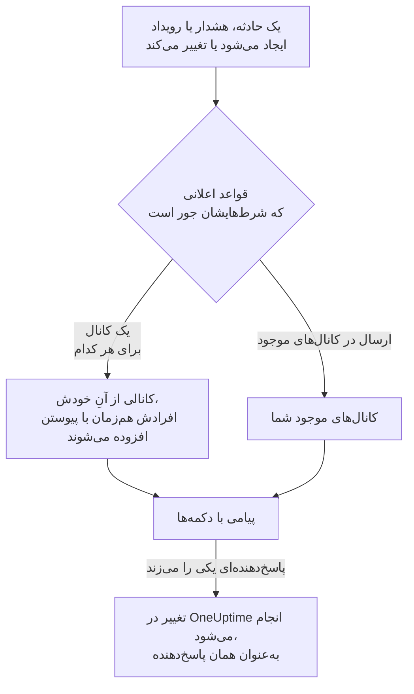

# Mattermost

OneUptime را به سرور Mattermost خود وصل کنید تا حوادث، هشدارها، اپیزودها، تعمیر و نگهداری زمان‌بندی‌شده، مانیتورها و به‌روزرسانی‌های آنکال در کانال‌هایتان منتشر شوند، هر حادثه کانال خودش را داشته باشد، و پاسخ‌دهندگان بدون ترک Mattermost تأیید کنند، برطرف کنند، یادداشت بیفزایند و حالت را تغییر دهند.

:::cards
- [اتصال Mattermost](#اتصال-mattermost): برای OneUptime یک حساب ربات بسازید، سپس پروژه را با توکن آن وصل کنید.
- [اتصال حساب خودتان](#اتصال-حساب-mattermost-خودتان): حساب Mattermost خود را به حساب OneUptime خود پیوند دهید.
- [قواعد اعلان](#قواعد-اعلان): تعیین کنید کدام رویدادها کجا منتشر شوند، و کدام‌ها کانال خودشان را بگیرند.
- [چه کسانی در کانال یک رکورد هستند](#چه-کسانی-در-کانال-یک-رکورد-هستند): از صفحه رکورد ببینید چه کسانی در آن هستند، به آن بپیوندید و افراد را اضافه کنید.
- [اقدام از Mattermost](#اقدام-روی-حوادث-هشدارها-و-رویدادها-از-mattermost): دکمه‌های پیام‌های OneUptime.
- [شبکه و خودمیزبانی](#شبکه-و-خودمیزبانی): هر سرور باید بتواند به چه چیزی برسد.
:::

## چگونه کار می‌کند

دو اتصال این کار را ممکن می‌کنند:

- **اتصال پروژه**، که یک بار برقرار می‌شود: یک حساب ربات روی سرور Mattermost شما، در تیم‌هایی که OneUptime در آن‌ها منتشر می‌کند. این حساب پیام‌ها را منتشر می‌کند، کانال‌ها را می‌سازد و افراد را به آن‌ها می‌افزاید.
- **اتصال خود هر فرد**: حساب Mattermost او که به حساب OneUptime او پیوند خورده است. دکمه‌ها به‌عنوان همان فرد و با مجوزهای او در پروژه عمل می‌کنند.

یک تیم Mattermost می‌تواند به بیش از یک پروژه وصل باشد، مثلاً پروژهٔ تولید و پروژهٔ آزمایشی. هر دکمه در پروژهٔ رکوردی عمل می‌کند که پیامش دربارهٔ آن است.

## پیش از شروع

- **نقشی که بتواند پروژه را وصل کند:** **مالک پروژه**، **مدیر پروژه** یا **عضو پروژه**. قطع اتصال به **مالک پروژه** یا **مدیر پروژه** نیاز دارد.
- **یک سرور Mattermost** که بتوانید در آن حساب ربات بسازید، یا یک مدیر Mattermost که بتواند آن را برایتان بسازد. هم Mattermost Cloud و هم Mattermost خودمیزبان کار می‌کنند.
- **طرح Growth در OneUptime Cloud** برای قواعد اعلان و خلاصه‌ها.

OneUptime برای Mattermost به هیچ تنظیمی روی سرور خودش نیاز ندارد: هر پروژه سرور Mattermost و حساب ربات خودش را می‌آورد.

## اتصال Mattermost

:::steps
### ساختن یک حساب ربات در Mattermost

در Mattermost، **System Console** > **Integrations** > **Bot Accounts** را باز کنید و مطمئن شوید **Enable Bot Account Creation** روشن است. سپس به **Integrations** > **Bot Accounts** > **Add Bot Account** بروید، نام آن را `oneuptime` بگذارید و ذخیره کنید. Mattermost توکن دسترسی ربات را فقط یک بار نشان می‌دهد: آن را کپی کنید.

### افزودن ربات به تیم خودتان

ربات را، همان‌طور که یک فرد را می‌افزایید، به هر تیمی بیفزایید که OneUptime باید در آن منتشر کند: **Main Menu** > **Invite People**، و `@oneuptime` را دعوت کنید. OneUptime فقط در تیم‌هایی کانال می‌سازد و منتشر می‌کند که ربات عضو آن‌هاست.

### اتصال پروژه

در OneUptime، به **تنظیمات پروژه** > **فضای کاری** > **Mattermost** بروید و روی **اتصال به Mattermost** کلیک کنید. نشانی سرور خود، مانند `https://chat.example.com`، و توکن دسترسی ربات را وارد کنید. OneUptime پیش از نگه داشتن هر چیزی، توکن را با سرور شما بررسی می‌کند. اگر ربات در بیش از یک تیم باشد، OneUptime می‌پرسد کدام تیم پیش‌فرض باشد: تیمی که قاعدهٔ اعلانِ بدون نام تیم، کانال‌هایش را در آن می‌سازد. تا وقتی هیچ فضای کاری‌ای وصل نشده، بخش **فضای کاری** در منوهای حوادث، هشدارها، تعمیر و نگهداری زمان‌بندی‌شده، مانیتورها و آنکال گزینهٔ **اتصال یک فضای کاری** را دارد که آن هم به همین‌جا می‌برد.

### افزودن یک قاعدهٔ اعلان

به **حوادث** > **فضای کاری** > **Mattermost** بروید و یک قاعده بسازید. برای نمونه، قاعده‌ای که برای هر حادثهٔ تازه یک کانال Mattermost با همهٔ کسانی که روی آن کار می‌کنند می‌سازد. [قواعد اعلان](#قواعد-اعلان) را ببینید.
:::

توکن دسترسی ربات فقط روی سرور OneUptime نگه داشته می‌شود، همراه دیگر رازهای پروژه رمزگذاری می‌شود، و دیگر هرگز نشان داده نمی‌شود. نشانی سرور، تیم‌ها و نام کاربری ربات در صفحهٔ تنظیمات Mattermost به همهٔ اعضای پروژه نشان داده می‌شوند.

یک پروژه به یک سرور Mattermost وصل است. برای انتقال آن به سروری دیگر، نخست اتصالش را قطع کنید: **تنظیمات پروژه** > **فضای کاری** > **Mattermost**، سپس **⋯** > **قطع اتصال Mattermost**. قطع اتصال، اتصال حساب Mattermost خود هر عضو را هم قطع می‌کند و روش‌های اعلان Mattermost آن‌ها و قواعد آنکالی را که از آن‌ها استفاده می‌کنند حذف می‌کند. قواعد اعلان و خلاصه‌های شما برای زمانی که دوباره وصل می‌شوید نگه داشته می‌شوند.

## بیش از یک تیم

OneUptime در همهٔ تیم‌هایی از سرور Mattermost شما کار می‌کند که رباتش عضو آن‌هاست:

1. در Mattermost، ربات را، همان‌طور که یک فرد را می‌افزایید، به هر تیمی بیفزایید که باید از OneUptime استفاده کند: تیم را باز کنید، سپس **Main Menu** > **Invite People**.
2. کارت **تیم‌های Mattermost** در **تنظیمات پروژه** > **فضای کاری** > **Mattermost** این تیم‌ها را فهرست می‌کند، نخست تیم پیش‌فرض را. پس از افزودن ربات به تیمی دیگر، روی **تازه‌سازی** کلیک کنید.

- **هر قاعده از کدام تیم استفاده می‌کند.** قواعد اعلان در فیلد **تیم Mattermost** تیمی را برمی‌گزینند که کانال‌هایشان در آن است. اگر خالی بماند، قاعده کانالش را در تیم پیش‌فرض می‌سازد، و کانال‌هایی را که نام می‌برد نخست همان‌جا و سپس در تیم‌های دیگر ربات جستجو می‌کند.
- **هر خلاصه از کدام تیم استفاده می‌کند.** خلاصه‌ها، در زبانهٔ **خلاصه** در **حوادث** و **هشدارها**، نیز در فیلد **تیم Mattermost** تیمی را برمی‌گزینند که کانال‌هایشان در آن است. اگر خالی بماند، خلاصه کانال‌هایش را نخست در تیم پیش‌فرض و سپس در تیم‌های دیگر ربات جستجو می‌کند.
- **تیم پیش‌فرض.** همان تیمی است که پروژه را به آن وصل کردید. **تنظیم به‌عنوان پیش‌فرض** روی کارت، تیم دیگری را پیش‌فرض می‌کند، اگر نقش شما بتواند پروژه را وصل کند.
- **جایی که OneUptime کار می‌کند.** دکمه‌های پیام‌های OneUptime، و فرم‌هایی که باز می‌کنند، در هر یک از این تیم‌ها کار می‌کنند. در تیمی که ربات از آن بیرون برده شده، دکمه فقط می‌گوید که آن تیم دیگر وصل نیست.
- **تیم پیش‌فرضی که ربات از آن بیرون برده شده.** کارت این را می‌گوید. ربات را در Mattermost دوباره اضافه کنید، یا تیم دیگری را به‌عنوان پیش‌فرض تنظیم کنید.
- **تیمی که یک قاعده نام می‌برد و ربات از آن بیرون برده شده.** کارت قاعده این را می‌گوید، و قاعده به‌جای آن از تیم دیگری استفاده نمی‌کند. ربات را در Mattermost دوباره به آن تیم اضافه کنید، یا در قاعده تیم دیگری انتخاب کنید: فرم قاعده هنوز انتخاب قبلی را نشان می‌دهد تا بتوانید آن را تغییر دهید.

## اتصال حساب Mattermost خودتان

Mattermost هیچ صفحهٔ ورودی ندارد که OneUptime بتواند شما را به آن بفرستد، پس ربات OneUptime به جای آن یک پیام مستقیم همراه یک پیوند به حساب Mattermost شما می‌فرستد:

:::steps
1. به **تنظیمات کاربر** > **فضای کاری** > **Mattermost** بروید. OneUptime حساب Mattermostی را که نشانی ایمیل شما را دارد جستجو می‌کند. اگر آن را پیدا کند، روی **ارسال پیوند به @your-username** کلیک کنید. اگر نه، روی **یک پیوند برایم بفرست** کلیک کنید و نام کاربری Mattermost خود را وارد کنید.
2. پیام مستقیم ربات OneUptime را در Mattermost باز کنید و روی **Connect my account** کلیک کنید.
3. پیوند، OneUptime را باز می‌کند و OneUptime حساب شما را وصل می‌کند.
:::

پیوند را در همان مرورگری باز کنید که در آن درخواستش کردید: فقط همان‌جا، فقط یک بار، و فقط تا ۱۵ دقیقه کار می‌کند. این ثابت می‌کند کسی که درخواست کرده هر دو حساب را در اختیار دارد، پس هیچ‌کس نمی‌تواند حساب Mattermost کس دیگری را وصل کند. اگر پیوندی درخواست نکرده‌اید، آن را نادیده بگیرید: تا وقتی پیوند در مرورگری که درخواستش کرده باز نشود، چیزی وصل نمی‌شود.

اتصال حساب شما متعلق به همین پروژه است. در پروژهٔ دیگری که به همان تیم Mattermost وصل است، آنجا هم حسابتان را وصل کنید.

## فراخوانده شدن در Mattermost

برای اینکه وقتی آنکال هستید با پیام مستقیم فراخوانده شوید، Mattermost را به‌عنوان یکی از روش‌های اعلان خود بیفزایید:

:::steps
1. حساب Mattermost خودتان را وصل کنید ([اتصال حساب Mattermost خودتان](#اتصال-حساب-mattermost-خودتان) را ببینید).
2. به **تنظیمات کاربر** > **روش‌های اعلان** بروید، زبانهٔ **برنامه‌های فضای کاری** را باز کنید و روی **افزودن حساب Mattermost** کلیک کنید.
3. روی **Send Test Message** در ردیف آن کلیک کنید. پیام به‌صورت پیام مستقیم از ربات پروژه می‌رسد.
:::

افزودن آن، فوراً آن را به قواعد آنکال شما هم می‌افزاید، پس از آن پس فراخوان‌ها در Mattermost به شما می‌رسند. اینکه کدام فراخوان‌ها را بگیرد، در **تنظیمات کاربر** > **راه‌های تماس با من** تغییر دهید. هر فراخوان پیوندی برای تأیید و پیوندی برای تشدید دارد. قطع اتصال حساب Mattermost شما این روش و قواعد آنکالی را که از آن استفاده می‌کنند حذف می‌کند.

## قواعد اعلان

یک قاعدهٔ اعلان می‌گوید کدام رویدادها در Mattermost منتشر شوند، و کجا. هر محصول قواعد خودش را دارد، در منوی خودش زیر **فضای کاری** > **Mattermost**: **حوادث** (با **اپیزودهای حادثه** و زبانهٔ **خلاصه**)، **هشدارها** (با **اپیزودهای هشدار** و **خلاصه**)، **تعمیر و نگهداری زمان‌بندی‌شده**، **مانیتورها**، **آنکال**، **رویدادهای امنیتی** و **SLOs**. این قواعد مانند قواعد Slack کار می‌کنند: برای شرط‌ها، مقصدها، به‌روزرسانی‌هایی که یک قاعده منتشر می‌کند و اینکه چه کسانی به کانال می‌پیوندند، [قواعد اعلان](/docs/workspace-connections/slack#قواعد-اعلان) را ببینید.

کانالی که قاعده می‌سازد به نام رکوردش نام‌گذاری می‌شود: حادثهٔ INC-42 نام `inc-42` را می‌گیرد. Mattermost حروف کوچک، اعداد، `-` و `_` را تا ۶۴ نویسه می‌پذیرد، و نام باید با یک حرف یا عدد آغاز شود و پایان یابد؛ فرم قاعده هنگام نوشتن، نام را نشان می‌دهد. اگر کانالی با آن نام از پیش باشد، مانند کانالی بایگانی‌شده، OneUptime `-2`، `-3` و مانند آن را می‌افزاید. یک حادثه، هشدار یا اپیزود خصوصی کانال خصوصی می‌گیرد.

برای انتشار در یک کانال موجود، نام آن را همان‌طور که در نشانی‌اش دیده می‌شود وارد کنید، مانند `incidents` برای `chat.example.com/team/channels/incidents`، یا نام نمایشی آن را. OneUptime نخستین بار که در یک کانال عمومی منتشر می‌کند، خودش به آن می‌پیوندد. پیش از آنکه قاعده‌ای در یک کانال خصوصی منتشر کند، ربات را در Mattermost به آن کانال بیفزایید. وقتی ربات در بیش از یک تیم است، هر قاعده تیمی را هم که کانال‌هایش در آن است برمی‌گزیند: [بیش از یک تیم](#بیش-از-یک-تیم) را ببینید.

افراد با حساب Mattermostی که وصل کرده‌اند به کانال یک قاعده می‌پیوندند، وگرنه با حساب Mattermostی که نشانی ایمیل آن‌ها را دارد، به شرطی که سرور شما نشانی‌های ایمیل را به ربات نشان دهد (**System Console** > **Site Configuration** > **Users and Teams** > **Show Email Address**). OneUptime نام همهٔ کسانی را که نتوانست بیفزاید در یک پیام در کانال می‌آورد، همراه پیوندی برای وصل کردن حسابشان.

حادثه، هشدار، اپیزود یا رویداد تعمیر و نگهداری زمان‌بندی‌شده‌ای که کانال خودش را دارد، در سربرگ صفحه‌اش در OneUptime، کنار دکمه‌های حالت، **باز کردن در Mattermost** دارد. این دکمه آن کانال را در زبانه‌ای تازه، روی سرور Mattermost شما باز می‌کند. رکوردی که دو کانال از خودش دارد هر دو را زیر دکمه فهرست می‌کند. رکوردی که در Slack یا Microsoft Teams هم کانال دارد، به‌جای آن یک دکمه **باز کردن کانال** دارد که همه را فهرست می‌کند. کانال‌های موجودی که قواعد شما در آن‌ها منتشر می‌کنند پیشنهاد نمی‌شوند.

**آزمایش قاعده** در ردیف یک قاعده، پیامی آزمایشی برای آن قاعده در کانال‌هایی که نام می‌برد منتشر می‌کند، همان‌طور که برای Slack می‌کند.

پیام‌های OneUptime با آنچه نقل می‌کنند به هیچ‌کس اعلان نمی‌دهند: نام یا توضیحی که `@channel`، `@here` یا `@someone` را در خود دارد همان‌طور که نوشته شده نشان داده می‌شود، و هیچ‌کس را صدا نمی‌زند.

## چه کسانی در کانال یک رکورد هستند

حادثه، هشدار، اپیزود یا رویداد تعمیر و نگهداری زمان‌بندی‌شده‌ای که کانال Mattermost خودش را دارد، در صفحه‌اش در OneUptime کارت **کانال Mattermost** را دارد. کارت کانال را به‌صورت پیوندی که آن را روی سرور Mattermost شما باز می‌کند نشان می‌دهد، اینکه خصوصی است یا نه، و چه کسانی در آن هستند، نخست خود شما. از روی کارت، بی‌نیاز از مدیر Mattermost:

- **پیوستن به کانال** شما را اضافه می‌کند، وقتی در کانال نیستید.
- **افزودن افراد** فهرستی از افراد و تیم‌های پروژه را باز می‌کند: فردی را برگزینید تا اضافه شود، یا تیمی را تا همه اعضایش اضافه شوند.

ربات OneUptime آن‌ها را اضافه می‌کند، همان‌طور که افراد کانال یک قاعده را اضافه می‌کند. ربات در کانال‌هایی که می‌سازد می‌ماند، پس این برای کانال خصوصی‌ای که همه ترکش کرده‌اند هم کار می‌کند. رکوردی که در Slack یا Microsoft Teams هم کانال دارد، همه را روی یک کارت **کانال‌های گفتگو** فهرست می‌کند.

- **چه کسی می‌تواند افراد را اضافه کند.** هر کسی که می‌تواند رکورد را ویرایش کند: برای یک حادثه **مالک پروژه**، **مدیر پروژه**، **عضو پروژه**، **مدیر حوادث** و **عضو حوادث**، یا **Edit Incident** در یک نقش سفارشی، و همین مجوز برای یک هشدار، یک اپیزود یا یک رویداد (برای نمونه **Edit Alert**). دیگران می‌بینند چه کسانی در کانال هستند، و چطور می‌شود واردش شد.
- **چه کسی را می‌توان اضافه کرد.** کسی که OneUptime بتواند در Mattermost پیدایش کند، از روی حسابی که وصل کرده، وگرنه از روی نشانی ایمیلش وقتی سرور شما نشانی‌های ایمیل را به ربات نشان می‌دهد، و در تیم کانال باشد. حساب مهمان در آن تیم را هم می‌توان اضافه کرد: Mattermost به اعضای کانال اجازه می‌دهد مهمان اضافه کنند. کارت نام کسانی را که نتوانست اضافه کند، همراه دلیلش می‌آورد.
- **چه چیزی ثبت می‌شود.** اینکه چه کسی اضافه شد و به دست چه کسی، در خوراک رکورد (**عضو به کانال اضافه شد**) و در **تنظیمات پروژه** > **اعلان‌ها** > **گزارش‌های اعلان** در زبانهٔ **فضای کاری**.
- **کانال بایگانی‌شده.** کارت همچنان نشان می‌دهد چه کسانی در آن هستند، و تا وقتی کانال در Mattermost از بایگانی خارج نشود کسی را اضافه نمی‌کند.
- **کانالی که ربات از آن بیرون برده شده.** Mattermost افراد یک کانال را فقط به کسی نشان می‌دهد که در آن است، حتی در کانال عمومی، پس کارت می‌گوید کانال را نمی‌بیند. یکی از اعضای کانال می‌تواند ربات را در Mattermost دوباره اضافه کند. OneUptime هم دفعه بعد که در کانال عمومی منتشر کند، خودش دوباره به آن می‌پیوندد.
- **بیرون بردن کسی.** OneUptime فقط اضافه می‌کند: کسی را در Mattermost از کانال بیرون ببرید.

## اقدام روی حوادث، هشدارها و رویدادها از Mattermost

پیام‌های OneUptime دکمه‌هایی دارند، و یک منوی **More actions** برای کارهایی که افراد کمتری به آن‌ها نیاز دارند. هر کدام به‌عنوان شما و با مجوزهای شما در پروژه عمل می‌کند، و در پیامی که فقط شما می‌بینید پاسخ می‌دهد.

| رکورد | دکمه‌ها و منو |
| --- | --- |
| **حادثه** | **Acknowledge**، **Resolve**، **Add Note**، و در منو **Change Severity** و **Change State** |
| **هشدار** | **Acknowledge**، **Resolve**، **Add Note**، **Change State**، **Execute On-Call Policy** |
| **اپیزود حادثه، اپیزود هشدار** | **Acknowledge**، **Resolve**، **Add Note**، **Change State**، **Execute On-Call Policy** |
| **تعمیر و نگهداری زمان‌بندی‌شده** | **Mark as Ongoing**، **Mark as Complete**، **Add Note**، **Change State** |

**Add Note**، **Change State**، **Change Severity** و **Execute On-Call Policy** فرمی را در Mattermost باز می‌کنند. یادداشت روی یک حادثه یا یک رویداد تعمیر و نگهداری زمان‌بندی‌شده می‌تواند عمومی باشد، که در صفحهٔ وضعیت نشان داده می‌شود، یا خصوصی؛ یادداشت روی یک حادثهٔ خصوصی همیشه خصوصی است، و روی یک هشدار هم همیشه خصوصی است. هر پیام همچنین پیوندی دارد که رکوردش را در OneUptime باز می‌کند، برای هر کار دیگری. وقتی یادداشت‌های عمومی پروژه به تأیید نیاز دارند، یادداشت عمومی‌ای که از فرم فرستاده شود منتظر تأیید می‌ماند، و پیامی که تنها شما می‌بینید می‌گوید منتظر چه کسی است: [تأیید یادداشت‌های عمومی](/docs/incidents/notes-owners-and-feed#تأیید-یادداشتهای-عمومی) را ببینید.

اگر حساب Mattermost شما هنوز وصل نیست، دکمه این را به شما می‌گوید، همراه پیوندی به **تنظیمات کاربر** > **فضای کاری** > **Mattermost**. حسابتان را وصل کنید، سپس دوباره دکمه را بزنید.

هر بار زدن دکمه، همراه نام کسی که آن را زده، در **تنظیمات پروژه** > **اعلان‌ها** > **گزارش‌های اعلان** در زبانهٔ **فضای کاری** ثبت می‌شود.

## تأیید یک یادداشت عمومی

وقتی یادداشت‌های عمومی پروژهٔ شما تأیید می‌خواهند و Mattermost را برای **تأیید یادداشت‌های عمومی** در تنظیمات اعلان خود روشن می‌کنید، هر یادداشت عمومی که منتظر مرحله‌ای است که شما تأییدش می‌کنید، به پیام‌های مستقیم شما با ربات OneUptime می‌آید: چه کسی آن را فرستاده، منتظر کدام مرحله است، خود یادداشت، **Approve**، **Reject** و پیوندی به یادداشت در OneUptime. **Approve** آن را برای همان مرحله تأیید می‌کند؛ در مرحلهٔ آخر نامش **Approve and publish** است و یادداشت فوراً منتشر می‌شود. **Reject** فرمی باز می‌کند که دلیل را می‌پرسد: دلیل لازم است و نویسندهٔ یادداشت آن را می‌بیند. دکمه‌ها به‌عنوان شما و با همان قواعد OneUptime عمل می‌کنند و در پیامی پاسخ می‌دهند که تنها خودتان می‌بینید. فشردن دکمه پس از آنکه کسی دیگر تصمیم گرفته، یا پس از تغییر یادداشت یا مرحله‌هایش، هیچ تصمیمی نمی‌گیرد و می‌گوید چه پیش آمده. وقتی دربارهٔ یادداشت تصمیم گرفته شد، پیام هر تأییدکننده دربارهٔ آن، از جمله پیام شما، تغییر می‌کند تا بگوید چه پیش آمده: برای مرحله‌اش تأیید شده و اکنون منتظر چه کسی است، منتشر شده، رد شده، تغییر کرده یا دوباره برای تأیید فرستاده شده، بدون تأیید منتشر شده، یا حذف شده. پیوندش به یادداشت در OneUptime می‌ماند و **Approve** و **Reject** دیگر نیستند. اگر حساب Mattermost شما متصل نیست، آن را در **تنظیمات کاربر** > **فضای کاری** > **Mattermost** متصل کنید و سپس دکمه را دوباره بفشارید. وقتی گام‌های تأیید در زمانی که یادداشتی منتظر است تغییر کنند، اگر یادداشت دیگر منتظر گام شما نباشد یا دیگر از شما پرسیده نشود، پیام شما درباره آن هم تغییر می‌کند، و کسانی که یادداشت اکنون منتظرشان است پیامی از آنِ خود می‌گیرند. ببینید [تأیید یادداشت‌های عمومی](/docs/incidents/notes-owners-and-feed#تأیید-یادداشتهای-عمومی).

## شبکه و خودمیزبانی

دو سرور با یکدیگر در ارتباط‌اند:

- **OneUptime به سرور Mattermost شما درخواست می‌فرستد**، تا منتشر کند، کانال بسازد و افراد را بیفزاید. در OneUptime Cloud، سرور Mattermost شما باید از اینترنت در دسترس باشد. یک OneUptime خودمیزبان تنها زمانی می‌تواند به سرور Mattermostی روی یک شبکهٔ خصوصی برسد که گردانندهٔ آن نشانی‌های خصوصی را با `ALLOW_PRIVATE_NETWORK_WEBHOOKS` یا `PRIVATE_NETWORK_WEBHOOK_ALLOWLIST` مجاز کند. OneUptime هرگز به نشانی‌ای روی ماشین خودش یا به نشانی فراداده‌های ابری درخواست نمی‌فرستد، و هرگز از تغییر مسیر پیروی نمی‌کند.
- **سرور Mattermost شما به OneUptime درخواست می‌فرستد**، وقتی کسی دکمه‌ای را می‌زند یا فرمی را می‌فرستد: `https://<your OneUptime>/api/mattermost/interactive` و `/api/mattermost/dialog`. اگر نشانی OneUptime خصوصی است، میزبان آن را در Mattermost به **System Console** > **Environment** > **Developer** > **Allow untrusted internal connections to** بیفزایید، وگرنه دکمه‌ها کار نمی‌کنند.

هر دکمه‌ای که OneUptime منتشر می‌کند امضایی برای تیم Mattermostی دارد که در آن منتشر شده است، و این امضا هنگام زدن دکمه بررسی می‌شود: زدن دکمه‌ای که امضای OneUptime را ندارد، یا زدنی که از تیم دیگری فرستاده شده، هیچ کاری نمی‌کند.

## رفع اشکال

| آنچه می‌بینید | چه باید کرد |
| --- | --- |
| **Mattermost did not accept the access token** | توکن ربات را دوباره کپی کنید. Mattermost آن را فقط یک بار نشان می‌دهد: در صورت نیاز، یک توکن تازه در **Integrations** > **Bot Accounts** بسازید. |
| **The bot account is not a member of any team** | ربات را در Mattermost به تیم خود بیفزایید، سپس دوباره وصل کنید. |
| تیمی که ربات را به آن افزوده‌اید روی کارت **تیم‌های Mattermost** نیست | روی **تازه‌سازی** در کارت کلیک کنید. |
| **OneUptime's bot is not a member of this Mattermost team** | تیمی را برگزیده‌اید که ربات آن را ترک کرده است. ربات را در Mattermost به آن بیفزایید، سپس روی **تازه‌سازی** کلیک کنید. |
| **OneUptime's bot may not create channels in the Mattermost team this rule names** | ربات را در Mattermost به آن تیم بیفزایید، یا در قاعده تیم دیگری برگزینید. |
| **OneUptime's bot is not a member of the Mattermost team chosen for the channel** | ربات را در Mattermost به آن تیم بیفزایید، یا در قاعده تیم دیگری برگزینید. |
| **OneUptime's bot is no longer a member of the project's default Mattermost team** | ربات را در Mattermost دوباره به آن تیم اضافه کنید، یا تیم دیگری را به‌عنوان پیش‌فرض تنظیم کنید. |
| **OneUptime could not reach the Mattermost server** | نشانی را بررسی کنید، و اینکه OneUptime بتواند به آن برسد. [شبکه و خودمیزبانی](#شبکه-و-خودمیزبانی) را ببینید. |
| **The bot is not a member of the private Mattermost channel** | ربات را در Mattermost به آن کانال بیفزایید. |
| دکمه‌ای کاری نمی‌کند، یا Mattermost می‌گوید نتوانست اقدام را کامل کند | Mattermost نمی‌تواند به OneUptime برسد. [شبکه و خودمیزبانی](#شبکه-و-خودمیزبانی) را ببینید. |
| هیچ پیام مستقیمی با پیوند شما نمی‌رسد | نام کاربری را بررسی کنید، و اینکه ربات در تیمی باشد که شما در آن هستید. |
| کارت کانال می‌گوید OneUptime کانال را نمی‌بیند | کانال حذف شده یا ربات از آن بیرون برده شده است. اگر هنوز وجود دارد، یکی از اعضای آن می‌تواند ربات را در Mattermost دوباره اضافه کند. |
| کارت کانال می‌گوید کسی در تیم Mattermost نیست | او را در Mattermost به تیم کانال اضافه کنید، سپس دوباره اضافه کنید. |
