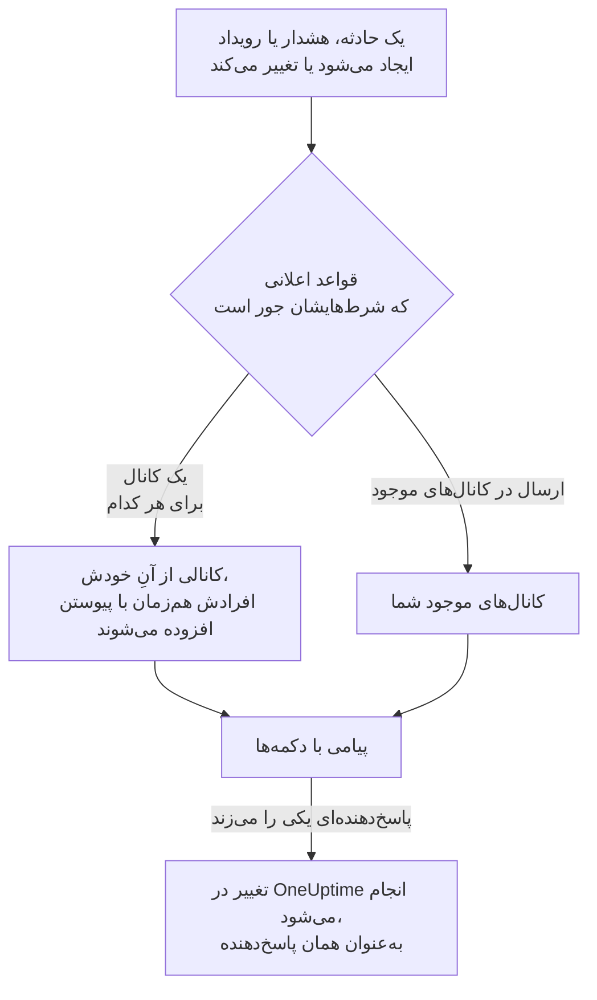

# Mattermost

OneUptime را به سرور Mattermost خود وصل کنید تا حوادث، هشدارها، اپیزودها، تعمیر و نگهداری زمان‌بندی‌شده، مانیتورها و به‌روزرسانی‌های آنکال در کانال‌هایتان منتشر شوند، هر حادثه کانال خودش را داشته باشد، و پاسخ‌دهندگان بدون ترک Mattermost تأیید کنند، برطرف کنند، یادداشت بیفزایند و حالت را تغییر دهند.

:::cards
- [اتصال Mattermost](#اتصال-mattermost): برای OneUptime یک حساب ربات بسازید، سپس پروژه را با توکن آن وصل کنید.
- [اتصال حساب خودتان](#اتصال-حساب-mattermost-خودتان): حساب Mattermost خود را به حساب OneUptime خود پیوند دهید.
- [قواعد اعلان](#قواعد-اعلان): تعیین کنید کدام رویدادها کجا منتشر شوند، و کدام‌ها کانال خودشان را بگیرند.
- [اقدام از Mattermost](#اقدام-روی-حوادث-هشدارها-و-رویدادها-از-mattermost): دکمه‌های پیام‌های OneUptime.
- [شبکه و خودمیزبانی](#شبکه-و-خودمیزبانی): هر سرور باید بتواند به چه چیزی برسد.
:::

## چگونه کار می‌کند

دو اتصال این کار را ممکن می‌کنند:

- **اتصال پروژه**، که یک بار برقرار می‌شود: یک حساب ربات روی سرور Mattermost شما، در تیمی که OneUptime در آن منتشر می‌کند. این حساب پیام‌ها را منتشر می‌کند، کانال‌ها را می‌سازد و افراد را به آن‌ها می‌افزاید.
- **اتصال خود هر فرد**: حساب Mattermost او که به حساب OneUptime او پیوند خورده است. دکمه‌ها به‌عنوان همان فرد و با مجوزهای او در پروژه عمل می‌کنند.

یک تیم Mattermost می‌تواند به بیش از یک پروژه وصل باشد، مثلاً پروژهٔ تولید و پروژهٔ آزمایشی. هر دکمه در پروژهٔ رکوردی عمل می‌کند که پیامش دربارهٔ آن است.

## پیش از شروع

- **نقشی که بتواند پروژه را وصل کند:** **مالک پروژه**، **مدیر پروژه** یا **عضو پروژه**. قطع اتصال به **مالک پروژه** یا **مدیر پروژه** نیاز دارد.
- **یک سرور Mattermost** که بتوانید در آن حساب ربات بسازید، یا یک مدیر Mattermost که بتواند آن را برایتان بسازد. هم Mattermost Cloud و هم Mattermost خودمیزبان کار می‌کنند.
- **طرح Growth در OneUptime Cloud** برای قواعد اعلان و خلاصه‌ها.

OneUptime برای Mattermost به هیچ تنظیمی روی سرور خودش نیاز ندارد: هر پروژه سرور Mattermost و حساب ربات خودش را می‌آورد.

## اتصال Mattermost

:::steps
### ساختن یک حساب ربات در Mattermost

در Mattermost، **System Console** > **Integrations** > **Bot Accounts** را باز کنید و مطمئن شوید **Enable Bot Account Creation** روشن است. سپس به **Integrations** > **Bot Accounts** > **Add Bot Account** بروید، نام آن را `oneuptime` بگذارید و ذخیره کنید. Mattermost توکن دسترسی ربات را فقط یک بار نشان می‌دهد: آن را کپی کنید.

### افزودن ربات به تیم خودتان

ربات را، همان‌طور که یک فرد را می‌افزایید، به تیمی بیفزایید که OneUptime باید در آن منتشر کند: **Main Menu** > **Invite People**، و `@oneuptime` را دعوت کنید. OneUptime فقط در همان تیم کانال می‌سازد و منتشر می‌کند.

### اتصال پروژه

در OneUptime، به **تنظیمات پروژه** > **فضای کاری** > **Mattermost** بروید و روی **اتصال به Mattermost** کلیک کنید. نشانی سرور خود، مانند `https://chat.example.com`، و توکن دسترسی ربات را وارد کنید. OneUptime پیش از نگه داشتن هر چیزی، توکن را با سرور شما بررسی می‌کند. اگر ربات در بیش از یک تیم باشد، OneUptime می‌پرسد در کدام تیم منتشر کند.

### افزودن یک قاعدهٔ اعلان

به **حوادث** > **فضای کاری** > **Mattermost** بروید و یک قاعده بسازید. برای نمونه، قاعده‌ای که برای هر حادثهٔ تازه یک کانال Mattermost با همهٔ کسانی که روی آن کار می‌کنند می‌سازد. [قواعد اعلان](#قواعد-اعلان) را ببینید.
:::

توکن دسترسی ربات فقط روی سرور OneUptime نگه داشته می‌شود، همراه دیگر رازهای پروژه رمزگذاری می‌شود، و دیگر هرگز نشان داده نمی‌شود. نشانی سرور، تیم و نام کاربری ربات در صفحهٔ تنظیمات Mattermost به همهٔ اعضای پروژه نشان داده می‌شوند.

یک پروژه به یک تیم Mattermost وصل است. برای انتقال آن به تیمی دیگر، یا سروری دیگر، نخست اتصالش را قطع کنید: **تنظیمات پروژه** > **فضای کاری** > **Mattermost**، سپس **⋯** > **قطع اتصال Mattermost**. قطع اتصال، اتصال حساب Mattermost خود هر عضو را هم قطع می‌کند و روش‌های اعلان Mattermost آن‌ها و قواعد آنکالی را که از آن‌ها استفاده می‌کنند حذف می‌کند. قواعد اعلان و خلاصه‌های شما برای زمانی که دوباره وصل می‌شوید نگه داشته می‌شوند.

## اتصال حساب Mattermost خودتان

Mattermost هیچ صفحهٔ ورودی ندارد که OneUptime بتواند شما را به آن بفرستد، پس ربات OneUptime به جای آن یک پیام مستقیم همراه یک پیوند به حساب Mattermost شما می‌فرستد:

:::steps
1. به **تنظیمات کاربر** > **فضای کاری** > **Mattermost** بروید. OneUptime حساب Mattermostی را که نشانی ایمیل شما را دارد جستجو می‌کند. اگر آن را پیدا کند، روی **ارسال پیوند به @your-username** کلیک کنید. اگر نه، روی **یک پیوند برایم بفرست** کلیک کنید و نام کاربری Mattermost خود را وارد کنید.
2. پیام مستقیم ربات OneUptime را در Mattermost باز کنید و روی **Connect my account** کلیک کنید.
3. پیوند، OneUptime را باز می‌کند و OneUptime حساب شما را وصل می‌کند.
:::

پیوند را در همان مرورگری باز کنید که در آن درخواستش کردید: فقط همان‌جا، فقط یک بار، و فقط تا ۱۵ دقیقه کار می‌کند. این ثابت می‌کند کسی که درخواست کرده هر دو حساب را در اختیار دارد، پس هیچ‌کس نمی‌تواند حساب Mattermost کس دیگری را وصل کند. اگر پیوندی درخواست نکرده‌اید، آن را نادیده بگیرید: تا وقتی پیوند در مرورگری که درخواستش کرده باز نشود، چیزی وصل نمی‌شود.

اتصال حساب شما متعلق به همین پروژه است. در پروژهٔ دیگری که به همان تیم Mattermost وصل است، آنجا هم حسابتان را وصل کنید.

## فراخوانده شدن در Mattermost

برای اینکه وقتی آنکال هستید با پیام مستقیم فراخوانده شوید، Mattermost را به‌عنوان یکی از روش‌های اعلان خود بیفزایید:

:::steps
1. حساب Mattermost خودتان را وصل کنید ([اتصال حساب Mattermost خودتان](#اتصال-حساب-mattermost-خودتان) را ببینید).
2. به **تنظیمات کاربر** > **روش‌های اعلان** بروید، زبانهٔ **برنامه‌های فضای کاری** را باز کنید و روی **افزودن حساب Mattermost** کلیک کنید.
3. روی **Send Test Message** در ردیف آن کلیک کنید. پیام به‌صورت پیام مستقیم از ربات پروژه می‌رسد.
:::

افزودن آن، فوراً آن را به قواعد آنکال شما هم می‌افزاید، پس از آن پس فراخوان‌ها در Mattermost به شما می‌رسند. اینکه کدام فراخوان‌ها را بگیرد، در **تنظیمات کاربر** > **قواعد آنکال** تغییر دهید. هر فراخوان پیوندی برای تأیید و پیوندی برای تشدید دارد. قطع اتصال حساب Mattermost شما این روش و قواعد آنکالی را که از آن استفاده می‌کنند حذف می‌کند.

## قواعد اعلان

یک قاعدهٔ اعلان می‌گوید کدام رویدادها در Mattermost منتشر شوند، و کجا. هر محصول قواعد خودش را دارد، در منوی خودش زیر **فضای کاری** > **Mattermost**: **حوادث** (با **اپیزودهای حادثه** و زبانهٔ **خلاصه**)، **هشدارها** (با **اپیزودهای هشدار** و **خلاصه**)، **تعمیر و نگهداری زمان‌بندی‌شده**، **مانیتورها**، **کشیک آنکال** و **رویدادهای امنیتی**. این قواعد مانند قواعد Slack کار می‌کنند: برای شرط‌ها، مقصدها و اینکه چه کسانی به کانال می‌پیوندند، [قواعد اعلان](/docs/workspace-connections/slack#قواعد-اعلان) را ببینید.

کانالی که قاعده می‌سازد به نام رکوردش نام‌گذاری می‌شود: حادثهٔ INC-42 نام `inc-42` را می‌گیرد. Mattermost حروف کوچک، اعداد، `-` و `_` را تا ۶۴ نویسه می‌پذیرد، و نام باید با یک حرف یا عدد آغاز شود و پایان یابد؛ فرم قاعده هنگام نوشتن، نام را نشان می‌دهد. اگر کانالی با آن نام از پیش باشد، مانند کانالی بایگانی‌شده، OneUptime `-2`، `-3` و مانند آن را می‌افزاید. یک حادثه، هشدار یا اپیزود خصوصی کانال خصوصی می‌گیرد.

برای انتشار در یک کانال موجود، نام آن را همان‌طور که در نشانی‌اش دیده می‌شود وارد کنید، مانند `incidents` برای `chat.example.com/team/channels/incidents`، یا نام نمایشی آن را. OneUptime نخستین بار که در یک کانال عمومی منتشر می‌کند، خودش به آن می‌پیوندد. پیش از آنکه قاعده‌ای در یک کانال خصوصی منتشر کند، ربات را در Mattermost به آن کانال بیفزایید.

افراد با حساب Mattermostی که وصل کرده‌اند به کانال یک قاعده می‌پیوندند، وگرنه با حساب Mattermostی که نشانی ایمیل آن‌ها را دارد، به شرطی که سرور شما نشانی‌های ایمیل را به ربات نشان دهد (**System Console** > **Site Configuration** > **Users and Teams** > **Show Email Address**). OneUptime نام همهٔ کسانی را که نتوانست بیفزاید در یک پیام در کانال می‌آورد، همراه پیوندی برای وصل کردن حسابشان.

**قاعده آزمایش** در ردیف یک قاعده، پیامی آزمایشی برای آن قاعده در کانال‌هایی که نام می‌برد منتشر می‌کند، همان‌طور که برای Slack می‌کند.

پیام‌های OneUptime با آنچه نقل می‌کنند به هیچ‌کس اعلان نمی‌دهند: نام یا توضیحی که `@channel`، `@here` یا `@someone` را در خود دارد همان‌طور که نوشته شده نشان داده می‌شود، و هیچ‌کس را صدا نمی‌زند.

## اقدام روی حوادث، هشدارها و رویدادها از Mattermost

پیام‌های OneUptime دکمه‌هایی دارند، و یک منوی **More actions** برای کارهایی که افراد کمتری به آن‌ها نیاز دارند. هر کدام به‌عنوان شما و با مجوزهای شما در پروژه عمل می‌کند، و در پیامی که فقط شما می‌بینید پاسخ می‌دهد.

| رکورد | دکمه‌ها و منو |
| --- | --- |
| **حادثه** | **Acknowledge**، **Resolve**، **Add Note**، و در منو **Change Severity** و **Change State** |
| **هشدار** | **Acknowledge**، **Resolve**، **Add Note**، **Change State**، **Execute On-Call Policy** |
| **اپیزود حادثه، اپیزود هشدار** | **Acknowledge**، **Resolve**، **Add Note**، **Change State**، **Execute On-Call Policy** |
| **تعمیر و نگهداری زمان‌بندی‌شده** | **Mark as Ongoing**، **Mark as Complete**، **Add Note**، **Change State** |

**Add Note**، **Change State**، **Change Severity** و **Execute On-Call Policy** فرمی را در Mattermost باز می‌کنند. یادداشت روی یک حادثه یا یک رویداد تعمیر و نگهداری زمان‌بندی‌شده می‌تواند عمومی باشد، که در صفحهٔ وضعیت نشان داده می‌شود، یا خصوصی؛ یادداشت روی یک حادثهٔ خصوصی همیشه خصوصی است، و روی یک هشدار هم همیشه خصوصی است. هر پیام همچنین پیوندی دارد که رکوردش را در OneUptime باز می‌کند، برای هر کار دیگری.

اگر حساب Mattermost شما هنوز وصل نیست، دکمه این را به شما می‌گوید، همراه پیوندی به **تنظیمات کاربر** > **فضای کاری** > **Mattermost**. حسابتان را وصل کنید، سپس دوباره دکمه را بزنید.

هر بار زدن دکمه، همراه نام کسی که آن را زده، در **تنظیمات پروژه** > **اعلان‌ها** > **گزارش‌های اعلان** در زبانهٔ **فضای کاری** ثبت می‌شود.

## شبکه و خودمیزبانی

دو سرور با یکدیگر در ارتباط‌اند:

- **OneUptime به سرور Mattermost شما درخواست می‌فرستد**، تا منتشر کند، کانال بسازد و افراد را بیفزاید. در OneUptime Cloud، سرور Mattermost شما باید از اینترنت در دسترس باشد. یک OneUptime خودمیزبان تنها زمانی می‌تواند به سرور Mattermostی روی یک شبکهٔ خصوصی برسد که گردانندهٔ آن نشانی‌های خصوصی را با `ALLOW_PRIVATE_NETWORK_WEBHOOKS` یا `PRIVATE_NETWORK_WEBHOOK_ALLOWLIST` مجاز کند. OneUptime هرگز به نشانی‌ای روی ماشین خودش یا به نشانی فراداده‌های ابری درخواست نمی‌فرستد، و هرگز از تغییر مسیر پیروی نمی‌کند.
- **سرور Mattermost شما به OneUptime درخواست می‌فرستد**، وقتی کسی دکمه‌ای را می‌زند یا فرمی را می‌فرستد: `https://<your OneUptime>/api/mattermost/interactive` و `/api/mattermost/dialog`. اگر نشانی OneUptime خصوصی است، میزبان آن را در Mattermost به **System Console** > **Environment** > **Developer** > **Allow untrusted internal connections to** بیفزایید، وگرنه دکمه‌ها کار نمی‌کنند.

هر دکمه‌ای که OneUptime منتشر می‌کند امضایی برای تیم Mattermostی دارد که در آن منتشر شده است، و این امضا هنگام زدن دکمه بررسی می‌شود: زدن دکمه‌ای که امضای OneUptime را ندارد، یا زدنی که از تیم دیگری فرستاده شده، هیچ کاری نمی‌کند.

## رفع اشکال

| آنچه می‌بینید | چه باید کرد |
| --- | --- |
| **Mattermost did not accept the access token** | توکن ربات را دوباره کپی کنید. Mattermost آن را فقط یک بار نشان می‌دهد: در صورت نیاز، یک توکن تازه در **Integrations** > **Bot Accounts** بسازید. |
| **The bot account is not a member of any team** | ربات را در Mattermost به تیم خود بیفزایید، سپس دوباره وصل کنید. |
| **OneUptime could not reach the Mattermost server** | نشانی را بررسی کنید، و اینکه OneUptime بتواند به آن برسد. [شبکه و خودمیزبانی](#شبکه-و-خودمیزبانی) را ببینید. |
| **The bot is not a member of the private Mattermost channel** | ربات را در Mattermost به آن کانال بیفزایید. |
| دکمه‌ای کاری نمی‌کند، یا Mattermost می‌گوید نتوانست اقدام را کامل کند | Mattermost نمی‌تواند به OneUptime برسد. [شبکه و خودمیزبانی](#شبکه-و-خودمیزبانی) را ببینید. |
| هیچ پیام مستقیمی با پیوند شما نمی‌رسد | نام کاربری را بررسی کنید، و اینکه ربات در تیمی باشد که شما در آن هستید. |
