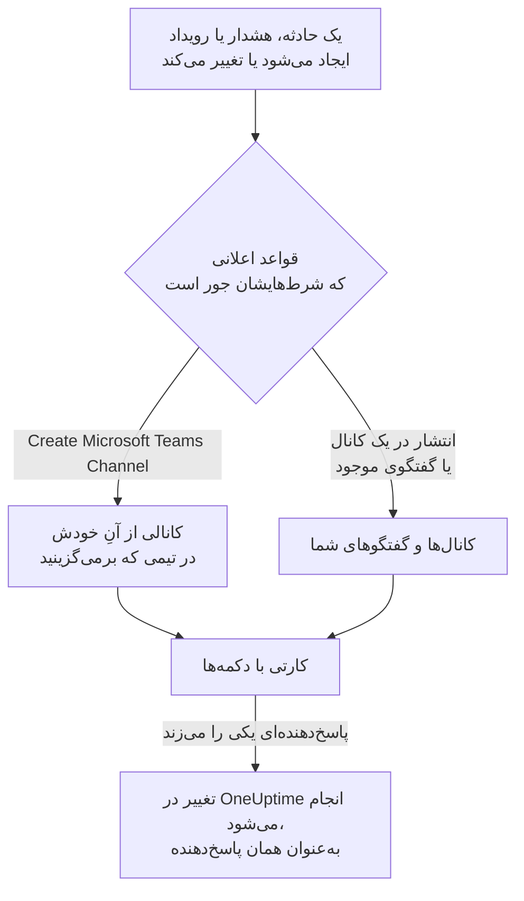

# Microsoft Teams

OneUptime را به Microsoft Teams وصل کنید تا حوادث، هشدارها، اپیزودها، تعمیر و نگهداری زمان‌بندی‌شده، مانیتورها و به‌روزرسانی‌های آنکال در کانال‌ها و گفتگوهایتان منتشر شوند، هر حادثه کانال خودش را داشته باشد، و پاسخ‌دهندگان از درون Teams کار کنند: تأیید، برطرف کردن، افزودن یادداشت، فراخوانی آنکال، اعلام حادثه و پرسیدن از OneUptime AI.

:::cards
- [اتصال Microsoft Teams](#اتصال-microsoft-teams): رضایت مدیر، ورود شما، و اپ در هر تیم.
- [قواعد اعلان](#قواعد-اعلان): تعیین کنید کدام رویدادها کجا منتشر شوند، و کدام‌ها کانال خودشان را بگیرند.
- [گفتگو با ربات OneUptime](#گفتگو-با-ربات-oneuptime): فرمان‌ها، پرسش‌ها و فرم‌ها در گفتگو با ربات.
- [اقدام روی حوادث، هشدارها و رویدادها از Microsoft Teams](#اقدام-روی-حوادث-هشدارها-و-رویدادها-از-microsoft-teams): دکمه‌های کارت‌های OneUptime.
:::

## چگونه کار می‌کند

سه چیز این کار را ممکن می‌کند:

- **اتصال پروژه**، که یک بار برقرار می‌شود: یک مدیر Microsoft 365 برای سازمان شما به اپ OneUptime رضایت می‌دهد.
- **اپ OneUptime در هر تیمی** که در آن اعلان می‌خواهید. Microsoft فقط به ربات اجازه می‌دهد در تیمی منتشر کند که به آن افزوده شده باشد.
- **اتصال خود هر فرد**: حساب Microsoft Teams او که به حساب OneUptime او پیوند خورده است. دکمه‌ها، فرمان‌ها و واکنش‌ها به‌عنوان همان فرد و با مجوزهای او در پروژه عمل می‌کنند.

## پیش از شروع

- **نقشی که بتواند پروژه را وصل کند:** **Project Owner**، **Project Admin** یا **Project Member**. حذف نصب به **Project Owner** یا **Project Admin** نیاز دارد.
- **یک مدیر Microsoft 365** برای اعطای رضایت مدیر، یک بار برای کل سازمان.
- **طرح Growth در OneUptime Cloud** برای قواعد اعلان و خلاصه‌ها. [قواعد اعلان پایین‌تر از طرح Growth](#قواعد-اعلان-پایینتر-از-طرح-growth) را ببینید.
- **روی یک سرور خودمیزبان،** نخست یک ربات Teams که برای آن تنظیم شده باشد. [یکپارچه‌سازی Microsoft Teams](/docs/self-hosted/microsoft-teams-integration) را ببینید.

## اتصال Microsoft Teams

:::steps
### اعطای رضایت مدیر

به **تنظیمات پروژه** > **فضای کاری** > **Microsoft Teams** بروید و روی **اعطای رضایت مدیر** کلیک کنید. یک مدیر Microsoft 365 وارد می‌شود و اپ OneUptime را برای سازمان مجاز می‌کند. سپس کارت **Admin Consent Completed** را نشان می‌دهد. تا وقتی هیچ فضای کاری‌ای وصل نشده، بخش **فضای کاری** در منوهای حوادث، هشدارها، تعمیر و نگهداری زمان‌بندی‌شده، مانیتورها و آنکال گزینهٔ **اتصال Slack یا Teams** را دارد که آن هم به همین‌جا می‌برد.

### اتصال حساب خودتان

روی **Connect with Microsoft Teams** کلیک کنید و با حساب کاری خود وارد شوید. OneUptime تیم‌های سازمان شما را می‌خواند؛ **مشاهده تیم‌ها** آن‌ها را فهرست می‌کند.

### افزودن اپ OneUptime به هر تیم (الزامی)

وصل کردن حسابتان به‌تنهایی کافی نیست. Microsoft فقط به ربات OneUptime اجازه می‌دهد در تیمی منتشر کند که به آن افزوده شده باشد، پس این کار را برای هر تیمی که در آن اعلان می‌خواهید انجام دهید:

- در Microsoft Teams، روی "..." کنار **نام تیم** (نه نام کانال) کلیک کنید.
- **Manage team** > **Apps** > **More apps** را برگزینید، **OneUptime** را پیدا کنید و روی **Add** کلیک کنید.

در OneUptime Cloud، **باز کردن فروشگاه Teams** اپ را در فروشگاه Microsoft Teams باز می‌کند، جایی که **Add to a team** همین کار را می‌کند. روی یک سرور خودمیزبان، به جای آن بسته‌ای را که از **دانلود فایل zip مانیفست اپلیکیشن** می‌گیرید نصب کنید: فقط همان بسته ربات سرور شما را دارد. اگر یک اعلان آزمایشی گزارش دهد که اپ OneUptime در تیم نصب نیست، همین گام جا افتاده است.

### وصل کردن بقیه

هر فرد حساب Microsoft Teams خود را در **تنظیمات کاربر** > **فضای کاری** > **Microsoft Teams** با **Connect my account with Microsoft Teams** پیوند می‌دهد تا به‌عنوان خودش روی حوادث اقدام کند و پیام مستقیم بگیرد. این بخش وقتی پروژه به Microsoft Teams وصل شد ظاهر می‌شود.

### افزودن یک قاعدهٔ اعلان

به **حوادث** > **فضای کاری** > **Microsoft Teams** بروید. بخش **فضای کاری** فقط فضاهای کاری گفتگویی را فهرست می‌کند که پروژهٔ شما وصل کرده است، پس **Microsoft Teams** پس از اتصال آنجا ظاهر می‌شود. یک قاعده بسازید، مثلاً قاعده‌ای که هنگام ایجاد یک حادثه در یک کانال Teams منتشر می‌کند، سپس روی **قاعده آزمایش** در ردیف آن کلیک کنید.
:::

> [!NOTE]
> نصب OneUptime برای خودتان، یا افزودن آن به یک گفتگو، نصب دیگری است و به آن اجازه نمی‌دهد در کانال‌های یک تیم منتشر کند. **کانال‌های خصوصی** نیاز دارند که اپ به خود کانال افزوده شود: کانال را باز کنید > "..." > **Manage channel** > **Apps** > **Add an app**. **کانال‌های اشتراکی** نمی‌توانند اعلان دریافت کنند: Microsoft Teams از ربات‌ها در کانال‌های اشتراکی پشتیبانی نمی‌کند.

## قواعد اعلان

یک قاعدهٔ اعلان می‌گوید کدام رویدادها در Microsoft Teams منتشر شوند، و کجا. هر محصول قواعد خودش را دارد، در منوی خودش زیر **فضای کاری** > **Microsoft Teams**:

| محصول | زبانه‌های صفحهٔ **Microsoft Teams** آن |
| --- | --- |
| **حوادث** | **حوادث**، **اپیزودهای حادثه**، **Summary** |
| **هشدارها** | **هشدارها**، **اپیزودهای هشدار**، **Summary** |
| **تعمیر و نگهداری زمان‌بندی‌شده** | یک فهرست قاعده |
| **مانیتورها** | یک فهرست قاعده |
| **کشیک آنکال** | یک فهرست قاعده |

ساختن یک قاعده چهار گام دارد:

| گام | آنچه تنظیم می‌کنید |
| --- | --- |
| **پایه** | **نام قاعده** و **توضیحات قاعده**. |
| **شرط‌ها** | قاعده برای کدام رویدادها اجرا می‌شود، مثلاً بر اساس شدت، حالت، برچسب، مانیتور یا واژه‌های عنوان. بدون هیچ شرطی برای هر رویدادی اجرا می‌شود. با دو شرط یا بیشتر، **شرط تطابق** می‌گوید همهٔ آن‌ها باید جور باشند یا هر یک کافی است. |
| **مقصد** | کجا منتشر می‌کند: یک کانال موجود از تیمی که برمی‌گزینید، گفتگوهایی که برمی‌گزینید، یک کانال تازه که در تیمی که برمی‌گزینید ساخته می‌شود، یا هر ترکیبی از این‌ها. |
| **Video Call** | فقط حوادث و هشدارها: برای هر کدام یک تماس آغاز کنید. [تماس‌های تصویری](/docs/workspace-connections/video-calls) را ببینید. |

کانالی که قاعده می‌سازد از **New Microsoft Teams Channel Name** و پس از آن شمارهٔ رکورد نام می‌گیرد، مانند `oneuptime-incident-42`، و فقط کانالی که ساخته شده افرادی را می‌گیرد که قاعده دعوت می‌کند. یک حادثه، هشدار یا اپیزود خصوصی کانال خصوصی می‌گیرد. هر به‌روزرسانی بعدی رکورد — تغییر حالت، یک یادداشت، یک مالک تازه — در کانال‌ها و گفتگوهای آن منتشر می‌شود.

**تنظیمات پروژه** > **فضای کاری** > **Microsoft Teams** کانال‌هایی از تیم‌های شما را که OneUptime می‌تواند ببیند، و گفتگوهایی را که به آن‌ها افزوده شده، فهرست می‌کند، با **ارسال آزمایشی** کنار هر کدام. یک گفتگو وقتی ظاهر می‌شود که اپ OneUptime در Microsoft Teams به آن افزوده شود؛ **Refresh Chats** گفتگوهای تازه و نام‌های کنونی آن‌ها را می‌آورد.

## آزمودن یک قاعده

**قاعده آزمایش** در ردیف یک قاعده، پیامی آزمایشی برای آن قاعده در کانال‌هایی که نام می‌برد منتشر می‌کند تا رسیدنش را ببینید. اگر قاعده برای هر رویداد یک کانال می‌سازد، آزمون هم یکی می‌سازد و افراد قاعده را به آن دعوت می‌کند.

مانند **ارسال آزمایشی** کنار یک کانال در **تنظیمات پروژه** > **فضای کاری** > **Microsoft Teams**، این کار به مجوز ساختن قواعد اعلان نیاز دارد: **Project Owner**، **Project Admin**، **Project Member**، **Settings Admin**، **Settings Member**، یا **Create Workspace Notification Rule** و **Read Workspace Notification Rule** در یک نقش سفارشی. برای کسی که فقط می‌تواند قواعد را ببیند، مانند یک **Viewer**، **قاعده آزمایش** قفل است و راهنمای آن می‌گوید چه لازم است؛ API آزمون او را با «You do not have permission to send test notifications in this project.» رد می‌کند. در OneUptime Cloud، آزمودن یک قاعده، مانند افزودن آن، به طرح **Growth** نیاز دارد.

در OneUptime Cloud، **ارسال آزمایشی** کنار یک کانال یا گفتگو هم به طرح **Growth** نیاز دارد، چون منتشر کردن در یک کانال همان کاری است که قواعد و خلاصه‌ها می‌کنند. **ارسال آزمایشی فوری** روی یک خلاصه به مجوز ساختن خلاصه‌ها (**Create Workspace Notification Summary** و **Read Workspace Notification Summary** در یک نقش سفارشی) و، در OneUptime Cloud، به طرح **Growth** نیاز دارد؛ برای هر کس دیگری قفل است و راهنمای آن می‌گوید چه لازم است. یک کلاینت MCP که با دسترسی فقط‌خواندنی وصل شده نمی‌تواند هیچ آزمونی بفرستد.

## خلاصه‌ها

زبانهٔ **Summary** در **حوادث** > **فضای کاری** > **Microsoft Teams** (و در **هشدارها**) یک جمع‌بندی دوره‌ای در کانال‌هایی که نام می‌برید منتشر می‌کند: چند حادثه یا هشدار رخ داده، با چه سرعتی تأیید و برطرف شده‌اند، و فهرستی با پیوندها. خلاصهٔ تازه هر هفته فرستاده می‌شود و ۷ روز گذشته را پوشش می‌دهد. اگر **ارسال اولین گزارش در** را خالی بگذارید، نخستین خلاصه ساعت ۰۹:۰۰ در آغاز هفته، روز یا ماه بعد فرستاده می‌شود؛ فرم می‌گوید چه زمانی.

هر خلاصه بر اساس ساعت **منطقه زمانی** خودش فرستاده می‌شود که در آغاز منطقهٔ زمانی شماست. ساعتِ روزِ خود را در آنجا در تمام سال حفظ می‌کند: خلاصه‌ای که برای ساعت ۰۹:۰۰ در برلین تنظیم شده، پس از جابه‌جایی ساعت‌ها برای ساعت تابستانی هم ساعت ۰۹:۰۰ به وقت برلین فرستاده می‌شود، و تاریخ‌های پیامش هم به وقت برلین است. از راه API، `timezone` را به‌صورت نام منطقهٔ زمانی IANA بفرستید، مانند `Europe/Berlin`. خلاصه‌ای که بدون منطقهٔ زمانی ساخته شود، منطقهٔ زمانی پروفایل سازنده‌اش را می‌گیرد، یا وقتی یک کلید API آن را می‌سازد، UTC را.

فرم خلاصه چهار گام دارد: **اطلاعات پایه** (نام آن، کانال‌ها و **نام تیم** آن‌ها)، **زمان‌بندی**، **محتوا** (**چه چیزهایی باید گنجانده شود**) و **فیلترها** (کدام حوادث یا هشدارها را می‌شمارد).

## قواعد اعلان پایین‌تر از طرح Growth

در OneUptime Cloud، قواعد اعلان و خلاصه‌ها در طرح **Growth** و بالاتر هستند. پروژه‌ای پایین‌تر از آن، قواعد و خلاصه‌هایی را که از قبل دارد نگه می‌دارد، و آن‌ها همچنان در Microsoft Teams منتشر می‌کنند. بنابراین صفحهٔ **Microsoft Teams** هر محصول (حوادث، هشدارها، تعمیر و نگهداری زمان‌بندی‌شده، کشیک آنکال، مانیتورها) یادداشت طرح را با فهرست آن‌ها در زیرش نشان می‌دهد (**قواعد اعلان که هنوز تنظیم شده‌اند**، **خلاصه‌هایی که هنوز تنظیم شده‌اند**): یک قاعده را حذف کنید، یا یک خلاصه را خاموش یا حذف کنید. افزودن یا تغییر قواعد و خلاصه‌ها به **Growth** نیاز دارد.

## فراخوانده شدن در Microsoft Teams

برای اینکه وقتی آنکال هستید با پیام مستقیم فراخوانده شوید، Microsoft Teams را به‌عنوان یکی از روش‌های اعلان خود بیفزایید:

:::steps
1. حساب Microsoft Teams خودتان را وصل کنید ([اتصال Microsoft Teams](#اتصال-microsoft-teams) را ببینید).
2. به **تنظیمات کاربر** > **روش‌های اعلان** بروید، زبانهٔ **Workspace Apps** را باز کنید و روی **Add Microsoft Teams Account** کلیک کنید.
3. روی **Send Test Message** در ردیف آن کلیک کنید. پیام به گفتگوهای Microsoft Teams شما می‌رسد.
:::

افزودن آن، فوراً آن را به قواعد آنکال شما هم می‌افزاید، پس از آن پس فراخوان‌ها در Microsoft Teams به شما می‌رسند. اینکه کدام فراخوان‌ها را بگیرد، در **تنظیمات کاربر** > **قواعد آنکال** تغییر دهید.

## ذخیرهٔ پیام‌ها به‌عنوان یادداشت

در کانالی که OneUptime برای یک حادثه، هشدار، اپیزود یا رویداد تعمیر و نگهداری زمان‌بندی‌شده ساخته است، به یک پیام یا یک پاسخ واکنش نشان دهید، و OneUptime آن را به‌عنوان یادداشتی روی همان رکورد ذخیره می‌کند. واکنش را ظرف یک دقیقه برمی‌دارد و با پاسخی در رشتهٔ گفتگو تأیید می‌کند:

| واکنش | ذخیره به‌عنوان |
| --- | --- |
| 📌 یا 📍 | یک یادداشت خصوصی که فقط تیم شما می‌بیند |
| 📣 یا 📢 | یک یادداشت عمومی که روی صفحهٔ وضعیت نشان داده می‌شود. فقط حوادث و رویدادهای تعمیر و نگهداری زمان‌بندی‌شده. |

یادداشت به‌عنوان شما و با مجوزهای شما ذخیره می‌شود، پس حساب Microsoft Teams خودتان باید وصل باشد، و اپ OneUptime باید در تیم باشد.

## گفتگو با ربات OneUptime

در یک گفتگوی شخصی به ربات پیام بدهید، یا در یک کانال یا گفتگوی گروهی با @ از OneUptime نام ببرید: آنجا فقط وقتی نامش برده شود پاسخ می‌دهد.

| پیام | آنچه ربات انجام می‌دهد |
| --- | --- |
| `help` | آنچه را می‌تواند انجام دهد فهرست می‌کند. |
| `ask <question>`، یا هر پرسشی به زبان ساده | OneUptime AI دربارهٔ لاگ‌ها، ردیابی‌ها، متریک‌ها، حوادث و مانیتورهای شما پاسخ می‌دهد، برای نمونه «الان کدام مانیتورها از کار افتاده‌اند؟». پاسخ‌ها فقط می‌خوانند. |
| `create incident [title]` | فرم حادثه را با عنوانِ پرشده باز می‌کند. |
| `create maintenance [title]` | فرم تعمیر و نگهداری زمان‌بندی‌شده را با عنوانِ پرشده باز می‌کند. |
| `show active incidents`، `show active alerts` | آنچه اکنون باز است را فهرست می‌کند. |
| `show scheduled maintenance`، `show ongoing maintenance` | رویدادهای نگهداری پیش رو، یا در جریان، را فهرست می‌کند. |

پرسیدن از OneUptime AI نیاز دارد که هوش مصنوعی برای پروژه روشن باشد. [پرسش از هوش مصنوعی](/docs/ai/ask-ai) را ببینید.

## ایجاد حادثه و نگهداری از Microsoft Teams

تایپ کردن `create incident` یا `create maintenance` برای ربات OneUptime، فرمی برای همان کسی که آن را تایپ کرده باز می‌کند، چه در گفتگوی شخصی، چه در کانال یا گفتگوی گروهی. فرم به‌عنوان همان فرد پر می‌شود: به‌عنوان حساب OneUptimeای که حساب Microsoft Teams او به آن وصل است ([اتصال Microsoft Teams](#اتصال-microsoft-teams) را ببینید)، با مجوزهای آن حساب در پروژه. به کسی که حسابش وصل نیست، یا حساب OneUptime او دیگر عضو پروژه نیست، به جای فرم گفته می‌شود چه کند.

- **چه کسی می‌تواند از آن‌ها استفاده کند.** کسانی که می‌توانند در OneUptime حادثه اعلام کنند یا رویداد تعمیر و نگهداری زمان‌بندی‌شده بسازند: **Project Owner**، **Project Admin**، **Project Member**، **Incident Admin** و **Incident Member** برای یک حادثه (**Create Incident** در یک نقش سفارشی)، و **Scheduled Maintenance Admin** و **Scheduled Maintenance Member** برای یک رویداد (**Create Scheduled Maintenance**). به هر کس دیگری این موضوع گفته می‌شود و فرمی نمی‌گیرد.
- **فرم چه چیزهایی پیشنهاد می‌کند.** هر فهرست — شدت‌ها، مانیتورها، وضعیت‌های مانیتور، سیاست‌های آنکال و برچسب‌ها — همان چیزهایی را دارد که کسی که فرم را خواسته می‌تواند بخواند، مانند همان فهرست در OneUptime، و یادداشت‌های «not shown» کارت هم فقط همان‌ها را می‌شمارند: با نقشی محدود به برخی برچسب‌ها، مانیتورها و سیاست‌های آنکالی که آن برچسب‌ها را دارند. فهرستی که او اصلاً نمی‌تواند بخواند کنار گذاشته می‌شود. سیاست‌های آنکال بایگانی‌شده هرگز پیشنهاد نمی‌شوند.
- **فرم چه چیزی را می‌تواند نام ببرد.** در یک کانال یا گفتگوی گروهی هر کسی که آنجاست می‌تواند فرم را ارسال کند، و فرم به‌عنوان همان کسی که ارسالش می‌کند، با مجوزهای خود او، ارسال می‌شود. حادثه یا رویداد با همان مجوزها ساخته و به نام همان فرد ثبت می‌شود. مانیتور، سیاست آنکال، برچسب، شدت یا وضعیتی که او نمی‌تواند بخواند، یا متعلق به پروژه‌ای دیگر، طوری رد می‌شود که گویی پروژه آن را ندارد، و چیزی ساخته نمی‌شود: ربات پاسخ می‌دهد «One of the values you picked ... is not available in this project any more. Please pick it again.»

**Execute On-Call Policy** روی یک حادثه، هشدار یا اپیزود هم همین‌طور کار می‌کند: به مجوز اجرای سیاست آنکال (**Project Owner**، **Project Admin**، **Project Member**، **On-Call Admin** و **On-Call Member**، یا **Create On-Call Duty Policy Execution Log** در یک نقش سفارشی) و به مجوز خواندن آن حادثه، هشدار یا اپیزود نیاز دارد، و سیاست‌های آنکال فعالی را پیشنهاد می‌کند که آن فرد می‌تواند بخواند. دیدن یک مانیتور یا سیاست آنکال از روی یک کارت هم آن را به‌عنوان کسی که دکمه را زده می‌خواند.

## اقدام روی حوادث، هشدارها و رویدادها از Microsoft Teams

دکمه‌های کارت‌های OneUptime به‌عنوان کسی که آن‌ها را می‌زند عمل می‌کنند، چه در گفتگوی شخصی، چه در کانال یا گفتگوی گروهی: به‌عنوان حساب OneUptimeای که حساب Microsoft Teams او به آن وصل است، با مجوزهای آن حساب در پروژه. **Acknowledge**، **Resolve**، **Change State**، **Add Note** و **Execute On-Call Policy** روی یک حادثه، هشدار یا اپیزود، و **Mark as Ongoing**، **Mark as Complete**، **Change State** و **Add Note** روی یک رویداد تعمیر و نگهداری زمان‌بندی‌شده، هر کدام همان تغییری را می‌دهند که همان اقدام در OneUptime می‌دهد، و در آنجا به نام همان فرد ثبت می‌شود: خط زمانی حالت و فید رکورد نشان می‌دهند چه کسی حالت آن را تغییر داده است، و یادداشت از آنِ اوست. یادداشتی که با یک واکنش از یک پیام ذخیره می‌شود هم به همین شکل منتشر می‌شود.

- **چه کسی می‌تواند از آن‌ها استفاده کند.** کسانی که می‌توانند همان تغییر را در OneUptime بدهند. تأیید، برطرف کردن یا تغییر حالت یک حادثه به مجوز تغییر حالت آن نیاز دارد: **Project Owner**، **Project Admin**، **Project Member**، **Incident Admin** و **Incident Member**، یا **Create Incident State Timeline** در یک نقش سفارشی. یک هشدار، اپیزود یا رویداد تعمیر و نگهداری زمان‌بندی‌شده به همان مجوز برای نوع خودش نیاز دارد (برای نمونه **Create Alert State Timeline**)، و یک یادداشت به مجوز انتشار آن نوع یادداشت. مانند پانل حالت در OneUptime، این‌ها مجوز ویرایش خود حادثه یا هشدار را نمی‌خواهند. به هر کس دیگری این موضوع گفته می‌شود و چیزی تغییر نمی‌کند.
- **کدام رکوردها.** آن‌هایی که آن فرد می‌تواند بخواند، مانند OneUptime: با نقشی محدود به برخی برچسب‌ها، حوادث، هشدارها، اپیزودها و رویدادهایی که آن برچسب‌ها را دارند. به دکمه‌ای روی هر رکورد دیگری، یا روی رکوردی از پروژه‌ای دیگر، پاسخ داده می‌شود که رکورد «was not found in this project, or you do not have access to it.»، و چیزی تغییر نمی‌کند. در OneUptime Cloud، تغییری که طرح پروژه شامل آن نیست با ذکر طرحی که لازم دارد رد می‌شود.
- **Change State چه پیشنهاد می‌کند.** حالت‌هایی که آن فرد می‌تواند بخواند و رکورد می‌تواند در ادامه به آن‌ها برود، به ترتیب پروژه: هیچ‌کدام پیش از حالتی که در آن است، برای یک اپیزود همان‌طور که برای یک حادثه، هشدار یا رویداد تعمیر و نگهداری زمان‌بندی‌شده، چون تغییر حالت هرگز رکورد را در فهرستش به عقب برنمی‌گرداند ([ترتیب محدودیتی واقعی است، نه ترجیحی نمایشی](/docs/incidents/states-and-severities#ترتیب-محدودیتی-واقعی-است-نه-ترجیحی-نمایشی) را ببینید). وقتی او هیچ‌کدام را نمی‌تواند بخواند، ربات می‌گوید «No incident states are available to you in this project. Ask a project admin for access to them.»؛ وقتی رکورد در آخرین حالتی است که می‌تواند به آن برسد، می‌گوید «There is no later state to move this incident to.». هیچ‌کدام کارت خالی نشان نمی‌دهد.
- **Escalate.** **Escalate** یک کارت، سیاست آنکال آن را برای حادثه، هشدار یا اپیزودی که کارت دربارهٔ آن است اجرا می‌کند، به‌عنوان کسی که آن را زده، با همان مجوزهای **Execute On-Call Policy**. به کارتی که دربارهٔ هیچ‌کدام از این‌ها نیست پاسخ داده می‌شود «This on-call policy can only be executed for an incident, an alert or an episode. Open the record you are paging about and use Execute On-Call Policy there.»، و کسی فراخوانده نمی‌شود.

## قطع اتصال

- **Disconnect** فقط پیوند حساب Microsoft Teams خودتان را برمی‌دارد و روش اعلان Microsoft Teams شما را هم همراه آن حذف می‌کند.
- **Uninstall OneUptime from Microsoft Teams** در **تنظیمات پروژه** > **فضای کاری** > **Microsoft Teams** اتصال پروژه را قطع می‌کند. OneUptime دیگر در Microsoft Teams منتشر نمی‌کند، و منوهای **فضای کاری** دیگر آن را فهرست نمی‌کنند. قواعد اعلان و خلاصه‌ها برای زمانی که دوباره وصل می‌شوید نگه داشته می‌شوند.

> [!WARNING]
> حذف نصب، پیوند حساب Microsoft Teams خود هر عضو پروژه را هم برمی‌دارد، و روش‌های اعلان Microsoft Teams و قواعد آنکالی را که از آن‌ها استفاده می‌کردند حذف می‌کند. یک پروژه به یک سازمان Microsoft 365 وصل است: برای انتقال آن به سازمانی دیگر، نخست حذف نصب کنید.

## رفع اشکال

:::details یک آزمون می‌گوید اپ OneUptime در تیم نصب نیست
Microsoft انتشار را رد کرد، چون ربات در آن تیم نیست. اپ را به تیم بیفزایید ([اتصال Microsoft Teams](#اتصال-microsoft-teams) را ببینید)، یا برای یک کانال خصوصی، به خود کانال. افزودن آن به یک تیم برای تیم‌های دیگر کاری نمی‌کند.
:::

:::details Microsoft Teams وصل نشد
وقتی Microsoft شما را بدون اتصال برمی‌گرداند، صفحه‌ای که از آن شروع کردید **Microsoft Teams وصل نشد** را نشان می‌دهد، و یک جمله دلیل را می‌گوید: مجوز ندارید، پیوند استفاده شده یا منقضی شده است، به سازمان Microsoft 365 دیگری وارد شده‌اید، یا سازمان شما هنوز هیچ تیمی ندارد. برای همهٔ جمله‌ها و اینکه برای هر کدام چه کنید، [اتصال کامل نشد](/docs/self-hosted/microsoft-teams-integration#اتصال-کامل-نشد) را ببینید.
:::

:::details ربات می‌گوید حساب من وصل نیست
آن را در **تنظیمات کاربر** > **فضای کاری** > **Microsoft Teams** با **Connect my account with Microsoft Teams** پیوند دهید، در حالی که به سازمانی وارد شده‌اید که پروژه به آن وصل است. یک حساب مهمان از سازمانی دیگر همان حساب نیست.
:::

:::details روی یک سرور خودمیزبان هر اعلانی شکست می‌خورد
اپ Teams که در تیم‌های شما نصب شده باید همان بسته‌ای باشد که سرور شما ساخته است، و Microsoft باید بتواند به نقطهٔ پایانی ربات سرور شما برسد. بخش عیب‌یابی [یکپارچه‌سازی Microsoft Teams](/docs/self-hosted/microsoft-teams-integration#عیبیابی) را ببینید.
:::

## گام‌های بعدی

:::cards
- [Slack](/docs/workspace-connections/slack): همان اعلان‌ها و اقدام‌ها در Slack.
- [تماس‌های تصویری](/docs/workspace-connections/video-calls): به هر حادثه یک تماس بدهید که همراه به‌روزرسانی‌هایش منتشر می‌شود.
- [یکپارچه‌سازی Microsoft Teams](/docs/self-hosted/microsoft-teams-integration): ربات Teams را روی یک سرور خودمیزبان تنظیم کنید.
- [اعلام یک حادثه](/docs/incidents/declaring-incidents): همهٔ راه‌هایی که یک حادثه آغاز می‌شود، و آنچه در آن هنگام اجرا می‌شود.
:::
