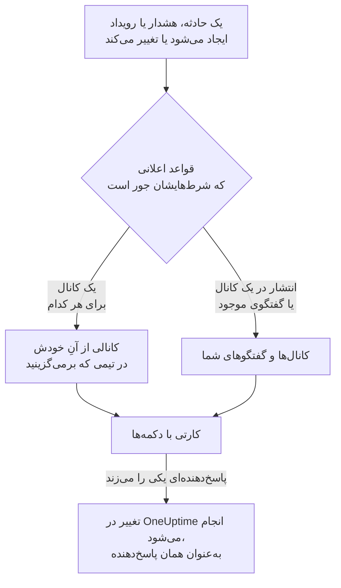

# Microsoft Teams

OneUptime را به Microsoft Teams وصل کنید تا حوادث، هشدارها، اپیزودها، تعمیر و نگهداری زمان‌بندی‌شده، مانیتورها و به‌روزرسانی‌های آنکال در کانال‌ها و گفتگوهایتان منتشر شوند، هر حادثه کانال خودش را داشته باشد، و پاسخ‌دهندگان از درون Teams کار کنند: تأیید، برطرف کردن، افزودن یادداشت، فراخوانی آنکال، اعلام حادثه و پرسیدن از OneUptime AI.

:::cards
- [اتصال Microsoft Teams](#اتصال-microsoft-teams): رضایت مدیر، ورود شما، و اپ در هر تیم.
- [درخواست اتصال از همه](#درخواست-اتصال-از-همه): به همهٔ اعضایی که حسابشان را وصل نکرده‌اند، یکجا پیام بفرستید.
- [قواعد اعلان](#قواعد-اعلان): تعیین کنید کدام رویدادها کجا منتشر شوند، و کدام‌ها کانال خودشان را بگیرند.
- [گفتگو با ربات OneUptime](#گفتگو-با-ربات-oneuptime): فرمان‌ها، پرسش‌ها و فرم‌ها در گفتگو با ربات.
- [برچسب‌های آنکال](#برچسبهای-آنکال): برچسب یک تیم را با آنکال‌ها یکسان نگه دارید و آن را فرا بخوانید.
- [اقدام روی حوادث، هشدارها و رویدادها از Microsoft Teams](#اقدام-روی-حوادث-هشدارها-و-رویدادها-از-microsoft-teams): دکمه‌های کارت‌های OneUptime.
:::

## چگونه کار می‌کند

سه چیز این کار را ممکن می‌کند:

- **اتصال پروژه**، که یک بار برقرار می‌شود: یک مدیر Microsoft 365 برای سازمان شما به اپ OneUptime رضایت می‌دهد.
- **اپ OneUptime در هر تیمی** که در آن اعلان می‌خواهید. Microsoft فقط به ربات اجازه می‌دهد در تیمی منتشر کند که به آن افزوده شده باشد.
- **اتصال خود هر فرد**: حساب Microsoft Teams او که به حساب OneUptime او پیوند خورده است. دکمه‌ها، فرمان‌ها و واکنش‌ها به‌عنوان همان فرد و با مجوزهای او در پروژه عمل می‌کنند.

یک سازمان Microsoft 365 می‌تواند به بیش از یک پروژه وصل باشد، مثلاً پروژهٔ تولید و پروژهٔ آزمایشی. دکمهٔ یک کارت در پروژه‌ای عمل می‌کند که کارت برای آن فرستاده شده است، مثلاً پروژهٔ حادثه‌ای که کارت دربارهٔ آن است. پیامی به ربات در پروژهٔ کانالی عمل می‌کند که در آن فرستاده شده است، مثلاً کانال یک حادثه، وگرنه در تنها پروژه‌ای که حساب Microsoft Teams فرستنده در آن وصل است. وقتی هیچ‌کدام از این‌ها پروژه را مشخص نکند، ربات از فرستنده می‌پرسد منظورش کدام پروژه است، با یک دکمه برای هر پروژه‌ای که در آن عضو است، و پس از انتخاب او کار را در همان پروژه ادامه می‌دهد. در گفتگو با OneUptime AI، این انتخاب برای پرسش‌های بعدی برقرار می‌ماند تا وقتی که یک ساعت بدون پرسش تازه بگذرد.

## پیش از شروع

- **نقشی که بتواند پروژه را وصل کند:** **مالک پروژه**، **مدیر پروژه** یا **عضو پروژه**. حذف نصب به **مالک پروژه** یا **مدیر پروژه** نیاز دارد.
- **یک مدیر Microsoft 365** برای اعطای رضایت مدیر، یک بار برای کل سازمان.
- **طرح Growth در OneUptime Cloud** برای قواعد اعلان و خلاصه‌ها. [قواعد اعلان پایین‌تر از طرح Growth](#قواعد-اعلان-پایینتر-از-طرح-growth) را ببینید.
- **روی یک سرور خودمیزبان،** نخست یک ربات Teams که برای آن تنظیم شده باشد. [یکپارچه‌سازی Microsoft Teams](/docs/self-hosted/microsoft-teams-integration) را ببینید.

## اتصال Microsoft Teams

:::steps
### اعطای رضایت مدیر

به **تنظیمات پروژه** > **فضای کاری** > **Microsoft Teams** بروید و روی **اعطای رضایت مدیر** کلیک کنید. یک مدیر Microsoft 365 وارد می‌شود و اپ OneUptime را برای سازمان مجاز می‌کند. سپس کارت **Admin Consent Completed** را نشان می‌دهد. تا وقتی هیچ فضای کاری‌ای وصل نشده، بخش **فضای کاری** در منوهای حوادث، هشدارها، تعمیر و نگهداری زمان‌بندی‌شده، مانیتورها و آنکال گزینهٔ **اتصال Slack یا Teams** را دارد که آن هم به همین‌جا می‌برد.

### اتصال حساب خودتان

روی **Connect with Microsoft Teams** کلیک کنید و با حساب کاری خود وارد شوید. OneUptime تیم‌های سازمان شما را می‌خواند؛ **مشاهده تیم‌ها** آن‌ها را فهرست می‌کند.

### افزودن اپ OneUptime به هر تیم (الزامی)

وصل کردن حسابتان به‌تنهایی کافی نیست. Microsoft فقط به ربات OneUptime اجازه می‌دهد در تیمی منتشر کند که به آن افزوده شده باشد، پس این کار را برای هر تیمی که در آن اعلان می‌خواهید انجام دهید:

- در Microsoft Teams، روی "..." کنار **نام تیم** (نه نام کانال) کلیک کنید.
- **Manage team** > **Apps** > **More apps** را برگزینید، **OneUptime** را پیدا کنید و روی **Add** کلیک کنید.

در OneUptime Cloud، **باز کردن فروشگاه Teams** اپ را در فروشگاه Microsoft Teams باز می‌کند، جایی که **Add to a team** همین کار را می‌کند. روی یک سرور خودمیزبان، به جای آن بسته‌ای را که از **دانلود فایل zip مانیفست اپلیکیشن** می‌گیرید نصب کنید: فقط همان بسته ربات سرور شما را دارد. اگر یک اعلان آزمایشی گزارش دهد که اپ OneUptime در تیم نصب نیست، همین گام جا افتاده است.

### وصل کردن بقیه

هر فرد حساب Microsoft Teams خود را در **تنظیمات کاربر** > **فضای کاری** > **Microsoft Teams** با **Connect my account with Microsoft Teams** پیوند می‌دهد تا به‌عنوان خودش روی حوادث اقدام کند و پیام مستقیم بگیرد. این بخش وقتی پروژه به Microsoft Teams وصل شد ظاهر می‌شود. برای اینکه کل تیم یکجا وصل شوند، [درخواست اتصال از همه](#درخواست-اتصال-از-همه) را ببینید.

### افزودن یک قاعدهٔ اعلان

به **حوادث** > **فضای کاری** > **Microsoft Teams** بروید. بخش **فضای کاری** فقط فضاهای کاری گفتگویی را فهرست می‌کند که پروژهٔ شما وصل کرده است، پس **Microsoft Teams** پس از اتصال آنجا ظاهر می‌شود. یک قاعده بسازید، مثلاً قاعده‌ای که هنگام ایجاد یک حادثه در یک کانال Teams منتشر می‌کند، سپس روی **قاعده آزمایش** در ردیف آن کلیک کنید.
:::

> [!NOTE]
> نصب OneUptime برای خودتان، یا افزودن آن به یک گفتگو، نصب دیگری است و به آن اجازه نمی‌دهد در کانال‌های یک تیم منتشر کند. **کانال‌های خصوصی** نیاز دارند که اپ به خود کانال افزوده شود: کانال را باز کنید > "..." > **Manage channel** > **Apps** > **Add an app**. **کانال‌های اشتراکی** نمی‌توانند اعلان دریافت کنند: Microsoft Teams از ربات‌ها در کانال‌های اشتراکی پشتیبانی نمی‌کند.

## درخواست اتصال از همه

هیچ‌کس، حتی یک مدیر، نمی‌تواند حساب Microsoft Teams کس دیگری را وصل کند: هر کس خودش به حساب خودش وارد می‌شود. برای اینکه کل تیم وصل شوند، یک **مالک پروژه** یا **مدیر پروژه** در **تنظیمات پروژه** > **فضای کاری** > **Microsoft Teams** یکجا از همه درخواست می‌کند. کارت **Members' Microsoft Teams accounts** نشان می‌دهد چند عضو وصل شده‌اند. با **Ask everyone to connect**، ربات OneUptime برای هر عضوی که هنوز وصل نشده پیامی می‌فرستد، با دکمهٔ **Connect Microsoft Teams account** که حساب او را با یک کلیک وصل می‌کند.

- **چه کسی پیام می‌گیرد.** هر عضو پروژه که حساب Microsoft Teams خود را وصل نکرده و در تیمی است که اپ OneUptime به آن افزوده شده است، و در آنجا از روی نشانی ایمیل یا نام اصلی کاربر (UPN) او پیدا می‌شود. کسی که در ۲۴ ساعت گذشته از او درخواست شده، دوباره درخواستی نمی‌گیرد، پس درخواست دوباره در روز بعد فقط به کسانی یادآوری می‌کند که هنوز وصل نشده‌اند.
- **آنچه کارت می‌گوید.** تا وقتی پیام‌ها در حال ارسال‌اند، اینکه ارسال تا کجا پیش رفته است، سپس اینکه چه کسی درخواست کرد و چند عضو پیام گرفتند. اعضایی که OneUptime نتوانست پیدا کند روی کارت نام برده می‌شوند: اپ را به تیمشان بیفزایید، یا از آن‌ها بخواهید خودشان حسابشان را در **تنظیمات کاربر** > **فضای کاری** > **Microsoft Teams** وصل کنند.
- **آنچه دکمه وصل می‌کند.** حساب Microsoft Teams هر کسی که آن را بفشارد و وارد شود، به حساب OneUptime خودِ او. پیامی که برای کس دیگری بازفرستاده شود، چیزی را به حساب عضوی که پیام برایش فرستاده شده بود وصل نمی‌کند.

## قواعد اعلان

یک قاعدهٔ اعلان می‌گوید کدام رویدادها در Microsoft Teams منتشر شوند، و کجا. هر محصول قواعد خودش را دارد، در منوی خودش زیر **فضای کاری** > **Microsoft Teams**:

| محصول | زبانه‌های صفحهٔ **Microsoft Teams** آن |
| --- | --- |
| **حوادث** | **حوادث**، **اپیزودهای حادثه**، **خلاصه** |
| **هشدارها** | **هشدارها**، **اپیزودهای هشدار**، **خلاصه** |
| **تعمیر و نگهداری زمان‌بندی‌شده** | یک فهرست قاعده |
| **مانیتورها** | یک فهرست قاعده |
| **کشیک آنکال** | یک فهرست قاعده |

ساختن یک قاعده چهار گام دارد:

| گام | آنچه تنظیم می‌کنید |
| --- | --- |
| **پایه** | **نام قاعده** و **توضیحات قاعده**. |
| **شرط‌ها** | قاعده برای کدام رویدادهاست، مثلاً بر اساس شدت، حالت، برچسب، مانیتور یا واژه‌های عنوان. شرط‌ها هنگام ایجاد رویداد و دوباره با هر به‌روزرسانی‌ای که OneUptime دربارهٔ آن منتشر می‌کند بررسی می‌شوند؛ پس قاعده‌ای برای حادثه‌های تأییدشده وقتی حادثه تأیید شود عمل می‌کند. قاعده تازه برای همهٔ رویدادهاست، مثلاً **همه حادثه‌ها**. برای محدود کردن آن، **فقط آن دسته از حادثه‌ها که با شرط‌ها مطابقت دارند** را انتخاب کنید و شرط‌ها را بیفزایید. با دو شرط یا بیشتر، **شرط تطابق** می‌گوید همهٔ آن‌ها باید جور باشند یا هر یک کافی است. |
| **مقصد** | کجا منتشر می‌کند: یک کانال موجود از تیمی که برمی‌گزینید، گفتگوهایی که برمی‌گزینید، یک کانال برای هر حادثه (یا هشدار، اپیزود، رویداد، مانیتور یا سیاست آنکال) که در تیمی که برمی‌گزینید ساخته می‌شود، یا هر ترکیبی از این‌ها. زیر این مرحله، **این قاعده چه می‌کند** مانند کارت قاعده آن را در چند جمله می‌گوید. |
| **Video Call** | فقط حوادث و هشدارها: برای هر کدام یک تماس آغاز کنید. [تماس‌های تصویری](/docs/workspace-connections/video-calls) را ببینید. |

کانالی که قاعده می‌سازد به نام رکوردش نام‌گذاری می‌شود: حادثهٔ INC-42 نام `inc-42` را می‌گیرد، هشدار ALT-7 نام `alt-7` را، و در پروژه‌ای بی پیشوند شماره، حادثهٔ ۴۲ نام `incident-42` را. متنِ **پیشوند نام کانال** پیش از نام می‌آید، پس `prod-` نام `prod-inc-42` را می‌سازد، و فرم هنگام نوشتن، نام را نشان می‌دهد. برای رویداد تعمیر و نگهداری زمان‌بندی‌شده، پیشوند جای پیشوند شماره‌اش را می‌گیرد: SM-5 نام `sm-5` را می‌گیرد، و `maint-` نام `maint-5` را می‌سازد. OneUptime حروف، اعداد، فاصله، `-` و `_` را تا ۵۰ نویسه‌ای که Microsoft Teams می‌پذیرد نگه می‌دارد. اگر تیم از پیش کانالی با آن نام داشته باشد، مانند کانال پروژه‌ای دیگر یا کانالی که در ۳۰ روز گذشته حذف شده، OneUptime `-2`، `-3` و مانند آن را می‌افزاید.

قاعده کانالش را نخستین باری می‌سازد که رویدادی با آن مطابقت داشته باشد: هنگام ایجاد رویداد، یا بعدتر، وقتی به‌روزرسانی‌ای آن را مطابق کند و رویداد هنوز باز باشد. قاعده‌ای برای حادثه‌های تأییدشده کانال را وقتی می‌سازد که حادثه تأیید شود. Microsoft Teams کانال‌های یک تیم را به همهٔ اعضای تیم نشان می‌دهد، پس OneUptime کسی را یکی‌یکی به کانال نمی‌افزاید: همهٔ اعضای تیمی که برمی‌گزینید می‌توانند آن را باز کنند، همان‌طور که فرم قاعده زیر **چه کسانی به کانال می‌پیوندند** می‌گوید. یک حادثه، هشدار یا اپیزود خصوصی کانال خصوصی می‌گیرد که فقط اعضایش آن را می‌بینند؛ افراد را در Microsoft Teams بیفزایید.

برای اینکه کسانی که آنکال هستند به کانال بیایند، زمان‌بندی‌های آنکالشان را زیر **منشن کردن آنکال‌ها** برگزینید. هنگام ایجاد کانال، OneUptime درست پس از نخستین پیام رکورد، پیامی در آن منتشر می‌کند که با @ از کسانی که در آن زمان‌بندی‌ها آنکال هستند نام می‌برد، تا Microsoft Teams آن‌ها را باخبر کند. هیچ‌کس فراخوانده نمی‌شود. OneUptime هر فرد را در تیم از روی حساب Microsoft Teams او که به OneUptime وصل است پیدا می‌کند، وگرنه از روی نشانی ایمیلش. کسی که در تیم نیست نمی‌تواند کانال‌های آن را باز کند، پس به‌جای آن، در پیام با دلیلش از او نام برده می‌شود. کانال خصوصی را فقط اعضایش می‌توانند باز کنند، پس افراد آنکال را در Microsoft Teams به آن بیفزایید.

هر به‌روزرسانی بعدی رکورد — تغییر حالت، یک یادداشت، یک مالک تازه — در کانال‌های آن منتشر می‌شود، و تا وقتی شرط‌های قواعدش برقرارند، در کانال‌ها و گفتگوهای موجودی که قواعدش نام می‌برند. OneUptime نمی‌تواند کانال Microsoft Teams را بایگانی کند، پس کانال یک قاعده پس از پایان رکوردش می‌ماند؛ آن را در Microsoft Teams بایگانی یا حذف کنید.

حادثه، هشدار، اپیزود یا رویداد تعمیر و نگهداری زمان‌بندی‌شده‌ای که کانال خودش را دارد، در سربرگ صفحه‌اش در OneUptime، کنار دکمه‌های حالت، **باز کردن در Microsoft Teams** دارد. این دکمه آن کانال را در زبانه‌ای تازه، در برنامه Microsoft Teams یا در مرورگر باز می‌کند. رکوردی که دو کانال از خودش دارد هر دو را زیر دکمه فهرست می‌کند. رکوردی که هم در Slack و هم در Microsoft Teams کانال دارد، به‌جای آن یک دکمه **باز کردن کانال** دارد که همه را فهرست می‌کند. کانال‌ها و گفتگوهای موجودی که قواعد شما در آن‌ها منتشر می‌کنند پیشنهاد نمی‌شوند.

صفحه رکورد کارت **کانال Microsoft Teams** را هم دارد، که می‌گوید چه کسی می‌تواند کانال را باز کند: همه اعضای تیم، یا برای کانال خصوصی، اعضای آن، که مالکانش در Microsoft Teams اضافه‌شان می‌کنند. OneUptime تغییر نمی‌دهد چه کسانی در یک کانال Microsoft Teams هستند. برای کانال Slack، کارت فهرست می‌کند چه کسانی در آن هستند و افراد را اضافه می‌کند: نگاه کنید به [چه کسانی در کانال یک رکورد هستند](/docs/workspace-connections/slack#چه-کسانی-در-کانال-یک-رکورد-هستند).

کانال‌ها و گفتگوها خوانا می‌مانند: هر رویداد یک بار منتشر می‌شود، و نخستین حالت رکورد در کارتی است که رکورد را اعلام می‌کند، نه در کارتی جداگانه. هر اجرای یک سیاست آنکال یک کارت است که با پیشرفت تشدید ویرایش می‌شود: چه کسی فراخوانده شد، چند بار و چگونه، چه کسی نه و چرا، و چه کسی تأیید کرد. کارت تازه فقط وقتی منتشر می‌شود که کسی باید کاری بکند: یک قاعده تشدید به هیچ‌کس نرسید، یا اجرا بی‌آنکه کسی تأیید کند به پایان رسید. اینکه مالکان رکورد یا مشترکان صفحه وضعیت باخبر شدند، در خوراک آن در OneUptime می‌ماند.

**تنظیمات پروژه** > **فضای کاری** > **Microsoft Teams** کانال‌هایی از تیم‌های شما را که OneUptime می‌تواند ببیند، و گفتگوهایی را که به آن‌ها افزوده شده، فهرست می‌کند، با **ارسال آزمایشی** کنار هر کدام. یک گفتگو وقتی ظاهر می‌شود که اپ OneUptime در Microsoft Teams به آن افزوده شود؛ **Refresh Chats** گفتگوهای تازه و نام‌های کنونی آن‌ها را می‌آورد.

## آزمودن یک قاعده

**قاعده آزمایش** در ردیف یک قاعده، پیامی آزمایشی برای آن قاعده در کانال‌هایی که نام می‌برد منتشر می‌کند تا رسیدنش را ببینید. اگر قاعده برای هر رویداد یک کانال می‌سازد، آزمون هم یکی می‌سازد و افراد قاعده را به آن دعوت می‌کند.

مانند **ارسال آزمایشی** کنار یک کانال در **تنظیمات پروژه** > **فضای کاری** > **Microsoft Teams**، این کار به مجوز ساختن قواعد اعلان نیاز دارد: **مالک پروژه**، **مدیر پروژه**، **عضو پروژه**، **مدیر تنظیمات**، **عضو تنظیمات**، یا **Create Workspace Notification Rule** و **Read Workspace Notification Rule** در یک نقش سفارشی. برای کسی که فقط می‌تواند قواعد را ببیند، مانند یک **بیننده**، **قاعده آزمایش** قفل است و راهنمای آن می‌گوید چه لازم است؛ API آزمون او را با «You do not have permission to send test notifications in this project.» رد می‌کند. در OneUptime Cloud، آزمودن یک قاعده، مانند افزودن آن، به طرح **Growth** نیاز دارد.

در OneUptime Cloud، **ارسال آزمایشی** کنار یک کانال یا گفتگو هم به طرح **Growth** نیاز دارد، چون منتشر کردن در یک کانال همان کاری است که قواعد و خلاصه‌ها می‌کنند. **ارسال آزمایشی فوری** روی یک خلاصه به مجوز ساختن خلاصه‌ها (**Create Workspace Notification Summary** و **Read Workspace Notification Summary** در یک نقش سفارشی) و، در OneUptime Cloud، به طرح **Growth** نیاز دارد؛ برای هر کس دیگری قفل است و راهنمای آن می‌گوید چه لازم است. یک کلاینت MCP که با دسترسی فقط‌خواندنی وصل شده نمی‌تواند هیچ آزمونی بفرستد.

## خلاصه‌ها

زبانهٔ **خلاصه** در **حوادث** > **فضای کاری** > **Microsoft Teams** (و در **هشدارها**) یک جمع‌بندی دوره‌ای در کانال‌هایی که نام می‌برید منتشر می‌کند: چند حادثه یا هشدار رخ داده، با چه سرعتی تأیید و برطرف شده‌اند، و فهرستی با پیوندها. خلاصهٔ تازه هر هفته فرستاده می‌شود و ۷ روز گذشته را پوشش می‌دهد. اگر **ارسال اولین گزارش در** را خالی بگذارید، نخستین خلاصه ساعت ۰۹:۰۰ در آغاز هفته، روز یا ماه بعد فرستاده می‌شود؛ فرم می‌گوید چه زمانی.

هر خلاصه بر اساس ساعت **منطقه زمانی** خودش فرستاده می‌شود که در آغاز منطقهٔ زمانی شماست. ساعتِ روزِ خود را در آنجا در تمام سال حفظ می‌کند: خلاصه‌ای که برای ساعت ۰۹:۰۰ در برلین تنظیم شده، پس از جابه‌جایی ساعت‌ها برای ساعت تابستانی هم ساعت ۰۹:۰۰ به وقت برلین فرستاده می‌شود، و تاریخ‌های پیامش هم به وقت برلین است. از راه API، `timezone` را به‌صورت نام منطقهٔ زمانی IANA بفرستید، مانند `Europe/Berlin`. خلاصه‌ای که بدون منطقهٔ زمانی ساخته شود، منطقهٔ زمانی پروفایل سازنده‌اش را می‌گیرد، یا وقتی یک کلید API آن را می‌سازد، UTC را.

فرم خلاصه چهار گام دارد: **اطلاعات پایه** (نام آن، کانال‌ها و **نام تیم** آن‌ها)، **زمان‌بندی**، **محتوا** (**چه چیزهایی باید گنجانده شود**) و **فیلترها** (کدام حوادث یا هشدارها را می‌شمارد).

## قواعد اعلان پایین‌تر از طرح Growth

در OneUptime Cloud، قواعد اعلان و خلاصه‌ها در طرح **Growth** و بالاتر هستند. پروژه‌ای پایین‌تر از آن، قواعد و خلاصه‌هایی را که از قبل دارد نگه می‌دارد، و آن‌ها همچنان در Microsoft Teams منتشر می‌کنند. بنابراین صفحهٔ **Microsoft Teams** هر محصول (حوادث، هشدارها، تعمیر و نگهداری زمان‌بندی‌شده، کشیک آنکال، مانیتورها) یادداشت طرح را با فهرست آن‌ها در زیرش نشان می‌دهد (**قواعد اعلان که هنوز تنظیم شده‌اند**، **خلاصه‌هایی که هنوز تنظیم شده‌اند**): یک قاعده را حذف کنید، یا یک خلاصه را خاموش یا حذف کنید. افزودن یا تغییر قواعد و خلاصه‌ها به **Growth** نیاز دارد.

## فراخوانده شدن در Microsoft Teams

برای اینکه وقتی آنکال هستید با پیام مستقیم فراخوانده شوید، Microsoft Teams را به‌عنوان یکی از روش‌های اعلان خود بیفزایید:

:::steps
1. حساب Microsoft Teams خودتان را وصل کنید ([اتصال Microsoft Teams](#اتصال-microsoft-teams) را ببینید).
2. به **تنظیمات کاربر** > **روش‌های اعلان** بروید، زبانهٔ **Workspace Apps** را باز کنید و روی **Add Microsoft Teams Account** کلیک کنید.
3. روی **Send Test Message** در ردیف آن کلیک کنید. پیام به گفتگوهای Microsoft Teams شما می‌رسد.
:::

افزودن آن، فوراً آن را به قواعد آنکال شما هم می‌افزاید، پس از آن پس فراخوان‌ها در Microsoft Teams به شما می‌رسند. اینکه کدام فراخوان‌ها را بگیرد، در **تنظیمات کاربر** > **قواعد آنکال** تغییر دهید.

## ذخیرهٔ پیام‌ها به‌عنوان یادداشت

در کانالی که OneUptime برای یک حادثه، هشدار، اپیزود یا رویداد تعمیر و نگهداری زمان‌بندی‌شده ساخته است، به یک پیام یا یک پاسخ واکنش نشان دهید، و OneUptime آن را به‌عنوان یادداشتی روی همان رکورد ذخیره می‌کند. واکنش را ظرف یک دقیقه برمی‌دارد و با پاسخی در رشتهٔ گفتگو تأیید می‌کند:

| واکنش | ذخیره به‌عنوان |
| --- | --- |
| 📌 یا 📍 | یک یادداشت خصوصی که فقط تیم شما می‌بیند |
| 📣 یا 📢 | یک یادداشت عمومی که روی صفحهٔ وضعیت نشان داده می‌شود. فقط حوادث و رویدادهای تعمیر و نگهداری زمان‌بندی‌شده. روی حادثه خصوصی، یک یادداشت خصوصی، و تأیید دلیلش را می‌گوید. |

یادداشت پیام را همان‌طور نگه می‌دارد که Microsoft Teams نشانش می‌داد: قالب‌بندی، پیوندها و کد آن، افرادی که نام می‌برد با نامشان، و پرونده‌ها و تصاویرش به‌صورت پیوند به آن‌ها. یادداشت عمومی پرونده‌ها و تصاویر را کنار می‌گذارد، چون فقط برای تیم شما باز می‌شوند.

یادداشت سخن کسی است که پیام را نوشته است: اگر حساب Microsoft Teams او وصل باشد با نامش در OneUptime، وگرنه با نامی که Teams نشان می‌دهد. یادداشت خصوصی در خط زمانی در همان زمانی قرار می‌گیرد که پیام فرستاده شد، هر قدر هم که دیرتر ذخیره شود. یادداشت عمومی در زمانی قرار می‌گیرد که ذخیره می‌شود، یعنی همان زمانی که صفحهٔ وضعیت آن را نشان می‌دهد. خط زمانی می‌گوید چه کسی آن را ذخیره کرد. یادداشت دوباره در کانال فرستاده نمی‌شود، جایی که پیام از پیش هست.

یادداشت به‌عنوان شما و با مجوزهای شما ذخیره می‌شود، و اپ OneUptime باید در تیم باشد. اگر حساب Microsoft Teams شما هنوز وصل نیست، OneUptime در پاسخی که از شما نام می‌برد از شما می‌خواهد آن را وصل کنید، همراه دکمه‌ای که به‌محض وصل شدن، پیام را ذخیره می‌کند.

## گفتگو با ربات OneUptime

در یک گفتگوی شخصی به ربات پیام بدهید، یا در یک کانال یا گفتگوی گروهی با @ از OneUptime نام ببرید: آنجا فقط وقتی نامش برده شود پاسخ می‌دهد.

| پیام | آنچه ربات انجام می‌دهد |
| --- | --- |
| `help` | آنچه را می‌تواند انجام دهد فهرست می‌کند. |
| `incident [title or number]` | فرم حادثه را با عنوانِ پرشده باز می‌کند. شمارهٔ یک حادثه، مانند `42` یا `INC-42`، به‌جای آن همان حادثه را نشان می‌دهد: [مدیریت یک حادثه از Microsoft Teams](#مدیریت-یک-حادثه-از-microsoft-teams) را ببینید. |
| `maintenance [title]` | فرم تعمیر و نگهداری زمان‌بندی‌شده را با عنوانِ پرشده باز می‌کند. |
| `oncall` | فهرست می‌کند که اکنون در هر زمان‌بندی آنکالی که می‌توانید ببینید چه کسی آنکال است، تا کی، و نفر بعدی کیست. |
| `page [who] [message]` | کسانی را که با @ از آن‌ها نام می‌برید دربارهٔ پیام شما فرا می‌خواند، یا کارتی می‌فرستد تا انتخاب کنید چه کسی فراخوانده شود. [فراخواندن کسی از Microsoft Teams](#فراخواندن-کسی-از-microsoft-teams) را ببینید. |
| `ask [question]`، یا هر پرسشی به زبان ساده | OneUptime AI دربارهٔ لاگ‌ها، ردیابی‌ها، متریک‌ها، حوادث و مانیتورهای شما پاسخ می‌دهد، برای نمونه «الان کدام مانیتورها از کار افتاده‌اند؟». پاسخ‌ها فقط می‌خوانند. |
| `show active incidents`، `show active alerts` | آنچه اکنون باز است را فهرست می‌کند. |
| `show scheduled maintenance`، `show ongoing maintenance` | رویدادهای نگهداری پیش رو، یا در جریان، را فهرست می‌کند. |

به‌جز فهرست‌های `show`، این‌ها همان واژه‌هایی هستند که در Slack پس از `/oneuptime` می‌آیند؛ `create incident` و `create maintenance` هم همچنان کار می‌کنند. پرسیدن از OneUptime AI نیاز دارد که حساب Microsoft Teams خودتان وصل باشد و هوش مصنوعی برای پروژه روشن باشد. اگر حساب شما وصل نیست، ربات در هر رشتهٔ گفتگو یا هر گفتگو تنها یک بار از شما می‌خواهد آن را وصل کنید، با دکمهٔ **Connect Microsoft Teams account**. [پرسش از هوش مصنوعی](/docs/ai/ask-ai) را ببینید.

## صفحهٔ خانهٔ شما در Microsoft Teams

به ربات OneUptime بنویسید `home`، و با صفحهٔ خانهٔ شما پاسخ می‌دهد: کارتی که نشان می‌دهد در پروژه چه می‌گذرد، تا جایی که شما اجازهٔ دیدنش را دارید.

- **آنکال شما.** زمان‌بندی‌های آنکالی که هم‌اکنون در آن‌ها آنکال هستید، و تا کی، وگرنه شیفت بعدی شما.
- **آنچه باز است.** تازه‌ترین حوادث و هشدارهای بازی که اجازهٔ خواندنشان را دارید، هر کدام با پیوندی به صفحه‌اش در OneUptime.
- **دکمه‌هایش.** **Declare incident** و **Page someone** همان‌طور پاسخ می‌دهند که `incident` و `page`، **Who's on call** همان‌طور که `oncall`، و **Refresh** کارت را در همان جا دوباره می‌خواند.

وقتی برنامهٔ OneUptime را برای خودتان اضافه می‌کنید، ربات بی‌درنگ صفحهٔ خانهٔ شما را می‌فرستد. صفحهٔ خانه و فهرست‌های `show` به‌نام شما می‌خوانند، پس به حساب Microsoft Teams متصل خودتان نیاز دارند: تا وقتی متصل نشده، ربات با دکمهٔ **Connect Microsoft Teams account** پاسخ می‌دهد. **باز کردن OneUptime در Microsoft Teams** در **تنظیمات کاربر** > **فضای کاری** > **Microsoft Teams** برنامه را در Teams باز می‌کند.

وقتی برنامه به تیمی اضافه می‌شود، ربات آنجا سلام می‌کند: چطور از آن سؤال بپرسید، و قاعدهٔ اعلانی که در کانال‌های تیم منتشر می‌کند را کجا اضافه کنید.

## ایجاد حادثه و نگهداری از Microsoft Teams

تایپ کردن `incident` یا `maintenance` برای ربات OneUptime، فرمی برای همان کسی که آن را تایپ کرده باز می‌کند، چه در گفتگوی شخصی، چه در کانال یا گفتگوی گروهی. فرم به‌عنوان همان فرد پر می‌شود: به‌عنوان حساب OneUptimeای که حساب Microsoft Teams او به آن وصل است ([اتصال Microsoft Teams](#اتصال-microsoft-teams) را ببینید)، با مجوزهای آن حساب در پروژه. به کسی که حسابش وصل نیست، یا حساب OneUptime او دیگر عضو پروژه نیست، به جای فرم، در پاسخی که از او نام می‌برد، گفته می‌شود چه کند.

- **چه کسی می‌تواند از آن‌ها استفاده کند.** کسانی که می‌توانند در OneUptime حادثه اعلام کنند یا رویداد تعمیر و نگهداری زمان‌بندی‌شده بسازند: **مالک پروژه**، **مدیر پروژه**، **عضو پروژه**، **مدیر حوادث** و **عضو حوادث** برای یک حادثه (**Create Incident** در یک نقش سفارشی)، و **مدیر تعمیر و نگهداری زمان‌بندی‌شده** و **عضو تعمیر و نگهداری زمان‌بندی‌شده** برای یک رویداد (**Create Scheduled Maintenance**). به هر کس دیگری این موضوع گفته می‌شود و فرمی نمی‌گیرد.
- **فرم چه چیزهایی پیشنهاد می‌کند.** هر فهرست — شدت‌ها، مانیتورها، وضعیت‌های مانیتور، سیاست‌های آنکال و برچسب‌ها — همان چیزهایی را دارد که کسی که فرم را خواسته می‌تواند بخواند، مانند همان فهرست در OneUptime، و یادداشت‌های «not shown» کارت هم فقط همان‌ها را می‌شمارند: با نقشی محدود به برخی برچسب‌ها، مانیتورها و سیاست‌های آنکالی که آن برچسب‌ها را دارند. فهرستی که او اصلاً نمی‌تواند بخواند کنار گذاشته می‌شود. سیاست‌های آنکال بایگانی‌شده هرگز پیشنهاد نمی‌شوند.
- **فرم چه چیزی را می‌تواند نام ببرد.** در یک کانال یا گفتگوی گروهی هر کسی که آنجاست می‌تواند فرم را ارسال کند، و فرم به‌عنوان همان کسی که ارسالش می‌کند، با مجوزهای خود او، ارسال می‌شود. حادثه یا رویداد با همان مجوزها ساخته و به نام همان فرد ثبت می‌شود. مانیتور، سیاست آنکال، برچسب، شدت یا وضعیتی که او نمی‌تواند بخواند، یا متعلق به پروژه‌ای دیگر، طوری رد می‌شود که گویی پروژه آن را ندارد، و چیزی ساخته نمی‌شود: ربات پاسخ می‌دهد «One of the values you picked ... is not available in this project any more. Please pick it again.»

**Execute On-Call Policy** روی یک حادثه، هشدار یا اپیزود هم همین‌طور کار می‌کند: به مجوز اجرای سیاست آنکال (**مالک پروژه**، **مدیر پروژه**، **عضو پروژه**، **مدیر آنکال** و **عضو آنکال**، یا **Create On-Call Duty Policy Execution Log** در یک نقش سفارشی) و به مجوز خواندن آن حادثه، هشدار یا اپیزود نیاز دارد، و سیاست‌های آنکال فعالی را پیشنهاد می‌کند که آن فرد می‌تواند بخواند. دیدن یک مانیتور یا سیاست آنکال از روی یک کارت هم آن را به‌عنوان کسی که دکمه را زده می‌خواند.

## فراخواندن کسی از Microsoft Teams

در یک کانال یا گفتگوی گروهی، `@OneUptime page @Nawaz Dhandala The checkout API is throwing 500s` بی‌درنگ Nawaz را فرا می‌خواند. OneUptime هشداری می‌سازد که عنوانش پیام شماست، و هر کسی که با @ از او نام می‌برید، همان‌طور که قواعد آنکال خودش می‌گوید، یک تماس تلفنی، یک پیامک، یک اعلان push یا یک ایمیل می‌گیرد، تا وقتی که کسی هشدار را تأیید کند.

- **چه کسی بی‌درنگ فراخوانده می‌شود.** کسانی که با @ از آن‌ها نام می‌برید، و کسانی که در زمان‌بندی‌هایی آنکال هستند که برچسبی که با @ از آن نام می‌برید دنبال می‌کند (نگاه کنید به [برچسب‌های آنکال](#برچسبهای-آنکال))، وقتی پیامی پس از آن‌ها بیاید. OneUptime هر فرد را از روی حساب OneUptimeای که حساب Microsoft Teams او به آن وصل است می‌شناسد، وگرنه از روی نشانی ایمیل او در Microsoft Teams. هیچ کسی بیرون از پروژه فراخوانده نمی‌شود.
- **هر چیز دیگری یک کارت می‌گیرد.** اگر از کسی با @ نام نبرید، مانند گفتگوی شخصی با ربات، پیامی نباشد، از برچسبی نام ببرید که هیچ زمان‌بندی آنکالی را که برای شما دیدنی است دنبال نمی‌کند، یا OneUptime نتواند کسی را بشناسد، ربات با کارت **Page someone** پاسخ می‌دهد که آنچه نوشته‌اید در آن پر شده، و می‌گوید چه کسی را نتوانست انتخاب کند. افراد، یک تیم، یک زمان‌بندی آنکال، که هر کسی را که اکنون در آن آنکال است فرا می‌خواند، یا یک سیاست آنکال، که از راه قواعد تشدیدش فرا می‌خواند، را انتخاب کنید و کارت را ارسال کنید. هر کسی در گفتگو می‌تواند کارت را به‌عنوان خودش ارسال کند. وقتی فراخوان انجام شد، کارت برداشته می‌شود تا کسی دو بار با آن فرا نخواند.
- **کجا نشان داده می‌شود.** گفتگو فراخوان را به‌صورت یک کارت نشان می‌دهد که به‌روز نگه داشته می‌شود: چه کسی و چگونه فراخوانده شد، و چه کسی تأیید کرد. جایی که ربات نمی‌تواند آن را پست کند، پاسخش می‌گوید چه کسی فراخوانده شد، با پیوندی به هشدار.
- **چه کسی می‌تواند فرا بخواند.** هر کسی که هم بتواند یک سیاست آنکال را اجرا کند و هم هشدار بسازد: **مالک پروژه**، **مدیر پروژه** و **عضو پروژه**، یا **عضو آنکال** همراه با **عضو هشدارها** (**Create On-Call Duty Policy Execution Log** و **Create Alert** در یک نقش سفارشی). فراخواندن مستقیم افراد، یک تیم یا یک زمان‌بندی، بدون سیاست آنکالی پشت فراخوان، به دسترسی به همهٔ سیاست‌های آنکال پروژه هم نیاز دارد. به هر کس دیگری این موضوع در یک پاسخ گفته می‌شود، و هیچ کسی فراخوانده نمی‌شود. در OneUptime Cloud، فراخواندن به طرح Growth نیاز دارد: در طرح‌های پایین‌تر، OneUptime طرح لازم را می‌گوید و هیچ کسی فراخوانده نمی‌شود.

## برچسب‌های آنکال

یک برچسب Microsoft Teams، مانند `@Payments on-call`، را با کسانی که در یک یا چند زمان‌بندی آنکال هم‌اکنون آنکال هستند یکسان نگه دارید تا هر کسی در تیمش بتواند با @ از آن نام ببرد و به آن‌ها برسد. OneUptime در هر تحویل و هر جایگزینی اعضای برچسب را تغییر می‌دهد و هر 15 دقیقه آن را بررسی می‌کند.

:::steps
### یک برچسب را به یک زمان‌بندی وصل کنید

زمان‌بندی را در **کشیک آنکال** > **زمان‌بندی‌های آنکال** باز کنید. در کارت **برچسب‌های Microsoft Teams** آن، روی **اتصال برچسب** کلیک کنید، تیم را انتخاب کنید و نام برچسب را بنویسید: برچسب تیم با این نام، یا برچسب جدیدی که OneUptime می‌سازد. اعضای آن بی‌درنگ با آنکال‌ها جایگزین می‌شوند.

### آن را به زمان‌بندی پشتیبان هم وصل کنید

برای برچسبی که آنکال اصلی و پشتیبان را با هم داشته باشد، همان برچسب را در صفحهٔ زمان‌بندی پشتیبان هم وصل کنید. یک برچسب می‌تواند هر تعداد زمان‌بندی را دنبال کند.
:::

- **آنچه کارت نشان می‌دهد.** اینکه اکنون چه کسانی در هر برچسب هستند، تیم آن، زمان‌بندی‌های دیگری که دنبال می‌کند، و اینکه **به‌روز** است یا نه. هر برچسب فقط اعضای تیم خودش را دارد: آنکالی که در تیم نیست، با دلیلش نام برده می‌شود.
- **کسی آنکال نیست.** OneUptime همه را تا وقتی کسی آنکال شود از برچسب بیرون می‌برد. برچسب تازه به کسی از تیم نیاز دارد که آنکال باشد، چون Microsoft Teams برچسب خالی نمی‌سازد.
- **فراخواندن برچسب.** `@OneUptime page @Payments on-call The checkout API is down` کسانی را فرا می‌خواند که در زمان‌بندی‌هایی که برچسب دنبال می‌کند آنکال هستند. نگاه کنید به [فراخواندن کسی از Microsoft Teams](#فراخواندن-کسی-از-microsoft-teams).
- **آنچه Microsoft 365 لازم دارد.** تغییر برچسب‌ها به مجوز `TeamworkTag.ReadWrite.All` برنامه نیاز دارد، که یک مدیر Microsoft 365 آن را با **اعطای رضایت مدیر** در **تنظیمات پروژه** > **فضای کاری** > **Microsoft Teams** می‌دهد. اگر سازمان شما پیش از آنکه OneUptime بتواند برچسب‌ها را نگه دارد رضایت داده است، یک بار دیگر رضایت دهید.
- **چه کسی می‌تواند یکی را وصل کند.** نقش‌هایی که می‌توانند زمان‌بندی‌ها را ویرایش کنند: **مالک پروژه**، **مدیر پروژه**، **عضو پروژه**، **مدیر آنکال** و **عضو آنکال**، یا **Edit On-Call Duty Policy Schedule** در یک نقش سفارشی. در OneUptime Cloud، وصل کردن به طرح **Growth** نیاز دارد.
- **قطع اتصال.** OneUptime دیگر برچسب را تغییر نمی‌دهد. برچسب و اعضایش همان‌طور که هستند در Microsoft Teams می‌مانند.

## مدیریت یک حادثه از Microsoft Teams

کارت یک حادثه چهار دکمه دارد، **Acknowledge Incident**، **Resolve Incident**، **Add Note** و **View Incident**، و بقیه در منوی آن است، دکمهٔ سه‌نقطه‌ای:

| مورد منو | چه می‌کند |
| --- | --- |
| **Change Severity** | شدت حادثه را تعیین می‌کند. |
| **Change Incident State** | حادثه را به حالتی بعدی می‌برد. |
| **Assign Role** | به کسی نقشی در حادثه می‌دهد، مانند **Incident Commander**. نقشی که فقط یک نفر می‌گیرد به او منتقل می‌شود. |
| **Page Someone** | افراد، یک تیم، کسی که هم‌اکنون در یک زمان‌بندی آنکال است، یا یک سیاست آنکال را دربارهٔ حادثه فرا می‌خواند، تا وقتی که کسی آن را تأیید کند. |
| **Edit Custom Fields** | فیلدهای سفارشی حادثه را تعیین می‌کند، هر یک پرشده با آنچه حادثه دارد. فیلدی که خالی بماند پاک می‌شود. |

`incident 42`، که برای ربات نوشته شود، با حادثهٔ 42، این دکمه‌ها و منوی آن پاسخ می‌دهد. شماره را همان‌طور بنویسید که OneUptime نشان می‌دهد: `42`، `#42` یا `INC-42`. در کانالِ خودِ یک حادثه، `incident` به‌تنهایی همان حادثه را نشان می‌دهد.

- **چه کسی می‌تواند از آن‌ها استفاده کند.** کسانی که می‌توانند همان تغییر را در OneUptime بدهند، مانند Slack: [مدیریت یک حادثه از Slack](/docs/workspace-connections/slack#مدیریت-یک-حادثه-از-slack) را ببینید. هر مورد با یک کارت پاسخ می‌دهد که همان‌طور پر شده که کسی که آن را فشرده می‌تواند حادثه را ببیند. هر کسی در گفتگو می‌تواند کارت را، به‌عنوان خودش و با مجوزهای خودش، ارسال کند.
- **چه اتفاقی می‌افتد.** تغییر به‌عنوان کسی انجام می‌شود که کارت را ارسال کرده، همان‌طور که در OneUptime، و فید حادثه می‌گوید چه چیزی تغییر کرد. ربات این را در پاسخی می‌گوید که از او نام می‌برد، و کارت را برمی‌دارد تا کسی آن را دو بار ارسال نکند. **Page Someone** می‌گوید چه کسی فراخوانده شد، یا چرا هیچ کس؛ حادثه‌ای که از پیش حل شده هیچ کسی را فرا نمی‌خواند.
- **جایی که Microsoft Teams فرق دارد.** کارت نمی‌تواند زیر یک فیلد بگوید چه چیزی نادرست است: مقداری که جور نیست در یک پاسخ گفته می‌شود، و کارت می‌ماند تا اصلاح و دوباره ارسال شود. فیلد تاریخ و زمان یک روز و یک ساعت است، در منطقهٔ زمانی خود شما. یک کلاینت قدیمی‌تر Teams منو را به‌صورت دکمه‌های بیشتر نشان می‌دهد. `incident 42` در گفتگو پاسخ می‌دهد، جایی که همهٔ کسانی که در آن هستند می‌توانند حادثه را ببینند.
- **کارت‌هایی که پیش از منو فرستاده شده‌اند.** دکمهٔ **Execute On-Call Policy** خود را نگه می‌دارند و همچنان کار می‌کند: **Page Someone** هم یک سیاست آنکال را فرا می‌خواند. هشدارها و اپیزودها دکمهٔ خود را نگه می‌دارند.

## اقدام روی حوادث، هشدارها و رویدادها از Microsoft Teams

دکمه‌های کارت‌های OneUptime به‌عنوان کسی که آن‌ها را می‌زند عمل می‌کنند، چه در گفتگوی شخصی، چه در کانال یا گفتگوی گروهی: به‌عنوان حساب OneUptimeای که حساب Microsoft Teams او به آن وصل است، با مجوزهای آن حساب در پروژه. **Acknowledge**، **Resolve**، **Change State**، **Add Note** و **Execute On-Call Policy** روی یک حادثه، هشدار یا اپیزود، و **Mark as Ongoing**، **Mark as Complete**، **Change State** و **Add Note** روی یک رویداد تعمیر و نگهداری زمان‌بندی‌شده، هر کدام همان تغییری را می‌دهند که همان اقدام در OneUptime می‌دهد، و در آنجا به نام همان فرد ثبت می‌شود: خط زمانی حالت و فید رکورد نشان می‌دهند چه کسی حالت آن را تغییر داده است، و یادداشت از آنِ اوست. یادداشتی که با یک واکنش از یک پیام ذخیره می‌شود هم به همین شکل منتشر می‌شود.

- **چه کسی می‌تواند از آن‌ها استفاده کند.** کسانی که می‌توانند همان تغییر را در OneUptime بدهند. تأیید، برطرف کردن یا تغییر حالت یک حادثه به مجوز تغییر حالت آن نیاز دارد: **مالک پروژه**، **مدیر پروژه**، **عضو پروژه**، **مدیر حوادث** و **عضو حوادث**، یا **Create Incident State Timeline** در یک نقش سفارشی. یک هشدار، اپیزود یا رویداد تعمیر و نگهداری زمان‌بندی‌شده به همان مجوز برای نوع خودش نیاز دارد (برای نمونه **Create Alert State Timeline**)، و یک یادداشت به مجوز انتشار آن نوع یادداشت. مانند پانل حالت در OneUptime، این‌ها مجوز ویرایش خود حادثه یا هشدار را نمی‌خواهند. به هر کس دیگری این موضوع گفته می‌شود و چیزی تغییر نمی‌کند.
- **کدام رکوردها.** آن‌هایی که آن فرد می‌تواند بخواند، مانند OneUptime: با نقشی محدود به برخی برچسب‌ها، حوادث، هشدارها، اپیزودها و رویدادهایی که آن برچسب‌ها را دارند. دکمه‌ای روی هر رکورد دیگری دلیل را می‌گوید و چیزی تغییر نمی‌کند: روی حادثه‌ای که نقش او به آن نمی‌رسد، «your access in this project does not include this incident. Ask a project admin for access to it.»؛ روی حادثهٔ خصوصی‌ای که او مالک آن نیست، «this incident is private, so only its owners and the project's owners and admins can see it. Ask one of them to add you as an owner.»؛ و روی حادثه‌ای که از آن زمان حذف شده، «the incident was not found. It may have been deleted.» در OneUptime Cloud، تغییری که طرح پروژه شامل آن نیست با ذکر طرحی که لازم دارد رد می‌شود.
- **Change State چه پیشنهاد می‌کند.** حالت‌هایی که آن فرد می‌تواند بخواند و رکورد می‌تواند در ادامه به آن‌ها برود، به ترتیب پروژه: هیچ‌کدام پیش از حالتی که در آن است، برای یک اپیزود همان‌طور که برای یک حادثه، هشدار یا رویداد تعمیر و نگهداری زمان‌بندی‌شده، چون تغییر حالت هرگز رکورد را در فهرستش به عقب برنمی‌گرداند ([ترتیب محدودیتی واقعی است، نه ترجیحی نمایشی](/docs/incidents/states-and-severities#ترتیب-محدودیتی-واقعی-است-نه-ترجیحی-نمایشی) را ببینید). وقتی او هیچ‌کدام را نمی‌تواند بخواند، ربات می‌گوید «No incident states are available to you in this project. Ask a project admin for access to them.»؛ وقتی رکورد در آخرین حالتی است که می‌تواند به آن برسد، می‌گوید «There is no later state to move this incident to.». هیچ‌کدام کارت خالی نشان نمی‌دهد.
- **Add Note روی حادثه خصوصی.** حادثه خصوصی یادداشت عمومی نمی‌پذیرد، پس کارت آن نوع یادداشت را نمی‌پرسد و یک یادداشت خصوصی می‌افزاید. کارتی که پیش از خصوصی شدن آن فرستاده شده هم یک یادداشت خصوصی می‌افزاید و این را می‌گوید. [حادثه‌های خصوصی فقط یادداشت خصوصی می‌پذیرند](/docs/incidents/notes-owners-and-feed#حادثههای-خصوصی-فقط-یادداشت-خصوصی-میپذیرند) را ببینید.
- **Escalate.** **Escalate** یک کارت، سیاست آنکال آن را برای حادثه، هشدار یا اپیزودی که کارت دربارهٔ آن است اجرا می‌کند، به‌عنوان کسی که آن را زده، با همان مجوزهای **Execute On-Call Policy**. به کارتی که دربارهٔ هیچ‌کدام از این‌ها نیست پاسخ داده می‌شود «This on-call policy can only be executed for an incident, an alert or an episode. Open the record you are paging about and use Execute On-Call Policy there.»، و کسی فراخوانده نمی‌شود.
- **پاسخ را کجا می‌گیرد.** در پاسخی در همان گفتگو، در کانال در رشتهٔ کارت، که از او نام می‌برد تا Microsoft Teams او را باخبر کند. دکمه‌ای که خیلی دیر فشرده شود می‌گوید چه کسی و چه زمانی زودتر انجامش داده است، مثلاً "Incident INC-2 was already acknowledged by Simon Lee at 6:07 PM."
- **اگر حساب او وصل نیست.** پاسخ از او می‌خواهد آن را وصل کند، با دکمهٔ **Connect Microsoft Teams account**. این دکمه تنظیمات Microsoft Teams خود او را در OneUptime باز می‌کند و پس از ورود به OneUptime، در صورت نیاز، حسابش را در یک گام وصل می‌کند. سپس OneUptime کاری را که فشرده بود، به‌عنوان او، تمام می‌کند و در همان گفتگو پاسخ می‌دهد؛ برای دکمه‌ای که فرمی باز می‌کند، یا یک فرمان، از او می‌خواهد دوباره آن را بفشارد یا تایپ کند. این دکمه یک بار، به مدت 30 دقیقه، و فقط برای حساب Microsoftی کار می‌کند که آن را فشرده است.

## قطع اتصال

- **قطع اتصال** فقط پیوند حساب Microsoft Teams خودتان را برمی‌دارد و روش اعلان Microsoft Teams شما را هم همراه آن حذف می‌کند.
- **Uninstall OneUptime from Microsoft Teams** در **تنظیمات پروژه** > **فضای کاری** > **Microsoft Teams** اتصال پروژه را قطع می‌کند. OneUptime دیگر در Microsoft Teams منتشر نمی‌کند، و منوهای **فضای کاری** دیگر آن را فهرست نمی‌کنند. قواعد اعلان و خلاصه‌ها برای زمانی که دوباره وصل می‌شوید نگه داشته می‌شوند.

> [!WARNING]
> حذف نصب، پیوند حساب Microsoft Teams خود هر عضو پروژه را هم برمی‌دارد، و روش‌های اعلان Microsoft Teams و قواعد آنکالی را که از آن‌ها استفاده می‌کردند حذف می‌کند. یک پروژه به یک سازمان Microsoft 365 وصل است: برای انتقال آن به سازمانی دیگر، نخست حذف نصب کنید.

## رفع اشکال

:::details یک آزمون می‌گوید اپ OneUptime در تیم نصب نیست
Microsoft انتشار را رد کرد، چون ربات در آن تیم نیست. اپ را به تیم بیفزایید ([اتصال Microsoft Teams](#اتصال-microsoft-teams) را ببینید)، یا برای یک کانال خصوصی، به خود کانال. افزودن آن به یک تیم برای تیم‌های دیگر کاری نمی‌کند.
:::

:::details Microsoft Teams وصل نشد
وقتی Microsoft شما را بدون اتصال برمی‌گرداند، صفحه‌ای که از آن شروع کردید **Microsoft Teams وصل نشد** را نشان می‌دهد، و یک جمله دلیل را می‌گوید: مجوز ندارید، پیوند استفاده شده یا منقضی شده است، به سازمان Microsoft 365 دیگری وارد شده‌اید، یا سازمان شما هنوز هیچ تیمی ندارد. برای همهٔ جمله‌ها و اینکه برای هر کدام چه کنید، [اتصال کامل نشد](/docs/self-hosted/microsoft-teams-integration#اتصال-کامل-نشد) را ببینید.
:::

:::details ربات می‌گوید حساب من وصل نیست
برای وصل کردن در یک گام، در پاسخ ربات **Connect Microsoft Teams account** را بفشارید، یا آن را در **تنظیمات کاربر** > **فضای کاری** > **Microsoft Teams** با **Connect my account with Microsoft Teams** پیوند دهید. در هر دو حالت به سازمانی وارد می‌شوید که پروژه به آن وصل است، و اگر آنجا مهمان هستید، به‌عنوان مهمان. اگر مهمان هستید و پیش‌تر حساب سازمان خودتان را وصل کرده‌اید، دوباره آن را وصل کنید.
:::

:::details روی یک سرور خودمیزبان هر اعلانی شکست می‌خورد
اپ Teams که در تیم‌های شما نصب شده باید همان بسته‌ای باشد که سرور شما ساخته است، و Microsoft باید بتواند به نقطهٔ پایانی ربات سرور شما برسد. بخش عیب‌یابی [یکپارچه‌سازی Microsoft Teams](/docs/self-hosted/microsoft-teams-integration#عیبیابی) را ببینید.
:::

## گام‌های بعدی

:::cards
- [Slack](/docs/workspace-connections/slack): همان اعلان‌ها و اقدام‌ها در Slack.
- [تماس‌های تصویری](/docs/workspace-connections/video-calls): به هر حادثه یک تماس بدهید که همراه به‌روزرسانی‌هایش منتشر می‌شود.
- [یکپارچه‌سازی Microsoft Teams](/docs/self-hosted/microsoft-teams-integration): ربات Teams را روی یک سرور خودمیزبان تنظیم کنید.
- [اعلام یک حادثه](/docs/incidents/declaring-incidents): همهٔ راه‌هایی که یک حادثه آغاز می‌شود، و آنچه در آن هنگام اجرا می‌شود.
:::
