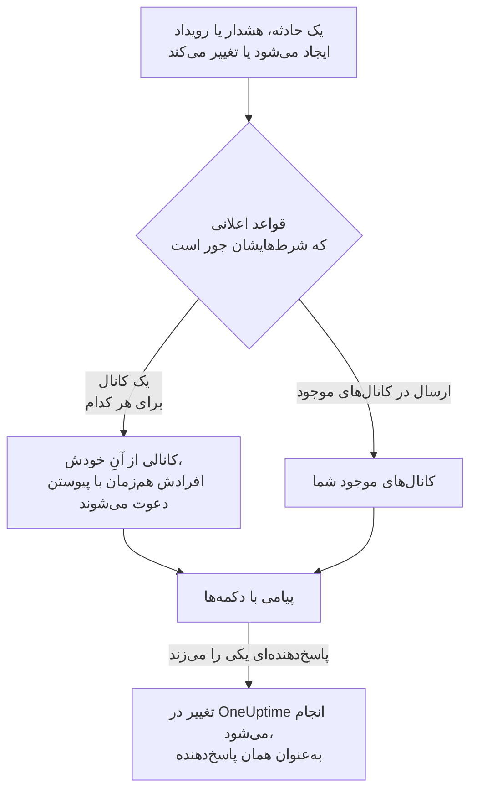

# Slack

OneUptime را به Slack وصل کنید تا حوادث، هشدارها، اپیزودها، تعمیر و نگهداری زمان‌بندی‌شده، مانیتورها و به‌روزرسانی‌های آنکال در کانال‌هایتان منتشر شوند، هر حادثه کانال خودش را داشته باشد، و پاسخ‌دهندگان بدون ترک Slack کار کنند: تأیید، برطرف کردن، افزودن یادداشت، فراخوانی آنکال و اعلام حادثه.

:::cards
- [اتصال Slack](#اتصال-slack): OneUptime را در فضای کاری خود نصب کنید، سپس حساب خودتان را پیوند دهید.
- [درخواست اتصال از همه](#درخواست-اتصال-از-همه): به همهٔ اعضایی که حسابشان را وصل نکرده‌اند، یکجا پیام بفرستید.
- [قواعد اعلان](#قواعد-اعلان): تعیین کنید کدام رویدادها کجا منتشر شوند، و کدام‌ها کانال خودشان را بگیرند.
- [چه کسانی در کانال یک رکورد هستند](#چه-کسانی-در-کانال-یک-رکورد-هستند): از صفحه رکورد ببینید چه کسانی در آن هستند، به آن بپیوندید و افراد را اضافه کنید.
- [فرمان /oneuptime](#فرمان-oneuptime): اعلام حادثه، زمان‌بندی نگهداری، دیدن اینکه چه کسی آنکال است و پرسیدن از هوش مصنوعی.
- [گروه‌های کاربری آنکال](#گروههای-کاربری-آنکال): یک گروه کاربری را با آنکال‌ها یکسان نگه دارید و آن را فرا بخوانید.
- [اقدام روی حوادث، هشدارها و رویدادها از Slack](#اقدام-روی-حوادث-هشدارها-و-رویدادها-از-slack): دکمه‌های پیام‌های OneUptime.
:::

## چگونه کار می‌کند

دو اتصال این کار را ممکن می‌کنند:

- **اتصال پروژه**، که یک بار برقرار می‌شود: اپ OneUptime که در فضای کاری Slack شما نصب شده است. پیام‌ها را منتشر می‌کند، کانال می‌سازد و افراد را دعوت می‌کند.
- **اتصال خود هر فرد**: حساب Slack او که به حساب OneUptime او پیوند خورده است. دکمه‌ها، فرمان‌ها و واکنش‌های ایموجی به‌عنوان همان فرد و با مجوزهای او در پروژه عمل می‌کنند.

یک فضای کاری Slack می‌تواند به بیش از یک پروژه وصل باشد، مثلاً پروژهٔ تولید و پروژهٔ آزمایشی. دکمه یا فرم در پروژهٔ رکوردی عمل می‌کند که دربارهٔ آن است. فرمان یا پیامی به OneUptime در پروژهٔ کانالی عمل می‌کند که در آن نوشته شده است، مثلاً کانال یک حادثه، وگرنه در تنها پروژه‌ای که حساب Slack شما در آن وصل است. وقتی هیچ‌کدام از این‌ها پروژه را مشخص نکند، OneUptime می‌پرسد منظورتان کدام پروژه است، با یک دکمه برای هر پروژه‌ای که در آن عضو هستید، و پس از انتخاب شما کار را در همان پروژه ادامه می‌دهد. در گفتگو با OneUptime AI، انتخاب شما تا پایان رشتهٔ گفتگو برقرار می‌ماند.

## پیش از شروع

- **نقشی که بتواند پروژه را وصل کند:** **مالک پروژه**، **مدیر پروژه** یا **عضو پروژه**. حذف نصب به **مالک پروژه** یا **مدیر پروژه** نیاز دارد.
- **یک فضای کاری Slack** که بتوانید اپ را در آن نصب کنید.
- **طرح Growth در OneUptime Cloud** برای قواعد اعلان و خلاصه‌ها. [قواعد اعلان پایین‌تر از طرح Growth](#قواعد-اعلان-پایینتر-از-طرح-growth) را ببینید.
- **روی یک سرور خودمیزبان،** نخست یک اپ Slack که برای آن تنظیم شده باشد. [یکپارچه‌سازی Slack](/docs/self-hosted/slack-integration) را ببینید.

## اتصال Slack

:::steps
### نصب OneUptime در فضای کاری Slack

به **تنظیمات پروژه** > **فضای کاری** > **Slack** بروید و روی **Connect with Slack** کلیک کنید. فضای کاری را انتخاب کنید و به OneUptime اجازه دهید. Slack شما را به همان صفحه برمی‌گرداند که اکنون نام فضای کاری‌ای را نشان می‌دهد که پروژه به آن وصل است. تا وقتی هیچ فضای کاری‌ای وصل نشده، بخش **فضای کاری** در منوهای حوادث، هشدارها، تعمیر و نگهداری زمان‌بندی‌شده، مانیتورها و آنکال گزینهٔ **اتصال Slack یا Teams** را دارد که آن هم به همین‌جا می‌برد.

### اتصال حساب Slack خودتان

نصب اپ، حساب کسی را که آن را نصب می‌کند پیوند می‌دهد. بقیه حساب Slack خود را در **تنظیمات کاربر** > **فضای کاری** > **Slack** با **Connect my account with Slack** پیوند می‌دهند تا به‌عنوان خودشان روی حوادث اقدام کنند و پیام مستقیم بگیرند. این بخش وقتی پروژه به Slack وصل شد ظاهر می‌شود. برای اینکه کل تیم یکجا وصل شوند، [درخواست اتصال از همه](#درخواست-اتصال-از-همه) را ببینید.

### افزودن یک قاعدهٔ اعلان

به **حوادث** > **فضای کاری** > **Slack** بروید. بخش **فضای کاری** فقط فضاهای کاری گفتگویی را فهرست می‌کند که پروژهٔ شما وصل کرده است، پس **Slack** پس از اتصال آنجا ظاهر می‌شود. یک قاعده بسازید، مثلاً قاعده‌ای که برای هر حادثهٔ تازه یک کانال Slack با همهٔ کسانی که روی آن کار می‌کنند می‌سازد: افراد فراخوانده‌شده، فرمانده حادثه و مالکان. [قواعد اعلان](#قواعد-اعلان) را ببینید.

### آزمودن قاعده

روی **قاعده آزمایش** در ردیف قاعده کلیک کنید. یک پیام آزمایشی به کانال‌هایی که قاعده نام می‌برد می‌رسد. [آزمودن یک قاعده](#آزمودن-یک-قاعده) را ببینید.
:::

## درخواست اتصال از همه

هیچ‌کس، حتی یک مدیر، نمی‌تواند حساب Slack کس دیگری را وصل کند: هر کس خودش به حساب خودش وارد می‌شود. برای اینکه کل تیم وصل شوند، یک **مالک پروژه** یا **مدیر پروژه** در **تنظیمات پروژه** > **فضای کاری** > **Slack** یکجا از همه درخواست می‌کند. کارت **Members' Slack accounts** نشان می‌دهد چند عضو وصل شده‌اند. با **Ask everyone to connect**، OneUptime برای هر عضوی که هنوز وصل نشده، یک پیام مستقیم در Slack می‌فرستد، با دکمهٔ **Connect Slack account** که حساب او را با یک کلیک وصل می‌کند.

- **چه کسی پیام می‌گیرد.** هر عضو پروژه که حساب Slack خود را وصل نکرده است و از روی نشانی ایمیلش در Slack پیدا می‌شود. کسی که در ۲۴ ساعت گذشته از او درخواست شده، دوباره درخواستی نمی‌گیرد، پس درخواست دوباره در روز بعد فقط به کسانی یادآوری می‌کند که هنوز وصل نشده‌اند.
- **آنچه کارت می‌گوید.** تا وقتی پیام‌ها در حال ارسال‌اند، اینکه ارسال تا کجا پیش رفته است، سپس اینکه چه کسی درخواست کرد و چند عضو پیام گرفتند. اعضایی که OneUptime نتوانست از روی نشانی ایمیلشان در Slack پیدا کند، روی کارت نام برده می‌شوند: آن‌ها خودشان حسابشان را در **تنظیمات کاربر** > **فضای کاری** > **Slack** وصل می‌کنند.
- **آنچه دکمه وصل می‌کند.** حساب Slack هر کسی که آن را بفشارد و وارد شود، به حساب OneUptime خودِ او. پیامی که برای کس دیگری بازفرستاده شود، چیزی را به حساب عضوی که پیام برایش فرستاده شده بود وصل نمی‌کند.

## قواعد اعلان

یک قاعدهٔ اعلان می‌گوید کدام رویدادها در Slack منتشر شوند، و کجا. هر محصول قواعد خودش را دارد، در منوی خودش زیر **فضای کاری** > **Slack**:

| محصول | زبانه‌های صفحهٔ **Slack** آن |
| --- | --- |
| **حوادث** | **حوادث**، **اپیزودهای حادثه**، **خلاصه** |
| **هشدارها** | **هشدارها**، **اپیزودهای هشدار**، **خلاصه** |
| **تعمیر و نگهداری زمان‌بندی‌شده** | یک فهرست قاعده |
| **مانیتورها** | یک فهرست قاعده |
| **کشیک آنکال** | یک فهرست قاعده |

ساختن یک قاعده چهار گام دارد:

| گام | آنچه تنظیم می‌کنید |
| --- | --- |
| **پایه** | **نام قاعده** و **توضیحات قاعده**. |
| **شرط‌ها** | قاعده برای کدام رویدادهاست، مثلاً بر اساس شدت، حالت، برچسب، مانیتور یا واژه‌های عنوان. شرط‌ها هنگام ایجاد رویداد و دوباره با هر به‌روزرسانی‌ای که OneUptime دربارهٔ آن منتشر می‌کند بررسی می‌شوند؛ پس قاعده‌ای برای حادثه‌های تأییدشده وقتی حادثه تأیید شود عمل می‌کند. قاعده تازه برای همهٔ رویدادهاست، مثلاً **همه حادثه‌ها**. برای محدود کردن آن، **فقط آن دسته از حادثه‌ها که با شرط‌ها مطابقت دارند** را انتخاب کنید و شرط‌ها را بیفزایید. با دو شرط یا بیشتر، **شرط تطابق** می‌گوید همهٔ آن‌ها باید جور باشند یا هر یک کافی است. |
| **مقصد** | کجا منتشر می‌کند: **ارسال در کانال‌های موجود** با نام کانال‌ها، **ایجاد یک کانال برای هر حادثه** (یا هشدار، اپیزود، رویداد، مانیتور یا سیاست آنکال) با کسانی که به آن می‌پیوندند، یا هر دو. زیر این مرحله، **این قاعده چه می‌کند** مانند کارت قاعده آن را در چند جمله می‌گوید. |
| **Video Call** | فقط حوادث و هشدارها: برای هر کدام یک تماس آغاز کنید. [تماس‌های تصویری](/docs/workspace-connections/video-calls) را ببینید. |

کانالی که قاعده می‌سازد به نام رکوردش نام‌گذاری می‌شود: حادثهٔ INC-42 نام `inc-42` را می‌گیرد، هشدار ALT-7 نام `alt-7` را، و در پروژه‌ای بی پیشوند شماره، حادثهٔ ۴۲ نام `incident-42` را. متنِ **پیشوند نام کانال** پیش از نام می‌آید، پس `prod-` نام `prod-inc-42` را می‌سازد، و فرم هنگام نوشتن، نام را نشان می‌دهد. برای رویداد تعمیر و نگهداری زمان‌بندی‌شده، پیشوند جای پیشوند شماره‌اش را می‌گیرد: SM-5 نام `sm-5` را می‌گیرد، و `maint-` نام `maint-5` را می‌سازد. Slack حروف کوچک، اعداد، `-` و `_` را تا ۸۰ نویسه می‌پذیرد. اگر کانالی با آن نام از پیش باشد، مانند کانال پروژه‌ای دیگر یا کانالی بایگانی‌شده، OneUptime `-2`، `-3` و مانند آن را می‌افزاید.

قاعده کانالش را نخستین باری می‌سازد که رویدادی با آن مطابقت داشته باشد: هنگام ایجاد رویداد، یا بعدتر، وقتی به‌روزرسانی‌ای آن را مطابق کند و رویداد هنوز باز باشد. قاعده‌ای برای حادثه‌های تأییدشده کانال را وقتی می‌سازد که حادثه تأیید شود. یک حادثه، هشدار یا اپیزود خصوصی کانال خصوصی می‌گیرد.

**چه کسانی به کانال می‌پیوندند** نشان می‌دهد قاعده چه کسانی را به کانالش می‌افزاید، هر کس را هم‌زمان با پیوستنش به رکورد، نه فقط هنگام ایجاد کانال: **پاسخ‌دهندگان آنکال، هم‌زمان با فراخوانی**، **فرمانده حادثه و دیگر نقش‌های حادثه، هم‌زمان با تعیین‌شدن** (حوادث و اپیزودهای حادثه) و **مالکان، هم‌زمان با افزوده‌شدن**، که در قاعدهٔ تازه همه تیک خورده‌اند، و افراد، تیم‌ها و زمان‌بندی‌های آنکال در **دعوت از این افراد هم** هنگام ایجاد کانال. فرمانده حادثه معمولاً وقتی تعیین می‌شود که کسی نخستین بار حادثه را تأیید کند، و همان وقت به کانال آن می‌پیوندد. قاعده‌ای که پیش از آنکه نقش‌های حادثه کادر خودشان را داشته باشند ذخیره شده، وقتی مالکان یا پاسخ‌دهندگان آنکال را می‌افزاید آن‌ها را هم می‌افزاید، و کادرش تیک‌خورده نشان داده می‌شود. کانال موجودی که قاعده در آن منتشر می‌کند کسی را نمی‌گیرد.

برای یک زمان‌بندی آنکال در **دعوت از این افراد هم**، هر کسی که هنگام ایجاد کانال در آن آنکال باشد، همان‌طور که صفحهٔ زمان‌بندی نشانش می‌دهد، به کانال می‌پیوندد و فراخوانده نمی‌شود. برای افزودن افراد فقط به کانال‌های برخی حادثه‌ها، به قاعده‌ای دوم همان شرط‌ها و همان افراد را بدهید، با همان **پیشوند نام کانال** که قاعدهٔ اول دارد: قواعدی که هنگام ایجاد کانال یک حادثه با آن مطابقت دارند، آن کانال را به اشتراک می‌گذارند و هر کدام افراد خودش را می‌افزاید.

هر به‌روزرسانی بعدی رکورد — تغییر حالت، یک یادداشت، یک مالک تازه — در کانال‌های آن منتشر می‌شود، و تا وقتی شرط‌های قواعدش برقرارند، در کانال‌های موجودی که قواعدش نام می‌برند. با روشن بودن **بایگانی کانال وقتی حادثه برطرف شد**، یا همتای آن برای هشدارها، اپیزودها، رویدادها، مانیتورها و سیاست‌های آنکال، قاعده‌ای که کانالی را ساخته آن را وقتی رکورد برطرف، کامل یا حذف شود بایگانی می‌کند، هرچه شرط‌هایش در آن زمان بگویند. حادثه، هشدار یا اپیزودی که از همان ابتدا برطرف‌شده ایجاد شود کانال خودش را نمی‌گیرد؛ پیام ایجاد آن همچنان به کانال‌هایی که قواعد شما نام می‌برند می‌رود. [حادثه‌ای که از پیش تأییدشده یا برطرف‌شده اعلام می‌شود](/docs/incidents/declaring-incidents#حادثهای-که-از-پیش-تأییدشده-یا-برطرفشده-اعلام-میشود) را ببینید.

با روشن بودن **نگه‌داشتن به‌روزرسانی‌های هر حادثه در یک رشته**، یا همتای آن برای هشدارها، اپیزودها و رویدادهای تعمیر و نگهداری زمان‌بندی‌شده، قاعده‌ای که در کانال‌های موجود منتشر می‌کند، آنچه را دربارهٔ یک رکورد منتشر می‌کند در هر یک از آن کانال‌ها در یک رشتهٔ گفتگو نگه می‌دارد. نخستین پیام رکورد رشته را آغاز می‌کند، هر به‌روزرسانی بعدی پاسخی در آن است، و تغییر حالت یا هشدار آنکال در خود کانال هم نشان داده می‌شود. پیامی که پیش از نخستین پیام رکورد برسد، مانند مالکی که یک مانیتور به حادثه‌ای که ایجاد می‌کند می‌افزاید، تا یک دقیقه منتظر آن می‌ماند و اگر نرسد، خودش رشته را آغاز می‌کند. کانالی که دو قاعده نام می‌برند، اگر یکی از آن‌ها بخواهد رشته‌ای می‌شود. این کلید فقط برای Slack است و در قاعدهٔ تازه خاموش است، که آن‌گاه هر پیام را جداگانه منتشر می‌کند.

حادثه، هشدار، اپیزود یا رویداد تعمیر و نگهداری زمان‌بندی‌شده‌ای که کانال خودش را دارد، در سربرگ صفحه‌اش در OneUptime، کنار دکمه‌های حالت، **باز کردن در Slack** دارد. این دکمه آن کانال را در زبانه‌ای تازه، در برنامه Slack یا در مرورگر باز می‌کند. رکوردی که دو کانال از خودش دارد هر دو را زیر دکمه فهرست می‌کند. رکوردی که هم در Slack و هم در Microsoft Teams کانال دارد، به‌جای آن یک دکمه **باز کردن کانال** دارد که همه را فهرست می‌کند. کانال‌های موجودی که قواعد شما در آن‌ها منتشر می‌کنند پیشنهاد نمی‌شوند.

یک کانال خوانا می‌ماند: هر رویداد یک بار منتشر می‌شود، و نخستین حالت رکورد در پیامی است که رکورد را اعلام می‌کند، نه در پیامی جداگانه. هر اجرای یک سیاست آنکال یک پیام است که با پیشرفت تشدید ویرایش می‌شود: چه کسی فراخوانده شد، چند بار و چگونه، چه کسی نه و چرا، و چه کسی تأیید کرد. پیام تازه فقط وقتی منتشر می‌شود که کسی باید کاری بکند: یک قاعده تشدید به هیچ‌کس نرسید، یا اجرا بی‌آنکه کسی تأیید کند به پایان رسید. کسی که حساب Slack خود را به OneUptime وصل نکرده است، با حساب Slackی که نشانی ایمیل او را دارد افزوده می‌شود. کسی که OneUptime از هیچ‌کدام از این دو راه پیدایش نکند، یا در Slack مهمان باشد، نمی‌تواند به کانال افزوده شود؛ OneUptime این را برای هر کانال یک بار می‌گوید، در یک پیام که نام همه آن‌ها را می‌برد و با بلندتر شدن فهرست ویرایش می‌شود. پیوند **Connect Slack account** همان پیام را برایشان بفرستید تا حساب خود را در یک گام وصل کنند. اینکه مالکان رکورد یا مشترکان صفحه وضعیت باخبر شدند، در خوراک آن در OneUptime می‌ماند.

**تنظیمات پروژه** > **فضای کاری** > **Slack** کانال‌هایی را که OneUptime می‌تواند ببیند فهرست می‌کند، با **ارسال آزمایشی** کنار هر کدام. OneUptime نخستین بار که در یک کانال عمومی منتشر می‌کند، خودش به آن می‌پیوندد. یک کانال خصوصی فقط وقتی فهرست می‌شود، و می‌توان در آن منتشر کرد، که اپ OneUptime در Slack به آن دعوت شده باشد.

## چه کسانی در کانال یک رکورد هستند

حادثه، هشدار، اپیزود یا رویداد تعمیر و نگهداری زمان‌بندی‌شده‌ای که کانال Slack خودش را دارد، در صفحه‌اش در OneUptime کارت **کانال Slack** را دارد. کارت کانال را به‌صورت پیوندی که آن را در Slack باز می‌کند نشان می‌دهد، اینکه خصوصی است یا نه، و چه کسانی در آن هستند، نخست خود شما. از روی کارت، بی‌نیاز از مدیر Slack:

- **پیوستن به کانال** شما را اضافه می‌کند، وقتی در کانال نیستید.
- **افزودن افراد** فهرستی از افراد و تیم‌های پروژه را باز می‌کند: فردی را برگزینید تا اضافه شود، یا تیمی را تا همه اعضایش اضافه شوند.

اپ OneUptime آن‌ها را اضافه می‌کند، همان‌طور که افراد کانال یک قاعده را اضافه می‌کند. اپ در کانال‌هایی که می‌سازد می‌ماند، پس این برای کانال خصوصی‌ای که همه ترکش کرده‌اند هم کار می‌کند.

- **چه کسی می‌تواند افراد را اضافه کند.** هر کسی که می‌تواند رکورد را ویرایش کند: برای یک حادثه **مالک پروژه**، **مدیر پروژه**، **عضو پروژه**، **مدیر حوادث** و **عضو حوادث**، یا **Edit Incident** در یک نقش سفارشی، و همین مجوز برای یک هشدار، یک اپیزود یا یک رویداد (برای نمونه **Edit Alert**). دیگران می‌بینند چه کسانی در کانال هستند، و چطور می‌شود واردش شد.
- **چه کسی را می‌توان اضافه کرد.** کسی که OneUptime بتواند در Slack پیدایش کند: از روی حساب Slackی که وصل کرده، وگرنه از روی نشانی ایمیلی که Slack از او دارد. کارت نام کسانی را که نتوانست اضافه کند، همراه دلیلش می‌آورد، مانند مهمانی که Slack او را بیرون از کانال نگه می‌دارد.
- **چه چیزی ثبت می‌شود.** اینکه چه کسی اضافه شد و به دست چه کسی، در خوراک رکورد (**عضو به کانال اضافه شد**) و در **تنظیمات پروژه** > **اعلان‌ها** > **گزارش‌های اعلان** در زبانهٔ **فضای کاری**.
- **بیرون بردن کسی.** OneUptime فقط اضافه می‌کند: کسی را در Slack از کانال بیرون ببرید.

## آزمودن یک قاعده

**قاعده آزمایش** در ردیف یک قاعده، پیامی آزمایشی برای آن قاعده در کانال‌هایی که نام می‌برد منتشر می‌کند تا رسیدنش را ببینید. اگر قاعده برای هر رویداد یک کانال می‌سازد، آزمون هم یکی می‌سازد و افراد قاعده را به آن دعوت می‌کند.

مانند **ارسال آزمایشی** کنار یک کانال در **تنظیمات پروژه** > **فضای کاری** > **Slack**، این کار به مجوز ساختن قواعد اعلان نیاز دارد: **مالک پروژه**، **مدیر پروژه**، **عضو پروژه**، **مدیر تنظیمات**، **عضو تنظیمات**، یا **Create Workspace Notification Rule** و **Read Workspace Notification Rule** در یک نقش سفارشی. برای کسی که فقط می‌تواند قواعد را ببیند، مانند یک **بیننده**، **قاعده آزمایش** قفل است و راهنمای آن می‌گوید چه لازم است؛ API آزمون او را با «You do not have permission to send test notifications in this project.» رد می‌کند. در OneUptime Cloud، آزمودن یک قاعده، مانند افزودن آن، به طرح **Growth** نیاز دارد.

در OneUptime Cloud، **ارسال آزمایشی** کنار یک کانال هم به طرح **Growth** نیاز دارد، چون منتشر کردن در یک کانال همان کاری است که قواعد و خلاصه‌ها می‌کنند. **ارسال آزمایشی فوری** روی یک خلاصه به مجوز ساختن خلاصه‌ها (**Create Workspace Notification Summary** و **Read Workspace Notification Summary** در یک نقش سفارشی) و، در OneUptime Cloud، به طرح **Growth** نیاز دارد؛ برای هر کس دیگری قفل است و راهنمای آن می‌گوید چه لازم است. یک کلاینت MCP که با دسترسی فقط‌خواندنی وصل شده نمی‌تواند هیچ آزمونی بفرستد.

## خلاصه‌ها

زبانهٔ **خلاصه** در **حوادث** > **فضای کاری** > **Slack** (و در **هشدارها**) یک جمع‌بندی دوره‌ای در کانال‌هایی که نام می‌برید منتشر می‌کند: چند حادثه یا هشدار رخ داده، با چه سرعتی تأیید و برطرف شده‌اند، و فهرستی با پیوندها. خلاصهٔ تازه هر هفته فرستاده می‌شود و ۷ روز گذشته را پوشش می‌دهد. اگر **ارسال اولین گزارش در** را خالی بگذارید، نخستین خلاصه ساعت ۰۹:۰۰ در آغاز هفته، روز یا ماه بعد فرستاده می‌شود؛ فرم می‌گوید چه زمانی.

هر خلاصه بر اساس ساعت **منطقه زمانی** خودش فرستاده می‌شود که در آغاز منطقهٔ زمانی شماست. ساعتِ روزِ خود را در آنجا در تمام سال حفظ می‌کند: خلاصه‌ای که برای ساعت ۰۹:۰۰ در برلین تنظیم شده، پس از جابه‌جایی ساعت‌ها برای ساعت تابستانی هم ساعت ۰۹:۰۰ به وقت برلین فرستاده می‌شود، و تاریخ‌های پیامش هم به وقت برلین است. از راه API، `timezone` را به‌صورت نام منطقهٔ زمانی IANA بفرستید، مانند `Europe/Berlin`. خلاصه‌ای که بدون منطقهٔ زمانی ساخته شود، منطقهٔ زمانی پروفایل سازنده‌اش را می‌گیرد، یا وقتی یک کلید API آن را می‌سازد، UTC را.

فرم خلاصه چهار گام دارد: **اطلاعات پایه** (نام و کانال‌های آن)، **زمان‌بندی**، **محتوا** (**چه چیزهایی باید گنجانده شود**) و **فیلترها** (کدام حوادث یا هشدارها را می‌شمارد).

## قواعد اعلان پایین‌تر از طرح Growth

در OneUptime Cloud، قواعد اعلان و خلاصه‌ها در طرح **Growth** و بالاتر هستند. پروژه‌ای پایین‌تر از آن، قواعد و خلاصه‌هایی را که از قبل دارد نگه می‌دارد، و آن‌ها همچنان در Slack منتشر می‌کنند. بنابراین صفحهٔ **Slack** هر محصول (حوادث، هشدارها، تعمیر و نگهداری زمان‌بندی‌شده، آنکال، مانیتورها) یادداشت طرح را با فهرست آن‌ها در زیرش نشان می‌دهد (**قواعد اعلان که هنوز تنظیم شده‌اند**، **خلاصه‌هایی که هنوز تنظیم شده‌اند**): یک قاعده را حذف کنید، یا یک خلاصه را خاموش یا حذف کنید. افزودن یا تغییر قواعد و خلاصه‌ها به **Growth** نیاز دارد.

## فراخوانده شدن در Slack

برای اینکه وقتی آنکال هستید با پیام مستقیم فراخوانده شوید، Slack را به‌عنوان یکی از روش‌های اعلان خود بیفزایید:

:::steps
1. حساب Slack خودتان را وصل کنید ([اتصال Slack](#اتصال-slack) را ببینید).
2. به **تنظیمات کاربر** > **روش‌های اعلان** بروید، زبانهٔ **Workspace Apps** را باز کنید و روی **Add Slack Account** کلیک کنید.
3. روی **Send Test Message** در ردیف آن کلیک کنید. پیام به پیام‌های مستقیم Slack شما می‌رسد.
:::

افزودن آن، فوراً آن را به قواعد آنکال شما هم می‌افزاید، پس از آن پس فراخوان‌ها در Slack به شما می‌رسند. اینکه کدام فراخوان‌ها را بگیرد، در **تنظیمات کاربر** > **قواعد آنکال** تغییر دهید.

## ذخیرهٔ پیام‌ها به‌عنوان یادداشت

در کانال یک حادثه، هشدار، اپیزود یا رویداد تعمیر و نگهداری زمان‌بندی‌شده به پیامی واکنش نشان دهید، و OneUptime آن را به‌عنوان یادداشتی روی همان رکورد ذخیره می‌کند و با پاسخی در رشتهٔ گفتگو تأیید می‌کند:

| واکنش | ذخیره به‌عنوان |
| --- | --- |
| ایموجی سنجاق 📌، یا **Pin to channel** خود Slack | یک یادداشت خصوصی که فقط تیم شما می‌بیند |
| ایموجی بلندگوی دستی یا بلندگو 📢 | یک یادداشت عمومی که روی صفحهٔ وضعیت نشان داده می‌شود. فقط حوادث و رویدادهای تعمیر و نگهداری زمان‌بندی‌شده. روی حادثه خصوصی، یک یادداشت خصوصی، و تأیید دلیلش را می‌گوید. |

در کانالی که یک قاعده به‌روزرسانی‌های هر رکورد را در یک رشتهٔ گفتگو نگه می‌دارد، به هر پیامی در یک رشته واکنش نشان دهید، چه پیام OneUptime و چه پاسخی که کسی نوشته است، و یادداشت روی رکوردی ذخیره می‌شود که رشته دربارهٔ آن است.

یادداشت پیام را همان‌طور نگه می‌دارد که Slack نشانش می‌داد: قالب‌بندی، پیوندها و کد آن، افراد و کانال‌هایی که نام می‌برد با نامشان، و پرونده‌ها و تصاویرش به‌صورت پیوند به آن‌ها. یادداشت عمومی پرونده‌ها و تصاویر را کنار می‌گذارد، چون فقط برای تیم شما باز می‌شوند.

یادداشت سخن کسی است که پیام را نوشته است: اگر حساب Slack او وصل باشد با نامش در OneUptime، وگرنه با نامی که Slack نشان می‌دهد. یادداشت خصوصی در خط زمانی در همان زمانی قرار می‌گیرد که پیام فرستاده شد، هر قدر هم که دیرتر ذخیره شود. یادداشت عمومی در زمانی قرار می‌گیرد که ذخیره می‌شود، یعنی همان زمانی که صفحهٔ وضعیت آن را نشان می‌دهد. خط زمانی می‌گوید چه کسی آن را ذخیره کرد. یادداشت دوباره در کانال فرستاده نمی‌شود، جایی که پیام از پیش هست.

یادداشت به‌عنوان شما و با مجوزهای شما ذخیره می‌شود. اگر حساب Slack شما هنوز وصل نیست، OneUptime در پیامی که فقط شما می‌بینید از شما می‌خواهد آن را وصل کنید، همراه دکمه‌ای که به‌محض وصل شدن، پیام را ذخیره می‌کند. هر پیام فقط یک بار ذخیره می‌شود، هر چند نفر که واکنش نشان دهند.

## فرمان /oneuptime

OneUptime در Slack یک فرمان دارد، `/oneuptime`. واژه‌ای که پس از آن می‌نویسید می‌گوید چه کاری انجام شود؛ هر چیز دیگری پس از آن پرسشی برای OneUptime AI است.

| فرمان | چه می‌کند |
| --- | --- |
| `/oneuptime help` | فرمان‌ها را همراه با نمونه فهرست می‌کند. |
| `/oneuptime incident [title or number]` | فرم حادثه را با عنوانِ پرشده باز می‌کند. شمارهٔ یک حادثه، مانند `42` یا `INC-42`، به‌جای آن همان حادثه را نشان می‌دهد: [مدیریت یک حادثه از Slack](#مدیریت-یک-حادثه-از-slack) را ببینید. |
| `/oneuptime maintenance [title]` | فرم تعمیر و نگهداری زمان‌بندی‌شده را با عنوانِ پرشده باز می‌کند. |
| `/oneuptime oncall` | فهرست می‌کند که اکنون در هر زمان‌بندی آنکالی که می‌توانید ببینید چه کسی آنکال است، تا کی، و نفر بعدی کیست. |
| `/oneuptime page [who] [message]` | کسانی را که با @ از آن‌ها نام می‌برید دربارهٔ پیام شما فرا می‌خواند، یا فرمی باز می‌کند تا انتخاب کنید چه کسی فراخوانده شود. [فراخواندن کسی از Slack](#فراخواندن-کسی-از-slack) را ببینید. |
| `/oneuptime ask [question]`، یا هر پرسشی | OneUptime AI دربارهٔ لاگ‌ها، ردیابی‌ها، متریک‌ها، حوادث و مانیتورهای شما پاسخ می‌دهد. |

پاسخ‌های `help` و `oncall` پیام‌هایی هستند که فقط خودتان زیر فرمان می‌بینید. واژهٔ نخستی که شبیه فرمانی با غلط تایپی است، مانند `incidnet`، فرمانی را که به آن شبیه است می‌گیرد، نه پاسخی از OneUptime AI. فرم‌های حادثه و نگهداری به‌عنوان خود شما عمل می‌کنند: [ایجاد حادثه و نگهداری از Slack](#ایجاد-حادثه-و-نگهداری-از-slack) را ببینید.

> [!NOTE]
> `/oneuptime incident` و `/oneuptime maintenance` جای `/incident` و `/maintenance` را می‌گیرند، که ممکن بود با فرمان‌های هم‌نام برنامه‌های دیگر Slack تداخل داشته باشند. برنامهٔ Slackای که از یک مانیفست قدیمی‌تر ساخته شده، آن‌ها را نگه می‌دارد و همان فرم‌ها را باز می‌کنند، تا وقتی که برنامه به‌روز شود: [برنامه‌های ساخته‌شده از مانیفست قدیمی‌تر](/docs/self-hosted/slack-integration#برنامههای-ساختهشده-از-مانیفست-قدیمیتر) را ببینید.

## صفحهٔ خانهٔ OneUptime در Slack

OneUptime را از **Apps** در نوار کناری Slack باز کنید: زبانهٔ **Home** آن نشان می‌دهد در پروژه چه می‌گذرد، تا جایی که شما اجازهٔ دیدنش را دارید، و هر بار که بازش می‌کنید دوباره خوانده می‌شود.

- **آنکال شما.** زمان‌بندی‌های آنکالی که هم‌اکنون در آن‌ها آنکال هستید، و تا کی، وگرنه شیفت بعدی شما.
- **آنچه باز است.** تازه‌ترین حوادث و هشدارهای بازی که اجازهٔ خواندنشان را دارید، هر کدام با پیوندی به صفحه‌اش در OneUptime.
- **دکمه‌هایش.** **Declare incident**، **Schedule maintenance** و **Page someone** همان فرم‌های `/oneuptime incident`، `/oneuptime maintenance` و `/oneuptime page` را باز می‌کنند، و **Who's on call** همان‌طور پاسخ می‌دهد که `/oneuptime oncall`.

صفحهٔ خانه به‌نام شما می‌خواند، پس به حساب Slack متصل خودتان نیاز دارد. تا وقتی متصل نشده، صفحهٔ خانه دکمهٔ **Connect Slack account** را دارد و به محض اتصال، صفحهٔ خانهٔ شما را نشان می‌دهد.

در فضای کاری Slack که به بیش از یک پروژه وصل است، صفحهٔ خانه هر بار یک پروژه را نشان می‌دهد. اگر حساب Slack شما در دو پروژه یا بیشتر از آن‌ها وصل باشد، منوی **Switch project** کنار نام پروژه، پروژه‌های دیگری را که در آن‌ها عضو هستید فهرست می‌کند. یکی را انتخاب کنید تا صفحهٔ خانهٔ آن را ببینید، و از آن پس صفحهٔ خانه با همان پروژه باز می‌شود، تا وقتی هنوز در آن عضو باشید. تا وقتی یکی را انتخاب نکرده‌اید، صفحهٔ خانه پروژه‌ای از پروژه‌های شما را نشان می‌دهد که زودتر از همه به Slack وصل شده است.

وقتی کسی OneUptime را به کانالی اضافه می‌کند، آنجا یک پیام خوشامد منتشر می‌کند: چطور از آن سؤال بپرسید، و قاعدهٔ اعلانی که در آن کانال منتشر می‌کند را کجا اضافه کنید. نخستین بار که زبانهٔ **Messages** آن را باز می‌کنید، همان‌جا به شما خوشامد می‌گوید: اینکه در Slack چه می‌کند و چطور شروع کنید.

## پرسیدن از OneUptime AI در Slack

دربارهٔ لاگ‌ها، ردیابی‌ها، متریک‌ها، حوادث و مانیتورهای خود به زبان ساده بپرسید. در یک کانال با @ از OneUptime نام ببرید، یا به آن پیام مستقیم بفرستید، و در رشتهٔ گفتگو پاسخ می‌دهد. `/oneuptime ask which monitors are down?` پاسخ خود را در کانال منتشر می‌کند. هر دو نیاز دارند که حساب Slack خودتان وصل باشد و هوش مصنوعی برای پروژه روشن باشد. پاسخ‌ها در Slack فقط می‌خوانند: برای تغییر چیزی از دکمه‌ها استفاده کنید. [پرسش از هوش مصنوعی](/docs/ai/ask-ai) را ببینید.

OneUptime فقط به چیزی پاسخ می‌دهد که خطاب به آن باشد.

- **در گفتگوی خودتان، فقط پاسخ دهید.** پرسشی که در یک کانال، نه در یک رشتهٔ گفتگو، می‌پرسید، گفتگویی را در رشتهٔ زیر آن آغاز می‌کند: برای پرسش‌های بیشتر همان‌جا پاسخ دهید، بی‌آنکه دوباره از OneUptime نام ببرید؛ دیگران هم با نام بردن از آن به گفتگو می‌پیوندند.
- **در هر رشتهٔ گفتگوی دیگر، از OneUptime نام ببرید.** برای نمونه در رشتهٔ زیر پیام یک حادثه، هر بار از آن نام ببرید: آنچه افراد در آنجا برای یکدیگر می‌نویسند پاسخی نمی‌گیرد.
- **اگر حساب Slack شما وصل نیست.** OneUptime در هر گفتگو یک بار از شما می‌خواهد آن را وصل کنید، در پیامی که فقط شما می‌بینید، با دکمهٔ **Connect Slack account**.

## ایجاد حادثه و نگهداری از Slack

`/oneuptime incident` و `/oneuptime maintenance` فرمی باز می‌کنند که آن را به‌عنوان خودتان پر و ارسال می‌کنید: به‌عنوان حساب OneUptimeای که حساب Slack شما به آن وصل است ([اتصال Slack](#اتصال-slack) را ببینید)، با مجوزهای آن حساب در پروژه. اگر حساب Slack شما وصل نباشد، یا حساب OneUptime شما دیگر عضو پروژه نباشد، OneUptime همان جایی که فرمان را اجرا کردید، در پیامی که فقط شما می‌بینید، به شما می‌گوید چه کنید و هیچ فرمی باز نمی‌شود. میانبرهای **Create New Incident** و **Create Scheduled Event** همان فرم‌ها را باز می‌کنند.

- **چه کسی می‌تواند از آن‌ها استفاده کند.** کسانی که می‌توانند در OneUptime حادثه اعلام کنند یا رویداد تعمیر و نگهداری زمان‌بندی‌شده بسازند: **مالک پروژه**، **مدیر پروژه**، **عضو پروژه**، **مدیر حوادث** و **عضو حوادث** برای یک حادثه (**Create Incident** در یک نقش سفارشی)، و **مدیر تعمیر و نگهداری زمان‌بندی‌شده** و **عضو تعمیر و نگهداری زمان‌بندی‌شده** برای یک رویداد (**Create Scheduled Maintenance**). به هر کس دیگری این موضوع همان جایی که آن را اجرا کرده گفته می‌شود و هیچ فرمی باز نمی‌شود.
- **فرم چه چیزهایی پیشنهاد می‌کند.** هر فهرست — شدت‌ها، مانیتورها، وضعیت‌های مانیتور، سیاست‌های آنکال و برچسب‌ها — همان چیزهایی را دارد که می‌توانید بخوانید، مانند همان فهرست در OneUptime: با نقشی محدود به برخی برچسب‌ها، مانیتورها و سیاست‌های آنکالی که آن برچسب‌ها را دارند. فهرستی که اصلاً نمی‌توانید بخوانید از فرم حذف می‌شود. سیاست‌های آنکال بایگانی‌شده هرگز پیشنهاد نمی‌شوند.
- **فرم چه چیزی را می‌تواند نام ببرد.** حادثه یا رویداد با مجوزهای خود شما ساخته و به نام شما ثبت می‌شود. مانیتور، سیاست آنکال، برچسب، شدت یا وضعیتی که نمی‌توانید بخوانید، یا متعلق به پروژه‌ای دیگر، طوری رد می‌شود که گویی پروژه آن را ندارد، حتی اگر فرم پیش از تغییر دسترسی شما باز شده باشد، و چیزی ساخته نمی‌شود. OneUptime دلیل را در کانال، در پیامی که فقط شما می‌بینید، می‌گوید.

**Execute On-Call Policy** روی یک حادثه، هشدار یا اپیزود هم همین‌طور کار می‌کند: به مجوز اجرای سیاست آنکال (**مالک پروژه**، **مدیر پروژه**، **عضو پروژه**، **مدیر آنکال** و **عضو آنکال**، یا **Create On-Call Duty Policy Execution Log** در یک نقش سفارشی) و به مجوز خواندن آن حادثه، هشدار یا اپیزود نیاز دارد، و سیاست‌های آنکال فعالی را پیشنهاد می‌کند که می‌توانید بخوانید.

## فراخواندن کسی از Slack

`/oneuptime page @nawaz The checkout API is throwing 500s` بی‌درنگ Nawaz را فرا می‌خواند. OneUptime هشداری می‌سازد که عنوانش پیام شماست، و هر کسی که با @ از او نام می‌برید، همان‌طور که قواعد آنکال خودش می‌گوید، یک تماس تلفنی، یک پیامک، یک اعلان push یا یک ایمیل می‌گیرد، تا وقتی که کسی هشدار را تأیید کند.

- **چه کسی بی‌درنگ فراخوانده می‌شود.** کسانی که با @ از آن‌ها نام می‌برید، و کسانی که در زمان‌بندی‌هایی آنکال هستند که گروه کاربری‌ای که با @ از آن نام می‌برید دنبال می‌کند (نگاه کنید به [گروه‌های کاربری آنکال](#گروههای-کاربری-آنکال))، وقتی پیامی پس از آن‌ها بیاید. OneUptime هر فرد را از روی حساب OneUptimeای که حساب Slack او به آن وصل است می‌شناسد، وگرنه از روی نشانی ایمیلی که Slack از او دارد. هیچ کسی بیرون از پروژه فراخوانده نمی‌شود.
- **هر چیز دیگری فرمی باز می‌کند.** اگر از کسی با @ نام نبرید، پیامی نباشد، از `@here` یا گروه کاربری‌ای نام ببرید که هیچ زمان‌بندی آنکالی را که برای شما دیدنی است دنبال نمی‌کند، یا OneUptime نتواند کسی را بشناسد، فرم **Page someone** با آنچه نوشته‌اید باز می‌شود و می‌گوید چه کسی را نتوانست انتخاب کند. افراد، یک تیم، یک زمان‌بندی آنکال، که هر کسی را که اکنون در آن آنکال است فرا می‌خواند، یا یک سیاست آنکال، که از راه قواعد تشدیدش فرا می‌خواند، را انتخاب کنید و فرم را ارسال کنید. نامی که اول می‌نویسید، مانند `/oneuptime page Primary The disk is full`، زمان‌بندی، تیم یا سیاستی با همان نام را انتخاب می‌کند.
- **کجا نشان داده می‌شود.** کانال فراخوان را به‌صورت یک پیام نشان می‌دهد که به‌روز نگه داشته می‌شود: چه کسی و چگونه فراخوانده شد، و چه کسی تأیید کرد. جایی که OneUptime نمی‌تواند پست کند، مانند کانال خصوصی‌ای که به آن دعوت نشده، پیامی که فقط شما می‌بینید می‌گوید چه کسی فراخوانده شد، با پیوندی به هشدار.
- **چه کسی می‌تواند فرا بخواند.** هر کسی که هم بتواند یک سیاست آنکال را اجرا کند و هم هشدار بسازد: **مالک پروژه**، **مدیر پروژه** و **عضو پروژه**، یا **عضو آنکال** همراه با **عضو هشدارها** (**Create On-Call Duty Policy Execution Log** و **Create Alert** در یک نقش سفارشی). فراخواندن مستقیم افراد، یک تیم یا یک زمان‌بندی، بدون سیاست آنکالی پشت فراخوان، به دسترسی به همهٔ سیاست‌های آنکال پروژه هم نیاز دارد. به هر کس دیگری این موضوع همان جایی که فرمان را اجرا کرده گفته می‌شود، و هیچ کسی فراخوانده نمی‌شود. در OneUptime Cloud، فراخواندن به طرح Growth نیاز دارد: در طرح‌های پایین‌تر، OneUptime طرح لازم را می‌گوید و هیچ کسی فراخوانده نمی‌شود.

## گروه‌های کاربری آنکال

یک گروه کاربری Slack، مانند `@payments-oncall`، را با کسانی که در یک یا چند زمان‌بندی آنکال هم‌اکنون آنکال هستند یکسان نگه دارید تا هر کسی بتواند با @ از آن نام ببرد و به آن‌ها برسد. OneUptime در هر تحویل و هر جایگزینی اعضای گروه را تغییر می‌دهد و هر 15 دقیقه آن را بررسی می‌کند.

:::steps
### یک گروه کاربری را به یک زمان‌بندی وصل کنید

زمان‌بندی را در **کشیک آنکال** > **زمان‌بندی‌های آنکال** باز کنید. در کارت **گروه‌های کاربری Slack** آن، روی **اتصال گروه کاربری** کلیک کنید، سپس یکی از گروه‌های کاربری فضای کاری خود را انتخاب کنید، یا با یک نام و یک شناسه **ایجاد گروه کاربری جدید** را انتخاب کنید. اعضای آن بی‌درنگ با آنکال‌ها جایگزین می‌شوند.

### آن را به زمان‌بندی پشتیبان هم وصل کنید

برای گروهی که آنکال اصلی و پشتیبان را با هم داشته باشد، همان گروه را در صفحهٔ زمان‌بندی پشتیبان هم وصل کنید. یک گروه می‌تواند هر تعداد زمان‌بندی را دنبال کند.
:::

- **آنچه کارت نشان می‌دهد.** اینکه اکنون چه کسانی در هر گروه هستند، زمان‌بندی‌های دیگری که دنبال می‌کند، و اینکه **به‌روز** است یا نه. آنکالی که نمی‌توان او را در گروه گذاشت، با دلیلش نام برده می‌شود: OneUptime هر فرد را از روی حساب Slack وصل‌شدهٔ او، وگرنه از روی نشانی ایمیلی که Slack از او دارد پیدا می‌کند، و Slack مهمان‌ها را به گروه‌های کاربری راه نمی‌دهد.
- **کسی آنکال نیست.** Slack نمی‌تواند گروه کاربری خالی نگه دارد، پس OneUptime گروه را تا وقتی کسی آنکال شود خاموش می‌کند و سپس دوباره روشنش می‌کند.
- **فراخواندن گروه.** `/oneuptime page @payments-oncall The checkout API is down` کسانی را فرا می‌خواند که در زمان‌بندی‌هایی که گروه دنبال می‌کند آنکال هستند. نگاه کنید به [فراخواندن کسی از Slack](#فراخواندن-کسی-از-slack).
- **آنچه Slack لازم دارد.** گروه‌های کاربری در طرح‌های پولی Slack هستند، و یک فضای کاری می‌تواند فقط به مالکان و مدیرانش اجازهٔ تغییر آن‌ها را بدهد: کارت می‌گوید کدام است و چه باید کرد. اگر Slack پیش از آنکه OneUptime بتواند گروه‌های کاربری را نگه دارد وصل شده است، یک بار دیگر آن را در **تنظیمات پروژه** > **فضای کاری** > **Slack** وصل کنید.
- **چه کسی می‌تواند یکی را وصل کند.** نقش‌هایی که می‌توانند زمان‌بندی‌ها را ویرایش کنند: **مالک پروژه**، **مدیر پروژه**، **عضو پروژه**، **مدیر آنکال** و **عضو آنکال**، یا **Edit On-Call Duty Policy Schedule** در یک نقش سفارشی. در OneUptime Cloud، وصل کردن به طرح **Growth** نیاز دارد.
- **قطع اتصال.** OneUptime دیگر گروه را تغییر نمی‌دهد. گروه و اعضایش همان‌طور که هستند در Slack می‌مانند.

## مدیریت یک حادثه از Slack

پیام یک حادثه چهار دکمه دارد، **Acknowledge Incident**، **Resolve Incident**، **Add Note** و **View Incident**، و بقیه در منوی آن است، دکمهٔ سه‌نقطه‌ای که پس از آن‌ها می‌آید:

| مورد منو | چه می‌کند |
| --- | --- |
| **Change Severity** | شدت حادثه را تعیین می‌کند. |
| **Change Incident State** | حادثه را به حالتی بعدی می‌برد. |
| **Assign Role** | به کسی نقشی در حادثه می‌دهد، مانند **Incident Commander**. نقشی که فقط یک نفر می‌گیرد به او منتقل می‌شود. |
| **Page Someone** | افراد، یک تیم، کسی که هم‌اکنون در یک زمان‌بندی آنکال است، یا یک سیاست آنکال را دربارهٔ حادثه فرا می‌خواند، تا وقتی که کسی آن را تأیید کند. |
| **Edit Custom Fields** | فیلدهای سفارشی حادثه را تعیین می‌کند، هر یک پرشده با آنچه حادثه دارد. فیلدی که خالی بماند پاک می‌شود. |

`/oneuptime incident 42` حادثهٔ 42 را، با این دکمه‌ها و منوی آن، در پیامی نشان می‌دهد که فقط خودتان می‌بینید. شماره را همان‌طور بنویسید که OneUptime نشان می‌دهد: `42`، `#42` یا `INC-42`. در کانالِ خودِ یک حادثه، `/oneuptime incident` به‌تنهایی همان حادثه را نشان می‌دهد.

- **چه کسی می‌تواند از آن‌ها استفاده کند.** کسانی که می‌توانند همان تغییر را در OneUptime بدهند. **Change Severity** و **Edit Custom Fields** به مجوز ویرایش حادثه نیاز دارند: **مالک پروژه**، **مدیر پروژه**، **عضو پروژه**، **مدیر حوادث** و **عضو حوادث**، یا **Edit Incident** در یک نقش سفارشی. **Assign Role** به **Create Incident Member** نیاز دارد، و برای انتقال نقشی که فقط یک نفر می‌گیرد به **Delete Incident Member** هم. **Page Someone** به همان چیزی نیاز دارد که **Execute On-Call Policy** نیاز دارد. به هر کس دیگری دلیلش گفته می‌شود، و هیچ فرمی باز نمی‌شود.
- **فرم‌ها چه پیشنهاد می‌کنند.** آنچه شما در پروژه می‌توانید بخوانید. فیلد سفارشی‌ای که از مانیتور حادثه کپی می‌شود کنار گذاشته می‌شود، چون دوباره کپی می‌شد، و یک فرم 40 فیلد را جا می‌دهد: بقیه را در OneUptime ویرایش کنید.
- **چه اتفاقی می‌افتد.** فرم بسته می‌شود و تغییر به‌عنوان شما انجام می‌شود، همان‌طور که در OneUptime: فید حادثه، و همراه آن کانال‌های حادثه، می‌گویند چه چیزی تغییر کرد، هر فیلد سفارشی با مقدار تازه‌اش. مقداری که با فیلدش جور نیست، مانند متن به‌جای عدد، زیر فیلد گفته می‌شود و فرم باز می‌ماند. **Page Someone** می‌گوید چه کسی فراخوانده شد، یا چرا هیچ کس؛ حادثه‌ای که از پیش حل شده هیچ کسی را فرا نمی‌خواند.
- **پیام‌هایی که پیش از منو فرستاده شده‌اند.** دکمهٔ **Execute On-Call Policy** خود را نگه می‌دارند و همچنان کار می‌کند: **Page Someone** هم یک سیاست آنکال را فرا می‌خواند. هشدارها و اپیزودها دکمهٔ خود را نگه می‌دارند.

## اقدام روی حوادث، هشدارها و رویدادها از Slack

دکمه‌های پیام‌هایی که OneUptime در Slack می‌فرستد هم به‌عنوان شما عمل می‌کنند: به‌عنوان حساب OneUptimeای که حساب Slack شما به آن وصل است، با مجوزهای آن حساب در پروژه. **Acknowledge**، **Resolve**، **Change State**، **Add Note** و **Execute On-Call Policy** روی یک حادثه، هشدار یا اپیزود، و **Mark as Ongoing**، **Mark as Complete**، **Change State** و **Add Note** روی یک رویداد تعمیر و نگهداری زمان‌بندی‌شده، هر کدام همان تغییری را می‌دهند که همان اقدام در OneUptime می‌دهد، و در آنجا به نام شما ثبت می‌شود: خط زمانی حالت و فید رکورد نشان می‌دهند که شما حالت آن را تغییر داده‌اید، و یادداشت از آنِ شماست. یادداشتی که با یک واکنش ایموجی از یک پیام ذخیره می‌شود هم به همین شکل منتشر می‌شود.

- **چه کسی می‌تواند از آن‌ها استفاده کند.** کسانی که می‌توانند همان تغییر را در OneUptime بدهند. تأیید، برطرف کردن یا تغییر حالت یک حادثه به مجوز تغییر حالت آن نیاز دارد: **مالک پروژه**، **مدیر پروژه**، **عضو پروژه**، **مدیر حوادث** و **عضو حوادث**، یا **Create Incident State Timeline** در یک نقش سفارشی. یک هشدار، اپیزود یا رویداد تعمیر و نگهداری زمان‌بندی‌شده به همان مجوز برای نوع خودش نیاز دارد (برای نمونه **Create Alert State Timeline**)، و یک یادداشت به مجوز انتشار آن نوع یادداشت. به هر کس دیگری این موضوع گفته می‌شود و چیزی تغییر نمی‌کند.
- **کدام رکوردها.** آن‌هایی که می‌توانید بخوانید، مانند OneUptime: با نقشی محدود به برخی برچسب‌ها، حوادث، هشدارها، اپیزودها و رویدادهایی که آن برچسب‌ها را دارند. دکمه‌ای روی هر رکورد دیگری دلیل را می‌گوید و چیزی تغییر نمی‌کند: روی حادثه‌ای که نقش شما به آن نمی‌رسد، «your access in this project does not include this incident. Ask a project admin for access to it.»؛ روی حادثهٔ خصوصی‌ای که مالک آن نیستید، «this incident is private, so only its owners and the project's owners and admins can see it. Ask one of them to add you as an owner.»؛ و روی حادثه‌ای که از آن زمان حذف شده، «the incident was not found. It may have been deleted.» در OneUptime Cloud، تغییری که طرح پروژه شامل آن نیست با ذکر طرحی که لازم دارد رد می‌شود.
- **Change State چه پیشنهاد می‌کند.** حالت‌هایی که می‌توانید بخوانید و رکورد می‌تواند در ادامه به آن‌ها برود، به ترتیب پروژه: هیچ‌کدام پیش از حالتی که در آن است، برای یک اپیزود همان‌طور که برای یک حادثه، هشدار یا رویداد تعمیر و نگهداری زمان‌بندی‌شده، چون تغییر حالت هرگز رکورد را در فهرستش به عقب برنمی‌گرداند ([ترتیب محدودیتی واقعی است، نه ترجیحی نمایشی](/docs/incidents/states-and-severities#ترتیب-محدودیتی-واقعی-است-نه-ترجیحی-نمایشی) را ببینید). وقتی هیچ‌کدام را نمی‌توانید بخوانید، به شما گفته می‌شود «No incident states are available to you in this project. Ask a project admin for access to them.»؛ وقتی رکورد در آخرین حالتی است که می‌تواند به آن برسد، به شما گفته می‌شود «There is no later state to move this incident to.». هیچ‌کدام فرم خالی باز نمی‌کند.
- **Add Note روی حادثه یا اپیزود خصوصی.** حادثه یا اپیزود خصوصی یادداشت عمومی نمی‌پذیرد، پس فرم آن نوع یادداشت را نمی‌پرسد و یک یادداشت خصوصی می‌افزاید. فرمی که پیش از خصوصی شدن آن باز شده هم یک یادداشت خصوصی می‌افزاید و این را می‌گوید. [حادثه‌های خصوصی فقط یادداشت خصوصی می‌پذیرند](/docs/incidents/notes-owners-and-feed#حادثههای-خصوصی-فقط-یادداشت-خصوصی-میپذیرند) را ببینید.
- **پاسخ را کجا می‌گیرید.** زیر پیامی که دکمه روی آن است، در پیامی که فقط شما می‌بینید؛ و فقط اگر Slack آن را نپذیرد، در پیام مستقیم. دکمه‌ای که خیلی دیر فشرده شود می‌گوید چه کسی و چه زمانی زودتر انجامش داده است، مثلاً "Incident INC-2 was already acknowledged by Simon Lee at 6:07 PM."
- **اگر حساب Slack شما وصل نیست.** پاسخ از شما می‌خواهد آن را وصل کنید، با دکمهٔ **Connect Slack account**. این دکمه تنظیمات Slack خود شما را در OneUptime باز می‌کند و پس از ورود به OneUptime، در صورت نیاز، حساب شما را در یک گام وصل می‌کند. سپس OneUptime کاری را که فشرده بودید، به‌عنوان شما، تمام می‌کند و زیر همان پیام پاسخ می‌دهد؛ برای دکمه‌ای که فرمی باز می‌کند، یا یک فرمان، از شما می‌خواهد دوباره آن را بفشارید یا اجرا کنید. این دکمه یک بار، به مدت 30 دقیقه، و فقط برای حساب Slackی کار می‌کند که آن را فشرده است: اگر با حساب کس دیگری وارد Slack شده باشید، چیزی را وصل نمی‌کند.

## قطع اتصال

- **قطع اتصال** فقط پیوند حساب Slack خودتان را برمی‌دارد و روش اعلان Slack شما را هم همراه آن حذف می‌کند.
- **Uninstall OneUptime from Slack** در **تنظیمات پروژه** > **فضای کاری** > **Slack** اتصال پروژه را قطع می‌کند. OneUptime دیگر در Slack منتشر نمی‌کند، و منوهای **فضای کاری** دیگر آن را فهرست نمی‌کنند. قواعد اعلان و خلاصه‌ها برای زمانی که دوباره وصل می‌شوید نگه داشته می‌شوند.

> [!WARNING]
> حذف نصب، پیوند حساب Slack خود هر عضو پروژه را هم برمی‌دارد، و روش‌های اعلان Slack و قواعد آنکالی را که از آن‌ها استفاده می‌کردند حذف می‌کند. کسانی که در Slack فراخوانده می‌شدند، تا وقتی Slack را دوباره بیفزایند، از راه روش‌های اعلان دیگرشان فراخوانده می‌شوند.

## داده‌های Slack شما

OneUptime از Slack فقط چیزی را می‌خواند که این قابلیت‌ها نیاز دارند، با مجوزهایی که هنگام نصب آن می‌دهید:

- **پیام‌های خطاب به OneUptime.** پیامی که با @ از آن نام می‌برد، پیامی که در پیام مستقیم برایش می‌فرستید، و پاسخ‌های شما در گفتگویی با آن، همراه با پیام‌های پیشین همان رشتهٔ گفتگو یا پیام مستقیم، تا OneUptime AI بتواند پاسخ دهد. Slack پیام‌های دیگر کانال‌ها و پیام‌های مستقیم گروهی‌ای را که OneUptime در آن‌هاست نیز برایش می‌فرستد؛ OneUptime نه به آن‌ها پاسخ می‌دهد و نه نگهشان می‌دارد.
- **پیام‌هایی که به‌عنوان یادداشت ذخیره می‌کنید.** پیامی که با 📌 یا 📢 به آن واکنش نشان می‌دهید یا سنجاقش می‌کنید، در کانال یک حادثه، هشدار، اپیزود یا رویداد تعمیر و نگهداری زمان‌بندی‌شده، که به‌عنوان یادداشتی روی همان رکورد با نام نویسنده‌اش ذخیره می‌شود.
- **نام کانال‌ها و افراد.** کانال‌هایی که می‌تواند در آن‌ها منتشر کند، تا بتوانید انتخابشان کنید، نام افراد، تا نشان دهد چه کسی چیزی نوشته یا کاری کرده است، و اینکه چه کسانی در کانال خودِ یک رکورد هستند، که هنگام نمایش صفحه رکورد خوانده می‌شود.
- **نشانی‌های ایمیل.** نشانی ایمیلی که Slack از یک فرد دارد، تا وقتی او حساب Slack خود را وصل نکرده، آن را با حساب OneUptime او جور کند: برای فراخواندن او، گذاشتنش در یک گروه کاربری آنکال، افزودنش به کانال یک رکورد، یا درخواست از او برای وصل کردن حسابش.
- **گروه‌های کاربری.** گروه‌های کاربری فضای کاری شما، تا یکی را برای یک زمان‌بندی آنکال انتخاب کنید، و افراد گروهی که وصل می‌کنید، تا آن را با کسانی که آنکال هستند یکسان نگه دارد.

آنچه OneUptime از این‌ها نگه می‌دارد — نام فضای کاری، کانال‌های آن، حساب‌های Slackی که افراد وصل می‌کنند، یادداشت‌ها و گروه‌های کاربری — همراه پروژهٔ شما ذخیره می‌شود. [سیاست حفظ حریم خصوصی](https://oneuptime.com/legal/privacy) می‌گوید OneUptime با داده‌های شما چگونه رفتار می‌کند.

## رفع اشکال

:::details یک قاعده هیچ چیزی منتشر نمی‌کند
شرط‌های قاعده را با **قاعده آزمایش** بررسی کنید: اگر آزمون می‌رسد، شرط‌های قاعده با آن رویداد جور نبوده‌اند. اگر نمی‌رسد، صفحهٔ Slack دلیل را می‌گوید. برای یک کانال خصوصی، نخست اپ OneUptime را در Slack به آن دعوت کنید. هر پیامی که OneUptime منتشر کرده، و هر پیامی که Slack رد کرده، در **تنظیمات پروژه** > **اعلان‌ها** > **گزارش‌های اعلان** در زبانهٔ **فضای کاری** فهرست می‌شود.
:::

:::details کسی در کانال یک قاعده نیست
کارت قاعده زیر **سپس** می‌گوید قاعده چه کسانی را دعوت می‌کند. هر دسته از افراد هم‌زمان با پیوستن به رکورد به کانال می‌پیوندند: افراد فراخوانده‌شده هنگام فراخوانی، فرمانده حادثه هنگام تعیین، مالک هنگام افزوده‌شدن، و کسانی که هنگام ایجاد کانال از پیش در رکورد بودند همان وقت. کسی که OneUptime نتواند او را در Slack پیدا کند، نه از روی حسابی که وصل کرده و نه از روی نشانی ایمیلش، افزوده نمی‌شود؛ OneUptime نام او را در کانال می‌آورد، همراه پیوندی برای وصل کردن حسابش. برای افزودن کسی همین حالا، روی کارت **کانال Slack** رکورد **افزودن افراد** را بزنید.
:::

:::details همه یک کانال خصوصی را ترک کرده‌اند
حادثه، هشدار، اپیزود یا رویداد را در OneUptime باز کنید و روی کارت **کانال Slack** آن **پیوستن به کانال** را بزنید، سپس **افزودن افراد** را تا دیگران را برگردانید. این کار به مجوز ویرایش رکورد نیاز دارد، نه به مدیر Slack: اپ OneUptime هنوز در کانال است، و همان آن‌ها را اضافه می‌کند. اگر کارت بگوید OneUptime نمی‌تواند کانال را ببیند، کانال حذف شده، یا اپ از آن برداشته شده است: کسی در کانال می‌تواند با تایپ `/invite @OneUptime` اپ را برگرداند.
:::

:::details Slack وصل نشد
وقتی Slack شما را بدون اتصال برمی‌گرداند، صفحه‌ای که از آن شروع کردید **Slack وصل نشد** را نشان می‌دهد، و یک جمله دلیل را می‌گوید: مجوز ندارید، پیوند استفاده شده یا منقضی شده است، به فضای کاری دیگری وارد شده‌اید، یا سرور برای Slack تنظیم نشده است. برای همهٔ جمله‌ها و اینکه برای هر کدام چه کنید، [اتصال کامل نشد](/docs/self-hosted/slack-integration#اتصال-کامل-نشد) را ببینید.
:::

:::details یک دکمه یا فرمان می‌گوید حساب Slack من وصل نیست
برای وصل کردن در یک گام، در همان پاسخ **Connect Slack account** را بفشارید، یا آن را در **تنظیمات کاربر** > **فضای کاری** > **Slack** با **Connect my account with Slack** پیوند دهید. اگر دیگر عضو پروژه نیستید، OneUptime به جای آن همین را می‌گوید و هیچ اقدامی برای شما انجام نمی‌دهد.
:::

:::details OneUptime به پاسخی در یک رشتهٔ گفتگو پاسخ نمی‌دهد
پاسخِ بدون نام بردن از OneUptime، فقط در گفتگوی خود شما با OneUptime AI پاسخ می‌گیرد: رشتهٔ زیر پرسشی که در یک کانال از آن پرسیده‌اید. در هر رشتهٔ گفتگوی دیگر، مانند رشتهٔ زیر پیام یک حادثه، با @ از OneUptime نام ببرید. اگر حساب Slack شما وصل نیست، OneUptime در هر گفتگو یک بار از شما می‌خواهد آن را وصل کنید، نه با هر پیام: در همان پیام **Connect Slack account** را بفشارید، یا آن را در **تنظیمات کاربر** > **فضای کاری** > **Slack** پیوند دهید. [پرسیدن از OneUptime AI در Slack](#پرسیدن-از-oneuptime-ai-در-slack) را ببینید.
:::

:::details اعلان‌ها می‌رسند، اما دکمه‌ها و فرمان‌ها کاری نمی‌کنند
روی یک سرور خودمیزبان، دکمه‌ها، فرم‌ها و فرمان‌ها نیاز دارند که Slack بتواند به OneUptime برسد؛ اعلان‌ها فقط به دسترسی خروجی نیاز دارند. [دسترسی شبکه برای استقرارهای خودمیزبان](/docs/self-hosted/slack-integration#دسترسی-شبکه-برای-استقرارهای-خودمیزبان) را ببینید.
:::

## گام‌های بعدی

:::cards
- [Microsoft Teams](/docs/workspace-connections/microsoft-teams): همان اعلان‌ها و اقدام‌ها در Microsoft Teams.
- [تماس‌های تصویری](/docs/workspace-connections/video-calls): به هر حادثه یک تماس بدهید که همراه به‌روزرسانی‌هایش منتشر می‌شود.
- [یکپارچه‌سازی Slack](/docs/self-hosted/slack-integration): اپ Slack را روی یک سرور خودمیزبان تنظیم کنید.
- [اعلام یک حادثه](/docs/incidents/declaring-incidents): همهٔ راه‌هایی که یک حادثه آغاز می‌شود، و آنچه در آن هنگام اجرا می‌شود.
:::
