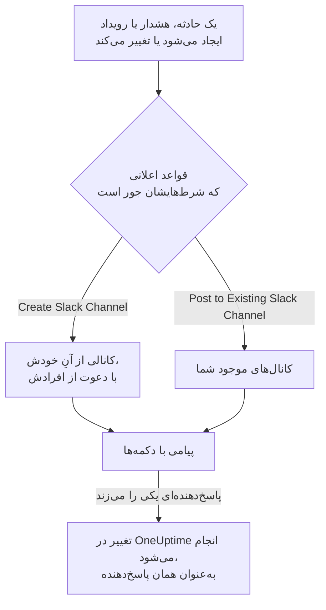

# Slack

OneUptime را به Slack وصل کنید تا حوادث، هشدارها، اپیزودها، تعمیر و نگهداری زمان‌بندی‌شده، مانیتورها و به‌روزرسانی‌های آنکال در کانال‌هایتان منتشر شوند، هر حادثه کانال خودش را داشته باشد، و پاسخ‌دهندگان بدون ترک Slack کار کنند: تأیید، برطرف کردن، افزودن یادداشت، فراخوانی آنکال و اعلام حادثه.

:::cards
- [اتصال Slack](#اتصال-slack): OneUptime را در فضای کاری خود نصب کنید، سپس حساب خودتان را پیوند دهید.
- [قواعد اعلان](#قواعد-اعلان): تعیین کنید کدام رویدادها کجا منتشر شوند، و کدام‌ها کانال خودشان را بگیرند.
- [ایجاد حادثه و نگهداری از Slack](#ایجاد-حادثه-و-نگهداری-از-slack): `/incident` و `/maintenance`، به‌عنوان خود شما.
- [اقدام روی حوادث، هشدارها و رویدادها از Slack](#اقدام-روی-حوادث-هشدارها-و-رویدادها-از-slack): دکمه‌های پیام‌های OneUptime.
:::

## چگونه کار می‌کند

دو اتصال این کار را ممکن می‌کنند:

- **اتصال پروژه**، که یک بار برقرار می‌شود: اپ OneUptime که در فضای کاری Slack شما نصب شده است. پیام‌ها را منتشر می‌کند، کانال می‌سازد و افراد را دعوت می‌کند.
- **اتصال خود هر فرد**: حساب Slack او که به حساب OneUptime او پیوند خورده است. دکمه‌ها، فرمان‌ها و واکنش‌های ایموجی به‌عنوان همان فرد و با مجوزهای او در پروژه عمل می‌کنند.

## پیش از شروع

- **نقشی که بتواند پروژه را وصل کند:** **Project Owner**، **Project Admin** یا **Project Member**. حذف نصب به **Project Owner** یا **Project Admin** نیاز دارد.
- **یک فضای کاری Slack** که بتوانید اپ را در آن نصب کنید.
- **طرح Growth در OneUptime Cloud** برای قواعد اعلان و خلاصه‌ها. [قواعد اعلان پایین‌تر از طرح Growth](#قواعد-اعلان-پایینتر-از-طرح-growth) را ببینید.
- **روی یک سرور خودمیزبان،** نخست یک اپ Slack که برای آن تنظیم شده باشد. [یکپارچه‌سازی Slack](/docs/self-hosted/slack-integration) را ببینید.

## اتصال Slack

:::steps
### نصب OneUptime در فضای کاری Slack

به **تنظیمات پروژه** > **فضای کاری** > **Slack** بروید و روی **Connect with Slack** کلیک کنید. فضای کاری را انتخاب کنید و به OneUptime اجازه دهید. Slack شما را به همان صفحه برمی‌گرداند که اکنون نام فضای کاری‌ای را نشان می‌دهد که پروژه به آن وصل است. تا وقتی هیچ فضای کاری‌ای وصل نشده، بخش **فضای کاری** در منوهای حوادث، هشدارها، تعمیر و نگهداری زمان‌بندی‌شده، مانیتورها و آنکال گزینهٔ **اتصال Slack یا Teams** را دارد که آن هم به همین‌جا می‌برد.

### اتصال حساب Slack خودتان

نصب اپ، حساب کسی را که آن را نصب می‌کند پیوند می‌دهد. بقیه حساب Slack خود را در **تنظیمات کاربر** > **فضای کاری** > **Slack** با **Connect my account with Slack** پیوند می‌دهند تا به‌عنوان خودشان روی حوادث اقدام کنند و پیام مستقیم بگیرند. این بخش وقتی پروژه به Slack وصل شد ظاهر می‌شود.

### افزودن یک قاعدهٔ اعلان

به **حوادث** > **فضای کاری** > **Slack** بروید. بخش **فضای کاری** فقط فضاهای کاری گفتگویی را فهرست می‌کند که پروژهٔ شما وصل کرده است، پس **Slack** پس از اتصال آنجا ظاهر می‌شود. یک قاعده بسازید، مثلاً قاعده‌ای که برای هر حادثهٔ تازه یک کانال Slack می‌سازد و مالکان حادثه را دعوت می‌کند. [قواعد اعلان](#قواعد-اعلان) را ببینید.

### آزمودن قاعده

روی **قاعده آزمایش** در ردیف قاعده کلیک کنید. یک پیام آزمایشی به کانال‌هایی که قاعده نام می‌برد می‌رسد. [آزمودن یک قاعده](#آزمودن-یک-قاعده) را ببینید.
:::

## قواعد اعلان

یک قاعدهٔ اعلان می‌گوید کدام رویدادها در Slack منتشر شوند، و کجا. هر محصول قواعد خودش را دارد، در منوی خودش زیر **فضای کاری** > **Slack**:

| محصول | زبانه‌های صفحهٔ **Slack** آن |
| --- | --- |
| **حوادث** | **حوادث**، **اپیزودهای حادثه**، **Summary** |
| **هشدارها** | **هشدارها**، **اپیزودهای هشدار**، **Summary** |
| **تعمیر و نگهداری زمان‌بندی‌شده** | یک فهرست قاعده |
| **مانیتورها** | یک فهرست قاعده |
| **کشیک آنکال** | یک فهرست قاعده |

ساختن یک قاعده چهار گام دارد:

| گام | آنچه تنظیم می‌کنید |
| --- | --- |
| **پایه** | **نام قاعده** و **توضیحات قاعده**. |
| **شرط‌ها** | قاعده برای کدام رویدادها اجرا می‌شود، مثلاً بر اساس شدت، حالت، برچسب، مانیتور یا واژه‌های عنوان. بدون هیچ شرطی برای هر رویدادی اجرا می‌شود. با دو شرط یا بیشتر، **شرط تطابق** می‌گوید همهٔ آن‌ها باید جور باشند یا هر یک کافی است. |
| **مقصد** | کجا منتشر می‌کند: **Post to Existing Slack Channel** با نام کانال‌ها، **Create Slack Channel** با نام کانال تازه و افرادی که دعوت می‌شوند، یا هر دو. |
| **Video Call** | فقط حوادث و هشدارها: برای هر کدام یک تماس آغاز کنید. [تماس‌های تصویری](/docs/workspace-connections/video-calls) را ببینید. |

کانالی که قاعده می‌سازد از **New Slack Channel Name** و پس از آن شمارهٔ رکورد نام می‌گیرد، مانند `oneuptime-incident-42`، و فقط کانالی که ساخته شده افرادی را می‌گیرد که قاعده دعوت می‌کند: مالکان رکورد، تیم‌ها و کاربرانی که برگزیده‌اید، و برای حوادث و هشدارها، افراد آنکال به محض فراخوانده شدن. یک حادثه، هشدار یا اپیزود خصوصی کانال خصوصی می‌گیرد. هر به‌روزرسانی بعدی رکورد — تغییر حالت، یک یادداشت، یک مالک تازه — در کانال‌های آن و در کانال‌های موجودی که قواعدش نام می‌برند منتشر می‌شود. حادثه، هشدار یا اپیزودی که از همان ابتدا برطرف‌شده ایجاد شود کانال خودش را نمی‌گیرد؛ پیام ایجاد آن همچنان به کانال‌هایی که قواعد شما نام می‌برند می‌رود. [حادثه‌ای که از پیش تأییدشده یا برطرف‌شده اعلام می‌شود](/docs/incidents/declaring-incidents#حادثهای-که-از-پیش-تأییدشده-یا-برطرفشده-اعلام-میشود) را ببینید.

**تنظیمات پروژه** > **فضای کاری** > **Slack** کانال‌هایی را که OneUptime می‌تواند ببیند فهرست می‌کند، با **ارسال آزمایشی** کنار هر کدام. OneUptime نخستین بار که در یک کانال عمومی منتشر می‌کند، خودش به آن می‌پیوندد. یک کانال خصوصی فقط وقتی فهرست می‌شود، و می‌توان در آن منتشر کرد، که اپ OneUptime در Slack به آن دعوت شده باشد.

## آزمودن یک قاعده

**قاعده آزمایش** در ردیف یک قاعده، پیامی آزمایشی برای آن قاعده در کانال‌هایی که نام می‌برد منتشر می‌کند تا رسیدنش را ببینید. اگر قاعده برای هر رویداد یک کانال می‌سازد، آزمون هم یکی می‌سازد و افراد قاعده را به آن دعوت می‌کند.

مانند **ارسال آزمایشی** کنار یک کانال در **تنظیمات پروژه** > **فضای کاری** > **Slack**، این کار به مجوز ساختن قواعد اعلان نیاز دارد: **Project Owner**، **Project Admin**، **Project Member**، **Settings Admin**، **Settings Member**، یا **Create Workspace Notification Rule** و **Read Workspace Notification Rule** در یک نقش سفارشی. برای کسی که فقط می‌تواند قواعد را ببیند، مانند یک **Viewer**، **قاعده آزمایش** قفل است و راهنمای آن می‌گوید چه لازم است؛ API آزمون او را با «You do not have permission to send test notifications in this project.» رد می‌کند. در OneUptime Cloud، آزمودن یک قاعده، مانند افزودن آن، به طرح **Growth** نیاز دارد.

در OneUptime Cloud، **ارسال آزمایشی** کنار یک کانال هم به طرح **Growth** نیاز دارد، چون منتشر کردن در یک کانال همان کاری است که قواعد و خلاصه‌ها می‌کنند. **ارسال آزمایشی فوری** روی یک خلاصه به مجوز ساختن خلاصه‌ها (**Create Workspace Notification Summary** و **Read Workspace Notification Summary** در یک نقش سفارشی) و، در OneUptime Cloud، به طرح **Growth** نیاز دارد؛ برای هر کس دیگری قفل است و راهنمای آن می‌گوید چه لازم است. یک کلاینت MCP که با دسترسی فقط‌خواندنی وصل شده نمی‌تواند هیچ آزمونی بفرستد.

## خلاصه‌ها

زبانهٔ **Summary** در **حوادث** > **فضای کاری** > **Slack** (و در **هشدارها**) یک جمع‌بندی دوره‌ای در کانال‌هایی که نام می‌برید منتشر می‌کند: چند حادثه یا هشدار رخ داده، با چه سرعتی تأیید و برطرف شده‌اند، و فهرستی با پیوندها. خلاصهٔ تازه هر هفته فرستاده می‌شود و ۷ روز گذشته را پوشش می‌دهد. اگر **ارسال اولین گزارش در** را خالی بگذارید، نخستین خلاصه ساعت ۰۹:۰۰ در آغاز هفته، روز یا ماه بعد فرستاده می‌شود؛ فرم می‌گوید چه زمانی.

هر خلاصه بر اساس ساعت **منطقه زمانی** خودش فرستاده می‌شود که در آغاز منطقهٔ زمانی شماست. ساعتِ روزِ خود را در آنجا در تمام سال حفظ می‌کند: خلاصه‌ای که برای ساعت ۰۹:۰۰ در برلین تنظیم شده، پس از جابه‌جایی ساعت‌ها برای ساعت تابستانی هم ساعت ۰۹:۰۰ به وقت برلین فرستاده می‌شود، و تاریخ‌های پیامش هم به وقت برلین است. از راه API، `timezone` را به‌صورت نام منطقهٔ زمانی IANA بفرستید، مانند `Europe/Berlin`. خلاصه‌ای که بدون منطقهٔ زمانی ساخته شود، منطقهٔ زمانی پروفایل سازنده‌اش را می‌گیرد، یا وقتی یک کلید API آن را می‌سازد، UTC را.

فرم خلاصه چهار گام دارد: **اطلاعات پایه** (نام و کانال‌های آن)، **زمان‌بندی**، **محتوا** (**چه چیزهایی باید گنجانده شود**) و **فیلترها** (کدام حوادث یا هشدارها را می‌شمارد).

## قواعد اعلان پایین‌تر از طرح Growth

در OneUptime Cloud، قواعد اعلان و خلاصه‌ها در طرح **Growth** و بالاتر هستند. پروژه‌ای پایین‌تر از آن، قواعد و خلاصه‌هایی را که از قبل دارد نگه می‌دارد، و آن‌ها همچنان در Slack منتشر می‌کنند. بنابراین صفحهٔ **Slack** هر محصول (حوادث، هشدارها، تعمیر و نگهداری زمان‌بندی‌شده، آنکال، مانیتورها) یادداشت طرح را با فهرست آن‌ها در زیرش نشان می‌دهد (**قواعد اعلان که هنوز تنظیم شده‌اند**، **خلاصه‌هایی که هنوز تنظیم شده‌اند**): یک قاعده را حذف کنید، یا یک خلاصه را خاموش یا حذف کنید. افزودن یا تغییر قواعد و خلاصه‌ها به **Growth** نیاز دارد.

## فراخوانده شدن در Slack

برای اینکه وقتی آنکال هستید با پیام مستقیم فراخوانده شوید، Slack را به‌عنوان یکی از روش‌های اعلان خود بیفزایید:

:::steps
1. حساب Slack خودتان را وصل کنید ([اتصال Slack](#اتصال-slack) را ببینید).
2. به **تنظیمات کاربر** > **روش‌های اعلان** بروید، زبانهٔ **Workspace Apps** را باز کنید و روی **Add Slack Account** کلیک کنید.
3. روی **Send Test Message** در ردیف آن کلیک کنید. پیام به پیام‌های مستقیم Slack شما می‌رسد.
:::

افزودن آن، فوراً آن را به قواعد آنکال شما هم می‌افزاید، پس از آن پس فراخوان‌ها در Slack به شما می‌رسند. اینکه کدام فراخوان‌ها را بگیرد، در **تنظیمات کاربر** > **قواعد آنکال** تغییر دهید.

## ذخیرهٔ پیام‌ها به‌عنوان یادداشت

در کانال یک حادثه، هشدار، اپیزود یا رویداد تعمیر و نگهداری زمان‌بندی‌شده به پیامی واکنش نشان دهید، و OneUptime آن را به‌عنوان یادداشتی روی همان رکورد ذخیره می‌کند و با پاسخی در رشتهٔ گفتگو تأیید می‌کند:

| واکنش | ذخیره به‌عنوان |
| --- | --- |
| ایموجی سنجاق 📌، یا **Pin to channel** خود Slack | یک یادداشت خصوصی که فقط تیم شما می‌بیند |
| ایموجی بلندگوی دستی یا بلندگو 📢 | یک یادداشت عمومی که روی صفحهٔ وضعیت نشان داده می‌شود. فقط حوادث و رویدادهای تعمیر و نگهداری زمان‌بندی‌شده. |

یادداشت به‌عنوان شما و با مجوزهای شما ذخیره می‌شود، پس حساب Slack خودتان باید وصل باشد. هر پیام فقط یک بار ذخیره می‌شود، هر چند نفر که واکنش نشان دهند.

## پرسیدن از OneUptime AI در Slack

دربارهٔ لاگ‌ها، ردیابی‌ها، متریک‌ها، حوادث و مانیتورهای خود به زبان ساده بپرسید. در یک کانال با @ از OneUptime نام ببرید، یا به آن پیام مستقیم بفرستید، و در رشتهٔ گفتگو پاسخ می‌دهد؛ برای پرسش‌های بیشتر همان‌جا پاسخ دهید. `/oneuptime ask which monitors are down?` پاسخ خود را در کانال منتشر می‌کند. هر دو نیاز دارند که حساب Slack خودتان وصل باشد و هوش مصنوعی برای پروژه روشن باشد. پاسخ‌ها در Slack فقط می‌خوانند: برای تغییر چیزی از دکمه‌ها استفاده کنید. [پرسش از هوش مصنوعی](/docs/ai/ask-ai) را ببینید.

## ایجاد حادثه و نگهداری از Slack

`/incident` و `/maintenance` فرمی باز می‌کنند که آن را به‌عنوان خودتان پر و ارسال می‌کنید: به‌عنوان حساب OneUptimeای که حساب Slack شما به آن وصل است ([اتصال Slack](#اتصال-slack) را ببینید)، با مجوزهای آن حساب در پروژه. اگر حساب Slack شما وصل نباشد، یا حساب OneUptime شما دیگر عضو پروژه نباشد، OneUptime در یک پیام مستقیم به شما می‌گوید چه کنید و هیچ فرمی باز نمی‌شود. میانبرهای **Create New Incident** و **Create Scheduled Event** همان فرم‌ها را باز می‌کنند.

- **چه کسی می‌تواند از آن‌ها استفاده کند.** کسانی که می‌توانند در OneUptime حادثه اعلام کنند یا رویداد تعمیر و نگهداری زمان‌بندی‌شده بسازند: **Project Owner**، **Project Admin**، **Project Member**، **Incident Admin** و **Incident Member** برای یک حادثه (**Create Incident** در یک نقش سفارشی)، و **Scheduled Maintenance Admin** و **Scheduled Maintenance Member** برای یک رویداد (**Create Scheduled Maintenance**). به هر کس دیگری این موضوع در یک پیام مستقیم گفته می‌شود و هیچ فرمی باز نمی‌شود.
- **فرم چه چیزهایی پیشنهاد می‌کند.** هر فهرست — شدت‌ها، مانیتورها، وضعیت‌های مانیتور، سیاست‌های آنکال و برچسب‌ها — همان چیزهایی را دارد که می‌توانید بخوانید، مانند همان فهرست در OneUptime: با نقشی محدود به برخی برچسب‌ها، مانیتورها و سیاست‌های آنکالی که آن برچسب‌ها را دارند. فهرستی که اصلاً نمی‌توانید بخوانید از فرم حذف می‌شود. سیاست‌های آنکال بایگانی‌شده هرگز پیشنهاد نمی‌شوند.
- **فرم چه چیزی را می‌تواند نام ببرد.** حادثه یا رویداد با مجوزهای خود شما ساخته و به نام شما ثبت می‌شود. مانیتور، سیاست آنکال، برچسب، شدت یا وضعیتی که نمی‌توانید بخوانید، یا متعلق به پروژه‌ای دیگر، طوری رد می‌شود که گویی پروژه آن را ندارد، حتی اگر فرم پیش از تغییر دسترسی شما باز شده باشد، و چیزی ساخته نمی‌شود. OneUptime دلیل را در یک پیام مستقیم می‌گوید.

**Execute On-Call Policy** روی یک حادثه، هشدار یا اپیزود هم همین‌طور کار می‌کند: به مجوز اجرای سیاست آنکال (**Project Owner**، **Project Admin**، **Project Member**، **On-Call Admin** و **On-Call Member**، یا **Create On-Call Duty Policy Execution Log** در یک نقش سفارشی) و به مجوز خواندن آن حادثه، هشدار یا اپیزود نیاز دارد، و سیاست‌های آنکال فعالی را پیشنهاد می‌کند که می‌توانید بخوانید.

## اقدام روی حوادث، هشدارها و رویدادها از Slack

دکمه‌های پیام‌هایی که OneUptime در Slack می‌فرستد هم به‌عنوان شما عمل می‌کنند: به‌عنوان حساب OneUptimeای که حساب Slack شما به آن وصل است، با مجوزهای آن حساب در پروژه. **Acknowledge**، **Resolve**، **Change State**، **Add Note** و **Execute On-Call Policy** روی یک حادثه، هشدار یا اپیزود، و **Mark as Ongoing**، **Mark as Complete**، **Change State** و **Add Note** روی یک رویداد تعمیر و نگهداری زمان‌بندی‌شده، هر کدام همان تغییری را می‌دهند که همان اقدام در OneUptime می‌دهد، و در آنجا به نام شما ثبت می‌شود: خط زمانی حالت و فید رکورد نشان می‌دهند که شما حالت آن را تغییر داده‌اید، و یادداشت از آنِ شماست. یادداشتی که با یک واکنش ایموجی از یک پیام ذخیره می‌شود هم به همین شکل منتشر می‌شود.

- **چه کسی می‌تواند از آن‌ها استفاده کند.** کسانی که می‌توانند همان تغییر را در OneUptime بدهند. تأیید، برطرف کردن یا تغییر حالت یک حادثه به مجوز تغییر حالت آن نیاز دارد: **Project Owner**، **Project Admin**، **Project Member**، **Incident Admin** و **Incident Member**، یا **Create Incident State Timeline** در یک نقش سفارشی. یک هشدار، اپیزود یا رویداد تعمیر و نگهداری زمان‌بندی‌شده به همان مجوز برای نوع خودش نیاز دارد (برای نمونه **Create Alert State Timeline**)، و یک یادداشت به مجوز انتشار آن نوع یادداشت. به هر کس دیگری این موضوع در یک پیام مستقیم گفته می‌شود و چیزی تغییر نمی‌کند.
- **کدام رکوردها.** آن‌هایی که می‌توانید بخوانید، مانند OneUptime: با نقشی محدود به برخی برچسب‌ها، حوادث، هشدارها، اپیزودها و رویدادهایی که آن برچسب‌ها را دارند. به دکمه‌ای روی هر رکورد دیگری، یا روی رکوردی از پروژه‌ای دیگر، پاسخ داده می‌شود که رکورد «was not found in this project, or you do not have access to it.»، و چیزی تغییر نمی‌کند. در OneUptime Cloud، تغییری که طرح پروژه شامل آن نیست با ذکر طرحی که لازم دارد رد می‌شود.
- **Change State چه پیشنهاد می‌کند.** حالت‌هایی که می‌توانید بخوانید و رکورد می‌تواند در ادامه به آن‌ها برود، به ترتیب پروژه: هیچ‌کدام پیش از حالتی که در آن است، برای یک اپیزود همان‌طور که برای یک حادثه، هشدار یا رویداد تعمیر و نگهداری زمان‌بندی‌شده، چون تغییر حالت هرگز رکورد را در فهرستش به عقب برنمی‌گرداند ([ترتیب محدودیتی واقعی است، نه ترجیحی نمایشی](/docs/incidents/states-and-severities#ترتیب-محدودیتی-واقعی-است-نه-ترجیحی-نمایشی) را ببینید). وقتی هیچ‌کدام را نمی‌توانید بخوانید، به شما گفته می‌شود «No incident states are available to you in this project. Ask a project admin for access to them.»؛ وقتی رکورد در آخرین حالتی است که می‌تواند به آن برسد، به شما گفته می‌شود «There is no later state to move this incident to.». هیچ‌کدام فرم خالی باز نمی‌کند.

## قطع اتصال

- **Disconnect** فقط پیوند حساب Slack خودتان را برمی‌دارد و روش اعلان Slack شما را هم همراه آن حذف می‌کند.
- **Uninstall OneUptime from Slack** در **تنظیمات پروژه** > **فضای کاری** > **Slack** اتصال پروژه را قطع می‌کند. OneUptime دیگر در Slack منتشر نمی‌کند، و منوهای **فضای کاری** دیگر آن را فهرست نمی‌کنند. قواعد اعلان و خلاصه‌ها برای زمانی که دوباره وصل می‌شوید نگه داشته می‌شوند.

> [!WARNING]
> حذف نصب، پیوند حساب Slack خود هر عضو پروژه را هم برمی‌دارد، و روش‌های اعلان Slack و قواعد آنکالی را که از آن‌ها استفاده می‌کردند حذف می‌کند. کسانی که در Slack فراخوانده می‌شدند، تا وقتی Slack را دوباره بیفزایند، از راه روش‌های اعلان دیگرشان فراخوانده می‌شوند.

## رفع اشکال

:::details یک قاعده هیچ چیزی منتشر نمی‌کند
شرط‌های قاعده را با **قاعده آزمایش** بررسی کنید: اگر آزمون می‌رسد، شرط‌های قاعده با آن رویداد جور نبوده‌اند. اگر نمی‌رسد، صفحهٔ Slack دلیل را می‌گوید. برای یک کانال خصوصی، نخست اپ OneUptime را در Slack به آن دعوت کنید. هر پیامی که OneUptime منتشر کرده، و هر پیامی که Slack رد کرده، در **تنظیمات پروژه** > **اعلان‌ها** > **گزارش‌های اعلان** در زبانهٔ **فضای کاری** فهرست می‌شود.
:::

:::details Slack وصل نشد
وقتی Slack شما را بدون اتصال برمی‌گرداند، صفحه‌ای که از آن شروع کردید **Slack وصل نشد** را نشان می‌دهد، و یک جمله دلیل را می‌گوید: مجوز ندارید، پیوند استفاده شده یا منقضی شده است، به فضای کاری دیگری وارد شده‌اید، یا سرور برای Slack تنظیم نشده است. برای همهٔ جمله‌ها و اینکه برای هر کدام چه کنید، [اتصال کامل نشد](/docs/self-hosted/slack-integration#اتصال-کامل-نشد) را ببینید.
:::

:::details یک دکمه یا فرمان می‌گوید حساب Slack من وصل نیست
آن را در **تنظیمات کاربر** > **فضای کاری** > **Slack** با **Connect my account with Slack** پیوند دهید. اگر دیگر عضو پروژه نیستید، OneUptime به جای آن همین را می‌گوید و هیچ اقدامی برای شما انجام نمی‌دهد.
:::

:::details اعلان‌ها می‌رسند، اما دکمه‌ها و فرمان‌ها کاری نمی‌کنند
روی یک سرور خودمیزبان، دکمه‌ها، فرم‌ها و فرمان‌ها نیاز دارند که Slack بتواند به OneUptime برسد؛ اعلان‌ها فقط به دسترسی خروجی نیاز دارند. [دسترسی شبکه برای استقرارهای خودمیزبان](/docs/self-hosted/slack-integration#دسترسی-شبکه-برای-استقرارهای-خودمیزبان) را ببینید.
:::

## گام‌های بعدی

:::cards
- [Microsoft Teams](/docs/workspace-connections/microsoft-teams): همان اعلان‌ها و اقدام‌ها در Microsoft Teams.
- [تماس‌های تصویری](/docs/workspace-connections/video-calls): به هر حادثه یک تماس بدهید که همراه به‌روزرسانی‌هایش منتشر می‌شود.
- [یکپارچه‌سازی Slack](/docs/self-hosted/slack-integration): اپ Slack را روی یک سرور خودمیزبان تنظیم کنید.
- [اعلام یک حادثه](/docs/incidents/declaring-incidents): همهٔ راه‌هایی که یک حادثه آغاز می‌شود، و آنچه در آن هنگام اجرا می‌شود.
:::
