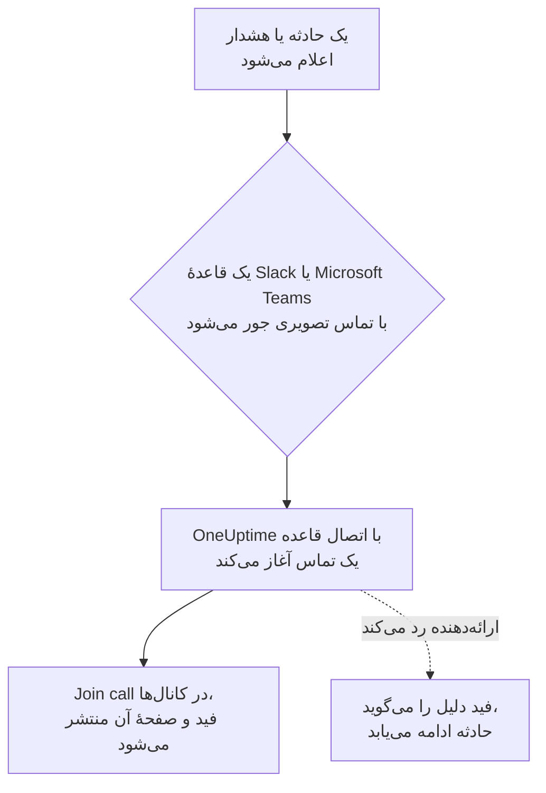

# تماس‌های تصویری

به هر حادثه و هشدار تماس خودش را بدهید. وقتی یک قاعدهٔ اعلان Slack یا Microsoft Teams برای یک حادثه یا هشدار تازه اجرا می‌شود، OneUptime یک جلسهٔ اختصاصی آغاز می‌کند (یک جلسهٔ Zoom، یک Google Meet، یک جلسهٔ Microsoft Teams یا huddle کانال Slack حادثه) و یک دکمهٔ **Join call** را هر جا که به‌روزرسانی‌های حادثه می‌روند منتشر می‌کند. پاسخ‌دهندگان با یک کلیک می‌پیوندند، و هیچ‌کس مجبور نیست ساعت ۳ بامداد جلسه‌ای بسازد و پیوندش را این‌سو و آن‌سو بچسباند.

:::cards
- [چگونه کار می‌کند](#چگونه-کار-میکند): یک قاعده تماس را آغاز می‌کند، و پاسخ‌دهندگان از هر جا که هستند می‌پیوندند.
- [اتصال با یک کلیک](#اتصال-با-یک-کلیک): Zoom، Google Meet یا Microsoft Teams، فقط با ورود.
- [ارائه‌دهندگان](#ارائهدهندگان): هویت سرویس اپ خودتان، یک پیوند جلسهٔ ثابت، یا یک huddle در Slack.
- [آغاز دستی یک تماس](#آغاز-دستی-یک-تماس): از صفحهٔ یک حادثه یا هشدار.
:::

## چگونه کار می‌کند



:::steps
### اتصال یک ارائه‌دهنده

به **تنظیمات پروژه** > **فضای کاری** > **Video Calls** بروید و Zoom، Google Meet یا Microsoft Teams را وصل کنید، یا یک پیوند جلسهٔ ثابت بیفزایید. در OneUptime Cloud، وصل کردن Zoom، Google Meet یا Microsoft Teams یک کلیک است: وارد شوید و به OneUptime اجازهٔ ساختن جلسه بدهید ([اتصال با یک کلیک](#اتصال-با-یک-کلیک) را ببینید). huddleهای Slack به چیزی جز اتصال Slack پروژه نیاز ندارند.

### روشن کردن آن در یک قاعده

یک قاعدهٔ اعلان Slack یا Microsoft Teams برای حوادث یا هشدارها را باز کنید (برای نمونه **حوادث** > **فضای کاری** > **Slack**). در گام **Video Call** قاعده، **Start a video call for the incident** را روشن کنید و برگزینید تماس کجا برگزار شود.

### پیوستن با یک کلیک

وقتی قاعده اجرا می‌شود، OneUptime یک تماس برای حادثه آغاز می‌کند و آن را با یک دکمهٔ **Join call** در کانال‌هایی که به‌روزرسانی‌های حادثه به آن‌ها می‌روند و در فید حادثه منتشر می‌کند. صفحهٔ حادثه تماس را در کارت **Video Call** خود و یک دکمهٔ **Join call** را در سرصفحه‌اش نشان می‌دهد.
:::

شرط‌های قاعده تعیین می‌کنند کدام حوادث تماس بگیرند. برای یک پل ارتباطی فقط روی حوادث Sev1، به قاعده یک شرط **شدت** بدهید. تماس‌ها برای حوادث و هشدارهایی آغاز می‌شوند که در حالت جاری اعلام می‌شوند. حادثه‌ای که از همان ابتدا برطرف‌شده ایجاد شود تماسی نمی‌گیرد.

### یک تماس برای هر حادثه

برای هر حادثه، در هر جایی که تماس برگزار می‌شود، یک بار تماس آغاز می‌شود. قواعدی که همان اتصال را برمی‌گزینند یک تماس مشترک دارند، و یک قاعده هرگز برای حادثه‌ای که از آن اتصال تماس دارد تماس دومی آغاز نمی‌کند. قواعدی که جاهای مختلفی را برمی‌گزینند هر کدام تماس خودشان را آغاز می‌کنند، برای نمونه یک جلسهٔ Zoom برای پاسخ‌دهندگان و huddle کانال Slack حادثه.

### وقتی تماس نمی‌تواند آغاز شود

اعلام یک حادثه هرگز منتظر ارائه‌دهندهٔ تماس تصویری نمی‌ماند. تماس پس از ایجاد حادثه آغاز می‌شود، پس ارائه‌دهنده‌ای کند یا ناموفق هرگز حادثه یا اعلان‌های آنکال آن را به تأخیر نمی‌اندازد.

اگر ارائه‌دهنده رد کند (یک راز منقضی‌شده، یک مجوز جاافتاده، یک میزبان حذف‌شده)، فید حادثه همراه با دلیل ارائه‌دهنده می‌گوید که تماس قاعده آغاز نشد، تا پاسخ‌دهندگان بدانند باید از صفحهٔ حادثه تماسی آغاز کنند. اجرای قاعده در گزارش‌های اعلان فضای کاری با عنوان **شروع تماس تصویری** فهرست می‌شود، و ردیف اتصال در **تنظیمات پروژه** > **فضای کاری** > **Video Calls** تا وقتی تماسی دوباره آغاز شود خطا را نشان می‌دهد.

### حوادث خصوصی

هر جلسه به نام حادثه‌ای که برای آن است، با شماره و عنوانش، نام‌گذاری می‌شود، و توضیحاتش به حادثه پیوند می‌دهد. برای یک حادثهٔ خصوصی عنوان کنار گذاشته می‌شود، چون هر کسی که به جلسه دعوت شده می‌تواند نام آن را بخواند.

## اتصال با یک کلیک

در OneUptime Cloud، وصل کردن Zoom، Google Meet یا Microsoft Teams یک کلیک می‌برد و هیچ تنظیمی نزد ارائه‌دهنده لازم نیست:

:::steps
1. به **تنظیمات پروژه** > **فضای کاری** > **Video Calls** بروید و روی **اتصال** در Zoom، Google Meet یا Microsoft Teams کلیک کنید.
2. روی **Continue to Zoom** (یا Google، یا Microsoft) کلیک کنید، وارد شوید، و به OneUptime اجازهٔ ساختن جلسه بدهید.
3. با اتصالِ برقرارشده به صفحهٔ تماس‌های تصویری برمی‌گردید. **Start a test meeting** آن را از ابتدا تا انتها بررسی می‌کند؛ سپس اتصال را در یک قاعدهٔ اعلان Slack یا Microsoft Teams برگزینید.
:::

هر جلسه به‌عنوان حسابی که با آن وارد می‌شوید ساخته می‌شود، و همان حساب میزبانش است. به جای حساب خودتان با یک حساب مشترک وارد شوید، مانند incidents@example.com، تا وقتی افراد می‌روند تماس‌ها همچنان آغاز شوند. ردیف اتصال نشان می‌دهد به‌عنوان چه کسی وارد شده است.

| ارائه‌دهنده | ورود با | آنچه OneUptime مجاز است انجام دهد |
| --- | --- | --- |
| Zoom | یک کاربر Zoom. جلسه‌هایی که میزبانشان یک کاربر Basic (رایگان) است پس از ۴۰ دقیقه پایان می‌یابند. | ساختن جلسه برای آن کاربر (`meeting:write:meeting`) و خواندن اینکه او کیست (`user:read:user`). |
| Google Meet | یک حساب Google که بتواند از Google Meet استفاده کند. | ساختن فضاهای Meet به‌عنوان آن حساب (`meetings.space.created`) و خواندن نشانی ایمیل آن. |
| Microsoft Teams | یک حساب کاری یا آموزشی با Microsoft Teams. حساب‌های شخصی Microsoft نمی‌توانند جلسهٔ Teams بسازند. | ساختن جلسه‌های آنلاین به‌عنوان آن حساب (مجوز تفویضی `OnlineMeetings.ReadWrite`) و وارد ماندن (`offline_access`). |

اتصالی که با ورود ساخته شده هم تنظیم‌هایی دارد که تعیین می‌کنند چه کسی منتظر بماند: **Who can join** برای Google Meet و **Who skips the lobby** برای Microsoft Teams. آن‌ها را با **ویرایش** در ردیف اتصال تغییر دهید.

### وارد ماندن

OneUptime توکن تازه‌سازی ورود را رمزگذاری‌شده نگه می‌دارد و دست‌کم هفته‌ای یک بار آن را تازه می‌کند، پس هرگز به دلیل استفاده نشدن منقضی نمی‌شود، هر چقدر هم پروژه بدون حادثه بماند. اگر ورود از کار بیفتد (حساب OneUptime را حذف کرده، حذف یا معلق شده، یا سیاست سازمان شما از آن می‌خواهد دوباره وارد شود)، ردیف اتصال همان روزی که OneUptime متوجه می‌شود، نه در حادثهٔ بعدی، **Not working** را همراه با دلیل نشان می‌دهد. **Reconnect** در ردیف آن را دوباره وارد می‌کند.

اتصال‌هایی که به‌عنوان یک حساب وارد شده‌اند، در همهٔ پروژه‌ها، یک ورود مشترک دارند: Zoom برای هر حساب فقط یک ورود نگه می‌دارد، پس وصل کردن دوبارهٔ همان کاربر Zoom آن را برای همهٔ آن‌ها جایگزین می‌کند.

### اتصال دوباره و حذف

**Reconnect** در ردیف یک اتصال آن را دوباره وارد می‌کند، به‌عنوان همان حساب یا حسابی دیگر. پس از اینکه حساب OneUptime را حذف کرد، یا برای انتقال جلسه‌های حادثه به حسابی دیگر، از آن استفاده کنید.

حذف یک اتصال، وقتی اتصال دیگری از آن ورود استفاده نکند، دسترسی OneUptime را در Zoom و Google پس می‌گیرد. برای Microsoft، OneUptime را در **My Apps** (myapps.microsoft.com) آن حساب حذف کنید. حذف OneUptime از حساب Zoom خود در Zoom App Marketplace، ورود آن را از هر اتصالی که به‌عنوان آن حساب وارد شده پاک می‌کند، و آن‌ها تا اتصال دوباره **Not working** نشان می‌دهند.

### اگر Microsoft یک مدیر بخواهد

برخی سازمان‌های Microsoft 365 فقط به مدیران اجازهٔ تأیید اپ‌ها را می‌دهند. اگر Microsoft بگوید به تأیید مدیر نیاز دارید، از یک مدیر Microsoft 365 بخواهید Microsoft Teams را وصل کند، یا OneUptime را در [مرکز مدیریت Microsoft Entra](https://entra.microsoft.com/) زیر **Enterprise applications** > **Admin consent requests** تأیید کند.

### استفاده از اپ خودتان به جای آن

برای اتصال با یک هویت سرویس به جای ورود یک فرد — یک اپ Server-to-Server OAuth در Zoom، یک حساب سرویس Google با تفویض در سطح دامنه، یا یک ثبت برنامه در Microsoft Entra — در پنجرهٔ اتصال روی **Use your own Zoom app** (یا Google، یا Microsoft) کلیک کنید. [ارائه‌دهندگان](#ارائهدهندگان) هر کدام را توضیح می‌دهد. روی یک سرور خودمیزبان بدون اپ‌های یک‌کلیکی تنظیم‌شده، **اتصال** مستقیماً همین فرم را باز می‌کند؛ برای تنظیم آن‌ها [اتصال یک‌کلیکی روی یک سرور خودمیزبان](#اتصال-یککلیکی-روی-یک-سرور-خودمیزبان) را ببینید.

## آغاز دستی یک تماس

کارت **Video Call** در صفحهٔ یک حادثه یا هشدار **Start call** را دارد (یا وقتی یکی هست، **Start another**). یکی از اتصال‌های پروژه یا huddle کانال Slack حادثه را برگزینید، یا یک پیوند جلسهٔ خودتان را بچسبانید. تماس مانند تماسی که یک قاعده آغاز می‌کند در کانال‌ها و فید حادثه منتشر می‌شود.

**حذف** روی کارت یک تماس را از صفحهٔ حادثه برمی‌دارد. خود جلسه حذف نمی‌شود، و هر کسی که پیوند را دارد همچنان می‌تواند به آن بپیوندد.

آغاز و حذف تماس‌ها به مجوز کار روی حوادث (یا هشدارها) نیاز دارد: **Project Owner**، **Project Admin**، **Project Member**، **Incident Admin** یا **Incident Member**، یا **Create Incident Video Call** و **Delete Incident Video Call** در یک نقش سفارشی. هر کسی که می‌تواند حادثه را بخواند تماس‌های آن را می‌بیند.

## ارائه‌دهندگان

این بخش دربارهٔ اتصال یک ارائه‌دهنده با هویت سرویس اپ خودتان است: یک اپ Server-to-Server OAuth در Zoom، یک حساب سرویس Google، یک ثبت برنامه در Microsoft Entra. هویت سرویس هرگز به یک فرد وابسته نیست، پس هر کس هم که برود کار می‌کند. برای اتصال با ورود به جای آن، [اتصال با یک کلیک](#اتصال-با-یک-کلیک) را ببینید.

اعتبارنامه‌ها در حالت ذخیره رمزگذاری می‌شوند و API هرگز آن‌ها را برنمی‌گرداند. هنگام ویرایش یک اتصال، اعتبارنامه‌ای که خالی بماند مقدار ذخیره‌شده را نگه می‌دارد.

**Start test meeting** در فرم اتصال، و **آزمایش** در ردیف یک اتصال، با تنظیمات اتصال یک جلسهٔ واقعی می‌سازند و پیوندش را نشان می‌دهند. این تنها بررسی‌ای است که ثابت می‌کند اعتبارنامه‌ها، مجوز در سمت ارائه‌دهنده و میزبان همه با هم کار می‌کنند. هیچ چیزی جایی منتشر نمی‌شود.

وصل کردن یک ارائه‌دهنده به **Project Owner**، **Project Admin** یا **Settings Admin**، یا **Create Video Call Connection** و **Edit Video Call Connection** در یک نقش سفارشی نیاز دارد.

### Zoom

OneUptime برای هر حادثه از راه یک اپ **Server-to-Server OAuth** در Zoom یک جلسهٔ Zoom می‌سازد که میزبانش یک کاربر Zoom دارای لایسنس به انتخاب شماست.

:::steps
1. در [Zoom App Marketplace](https://marketplace.zoom.us/)، **Develop** > **Build App** را برگزینید و یک اپ **Server-to-Server OAuth** بسازید. ساختن آن به یک مدیر حساب Zoom، یا نقشی که اپ‌های Server-to-Server OAuth را مجاز می‌کند، نیاز دارد.
2. در صفحهٔ **Scopes** اپ، **meeting:write:meeting:admin** (ساختن جلسه برای یک کاربر) را بیفزایید. اپی که پیش از scopeهای جزئی ساخته شده می‌تواند به جای آن از **meeting:write:admin** استفاده کند.
3. اپ را **Activate** کنید، سپس **Account ID**، **Client ID** و **Client secret** را از صفحهٔ **App Credentials** آن در فرم اتصال کپی کنید.
4. **Meeting host** را وارد کنید: ایمیل یک کاربر Zoom دارای لایسنس، ترجیحاً یک حساب سرویس مانند incidents@example.com، تا وقتی افراد می‌روند جلسه‌ها همچنان کار کنند. جلسه‌هایی که میزبانشان یک کاربر Basic (رایگان) است پس از ۴۰ دقیقه پایان می‌یابند.
5. پاسخ‌دهندگان بدون انتظار برای میزبان می‌پیوندند، چون میزبان یک حساب سرویس است که هرگز نمی‌پیوندد. مطمئن شوید تنظیم **Waiting room** حساب Zoom شما در حالت روشن قفل نشده باشد، وگرنه هیچ‌کس نمی‌تواند وارد شود.
:::

| فیلد | کجا پیدایش کنید |
| --- | --- |
| Account ID | صفحهٔ **App Credentials** اپ |
| Client ID | صفحهٔ **App Credentials** اپ |
| Client secret | صفحهٔ **App Credentials** اپ |
| Meeting host | ایمیل کاربر Zoom دارای لایسنس که میزبان همهٔ جلسه‌هاست |

### Google Meet

OneUptime برای هر حادثه با Google Meet REST API یک Google Meet می‌سازد، از راه یک حساب سرویس Google Cloud که با تفویض در سطح دامنه به‌عنوان یک کاربر Google Workspace عمل می‌کند.

:::steps
1. در [کنسول Google Cloud](https://console.cloud.google.com/)، یک پروژه برگزینید یا بسازید و **Google Meet REST API** را برای آن فعال کنید.
2. زیر **IAM & Admin** > **Service accounts**، یک حساب سرویس بسازید. آن را باز کنید، به **Keys** > **Add key** > **Create new key** بروید، **JSON** را برگزینید، و فایل دانلودشده را به‌عنوان **Service account JSON key** در فرم اتصال بچسبانید.
3. در [کنسول Google Admin](https://admin.google.com/)، **Security** > **Access and data control** > **API controls** > **Manage Domain Wide Delegation** را باز کنید و روی **Add new** کلیک کنید. **Client ID** عددی حساب سرویس و scope `https://www.googleapis.com/auth/meetings.space.created` را وارد کنید.
4. کاربر Google Workspace را که حساب سرویس به‌عنوان او عمل می‌کند در **Create meetings as** وارد کنید: یک حساب اختصاصی مانند incidents@example.com. مالک همهٔ جلسه‌ها همین کاربر است.
:::

**Who can join** تعیین می‌کند چه کسی بدون درخواست می‌پیوندد: با **People in your organization join directly, others ask to join** (پیش‌فرض)، افراد بیرون از Google Workspace شما درخواست پیوستن می‌دهند و کسی در تماس آن‌ها را راه می‌دهد. با **Anyone with the link joins directly**، هیچ‌کس منتظر نمی‌ماند.

تفویض در سطح دامنه ممکن است چند دقیقه طول بکشد تا کار کند. اگر درست پس از افزودن تفویض، آزمون گزارش دهد که Google به حساب سرویس اجازه نداد به‌عنوان کاربر عمل کند، چند دقیقه صبر کنید و دوباره آزمایش کنید.

### Microsoft Teams

OneUptime برای هر حادثه با Microsoft Graph یک جلسهٔ Microsoft Teams می‌سازد، از راه یک ثبت برنامه در Microsoft Entra که از طرف یک کاربر Teams دارای لایسنس جلسه برگزار می‌کند.

:::steps
1. در [مرکز مدیریت Microsoft Entra](https://entra.microsoft.com/)، **App registrations** > **New registration** را باز کنید و یک برنامهٔ تک‌مستأجری ثبت کنید. **Directory (tenant) ID** و **Application (client) ID** آن را کپی کنید.
2. زیر **API permissions**، مجوز **application** مربوط به Microsoft Graph، یعنی **OnlineMeetings.ReadWrite.All**، را بیفزایید، سپس روی **Grant admin consent** کلیک کنید.
3. زیر **Certificates & secrets**، یک راز کلاینت بسازید و **Value** آن را، نه Secret ID آن را، به‌عنوان **Client secret** در فرم اتصال بچسبانید.
4. برگزارکننده را برگزینید: یک کاربر Teams دارای لایسنس، ترجیحاً یک حساب سرویس. **Object ID** او را از **Users** در مرکز مدیریت Entra در **Organizer object ID** کپی کنید.
5. با یک سیاست دسترسی برنامه به اپ اجازه دهید برای برگزارکننده جلسه بسازد. در Teams PowerShell، پس از `Connect-MicrosoftTeams`، دو فرمان زیر را اجرا کنید.
:::

```powershell
New-CsApplicationAccessPolicy -Identity OneUptime-Meetings -AppIds "<application-client-id>"
Grant-CsApplicationAccessPolicy -PolicyName OneUptime-Meetings -Identity "<organizer-object-id>"
```

اعمال سیاست ممکن است تا ۳۰ دقیقه طول بکشد. تا آن زمان، آزمون گزارش می‌دهد که اپ مجاز نیست برای برگزارکننده جلسه بسازد.

**Who skips the lobby** تعیین می‌کند چه کسی بدون انتظار می‌پیوندد: با **People in your organization skip the lobby** (پیش‌فرض)، هر کس دیگری در لابی منتظر می‌ماند تا کسی در جلسه او را راه دهد. با **Everyone skips the lobby**، هیچ‌کس منتظر نمی‌ماند.

### پیوند جلسه

یک پیوند جلسهٔ ثابت برای هر حادثه همان اتاق است: یک Zoom Personal Meeting Room، یک جلسهٔ تکرارشوندهٔ Microsoft Teams یا Google Meet، یک اتاق شخصی Webex یا یک اتاق Jitsi. برای هر حادثه چیزی ساخته نمی‌شود، پس چیزی برای مجاز کردن نیست.

:::steps
1. در ابزاری که تیم شما از پیش استفاده می‌کند، جلسه‌ای بسازید که هرگز منقضی نشود.
2. پیوند پیوستن https آن را به‌عنوان **Meeting link** در فرم اتصال بچسبانید.
:::

هر حادثه و هشداری که با این اتصال آغاز شود از همین اتاق استفاده می‌کند، پس دو حادثهٔ هم‌زمان هم آن را مشترک دارند. مطمئن شوید جلسه اجازه می‌دهد افراد بدون میزبان بپیوندند.

### huddleهای Slack

یک قاعدهٔ Slack می‌تواند به جای آن huddle کانال Slack حادثه را آغاز کند. چیزی برای وصل کردن نیست: در گام **Video Call** قاعده، **Slack huddle** را برگزینید.

huddle در کانالی برگزار می‌شود که قاعده برای حادثه می‌سازد، یا وقتی قاعده به جای آن در کانال‌های موجود منتشر می‌کند، در نخستین آن‌ها. پس قاعده باید یک کانال بسازد یا در یک کانال موجود منتشر کند. دکمهٔ **Join huddle** huddle کانال را در Slack باز می‌کند. نخستین پاسخ‌دهنده‌ای که آن را باز کند huddle را آغاز می‌کند، و همهٔ بعدی‌ها به آن می‌پیوندند. Slack راهی برای آغاز huddle از طرف یک اپ ندارد، پس تا کسی آن را باز نکند، هیچ‌کس در huddle نیست.

huddle در Slack فقط برای قواعد Slack است. یک قاعدهٔ Microsoft Teams تماس‌هایش را با یکی از اتصال‌های تماس تصویری پروژه آغاز می‌کند.

## استفاده از API

یک تماس رکوردی روی حادثه (`IncidentVideoCall`) یا هشدار (`AlertVideoCall`) است. آن را با `_id` حادثه و یکی از این‌ها بسازید:

- `videoCallConnectionId`: با آن اتصال یک جلسهٔ تازه آغاز کنید.
- `provider` با مقدار `SlackHuddle`: huddle کانال Slack حادثه.
- `joinUrl` (و به‌طور اختیاری `title`): یک پیوند جلسهٔ خودتان.

```json
{
  "data": {
    "projectId": "<project-id>",
    "incidentId": "<incident-id>",
    "videoCallConnectionId": "<connection-id>"
  }
}
```

`POST /api/video-call-connection/test` با یک اتصال ذخیره‌شده (`{ "connectionId": "..." }`) یا با تنظیماتی که هنوز ذخیره نشده‌اند (`{ "provider": "Zoom", "config": { ... }, "secrets": { ... } }`) یک جلسهٔ آزمایشی آغاز می‌کند و `joinUrl` آن را برمی‌گرداند.

`authMethod` یک اتصال می‌گوید چگونه وارد می‌شود: `OAuth` برای اتصالی که با ورود ساخته شده، `AppCredentials` برای اتصالی با اعتبارنامه‌های اپ خودتان، و هیچ برای یک پیوند جلسه. اتصالی که با ورود ساخته می‌شود فقط با ورود، در داشبورد، ساخته می‌شود. از راه API می‌توانید نامش و `config` آن را تغییر دهید، و `connectedAccount` آن می‌گوید به‌عنوان چه کسی وارد شده است.

## اتصال یک‌کلیکی روی یک سرور خودمیزبان

OneUptime Cloud اپ‌های Zoom، Google و Microsoft خودش را برای اتصال یک‌کلیکی دارد. یک سرور خودمیزبان آن را برای هر ارائه‌دهنده‌ای که اپش را تنظیم کرده‌اید پیشنهاد می‌کند. بدون آن، **اتصال** فرم اپ خودتان را باز می‌کند.

برای هر ارائه‌دهنده یک اپ OAuth بسازید و این Redirect URI را، با میزبان سرور خودتان، روی آن ثبت کنید:

| ارائه‌دهنده | Redirect URI | متغیرهای محیطی | مقادیر Helm |
| --- | --- | --- | --- |
| Zoom | `https://<host>/api/video-call-oauth/zoom/callback` | `ZOOM_APP_CLIENT_ID`, `ZOOM_APP_CLIENT_SECRET`, `ZOOM_APP_WEBHOOK_SECRET_TOKEN` | `zoomApp.clientId`, `zoomApp.clientSecret`, `zoomApp.webhookSecretToken` |
| Google Meet | `https://<host>/api/video-call-oauth/google-meet/callback` | `GOOGLE_MEET_APP_CLIENT_ID`, `GOOGLE_MEET_APP_CLIENT_SECRET` | `googleMeetApp.clientId`, `googleMeetApp.clientSecret` |
| Microsoft Teams | `https://<host>/api/video-call-oauth/microsoft-teams/callback` | `MICROSOFT_TEAMS_MEETINGS_APP_CLIENT_ID`, `MICROSOFT_TEAMS_MEETINGS_APP_CLIENT_SECRET` | `microsoftTeamsMeetingsApp.clientId`, `microsoftTeamsMeetingsApp.clientSecret` |

- **Zoom**: در [Zoom App Marketplace](https://marketplace.zoom.us/)، **Develop** > **Build App** را برگزینید و یک **General App** با مدیریت کاربران بسازید. زیر **Basic Information**، Redirect URI را به‌عنوان OAuth Redirect URL در هر دو زبانهٔ **Development** و **Production** و در فهرست مجاز OAuth بیفزایید، و در زبانهٔ **Production** نشانی نقطهٔ پایانی **Deauthorization Notification** را روی `https://<host>/api/video-call-oauth/zoom/events` بگذارید. زیر **Scopes**، `meeting:write:meeting` و `user:read:user` را بیفزایید. **Secret Token** زیر **Features** > **Access** همان `ZOOM_APP_WEBHOOK_SECRET_TOKEN` است. اعتبارنامه‌های **Development** فقط برای کاربران حساب Zoom خودتان کار می‌کنند؛ اعتبارنامه‌های **Production** پس از اینکه Zoom اپ را بررسی و منتشر کرد برای همه کار می‌کنند.
- **Google Meet**: در [کنسول Google Cloud](https://console.cloud.google.com/)، **Google Meet REST API** را فعال کنید، صفحهٔ رضایت OAuth (**Google Auth Platform**) را با scopeهای `openid`، `email` و `https://www.googleapis.com/auth/meetings.space.created` پیکربندی کنید، و یک کلاینت OAuth از نوع **Web application** با Redirect URI بسازید. اپ را در حالت production منتشر کنید: اپی که در حالت testing بماند پس از هفت روز ورودهایش را از دست می‌دهد. Google اپ‌هایی را که scope مربوط به Meet را می‌خواهند بررسی می‌کند؛ تا آن زمان، افراد پیش از ورود یک هشدار می‌بینند.
- **Microsoft Teams**: در [مرکز مدیریت Microsoft Entra](https://entra.microsoft.com/)، برنامه‌ای برای **Accounts in any organizational directory** ثبت کنید، Redirect URI را به‌عنوان یک Redirect URI از نوع **Web** بیفزایید، مجوزهای تفویضی Microsoft Graph، یعنی `openid`، `profile`، `email`، `offline_access` و `OnlineMeetings.ReadWrite`، را بیفزایید، و یک راز کلاینت بسازید. از یک ثبت جداگانه استفاده کنید، نه ثبت ربات Microsoft Teams (`MICROSOFT_TEAMS_APP_CLIENT_ID`). تا وقتی اپ ناشر تأییدشده‌ای نداشته باشد، بیشتر سازمان‌ها برای رضایت به آن به یک مدیر نیاز دارند.

شناسه‌های کلاینت عمومی هستند: به داشبورد فرستاده می‌شوند تا بداند کدام ارائه‌دهندگان با یک کلیک وصل می‌شوند. رازها و توکن راز webhook را محرمانه نگه دارید. worker هر روز همهٔ ورودها را تازه می‌کند، پس به همان مقادیری نیاز دارد که app دارد.

## رفع اشکال

:::details برای یک حادثه هیچ تماسی آغاز نشد
بررسی کنید که قاعده با حادثه جور شده باشد (**قاعده آزمایش**)، گام **Video Call** آن روشن باشد، و حادثه در حالت جاری اعلام شده باشد: حادثه‌ای که از همان ابتدا برطرف‌شده ایجاد شود تماسی نمی‌گیرد. قاعده‌ای که پیش‌تر با آن اتصال برای حادثه تماسی آغاز کرده، تماس دیگری آغاز نمی‌کند.
:::

:::details فید می‌گوید تماس آغاز نشد
ارائه‌دهنده رد کرده، و فید دلیلش را می‌گوید. در این میان از صفحهٔ حادثه یک تماس آغاز کنید. سپس **آزمایش** را در ردیف اتصال اجرا کنید: تا وقتی تنظیمات را نزد ارائه‌دهنده درست می‌کنید، همان دلیل را نشان می‌دهد، مانند یک راز کلاینت منقضی‌شده یا یک مجوز جاافتاده.
:::

:::details یک اتصال Not working نشان می‌دهد
ورود آن از کار افتاده است: حساب OneUptime را حذف کرده، حذف یا معلق شده، یا باید دوباره وارد شود. روی **Reconnect** در ردیف آن کلیک کنید. تا آن زمان، تماس‌هایی که باید آغاز کند نمی‌توانند آغاز شوند.
:::

:::details افراد در لابی یا اتاق انتظار منتظر می‌مانند
**Who can join** (Google Meet) یا **Who skips the lobby** (Microsoft Teams) را با **ویرایش** در ردیف اتصال تغییر دهید. برای Zoom، مطمئن شوید تنظیم **Waiting room** حساب در حالت روشن قفل نشده باشد.
:::

## گام‌های بعدی

:::cards
- [Slack](/docs/workspace-connections/slack): قواعدی که تماس آغاز می‌کنند، و کانال‌هایی که در آن‌ها منتشر می‌کنند.
- [Microsoft Teams](/docs/workspace-connections/microsoft-teams): همان قواعد و تماس‌ها در Microsoft Teams.
- [یکپارچه‌سازی Microsoft Teams](/docs/self-hosted/microsoft-teams-integration): ربات Teams را روی یک سرور خودمیزبان تنظیم کنید.
- [اعلام یک حادثه](/docs/incidents/declaring-incidents): وقتی یک حادثه آغاز می‌شود چه رخ می‌دهد.
:::
