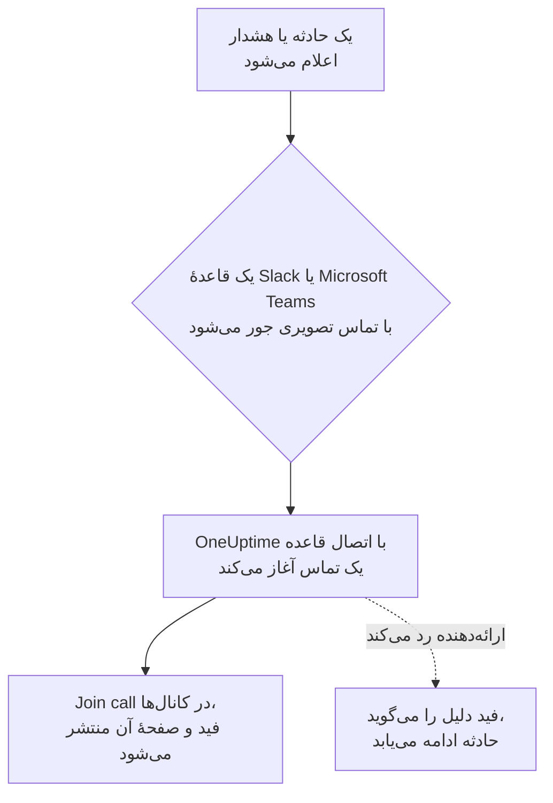

# تماس‌های تصویری

به هر حادثه و هشدار تماس خودش را بدهید. وقتی یک قاعدهٔ اعلان Slack یا Microsoft Teams برای یک حادثه یا هشدار تازه اجرا می‌شود، OneUptime یک جلسهٔ اختصاصی آغاز می‌کند (یک جلسهٔ Zoom، یک Google Meet، یک جلسهٔ Microsoft Teams یا huddle کانال Slack حادثه) و یک دکمهٔ **Join call** را هر جا که به‌روزرسانی‌های حادثه می‌روند منتشر می‌کند. پاسخ‌دهندگان با یک کلیک می‌پیوندند، و هیچ‌کس مجبور نیست ساعت ۳ بامداد جلسه‌ای بسازد و پیوندش را این‌سو و آن‌سو بچسباند.

:::cards
- [چگونه کار می‌کند](#چگونه-کار-میکند): یک قاعده تماس را آغاز می‌کند، و پاسخ‌دهندگان از هر جا که هستند می‌پیوندند.
- [اتصال با یک کلیک](#اتصال-با-یک-کلیک): Zoom، Google Meet یا Microsoft Teams، فقط با ورود.
- [ارائه‌دهندگان](#ارائهدهندگان): هویت سرویس اپ خودتان، یک پیوند جلسهٔ ثابت، یا یک huddle در Slack.
- [آغاز دستی یک تماس](#آغاز-دستی-یک-تماس): از صفحهٔ یک حادثه یا هشدار.
- [رونوشت تماس‌ها](#رونوشت-تماسها): آنچه در تماس یک حادثه گفته شد، و علت ریشه‌ای که OneUptime AI در آن می‌خواند.
:::

## چگونه کار می‌کند



:::steps
### اتصال یک ارائه‌دهنده

به **تنظیمات پروژه** > **فضای کاری** > **Video Calls** بروید و Zoom، Google Meet یا Microsoft Teams را وصل کنید، یا یک پیوند جلسهٔ ثابت بیفزایید. در OneUptime Cloud، وصل کردن Zoom، Google Meet یا Microsoft Teams یک کلیک است: وارد شوید و به OneUptime اجازهٔ ساختن جلسه بدهید ([اتصال با یک کلیک](#اتصال-با-یک-کلیک) را ببینید). huddleهای Slack به چیزی جز اتصال Slack پروژه نیاز ندارند.

### روشن کردن آن در یک قاعده

یک قاعدهٔ اعلان Slack یا Microsoft Teams برای حوادث یا هشدارها را باز کنید (برای نمونه **حوادث** > **فضای کاری** > **Slack**). در گام **Video Call** قاعده، **Start a video call for the incident** را روشن کنید و برگزینید تماس کجا برگزار شود.

### پیوستن با یک کلیک

وقتی قاعده اجرا می‌شود، OneUptime یک تماس برای حادثه آغاز می‌کند و آن را با یک دکمهٔ **Join call** در کانال‌هایی که به‌روزرسانی‌های حادثه به آن‌ها می‌روند و در فید حادثه منتشر می‌کند. صفحهٔ حادثه تماس را در کارت **Video Call** خود و یک دکمهٔ **پیوستن به تماس** را در سرصفحه‌اش نشان می‌دهد.
:::

شرط‌های قاعده تعیین می‌کنند کدام حوادث تماس بگیرند. برای یک پل ارتباطی فقط روی حوادث Sev1، به قاعده یک شرط **شدت** بدهید. تماس‌ها برای حوادث و هشدارهایی آغاز می‌شوند که در حالت جاری اعلام می‌شوند. حادثه‌ای که از همان ابتدا برطرف‌شده ایجاد شود تماسی نمی‌گیرد.

### یک تماس برای هر حادثه

برای هر حادثه، در هر جایی که تماس برگزار می‌شود، یک بار تماس آغاز می‌شود. قواعدی که همان اتصال را برمی‌گزینند یک تماس مشترک دارند، و یک قاعده هرگز برای حادثه‌ای که از آن اتصال تماس دارد تماس دومی آغاز نمی‌کند. قواعدی که جاهای مختلفی را برمی‌گزینند هر کدام تماس خودشان را آغاز می‌کنند، برای نمونه یک جلسهٔ Zoom برای پاسخ‌دهندگان و huddle کانال Slack حادثه.

### وقتی تماس نمی‌تواند آغاز شود

اعلام یک حادثه هرگز منتظر ارائه‌دهندهٔ تماس تصویری نمی‌ماند. تماس پس از ایجاد حادثه آغاز می‌شود، پس ارائه‌دهنده‌ای کند یا ناموفق هرگز حادثه یا اعلان‌های آنکال آن را به تأخیر نمی‌اندازد.

اگر ارائه‌دهنده رد کند (یک راز منقضی‌شده، یک مجوز جاافتاده، یک میزبان حذف‌شده)، فید حادثه همراه با دلیل ارائه‌دهنده می‌گوید که تماس قاعده آغاز نشد، تا پاسخ‌دهندگان بدانند باید از صفحهٔ حادثه تماسی آغاز کنند. اجرای قاعده در گزارش‌های اعلان فضای کاری با عنوان **شروع تماس تصویری** فهرست می‌شود، و ردیف اتصال در **تنظیمات پروژه** > **فضای کاری** > **Video Calls** تا وقتی تماسی دوباره آغاز شود خطا را نشان می‌دهد.

### حوادث خصوصی

هر جلسه به نام حادثه‌ای که برای آن است، با شماره و عنوانش، نام‌گذاری می‌شود، و توضیحاتش به حادثه پیوند می‌دهد. برای یک حادثهٔ خصوصی عنوان کنار گذاشته می‌شود، چون هر کسی که به جلسه دعوت شده می‌تواند نام آن را بخواند.

## اتصال با یک کلیک

در OneUptime Cloud، وصل کردن Zoom، Google Meet یا Microsoft Teams یک کلیک می‌برد و هیچ تنظیمی نزد ارائه‌دهنده لازم نیست:

:::steps
1. به **تنظیمات پروژه** > **فضای کاری** > **Video Calls** بروید و روی **اتصال** در Zoom، Google Meet یا Microsoft Teams کلیک کنید.
2. روی **Continue to Zoom** (یا Google، یا Microsoft) کلیک کنید، وارد شوید، و به OneUptime اجازهٔ ساختن جلسه بدهید.
3. با اتصالِ برقرارشده به صفحهٔ تماس‌های تصویری برمی‌گردید. **Start a test meeting** آن را از ابتدا تا انتها بررسی می‌کند؛ سپس اتصال را در یک قاعدهٔ اعلان Slack یا Microsoft Teams برگزینید.
:::

هر جلسه به‌عنوان حسابی که با آن وارد می‌شوید ساخته می‌شود، و همان حساب میزبانش است. به جای حساب خودتان با یک حساب مشترک وارد شوید، مانند incidents@example.com، تا وقتی افراد می‌روند تماس‌ها همچنان آغاز شوند. ردیف اتصال نشان می‌دهد به‌عنوان چه کسی وارد شده است.

| ارائه‌دهنده | ورود با | آنچه OneUptime مجاز است انجام دهد |
| --- | --- | --- |
| Zoom | یک کاربر Zoom. جلسه‌هایی که میزبانشان یک کاربر Basic (رایگان) است پس از ۴۰ دقیقه پایان می‌یابند. | ساختن جلسه برای آن کاربر (`meeting:write:meeting`) و خواندن اینکه او کیست (`user:read:user`). برای [رونوشت تماس‌ها](#رونوشت-تماسها)، خواندن رونوشت ضبط‌های ابری جلسه‌های آن کاربر (`cloud_recording:read:list_recording_files`، `cloud_recording:read:meeting_transcript`). |
| Google Meet | یک حساب Google که بتواند از Google Meet استفاده کند. | ساختن فضاهای Meet به‌عنوان آن حساب (`meetings.space.created`) و خواندن نشانی ایمیل آن. |
| Microsoft Teams | یک حساب کاری یا آموزشی با Microsoft Teams. حساب‌های شخصی Microsoft نمی‌توانند جلسهٔ Teams بسازند. | ساختن جلسه‌های آنلاین به‌عنوان آن حساب (مجوز تفویضی `OnlineMeetings.ReadWrite`) و وارد ماندن (`offline_access`). برای [ضبط و رونویسی تماس‌های حادثه](#ضبط-و-رونویسی-هر-تماس)، گذاشتن جلسه‌ها در تقویم آن حساب (`Calendars.ReadWrite`) و خواندن رونوشت آن‌ها (`OnlineMeetingTranscript.Read.All`، که یک مدیر آن را تأیید می‌کند). |

اتصالی که با ورود ساخته شده هم تنظیم‌هایی دارد که تعیین می‌کنند چه کسی منتظر بماند: **Who can join** برای Google Meet و **Who skips the lobby** برای Microsoft Teams. آن‌ها را با **ویرایش** در ردیف اتصال تغییر دهید.

اتصال Zoom که پیش از آنکه OneUptime رونوشت تماس‌ها را بخواند وارد شده، مانند قبل تماس آغاز می‌کند، اما تا دوباره وارد نشود نمی‌تواند رونوشت آن‌ها را بخواند: **Reconnect** در ردیف آن، مجوزهای رونوشت را از Zoom می‌خواهد.

اتصال Microsoft Teams که وقتی **ضبط و رونویسی تماس‌های حادثه** خاموش بود وارد شده، مانند قبل تماس آغاز می‌کند، بدون ضبط. وقتی این گزینه روشن شد، **Reconnect** در ردیف آن مجوزهای تقویم و رونوشت را هم از Microsoft می‌خواهد.

### وارد ماندن

OneUptime توکن تازه‌سازی ورود را رمزگذاری‌شده نگه می‌دارد و دست‌کم هفته‌ای یک بار آن را تازه می‌کند، پس هرگز به دلیل استفاده نشدن منقضی نمی‌شود، هر چقدر هم پروژه بدون حادثه بماند. اگر ورود از کار بیفتد (حساب OneUptime را حذف کرده، حذف یا معلق شده، یا سیاست سازمان شما از آن می‌خواهد دوباره وارد شود)، ردیف اتصال همان روزی که OneUptime متوجه می‌شود، نه در حادثهٔ بعدی، **کار نمی‌کند** را همراه با دلیل نشان می‌دهد. **Reconnect** در ردیف آن را دوباره وارد می‌کند.

اتصال‌هایی که به‌عنوان یک حساب وارد شده‌اند، در همهٔ پروژه‌ها، یک ورود مشترک دارند: Zoom برای هر حساب فقط یک ورود نگه می‌دارد، پس وصل کردن دوبارهٔ همان کاربر Zoom آن را برای همهٔ آن‌ها جایگزین می‌کند.

### اتصال دوباره و حذف

**Reconnect** در ردیف یک اتصال آن را دوباره وارد می‌کند، به‌عنوان همان حساب یا حسابی دیگر. پس از اینکه حساب OneUptime را حذف کرد، یا برای انتقال جلسه‌های حادثه به حسابی دیگر، از آن استفاده کنید.

حذف یک اتصال، وقتی اتصال دیگری از آن ورود استفاده نکند، دسترسی OneUptime را در Zoom و Google پس می‌گیرد. برای Microsoft، OneUptime را در **My Apps** (myapps.microsoft.com) آن حساب حذف کنید. حذف OneUptime از حساب Zoom خود در Zoom App Marketplace، ورود آن را از هر اتصالی که به‌عنوان آن حساب وارد شده پاک می‌کند، و آن‌ها تا اتصال دوباره **کار نمی‌کند** نشان می‌دهند.

### اگر Microsoft یک مدیر بخواهد

برخی سازمان‌های Microsoft 365 فقط به مدیران اجازهٔ تأیید اپ‌ها را می‌دهند. اگر Microsoft بگوید به تأیید مدیر نیاز دارید، از یک مدیر Microsoft 365 بخواهید Microsoft Teams را وصل کند، یا OneUptime را در [مرکز مدیریت Microsoft Entra](https://entra.microsoft.com/) زیر **Enterprise applications** > **Admin consent requests** تأیید کند. پروژه‌ای که تماس‌های Teams خود را ضبط می‌کند در هر سازمان یک بار به این تأیید نیاز دارد: فقط یک مدیر می‌تواند به یک اپ اجازه دهد رونوشت جلسه‌ها را بخواند.

### استفاده از اپ خودتان به جای آن

برای اتصال با یک هویت سرویس به جای ورود یک فرد — یک اپ Server-to-Server OAuth در Zoom، یک حساب سرویس Google با تفویض در سطح دامنه، یا یک ثبت برنامه در Microsoft Entra — در پنجرهٔ اتصال روی **Use your own Zoom app** (یا Google، یا Microsoft) کلیک کنید. [ارائه‌دهندگان](#ارائهدهندگان) هر کدام را توضیح می‌دهد. روی یک سرور خودمیزبان بدون اپ‌های یک‌کلیکی تنظیم‌شده، **اتصال** مستقیماً همین فرم را باز می‌کند؛ برای تنظیم آن‌ها [اتصال یک‌کلیکی روی یک سرور خودمیزبان](#اتصال-یککلیکی-روی-یک-سرور-خودمیزبان) را ببینید.

## آغاز دستی یک تماس

کارت **Video Call** در صفحهٔ یک حادثه یا هشدار **Start call** را دارد (یا وقتی یکی هست، **Start another**). یکی از اتصال‌های پروژه یا huddle کانال Slack حادثه را برگزینید، یا یک پیوند جلسهٔ خودتان را بچسبانید. تماس مانند تماسی که یک قاعده آغاز می‌کند در کانال‌ها و فید حادثه منتشر می‌شود.

**حذف** روی کارت یک تماس را از صفحهٔ حادثه برمی‌دارد. خود جلسه حذف نمی‌شود، و هر کسی که پیوند را دارد همچنان می‌تواند به آن بپیوندد.

آغاز و حذف تماس‌ها به مجوز کار روی حوادث (یا هشدارها) نیاز دارد: **مالک پروژه**، **مدیر پروژه**، **عضو پروژه**، **مدیر حوادث** یا **عضو حوادث**، یا **Create Incident Video Call** و **Delete Incident Video Call** در یک نقش سفارشی. هر کسی که می‌تواند حادثه را بخواند تماس‌های آن را می‌بیند.

## رونوشت تماس‌ها

آنچه پاسخ‌دهندگان در یک تماس می‌گویند، اینکه چه چیزی را بررسی کردند، به چه چیزی مشکوک‌اند و چه تصمیمی گرفتند، بهترین سابقهٔ نحوهٔ رسیدگی به یک حادثه است، و با پایان تماس از دست می‌رود. تماس یک حادثه رونوشتش را نگه می‌دارد، و OneUptime AI آن را می‌خواند تا علت ریشه‌ای را که تماس به آن اشاره می‌کند پیدا کند. هیچ چیزی از آنچه می‌خواند به حادثه نمی‌رسد مگر آنکه یک پاسخ‌دهنده از آن استفاده کند.

:::steps
### رونوشت را پس از تماس بگیرید

در کارت **Video Call** حادثه، **دریافت از Zoom**، **دریافت از Google Meet** یا **دریافت از Microsoft Teams** رونوشت جلسه‌ای را می‌خواند که OneUptime آنجا آغاز کرده است (برای Microsoft Teams، جلسه‌ای که در مدتی آغاز کرده که همهٔ تماس‌ها ضبط و رونویسی می‌شوند). برای هر تماس دیگری، **افزودن رونوشت** فایلی را که ابزار جلسه ذخیره کرده (`.vtt`، `.srt` یا `.txt`، تا ۵ MB) یا رونوشت جای‌گذاری‌شده را می‌گیرد. وقتی [همهٔ تماس‌ها ضبط و رونویسی می‌شوند](#ضبط-و-رونویسی-هر-تماس)، OneUptime پس از پایان تماس خودش رونوشت را می‌گیرد.

### OneUptime AI آن را می‌خواند

ظرف یکی دو دقیقه، کارت **AI Investigation** حادثه **علت ریشه‌ای پیشنهادی** را با برچسب **تأیید‌نشده** نشان می‌دهد، همراه با خط‌هایی از رونوشت که بر آن‌ها تکیه دارد و با زمان و گوینده‌شان نقل شده‌اند. زیر آن، به‌صورت بسته، بقیهٔ آنچه در تماس گفته شد آمده است: یافته‌ها، در دو دستهٔ **در تماس تأیید شد** و **فرضیه‌ها**، سپس آنچه امتحان شد، تصمیم‌ها، پیگیری‌ها و پرسش‌های باز. آنچه خوانده در فید حادثه هم منتشر می‌شود، و از آنجا در کانال‌های Slack و Microsoft Teams حادثه.

### از آن استفاده کنید، یا ردش کنید

**استفاده به‌عنوان علت ریشه‌ای** پیشنهاد را همراه با نقل‌قول‌ها در ویرایشگر علت ریشه‌ای باز می‌کند. هر چه لازم است را تغییر دهید و ذخیره کنید: به‌عنوان ویرایش خود شما علت ریشه‌ای حادثه می‌شود و در فید آن ثبت می‌شود. **بستن** پیشنهاد را کنار می‌گذارد، و **واگرد** آن را برمی‌گرداند.
:::

OneUptime AI فقط زمانی علتی را پیشنهاد می‌دهد که در تماس نام برده شده باشد، همراه با خط‌هایی که آن را می‌گویند، و آن خط‌ها را همان‌طور که در رونوشت آمده‌اند نقل می‌کند. وقتی تماس علت را روشن نکرده باشد، کارت به جای حدس زدن **در تماس به اندازهٔ کافی صحبت نشد تا علت ریشه‌ای پیشنهاد شود** را نشان می‌دهد.

### ضبط و رونویسی هر تماس

برای اینکه کسی مجبور نباشد ضبط یک تماس یا گرفتن رونوشتش را به خاطر بسپارد، **ضبط و رونویسی تماس‌های حادثه** را در **تنظیمات پروژه** > **فضای کاری** > **Video Calls** روشن کنید. تا وقتی روشن است:

- OneUptime برای هر جلسهٔ حادثه‌ای که آغاز می‌کند، از Zoom می‌خواهد آن را در ابر ضبط کند، از Google Meet می‌خواهد آن را رونویسی کند، و از Microsoft Teams می‌خواهد آن را به‌طور خودکار ضبط و رونویسی کند. پیامی که تماس را منتشر می‌کند پیش از پیوستن هر کسی این را می‌گوید.
- پس از پایان تماس، OneUptime خودش رونوشت را می‌گیرد، همان‌طور که **دریافت از Zoom** می‌گرفت، و OneUptime AI آن را می‌خواند. تا آن زمان کارت **Video Call** می‌گوید که منتظر است.
- آنچه OneUptime AI خوانده به فید حادثه و کانال‌های Slack و Microsoft Teams آن می‌رود: علت ریشه‌ای پیشنهادی با علامت تأییدنشده، سپس آنچه تأیید شد، امتحان شد و تصمیم گرفته شد، پیگیری‌ها و پرسش‌های باز.
- وقتی حادثه پیش از رسیدن رونوشت برطرف شود، پیش‌نویس خودکار گزارش پس از حادثه منتظر آن می‌ماند تا آنچه را در تماس گفته شد بخواند: حداکثر شش ساعت در مدتی که ارائه‌دهنده رونوشت را آماده می‌کند، و یک ساعت وقتی هنوز نشانی از رونوشت نیست.

این گزینه به‌طور پیش‌فرض خاموش است، چون افراد را ضبط می‌کند: همهٔ حاضران در آن تماس‌ها می‌بینند که ضبط یا رونویسی می‌شوند، پس بررسی کنید که سازمان شما آن را مجاز می‌داند. Zoom فقط وقتی رونوشت نگه می‌دارد که حساب با روشن بودن رونوشت صوتی در ابر ضبط کند، و Google Meet فقط در نسخه‌ای از Google Workspace که رونوشت دارد. huddleهای Slack و پیوندهای جلسه ضبط نمی‌شوند، تماس‌های هشدار هم همین‌طور: رونوشت آن‌ها را دستی بیفزایید.

Microsoft فقط به اپ‌ها اجازه می‌دهد رونوشت جلسه‌های Teams را بخوانند که در یک تقویم هستند، پس OneUptime هر جلسهٔ حادثه را در تقویم برگزارکننده‌اش می‌گذارد و ضبط و رونویسی خودکار را در گزینه‌های جلسه روشن می‌کند. برای این کار، اتصال به دو مجوز دیگر Microsoft Graph نیاز دارد، `Calendars.ReadWrite` و `OnlineMeetingTranscript.Read.All`: آن‌ها را به ثبت برنامهٔ خود بیفزایید ([Microsoft Teams](#microsoft-teams) را ببینید)، یا برای اتصالی که با ورود ساخته شده از **Reconnect** استفاده کنید. سیاست جلسهٔ Teams برگزارکننده باید ضبط ابری، رونویسی و ضبط خودکار را مجاز کند، و سازمان شما نباید دسترسی اپ‌ها به رونوشت‌ها را خاموش کرده باشد. تماسی که OneUptime نتواند در تقویم بگذارد باز هم آغاز می‌شود، بدون ضبط، و کارت **Video Call** آن می‌گوید چرا.

### هر ارائه‌دهنده چه چیزی نگه می‌دارد

| تماس | رونوشتش را چگونه می‌گیرد | به چه چیزی نیاز دارد |
| --- | --- | --- |
| Zoom | **دریافت از Zoom** | جلسه‌ای که با روشن بودن رونوشت صوتی در ابر ضبط شده، یا جلسه‌ای که خلاصهٔ جلسهٔ AI Companion در آن روشن است. اتصال به scopeهای رونوشت نیاز دارد ([Zoom](#zoom) را ببینید)، و اتصالی که پیش از آن‌ها وارد شده به **Reconnect** نیاز دارد. Zoom رونوشت را پس از جلسه آماده می‌کند، معمولاً در کمتر از دو برابر مدت جلسه. |
| Google Meet | **دریافت از Google Meet** | رونوشت‌هایی که در تماس روشن شده‌اند، در نسخه‌ای از Google Workspace که آن را دارد. چیز دیگری برای راه‌اندازی نیست: OneUptime رونوشت جلسه‌هایی را که خودش ساخته می‌خواند. Google رونوشت را ۳۰ روز برای خواندن اپ‌ها نگه می‌دارد. |
| Microsoft Teams | **دریافت از Microsoft Teams** | جلسه‌ای که OneUptime در مدتی آغاز کرده که [همهٔ تماس‌ها ضبط و رونویسی می‌شوند](#ضبط-و-رونویسی-هر-تماس): Microsoft فقط به اپ‌ها اجازه می‌دهد رونوشت جلسه‌هایی را بخوانند که در یک تقویم هستند، و یک جلسه را ۶۰ روز نگه می‌دارد. برای هر جلسهٔ Teams دیگری، **افزودن رونوشت**: در Teams، خلاصهٔ جلسه و سپس رونوشت آن را باز کنید و آن را به‌صورت فایل `.vtt` دانلود کنید. |
| پیوند جلسه یا huddle در Slack | **افزودن رونوشت** | رونوشتی که ابزار جلسه، یا یادداشت‌های huddle، نگه می‌دارند. |

### چه کسی چه کاری می‌تواند بکند

گرفتن، افزودن، جایگزینی و حذف یک رونوشت، خواندن دوبارهٔ آن و رد کردن یک پیشنهاد به مجوز آغاز تماس‌های حادثه نیاز دارد: **مالک پروژه**، **مدیر پروژه**، **عضو پروژه**، **مدیر حوادث** یا **عضو حوادث**، یا **Create Incident Video Call** در یک نقش سفارشی. **استفاده به‌عنوان علت ریشه‌ای** به مجوز ویرایش علت ریشه‌ای حادثه نیاز دارد. هر کسی که می‌تواند حادثه را بخواند، رونوشت تماس‌های آن و آنچه OneUptime AI در آن‌ها خوانده را می‌بیند.

### OneUptime AI چه چیزی را می‌خواند

خواندن یک رونوشت، مانند یک بررسی، کار هوش مصنوعی است: فقط وقتی اجرا می‌شود که هوش مصنوعی برای پروژه روشن باشد، و در مصرف هوش مصنوعی و سقف‌های روزانهٔ پروژه حساب می‌شود ([کنترل هزینه‌ها](/docs/ai/ai-sre#کنترلهای-هزینه) را ببینید). یک رونوشت طولانی در چند بخش خوانده می‌شود. وقتی هوش مصنوعی خاموش است، رونوشت نگه داشته می‌شود و کارت می‌گوید که خوانده نشده است. حذف یک رونوشت آنچه را OneUptime AI در آن خوانده حذف می‌کند، و علت ریشه‌ای حادثه را نگه می‌دارد. پیش‌نویس گزارش پس از حادثه که هوش مصنوعی می‌نویسد نیز آنچه را در تماس‌های حادثه گفته شده می‌خواند ([گزارش‌های پس از حادثه](/docs/incidents/postmortems) را ببینید).

## ارائه‌دهندگان

این بخش دربارهٔ اتصال یک ارائه‌دهنده با هویت سرویس اپ خودتان است: یک اپ Server-to-Server OAuth در Zoom، یک حساب سرویس Google، یک ثبت برنامه در Microsoft Entra. هویت سرویس هرگز به یک فرد وابسته نیست، پس هر کس هم که برود کار می‌کند. برای اتصال با ورود به جای آن، [اتصال با یک کلیک](#اتصال-با-یک-کلیک) را ببینید.

اعتبارنامه‌ها در حالت ذخیره رمزگذاری می‌شوند و API هرگز آن‌ها را برنمی‌گرداند. هنگام ویرایش یک اتصال، اعتبارنامه‌ای که خالی بماند مقدار ذخیره‌شده را نگه می‌دارد.

**Start test meeting** در فرم اتصال، و **آزمایش** در ردیف یک اتصال، با تنظیمات اتصال یک جلسهٔ واقعی می‌سازند و پیوندش را نشان می‌دهند. این تنها بررسی‌ای است که ثابت می‌کند اعتبارنامه‌ها، مجوز در سمت ارائه‌دهنده و میزبان همه با هم کار می‌کنند. هیچ چیزی جایی منتشر نمی‌شود.

وصل کردن یک ارائه‌دهنده به **مالک پروژه**، **مدیر پروژه** یا **مدیر تنظیمات**، یا **Create Video Call Connection** و **Edit Video Call Connection** در یک نقش سفارشی نیاز دارد.

### Zoom

OneUptime برای هر حادثه از راه یک اپ **Server-to-Server OAuth** در Zoom یک جلسهٔ Zoom می‌سازد که میزبانش یک کاربر Zoom دارای لایسنس به انتخاب شماست.

:::steps
1. در [Zoom App Marketplace](https://marketplace.zoom.us/)، **Develop** > **Build App** را برگزینید و یک اپ **Server-to-Server OAuth** بسازید. ساختن آن به یک مدیر حساب Zoom، یا نقشی که اپ‌های Server-to-Server OAuth را مجاز می‌کند، نیاز دارد.
2. در صفحهٔ **Scopes** اپ، **meeting:write:meeting:admin** (ساختن جلسه برای یک کاربر) را بیفزایید. اپی که پیش از scopeهای جزئی ساخته شده می‌تواند به جای آن از **meeting:write:admin** استفاده کند. برای اینکه OneUptime [رونوشت تماس‌ها](#رونوشت-تماسها) را هم بخواند، **cloud_recording:read:list_recording_files:admin** و **cloud_recording:read:meeting_transcript:admin** را بیفزایید (یا **recording:read:admin** در اپی که پیش از scopeهای جزئی ساخته شده).
3. اپ را **Activate** کنید، سپس **Account ID**، **Client ID** و **راز کلاینت** را از صفحهٔ **App Credentials** آن در فرم اتصال کپی کنید.
4. **Meeting host** را وارد کنید: ایمیل یک کاربر Zoom دارای لایسنس، ترجیحاً یک حساب سرویس مانند incidents@example.com، تا وقتی افراد می‌روند جلسه‌ها همچنان کار کنند. جلسه‌هایی که میزبانشان یک کاربر Basic (رایگان) است پس از ۴۰ دقیقه پایان می‌یابند.
5. پاسخ‌دهندگان بدون انتظار برای میزبان می‌پیوندند، چون میزبان یک حساب سرویس است که هرگز نمی‌پیوندد. مطمئن شوید تنظیم **Waiting room** حساب Zoom شما در حالت روشن قفل نشده باشد، وگرنه هیچ‌کس نمی‌تواند وارد شود.
:::

| فیلد | کجا پیدایش کنید |
| --- | --- |
| Account ID | صفحهٔ **App Credentials** اپ |
| Client ID | صفحهٔ **App Credentials** اپ |
| Client secret | صفحهٔ **App Credentials** اپ |
| Meeting host | ایمیل کاربر Zoom دارای لایسنس که میزبان همهٔ جلسه‌هاست |

### Google Meet

OneUptime برای هر حادثه با Google Meet REST API یک Google Meet می‌سازد، از راه یک حساب سرویس Google Cloud که با تفویض در سطح دامنه به‌عنوان یک کاربر Google Workspace عمل می‌کند.

:::steps
1. در [کنسول Google Cloud](https://console.cloud.google.com/)، یک پروژه برگزینید یا بسازید و **Google Meet REST API** را برای آن فعال کنید.
2. زیر **IAM & Admin** > **Service accounts**، یک حساب سرویس بسازید. آن را باز کنید، به **Keys** > **Add key** > **Create new key** بروید، **JSON** را برگزینید، و فایل دانلودشده را به‌عنوان **Service account JSON key** در فرم اتصال بچسبانید.
3. در [کنسول Google Admin](https://admin.google.com/)، **Security** > **Access and data control** > **API controls** > **Manage Domain Wide Delegation** را باز کنید و روی **Add new** کلیک کنید. **Client ID** عددی حساب سرویس و scope `https://www.googleapis.com/auth/meetings.space.created` را وارد کنید.
4. کاربر Google Workspace را که حساب سرویس به‌عنوان او عمل می‌کند در **Create meetings as** وارد کنید: یک حساب اختصاصی مانند incidents@example.com. مالک همهٔ جلسه‌ها همین کاربر است.
:::

**Who can join** تعیین می‌کند چه کسی بدون درخواست می‌پیوندد: با **People in your organization join directly, others ask to join** (پیش‌فرض)، افراد بیرون از Google Workspace شما درخواست پیوستن می‌دهند و کسی در تماس آن‌ها را راه می‌دهد. با **Anyone with the link joins directly**، هیچ‌کس منتظر نمی‌ماند.

تفویض در سطح دامنه ممکن است چند دقیقه طول بکشد تا کار کند. اگر درست پس از افزودن تفویض، آزمون گزارش دهد که Google به حساب سرویس اجازه نداد به‌عنوان کاربر عمل کند، چند دقیقه صبر کنید و دوباره آزمایش کنید.

### Microsoft Teams

OneUptime برای هر حادثه با Microsoft Graph یک جلسهٔ Microsoft Teams می‌سازد، از راه یک ثبت برنامه در Microsoft Entra که از طرف یک کاربر Teams دارای لایسنس جلسه برگزار می‌کند.

:::steps
1. در [مرکز مدیریت Microsoft Entra](https://entra.microsoft.com/)، **App registrations** > **New registration** را باز کنید و یک برنامهٔ تک‌مستأجری ثبت کنید. **Directory (tenant) ID** و **Application (client) ID** آن را کپی کنید.
2. زیر **API permissions**، مجوز **application** مربوط به Microsoft Graph، یعنی **OnlineMeetings.ReadWrite.All**، را بیفزایید (و برای اینکه [تماس‌های حادثه را هم ضبط و رونویسی کنید](#ضبط-و-رونویسی-هر-تماس)، **Calendars.ReadWrite** و **OnlineMeetingTranscript.Read.All** را)، سپس روی **Grant admin consent** کلیک کنید.
3. زیر **Certificates & secrets**، یک راز کلاینت بسازید و **Value** آن را، نه Secret ID آن را، به‌عنوان **راز کلاینت** در فرم اتصال بچسبانید.
4. برگزارکننده را برگزینید: یک کاربر Teams دارای لایسنس، ترجیحاً یک حساب سرویس. **Object ID** او را از **Users** در مرکز مدیریت Entra در **Organizer object ID** کپی کنید.
5. با یک سیاست دسترسی برنامه به اپ اجازه دهید برای برگزارکننده جلسه بسازد. در Teams PowerShell، پس از `Connect-MicrosoftTeams`، دو فرمان زیر را اجرا کنید.
:::

```powershell
New-CsApplicationAccessPolicy -Identity OneUptime-Meetings -AppIds "<application-client-id>"
Grant-CsApplicationAccessPolicy -PolicyName OneUptime-Meetings -Identity "<organizer-object-id>"
```

اعمال سیاست ممکن است تا ۳۰ دقیقه طول بکشد. تا آن زمان، آزمون گزارش می‌دهد که اپ مجاز نیست برای برگزارکننده جلسه بسازد.

همین سیاست به اپ اجازه می‌دهد رونوشت جلسه‌های برگزارکننده را بخواند. `Calendars.ReadWrite` به یک اپ اجازه می‌دهد هر تقویمی را در سازمان شما تغییر دهد: برای اینکه آن را به تقویم برگزارکننده محدود کنید، آن را به جای زیر **API permissions**، با [RBAC برای برنامه‌ها در Exchange Online](https://learn.microsoft.com/exchange/permissions-exo/application-rbac) و با دامنه‌ای محدود به برگزارکننده اعطا کنید.

**Who skips the lobby** تعیین می‌کند چه کسی بدون انتظار می‌پیوندد: با **People in your organization skip the lobby** (پیش‌فرض)، هر کس دیگری در لابی منتظر می‌ماند تا کسی در جلسه او را راه دهد. با **Everyone skips the lobby**، هیچ‌کس منتظر نمی‌ماند.

### پیوند جلسه

یک پیوند جلسهٔ ثابت برای هر حادثه همان اتاق است: یک Zoom Personal Meeting Room، یک جلسهٔ تکرارشوندهٔ Microsoft Teams یا Google Meet، یک اتاق شخصی Webex یا یک اتاق Jitsi. برای هر حادثه چیزی ساخته نمی‌شود، پس چیزی برای مجاز کردن نیست.

:::steps
1. در ابزاری که تیم شما از پیش استفاده می‌کند، جلسه‌ای بسازید که هرگز منقضی نشود.
2. پیوند پیوستن https آن را به‌عنوان **Meeting link** در فرم اتصال بچسبانید.
:::

هر حادثه و هشداری که با این اتصال آغاز شود از همین اتاق استفاده می‌کند، پس دو حادثهٔ هم‌زمان هم آن را مشترک دارند. مطمئن شوید جلسه اجازه می‌دهد افراد بدون میزبان بپیوندند.

### huddleهای Slack

یک قاعدهٔ Slack می‌تواند به جای آن huddle کانال Slack حادثه را آغاز کند. چیزی برای وصل کردن نیست: در گام **Video Call** قاعده، **Slack huddle** را برگزینید.

huddle در کانالی برگزار می‌شود که قاعده برای حادثه می‌سازد، یا وقتی قاعده به جای آن در کانال‌های موجود منتشر می‌کند، در نخستین آن‌ها. پس قاعده باید یک کانال بسازد یا در یک کانال موجود منتشر کند. دکمهٔ **پیوستن به هادل** huddle کانال را در Slack باز می‌کند. نخستین پاسخ‌دهنده‌ای که آن را باز کند huddle را آغاز می‌کند، و همهٔ بعدی‌ها به آن می‌پیوندند. Slack راهی برای آغاز huddle از طرف یک اپ ندارد، پس تا کسی آن را باز نکند، هیچ‌کس در huddle نیست.

huddle در Slack فقط برای قواعد Slack است. یک قاعدهٔ Microsoft Teams تماس‌هایش را با یکی از اتصال‌های تماس تصویری پروژه آغاز می‌کند.

## استفاده از API

یک تماس رکوردی روی حادثه (`IncidentVideoCall`) یا هشدار (`AlertVideoCall`) است. آن را با `_id` حادثه و یکی از این‌ها بسازید:

- `videoCallConnectionId`: با آن اتصال یک جلسهٔ تازه آغاز کنید.
- `provider` با مقدار `SlackHuddle`: huddle کانال Slack حادثه.
- `joinUrl` (و به‌طور اختیاری `title`): یک پیوند جلسهٔ خودتان.

```json
{
  "data": {
    "projectId": "<project-id>",
    "incidentId": "<incident-id>",
    "videoCallConnectionId": "<connection-id>"
  }
}
```

`POST /api/video-call-connection/test` با یک اتصال ذخیره‌شده (`{ "connectionId": "..." }`) یا با تنظیماتی که هنوز ذخیره نشده‌اند (`{ "provider": "Zoom", "config": { ... }, "secrets": { ... } }`) یک جلسهٔ آزمایشی آغاز می‌کند و `joinUrl` آن را برمی‌گرداند.

`authMethod` یک اتصال می‌گوید چگونه وارد می‌شود: `OAuth` برای اتصالی که با ورود ساخته شده، `AppCredentials` برای اتصالی با اعتبارنامه‌های اپ خودتان، و هیچ برای یک پیوند جلسه. اتصالی که با ورود ساخته می‌شود فقط با ورود، در داشبورد، ساخته می‌شود. از راه API می‌توانید نامش و `config` آن را تغییر دهید، و `connectedAccount` آن می‌گوید به‌عنوان چه کسی وارد شده است.

## اتصال یک‌کلیکی روی یک سرور خودمیزبان

OneUptime Cloud اپ‌های Zoom، Google و Microsoft خودش را برای اتصال یک‌کلیکی دارد. یک سرور خودمیزبان آن را برای هر ارائه‌دهنده‌ای که اپش را تنظیم کرده‌اید پیشنهاد می‌کند. بدون آن، **اتصال** فرم اپ خودتان را باز می‌کند.

برای هر ارائه‌دهنده یک اپ OAuth بسازید و این Redirect URI را، با میزبان سرور خودتان، روی آن ثبت کنید:

| ارائه‌دهنده | Redirect URI | متغیرهای محیطی | مقادیر Helm |
| --- | --- | --- | --- |
| Zoom | `https://<host>/api/video-call-oauth/zoom/callback` | `ZOOM_APP_CLIENT_ID`, `ZOOM_APP_CLIENT_SECRET`, `ZOOM_APP_WEBHOOK_SECRET_TOKEN` | `zoomApp.clientId`, `zoomApp.clientSecret`, `zoomApp.webhookSecretToken` |
| Google Meet | `https://<host>/api/video-call-oauth/google-meet/callback` | `GOOGLE_MEET_APP_CLIENT_ID`, `GOOGLE_MEET_APP_CLIENT_SECRET` | `googleMeetApp.clientId`, `googleMeetApp.clientSecret` |
| Microsoft Teams | `https://<host>/api/video-call-oauth/microsoft-teams/callback` | `MICROSOFT_TEAMS_MEETINGS_APP_CLIENT_ID`, `MICROSOFT_TEAMS_MEETINGS_APP_CLIENT_SECRET` | `microsoftTeamsMeetingsApp.clientId`, `microsoftTeamsMeetingsApp.clientSecret` |

- **Zoom**: در [Zoom App Marketplace](https://marketplace.zoom.us/)، **Develop** > **Build App** را برگزینید و یک **General App** با مدیریت کاربران بسازید. زیر **Basic Information**، Redirect URI را به‌عنوان OAuth Redirect URL در هر دو زبانهٔ **Development** و **Production** و در فهرست مجاز OAuth بیفزایید، و در زبانهٔ **Production** نشانی نقطهٔ پایانی **Deauthorization Notification** را روی `https://<host>/api/video-call-oauth/zoom/events` بگذارید. زیر **Scopes**، `meeting:write:meeting` و `user:read:user` را بیفزایید. برای اینکه بتواند [رونوشت تماس‌ها](#رونوشت-تماسها) را بخواند، `cloud_recording:read:list_recording_files` و `cloud_recording:read:meeting_transcript` را هم بیفزایید. **Secret Token** زیر **Features** > **Access** همان `ZOOM_APP_WEBHOOK_SECRET_TOKEN` است. اعتبارنامه‌های **Development** فقط برای کاربران حساب Zoom خودتان کار می‌کنند؛ اعتبارنامه‌های **Production** پس از اینکه Zoom اپ را بررسی و منتشر کرد برای همه کار می‌کنند.
- **Google Meet**: در [کنسول Google Cloud](https://console.cloud.google.com/)، **Google Meet REST API** را فعال کنید، صفحهٔ رضایت OAuth (**Google Auth Platform**) را با scopeهای `openid`، `email` و `https://www.googleapis.com/auth/meetings.space.created` پیکربندی کنید، و یک کلاینت OAuth از نوع **Web application** با Redirect URI بسازید. اپ را در حالت production منتشر کنید: اپی که در حالت testing بماند پس از هفت روز ورودهایش را از دست می‌دهد. Google اپ‌هایی را که scope مربوط به Meet را می‌خواهند بررسی می‌کند؛ تا آن زمان، افراد پیش از ورود یک هشدار می‌بینند.
- **Microsoft Teams**: در [مرکز مدیریت Microsoft Entra](https://entra.microsoft.com/)، برنامه‌ای برای **Accounts in any organizational directory** ثبت کنید، Redirect URI را به‌عنوان یک Redirect URI از نوع **Web** بیفزایید، مجوزهای تفویضی Microsoft Graph، یعنی `openid`، `profile`، `email`، `offline_access` و `OnlineMeetings.ReadWrite`، را بیفزایید (و `Calendars.ReadWrite` و `OnlineMeetingTranscript.Read.All` را، که پروژه‌ای که [تماس‌هایش را ضبط و رونویسی می‌کند](#ضبط-و-رونویسی-هر-تماس) درخواست می‌کند)، و یک راز کلاینت بسازید. از یک ثبت جداگانه استفاده کنید، نه ثبت ربات Microsoft Teams (`MICROSOFT_TEAMS_APP_CLIENT_ID`). تا وقتی اپ ناشر تأییدشده‌ای نداشته باشد، بیشتر سازمان‌ها برای رضایت به آن به یک مدیر نیاز دارند.

شناسه‌های کلاینت عمومی هستند: به داشبورد فرستاده می‌شوند تا بداند کدام ارائه‌دهندگان با یک کلیک وصل می‌شوند. رازها و توکن راز webhook را محرمانه نگه دارید. worker هر روز ورودهایی را که نوبت تازه‌سازی‌شان رسیده تازه می‌کند، پس به همان مقادیری نیاز دارد که app دارد.

## رفع اشکال

:::details برای یک حادثه هیچ تماسی آغاز نشد
بررسی کنید که قاعده با حادثه جور شده باشد (**قاعده آزمایش**)، گام **Video Call** آن روشن باشد، و حادثه در حالت جاری اعلام شده باشد: حادثه‌ای که از همان ابتدا برطرف‌شده ایجاد شود تماسی نمی‌گیرد. قاعده‌ای که پیش‌تر با آن اتصال برای حادثه تماسی آغاز کرده، تماس دیگری آغاز نمی‌کند.
:::

:::details فید می‌گوید تماس آغاز نشد
ارائه‌دهنده رد کرده، و فید دلیلش را می‌گوید. در این میان از صفحهٔ حادثه یک تماس آغاز کنید. سپس **آزمایش** را در ردیف اتصال اجرا کنید: تا وقتی تنظیمات را نزد ارائه‌دهنده درست می‌کنید، همان دلیل را نشان می‌دهد، مانند یک راز کلاینت منقضی‌شده یا یک مجوز جاافتاده.
:::

:::details یک اتصال کار نمی‌کند نشان می‌دهد
ورود آن از کار افتاده است: حساب OneUptime را حذف کرده، حذف یا معلق شده، یا باید دوباره وارد شود. روی **Reconnect** در ردیف آن کلیک کنید. تا آن زمان، تماس‌هایی که باید آغاز کند نمی‌توانند آغاز شوند.
:::

:::details افراد در لابی یا اتاق انتظار منتظر می‌مانند
**Who can join** (Google Meet) یا **Who skips the lobby** (Microsoft Teams) را با **ویرایش** در ردیف اتصال تغییر دهید. برای Zoom، مطمئن شوید تنظیم **Waiting room** حساب در حالت روشن قفل نشده باشد.
:::

:::details دریافت از Zoom رونوشتی پیدا نمی‌کند
Zoom فقط رونوشت جلسه‌ای را نگه می‌دارد که با روشن بودن رونوشت صوتی در ابر ضبط شده، یا خلاصهٔ جلسهٔ AI Companion در آن روشن بوده، و آن را پس از پایان جلسه آماده می‌کند. کارت می‌گوید کدام است: بعداً دوباره امتحان کنید، یا یکی از آن‌ها را برای جلسه‌های حادثه روشن کنید. تا آن زمان، **افزودن رونوشت** رونوشتی را که ذخیره کرده‌اید می‌گیرد.
:::

:::details کارت Video Call هنوز منتظر رونوشت است
OneUptime پس از پایان تماس هر چند دقیقه یک بار رونوشت را از Zoom، Google Meet یا Microsoft Teams می‌خواهد، هر چه تماس قدیمی‌تر شود کمتر، تا سه روز پس از آغاز تماس. رونوشت چند دقیقه پس از آنکه ارائه‌دهنده آن را آماده کرد می‌رسد، و Zoom تا حدود دو برابر مدت تماس زمان می‌برد. **دریافت از Zoom** بی‌درنگ آن را می‌خواهد. وقتی ارائه‌دهنده هیچ رونوشتی نگه نمی‌دارد، کارت همین را می‌گوید: بررسی کنید که حساب Zoom با روشن بودن رونوشت صوتی در ابر ضبط کند، نسخهٔ Google Workspace شما رونوشت داشته باشد، یا سیاست جلسهٔ برگزارکنندهٔ Teams ضبط خودکار را مجاز کند.
:::

:::details یک تماس Microsoft Teams ضبط نشد
OneUptime نتوانست جلسه را در تقویم برگزارکننده‌اش بگذارد، پس تماس را به روش معمول، بدون ضبط، آغاز کرد، و کارت **Video Call** می‌گوید چرا. معمولاً اتصال `Calendars.ReadWrite` یا `OnlineMeetingTranscript.Read.All` را ندارد: آن‌ها را به ثبت برنامه بیفزایید و رضایت مدیر را اعطا کنید، یا برای اتصالی که با ورود ساخته شده از **Reconnect** استفاده کنید. تماس‌هایی که پس از آن آغاز شوند ضبط می‌شوند.
:::

:::details OneUptime AI نتوانست یک رونوشت را بخواند
کارت می‌گوید چرا: هوش مصنوعی برای پروژه خاموش است، پروژه به یک سقف روزانهٔ هوش مصنوعی رسیده، یا ارائه‌دهندهٔ هوش مصنوعی رد کرده است. وقتی برطرف شد، **تلاش دوباره** در کارت آن را دوباره می‌خواند.
:::

## گام‌های بعدی

:::cards
- [Slack](/docs/workspace-connections/slack): قواعدی که تماس آغاز می‌کنند، و کانال‌هایی که در آن‌ها منتشر می‌کنند.
- [Microsoft Teams](/docs/workspace-connections/microsoft-teams): همان قواعد و تماس‌ها در Microsoft Teams.
- [یکپارچه‌سازی Microsoft Teams](/docs/self-hosted/microsoft-teams-integration): ربات Teams را روی یک سرور خودمیزبان تنظیم کنید.
- [اعلام یک حادثه](/docs/incidents/declaring-incidents): وقتی یک حادثه آغاز می‌شود چه رخ می‌دهد.
:::
