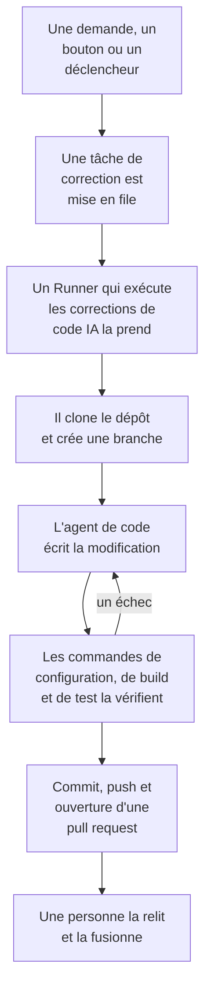

# Code

Code est l'endroit où vous demandez à OneUptime AI de travailler dans vos dépôts, comme vous le demanderiez à un agent de code : corriger un bug, écrire des tests, expliquer le code, faire une modification. Code s'ouvre sur la zone où vous demandez, avec le dépôt et la branche choisis dedans et toutes les tâches en dessous ; la page d'une tâche est une conversation à laquelle vous pouvez répondre. OneUptime lance aussi des tâches de lui-même, à partir d'exceptions, de traces et d'investigations. Un [Runner](/docs/runbooks/agents) clone le dépôt, écrit la modification sur une nouvelle branche, la compile et la teste, puis ouvre une pull request. Une personne relit et fusionne chacune d'elles : le Runner peut pousser des branches et ouvrir des pull requests, rien de plus.

:::cards
- [Demander à l'IA dans un dépôt](#demander-à-lia-dans-un-dépôt): Une demande avec vos propres mots, et le contexte dont elle a besoin.
- [La conversation d'une tâche](#la-conversation-dune-tâche): Ce que l'IA a fait, ce qu'elle a modifié, et votre réponse.
- [Déroulement d'une exécution de correction](#déroulement-dune-exécution-de-correction): D'un clic à une pull request, étape par étape.
- [Où démarrent les tâches de correction](#où-démarrent-les-tâches-de-correction): Les tâches que OneUptime lance, et ce que fait chaque pull request.
- [Télémétrie de production dans une correction](#télémétrie-de-production-dans-une-correction): Ce qu'une correction lit de la production pendant qu'elle écrit la modification.
- [Revue de production des pull requests](#revue-de-production-des-pull-requests): Ce que la production dit du code que modifie chaque pull request.
- [Connecter un dépôt](#connecter-un-dépôt): GitHub, GitLab, Forgejo ou Gitea, ou tout serveur Git.
- [Avant de commencer](#avant-de-commencer): Un modèle, un dépôt connecté et un Runner.
- [Quand une correction échoue](#quand-une-correction-échoue): Ce qui arrive à une exécution qui échoue, se bloque ou attend.
:::

> [!TIP]
> Vous pouvez aussi lancer cela depuis GitHub. Mentionnez la GitHub App de OneUptime dans une issue ou une pull request, et elle implémente, révise ou relit sur place : voir [GitHub App](/docs/ai/github-app). C'est le même agent, le même Runner et les mêmes budgets ; seul le déclencheur change.

## Demander à l'IA dans un dépôt

:::steps
### Ouvrir Code

Ouvrez **Produits → Code**. Code s'ouvre sur **Que doit faire l'IA ?** : la zone où vous demandez, avec toutes les tâches en dessous, les plus récentes d'abord. S'il n'y a encore aucun dépôt, Code propose plutôt **Connecter GitHub**, avec GitLab, Forgejo ou Gitea et tout serveur Git en dessous (voir [Connecter un dépôt](#connecter-un-dépôt)). **Dépôts**, dans son menu latéral, liste les dépôts où l'IA peut travailler, et regroupe sous **Non connecté** ceux que OneUptime n'atteint plus. La page de chaque dépôt a la même zone pour ce dépôt.

### Choisir le dépôt et la branche

La zone s'ouvre sur le dépôt que vous avez choisi en dernier. Choisissez-en un autre dans sa rangée du bas et, à côté, la branche d'où part la tâche : la branche principale du dépôt, marquée **Par défaut**, jusqu'à ce que vous en choisissiez une autre. L'IA crée sa branche à partir de celle que vous choisissez et ouvre sa pull request vers elle.

### Dire ce que vous voulez

Écrivez la modification, le bug ou la question avec vos propres mots. Tant que rien n'a été demandé, Code en suggère quelques-unes sous **Essayez de demander**.

### Ajouter du contexte

Cliquez sur **Ajouter du contexte** pour donner à l'IA ce dont elle a besoin : un fichier ou un dossier du dépôt, une note, un lien ou un enregistrement du projet. OneUptime lit chaque enregistrement au moment où vous envoyez la demande, avec vos permissions, et conserve ce que l'IA a reçu.

### Lancer la tâche

Cliquez sur **Lancer la tâche**, ou appuyez sur Entrée. La page de la tâche s'ouvre, et le travail de l'IA s'y affiche au fur et à mesure.
:::

| Contexte | Ce que reçoit l'IA |
| --- | --- |
| **Fichier ou dossier** | Un chemin dans le dépôt, que l'IA lit en premier. |
| **Note** | Un texte que vous collez : une erreur, une spécification, une ligne de log. |
| **Lien** | Une adresse web, comme référence. |
| **Incident** ou **Alerte** | Son état, sa description et sa cause racine, tels qu'ils sont quand vous envoyez la demande. |
| **Exception** | Son message et sa stack trace. |
| **Moniteur** | Son type, son statut et sa description. |
| **Trace** | Ses spans : leurs noms, leurs durées et leurs erreurs. |
| **Journaux** | Les 20 dernières lignes de log qui contiennent votre recherche, sur la dernière heure, le dernier jour ou la dernière semaine. |
| **Profil de performance** | Où va le temps d'une fonction dans les profils de son service : qui l'appelle, ce qu'elle appelle et ses lignes les plus chaudes. |

Une demande porte au plus 10 éléments de contexte. Les jetons, clés, mots de passe et adresses e-mail présents dans ce que OneUptime lit sont masqués avant que l'IA ne les voie, comme partout où OneUptime AI lit vos données.

## La conversation d'une tâche

La page d'une tâche est une conversation : ce qui a été demandé et le contexte ajouté, puis le tour de l'IA – ses étapes, affichées au fur et à mesure (les fichiers qu'elle a lus et modifiés, ce qu'elle a cherché, les commandes qu'elle a exécutées), sa réponse, les fichiers qu'elle a modifiés avec leur diff, et la pull request. Le haut de la page indique où travaille la tâche (son dépôt et la branche d'où elle est partie), combien de lignes elle a modifiées, avec un bouton vers sa pull request, et où en est la tâche :

| État | Ce que cela signifie |
| --- | --- |
| **En file d'attente** | Elle attend qu'un Runner la prenne. |
| **En cours…** | L'IA y travaille. **Arrêter** l'arrête ; ce qu'elle a poussé reste sur la branche. |
| **En attente de votre part** | L'IA a posé une question. Répondez-y dans la zone en dessous. |
| **Terminé** | L'IA a fini : sa réponse, et la pull request si elle a modifié du code. |
| **Échec** | Le tour n'a pas pu aboutir, et dit pourquoi. **Réessayer** redemande la même chose. |
| **Arrêté** | Quelqu'un l'a arrêtée. **Réessayer** redemande la même chose. |

Pour donner suite, écrivez dans la zone en bas, qui reste visible pendant que la conversation défile : répondez à l'IA, ajoutez du contexte ou demandez des modifications. Chaque réponse est le tour suivant de la même tâche : elle travaille sur la même branche et pousse vers la même pull request tant que celle-ci est ouverte. Une tâche ne fait qu'un tour à la fois, donc la zone attend pendant que l'IA travaille. Le **Journal** de chaque tour est le relevé exact de ce qu'il a fait.

Toute personne qui peut lire un dépôt lit ses tâches. Demander à l'IA, répondre et arrêter une tâche demandent la permission de modifier le dépôt, tout comme voir le diff d'une modification : les autres voient quels fichiers ont changé. Les tâches que OneUptime lance de lui-même (ci-dessous) figurent aussi dans leur dépôt, comme des conversations auxquelles vous pouvez répondre.

## Déroulement d'une exécution de correction



1. Vous cliquez sur **Lancer la tâche** dans Code, ou sur **Corriger avec l'IA** sur une exception non résolue, ou un autre bouton ou déclencheur lance une tâche (voir [Où démarrent les tâches de correction](#où-démarrent-les-tâches-de-correction)).
2. La tâche est mise en file sur son dépôt, et le Runner que le dépôt choisit la prend : l'un de vos Runners, ou un Runner global quand il n'en choisit aucun (voir [Choisir le Runner du dépôt](#choisir-le-runner-du-dépôt)).
3. Le Runner récupère le contexte de la tâche. Pour une demande, ce sont ses mots, le contexte ajouté et la conversation jusque-là ; pour une exception, son type, son message et sa stack trace.
4. Il clone le dépôt dans un espace de travail qui lui est propre et crée une branche. Une correction d'exception s'appelle `oneuptime-fix-exception-` suivi des premiers caractères de l'identifiant de l'exécution. Une demande part de la branche choisie quand elle a été faite, et sa pull request s'ouvre vers celle-ci. Une réponse travaille plutôt sur la branche de la pull request ouverte de la tâche.
5. Un agent de code, propulsé par le fournisseur LLM de votre projet, lit le code et écrit la modification. Le serveur OneUptime effectue les appels au LLM, si bien que le Runner ne détient jamais la clé d'API de votre fournisseur, et chaque appel est mesuré et listé dans les journaux IA. Une correction d'exception, de trace lente ou d'incident consulte aussi les données de production pendant qu'elle travaille : les exceptions, les traces, les logs et les métriques des services du dépôt (voir [Télémétrie de production dans une correction](#télémétrie-de-production-dans-une-correction)).
6. Sur votre propre Runner, l'agent de code compile et teste sa modification comme le dit le `AGENTS.md` du dépôt avant que quoi que ce soit ne soit commité, et répare ce qui échoue (voir [Vérification avant la pull request](#vérification-avant-la-pull-request)).
7. Le Runner committe, pousse la branche, ouvre la pull request (pour une demande, seulement si elle a modifié du code) et supprime l'espace de travail.

La page d'où la tâche a été lancée affiche son état en direct. Chaque tâche est listée dans son dépôt sous **Produits → Code** : sa page est sa conversation, et le **Journal** de chaque tour a une ligne pour chaque fichier que le Runner a lu ou écrit et pour chaque commande qu'il a exécutée.

Chaque exécution est tenue à des budgets que le serveur impose : au plus **40 appels au LLM** et **100 000 tokens de sortie**. Les requêtes de télémétrie de production d'une exécution sont décomptées de ces mêmes 40 appels. Une exécution qui en atteint un se termine par un résumé du travail accompli jusque-là au lieu de tourner en boucle. Les exécutions de correction comptent aussi dans les limites quotidiennes d'IA du projet, quand le projet en fixe.

## Où démarrent les tâches de correction

| Où | Clic | La pull request |
| --- | --- | --- |
| La page **Assistance IA** d'une exception | **Corriger avec l'IA** | Corrige le bug à l'origine de l'exception. |
| La page **Assistance IA** d'une exception | **Générer un test de régression** | Ajoute un test qui reproduit l'exception et échoue jusqu'à ce que le bug soit corrigé. |
| La page **Assistance IA** d'une exception | **Améliorer la gestion des erreurs** | Pour une erreur attendue, comme une saisie invalide : retire les données utilisateur du message, valide la saisie plus tôt et marque l'erreur comme gérée, sans changer le comportement. |
| La carte **Investigation IA** d'un incident ou d'une alerte | **Ouvrir une PR de correctif à partir de cette analyse** | Corrige la cause racine publiée par l'investigation (voir [Corrections de code automatiques à partir des investigations](#corrections-de-code-automatiques-à-partir-des-investigations)). |
| Une trace qui vaut d'être corrigée | **Accélérer avec l'IA** | Corrige le schéma lent que le bouton indique, comme une requête N+1 ou des appels qui pourraient s'exécuter en parallèle. |
| La page **Journaux** d'un service | **Améliorer la journalisation** | Rend les logs du service structurés, au bon niveau de gravité et reliés à ses traces, sans changer le comportement. |
| La page **Traces** d'un service | **Améliorer le traçage** | Ajoute des spans et des attributs là où le tracing du service manque, sans changer le comportement. |
| Une fonction dans **Profils de performance** | **Corriger avec l'IA** | Fait faire à la fonction le même travail avec moins de temps ou de mémoire, avec son profil comme preuve. |

Ces boutons n'apparaissent que là où ils peuvent lancer une tâche. Quand l'IA est désactivée pour le projet, aucun n'apparaît et le menu latéral d'une exception ne propose pas **Assistance IA**. **Améliorer la journalisation** et **Améliorer le traçage** apparaissent dès qu'un dépôt est connecté et que rien n'empêche l'IA d'y travailler (comme le forfait, des crédits IA épuisés ou aucun Runner en ligne), et **Accélérer avec l'IA** seulement sur une trace qui vaut d'être corrigée (voir [Explorateur de traces](/docs/telemetry/traces-explorer)). Le bouton **Corriger avec l'IA** d'une fonction n'apparaît que sur le propre code de l'application qui prend au moins 5 % du temps ou de la mémoire du profil, ou dont la part a augmenté de 3 points ou plus depuis la fenêtre à laquelle on la compare (voir [Profilage continu](/docs/telemetry/profiles)).

Pour ouvrir la page **Assistance IA** d'une exception, ouvrez l'exception sous **Produits → Observabilité → Exceptions** et choisissez **Assistance IA** dans son menu latéral. Une exception résolue ou archivée doit d'abord être marquée comme non résolue.

OneUptime AI lance aussi des tâches de correction de lui-même : à partir d'une investigation qui trouve une modification de code, d'une investigation qui se termine sans conclusion faute de télémétrie, et des AI Insights sur les exceptions et les traces lentes. Chacune a son propre interrupteur ; voir [Corrections de code automatiques](/docs/ai/ai-sre#correctifs-de-code-automatiques).

## Télémétrie de production dans une correction

OneUptime conserve ce que fait votre code en production, si bien qu'une correction n'a pas à se contenter d'une stack trace. Pendant que l'agent de code travaille, il peut interroger la télémétrie de production des services du dépôt :

| Ce qu'il lit | À quoi cela sert |
| --- | --- |
| **Exceptions** | Les groupes d'exceptions levées dans des fichiers ou une fonction donnés : à quelle fréquence ces derniers jours, depuis quelle version, et la trace d'une occurrence récente. |
| **Traces** | Le profil de latence et d'erreurs d'un endpoint ou d'une opération, et les spans d'une trace. |
| **Journaux** | Les lignes de log d'un service, par période, gravité, texte ou trace. |
| **Métriques** | Une métrique que publie un service, au fil du temps ; sans nom, les métriques qu'il publie. |
| **Incidents** | Les incidents qui ont touché les services, ou pour lesquels une correction OneUptime a été ouverte dans ce dépôt, avec leur cause racine et leur post-mortem. |
| **Déploiements** | Les déploiements récents et les autres changements des services, chacun avec le verdict de OneUptime indiquant s'il a nui à son service. |

| Tâche | Ce qu'elle vérifie |
| --- | --- |
| **Corriger avec l'IA** sur une exception | À quelle fréquence elle est levée aujourd'hui et depuis quelle version, les logs et la trace d'une occurrence. |
| **Accélérer avec l'IA** | La charge et la lenteur de l'opération sur l'ensemble de ses traces, pas seulement celle qui a été analysée. Elle ne change rien quand l'opération n'est plus lente. |
| **Ouvrir une PR de correctif à partir de cette analyse**, et les corrections ouvertes automatiquement à partir des investigations | Les déploiements qui ont précédé l'incident, ses erreurs, ses logs et ses opérations lentes, et si la cause a déjà frappé auparavant. |
| `@oneuptime review` depuis GitHub | Ce que dit la production du code modifié (voir [Relectures avec contexte de production](/docs/ai/github-app#relectures-avec-contexte-de-production)). |

La description de la pull request indique ce que l'agent a interrogé et ce que cela a montré. Les autres tâches, comme les tests de régression et les améliorations de la journalisation ou du traçage, n'interrogent pas la production.

Ce que l'agent peut lire est décidé par le serveur OneUptime, à partir de la tâche elle-même :

- **Lecture seule.** Les requêtes s'exécutent sur le serveur OneUptime, jamais sur le Runner, qui ne détient aucun identifiant permettant de lire la télémétrie. Rien de ce qu'elles font ne peut modifier votre projet.
- **Ce projet, et seulement les services de ce dépôt.** Vous ne les associez pas vous-même : ce sont les services pour lesquels OneUptime trouve ce dépôt, comme il trouve le dépôt d'une correction - les stack traces de leurs exceptions passent par ses fichiers, ils portent le même nom que lui, ou c'est le seul dépôt du projet. La télémétrie d'un autre service ne peut pas être lue.
- **Aucun incident privé**, et les jetons, clés, mots de passe et adresses e-mail sont masqués avant que l'agent ne voie un résultat, comme partout où OneUptime AI lit vos données.
- **Limité.** Au plus **12** requêtes par exécution, chacune décomptée des 40 appels de l'exécution.

Quand aucun service ne correspond au dépôt, la tâche s'exécute sans télémétrie de production, comme avant.

## Revue de production des pull requests

OneUptime sait ce que fait votre code en production : il peut donc relire une pull request avec ce que personne ne voit en lisant le diff. Activez **Relire les demandes de tirage au regard de la production**, sous **Plus de paramètres** sur la page **Paramètres** d'un dépôt dans Code, et chaque pull request qu'une personne ayant l'accès en écriture ouvre ou met à jour reçoit un commentaire qui dit ce que la production montre du code qu'elle modifie. Le commentaire est modifié sur place à chaque push, et la page **Revues de production** du dépôt dans Code garde chaque revue, avec **Relire à nouveau**.

| Ce qu'elle lit | Du code que modifie la pull request |
| --- | --- |
| **Exceptions** | Les exceptions levées dans les lignes, fonctions et fichiers modifiés ces 7 derniers jours, les nouvelles et les non gérées signalées. |
| **Opérations** | Les opérations tracées qui exécutent le code modifié dans la dernière heure : leurs spans, leurs erreurs et leur p95. |
| **Fonctions coûteuses** | Les fonctions du code modifié qui prennent une part des profils des services dans la dernière heure. |
| **Incidents** | Les incidents des services des 30 derniers jours encore ouverts, ou dont la cause racine ou le post-mortem cite le code modifié. Jamais un incident privé. |
| **Déploiements** | Les déploiements des services des 7 derniers jours que OneUptime soupçonne d'une régression. |

Quand la production dit quelque chose, OneUptime AI le lit à côté du diff et ajoute **Points d'attention** : quelques points courts, chacun fondé sur les faits. Elle ne tourne que tant que l'IA est activée pour le projet, au plus 10 fois par jour pour une pull request et 100 pour un dépôt, et elle est comptée comme tout appel d'IA ; les faits sont lus à chaque fois sans elle. Quand la production ne montre rien du changement, OneUptime ne publie rien.

- **Des agrégats uniquement.** Le commentaire contient des nombres, des durées et des noms de code : jamais le message d'une exception, une ligne de journal, le titre d'un incident ni des données personnelles.
- **Les dépôts publics reçoivent un lien.** Tout le monde peut lire les pull requests d'un dépôt public : là, le commentaire ne fait que renvoyer vers la revue dans OneUptime, que seuls les membres du projet peuvent ouvrir. **Commentaire de revue de production**, sous **Plus de paramètres** sur la page **Paramètres** du dépôt, peut publier **Seulement un lien vers la revue** partout, ou **La revue, même sur un dépôt public**.
- **Les contributeurs externes ne peuvent pas en lancer.** Une pull request n'est relue d'elle-même que si son auteur, et quiconque y a poussé des commits, peuvent écrire dans le dépôt. Celle de quelqu'un d'autre - un contributeur externe, un fork, un bot - est relue quand une personne ayant l'accès en écriture y commente `@oneuptime production review`, ou clique sur **Relire à nouveau** dans Code.
- **Lecture seule.** Une revue ne clone rien et n'exécute rien de la pull request. Son diff et son titre sont des données pour OneUptime AI, jamais des instructions : l'IA n'a aucun outil, et ce qu'elle écrit est placé dans le commentaire sous forme de texte.

L'interrupteur est activé pour les dépôts que la GitHub App connecte à partir de maintenant. Un dépôt connecté avant qu'il existe le garde désactivé jusqu'à ce que vous l'activiez.

## Vérification avant la pull request

Un dépôt dit comment il se compile et se teste dans un `AGENTS.md` à sa racine, le fichier que lisent les agents de code. Avant de modifier quoi que ce soit, l'agent de code lit le `AGENTS.md` du dépôt (ou son `CLAUDE.md`, quand il n'a pas de `AGENTS.md`) sur la branche d'où part la tâche, et travaille comme il le dit. Sans l'un ni l'autre, il l'apprend du `CONTRIBUTING.md` du dépôt, du README, des scripts du paquet, du `Makefile` ou des workflows de CI. Il n'y a rien à configurer dans OneUptime.

| Où l'IA travaille | Ce qu'elle fait du build et des tests du dépôt |
| --- | --- |
| L'un de vos Runners | Compile et teste sa modification avant l'ouverture de la pull request, corrige ce qui échoue et vérifie à nouveau, et indique dans son résumé les vérifications qu'elle a lancées. Chaque commande qu'elle lance dispose de 2 minutes au plus, sans les identifiants propres du Runner dans son environnement. |
| **Agent Runbook global** | Ne lance aucune commande : l'IA écrit la modification et ouvre la pull request, et la CI de votre dépôt la vérifie. |

Rien de ce qui vient d'une pull request issue d'un fork n'est jamais lu comme les instructions du dépôt : une révision refuse une telle pull request, et une relecture lit la branche de base.

### Commandes définies sur un dépôt

Code ne demande plus de commandes d'installation, de build et de test, mais un dépôt qui en a, définies auparavant ou via l'API ou Terraform, les garde. Elles s'affichent en lecture seule sur la carte **Commandes de build et de test**, sous **Plus de paramètres** sur la page **Paramètres** du dépôt, et **Supprimer les commandes** supprime les trois. Tant que l'une d'elles est définie, chaque exécution de correction sur votre propre Runner vérifie aussi sa modification avec elles avant que la pull request ne s'ouvre :

1. Quand l'agent de code a terminé, les commandes s'exécutent dans l'ordre à la racine du dépôt, sur le Runner, dans l'espace de travail cloné. Chacune dispose de 15 minutes au plus et s'exécute avec `CI=true`, pour que rien n'attende une saisie ; le premier échec arrête la passe.
2. En cas d'échec, la fin de la sortie de la commande en échec retourne au même agent de code comme tâche de réparation, avec la consigne de corriger sa propre modification plutôt que d'affaiblir ou de sauter des tests, et les commandes s'exécutent à nouveau. Il fait au plus **2** tentatives de réparation. Elles partagent le budget LLM de l'exécution, et leurs modifications vont dans le même commit que la correction.
3. Le résultat, réussi, en échec ou ignoré (aucune commande définie, ou un Runner global), est écrit dans une section Verification de la description de la pull request et enregistré sur la pull request de la tâche.

Une modification qui échoue toujours à la vérification n'est pas jetée : la pull request s'ouvre quand même, avec une section "Verification failed" clairement signalée qui nomme la commande en échec et se termine par sa sortie. Le travail est conservé, et la personne qui relit décide. Un dépôt sans commande définie est signalé comme ignoré, plutôt que de laisser croire à un build au vert.

Les commandes sont des paramètres du dépôt que votre équipe écrit, exécutés sur votre propre Runner : le même modèle de confiance que les étapes Bash d'un runbook. L'IA ne les écrit ni ne les modifie jamais. Un Runner global, que OneUptime fait tourner pour chaque projet, ne les exécute jamais : sur un Runner global, la correction est écrite et ouverte pour relecture, la vérification est signalée comme ignorée, et la CI de votre dépôt vérifie la modification. [Faites tourner votre propre Runner](#faire-tourner-votre-propre-runner) pour que les corrections soient compilées et testées avant l'ouverture de la pull request.

## Après la fusion d'un correctif

Fusionner un correctif ne corrige rien tant qu'il ne tourne pas. Dès qu'une pull request de correctif est fusionnée, OneUptime attend un déploiement enregistré qui la contient (voir [Déploiements et changements](/docs/telemetry/change-events)) et surveille, dans ce déploiement, ce à quoi servait le correctif. La pull request de la tâche dans Code dit comment cela s'est passé, tout comme la page **Assistance IA** de l'exception, les journaux IA de l'incident et l'insight IA d'où vient le correctif :

| Un correctif de | Ce qui est surveillé | Il a fonctionné | Il n'a pas fonctionné |
| --- | --- | --- | --- |
| Une exception | Si l'exception se reproduit | **Corrigé en production** | **Se produit encore après le correctif** |
| Une trace lente ou un insight de latence | Le p99 de l'opération que nomme le correctif | **Plus rapide en production** | **Toujours lent après le correctif** |
| La cause racine d'un incident ou d'une alerte | Si son moniteur en déclenche un autre | **Corrigé en production** | **Survenu de nouveau après le correctif** |
| Télémétrie, journalisation ou traçage manquants | Ce que le correctif ajoute, et le reste de la télémétrie du service | **Arrive en production** | **Télémétrie interrompue après le correctif** |

Tant qu'aucun déploiement ne le livre, le correctif affiche **Fusionné, en attente d'un déploiement**, puis **Déployé, surveillé en production** pendant qu'il est surveillé. Un correctif qu'aucun déploiement enregistré ne contient dans les 14 jours, ou dont la production ne peut rien dire, affiche **Non vérifié en production**. [Correctifs de code automatiques](/docs/ai/ai-sre#correctifs-de-code-automatiques) donne les règles. Un test de non-régression, une meilleure gestion des erreurs, une revue et une demande dans Code ne sont pas surveillés : la production ne peut pas montrer ce qu'ils changent.

## Connecter un dépôt

Ouvrez **Dépôts** dans le menu latéral de Code et cliquez sur **Connecter des dépôts** : Code demande où se trouve votre code, et connecte chaque endroit à sa façon. Ce que l'IA fait dans un dépôt dépend de l'endroit où il se trouve :

| Où est le code | Comment il se connecte | Ce que l'IA y fait |
| --- | --- | --- |
| **GitHub** | La GitHub App de OneUptime, installée sur les dépôts qu'elle choisit. | Tout ce que décrit cette page, avec les commandes depuis GitHub (voir [GitHub App](/docs/ai/github-app)) et les [revues de production](#revue-de-production-des-pull-requests). |
| **GitLab**, sur GitLab.com ou le vôtre | Un jeton d'accès : un jeton personnel, de groupe ou de projet avec les portées `api` et `write_repository`, et au moins le rôle Developer. | Les tâches et les correctifs, chaque modification dans une demande de fusion ; le choix de la branche ; le code que parcourt une trace de pile ou un profil ; si un correctif a été fusionné, et ce que la production a montré une fois livré. |
| **Forgejo ou Gitea**, sur Codeberg ou le vôtre | Un jeton d'accès avec un accès en lecture et en écriture aux dépôts, et en lecture à l'utilisateur. | La même chose que sur GitLab, chaque modification dans une demande de tirage. |
| **Tout serveur Git**, en HTTPS | L'adresse avec laquelle vous clonez le dépôt, un nom d'utilisateur, et un mot de passe ou un jeton d'accès qui peut lire le dépôt et y pousser. | L'IA clone le dépôt et pousse chaque modification sur une nouvelle branche, que sa réponse nomme : c'est vous qui ouvrez la demande de tirage. Sur Bitbucket et Azure DevOps, elle renvoie vers l'endroit où l'ouvrir. |

Les commandes depuis les commentaires et les revues de production ont besoin de la GitHub App : elles ne fonctionnent donc pour l'instant que dans les dépôts GitHub, et les **Paramètres** du dépôt le disent.

Pour GitLab, Forgejo ou Gitea, saisissez l'adresse du serveur (GitLab.com et Codeberg sont préremplis) et le jeton, puis choisissez les dépôts à connecter : la liste ne propose que ceux dans lesquels le jeton peut pousser, et en connecter d'autres plus tard peut réutiliser le jeton. OneUptime vérifie chaque jeton auprès de son serveur avant de le garder, le conserve chiffré et ne l'affiche plus jamais. Les **Paramètres** du dépôt montrent son serveur, le compte et les derniers caractères du jeton, avec **Remplacer le jeton d'accès**. Quand le serveur refuse un jeton expiré ou révoqué, ses dépôts affichent **Jeton refusé** et l'IA cesse d'y travailler, jusqu'à ce que le remplacement du jeton reconnecte chaque dépôt qui l'utilise.

### Un serveur Git sur un réseau privé

OneUptime Cloud n'atteint que les serveurs Git sur Internet, jamais une adresse privée, de bouclage ou locale au lien. Connectez un serveur que seul votre réseau atteint comme **Tout serveur Git** : Code indique qu'il ne peut pas l'atteindre, et **Connecter quand même** le connecte pour l'un de vos propres Runners sur ce réseau. Choisissez ce Runner sur la carte **Agent Runbook** du dépôt (voir [Choisir le Runner du dépôt](#choisir-le-runner-du-dépôt)). Un Runner global n'y travaille jamais, et OneUptime n'en lit rien sur le serveur : le choix de la branche ne propose donc que sa branche principale. Un OneUptime auto-hébergé, et son Runner global, atteignent les serveurs Git de son propre réseau.

## Avant de commencer

Une tâche a besoin de trois choses. La zone de demande de Code et la page **Assistance IA** de l'exception vérifient les trois avant de proposer de démarrer, et indiquent ce qui manque.

| Quoi | OneUptime Cloud | Auto-hébergé |
| --- | --- | --- |
| Un fournisseur LLM | Rien à configurer : un projet sans fournisseur propre utilise le fournisseur global, payé sur les crédits IA du projet. Un fournisseur à vous, sous **Paramètres du projet → IA → Fournisseurs LLM**, passe en premier. | Définissez une fois les variables d'environnement `GLOBAL_LLM_PROVIDER_*` sur le serveur, ou ajoutez un fournisseur au projet. |
| Un dépôt connecté via la GitHub App | **Produits → Code**, puis **Connecter GitHub**. Si l'application est déjà installée sur le compte GitHub, cliquez plutôt sur **Connecter une installation existante** : l'installer de nouveau ne la connecte pas. Nécessite le plan Growth. | Pareil, une fois que votre instance a une GitHub App (voir [Intégration GitHub](/docs/self-hosted/github-integration)). |
| Ou un dépôt sur GitLab, Forgejo ou Gitea, ou tout serveur Git | **Dépôts** dans Code, puis **Connecter des dépôts** (voir [Connecter un dépôt](#connecter-un-dépôt)). Nécessite le plan Growth. | Pareil, sans GitHub App à configurer. |
| Un Runner qui exécute les corrections de code IA | Rien à faire tourner : un dépôt qui n'en choisit aucun travaille sur les Runners globaux de OneUptime. | Le service `runner` de Docker Compose, ou le Runner du chart Helm (`runner.enabled`, activé par défaut), s'enregistre tout seul et exécute les corrections de code IA dans chaque dépôt qui ne choisit aucun Runner. |

Sur une instance auto-hébergée, le fournisseur global est un bloc de `config.env` (Docker Compose) ou de vos valeurs Helm. Pour un Ollama auto-hébergé :

```bash
GLOBAL_LLM_PROVIDER_TYPE=Ollama
# An address the OneUptime server can reach, never localhost.
GLOBAL_LLM_PROVIDER_BASE_URL=http://ollama:11434
GLOBAL_LLM_PROVIDER_MODEL_NAME=llama3.1
# No GLOBAL_LLM_PROVIDER_API_KEY needed — Ollama is keyless.
```

Tout fournisseur pris en charge fonctionne : voir [Fournisseurs LLM](/docs/ai/llm-provider) pour tous les fournisseurs et chaque variable d'environnement.

Vous n'associez pas de dépôts à des services. Quand une tâche démarre, OneUptime trouve le dépôt en comparant les chemins de fichiers de la stack trace de l'exception à vos dépôts connectés. Si rien ne correspond, il se rabat sur un dépôt nommé comme le service, puis sur le seul dépôt du projet quand il n'y en a qu'un. La page **Assistance IA** indique quel dépôt il a trouvé.

### Choisir le Runner du dépôt

Chaque dépôt choisit le Runner sur lequel l'IA y travaille : sur sa page **Paramètres** dans Code, ouvrez **Plus de paramètres**, cliquez sur **Modifier** sur la carte **Agent Runbook** et choisissez-en un. Un dépôt que la GitHub App importe démarre sur le [Runner par défaut](/docs/runbooks/agents#lagent-runbook-par-défaut-du-projet) du projet, quand il en a un. Un dépôt qui n'en choisit aucun travaille sur **Agent Runbook global**, que OneUptime fait tourner pour chaque projet.

| Runner | Ce qu'il fait d'une tâche |
| --- | --- |
| **Agent Runbook global** | Écrit la modification et ouvre la pull request sans la compiler ni la tester : la CI de votre dépôt vérifie la modification. |
| L'un de vos Runners | Compile et teste aussi la modification comme le dit le `AGENTS.md` du dépôt, sur un hôte que vous contrôlez. |

Seul le Runner qu'un dépôt choisit reçoit ses tâches et un jeton pour lui. Dans un projet qui désactive **Utiliser les agents Runbook globaux** sous **Runbooks → Agents de runbook**, chaque dépôt a besoin de l'un des Runners du projet. La page d'un Runner liste les dépôts qui le choisissent.

### Faire tourner votre propre Runner

Pour faire tourner un Runner ailleurs, par exemple sur une machine proche de vos dépôts :

:::steps
### Créer le Runner

Créez un Runner sous **Runbooks → Agents de runbook** et cliquez sur **Afficher les instructions de configuration** sur sa ligne. La commande contient la clé secrète du Runner, que seul un Project Owner, un Project Admin ou un Runbook Admin peut lire. Elle ressemble à ceci :

```bash
docker run --name oneuptime-runner --restart unless-stopped \
  -e ONEUPTIME_RUNNER_ID=<runner-id> \
  -e ONEUPTIME_RUNNER_KEY=<runner-key> \
  -e ONEUPTIME_URL=<your-oneuptime-url> \
  -d oneuptime/runner:release
```

### Le choisir pour le dépôt

Sur la page **Paramètres** du dépôt dans Code, ouvrez **Plus de paramètres**, cliquez sur **Modifier** sur la carte **Agent Runbook** et choisissez le Runner. Le Runner prend en compte le changement à son prochain heartbeat, en une minute environ ; il n'y a rien à redémarrer.

### Vérifier qu'il se connecte

Le Runner apparaît comme connecté sur la page **Runbooks → Agents de runbook** en une minute ou deux. Sinon, lisez le log du conteneur (`docker logs oneuptime-runner`) à la recherche d'une erreur d'identifiants ou de réseau.
:::

Toute façon de faire tourner le conteneur convient (Docker Compose, Kubernetes, etc.), du moment qu'il a ces variables et peut joindre votre instance OneUptime en HTTPS :

| Variable | Ce que c'est |
| --- | --- |
| `ONEUPTIME_RUNNER_ID` | L'identifiant du Runner, depuis le tableau de bord. |
| `ONEUPTIME_RUNNER_KEY` | La clé secrète du Runner. |
| `ONEUPTIME_URL` | L'adresse de votre instance OneUptime (`https://oneuptime.com` sur OneUptime Cloud). |

> [!NOTE]
> Avant OneUptime 12, les corrections de code IA tournaient sur un composant AI Agent séparé (l'image `oneuptime/ai-agent` avec des variables `AI_AGENT_*`). Il a fusionné dans le Runner : si vous en faites encore tourner un, le [guide de mise à niveau de v11 vers v12](/docs/installation/upgrading) explique comment le remplacer.

## Corrections de code automatiques à partir des investigations

Quand une [investigation IA](/docs/ai/ai-sre) publie une analyse de cause racine sur un incident ou une alerte, et que sa classification soignée recommande une modification du code, la carte de l'investigation propose **Ouvrir une PR de correctif à partir de cette analyse** : une tâche de correction dont tout le contexte est l'analyse publiée. Le bouton est masqué quand le remède est opérationnel, limité à l'infrastructure, externe, un refus attendu, une erreur de l'utilisateur ou non concluant. Les corrections éligibles se font sans le clic tant que **Corriger automatiquement les nouveaux incidents** est activé sur **Incidents → IA → Paramètres** (et **Corriger automatiquement les nouvelles alertes** sur **Alertes → IA → Paramètres**). La correction commence désactivée, y compris pour les nouveaux projets. Sans règle IA, chaque correction éligible s'ouvre ; avec des règles, seulement pour ce qu'une règle cible, quand la règle a **Pull requests de correctif** activé (c'est le cas d'une nouvelle règle), dans les dépôts de code qu'elle nomme.

Tant que la correction est activée, une investigation qui se termine sur une cause racine sûre et étayée, qu'une modification de code peut corriger, met en file la même tâche de correction que celle que crée le bouton. La décision est une classification encadrée que le serveur vérifie, jamais un motif recherché dans le texte de l'analyse : seul un verdict positif de correction de code ouvre une pull request. Des preuves manquantes, un remède hors du code et une classification en échec aboutissent tous à ne rien faire.

Tout le reste correspond au bouton :

- La pull request s'ouvre prête à être relue, rédigée à partir de l'analyse publiée, et nécessite un dépôt connecté, l'un de ceux que nomment les règles qui la ciblent quand elles en nomment, et un Runner en ligne pour y travailler : celui que le dépôt choisit, ou un Runner global.
- Elle compte dans la limite quotidienne de tâches de correction de ce signal (**Limite quotidienne de tâches de correctif IA pour les incidents** ou **Limite quotidienne de tâches de correctif IA pour les alertes**, sous **Plus de paramètres** sur sa page de paramètres IA) et dans le plafond de pull requests ouvertes du dépôt, quand l'un ou l'autre est défini. Non définis, ni l'un ni l'autre ne limite quoi que ce soit.
- Chaque déclencheur cherche d'abord une tâche de correction déjà en file ou en cours pour le même incident ou la même alerte, si bien qu'un déclencheur automatique et un clic donnent normalement une seule tâche, pas deux pull requests. La vérification est une lecture avant l'écriture, pas un verrou, si bien que deux déclencheurs au même instant peuvent encore passer tous les deux.
- L'exécution est écrite par le système, n'est attribuée à personne, et rien ne fusionne tout seul.

## Quand une correction échoue

:::details L'exécution échoue
La correction n'a pas pu être appliquée, le dépôt ou la branche d'où partait une demande n'a pas pu être joint, ou l'appel au LLM a échoué. La conversation de la tâche, et la page d'où elle a été lancée, affichent la raison et proposent de réessayer. Le **Journal** du tour contient le journal complet de l'exécution.
:::

:::details Le Runner s'arrête au milieu d'une exécution
Une exécution dont le heartbeat est silencieux depuis plus de 12 minutes est mise en échec avec une erreur. Elle n'est jamais remise en file d'elle-même, car le Runner peut déjà avoir poussé une partie d'une branche de correction ; relancez-la depuis l'endroit où vous l'aviez lancée.
:::

:::details Aucun Runner ne prend la tâche
Une tâche qui attend plus de 30 minutes alors que le Runner qui doit la prendre n'est pas connecté - celui que son dépôt choisit, ou un Runner global pour un dépôt qui n'en choisit aucun - échoue, avec un message qui dit lequel, si bien qu'elle n'apparaît jamais en cours indéfiniment. Quand un Runner est en ligne mais occupé, les tâches en file attendent leur tour. Un Runner antérieur à Code ne reçoit jamais de demande de Code : mettez à jour un Runner que vous faites tourner vous-même en même temps que le serveur.
:::

## Confidentialité

Le clone de votre dépôt réside dans un espace de travail à l'intérieur du conteneur du Runner et est supprimé à la fin de l'exécution, qu'elle ait réussi ou non. Le Runner ne détient jamais la clé d'API de votre fournisseur LLM : le serveur OneUptime effectue les appels au LLM pour lui, et exécute aussi les requêtes de télémétrie de production. OneUptime ne conserve pas votre dépôt et ne s'entraîne pas sur votre code. Le journal de la tâche garde les 300 premiers caractères de la sortie de chaque étape, pour que vous puissiez vérifier ce qu'a fait le Runner, et cela peut inclure des extraits de code. Faites tourner un Runner auto-hébergé avec votre propre fournisseur LLM (Ollama local compris), et votre code ne quitte jamais votre infrastructure.

## Étapes suivantes

:::cards
- [GitHub App](/docs/ai/github-app): Demandez une modification, une révision ou une relecture depuis GitHub même.
- [AI SRE](/docs/ai/ai-sre): Les investigations dont les analyses peuvent devenir des pull requests grâce aux tâches de correction.
- [Agents de runbook](/docs/runbooks/agents): Le worker qui mène chaque exécution de correction.
:::
