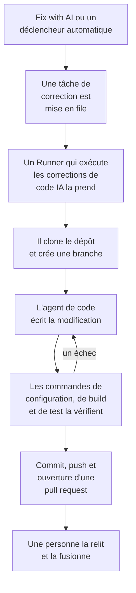

# Tâches de correction

Une tâche de correction est une pull request que OneUptime AI écrit dans votre code. Vous en lancez une depuis une exception, une trace, un service ou une investigation, ou OneUptime en lance une de lui-même ; un [Runner](/docs/runbooks/agents) clone le dépôt, écrit la modification sur une nouvelle branche, la compile et la teste, puis ouvre une pull request. Une personne relit et fusionne chacune d'elles : le Runner peut pousser des branches et ouvrir des pull requests, rien de plus.

:::cards
- [Déroulement d'une exécution de correction](#déroulement-dune-exécution-de-correction): D'un clic à une pull request, étape par étape.
- [Où démarrent les tâches de correction](#où-démarrent-les-tâches-de-correction): Les boutons qui en lancent une, et ce que fait chaque pull request.
- [Avant de commencer](#avant-de-commencer): Un modèle, un dépôt connecté et un Runner.
- [Quand une correction échoue](#quand-une-correction-échoue): Ce qui arrive à une exécution qui échoue, se bloque ou attend.
:::

> [!TIP]
> Vous pouvez aussi lancer cela depuis GitHub. Mentionnez la GitHub App de OneUptime dans une issue ou une pull request, et elle implémente, révise ou relit sur place : voir [GitHub App](/docs/ai/github-app). C'est le même agent, le même Runner et les mêmes budgets ; seul le déclencheur change.

## Déroulement d'une exécution de correction



1. Vous cliquez sur **Fix with AI** sur une exception non résolue, ou un autre bouton ou déclencheur lance une tâche (voir [Où démarrent les tâches de correction](#où-démarrent-les-tâches-de-correction)).
2. La tâche est mise en file, et un Runner disponible avec **Exécute les corrections de code IA** activé la prend.
3. Le Runner récupère le contexte de la tâche. Pour une exception, ce sont son type, son message et sa stack trace.
4. Il clone le dépôt dans un espace de travail qui lui est propre et crée une branche. Une correction d'exception s'appelle `oneuptime-fix-exception-` suivi des premiers caractères de l'identifiant de l'exécution.
5. Un agent de code, propulsé par le fournisseur LLM de votre projet, lit le code et écrit la modification. Le serveur OneUptime effectue les appels au LLM, si bien que le Runner ne détient jamais la clé d'API de votre fournisseur, et chaque appel est mesuré et listé dans les journaux IA.
6. Si le dépôt a des commandes de vérification, votre propre Runner compile et teste la modification avant de committer quoi que ce soit, et renvoie un échec à l'agent de code pour qu'il le répare (voir [Vérification avant la pull request](#vérification-avant-la-pull-request)).
7. Le Runner committe, pousse la branche, ouvre la pull request et supprime l'espace de travail.

La page d'où la tâche a été lancée affiche son état en direct. Chaque tâche est listée sous **Produits → Code → Tâches** : ouvrez-en une pour voir sa **Vue d'ensemble**, ses **Journaux** (une ligne pour chaque fichier que le Runner a lu ou écrit et pour chaque commande qu'il a exécutée) et ses **Demandes de tirage**.

Chaque exécution est tenue à des budgets que le serveur impose : au plus **40 appels au LLM** et **100 000 tokens de sortie**. Une exécution qui en atteint un se termine par un résumé du travail accompli jusque-là au lieu de tourner en boucle. Les exécutions de correction comptent aussi dans les limites quotidiennes d'IA du projet, quand le projet en fixe.

## Où démarrent les tâches de correction

| Où | Clic | La pull request |
| --- | --- | --- |
| La page **Assistance IA** d'une exception | **Fix with AI** | Corrige le bug à l'origine de l'exception. |
| La page **Assistance IA** d'une exception | **Générer un test de régression** | Ajoute un test qui reproduit l'exception et échoue jusqu'à ce que le bug soit corrigé. |
| La page **Assistance IA** d'une exception | **Améliorer la gestion des erreurs** | Pour une erreur attendue, comme une saisie invalide : retire les données utilisateur du message, valide la saisie plus tôt et marque l'erreur comme gérée, sans changer le comportement. |
| La carte **Investigation IA** d'un incident ou d'une alerte | **Ouvrir une PR de correctif à partir de cette analyse** | Corrige la cause racine publiée par l'investigation (voir [Corrections de code automatiques à partir des investigations](#corrections-de-code-automatiques-à-partir-des-investigations)). |
| Une trace | **Corriger les performances avec l'IA** | Corrige le schéma lent trouvé dans la trace, comme des requêtes N+1 ou un seul span lent dominant. |
| La page **Journaux** d'un service | **Improve Logging** | Rend les logs du service structurés, au bon niveau de gravité et reliés à ses traces, sans changer le comportement. |
| La page **Traces** d'un service | **Improve Tracing** | Ajoute des spans et des attributs là où le tracing du service manque, sans changer le comportement. |

Pour ouvrir la page **Assistance IA** d'une exception, ouvrez l'exception sous **Produits → Observabilité → Exceptions** et choisissez **Assistance IA** dans son menu latéral. Une exception résolue ou archivée doit d'abord être marquée comme non résolue.

OneUptime AI lance aussi des tâches de correction de lui-même : à partir d'une investigation qui trouve une modification de code, d'une investigation qui se termine sans conclusion faute de télémétrie, et des AI Insights sur les exceptions et les traces lentes. Chacune a son propre interrupteur ; voir [Corrections de code automatiques](/docs/ai/ai-sre#correctifs-de-code-automatiques).

## Vérification avant la pull request

Un dépôt de code peut porter jusqu'à trois commandes de vérification sur sa page **Paramètres**, sous **Dépôts de code** :

| Commande | Exemple | Quand elle s'exécute |
| --- | --- | --- |
| **Setup Command** | `npm ci` | En premier, pour installer les dépendances. |
| **Commande de build** | `npm run build` | Après la configuration. |
| **Test Command** | `npm test` | En dernier. |

Quand l'une d'elles est définie, chaque exécution de correction vérifie sa modification avant que la pull request ne s'ouvre :

1. Quand l'agent de code a terminé, les commandes s'exécutent dans l'ordre à la racine du dépôt, sur le Runner, dans l'espace de travail cloné. Chacune dispose de 15 minutes au plus et s'exécute avec `CI=true`, pour que rien n'attende une saisie ; le premier échec arrête la passe.
2. En cas d'échec, la fin de la sortie de la commande en échec retourne au même agent de code comme tâche de réparation, avec la consigne de corriger sa propre modification plutôt que d'affaiblir ou de sauter des tests, et les commandes s'exécutent à nouveau. Il fait au plus **2** tentatives de réparation. Elles partagent le budget LLM de l'exécution, et leurs modifications vont dans le même commit que la correction.
3. Le résultat, réussi, en échec ou ignoré (aucune commande définie, ou un Runner partagé), est écrit dans une section Verification de la description de la pull request et enregistré sur la pull request de la tâche.

Une modification qui échoue toujours à la vérification n'est pas jetée : la pull request s'ouvre quand même, avec une section "Verification failed" clairement signalée qui nomme la commande en échec et se termine par sa sortie. Le travail est conservé, et la personne qui relit décide. Un dépôt sans commande définie est signalé comme ignoré, plutôt que de laisser croire à un build au vert.

Les commandes sont des paramètres du dépôt que votre équipe écrit, exécutés sur votre propre Runner : le même modèle de confiance que les étapes Bash d'un runbook. L'IA ne les écrit ni ne les modifie jamais. Les Runners partagés de OneUptime ne les exécutent jamais : sur un Runner partagé, la correction est écrite et ouverte pour relecture, la vérification est signalée comme ignorée, et la CI de votre dépôt vérifie la modification. [Faites tourner votre propre Runner](#faire-tourner-votre-propre-runner) pour que les corrections soient compilées et testées avant l'ouverture de la pull request.

## Avant de commencer

Une tâche de correction a besoin de trois choses. La page **Assistance IA** de l'exception vérifie les trois avant de proposer de démarrer, et indique ce qui manque.

| Quoi | OneUptime Cloud | Auto-hébergé |
| --- | --- | --- |
| Un fournisseur LLM | Rien à configurer : un projet sans fournisseur propre utilise le fournisseur global, payé sur les crédits IA du projet. Un fournisseur à vous, sous **Paramètres du projet → IA → Fournisseurs LLM**, passe en premier. | Définissez une fois les variables d'environnement `GLOBAL_LLM_PROVIDER_*` sur le serveur, ou ajoutez un fournisseur au projet. |
| Un dépôt connecté via la GitHub App | **Produits → Code → Tâches**, puis **Dépôts de code** et **Se connecter avec l'application GitHub**. Si l'application est déjà installée sur le compte GitHub, cliquez plutôt sur **Connecter une installation existante** : l'installer de nouveau ne la connecte pas. Nécessite le plan Growth. | Pareil, une fois que votre instance a une GitHub App (voir [Intégration GitHub](/docs/self-hosted/github-integration)). |
| Un Runner qui exécute les corrections de code IA | Rien à faire tourner : les Runners partagés de OneUptime s'en chargent. | Le service `runner` de Docker Compose, ou le Runner du chart Helm (`runner.enabled`, activé par défaut), s'enregistre tout seul et exécute les corrections de code IA. |

Sur une instance auto-hébergée, le fournisseur global est un bloc de `config.env` (Docker Compose) ou de vos valeurs Helm. Pour un Ollama auto-hébergé :

```bash
GLOBAL_LLM_PROVIDER_TYPE=Ollama
# An address the OneUptime server can reach, never localhost.
GLOBAL_LLM_PROVIDER_BASE_URL=http://ollama:11434
GLOBAL_LLM_PROVIDER_MODEL_NAME=llama3.1
# No GLOBAL_LLM_PROVIDER_API_KEY needed — Ollama is keyless.
```

Tout fournisseur pris en charge fonctionne : voir [Fournisseurs LLM](/docs/ai/llm-provider) pour tous les fournisseurs et chaque variable d'environnement.

Vous n'associez pas de dépôts à des services. Quand une tâche démarre, OneUptime trouve le dépôt en comparant les chemins de fichiers de la stack trace de l'exception à vos dépôts connectés. Si rien ne correspond, il se rabat sur un dépôt nommé comme le service, puis sur le seul dépôt du projet quand il n'y en a qu'un. La page **Assistance IA** indique quel dépôt il a trouvé.

### Faire tourner votre propre Runner

Pour faire tourner un Runner ailleurs, par exemple sur une machine proche de vos dépôts :

:::steps
### Créer le Runner

Créez un Runner sous **Runbooks → Agents de runbook** et cliquez sur **Afficher les instructions de configuration** sur sa ligne. La commande contient la clé secrète du Runner, que seul un Project Owner, un Project Admin ou un Runbook Admin peut lire. Elle ressemble à ceci :

```bash
docker run --name oneuptime-runner --restart unless-stopped \
  -e ONEUPTIME_RUNNER_ID=<runner-id> \
  -e ONEUPTIME_RUNNER_KEY=<runner-key> \
  -e ONEUPTIME_URL=<your-oneuptime-url> \
  -d oneuptime/runner:release
```

### Activer les corrections de code IA

Activez **Exécute les corrections de code IA** sur le Runner. C'est désactivé par défaut, et le Runner prend en compte le changement à son prochain heartbeat, en une minute environ ; il n'y a rien à redémarrer.

### Vérifier qu'il se connecte

Le Runner apparaît comme connecté sur la page **Runbooks → Agents de runbook** en une minute ou deux. Sinon, lisez le log du conteneur (`docker logs oneuptime-runner`) à la recherche d'une erreur d'identifiants ou de réseau.
:::

Toute façon de faire tourner le conteneur convient (Docker Compose, Kubernetes, etc.), du moment qu'il a ces variables et peut joindre votre instance OneUptime en HTTPS :

| Variable | Ce que c'est |
| --- | --- |
| `ONEUPTIME_RUNNER_ID` | L'identifiant du Runner, depuis le tableau de bord. |
| `ONEUPTIME_RUNNER_KEY` | La clé secrète du Runner. |
| `ONEUPTIME_URL` | L'adresse de votre instance OneUptime (`https://oneuptime.com` sur OneUptime Cloud). |

> [!NOTE]
> Avant OneUptime 12, les corrections de code IA tournaient sur un composant AI Agent séparé (l'image `oneuptime/ai-agent` avec des variables `AI_AGENT_*`). Il a fusionné dans le Runner : si vous en faites encore tourner un, le [guide de mise à niveau de v11 vers v12](/docs/installation/upgrading) explique comment le remplacer.

## Corrections de code automatiques à partir des investigations

Quand une [investigation IA](/docs/ai/ai-sre) publie une analyse de cause racine sur un incident ou une alerte, et que sa classification soignée recommande une modification du code, la carte de l'investigation propose **Ouvrir une PR de correctif à partir de cette analyse** : une tâche de correction dont tout le contexte est l'analyse publiée. Le bouton est masqué quand le remède est opérationnel, limité à l'infrastructure, externe, un refus attendu, une erreur de l'utilisateur ou non concluant. Les corrections éligibles se font sans le clic tant que l'interrupteur **Ouvrir une pull request de correctif quand une investigation trouve une modification de code** est activé. Il fait partie de la correction : il se trouve sous **Corriger automatiquement les nouveaux incidents** sur **Incidents → IA → Paramètres** (et sous **Corriger automatiquement les nouvelles alertes** sur **Alertes → IA → Paramètres**), s'active quand la correction est activée et n'ouvre des pull requests que tant que la correction est activée. Les deux commencent désactivés, y compris pour les nouveaux projets.

Tant qu'il est activé, une investigation qui se termine sur une cause racine sûre et étayée, qu'une modification de code peut corriger, met en file la même tâche de correction que celle que crée le bouton. La décision est une classification encadrée que le serveur vérifie, jamais un motif recherché dans le texte de l'analyse : seul un verdict positif de correction de code ouvre une pull request. Des preuves manquantes, un remède hors du code et une classification en échec aboutissent tous à ne rien faire.

Tout le reste correspond au bouton :

- La pull request s'ouvre prête à être relue, rédigée à partir de l'analyse publiée, et nécessite un dépôt connecté via la GitHub App et un Runner avec **Exécute les corrections de code IA** activé.
- Elle compte dans la limite quotidienne de tâches de correction de ce signal (**Limite quotidienne de tâches de correctif IA pour les incidents** ou **Limite quotidienne de tâches de correctif IA pour les alertes**, sous **Plus de paramètres** sur sa page de paramètres IA) et dans le plafond de pull requests ouvertes du dépôt, quand l'un ou l'autre est défini. Non définis, ni l'un ni l'autre ne limite quoi que ce soit.
- Chaque déclencheur cherche d'abord une tâche de correction déjà en file ou en cours pour le même incident ou la même alerte, si bien qu'un déclencheur automatique et un clic donnent normalement une seule tâche, pas deux pull requests. La vérification est une lecture avant l'écriture, pas un verrou, si bien que deux déclencheurs au même instant peuvent encore passer tous les deux.
- L'exécution est écrite par le système, n'est attribuée à personne, et rien ne fusionne tout seul.

## Quand une correction échoue

:::details L'exécution échoue
La correction n'a pas pu être appliquée, le dépôt n'a pas pu être joint ou l'appel au LLM a échoué. La page d'où la tâche a été lancée affiche la raison et propose de réessayer. La page **Journaux** de la tâche contient le journal complet de l'exécution.
:::

:::details Le Runner s'arrête au milieu d'une exécution
Une exécution dont le heartbeat est silencieux depuis plus de 12 minutes est mise en échec avec une erreur. Elle n'est jamais remise en file d'elle-même, car le Runner peut déjà avoir poussé une partie d'une branche de correction ; relancez-la depuis l'endroit où vous l'aviez lancée.
:::

:::details Aucun Runner ne prend la tâche
Une tâche qui attend plus de 30 minutes alors qu'aucun Runner avec **Exécute les corrections de code IA** n'est connecté échoue, avec un message invitant à vérifier le Runner, si bien qu'elle n'apparaît jamais en cours indéfiniment. Quand un Runner est en ligne mais occupé, les tâches en file attendent leur tour.
:::

## Confidentialité

Le clone de votre dépôt réside dans un espace de travail à l'intérieur du conteneur du Runner et est supprimé à la fin de l'exécution, qu'elle ait réussi ou non. Le Runner ne détient jamais la clé d'API de votre fournisseur LLM : le serveur OneUptime effectue les appels au LLM pour lui. OneUptime ne conserve pas votre dépôt et ne s'entraîne pas sur votre code. Le journal de la tâche garde les 300 premiers caractères de la sortie de chaque étape, pour que vous puissiez vérifier ce qu'a fait le Runner, et cela peut inclure des extraits de code. Faites tourner un Runner auto-hébergé avec votre propre fournisseur LLM (Ollama local compris), et votre code ne quitte jamais votre infrastructure.

## Feuille de route

Prévu, et **pas encore disponible** :

- **Prise en charge de GitLab.** Les dépôts se connectent uniquement via la GitHub App.
- **Plus de télémétrie dans une correction.** Fournir à la correction les traces, les logs et les métriques autour d'une exception, au-delà de la stack trace.

## Étapes suivantes

:::cards
- [GitHub App](/docs/ai/github-app): Demandez une modification, une révision ou une relecture depuis GitHub même.
- [AI SRE](/docs/ai/ai-sre): Les investigations dont les analyses peuvent devenir des pull requests grâce aux tâches de correction.
- [Agents de runbook](/docs/runbooks/agents): Le worker qui mène chaque exécution de correction.
:::
