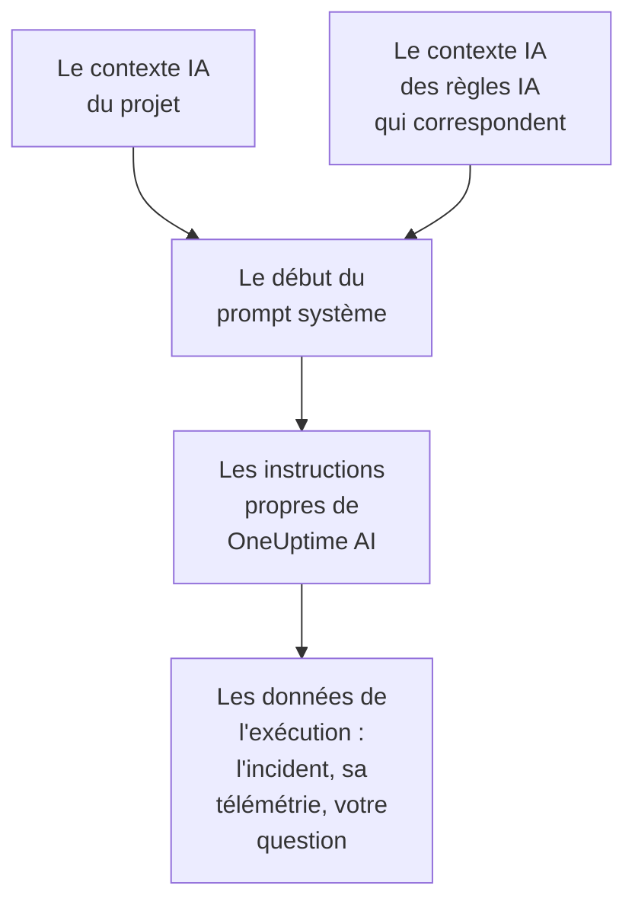

# Contexte IA

Le contexte IA est ce que votre équipe écrit pour OneUptime AI sur vos propres systèmes : comment ils s'articulent, à qui appartient chaque symptôme, où se trouvent les logs et les mots qu'emploie votre équipe. OneUptime AI le lit en premier dans chaque investigation, chaque correction, chaque brouillon de post-mortem et chaque conversation Demander à l'IA, et part ainsi de ce que votre équipe sait déjà.

:::cards
- [Écrire le contexte IA](#écrire-le-contexte-ia): Une carte dans les paramètres IA du projet.
- [Les notes propres à une règle IA](#les-notes-propres-à-une-règle-ia): Des notes sur ce qu'une règle cible.
- [Ce qui le lit](#ce-qui-le-lit): Les fonctionnalités qui le lisent, et celles qui ne le lisent pas.
- [Ce qu'une exécution a lu](#ce-quune-exécution-a-lu): Chaque exécution montre les notes qu'elle a reçues.
:::

## Fonctionnement

OneUptime AI place le contexte IA tout au début de son prompt système, avant ses propres instructions et les données de l'exécution : d'abord les notes du projet, puis celles des règles IA qui correspondent. Il les lit comme le savoir de votre équipe. Elles ne prouvent pas ce qui se passe en ce moment, et elles ne changent jamais les règles propres de OneUptime AI.

Comme les notes viennent en premier et restent les mêmes d'une exécution à l'autre, elles font partie du début du prompt que les fournisseurs mettent en cache. Avec Anthropic, OneUptime marque le prompt système pour la mise en cache ; OpenAI, Azure OpenAI et les autres fournisseurs qui mettent en cache le début répété d'un prompt le font d'eux-mêmes. Des notes qui n'ont pas changé coûtent moins cher à relire.

## Écrire le contexte IA

:::steps
### Ouvrir les fonctionnalités IA
Ouvrez **Paramètres du projet → IA → Fonctionnalités IA**. La carte **Contexte IA** se trouve sous **Activer l'IA**.

### Écrire les notes
Cliquez sur **Ajouter un contexte IA**, ou sur **Modifier** une fois qu'il y a des notes. Écrivez en Markdown, ou cliquez sur **Partir d'un plan** pour obtenir un titre pour chaque type de note.

### Les enregistrer
Cliquez sur **Enregistrer les modifications**. La carte montre les notes, leur longueur et à peu près combien de jetons un modèle lit pour elles.
:::

Écrivez ce que vous diriez à une personne qui arrive dans l'équipe :

| Type de note | Par exemple |
| --- | --- |
| Comment vos systèmes s'articulent | `checkout-api` sert la page de paiement et dépend de `payments-db`. |
| À qui appartient chaque symptôme | Une 502 sur la page de paiement revient à l'équipe Paiements : vérifiez d'abord `payments-db`. |
| Où se trouvent les logs | Les logs du paiement sont dans Loki sous `app=checkout`. |
| Les mots de votre équipe | PSP désigne notre prestataire de services de paiement. |

> [!WARNING]
> N'y mettez aucun secret : quiconque peut voir ce qu'une exécution IA a fait peut lire les notes qu'elle a reçues.

## Les notes propres à une règle IA

Une règle IA peut avoir ses propres notes sur les incidents ou les alertes qu'elle cible : les services d'un produit, leurs responsables, l'emplacement de leurs logs. Écrivez-les dans le champ **Contexte IA** de la règle, sous **Plus de champs**, après **Fournisseur LLM**. Une règle qui se contente d'exécuter ses runbooks à chaque fois ne demande rien à OneUptime AI, elle n'a donc pas de contexte IA à écrire.

- Une investigation lit les notes du projet, puis celles de chaque règle IA activée qui investigue et correspond à l'incident ou à l'alerte, dans l'ordre des noms des règles.
- Une correction lit les notes du projet, puis celles de sa propre règle.
- La conversation sur un incident ou une alerte lit les mêmes notes que son investigation.

## Ce qui le lit

| Fonctionnalité | Ce qu'elle lit |
| --- | --- |
| Les investigations de AI SRE, et leurs nouvelles vérifications quand une nouvelle alerte s'ouvre | Les notes du projet, et celles des règles IA qui correspondent |
| Les corrections qu'une règle IA lance : leurs plans, commandes et serveurs MCP | Les notes du projet, et celles de la règle |
| Demander à l'IA, et la conversation sur un incident ou une alerte | Les notes du projet ; sur un incident ou une alerte, aussi celles des règles IA qui correspondent |
| Les réponses dans Slack et Microsoft Teams | Les notes du projet |
| Les brouillons de post-mortem, pour les incidents et les épisodes | Les notes du projet |
| Le tri dans AI Insights et la qualification des dossiers de sécurité | Les notes du projet |

Les appels qui ne font que reformuler ou juger ce qu'ils reçoivent ne le lisent pas : les brouillons de notes et de notes publiques, les résumés d'appels, le résumé, la confiance et la note d'une investigation, et le titre d'une conversation. Pas plus que les prompts que les gens écrivent eux-mêmes, dans l'étape IA d'un workflow ou d'un runbook.

## Limites

| Quoi | Au maximum |
| --- | --- |
| Le contexte IA du projet | 20 000 caractères |
| Le contexte IA d'une règle IA | 5 000 caractères |
| Tout le contexte IA qu'une exécution lit | 30 000 caractères |

Le formulaire compte les caractères pendant la saisie et refuse un enregistrement au-delà de la limite, et l'API aussi. Une exécution lit d'abord les notes du projet, puis celles de chaque règle qui correspond, dans l'ordre de leurs noms. Une règle dont les notes feraient dépasser 30 000 caractères à l'exécution est laissée de côté en entier, et l'activité de l'exécution l'indique.

Le nombre de jetons est une estimation : la taille des notes en octets UTF-8 divisée par 4, arrondie au supérieur. Chaque modèle compte les jetons à sa façon, donc le décompte d'un fournisseur peut différer, surtout pour un texte qui n'est pas en anglais.

## Ce qu'une exécution a lu

Chaque exécution enregistre mot pour mot les notes qu'elle a lues. Son activité indique **Contexte IA du projet lu**, ou combien de règles IA elle a aussi lues, avec à peu près combien de jetons cela représente. **Voir** ouvre les notes telles que l'exécution les a lues : celles du projet d'abord, puis celles de chaque règle sous son nom, même après qu'elles ont été modifiées. Quand les notes d'une règle ont été laissées de côté à cause de la limite de l'exécution, un avertissement l'indique.

## Qui peut le modifier

- **Propriétaire du projet** et **Administrateur du projet** peuvent modifier le contexte IA du projet. **Membre du projet**, **Lecteur** et **Read Project** peuvent le lire.
- Les notes d'une règle IA font partie de la règle : quiconque peut modifier la règle peut les modifier.
- Les notes ne sont jamais lues que pour leur propre projet : aucune exécution ne lit le contexte IA d'un autre projet.

Par l'API ou Terraform, les notes du projet sont le champ `aiContext` du projet, et celles d'une règle IA le propre `aiContext` de la règle.

## Étapes suivantes

:::cards
- [AI SRE](/docs/ai/ai-sre): Laissez OneUptime AI investiguer chaque nouvel incident et chaque nouvelle alerte.
- [Demander à l'IA](/docs/ai/ask-ai): Interrogez les données de votre projet dans une conversation.
- [Fournisseurs LLM](/docs/ai/llm-provider): Choisissez le modèle qui lit les notes.
:::
