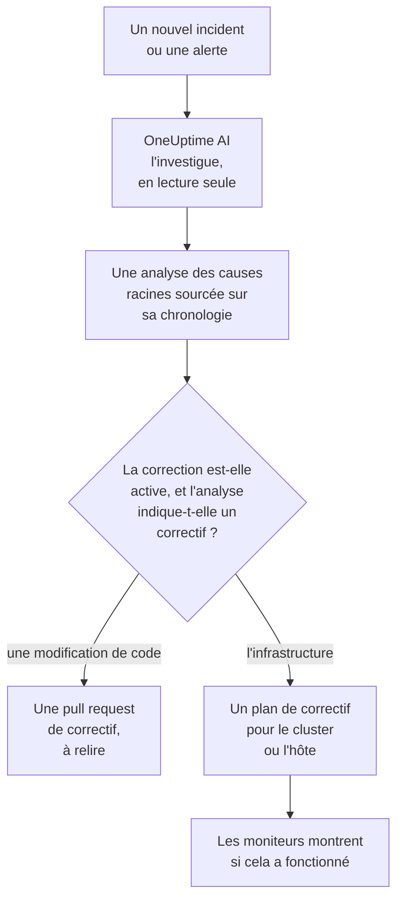
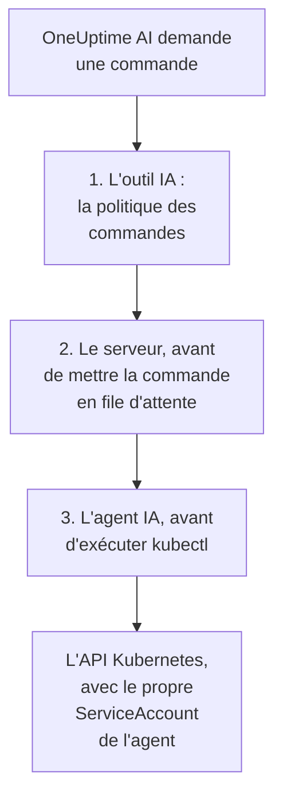

# AI SRE

OneUptime AI est votre ingénieur en fiabilité des sites (SRE) piloté par l'IA. Dès qu'un nouvel incident ou une nouvelle alerte est déclaré, il se met en route, l'investigue à partir de votre propre télémétrie — journaux, métriques, traces, exceptions, moniteurs et changements récents — et publie une analyse des causes racines sourcée sur la chronologie de l'incident ou de l'alerte, généralement avant que la personne d'astreinte ait fini de lire la notification.

Chaque affirmation de l'analyse porte une citation qui renvoie directement aux données exactes qui l'étayent, et l'investigation elle-même est **strictement en lecture seule** : OneUptime AI ne peut jamais rien modifier dans votre projet pendant qu'il investigue.

:::cards
- [Fonctionnement](#fonctionnement): D'un nouvel incident à une analyse sourcée, et à un correctif quand vous l'autorisez.
- [Activer les investigations IA](#activer-les-investigations-ia): Les interrupteurs, et ce dont ils ont besoin.
- [Accès au cluster — laisser OneUptime AI exécuter kubectl](#accès-au-cluster-laisser-oneuptime-ai-exécuter-kubectl): Investiguer, et corriger, à l'intérieur de Kubernetes.
- [Maîtrise des coûts](#maîtrise-des-coûts): Des limites pour les incidents, pour les alertes et pour tout le projet.
:::

## Fonctionnement

OneUptime AI fait trois choses pour un nouvel incident ou une nouvelle alerte, et chacune a son propre interrupteur :

- **Il investigue** (activé par défaut). Il lit votre télémétrie, ainsi que les clusters et les hôtes où tourne un agent IA, et publie une analyse des causes racines sourcée. Une investigation ne modifie rien.
- **Il corrige** (désactivé par défaut). Quand la correction est activée, une analyse sûre d'elle devient un correctif : une pull request pour une modification de votre code, ou un plan de commandes pour un cluster ou un hôte, exécuté comme l'agent IA de ce cluster ou de cet hôte le permet.
- **Il apprend.** Les pages Analyses IA indiquent ce qui ne cesse de mal tourner, à partir de tout ce qui a été enregistré.



Une analyse qui ne trouve aucune cause est publiée discrètement, sans alerter personne (voir [Mode silencieux](#mode-silencieux)), et rien n'est corrigé sans cause.

## Ce que publie l'investigation

Quand une investigation se termine, OneUptime AI publie une analyse des causes racines avec ces sections :

- **Summary** — une ou deux phrases qu'une personne alertée peut lire en cinq secondes.
- **Most likely root cause** — l'hypothèse, avec seulement la confiance que les éléments justifient, chaque affirmation factuelle étant citée. Si la télémétrie est insuffisante, l'IA le dit clairement et liste ce qu'elle a vérifié au lieu de deviner.
- **Evidence** — les principaux constats qui étayent ou écartent l'hypothèse, chacun cité.
- **Suggested next steps** — des actions concrètes pour la personne d'astreinte.

Pour les incidents, l'analyse est publiée dans le fil de l'incident **et** comme note interne de l'incident (là où les intervenants collaborent). Pour les alertes, elle est publiée dans le fil de l'alerte.

Pendant que l'investigation tourne, la page de l'incident ou de l'alerte affiche un panneau **Investigation IA** en direct qui raconte chaque étape — quels outils ont tourné, ce qu'ils ont trouvé et combien de temps ils ont pris — pour que vous puissiez la regarder réfléchir. Si une investigation échoue, le panneau affiche la raison de l'échec plutôt qu'un vide silencieux.

Une investigation tourne jusqu'à ce qu'elle ait terminé : elle n'a **aucune limite de temps** ni petit budget de requêtes, elle peut donc exécuter chaque requête et chaque commande kubectl ou d'infrastructure dont elle a besoin. Une longue sortie de commande (un `kubectl describe node` d'un nœud chargé, les journaux d'un pod) n'est jamais tronquée — OneUptime AI la lit une page à la fois. Si vous voulez un arrêt net, définissez une **limite de temps d'investigation** par type de signal (voir **Maîtrise des coûts** ci-dessous).

## Ce qu'une investigation lit

Une investigation part de l'incident ou de l'alerte et de l'infrastructure à laquelle il est lié : les hôtes, les hôtes Docker et Podman, les clusters Kubernetes, les bases de données et les services que surveillent ses moniteurs. Un moniteur de site web, d'API ou synthétique surveille ce à quoi vous le liez sous **Moniteur → Vue d'ensemble → Ressources liées** : liez-le donc aux hôtes qui servent ce qu'il vérifie, et chaque investigation de ses incidents commence là.

- Les alertes sur cette infrastructure ouvertes dans les 30 minutes avant l'incident, ou encore ouvertes, les plus récentes d'abord, comme l'alerte de CPU élevé de l'hôte derrière un site lent. Les alertes privées sont laissées de côté.
- Les métriques de l'infrastructure elle-même, lues comme on les lit. Les métriques d'hôte comme `system.cpu.utilization` et `system.memory.utilization` sont rapportées une fois par état, et les états totalisent 100 %, donc une moyenne sur l'ensemble ne dit rien. OneUptime AI les lit état par état (le CPU occupé, c'est user plus system), et toute métrique par conteneur, par point de montage ou par n'importe quel autre attribut.
- Les conteneurs d'un hôte Docker ou Podman : les plus chargés en CPU, en mémoire ou en redémarrages, et ceux qui ont cessé de remonter des données. Un conteneur arrêté n'envoie rien plutôt que zéro, donc les chiffres de l'hôte entier le cachent.

L'activité de l'investigation sur la carte **Investigation IA** indique combien d'alertes ouvertes ou récentes elle a lues, et sur quelles ressources.

### Vérifié de nouveau quand une nouvelle alerte s'ouvre

Une investigation démarre dès qu'un incident est déclaré, et une alerte d'hôte qui a besoin de quelques minutes de métriques peut s'ouvrir après. Quand une alerte s'ouvre sur l'infrastructure liée à l'incident dans les 30 minutes qui suivent l'incident, après que l'investigation l'a lue, et que l'incident est toujours ouvert, OneUptime AI vérifie l'incident une fois de plus avec cette alerte en main. La nouvelle analyse commence par **Checked again** et l'alerte qui a provoqué la vérification, et son activité le dit aussi.

Cela arrive au plus une fois par incident, avec les mêmes interrupteurs et limites qu'une nouvelle investigation : **Activer l'IA**, _Investiguer les nouveaux incidents_, les crédits IA, et les limites quotidiennes et de simultanéité. Il n'y a rien à activer. Une vérification de suivi ne relance jamais la remédiation automatique et n'est jamais suivie elle-même, et l'investigation d'une alerte n'est pas vérifiée de nouveau.

## Parler de l'incident avec OneUptime AI

La carte **Investigation IA** se termine par une conversation — **Ask OneUptime AI** — partagée par toutes les personnes qui peuvent voir l'incident ou l'alerte. C'est une seule carte, quoi qu'il se soit passé au-dessus : sous un rapport, vous posez des questions de suivi, et quand aucune investigation automatique n'a tourné (ou qu'elle s'est arrêtée avant son rapport), la première suggestion est **What is the root cause?**, qui fait investiguer OneUptime AI à la demande.

- **Poser des questions de suivi** — « quels pods utilisent le plus de mémoire ? », « qu'est-ce qui a changé juste avant le début ? », « autre chose est-il touché ? ». OneUptime AI s'appuie sur son rapport, interroge des données fraîches (et exécute des commandes kubectl ou d'infrastructure en lecture seule là où il a un accès) et cite chaque affirmation.
- **Lui demander d'agir** — « acquitte cet incident », « publie une mise à jour de statut disant que nous investiguons », « alerte l'astreinte base de données », « augmente la sévérité ». Il utilise les mêmes actions que Demander à l'IA et agit toujours **avec vos propres autorisations**, il ne peut donc jamais faire plus que vous.
- **Choisir sa façon d'agir** avec l'interrupteur de la zone de message, qui indique à côté ce que signifie le mode choisi : _Auto-run_ (par défaut — il agit tout de suite sur une demande claire), _Ask to act_ (il affiche d'abord une carte d'approbation, que toute personne sur l'incident peut approuver ou refuser) ou _Lecture seule_.
- **Un seul fil partagé.** Chaque question indique qui l'a posée, tout le monde voit la même conversation en direct, et chacun peut arrêter une réponse en cours. Les graphiques et les tableaux d'une réponse sont montrés à la personne qui a posé la question ; les autres voient la réponse sourcée. Chaque réponse liste ses **Sources**, et une source qui a sa propre page (journaux, métriques, un moniteur) l'ouvre. Un long fil s'ouvre sur ses messages les plus récents, avec un bouton au-dessus (par exemple **Show 6 earlier messages**) qui ramène le reste.

## Activer les investigations IA

Les investigations autonomes sont **activées par défaut pour les nouveaux projets**. C'est aussi le cas des brouillons de post-mortem et des Analyses IA. La correction démarre désactivée, tout comme les pull requests qui en font partie (voir [Correctifs de code automatiques](#correctifs-de-code-automatiques)). Un projet créé avant ce réglage par défaut garde son réglage ; activez les investigations comme à l'étape 3, ou avec **Activer** sur la page **Agent IA** de n'importe quel cluster Kubernetes (Project Owner ou Project Admin). Pour les vérifier ou les modifier :

:::steps
1. **Configurer un fournisseur LLM.** Les installations auto-hébergées apportent leur propre clé (ou tournent entièrement hors ligne avec Ollama en local) — voir [Fournisseurs LLM](/docs/ai/llm-provider). Les utilisateurs de OneUptime Cloud peuvent utiliser le fournisseur global préconfiguré, facturé en jetons IA mesurés, le projet a donc besoin de crédits IA : un propriétaire du projet ou une personne disposant de **Manage Billing** les ajoute dans **Paramètres du projet → IA → Crédits IA**, où le **Rechargement automatique** évite qu'ils s'épuisent.
2. **Vérifier que l'IA est activée pour le projet** (elle l'est par défaut) : **Activer l'IA**, dans **Paramètres du projet → IA → Fonctionnalités IA**.
3. **Choisir par type de signal** (les deux sont activés pour les nouveaux projets) :
   - Incidents : **Incidents → IA → Paramètres** — activez _Investiguer les nouveaux incidents_.
   - Alertes : **Alertes → IA → Paramètres** — activez _Investiguer les nouvelles alertes_.
:::

Chaque comportement de l'IA sur ces pages est un interrupteur qui s'enregistre dès que vous le basculez ; il n'y a pas de bouton Enregistrer. La page des incidents en a trois, sous **Ce que fait OneUptime AI** : _Investiguer les nouveaux incidents_, _Corriger automatiquement les nouveaux incidents_ et _Rédiger un post-mortem quand un incident est résolu_. La page des alertes a les mêmes, sans le post-mortem. _Corriger automatiquement les nouveaux incidents_ (et _Corriger automatiquement les nouvelles alertes_) démarre **désactivé**, y compris pour les nouveaux projets : il permet à OneUptime AI de modifier votre infrastructure, c'est donc au projet de l'activer — voir [Quels incidents sont investigués et corrigés](#quels-incidents-sont-investigués-et-corrigés). Deux autres interrupteurs en font partie, affichés en dessous tant qu'il est activé : _Ouvrir une pull request de correctif quand une investigation trouve une modification de code_ et _Ouvrir une pull request qui ajoute la télémétrie manquante_. Activer la correction active les deux, et la désactiver désactive les deux ; tant qu'elle est activée, désactivez celui des deux que vous ne voulez pas. Les Project Owners et les Project Admins peuvent les modifier ; pour tous les autres, chaque interrupteur est verrouillé et indique l'autorisation dont il a besoin.

Les pages ne disent deux choses que lorsqu'elles sont vraies. Si **Activer l'IA** est désactivé, rien n'y tourne, et la page le dit en haut, avec l'interrupteur Activer l'IA lui-même pour les personnes qui peuvent le modifier (les Project Owners, et toute personne disposant de Manage Billing) ; les autres apprennent qui le peut. Si le projet n'a aucun fournisseur LLM que OneUptime AI puisse utiliser — aucun du tout, ou des fournisseurs mais aucun défini par défaut —, la page le dit aussi, avec un lien vers **Paramètres du projet → IA → Fournisseurs LLM**. Sur OneUptime Cloud, le fournisseur global compte, donc rien n'y est dit.

Les incidents et les alertes se configurent indépendamment, vous pouvez donc donner à chaque type de signal son propre plafond de simultanéité, son budget quotidien de jetons, son budget de tâches de correction et sa règle de pull requests de suivi. Aucune de ces limites ne s'applique tant que vous ne la définissez pas — elles sont repliées sous **Plus de paramètres** en bas de chaque page ; voir **Maîtrise des coûts** ci-dessous. Modifier un paramètre IA des alertes ne modifie pas le paramètre correspondant des incidents, et inversement.

La correction s'appuie sur les investigations : tant que **Corriger automatiquement les nouveaux incidents** (ou les alertes) est activé, **Ouvrir une pull request de correctif quand une investigation trouve une modification de code** permet à une investigation qui identifie avec assurance une modification de code dans un dépôt d'ouvrir automatiquement une pull request de correctif — voir **Correctifs de code automatiques** ci-dessous.

## Accès au cluster — laisser OneUptime AI exécuter kubectl

D'origine, une investigation ne peut utiliser que la télémétrie que vos agents envoient. Pour un signal Kubernetes, cela ne suffit souvent pas : « des pods bloqués en Pending » est un problème d'ordonnancement que l'on diagnostique en décrivant le pod et en lisant ses événements, pas en regardant une métrique. L'**Agent IA Kubernetes** permet à OneUptime AI de faire exactement cela — et, si vous l'autorisez, de corriger ce qu'il trouve.

La page de chaque cluster a une section **IA** dans son menu latéral :

- **Agent** — la page **Agent IA** du cluster : si l'agent est connecté, ce que l'IA peut faire sur le cluster et tout ce qui demande votre attention, chaque point avec l'étape qui le règle. La même explication apparaît dans le panneau d'investigation de l'incident quand l'IA a dû investiguer avec les seules données de OneUptime.
- **Analyses** — la page **Analyses IA** du cluster : ce que OneUptime AI a appris sur le cluster — ce qui ne cesse de mal tourner et pourquoi, et quoi faire (voir [Ce que l'IA a appris sur un cluster](#ce-que-lia-a-appris-sur-un-cluster)).
- **Journaux** — la page **Journaux IA** du cluster : tout ce que OneUptime AI a fait sur le cluster, du plus récent au plus ancien (voir [Tout ce que l'IA a fait sur un cluster](#tout-ce-que-lia-a-fait-sur-un-cluster)).

La **Vue d'ensemble** du cluster se termine par une carte **Agent IA** qui résume la page de l'agent IA : si l'agent est connecté, si **Investiguer avec kubectl** est activé, comment les correctifs s'exécutent (**Désactivé**, **Demander une approbation**, **Automatique** ou **Contourner l'approbation**) et ce qui demande votre attention, avec un lien vers la page de l'agent IA, où on les modifie.

### L'agent IA Kubernetes — activé par défaut, en lecture seule

Le chart de l'[agent Kubernetes de OneUptime](/docs/telemetry/kubernetes-agent) exécute l'agent IA Kubernetes par défaut : un petit pod (`component=ai-agent`, image `oneuptime/kubernetes-ai-agent`) avec un ServiceAccount en **lecture seule**. Il se connecte avec la clé API que le chart utilise déjà, il n'y a donc rien à configurer dans le tableau de bord : en une minute, la page de l'agent IA du cluster l'affiche comme **Connecté** et **Investiguer avec kubectl** est activé — sauf si quelqu'un a déjà choisi des paramètres IA pour le cluster sur cette page, qui sont conservés tels quels.

Pour un agent installé avant l'existence de l'agent IA Kubernetes, actualisez d'abord l'index de vos charts, puis faites la mise à niveau :

```bash
helm repo update
helm upgrade kubernetes-agent oneuptime/kubernetes-agent \
  --namespace oneuptime-agent --reset-then-reuse-values \
  --set aiAgent.enabled=true
```

`kubernetes-agent` dans `oneuptime-agent` sont le nom de release et l'espace de noms qu'utilisent les instructions d'installation du tableau de bord ; si vous avez installé l'agent avec d'autres noms, utilisez les vôtres (`helm list -A | grep kubernetes-agent` les affiche). Sans `helm repo update`, Helm peut résoudre le chart à partir duquel vous avez installé, qui ne connaît pas `aiAgent` et échoue avec `Additional property aiAgent is not allowed`. Sur un OneUptime auto-hébergé, mettez OneUptime à niveau avant le chart — voir [Mettre à niveau l'agent](/docs/telemetry/kubernetes-agent#mettre-à-jour-lagent). Pour exécuter le chart sans l'agent IA, passez `--set aiAgent.enabled=false`.

**Tester la connexion**, dans le menu **⋯** à côté du statut de l'agent sur la page de l'agent IA, exécute `kubectl version` et `kubectl auth can-i --list` via l'agent et affiche les résultats : ce qu'il peut atteindre et ce qu'il a le droit de faire. Si la page indique que l'agent n'est pas connecté, lisez son journal avec `kubectl logs -n oneuptime-agent -l component=ai-agent --tail=100`. Une clé qui a un **Pinned Service Name** ne peut pas enregistrer l'agent — donnez au chart une clé qui n'en a pas. Quand le serveur refuse un enregistrement, le journal indique si le refus se lèvera de lui-même (un ancien pod de l'agent qui se signale encore, ou l'ancien Runner du cluster encore en train de s'arrêter pendant une mise à niveau) ou ce qu'il faut changer. **Réinitialiser l'agent**, dans le même menu, fait oublier au serveur la clé de l'agent une fois que vous avez confirmé ; le pod se reconnecte de lui-même en quelques minutes.

L'agent IA Kubernetes n'est pas un Runner et n'apparaît jamais sous Runbooks → Agents de runbook. Il n'utilise jamais que son propre ServiceAccount, donc OneUptime ne lui remet jamais d'identifiant, il n'est jamais utilisé comme hôte Bash/SSH pour les runbooks, et il n'est jamais accepté comme Runner de commandes d'une règle de remédiation automatique.

### Ce que l'IA peut faire — défini par l'agent

Ce que OneUptime AI peut faire sur un cluster se définit là où l'agent tourne, dans le chart, avec deux valeurs :

- `aiAgent.investigation` — `true` : l'IA peut exécuter kubectl en lecture seule sur le cluster pendant qu'elle investigue. `false` : elle investigue toujours, avec les données que OneUptime a déjà.
- `aiAgent.fixes` — comment l'IA applique un correctif : `off`, `ask-for-approval`, `automatic` ou `bypass-approval` (voir [Fonctionnement des correctifs](#fonctionnement-des-correctifs)). Chaque niveau sauf `off` donne à l'agent IA un accès en écriture ; avec `off`, il n'en a aucun et refuse lui-même toute écriture.

L'agent IA communique les deux à OneUptime à chaque heartbeat, et OneUptime les applique au cluster. **Ce que l'IA peut faire**, sur la page de l'agent IA du cluster, les affiche — **Activé** et le niveau de correctifs, en vert dès qu'ils sont activés — sans moyen de les y modifier ; **Modifier** affiche chaque option avec le `helm upgrade` exact qui la définit. Une modification faite ailleurs — sur la page de l'agent IA, par l'API ou par Terraform — est refusée tant que l'agent les définit.

Une release qui ne définit aucune des deux valeurs laisse l'agent utiliser ses valeurs par défaut (investigation activée ; correctifs désactivés, ou ask-for-approval avec l'ancien `aiAgent.remediation.enabled=true`). OneUptime n'applique ces valeurs par défaut qu'à un cluster dont personne n'a choisi les paramètres IA sur sa page d'agent IA : les paramètres choisis là sont conservés tels quels, et la page affiche la commande qui les transfère dans le chart. De même pour un cluster dont l'agent IA est trop ancien pour les communiquer — mettre le chart à niveau avec les deux valeurs les transfère.

### Laisser l'IA corriger ce qu'elle trouve

Les correctifs sont désactivés tant que vous ne les activez pas avec `aiAgent.fixes`, qui donne aussi à l'agent IA un accès en écriture — idéalement seulement dans les espaces de noms que l'IA peut corriger, et avec les opérations sur les nœuds désactivées :

```bash
helm repo update
helm upgrade kubernetes-agent oneuptime/kubernetes-agent \
  --namespace oneuptime-agent --reset-then-reuse-values \
  --set aiAgent.enabled=true \
  --set aiAgent.investigation=true \
  --set aiAgent.fixes=ask-for-approval \
  --set "aiAgent.remediation.namespaces={web,api}" \
  --set aiAgent.remediation.nodeOperations=false
```

Ou à l'échelle du cluster :

```bash
helm repo update
helm upgrade kubernetes-agent oneuptime/kubernetes-agent \
  --namespace oneuptime-agent --reset-then-reuse-values \
  --set aiAgent.enabled=true \
  --set aiAgent.investigation=true \
  --set aiAgent.fixes=ask-for-approval \
  --set-json 'aiAgent.remediation.namespaces=[]'
```

Remplacez `{web,api}` par les espaces de noms que l'IA peut corriger. Chaque espace de noms listé doit déjà exister : le chart crée un RoleBinding dans chacun et ne crée jamais d'espace de noms, donc un espace manquant fait échouer toute l'installation ou la mise à niveau — collecteur compris — avec `namespaces "api" not found`. Créez-le d'abord, ou retirez-le de la liste ; retirez un espace de noms de la liste avant de le supprimer. Omettre l'option lors d'une mise à niveau conserve la liste stockée dans la release ; pour revenir à l'échelle du cluster, passez donc `--set-json 'aiAgent.remediation.namespaces=[]'` (Helm 3.10+), comme le fait la seconde commande — pas `={}`, que Helm lit comme un nom vide et que le chart refuse. `--set aiAgent.remediation.namespaces=null` ne réinitialise pas une liste stockée sous `--reuse-values` : Helm garde la liste stockée. `aiAgent.remediation.nodeOperations=false` tient les correctifs à l'écart des nœuds ; mettez-le à `true` pour laisser l'IA isoler, réintégrer, vider et marquer d'un taint des nœuds (un drain, un taint ou un patch d'un nœud attend toujours un humain).

Utilisez `automatic` ou `bypass-approval` à la place de `ask-for-approval` pour plus d'autonomie, et `--set aiAgent.fixes=off` pour désactiver à nouveau les correctifs, ce qui retire aussi l'accès en écriture. Les correctifs ont aussi besoin de deux interrupteurs du projet. **Corriger automatiquement les nouveaux incidents** (dans **Incidents → IA → Paramètres**) et **Corriger automatiquement les nouvelles alertes** (dans **Alertes → IA → Paramètres**) démarrent désactivés : tant qu'aucun n'est activé, rien de nouveau de ce type n'est corrigé. **Activer l'IA** (**Paramètres du projet → IA → Fonctionnalités IA**) est activé sauf si quelqu'un l'a désactivé ; il désactive toute l'IA du projet, quelle que soit la configuration d'un agent.

### Sur quels incidents agissent les correctifs d'un cluster

Tant que **Corriger automatiquement les nouveaux incidents** est activé et qu'aucune règle de remédiation automatique n'est configurée, OneUptime AI corrige chaque nouvel incident auquel le cluster est lié, dans le mode que définit la page de son agent IA — et de même pour les alertes avec **Corriger automatiquement les nouvelles alertes**. Avec des règles, il ne corrige que les incidents qui correspondent à une règle qui corrige avec OneUptime AI (voir [Quels incidents sont investigués et corrigés](#quels-incidents-sont-investigués-et-corrigés)). Ce à quoi il n'est pas lié, il n'y touche pas — même si la cause se trouve clairement dans le cluster. Un incident ou une alerte est lié à un cluster quand :

- la télémétrie qui l'a déclenché nomme le cluster (un moniteur de métrique, de journal ou de trace sur les données du cluster) ;
- son moniteur est un moniteur Kubernetes du cluster ;
- son moniteur est lié au cluster dans **Moniteur → Vue d'ensemble → Ressources liées** — la façon de lier un moniteur de site web, d'API ou synthétique au cluster qui sert ce qu'il vérifie ;
- quelqu'un a choisi le cluster dans **Autres ressources affectées** en le déclarant (choisir un moniteur lié l'y ajoute pour vous).

Chaque incident et chaque alerte indique sur sa carte **Remédiation** s'il était lié à un cluster et ce qu'ont fait les correctifs du cluster ; voir [Ce qu'a fait la remédiation automatique](#ce-qua-fait-la-remédiation-automatique). Il en va de même pour une ressource d'infrastructure et son agent IA.

### Qui peut le modifier

Tant que l'agent IA Kubernetes définit l'investigation et les correctifs, c'est la personne qui peut modifier les valeurs du chart sur le cluster qui les modifie ; OneUptime refuse une modification faite ailleurs. Les règles ci-dessous valent pour ce qui reste dans OneUptime — la liste d'autorisation kubectl, et la liaison du Runner et de l'identifiant — ainsi que pour l'investigation et les correctifs d'un cluster dont les paramètres sont encore définis dans OneUptime (voir [Ce que l'IA peut faire — défini par l'agent](#ce-que-lia-peut-faire-défini-par-lagent)).

Activer les correctifs — tout passage de **Désactivé** à un autre mode — et les assouplir — passer à **Automatique** ou **Contourner l'approbation**, écrire la liste d'autorisation kubectl, lier un Runner ou un identifiant, ou retirer cette liaison d'un cluster qui a un agent IA Kubernetes — exige un Project Owner, un Project Admin ou l'autorisation **Edit Auto Remediation Rule**, soit les mêmes personnes qui peuvent créer une règle de remédiation entièrement automatique. Lier un identifiant exige aussi l'autorisation **Read Runbook Credential**, sauf si vous êtes Project Owner ou Project Admin. **Réinitialiser l'agent** exige les mêmes personnes qu'activer les correctifs. Les resserrer — **Désactivé**, revenir à **Demander une approbation**, vider la liste d'autorisation — est ouvert à toute personne qui peut modifier le cluster.

### Ce qu'une investigation peut exécuter

Avec un accès, une investigation exécute kubectl en **lecture seule** via l'agent IA — `get`, `describe`, `logs`, `events`, `top`, `rollout status/history`, `auth can-i` —, autant de commandes qu'il lui en faut, et cite chaque commande comme n'importe quel autre élément. La sortie n'est jamais tronquée : l'agent en garde jusqu'à un mégaoctet, et OneUptime AI lit une longue sortie une page à la fois. Trois vérifications indépendantes la maintiennent en lecture seule : la politique qui classe chaque commande, le serveur qui refuse de mettre en file autre chose pour une investigation, et l'agent IA, qui revérifie la même politique avant de lancer kubectl. « Lecture seule — rien n'a été modifié dans vos systèmes » reste littéralement vrai.



### Fonctionnement des correctifs

Les **Correctifs** de la page de l'agent IA ont quatre réglages (le `aiAgent.fixes` du chart : `off`, `ask-for-approval`, `automatic`, `bypass-approval`) :

- **Désactivé** — l'IA ne fait qu'investiguer.
- **Demander une approbation** — après l'analyse des causes racines, OneUptime AI établit un diagnostic avec kubectl et compose le plus petit plan kubectl qui traite la cause, par exemple `kubectl rollout restart deployment/web -n web`. Le plan apparaît sur l'incident avec sa justification, son effet attendu et son retour arrière ; un humain l'approuve d'un clic, et OneUptime exécute exactement ces commandes. Si les moniteurs ne se rétablissent pas, le retour arrière s'exécute et OneUptime AI compose un plan de plus — de nouveau soumis à approbation — avec la tentative échouée sous les yeux, pour adopter une autre approche ou dire ce qu'un humain devrait examiner.
- **Automatique** — les modifications sûres s'exécutent d'elles-mêmes ; une modification plus risquée, jamais. Quand le tour n'a pu trouver que des correctifs plus risqués, il se termine en proposant exactement ceux-là à l'approbation d'un clic. Quand il a aussi exécuté un correctif sûr, le plus risqué reste dans l'analyse et n'est proposé que si la vérification montre que le correctif sûr n'a pas rétabli les moniteurs — par le tour de suivi, qui demande une approbation. Ajoutez la forme d'une commande plus risquée à la liste d'autorisation sur la page de l'agent IA, et elle s'exécute d'elle-même aussi. Le mode automatique résout aussi le signal une fois que la vérification confirme que les moniteurs se sont rétablis, et il est limité par un disjoncteur à trois correctifs sans surveillance par cluster et par heure : au-delà, ou tant qu'un autre tour sans surveillance de OneUptime AI modifie ou vérifie encore le même cluster, un tour propose son plan à l'approbation au lieu de l'exécuter.
- **Contourner l'approbation** — l'IA ne demande pas. Chaque modification que la politique autorise, y compris les plus risquées, s'exécute d'elle-même, tout comme le tour de suivi après une vérification échouée ; le signal se résout de lui-même une fois que la vérification confirme le rétablissement. Ce qui exige un humain dans tous les modes (ci-dessous) l'attend toujours. Un tour propose aussi son plan à l'approbation au lieu de l'exécuter, et dit pourquoi sur l'incident, quand :
  - le disjoncteur horaire (trois correctifs sans surveillance par cluster et par heure) s'est déclenché, ou ne peut pas être vérifié ;
  - un autre tour sans surveillance de OneUptime AI modifie encore le même cluster, ou y vérifie encore un correctif — une alerte et un incident d'un même moniteur sont le cas habituel —, ou cela ne peut pas être vérifié ;
  - c'est le tour de suivi après un correctif dont le retour arrière ne s'est pas terminé.

Une modification **sûre** touche exactement un objet nommé : `rollout restart/undo/pause/resume`, `scale` (vers n'importe quelle valeur sauf 0), la suppression d'un pod nommé, `cordon`/`uncordon`, et `label`/`annotate` sur un Pod, Deployment, StatefulSet, DaemonSet, ReplicaSet, Job ou CronJob nommé avec une clé ordinaire (pas une clé réservée comme `*.kubernetes.io/…` ou `*.k8s.io/…`). Tout le reste de ce que la politique autorise est **plus risqué** : les mêmes verbes sur un type seul (`rollout restart deployment`), sur plusieurs objets, avec un sélecteur ou avec `--all` ; `scale` vers 0 ; la suppression d'un job ; `taint` ; `drain` ; `patch` ; `set image/env/resources` ; `create` ; la suppression avec `--force` ; et les labels ou annotations sur tout autre type ou avec une clé réservée.

Certaines limites tiennent dans **tous** les modes, Contourner l'approbation compris, et aucune entrée de la liste d'autorisation ne les change :

- Une écriture dans **kube-system**, **kube-public** ou **kube-node-lease** exige toujours un humain. Une ressource personnalisée est jugée d'après l'espace de noms dans lequel elle est écrite, même une dont le nom ressemble à un type intégré à l'échelle du cluster (`nodes.example.com`, `namespaces.example.com`).
- Un `drain`, un `taint` ou un `patch` d'un nœud exige toujours un humain. Vider un nœud expulse les pods de tous les espaces de noms — les trois ci-dessus et celui de l'agent compris —, et un taint `NoExecute` les expulse aussi, qu'il soit posé par `kubectl taint` ou par un `patch` du nœud.
- L'agent IA ne modifie jamais rien dans son propre espace de noms — un correctif à cet endroit pourrait réduire à zéro l'agent Kubernetes, ou l'agent IA lui-même —, ni rien en dehors des espaces de noms où son chart l'autorise à écrire (`aiAgent.remediation.namespaces`), ni un nœud quand son chart a désactivé les opérations sur les nœuds (`aiAgent.remediation.nodeOperations=false`). OneUptime lit ce périmètre dans ce que l'agent IA communique et refuse un tel correctif quand OneUptime AI le propose, puis de nouveau quand quelqu'un l'approuve, il n'atteint donc jamais l'agent IA sous la forme d'un correctif échoué ; l'agent IA le refuse aussi, avant de lancer `kubectl`.
- Les commandes destructrices (ci-dessous) ne s'exécutent jamais, même avec l'approbation d'un humain.

La liste d'autorisation du mode automatique est comparée mot à mot à la commande analysée, et non comme du texte libre : `*` représente exactement un mot (une image, un nom), jamais des objets, des options ou un second `-n` en plus, et chaque option utilisée par la commande doit être écrite dans l'entrée. `kubectl set image deployment/web * -n web` autorise une nouvelle image pour `web` dans `web`, rien d'autre. Une entrée doit écrire son verbe en toutes lettres — et la sous-commande de `rollout`, `set` ou `create` — au lieu d'utiliser `*` à sa place, et doit compter plus d'un mot après le `kubectl` initial facultatif ; une entrée qui enfreint ces règles, comme `scale` ou `kubectl *`, ne pourrait jamais pré-approuver une modification et est refusée à l'enregistrement.

:::details Les commandes qui ne s'exécutent jamais, et comment une commande est lue
Certaines commandes ne s'exécutent **jamais**, quel que soit le mode et même avec une approbation humaine. La politique des commandes les refuse, et elle est appliquée trois fois — par l'outil du serveur, par le point de passage obligé où le serveur met en file, et par l'agent IA avant de lancer `kubectl` : `exec`, `attach`, `cp`, `port-forward`, `proxy`, `debug`, `run`, `edit`, `apply`, `replace`, `diff`, les plugins kubectl et tout autre verbe absent de sa liste, toute entrée de fichier (`-f`, `-k`) ou tout format de sortie qui lit un fichier (`-o jsonpath-file=`, `-o go-template-file=`, `-o custom-columns-file=`, `--template`, et un `-o jsonpath`/`go-template`/`custom-columns` seul sans son modèle en ligne), les options d'identifiants, d'usurpation d'identité (`--as`, `--as-group`, `--as-uid`, `--as-user-extra`), de sélection du cluster, `--kuberc`, d'API brute et de journalisation verbeuse, les objets Secret avec **n'importe quel** verbe — OneUptime AI ne lit, ne modifie, ne supprime ni ne crée jamais un Secret, et `create secret`, `create token` et `set env --resolve` sont refusés avec eux —, tout ce qui accorde du RBAC (`create role`, `create clusterrole`, `create rolebinding`, `create clusterrolebinding`, `set subject`), `certificate approve`, `set serviceaccount`, `create deployment`, `create cronjob` ou `create job` avec `--image` (`create job --from=cronjob/…` reste une modification plus risquée), `expose --overrides` ou `--override-type` (la surcharge peut faire créer à kubectl un Job, un ClusterRoleBinding ou tout autre type d'objet au lieu d'un Service), un corps de `patch` qui n'est pas du JSON (kubectl le lirait comme du YAML, dont les tags peuvent écrire un champ qu'aucune vérification ne voit), les patchs qui modifient le ServiceAccount, les volumes ou les paramètres de sécurité d'un modèle de pod (ports de l'hôte, désactivation de l'espace de noms utilisateur `hostUsers` et classe d'exécution `runtimeClassName` compris), les patchs qui remplacent une partie entière d'un modèle de pod au lieu d'y définir des champs (un strategic-merge `$patch: replace`, un merge patch qui définit une liste `containers` entière, ou un JSON patch qui remplace ou retire la spécification du pod) — ce qui abandonnerait ces paramètres sans les nommer —, un label ou une annotation sur des objets Namespace choisis par `--all` ou par un sélecteur plutôt que par leur nom, toute écriture — `patch`, `label`, `annotate`, `set` — sur des objets RBAC, des CustomResourceDefinitions, des APIServices, des configurations de webhooks d'admission ou des politiques d'admission, les écritures avec `--all-namespaces`, `delete --all`, et la suppression d'espaces de noms, de nœuds, de volumes, de CRD ou de rôles de cluster. Les options sont analysées comme kubectl les analyse, de sorte qu'une option ou un type interdit ne peut pas se cacher derrière un autre : les options courtes combinées sont séparées lettre par lettre (`-As` est détecté), les options à valeur facultative (`--cascade`, `--dry-run`, `--validate`) n'avalent jamais le mot suivant, et toute option sauf `-n`/`--namespace`, `--request-timeout` et `--match-server-version` doit venir après le verbe (et après la sous-commande de `rollout`, `set`, `create`, `auth`, `cluster-info` et `top`), car kubectl choisit la commande avant d'analyser les options. L'agent IA embarque son propre kubectl à version fixe (v1.36.4) et désactive kuberc, de sorte qu'un fichier kuberc ne peut pas ajouter de valeurs par défaut ni d'alias à une commande après que la politique l'a vérifiée. Il remet à chaque commande un kubeconfig privé pour son propre ServiceAccount qui pointe vers le fichier de jeton monté, jamais une copie du jeton.
:::

### Ce que le RBAC de l'agent IA limite, et ne limite pas

:::details Ce que le RBAC du chart accorde
Le RBAC du chart est une couche distincte de la politique, et il limite **où** l'agent IA peut écrire, pas ce qu'une écriture peut faire. L'accès en lecture seule (get/list/watch, journaux des pods) est accordé à l'échelle du cluster. `aiAgent.remediation.enabled` ajoute patch/update sur les Deployments, StatefulSets, DaemonSets, ReplicaSets et leur sous-ressource scale, les Jobs, CronJobs, Pods et HPA ; create sur les Jobs et les HPA ; et delete sur les Pods et les Jobs uniquement. `aiAgent.remediation.nodeOperations` (activé par défaut) ajoute cordon, uncordon, taint et drain sur les nœuds, à l'échelle du cluster ; mettez-le à `false` et le chart n'accorde aucun RBAC sur les nœuds et le signale à l'agent IA (`ONEUPTIME_KUBECTL_ALLOW_NODE_OPERATIONS=false`), qui refuse alors cordon, uncordon, drain, taint et label/annotate/patch sur un nœud avant de lancer kubectl — et, comme l'agent IA communique l'interrupteur, OneUptime refuse un tel correctif dès qu'il est proposé ou approuvé. Il n'accorde jamais les Secrets, `exec`, `attach`, `port-forward`, les jetons de ServiceAccount, l'usurpation d'identité, les CRD ni les écritures RBAC, donc supprimer tout autre type, ou poser un label sur un Service, une ConfigMap, un Ingress, un Namespace ou un PVC, échoue au serveur d'API avec `Forbidden` même quand un humain l'a approuvé. Les deux couches ne sont pas des copies l'une de l'autre : pour le RBAC, `apply`, `edit`, `replace`, les écritures avec `--all-namespaces` et `delete --all` sont des appels patch, update et delete ordinaires, et seule la politique les arrête.
:::

:::warning Ce que représente l'accès en écriture
Soyez toutefois lucide sur ce que représente cet accès en écriture : **patch/update sur les workloads, les pods et les CronJobs, et create sur les Jobs, dans un espace de noms équivaut à exécuter n'importe quelle image sous n'importe quel ServiceAccount de cet espace de noms et à lire ses Secrets.** Un modèle de pod peut nommer n'importe quelle image, n'importe quel ServiceAccount et n'importe quel volume Secret, et le RBAC n'a pas de verbe « patch, mais pas le modèle de pod » — qu'aucune règle ne nomme `exec` ou les Secrets n'y change rien. C'est pourquoi la politique refuse de changer le ServiceAccount, les paramètres de sécurité, les volumes, la commande ou le câblage des Secrets avec lesquels un pod s'exécute (patchs de sécurité du modèle de pod, patchs qui remplacent la spécification du pod ou une liste `containers` entière, `set serviceaccount`, `create … --image`, `expose --overrides`, corps de patch non JSON), pourquoi les espaces de noms protégés exigent toujours un humain, et pourquoi `aiAgent.remediation.namespaces` existe. La politique ne refuse **pas** de changer une image : `set image`, ou un patch d'un champ d'image, est une modification plus risquée — la nouvelle image s'exécute sous le propre ServiceAccount du workload, avec ses Secrets — qu'un humain approuve, sauf si le cluster contourne les approbations ou que sa liste d'autorisation nomme la commande. Sans `aiAgent.remediation.namespaces`, le rôle d'écriture est lié à l'échelle du cluster — kube-system, kube-public, kube-node-lease et l'espace de noms de l'agent compris, puisque le RBAC ne peut pas exclure d'espaces de noms d'une liaison à l'échelle du cluster — et là, ce sont la politique et l'agent IA qui tiennent la ligne, pas le RBAC. Avec, le chart lie le rôle exactement dans les espaces de noms que vous listez, OneUptime refuse une écriture ailleurs quand elle est proposée ou approuvée, et l'agent IA la refuse encore avant de lancer kubectl.
:::

### Ce que l'IA a appris sur un cluster

La page **Analyses IA** du cluster (IA → Analyses) vous dit ce qui vaut la peine d'être su sur le cluster d'après les 30 derniers jours — non pas un relevé de ce que l'IA a fait, mais ce qu'elle a découvert :

- **Ce que OneUptime AI a trouvé** — les quelques points qui comptent le plus, le plus important en premier, chacun avec les incidents et les alertes qui le sous-tendent et une prochaine étape :
  - un problème qui revient sans cesse : à quelle fréquence (chaque incident et chaque alerte qu'il a déclenché compte, investigué ou non) et quelle part du total cela représente, s'il est nouveau cette semaine ou s'aggrave, le moment de la journée où il commence d'habitude (dans votre propre fuseau horaire), les parties du cluster qu'il touche, ce que la dernière investigation a trouvé et la première étape que suggère son rapport ;
  - un correctif qui n'a pas résolu son problème, et les correctifs en attente de votre approbation ;
  - un risque repéré avant que quiconque soit alerté : une [analyse](#analyses-détection-proactive) ouverte de sévérité High ou Medium sur la propre télémétrie du cluster ;
  - le nœud, le pod, l'espace de noms ou le workload derrière plusieurs problèmes différents, lié à sa propre page dans le cluster ;
  - ce que l'IA a corrigé d'elle-même et si le correctif a tenu, et — quand votre équipe a approuvé chaque correctif proposé par l'IA — que l'IA pourrait appliquer d'elle-même des correctifs comme ceux-là ;
  - un problème qui revenait sans cesse et qui a cessé après un correctif.

  Quand rien ne ressort, la page le dit.
- **Autres problèmes** — tout le reste de ce que l'IA a examiné, regroupé selon ce qui l'a déclenché (un moniteur est un problème, quel que soit le nombre de pods ou de nœuds pour lesquels il s'est déclenché), le plus fréquent en premier : à quelle fréquence, quels espaces de noms, workloads, pods ou nœuds il touche, ce que la dernière investigation a trouvé et suggère, ce que sont devenus les correctifs proposés par l'IA, et ce que votre équipe et l'évaluation ont dit des constats. Un problème survenu plus d'une fois est marqué **Récurrent**, **Nouveau cette semaine** ou **S'aggrave**.
- **Où les problèmes surviennent** — les parties du cluster qui sont revenues le plus souvent, et dans combien de problèmes différents.
- **Repéré avant que quiconque soit alerté** — les autres analyses ouvertes que les détecteurs ont créées à partir de la propre télémétrie du cluster.
- **Ce que OneUptime AI a fait ici** — la note de bas de page : combien d'investigations, de correctifs et de commandes il y a eu et combien ont échoué, les investigations par jour, ce que sont devenus les correctifs proposés par l'IA et si ceux qui ont été appliqués ont résolu le problème, et ce qui s'est mal passé dans le travail de l'IA elle-même (investigations échouées, commandes que l'agent n'a jamais prises en charge, constats rejetés par votre équipe), chaque point avec l'endroit où regarder.

Avec **Activer l'IA** désactivé pour le projet, ou sans fournisseur LLM que OneUptime AI puisse utiliser, la page le dit en haut : rien de nouveau n'est investigué, donc rien de nouveau n'apparaît.

Tout ce qui figure sur la page provient de ce que OneUptime a déjà enregistré — les incidents et les alertes, leurs investigations et ce qu'elles ont conclu, les verdicts à leur sujet, les correctifs et les commandes — et aucun modèle n'est appelé pour la construire : les mots qui sont ceux de l'IA (un constat, une étape suggérée) ont été écrits par l'investigation qui les a trouvés, et sont présentés comme les siens. Toute personne qui peut voir le cluster peut voir la page, et celle-ci ne nomme que les incidents et les alertes que la personne peut lire.

### Tout ce que l'IA a fait sur un cluster

La page **Journaux IA** du cluster (IA → Journaux) est le relevé de tout ce que OneUptime AI y a fait, du plus récent au plus ancien : chaque investigation avec son incident ou son alerte et son résumé, chaque correctif qu'il a proposé ou exécuté avec son statut, et chaque commande kubectl — d'investigation ou de correctif — avec la commande, son statut et le moment où elle a tourné. Le résumé d'une investigation est son TL;DR ou, quand aucun TL;DR n'a pu être écrit, le résumé par lequel s'ouvre son rapport. Cette page s'appelait auparavant Analyses IA ; un favori de son ancienne adresse ouvre désormais la page Analyses IA, qui renvoie ici.

### Via un Runner à la place (avancé)

Un cluster qui n'exécute pas le chart — un cluster qui envoie sa télémétrie Kubernetes d'une autre façon — peut donner à OneUptime AI un accès kubectl via un Runner que vous exploitez (Runbooks → Agents de runbook). Liez le Runner et un identifiant Kubernetes (URL du serveur d'API + jeton de ServiceAccount, dans **Runbooks → Agents de runbook → Identifiants**) au cluster avec l'API ou Terraform (l'**Agent Runbook d'accès IA** et l'**Identifiant d'accès IA** du cluster), et activez **Exécute les commandes de remédiation IA** pour ce Runner. Les correctifs via un Runner ont besoin des mêmes interrupteurs du projet que les correctifs via l'agent IA : **Activer l'IA**, et **Corriger automatiquement les nouveaux incidents** (ou les alertes). Pour limiter où un tel Runner peut écrire, démarrez-le avec `ONEUPTIME_KUBECTL_WRITE_NAMESPACES` (et `ONEUPTIME_KUBECTL_ALLOW_NODE_OPERATIONS=false` pour tenir les correctifs à l'écart des nœuds) : le Runner communique ces limites, donc OneUptime refuse un correctif hors de celles-ci quand il est proposé ou approuvé, avant qu'il n'atteigne le Runner, et le Runner le refuse encore. Un cluster lié à un Runner continue de l'utiliser même quand l'agent IA Kubernetes est installé ; la page de l'agent IA indique alors par quel Runner et quel identifiant il passe et, une fois l'agent IA connecté, propose **Passer à l'agent IA** dans le menu **⋯** à côté du statut de l'agent.

Les clusters configurés avec un chart antérieur (`aiAccess.enabled=true`) atteignent OneUptime AI via l'ancien Runner du cluster jusqu'à la mise à niveau du chart. La mise à niveau remplace ce Runner par l'agent IA Kubernetes et reprend ses paramètres — voir [Mettre à niveau l'agent](/docs/telemetry/kubernetes-agent#mettre-à-jour-lagent).

## Accès à l'infrastructure — Docker, Podman, Swarm, Proxmox, VMware, Ceph, bases de données et hôtes

Le même type d'accès existe pour le reste de votre infrastructure. Un agent IA de ressource (image `oneuptime/resource-ai-agent`) tourne à côté du collecteur d'un hôte Docker ou Podman, d'un cluster Docker Swarm, d'un cluster Proxmox, d'un VMware vCenter, d'un cluster Ceph ou d'un serveur de base de données — ou seul sur un hôte Linux — et laisse OneUptime AI y exécuter des commandes en lecture seule pendant qu'il investigue (`docker logs`, `pvesh get`, `govc vm.info`, `ceph health detail`, un catalogue fixe de diagnostics de base de données, `systemctl status`, `journalctl`, …) et, seulement si vous démarrez l'agent avec `ONEUPTIME_AI_ALLOW_WRITES=true` et un niveau de correctifs (`ONEUPTIME_AI_FIXES`), appliquer des correctifs avec les mêmes quatre modes et les mêmes trois vérifications qu'un cluster Kubernetes. Comme pour un cluster, ce que l'IA peut faire sur une telle ressource se définit là où son agent tourne (`ONEUPTIME_AI_INVESTIGATION`, `ONEUPTIME_AI_FIXES`) et s'affiche en lecture seule sur la page de son agent IA. Chaque ressource de ce type a les mêmes pages **Agent IA**, **Analyses** et **Journaux**. Voir [Agents IA pour l'infrastructure](/docs/ai/infrastructure-ai-agents) pour savoir comment les installer, ce que chacun peut exécuter et son modèle de sécurité.

## Mode silencieux

Une investigation qui ne parvient pas à déterminer une cause publie son analyse sur la chronologie **sans** notifier votre espace de travail Slack/Teams ni l'astreinte. Une non-réponse ne devrait jamais alerter personne — l'analyse est là quand quelqu'un regarde, mais personne n'est réveillé pour « non concluant ». Les analyses sûres d'elles notifient l'espace de travail normalement.

Le fait qu'une analyse compte comme sûre d'elle est décidé par un signal vérifié par le serveur, et non par ce que dit le texte de l'analyse : une investigation qui n'a recueilli aucun élément (aucune requête de télémétrie réussie, aucune citation) est toujours traitée comme non concluante, et sinon une vérification distincte et contrainte classe l'analyse. Si cette vérification échoue elle-même, OneUptime AI penche du côté de la notification — le mode silencieux échoue plus bruyamment, jamais en silence.

## Correctifs de code automatiques

Une analyse sûre d'elle qui recommande une modification de code dans un dépôt peut aller un cran plus loin que la notification : elle ouvre le correctif. L'interrupteur **Ouvrir une pull request de correctif quand une investigation trouve une modification de code** fait partie de la correction : il se trouve sous **Corriger automatiquement les nouveaux incidents** dans **Incidents → IA → Paramètres**, et sous **Corriger automatiquement les nouvelles alertes** dans **Alertes → IA → Paramètres**, et n'ouvre des pull requests que tant que cet interrupteur est activé. Les deux démarrent **désactivés**, y compris pour les nouveaux projets ; activer la correction l'active, et désactiver la correction le désactive. Rien ne s'ouvre tant que le projet n'a pas de dépôt connecté via la GitHub App et de Runner doté de la capacité de correction de code. Un type de signal pour lequel ce paramètre est activé met automatiquement en file la même tâche de correction que le bouton **Ouvrir une PR de correctif à partir de cette analyse** du panneau d'investigation : une tâche d'agent IA qui transforme l'analyse publiée en pull request, prête à être relue. Le bouton utilise la même recommandation et est masqué pour les analyses dont le remède est opérationnel, purement lié à l'infrastructure, externe, un refus attendu, une erreur de l'utilisateur, ou non concluant.

Un second interrupteur sous la correction, **Ouvrir une pull request qui ajoute la télémétrie manquante**, concerne les investigations qui se terminent sans conclusion parce que les journaux, traces ou métriques dont elles avaient besoin manquaient : OneUptime AI ouvre une pull request qui ajoute cette instrumentation aux chemins de code concernés, pour que votre équipe la relise. Il a besoin d'un dépôt connecté via la GitHub App, et s'active et se désactive lui aussi avec la correction.

Une pull request ne change rien tant que votre équipe ne l'a pas fusionnée, mais la correction fait plus que les ouvrir. Pour obtenir les pull requests sans que OneUptime AI modifie vos clusters ou vos hôtes, activez la correction, laissez les **Correctifs** désactivés sur la page **Agent IA** de chaque cluster Kubernetes et de chaque hôte (désactivé est leur valeur par défaut), et n'ajoutez aucune règle de remédiation automatique : avec la correction activée et sans règle, OneUptime AI ne corrige que là où une page d'agent IA le permet. Les règles de remédiation automatique restreignent ces correctifs et les runbooks, pas les pull requests : tant que la correction est activée, chaque investigation qui remplit les conditions peut en ouvrir une.

Par l'API ou Terraform, les trois sont des champs distincts du projet, et le serveur enregistre ce que vous écrivez : `enableAutomaticIncidentRemediation` active la correction, et les pull requests ne s'ouvrent que tant qu'elle est activée et que leur propre champ l'est aussi — `enableAutomaticIncidentCodeFixes` et `enableIncidentInstrumentationFixTasks` (`enableAutomaticAlertRemediation`, `enableAutomaticAlertCodeFixes` et `enableAlertInstrumentationFixTasks` pour les alertes). Le serveur n'en active ni n'en désactive aucun de lui-même ; pour activer la correction avec ses pull requests, définissez donc les trois dans une seule requête.

La même classification contrainte et vérifiée par le serveur qui décide de la confiance décide aussi si une modification du dépôt est appropriée. Seule une classification positive en correctif de code propose ou ouvre automatiquement la pull request. Une investigation qui n'a recueilli aucun élément vérifié par le serveur, qui recommande un remède sans code, ou dont la classification a échoué n'en ouvre jamais — la création de PR échoue toujours vers l'inaction. Tout le reste correspond au bouton manuel : la pull request s'ouvre prête à être relue, a besoin d'un dépôt connecté via la GitHub App et d'un Runner doté de la capacité de correction de code, compte dans la limite quotidienne de tâches de correction de ce type de signal et dans le plafond de PR ouvertes du dépôt quand l'une ou l'autre est définie, et au plus une tâche de correction par incident ou par alerte peut être active à la fois. L'investigation elle-même reste en lecture seule — le correctif s'exécute comme une tâche d'agent distincte et entièrement journalisée. Voir [Tâches de correction](/docs/ai/ai-agent) pour le fonctionnement des pull requests de correctif, y compris la vérification par build et tests qui s'exécute avant l'ouverture de chaque pull request.

## Quels incidents sont investigués et corrigés

Deux interrupteurs sur la page des paramètres IA de chaque type de signal décident de ce que OneUptime AI fait de lui-même d'un nouvel incident : _Investiguer les nouveaux incidents_ (activé par défaut) et _Corriger automatiquement les nouveaux incidents_ (désactivé par défaut) ; les alertes ont leur propre paire. Des règles, repliées sous **Plus de paramètres** sur la même page, restreignent chacun d'eux. La plupart des projets n'en ont besoin d'aucune.

- **Règles d'investigation** — quels nouveaux incidents sont investigués. Sans règle, ils le sont tous. Avec des règles, seuls les incidents qui correspondent à au moins une règle activée le sont ; les autres le disent sur leur carte **Investigation IA** (**This incident was outside the investigation rules at creation**), et vous pouvez quand même interroger OneUptime AI à leur sujet. Une règle, c'est un nom et ses conditions. Des règles illisibles n'arrêtent jamais une investigation : l'incident est investigué comme s'il n'y en avait aucune.
- **Règles de remédiation automatique** — quels nouveaux incidents sont corrigés, et comment, tant que _Corriger automatiquement les nouveaux incidents_ est activé. Sans règle, OneUptime AI corrige chaque nouvel incident sur les clusters Kubernetes et les hôtes auxquels il est lié, dans le mode que définit la page de l'agent IA de chacun. Avec des règles, seuls les incidents qui correspondent à au moins une règle activée sont corrigés, chacun comme le disent ses règles correspondantes.

Une règle de remédiation automatique pose trois questions :

1. **Conditions** — quels incidents elle cible : **Tous les incidents**, où démarre une nouvelle règle, ou **Uniquement les incidents qui correspondent aux conditions** sur les moniteurs, sévérités, labels, labels de moniteur, titre et description, les mêmes conditions que les autres règles d'incident et d'alerte du projet.
2. **Corriger avec** — **OneUptime AI** corrige l'incident via l'agent IA du cluster ou de l'hôte qu'il affecte ; **Runbooks** exécute les runbooks que nomme la règle, de la même façon à chaque fois.
3. **Approbation** — **Demander avant de corriger** : rien ne s'exécute tant que quelqu'un n'a pas approuvé le correctif d'un clic. **Corriger sans demander** : les runbooks démarrent tout de suite, et OneUptime AI corrige sans approbation partout où les paramètres de l'agent IA le permettent — un cluster ou un hôte réglé pour demander une approbation la demande quand même.

Quand plusieurs règles correspondent, chacune s'exécute : OneUptime AI corrige l'incident une fois, et chaque règle de runbook exécute ses runbooks. Si une règle OneUptime AI correspondante demande avant de corriger, chaque correctif de OneUptime AI pour l'incident demande d'abord, et sa ligne sur la carte **Remédiation** nomme cette règle.

Une règle enregistrée avant la simplification des règles continue de faire ce qu'elle faisait. Une règle qui faisait composer à l'IA des commandes sur des Runners, ou choisir l'un des runbooks du projet, s'affiche comme **OneUptime AI : commandes sur les Runners** ou **OneUptime AI : choisit un runbook** et continue de le faire ; elle n'active pas les correctifs des clusters et des hôtes et ne les fait pas demander. Ses autres paramètres (la liste d'autorisation des commandes, les Runners de commandes, la fenêtre de vérification) sont conservés, et se définissent par l'API ou Terraform.

**Les commandes sur les Runners et les identifiants avec lesquels elles s'exécutent.** Une commande SSH que OneUptime AI compose pour une telle règle s'exécute sur un hôte qu'il atteint avec l'un des identifiants attribués au Runner - celui que OneUptime AI a choisi. Approuver un plan contenant une commande SSH confirme ce choix, cela exige donc l'autorisation de lire les identifiants de runbook (**Read Runbook Credential**, ou un Project Owner ou un Project Admin), comme le fait de nommer un identifiant dans une étape de runbook ; sans elle, l'approbation est refusée, en indiquant qui peut approuver le plan, et rien ne s'exécute. Laisser une telle règle exécuter ses commandes sans demander - **Corriger sans demander**, avec une liste d'autorisation des commandes - exige la même autorisation quand un enregistrement active cela - y compris l'activation d'une telle règle - ou ajoute des motifs ou des Runners à la liste d'autorisation, quelle que soit la façon dont elle est écrite ; restreindre la règle, ou désactiver cela, ne l'exige pas. Activer **Exécute les commandes de remédiation IA** pour un Runner qui détient des identifiants SSH exige la même autorisation, puisqu'une règle qui ne nomme aucun Runner atteint chaque Runner qui exécute les commandes de OneUptime AI. Attribuer un identifiant SSH à un Runner qui exécute les commandes de OneUptime AI - créer l'identifiant avec ce Runner, ou y ajouter le Runner - l'exige aussi, de sorte qu'un identifiant SSH n'atteint un tel Runner que par une personne qui peut le lire, quel que soit l'élément enregistré en premier, l'identifiant ou l'interrupteur (voir [Les Runners qui exécutent les commandes de OneUptime AI](/docs/runbooks/credentials#agents-runbook-qui-exécutent-les-commandes-doneuptime-ai)). Une étape de workflow ne reçoit jamais cette autorisation en agissant comme Project Admin : une personne qui la détient doit faire ces changements. Une commande kubectl s'exécute avec l'identifiant lié à son cluster sur la page **Agent IA**, que seule une personne qui peut lire les identifiants de runbook peut lier (voir [Qui peut le modifier](#qui-peut-le-modifier)), donc l'approuver n'exige rien de plus.

## La remédiation automatique attend l'analyse

Quand le projet corrige automatiquement les nouveaux incidents ou les nouvelles alertes (**Corriger automatiquement les nouveaux incidents** et **Corriger automatiquement les nouvelles alertes**, avec les règles de remédiation automatique sous **Plus de paramètres** dans **Incidents → IA → Paramètres** et **Alertes → IA → Paramètres**), la correction attend l'investigation — **l'analyse des causes d'abord** :

- Quand un nouvel incident ou une nouvelle alerte **met en file une investigation IA**, la remédiation automatique de cet incident ou de cette alerte est reportée jusqu'à ce que l'investigation **aboutisse** — quelle que soit l'issue finale : l'analyse est publiée, l'exécution échoue après ses nouvelles tentatives, elle expire dans la file, ou elle devient obsolète. Ce n'est qu'alors que les règles de remédiation s'exécutent, de sorte que le planificateur de remédiation a toujours l'analyse des causes racines publiée en entrée au lieu de faire la course avec elle.
- Quand **aucune investigation n'est mise en file** (investigations désactivées, ou un seuil de sévérité, un délai de récupération ou un budget que vous avez défini l'a écartée), la remédiation se déclenche immédiatement à la création de l'incident ou de l'alerte, exactement comme avant. La remédiation automatique ne dépend jamais de l'activation de la voie des investigations IA.
- Un incident ou une alerte **créé déjà résolu** n'est ni investigué ni corrigé : il était terminé avant d'être enregistré. Sa carte **Investigation IA** le dit, et vous pouvez quand même interroger OneUptime AI à son sujet. Voir [Déclaré déjà acquitté ou résolu](/docs/incidents/declaring-incidents#déclaré-déjà-pris-en-compte-ou-résolu).

Une investigation qui échoue, expire ou devient obsolète libère quand même la remédiation — le report retarde la remédiation jusqu'à ce que l'issue soit connue ; il ne l'annule jamais.

Pendant que la remédiation attend, la carte **Remédiation** de l'incident ou de l'alerte le dit, et montre ce qui s'est passé une fois l'investigation aboutie.

La remédiation automatique dépend de deux interrupteurs. **Corriger automatiquement les nouveaux incidents** (ou les alertes), désactivé tant que le projet ne l'active pas : quand il est désactivé, aucun nouvel incident (ou alerte) n'est corrigé. Et **Activer l'IA** (**Paramètres du projet → IA → Fonctionnalités IA**), l'interrupteur principal de l'IA du projet : quand il est désactivé, aucune règle de remédiation automatique ne s'exécute — pas même une règle qui démarre un runbook sans IA — et aucun cluster ni aucune ressource n'est corrigé.

## Ce qu'a fait la remédiation automatique

Chaque incident et chaque alerte a une carte **Remédiation** qui dit ce que la remédiation automatique en a fait — y compris quand elle n'a rien fait. Chaque fois que le moteur évalue l'incident ou l'alerte, il enregistre une ligne par façon de le corriger :

- **Chaque cluster Kubernetes auquel il est lié** — OneUptime AI a démarré un correctif (et s'il demande une approbation ou s'exécute de lui-même) ; les correctifs sont désactivés sur le cluster ; les correctifs sont activés mais bloqués, avec la raison et la prochaine étape qu'indique la page de l'agent IA du cluster ; le cluster a déjà un correctif pour lui ; ou le correctif n'a pas pu démarrer.
- **Chaque ressource d'infrastructure à laquelle il est lié** — la même chose, plus le fait qu'une autre ressource liée a reçu l'unique correctif IA qu'obtient un incident.
- **Les règles de remédiation automatique** — avec des règles configurées : aucune n'a correspondu (et combien ont été vérifiées), donc rien n'a été corrigé ; ou ce qu'a fait chaque règle correspondante : faire corriger l'incident par OneUptime AI (en demandant d'abord ou non), proposer ou démarrer un runbook, faire composer des commandes ou choisir un runbook par l'IA, ou ne pas y parvenir, et pourquoi.
- **Le projet** — **Corriger automatiquement les nouveaux incidents** (ou les alertes) est désactivé ; **Activer l'IA** est désactivé, donc rien ne s'exécute ; l'incident a déjà le nombre maximal de correctifs qu'il peut recevoir ; ou l'évaluation s'est arrêtée sur une erreur.

Quand l'incident n'est lié à aucun cluster ni à aucune ressource d'infrastructure, la carte le dit en une ligne — la raison la plus courante pour laquelle rien n'a été corrigé — avec un lien vers chacun de ses moniteurs, où vous pouvez les lier à ce qu'ils surveillent pour que le prochain incident qu'ils déclenchent soit lié. Chaque ligne renvoie à l'endroit où l'on change la chose : la page de l'agent IA du cluster ou de la ressource, les paramètres IA de l'incident (ou de l'alerte), où se trouvent son interrupteur de correction et ses règles, **Activer l'IA**, ou les fournisseurs LLM. Les incidents et les alertes créés avant que cela soit enregistré n'affichent la carte que si quelque chose a été proposé.

## Ce que OneUptime AI a appris, et tout ce qu'il a fait

La section **IA** des menus latéraux Incidents et Alertes s'ouvre sur deux pages qui reviennent sur ce que OneUptime AI a fait pour ce type de signal. Aucune ne modifie quoi que ce soit : les deux ne montrent que ce qui a été enregistré, et seulement pour les incidents (ou les alertes) que vous pouvez voir.

- **Analyses** (**Incidents → IA → Analyses**, **Alertes → IA → Analyses**) — la même page Analyses IA qu'un cluster (voir [Ce que l'IA a appris sur un cluster](#ce-que-lia-a-appris-sur-un-cluster)), sur les incidents (ou les alertes) des 30 derniers jours, établie sur le serveur à partir de ce qui a été enregistré :
  - **Ce que OneUptime AI a trouvé** — les quelques points qui comptent le plus, chacun avec les incidents qui le sous-tendent et une prochaine étape : un incident qui revient sans cesse (à quelle fréquence et quelle part du total cela représente, s'il est nouveau cette semaine ou s'aggrave, quand il commence d'habitude, les moniteurs qui l'ont déclenché, ce que l'IA a trouvé et l'étape qu'elle suggère), un correctif qui n'a pas aidé ou qui attend une approbation, les incidents que l'IA n'a pas examinés et pourquoi (avec le chemin vers le paramètre qui en décide, pour les personnes qui peuvent le modifier), le service ou le moniteur derrière plusieurs problèmes différents, ce que l'IA a corrigé d'elle-même, et — quand votre équipe a approuvé chaque correctif proposé par l'IA — le moyen de laisser l'IA appliquer d'elle-même des correctifs comme ceux-là.
  - **Autres problèmes** — le reste de ce que l'IA a examiné, regroupé selon le moniteur qui l'a déclenché (par titre quand il n'y en a pas), le plus fréquent en premier : à quelle fréquence, les moniteurs qui le sous-tendent, quels hôtes, pods ou autres éléments il touche, ce que la dernière investigation a trouvé et suggère, ce que sont devenus les correctifs proposés par l'IA, et ce que votre équipe et l'évaluation automatique ont pensé des constats.
  - **Moniteurs qui tombent en panne à répétition** et **Services qui tombent en panne à répétition** — les moniteurs à l'origine du plus grand nombre d'incidents des 30 jours, et les services qui en ont été le plus touchés, investigués ou non.
  - **Ce que OneUptime AI a fait ici** — la note de bas de page : combien d'investigations il y a eu et combien des incidents créés pendant les 30 jours l'IA a investigués, les correctifs et les commandes et combien ont échoué, les investigations par jour, ce que sont devenus les correctifs et les pull requests de correctif, et pourquoi l'IA n'a pas investigué les autres, avec le chemin vers les paramètres IA qui en décident.

  Voir les chiffres des correctifs exige l'autorisation de lire les suggestions de remédiation automatique ; sans elle, ils sont omis, et non affichés comme zéro.
- **Journaux** (**Incidents → IA → Journaux**, **Alertes → IA → Journaux**) — chaque investigation, correctif, pull request de correctif et commande, du plus récent au plus ancien, chacun lié à son incident ou à son alerte. Le résumé d'une investigation est son TL;DR ou, quand aucun TL;DR n'a pu être écrit, le résumé par lequel s'ouvre son rapport. Filtrez sur un type, et utilisez **Charger les entrées plus anciennes** pour remonter. Les commandes exigent l'autorisation de lire les tâches des Runners, et les correctifs celle de lire les suggestions de remédiation automatique ; la page indique quels types elle omet pour votre rôle.

Les paramètres IA et les règles de remédiation automatique se trouvaient auparavant à `…/settings/ai` et `…/settings/auto-remediation-rules`, puis les règles à `…/ai/auto-remediation-rules` ; ces adresses fonctionnent toujours, et ouvrent **IA → Paramètres**, où se trouvent désormais les règles, sous **Plus de paramètres**.

## Maîtrise des coûts

Chaque limite ci-dessous est facultative, et aucune ne s'applique tant que vous ne la définissez pas : avec l'investigation automatique activée, chaque nouvel incident et chaque nouvelle alerte est investigué, quelle que soit sa sévérité, et rien ne plafonne le nombre d'investigations ou de tâches de correction qui s'exécutent. Le volume d'alertes peut être bien plus élevé que celui des incidents, ce sont donc les contrôles vers lesquels se tourner quand vous voulez un plafond.

Elles sont repliées sous **Plus de paramètres** en bas de la page des paramètres IA de chaque type de signal, avec les règles d'investigation et les règles de remédiation automatique (voir [Quels incidents sont investigués et corrigés](#quels-incidents-sont-investigués-et-corrigés)), dans **Incidents → IA → Paramètres** et **Alertes → IA → Paramètres**, en trois sections qui se modifient chacune sur une page : **Quels incidents sont investigués** (ou les alertes : le seuil de sévérité et le délai de récupération), **Limites d'investigation** (le plafond de simultanéité et la limite de temps) et **Limites quotidiennes** (les limites de jetons et de tâches de correction). Repliée, **Plus de paramètres** nomme les deux tableaux de règles et les trois sections et dit ce que font les valeurs par défaut — chaque incident (ou alerte) est investigué, quelle que soit sa sévérité, chacun est corrigé tant que la correction est activée, et rien ne limite ce que fait OneUptime AI — et, dès qu'une règle ou une limite est définie, affiche le tableau ou la section qui la contient. Ouverte, c'est une seule carte : chaque tableau et chaque ensemble de limites en est une section, avec son propre titre et son bouton **Modifier** ou **Créer**, séparée de la suivante par un séparateur.

| Contrôle | Comportement |
| --- | --- |
| Seuil de sévérité | Seuls les incidents ou les alertes d'une sévérité minimale ou supérieure sont investigués. Non défini (par défaut) signifie **toutes les sévérités**. |
| Délai de récupération avant une nouvelle investigation | Un incident ou une alerte répété d'un moniteur investigué pendant le délai de récupération n'est pas investigué de nouveau — la première analyse fait foi. Non défini (par défaut) ou 0 signifie **aucun délai de récupération** : chaque incident et chaque alerte est investigué. Au plus 1440 minutes (une journée). |
| Plafond de simultanéité | Combien d'investigations de ce type de signal s'exécutent en même temps. Les incidents et les alertes ont des réserves séparées. Non défini (par défaut) signifie **aucune limite** : chaque investigation démarre tout de suite. Un plafond que vous définissez vaut au moins 1, sans maximum ; ce n'est qu'alors que les investigations en file attendent une place libre, et elles expirent au bout de 30 minutes. |
| Limite de temps d'investigation | Facultatif. Arrête une investigation après ce nombre de minutes et rapporte ce qu'elle a trouvé. Non défini (par défaut) signifie **aucune limite de temps** — l'investigation tourne jusqu'à ce qu'elle ait terminé, avec seulement un garde-fou contre l'emballement de 100 appels LLM et 300 appels d'outils. Une investigation terminée consomme en plus un minuscule appel de classification de la confiance (20 jetons de sortie au maximum), mesuré et décompté de la limite quotidienne de jetons. |
| Limite quotidienne de jetons | Nombre maximal facultatif de jetons par jour UTC pour le travail autonome de l'IA lié à ce type de signal, y compris les investigations, la remédiation et les tâches de correction de suivi. L'usage des incidents et celui des alertes sont comptés séparément. Quand une limite est atteinte, seul le travail de l'IA de ce type de signal est mis en pause jusqu'au lendemain — le chat IA interactif n'est jamais bloqué. Non défini (par défaut) signifie **aucune limite** ; définissez **0** pour mettre cette voie en pause. |
| Limite quotidienne de tâches de correction | Nombre maximal de tâches de correction liées à un incident ou à une alerte créées par jour UTC. Chaque type de signal a sa propre limite. Non défini (par défaut) signifie **aucune limite** ; définissez 0 pour mettre en pause les tâches de correction de cette voie. |

Le travail de l'IA en dehors des incidents et des alertes — le tri des analyses, et les tâches de correction pour les exceptions, les analyses et les régressions de performance — n'a pas de paramètre propre ni aucune des limites du tableau ; seules les limites quotidiennes propres au projet (ci-dessous) s'y appliquent. Ses pull requests comptent dans le **Nombre max de demandes de tirage de correctifs ouvertes** d'un dépôt (sur la page **Paramètres** du dépôt) une fois que vous en définissez un ; non défini signifie aucun plafond, et 0 bloque les pull requests de correctif IA pour ce dépôt.

### Les limites quotidiennes propres au projet

Au-dessus de toutes les limites du tableau, un projet peut plafonner ce que OneUptime AI utilise en une journée, quoi qu'il fasse : Demander à l'IA, investigations, brouillons de post-mortem, pull requests de correctif, tri des analyses, workflows, runbooks, et questions dans Slack ou Microsoft Teams. Les limites se trouvent dans **Paramètres du projet → Fonctionnalités IA**, repliées sous **Plus de paramètres**, dans sa section **Limites quotidiennes** :

- **Limite quotidienne de jetons IA** : le maximum de jetons que l'IA du projet peut utiliser chaque jour, via n'importe quel fournisseur LLM.
- **Limite quotidienne de dépenses IA (USD)**, sur OneUptime Cloud : le maximum de crédits IA, en dollars US entiers, que l'IA du projet peut dépenser chaque jour. Seule l'IA facturée sur les crédits IA du projet compte, elle n'arrête donc jamais l'IA qui tourne sur le propre fournisseur LLM du projet. Les installations auto-hébergées ne facturent pas l'IA, elles ne la proposent donc pas.

Non défini (par défaut) signifie **aucune limite**. Une limite est un nombre entier d'au moins 1 ; pour désactiver l'IA, utilisez **Activer l'IA**. Une journée est une journée UTC, comme pour les limites des incidents et des alertes : l'usage est compté à partir de minuit UTC, et le compte repart au minuit UTC suivant. Repliée, la section indique ce qui s'applique et ce que l'IA a utilisé aujourd'hui, par exemple « Au plus 200 000 jetons par jour. Utilisé aujourd'hui : 45 210 jetons. » Seul un propriétaire du projet ou une personne disposant de **Manage Billing** peut modifier les limites : les mêmes personnes qui peuvent désactiver l'IA.

Une fois une limite atteinte, le nouveau travail de l'IA s'arrête jusqu'à minuit UTC. Un appel déjà en cours se termine, et chaque appel suivant est refusé avec une phrase qui dit quelle limite a été atteinte, combien a été utilisé, et qui peut la modifier et où : « A project owner or someone with Manage Billing can raise or remove the limit in Project Settings → AI Features → More settings. » Demander à l'IA, un bouton **Générer avec l'IA**, un workflow, une étape de runbook, ainsi que Slack et Microsoft Teams répondent avec cette phrase, et chaque appel refusé est listé dans les Journaux IA (**Paramètres du projet → IA → Journaux IA**) avec le statut **Budget Exceeded**. Les investigations automatiques, les brouillons de post-mortem et le tri des analyses ne sont pas démarrés du tout. Un incident ou une alerte créé entre-temps le dit dans sa carte d'investigation IA, avec un lien vers les limites pour les personnes qui peuvent les modifier. Les limites quotidiennes de jetons des incidents et des alertes s'appliquent toujours sous celle du projet : l'IA s'arrête à celle qui est atteinte en premier.

#### Quand une limite est atteinte

**Les propriétaires du projet reçoivent un e-mail.** La première fois qu'une limite arrête OneUptime AI au cours d'une journée UTC, chaque propriétaire du projet reçoit un e-mail : quelle limite, ce que le projet en a utilisé aujourd'hui, quand elle se réinitialise, et un lien vers **Paramètres du projet → Fonctionnalités IA**, où il peut la relever ou la supprimer. Il arrive une fois par jour pour chaque limite : la limite de jetons et la limite de dépenses envoient chacune le leur, et rien de plus n'est envoyé ce jour-là, quel que soit le nombre d'appels refusés. C'est le même e-mail que celui que les propriétaires reçoivent pour la facturation, et il apparaît comme lui dans les journaux d'e-mails du projet.

**Les incidents et les alertes ignorés sont investigués après la réinitialisation.** Un incident ou une alerte qui n'a pas été investigué parce qu'une limite était atteinte l'est dès que la limite n'arrête plus l'IA : après minuit UTC, ou dès qu'un propriétaire relève ou supprime la limite. Seulement s'il est encore ouvert et date de moins d'un jour, et une seule fois. Les paramètres du moment s'appliquent, comme pour un nouvel incident ou une nouvelle alerte : tant qu'Activer l'IA ou l'investigation automatique est désactivé, qu'il n'y a pas de fournisseur LLM ou de crédit IA, ou que la limite quotidienne de jetons des incidents ou des alertes est atteinte, il continue d'attendre ; le seuil de sévérité et le délai de récupération peuvent toujours l'écarter, et sa carte dit alors pourquoi. Un enregistrement résolu entre-temps, ou pour lequel quelqu'un a demandé entre-temps à OneUptime AI d'investiguer, n'est pas investigué de nouveau. Quelques-uns sont repris toutes les cinq minutes, les plus récents d'abord, et seulement tant que la file d'investigation du projet n'a rien d'autre en attente, de sorte que les nouveaux incidents et alertes passent en premier ; si la limite est de nouveau atteinte, les autres attendent la réinitialisation suivante.

### Quand les crédits IA sont épuisés

Sur OneUptime Cloud, OneUptime AI sur le fournisseur global est payé avec les crédits IA du projet, dans **Paramètres du projet → IA → Crédits IA**. Ce qui se passe quand ils sont épuisés dépend du **Rechargement automatique**, sur la même page :

- **Rechargement automatique activé** : l'appel IA qui trouve le premier les crédits épuisés ajoute le montant défini pour le rechargement automatique, en débitant la carte du projet, puis s'exécute. Les appels qui arrivent au même moment ne débitent la carte qu'une fois. Activer le rechargement automatique alors que les crédits sont sous son seuil les ajoute tout de suite, comme le fait le rechargement automatique du solde SMS et appels.
- **Rechargement automatique désactivé** : OneUptime AI s'arrête. Chaque appel IA est refusé en indiquant qui peut ajouter des crédits, et où : « A project owner or someone with Manage Billing can add AI credits in Project Settings → AI Credits. » Chaque appel refusé est listé dans les Journaux IA (**Paramètres du projet → IA → Journaux IA**) avec le statut **Insufficient Balance**. Les investigations automatiques et les brouillons de post-mortem ne sont pas démarrés, et les pages des agents IA et la page des tâches IA indiquent que le projet n'a plus de crédits IA.
- **Le rechargement automatique n'a pas pu débiter la carte** (il n'y a pas de moyen de paiement, ou la carte a été refusée) : OneUptime AI s'arrête de la même façon, et les propriétaires reçoivent l'e-mail qui indique que le rechargement a échoué. Le rechargement automatique réessaie la carte une heure plus tard. Ajouter des crédits à la main, ou enregistrer à nouveau le rechargement automatique, réessaie tout de suite. D'ici là, **Crédits IA** le signale en haut, à toutes les personnes qui l'ouvrent : un propriétaire du projet ou une personne disposant de **Manage Billing** est invité à vérifier le moyen de paiement ou à ajouter des crédits, et les autres apprennent qui le peut.

**Les propriétaires du projet reçoivent un e-mail** la première fois que OneUptime AI s'arrête faute de crédits : quand l'appel qui dépense les derniers se termine, ou quand un appel IA est refusé ou qu'une investigation est ignorée. L'e-mail dit quoi faire et renvoie vers **Crédits IA**. Il arrive une fois à chaque épuisement des crédits ; une fois des crédits ajoutés, le prochain épuisement en envoie un autre.

## Confiance et sécurité

- **Lecture seule, toujours.** Les investigations autonomes s'exécutent avec un ensemble choisi d'outils en lecture seule (requêtes de métriques, de journaux, de traces, d'exceptions et de changements — y compris `baseline_anomaly`, qui juge une métrique par rapport à sa plage normale apprise pour chaque heure de la semaine). L'IA ne peut rien acquitter, résoudre, alerter ni modifier depuis une investigation.
- **Les citations sont générées côté serveur** à partir d'appels d'outils réellement exécutés — le modèle ne peut pas fabriquer une citation vers des données qu'il n'a jamais lues.
- **Piste d'audit complète.** Chaque investigation est enregistrée comme une exécution IA avec une piste d'événements ordonnée (chaque appel LLM et chaque appel d'outil), et chaque appel LLM est mesuré sur la page des Journaux IA (**Paramètres du projet → IA → Journaux IA**) avec le nombre de jetons et le coût.
- **Les secrets sont masqués** dans les résultats des outils avant que quoi que ce soit ne soit envoyé au LLM (jetons, identifiants, motifs de clés).
- **Les images sont exclues de ce que lit le modèle.** Une image intégrée au texte d'un incident ou d'une alerte - la capture d'écran d'un moniteur synthétique dans la description, une image collée dans une note - représente des centaines de kilo-octets de base64 que le modèle ne peut pas lire et qui seraient facturés à chaque appel. Elle est remplacée par une courte note, comme `[image omitted: JPEG, 340 KB]`, et l'activité de l'investigation indique ce qui a été omis. Une description, une cause racine ou une note de plus de 4 000 caractères est coupée de la même façon, et se termine par une note qui indique combien il manque (16 000 caractères dans un brouillon de post-mortem ou de note). Les personnes voient toujours chaque image : seul ce que lit le modèle change.
- **Auto-hébergé = aucune sortie vers des tiers.** Avec votre propre fournisseur LLM (y compris Ollama en local), la télémétrie ne quitte jamais votre infrastructure.
- **Ce qu'il écrit n'agit sur rien.** OneUptime AI écrit à partir de votre télémétrie, et la télémétrie peut contenir du texte destiné à l'orienter. Où que son Markdown aille - le rapport dans le fil et la note interne, un brouillon de post-mortem, les notes, mises à jour de statut et descriptions d'incident qu'il écrit, et ses réponses dans Slack et Microsoft Teams -, il garde ses titres, listes, tableaux et code, mais une mention Slack comme `<!channel>` n'y notifie personne, une image s'affiche comme un lien, un lien affiche ses mots et son adresse tels qu'ils sont écrits (une adresse seule reste un lien qui montre où il mène), et une balise HTML s'affiche comme du texte.

## Post-mortem automatique

Indépendamment des investigations, OneUptime AI peut rédiger automatiquement un post-mortem quand un incident est résolu. C'est un interrupteur à part — **Rédiger un post-mortem quand un incident est résolu**, sur la page des paramètres IA des incidents (**Incidents → IA → Paramètres**) — pour que vous puissiez investiguer sans rédiger, ou rédiger sans investiguer. Il est **activé par défaut pour les nouveaux projets** ; un projet créé avant ce réglage par défaut garde son réglage. Le brouillon n'écrase jamais une note de post-mortem existante, et n'est pas écrit dans un post-mortem pour lequel **Publier sur la page de statut** est déjà activé : il y irait sur la page de statut sans relecture, et les abonnés en seraient avertis. Cela utilise le même fournisseur LLM et apparaît dans l'onglet post-mortem de l'incident pour une relecture humaine.

## Analyses — détection proactive

Les investigations réagissent aux incidents et aux alertes. Les **Analyses IA** guettent les problèmes avant que quiconque soit alerté : toutes les 15 minutes, des détecteurs déterministes parcourent votre télémétrie à la recherche de soucis qui n'ont pas (encore) déclenché de moniteur. Il n'y a **aucune IA dans la boucle de surveillance** — les détecteurs sont des contrôles statistiques à seuils fixes, donc la partie toujours active de la fonctionnalité ne consomme aucun jeton et ne peut pas halluciner un constat. Les seuils sont volontairement prudents : une analyse signifie que quelque chose a vraiment bougé, pas qu'un chiffre a frémi.

Ce que surveillent les détecteurs :

| Détecteur | Se déclenche quand | Sévérité |
| ------------------------- | ------------------------------------------------------------------------------------------------------------------------------------------------------------------------------------------------------------------------------------------------------------------------------------------ | ------------------------------------------------------------------------------------------------------- |
| Nouvelles exceptions | Une exception vue pour la première fois au cours des 24 dernières heures s'est déjà produite 3+ fois | Medium ; High à partir de 50+ occurrences |
| Pics d'exceptions | Une exception établie bondit à 10+ occurrences au cours de la dernière heure, à 5×+ son taux horaire normal — y compris une exception longtemps dormante qui se réveille | Medium ; High à partir de 10× |
| Pics de journaux d'erreurs | Le volume de journaux Error/Fatal de tout le projet atteint 100+ au cours de la dernière heure, à 3×+ la moyenne horaire de la veille ; l'analyse nomme les services qui y contribuent le plus | Medium ; High à partir de 10× |
| Régressions de latence des traces | La latence p99 d'un service sur la dernière heure atteint au moins 1 seconde et 2×+ sa p99 des 24 heures précédentes, avec assez de trafic pour être significative. Le détecteur examine une trace lente représentative et enregistre ce qu'il a trouvé — motifs de requêtes N+1, spans lents dominants — comme élément de preuve sur l'analyse | Medium ; High à partir de 4× |
| Dérive de métrique | La moyenne d'une métrique cette semaine a bougé de 50%+ par rapport à la même métrique la semaine dernière | Toujours Low — le sens de la dérive ne dit rien du caractère néfaste du changement, donc la dérive n'est jamais corrigée automatiquement |

Chaque constat devient une **analyse** dans une boîte de réception discrète — **Produits → AI → Analyses** dans le tableau de bord. La boîte de réception commence par ce qu'il faut regarder en premier : le constat ouvert qui compte le plus (le plus grave, le plus récemment vu) avec la conclusion de son tri, le service à l'origine de la plupart des constats ouverts quand l'un d'eux se détache, et combien sont nouveaux cette semaine. Les analyses **n'alertent jamais personne et n'ouvrent jamais d'incident** ; elles attendent que quelqu'un regarde. Un constat récurrent actualise son analyse existante (dernière observation, nombre d'occurrences) au lieu d'empiler des doublons, un constat que vous masquez reste hors de votre boîte de réception pendant 7 jours, et chaque analyse périodique crée au plus 10 nouvelles analyses par projet.

Quand un fournisseur LLM est configuré, chaque nouvelle analyse reçoit aussi une **analyse de tri** : une investigation IA sourcée en lecture seule — même moteur, même piste d'audit et même budget par exécution que les investigations autonomes — qui évalue la cause racine probable, le rayon d'impact, et la prochaine action qui vaut la peine. Le tri des analyses n'est rattaché à aucun incident ni à aucune alerte, il ne consomme donc jamais le budget de jetons des incidents ni celui des alertes. Le résultat est enregistré sur la page de l'analyse. Sans fournisseur, vous obtenez quand même les analyses ; vous vous passez simplement du tri par l'IA.

En option, OneUptime AI peut aussi ouvrir une **pull request de correctif** pour les types d'analyses aux éléments les plus solides : les exceptions nouvelles et en pic (via le pipeline existant de correction des exceptions) et les régressions de latence des traces (fondées sur les éléments des spans enregistrés sur l'analyse). Les pics de journaux d'erreurs et la dérive de métrique ne sont jamais corrigés automatiquement. Chaque PR de correctif automatique s'ouvre prête à être relue et exige une relecture humaine — la fusion automatique n'existe pas. Le travail de l'IA en dehors des incidents et des alertes n'a pas de limite quotidienne de tâches de correction, donc le seul plafond que rencontrent ces pull requests est le plafond de PR ouvertes du dépôt, si vous en définissez un.

Les trois paramètres sont **activés par défaut pour les nouveaux projets** (un projet créé avant ce réglage par défaut garde son réglage), dans **Produits → AI → Analyses → Paramètres**. Chacun est un interrupteur qui s'enregistre dès que vous le basculez :

1. **Surveiller la télémétrie pour détecter les problèmes** — active la boucle de surveillance, la boîte de réception et le tri.
2. **Ouvrir une pull request de correctif quand une analyse pointe vers votre code** — active la création de tâches de correction pour les analyses éligibles. Cela demande la même configuration que le parcours manuel « Fix with AI » : un dépôt connecté via la GitHub App et un fournisseur LLM.
3. **Archiver les exceptions attendues** — les groupes d'exceptions que le tri classe comme refus attendus (connexions refusées, limites du forfait, scanners qui déclenchent une validation volontaire) sont archivés, pour qu'ils cessent d'apparaître comme non résolus. Les erreurs de l'utilisateur et les problèmes d'infrastructure ne le sont jamais, et vous pouvez ramener un groupe archivé depuis l'onglet **Archivé**.

Avec **Activer l'IA** désactivé, les analyses sont toujours trouvées (les détecteurs n'utilisent pas d'IA), mais aucune n'est triée, archivée ni corrigée ; la page des paramètres le dit en haut. Sans fournisseur LLM que OneUptime AI puisse utiliser, elle indique que les analyses ne sont pas triées.

Chaque analyse a les boutons **Confirmer** et **Masquer** — utilisez-les même quand vous ne donnez pas suite au constat. Vos votes de confirmation et de masquage servent à mesurer la précision de chaque détecteur, et c'est cette précision mesurée qui décide quels types d'analyses méritent davantage d'automatisation avec le temps. Masquer garde aussi le même constat hors de votre boîte de réception pendant les 7 jours suivants.

## Prérequis et limites

- Un fournisseur LLM doit être configuré (propre au projet ou le fournisseur global du cloud).
- Les investigations se déclenchent uniquement sur les incidents et les alertes **nouvellement créés** — activer les interrupteurs n'investigue pas les signaux passés.
- La vérification `baseline_anomaly` a besoin d'environ deux semaines d'historique de métriques avant que ses références par heure de la semaine soient fiables ; avant cela, elle signale « insufficient baseline data » au lieu de deviner.
- Sur OneUptime Cloud avec le fournisseur global, les investigations consomment des jetons IA mesurés (voir **Paramètres du projet → IA → Crédits IA**). Apportez votre propre clé de fournisseur pour un usage non mesuré, ou plafonnez ce que l'IA peut dépenser chaque jour avec une limite quotidienne de dépenses IA (Paramètres du projet → Fonctionnalités IA → Plus de paramètres).

## Dépannage

:::details Un incident n'a pas été investigué
Sa carte **Investigation IA** dit pourquoi : l'IA est désactivée pour le projet, il n'y a pas de fournisseur LLM ou pas de crédit IA, une limite a été atteinte, l'incident était hors des règles d'investigation ou sous le seuil de sévérité, son moniteur a été investigué pendant le délai de récupération, ou il a été créé déjà résolu. Demandez à OneUptime AI, sur la carte, de l'investiguer maintenant.
:::

:::details L'analyse dit qu'elle n'a pas trouvé de cause
L'investigation a trouvé trop peu d'éléments : elle dit ce qu'elle a vérifié. Assurez-vous que le service envoie les journaux, traces ou métriques où la cause apparaîtrait, et donnez au cluster ou à l'hôte un agent IA pour que OneUptime AI puisse regarder à l'intérieur. Avec **Ouvrir une pull request qui ajoute la télémétrie manquante** activé, OneUptime AI ouvre une pull request qui ajoute ce qui manquait.
:::

:::details Rien n'a été corrigé
La carte **Remédiation** de l'incident a une ligne pour chaque façon dont il aurait pu être corrigé, avec la raison pour laquelle il ne l'a pas été et un lien vers l'endroit où cela se change : correction désactivée, aucun cluster ni hôte lié à l'incident, correctifs désactivés sur la page de l'agent IA, ou aucune règle de remédiation automatique correspondante.
:::

:::details OneUptime AI a cessé de fonctionner pour la journée
Une limite quotidienne ou les crédits IA sont épuisés. Le refus indique laquelle et qui peut la modifier ; voir [Maîtrise des coûts](#maîtrise-des-coûts).
:::

## Étapes suivantes

:::cards
- [Agents IA pour l'infrastructure](/docs/ai/infrastructure-ai-agents): Laissez OneUptime AI regarder à l'intérieur de Docker, Proxmox, VMware, Ceph, des bases de données et des hôtes.
- [Tâches de correction](/docs/ai/ai-agent): Comment une pull request de correctif est écrite et vérifiée.
- [Demander à l'IA](/docs/ai/ask-ai): Posez des questions sur tout ce qui se trouve dans votre projet, depuis n'importe quelle page.
:::
