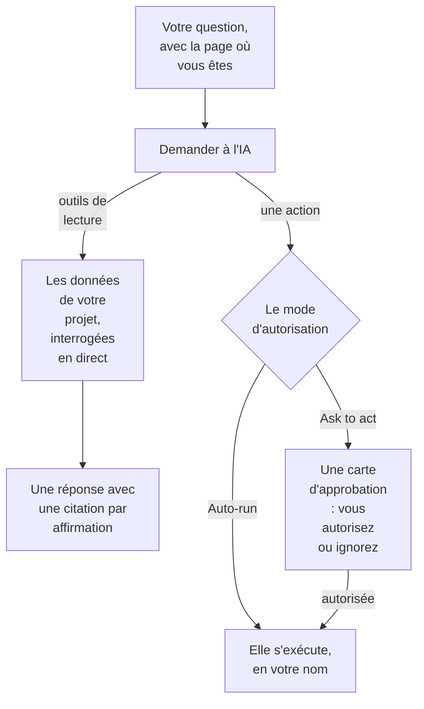

# Demander à l'IA

Demander à l'IA est le chat de OneUptime sur les données de votre projet. Interrogez-le sur les logs, les traces, les métriques, les exceptions, les incidents, les alertes, les moniteurs, l'astreinte, les pages de statut, les SLO, les runbooks ou les flux de travail : il interroge votre projet en direct, appuie chaque affirmation sur une citation et, quand vous l'y autorisez, agit pour vous.

:::cards
- [Ouvrir Demander à l'IA](#ouvrir-demander-à-lia): Depuis l'en-tête, le clavier, un graphique ou le menu des produits.
- [Ce qu'il voit](#ce-quil-voit): Les données qu'il lit pour vous répondre.
- [Actions et modes d'autorisation](#actions-et-modes-dautorisation): Choisissez s'il peut agir, et quand il demande d'abord.
- [Les actions sont faites en votre nom](#les-actions-sont-faites-en-votre-nom): Vos autorisations, votre nom sur chaque changement.
:::

## Comment Demander à l'IA répond

Demander à l'IA ne répond qu'avec ce que renvoient ses outils : il exécute des requêtes sur votre projet au lieu de répondre de mémoire. Chaque fait d'une réponse porte une puce de citation qui montre la requête derrière lui et ouvre les données lues. Quand vous lui demandez de changer quelque chose, le mode d'autorisation de la conversation décide s'il vous demande d'abord. Avant votre question, il lit le [contexte IA](/docs/ai/ai-context) du projet : ce que votre équipe a écrit pour OneUptime AI sur vos propres systèmes.

En mode **Lecture seule**, les actions ne sont jamais proposées au modèle : la conversation ne fait que lire.

## Questions sur OneUptime

Demander à l'IA répond aussi aux questions sur OneUptime lui-même : « Comment recevoir un SMS quand mon site tombe ? », « Qu'est-ce qu'un épisode ? », « Où ajouter un deuxième numéro de téléphone ? ». Ses réponses viennent de cette documentation, la copie que sert votre OneUptime : cela fonctionne sans accès à Internet et n'envoie rien à un nouvel endroit. Il lit une page dans votre langue quand elle est traduite, cite la page et la section de chaque étape, et dit que la documentation ne couvre pas un point plutôt que de deviner.

Une réponse à « comment faire » se termine par un bouton qui ouvre la page de votre projet où vous le faites, comme **Créer un moniteur** ou **Méthodes de notification**. Il n'ouvre que des pages qu'OneUptime possède : celles que trouve la recherche (`Ctrl` + `K`).

## Ouvrir Demander à l'IA

| Où | Comment |
| --- | --- |
| N'importe quelle page | Cliquez sur **Demander à l'IA** dans l'en-tête, ou appuyez sur `Ctrl` + `I` (`Cmd` + `I` sur un Mac). Pendant que vous tapez dans un champ de texte ou un éditeur, ces touches restent le raccourci italique de l'éditeur. |
| La palette de commandes | Appuyez sur `Ctrl` + `K` (`Cmd` + `K` sur un Mac) et choisissez **Demander à l'IA**. |
| Un motif d'erreur des logs, ou les constats d'un graphique | Cliquez sur **Expliquer avec l'IA** : Demander à l'IA s'ouvre avec les éléments comme une question que vous pouvez modifier avant de l'envoyer. |
| Le menu des produits | Ouvrez **Produits → IA → Chat**. Demander à l'IA s'ouvre à côté de la page où vous étiez. Chaque conversation a sa propre adresse : vous pouvez la mettre en favori et y revenir. |

Demander à l'IA s'ouvre sur le côté de la fenêtre, et la page lui fait de la place : rien n'est caché derrière, vous pouvez donc continuer à travailler sur la page, passer à d'autres pages et poser une nouvelle question. Faites glisser son bord pour l'élargir ou le rétrécir. Appuyez sur `Esc` à l'intérieur, ou cliquez à nouveau sur **Demander à l'IA**, pour rendre toute la fenêtre à la page. Quand il est ouvert, `Ctrl` + `I` (`Cmd` + `I` sur un Mac) passe de la page à la zone de saisie, et le ferme depuis celle-ci. La conversation reste où vous l'avez laissée : rouvrez Demander à l'IA pour la poursuivre. Si vous le fermez pendant qu'il répond encore, un rappel dans le coin indique quand la réponse est prête, et l'ouvre. Sur une tablette ou un téléphone, où il n'y a pas de place pour les deux, il s'ouvre par-dessus la page, et occupe tout l'écran sur un téléphone.

Sur un incident ou une alerte, la carte **OneUptime AI** a sa propre conversation, **Demander à OneUptime AI**, partagée avec tous ceux qui voient cet incident ou cette alerte : voir [Parler de l'incident avec OneUptime AI](/docs/ai/ai-sre#parler-de-lincident-avec-oneuptime-ai).

## Ce qu'il voit

Demander à l'IA lit votre projet avec vos propres autorisations : il voit ce que vous pouvez voir, et rien de plus.

| Domaine | Ce que Demander à l'IA lit |
| --- | --- |
| Télémétrie | Recherche et histogrammes de logs, agrégations de traces et arbres de spans, métriques, exceptions, événements de sécurité, real user monitoring et Web Vitals, changements récents, et contrôles d'anomalies par rapport à des références apprises. |
| Infrastructure | Hôtes, Docker, Podman, Kubernetes, Docker Swarm, Proxmox, VMware vCenter, Ceph, baies de stockage, fonctions serverless, environnements cloud, flottes IoT et équipements réseau : ce qui figure dans l'inventaire, leur état de connexion signalé, les tendances des métriques, le nombre de logs par gravité et les résumés des opérations de traces. Une requête couvre aussi bien la télémétrie qui nomme un service que celle qui nomme une ressource d'infrastructure. |
| Réponse aux incidents | Incidents et alertes, avec des filtres d'état (« qu'est-ce qui est actif en ce moment ? »), leurs chronologies d'activité (changements d'état, notes internes et publiques, le fil) et leurs propriétaires, et une recherche dans les incidents passés pour réutiliser leur résolution. |
| Astreinte | Qui est d'astreinte maintenant, les politiques et chaînes d'escalade, et si les derniers appels ont été remis et acquittés. |
| Le travail de l'IA elle-même | Les résultats des investigations d'AI SRE et des AI Insights, pour que « qu'a trouvé l'IA ? » soit répondu à partir de l'analyse publiée au lieu d'être refait. |
| Plateforme | Moniteurs (avec filtres d'état), maintenance planifiée, pages de statut et leurs annonces, SLO, runbooks, exécutions de flux de travail, santé des sondes, équipes, et le code des dépôts connectés sur GitHub, GitLab, Forgejo, Gitea et Azure DevOps (voir [Ce que l'IA lit dans un dépôt Git](/docs/ai/ai-agent#ce-que-lia-lit-dans-un-dépôt-git)). |

## Contexte de la page

Demander à l'IA sait depuis quelle page vous l'avez ouvert. Sur la page d'un incident, « pourquoi est-ce arrivé ? » désigne cet incident : la zone de saisie montre une puce avec le sujet de la page, et les questions qu'il suggère sont celles de cette page. Retirez la puce pour poser une question sur tout le projet, et remettez-la de la même façon. Ouvrez Demander à l'IA sur une autre page et le contexte vous suit. La conversation retient aussi son premier sujet sur le serveur, si bien qu'une relance des jours plus tard comprend toujours « cet incident ».

Sur un incident, une alerte, un moniteur ou un événement de maintenance planifiée, les questions suivent aussi l'état de cet enregistrement, lu chaque fois que Demander à l'IA s'ouvre dessus. Un incident résolu demande comment s'est déroulée la réponse et ce qui empêcherait qu'il se reproduise, une alerte résolue si c'était un vrai problème et à quelle fréquence des alertes comme elle se déclenchent, et un moniteur qui n'est pas opérationnel demande pourquoi. Un événement de maintenance qui n'a pas commencé demande si ses moniteurs sont sains avant son début, et un événement terminé s'ils sont revenus à la normale.

Les listes d'infrastructure et les pages de ressources proposent des questions pour le type de ressource affiché. Ouvrez un cluster Kubernetes et demandez « Quelles métriques ont changé au cours des 24 dernières heures ? », ou ouvrez un hôte Docker et demandez « Résume la gravité des logs et les erreurs de traces des six dernières heures. » Les liens vers les éléments ramènent à la page de la ressource. Les lectures respectent vos autorisations sur le projet, les ressources et la télémétrie, y compris les restrictions par propriétaire et par étiquettes.

Sur la page d'un élément enfant, le contexte enregistre aussi le pod, le conteneur, la VM, le processus ou l'autre élément sélectionné. Les outils d'infrastructure lisent la télémétrie de la ressource parente ; ils ne peuvent pas mesurer un élément enfant à partir de son seul nom. Demander à l'IA le dit, et ne devine pas un namespace Kubernetes que la page n'indique pas. Un état de connexion n'est pas la santé d'une charge de travail, et une télémétrie absente ne signifie pas qu'une ressource va bien.

## Commandes sur votre infrastructure

Ouvert sur la page d'une ressource dont l'agent IA est connecté (un hôte, un hôte Docker ou Podman, un cluster Docker Swarm, un cluster Proxmox, un VMware vCenter, un cluster Ceph, un serveur de base de données ou un cluster Kubernetes), Demander à l'IA y exécute des commandes par cet agent quand vous le demandez : « exécute `uptime` sur cet hôte » ou « affiche les 100 dernières lignes de `journalctl -u nginx` ». Il répond avec ce qui est revenu, cité comme tout autre élément de preuve. Ouvert sur un incident ou une alerte, il atteint les ressources qui y sont liées.

- Il n'exécute que les commandes en lecture seule qu'une investigation IA peut exécuter sur ce type de ressource (voir [Agents IA pour l'infrastructure](/docs/ai/infrastructure-ai-agents)), autant que la réponse en demande, vérifiées par OneUptime puis de nouveau par l'agent, dans tous les modes d'autorisation. Une modification par l'agent, comme le redémarrage d'un service, ne s'exécute jamais depuis Demander à l'IA : il vous donne plutôt la commande exacte, et l'agent n'effectue de modifications que lorsque OneUptime AI remédie à un incident ou à une alerte, selon les propres réglages de correctifs de la ressource. Les actions propres à Demander à l'IA, comme l'exécution d'un runbook, suivent le mode d'autorisation de la conversation, décrit plus bas.
- Il n'atteint que les ressources que vous pouvez voir, et seulement tant que l'investigation IA est activée pour la ressource.
- Quand il ne peut pas y exécuter de commande (aucun agent n'est connecté, l'agent est hors ligne, ou l'investigation IA est désactivée pour la ressource), il le dit, avec ce qu'il faut changer, et répond plutôt à partir des données de votre projet.

## Actions et modes d'autorisation

Chaque conversation a un mode d'autorisation, que vous choisissez dans la zone de saisie, à côté du champ où vous tapez :

| Mode | Ce qui se passe |
| --- | --- |
| **Demander avant d'agir** | Le mode par défaut. Demander à l'IA propose chaque action sur une carte d'approbation, et rien ne s'exécute tant que vous n'avez pas choisi **Autoriser** ou **Ignorer** pour elle, ou **Tout refuser**. |
| **Exécution automatique** | Les actions s'exécutent dès que le modèle les demande, toujours dans les limites de votre rôle. À utiliser avec prudence. |
| **Lecture seule** | Les actions ne sont pas du tout proposées au modèle : Demander à l'IA peut seulement lire. |

Ce que Demander à l'IA peut faire quand un mode le permet :

- Créer un incident ou une alerte, acquitter ou résoudre des incidents et des alertes, et changer la gravité d'un incident.
- Lier un incident ou une alerte à l'infrastructure et aux services qu'il concerne. Un incident ou une alerte qu'il crée sur la page d'une ressource, comme celle d'un hôte, est lié à cette ressource, et la carte d'approbation indique ce que chaque action lie. OneUptime AI enquête sur ce à quoi un incident ou une alerte est lié, et le corrige.
- Consigner un problème dont quelqu'un s'occupe déjà, ou qui est déjà terminé : un incident ou une alerte qu'il crée peut commencer déjà pris en compte ou résolu, et n'alerte alors personne. La carte d'approbation indique lequel. Voir [Déclaré déjà pris en compte ou résolu](/docs/incidents/declaring-incidents#déclaré-déjà-pris-en-compte-ou-résolu).
- Publier une note interne sur un incident ou une alerte. Les notes internes n'apparaissent jamais sur une page de statut.
- Publier une mise à jour de statut publique sur un incident. C'est une action distincte, car elle prévient les abonnés de la page de statut.
- Appeler une politique d'astreinte, exécuter un runbook ou lancer une investigation IA d'un incident ou d'une alerte.
- Tout mettre en place à partir d'une phrase : un moniteur de site web ou d'API, qui est appelé, une page de statut et les moniteurs qu'elle affiche, le tout sur une seule carte d'approbation. Voir [Tout mettre en place](#tout-mettre-en-place).
- Proposer un changement de code : committer sur une nouvelle branche d'un dépôt sur GitHub, GitLab, Forgejo ou Gitea et ouvrir une pull request (une demande de fusion sur GitLab). Il n'écrit jamais sur la branche par défaut ni sur une branche protégée, si bien qu'une personne fusionne toujours le changement. Ask AI écrit chaque fichier en entier, à partir du fichier tel qu'il l'a lu en dernier, et lit la branche principale d'un dépôt, sauf si on lui en demande une autre. Si un fichier a changé sur la branche après qu'Ask AI l'a lu, la carte le nomme avant que vous n'approuviez le commit ou la pull request, par exemple « Ce fichier a changé sur fix/login après que l'IA l'a lu, et la version de l'IA annule ce changement : src/billing/charge.ts. » Elle nomme aussi un fichier qu'Ask AI n'a lu que sur une autre branche, où il est différent, un fichier qu'Ask AI n'a jamais lu mais remplace, et un fichier que OneUptime n'a pas pu vérifier. Ask AI lit un long fichier par morceaux, si bien que la carte nomme aussi un fichier qu'Ask AI n'a lu qu'en partie, par exemple « L'IA n'a lu qu'une partie de ce fichier, et sa version le remplace en entier : src/billing/charge.ts. » Une fois qu'Ask AI a lu tout le fichier, en une lecture ou en plusieurs, la carte n'en dit rien. Une réponse ultérieure a les mots des précédentes, pas les fichiers qu'elles ont lus, si bien que la carte nomme aussi un fichier qu'Ask AI n'a lu que dans une réponse précédente, par exemple « L'IA a lu ce fichier dans une réponse précédente et n'en a plus le texte, et sa version le remplace en entier : src/billing/charge.ts. » Une très longue réponse laisse aussi de côté ses résultats les plus anciens, pour rester dans ce que le modèle peut prendre en compte d'un coup, si bien que la carte nomme aussi un fichier qu'Ask AI a lu plus tôt dans la même réponse si ce résultat a été laissé de côté, par exemple « L'IA a lu ce fichier plus tôt dans cette réponse et n'en a plus le texte, et sa version le remplace en entier : src/billing/charge.ts. » Si Ask AI a lu le fichier en plusieurs parties et ne les a plus toutes, la carte le dit aussi, par exemple « L'IA a lu ce fichier et n'en a plus une partie du texte, et sa version le remplace en entier : src/billing/charge.ts. » Une fois qu'Ask AI a relu le fichier dans la réponse qui le modifie, la carte n'en dit rien. Un nouveau fichier ne compte jamais. Pour conserver ce que quelqu'un d'autre a changé, ignorez l'action et demandez à Ask AI de relire les fichiers. En Exécution automatique, où personne n'approuve les actions, Ask AI n'effectue pas une telle modification : il relit les fichiers et apporte sa modification aux fichiers tels qu'ils sont maintenant. Si un fichier change pendant que la carte vous attend, l'approuver ne change rien, et Ask AI propose de nouveau la modification. Une pull request que vous approuvez malgré tout cite ces fichiers dans sa description, pour la personne qui la relit. Ask AI ne voit jamais les valeurs qui ressemblent à des secrets ou à des données personnelles, comme les adresses IP, les adresses e-mail et les clés : il lit à leur place un espace réservé comme `[redacted-ip]`. La carte nomme donc aussi un fichier dans lequel la version d'Ask AI écrit de tels espaces réservés, par exemple « Des valeurs qui ressemblent à des secrets ou à des données personnelles ont été masquées à l'IA, et sa version de ce fichier écrit des espaces réservés à leur place : config/servers.ts. » Un espace réservé que le fichier de la branche contient déjà ne compte pas. Ask AI ne peut pas réécrire ces valeurs, donc en Exécution automatique il n'effectue pas cette modification et vous dit plutôt quoi changer.

Demandez un incident quand des utilisateurs sont touchés, et une alerte quand quelque chose demande d'abord l'attention de votre équipe, comme la mémoire d'un hôte qui ne cesse de grimper. L'un comme l'autre est créé une fois et ne surveille rien : pour être alerté chaque fois que la mémoire d'un hôte dépasse 75 %, créez un [moniteur d'hôte](/docs/monitor/host-monitor#modèles-dalerte-prêts-à-lemploi) à partir de son modèle de mémoire, avec 75 % comme seuil. Demander à l'IA ne met en place que des moniteurs de site web et d'API (voir [Tout mettre en place](#tout-mettre-en-place)). Quand on lui en demande d'un autre type, il le dit, vérifie la valeur actuelle et propose de lever une alerte si elle est déjà dépassée.

## Les actions sont faites en votre nom

Chaque action de Demander à l'IA est faite en votre nom : il fait le même changement que le tableau de bord pour la même action, avec vos propres autorisations dans le projet, et le changement vous est attribué. Acquitter un incident depuis le chat crée le même changement d'état que le panneau d'état de l'incident, si bien que la chronologie et le fil de l'incident montrent que vous avez changé son état. Un appel envoyé depuis le chat vous montre comme celui qui l'a déclenché.

- **Ce dont chaque action a besoin.** L'autorisation que le tableau de bord demande pour le même changement. Créer un incident ou une alerte demande l'autorisation d'en créer : un rôle qui le peut, ou **Create Incident** ou **Create Alert** dans un rôle personnalisé. Acquitter ou résoudre un incident demande l'autorisation de changer son état : **Propriétaire du projet**, **Administrateur du projet**, **Membre du projet**, **Administrateur des incidents** et **Membre des incidents**, ou **Create Incident State Timeline** dans un rôle personnalisé ; une alerte demande la même autorisation pour les alertes (**Create Alert State Timeline**). Créer un incident ou une alerte qui commence déjà pris en compte ou résolu demande les deux : l'autorisation de le créer, et celle de changer son état. Appeler une politique d'astreinte demande l'autorisation de l'exécuter (**Execute On-Call Policies**), et exécuter un runbook demande l'autorisation de lancer des exécutions de runbooks : un rôle qui exécute des runbooks, pour les runbooks qu'atteignent ses étiquettes, ou **Create Runbook Execution** dans un rôle personnalisé, qui atteint tous les runbooks du projet. Changer la gravité d'un incident, lancer une investigation IA d'un incident ou d'une alerte et écrire du code dans un dépôt connecté demande l'autorisation de modifier cet incident, cette alerte ou ce dépôt. Une action que vous n'avez pas le droit de faire est refusée, et l'IA vous dit quelle autorisation il faut. Si vous avez l'autorisation mais qu'une équipe dont vous faites partie la bloque, l'IA vous le dit : un blocage sur certaines étiquettes refuse cette action dans Demander à l'IA pour tous les enregistrements, pas seulement pour ceux qui portent ces étiquettes.
- **Quels enregistrements.** Ceux que vous pouvez modifier, comme partout dans OneUptime : avec un rôle limité à certaines étiquettes, ou aux enregistrements dont vous êtes propriétaire, une action sur tout autre enregistrement ne change rien. Un runbook ne s'exécute que si votre autorisation de lancer des exécutions de runbooks l'atteint. Sur OneUptime Cloud, une action que l'offre du projet n'inclut pas est refusée avec l'offre nécessaire.
- **Quand une action est refusée.** Rien ne change, et l'IA vous dit clairement que l'action n'a pas été faite, et pourquoi, au lieu de réessayer. Parmi les étapes de la réponse, celle de l'action indique qu'elle n'a pas été faite, et pourquoi : votre rôle ne le permet pas, une équipe dont vous faites partie le bloque, ou l'offre du projet ne l'inclut pas.
- **Slack, Microsoft Teams et les investigations IA.** Les réponses de l'IA dans Slack et Microsoft Teams, et les investigations IA autonomes, ne font que lire : elles ne font aucune de ces actions. Si vous lui demandez un changement, l'IA vous dit comment le faire depuis le chat : `/oneuptime incident` déclare un incident, `/oneuptime incident 42` affiche l'incident 42 avec ses boutons, `/oneuptime page` alerte quelqu'un (dans Microsoft Teams, les mêmes mots adressés au bot OneUptime), et les boutons des messages de OneUptime agissent aussi en votre nom (voir [Slack](/docs/workspace-connections/slack#agir-sur-les-incidents-alertes-et-événements-depuis-slack) et [Microsoft Teams](/docs/workspace-connections/microsoft-teams#agir-sur-les-incidents-alertes-et-événements-depuis-microsoft-teams)). Pour tout autre changement, elle renvoie vers Demander à l'IA, qui propose le changement pour que vous l'approuviez. Interrogée dans le canal propre d'un incident ou d'une alerte, elle comprend que vous parlez de cet incident ou de cette alerte.

## Tout mettre en place

Demander à l'IA met en place, à partir d'une phrase, ce que mettent en place les configurations guidées : « Surveille example.com chaque minute et envoie-moi un SMS s'il est en panne. »

- **Un plan, une approbation.** Demander à l'IA propose chaque partie sur une seule carte d'approbation, chacune en termes simples : un moniteur de site web ou d'API, la première politique d'astreinte du projet, une page de statut et les moniteurs qu'elle affiche. La carte se termine par « Rien d'autre ne change. » Choisissez **Ignorer** sur toute partie dont vous ne voulez pas, puis exécutez le reste. Rien n'est créé avant.
- **Toujours demandé.** La mise en place attend votre approbation dans tous les modes, **Exécution automatique** compris, car elle crée ce qui appelle des personnes et ce que voient vos clients. **Lecture seule** ne la propose pas.
- **Les enregistrements des configurations guidées.** Le moniteur est celui que **Savoir quand mon site web ou mon API est en panne** crée pour la même adresse : les valeurs par défaut de Créer un moniteur, qui ouvre un incident quand l'adresse ne répond pas ou répond par une erreur, vérifié toutes les 5 minutes sauf si vous demandez un autre des intervalles de Créer un moniteur. Il vous appartient, donc vous recevez un e-mail quand son statut change. La page de statut est celle que **Publiez une page de statut** crée : publique dès sa création, elle affiche le statut, la disponibilité et l'historique de chaque moniteur.
- **Qui est appelé.** Dans un projet qui n'appelle encore personne, Demander à l'IA propose la première politique d'astreinte du projet, « Default on-call policy », qui vous appelle, ainsi que les membres et équipes que vous nommez, pour chaque nouvel incident et chaque nouvelle alerte. Un projet qui appelle déjà des personnes garde ses propres politiques et règles d'astreinte, et Demander à l'IA le dit au lieu d'en créer une autre.
- **Ce qui manque.** Demander à l'IA n'ajoute jamais de numéro de téléphone ni l'application mobile : vous les ajoutez et les vérifiez dans **Paramètres utilisateur → Méthodes de notification**. Si vous demandez à recevoir des SMS sans numéro vérifié, la carte le dit et la réponse renvoie vers la page. Une partie que Demander à l'IA ne peut pas créer n'est pas proposée, par exemple quand votre rôle ne le permet pas, que l'adresse n'en est pas une ou que les moniteurs n'existent pas : la réponse dit ce qu'il faut.
- **Ce dont chaque partie a besoin.** Un moniteur nécessite l'autorisation de créer des moniteurs. L'appel nécessite l'autorisation de créer des politiques d'astreinte, leurs règles d'escalade, et des règles d'astreinte d'incident et d'alerte. Une page de statut nécessite l'autorisation de créer des pages de statut et d'y ajouter des moniteurs. Les limites du forfait du projet s'appliquent, comme dans les configurations guidées.
- **Ensuite, testez.** Une fois le plan exécuté, chaque carte ouvre ce qui a été créé, et **Tester cette politique** (ou **M'envoyer un appel de test**, pour un moniteur seul) sous la réponse envoie un appel de test que vous accusez depuis le message. Si une partie échoue, la réponse dit ce qui a été créé et ce qui ne l'a pas été.
- **Qui est prévenu.** Demandez « qui est prévenu quand example.com tombe en panne ? » et Demander à l'IA répond à partir de la même chaîne que celle affichée sur la page du moniteur, en nommant chaque rupture.

## Piloter une conversation

- **Arrêtez-le.** Pendant que Demander à l'IA travaille, le bouton d'envoi devient un bouton d'arrêt. Arrêtez une exécution à tout moment et posez aussitôt une autre question.
- **Suivez son travail.** Pendant qu'il répond, une ligne dit ce qu'il fait en ce moment, par exemple chercher dans les journaux. Cliquez sur le nombre d'étapes à côté pour voir chaque étape.
- **Choisissez le modèle.** Quand votre projet peut utiliser plus d'un fournisseur LLM, le sélecteur de fournisseur de la zone de saisie liste les fournisseurs LLM de votre projet et les fournisseurs globaux, avec celui par défaut marqué. Une nouvelle conversation utilise celui par défaut.
- **Notez une réponse.** **Bonne réponse** et **Mauvaise réponse** sont enregistrés avec le message, pour mesurer la qualité des réponses dans le temps.
- **Voyez le coût.** Sous chaque réponse, ses sources s'ouvrent sur les requêtes qu'elle a exécutées, et celles de la réponse la plus récente indiquent aussi combien de requêtes elle a exécutées, ses tokens et son coût. Chaque puce de citation d'une réponse ouvre les données derrière elle.
- **Gardez une copie.** **Télécharger la conversation** enregistre le fil avec **Télécharger en Markdown**, pour le lire ou le coller dans un ticket, ou **Télécharger en PDF**, pour le transmettre.
- **Reprenez où vous en étiez.** **Toutes les conversations**, dans l'en-tête de Demander à l'IA, liste vos conversations, de la plus récente à la plus ancienne, pour les rouvrir ou les supprimer. Le début d'une nouvelle conversation montre les trois dernières.

## Prérequis

- **Un fournisseur LLM.** Demander à l'IA utilise le fournisseur LLM par défaut du projet (voir [Fournisseurs LLM](/docs/ai/llm-provider)). Sur OneUptime Cloud, il fonctionne d'emblée avec le fournisseur global, payé sur les crédits IA du projet ; une installation auto-hébergée configure un fournisseur, ou les variables d'environnement du fournisseur global. Les réponses ne valent que ce que vaut le modèle : un petit modèle auto-hébergé sans appels d'outils fiables répond mal.
- **L'offre Growth, sur OneUptime Cloud.** Un projet sur une offre inférieure voit que l'IA n'est pas incluse dans son offre, avec un lien vers **Paramètres du projet → Facturation et factures → Facturation**.
- **L'IA activée pour le projet.** **Activer l'IA**, sur **Paramètres du projet → IA → Fonctionnalités IA**, coupe toutes les fonctionnalités IA du projet, Demander à l'IA compris. Elle est activée sauf si quelqu'un l'a coupée.

Demander à l'IA compte dans les limites quotidiennes d'IA propres au projet quand le projet les définit (Paramètres du projet → IA → Fonctionnalités IA → Plus de paramètres) : quand l'une est atteinte, Demander à l'IA affiche une phrase qui dit quelle limite est atteinte, que OneUptime AI reprend à minuit UTC et qui peut relever ou supprimer la limite. Les propriétaires du projet reçoivent un e-mail la première fois qu'une limite est atteinte chaque jour. Les limites quotidiennes des incidents et des alertes n'arrêtent jamais Demander à l'IA. Voir [les limites quotidiennes propres au projet](/docs/ai/ai-sre#les-limites-quotidiennes-propres-au-projet).

## Dépannage

:::details Demander à l'IA dit que l'IA n'est pas disponible
Demander à l'IA dit pourquoi avant que vous ne tapiez : l'offre du projet n'inclut pas l'IA, **Activer l'IA** est coupé, ou le projet n'a aucun fournisseur LLM. Chaque avis renvoie à la page où cela se change.
:::

:::details Une action a été refusée
Demander à l'IA dit quelle autorisation l'action demande, ou quelle équipe la bloque. Demandez à quelqu'un qui peut faire le changement, ou demandez à un propriétaire du projet de donner l'autorisation à votre rôle. Rien n'a été modifié.
:::

:::details Les réponses sont vagues ou n'utilisent jamais de données
Vérifiez le modèle derrière le fournisseur. Demander à l'IA a besoin d'un modèle qui appelle des outils de façon fiable ; les petits modèles locaux répondent souvent sans exécuter une seule requête. Voir [Fournisseurs LLM](/docs/ai/llm-provider).
:::

## Étapes suivantes

:::cards
- [AI SRE](/docs/ai/ai-sre): Laissez OneUptime AI investiguer chaque nouvel incident et chaque nouvelle alerte.
- [Fournisseurs LLM](/docs/ai/llm-provider): Choisissez le modèle qu'utilisent Demander à l'IA et les autres fonctionnalités IA.
- [Serveur MCP](/docs/ai/mcp-server): Interrogez OneUptime depuis Claude, Cursor ou VS Code à la place.
:::
