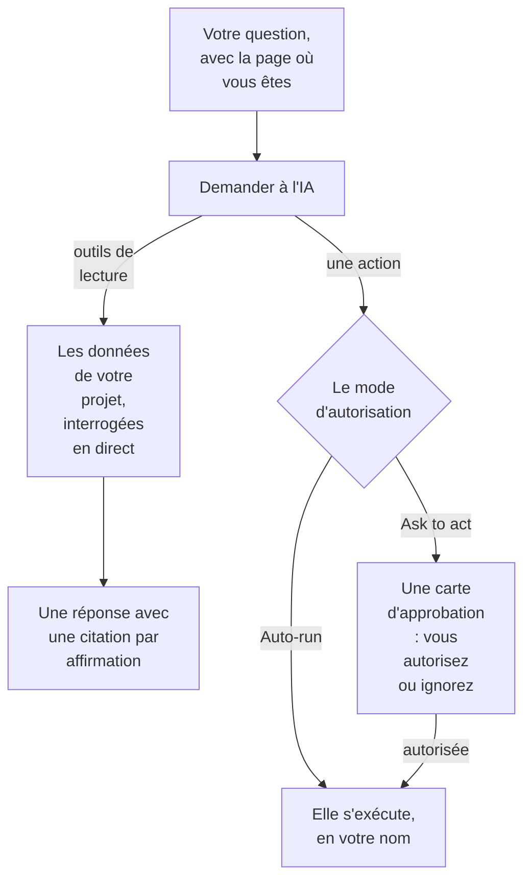

# Demander à l'IA

Demander à l'IA est le chat de OneUptime sur les données de votre projet. Interrogez-le sur les logs, les traces, les métriques, les exceptions, les incidents, les alertes, les moniteurs, l'astreinte, les pages de statut, les SLO, les runbooks ou les flux de travail : il interroge votre projet en direct, appuie chaque affirmation sur une citation et, quand vous l'y autorisez, agit pour vous.

:::cards
- [Ouvrir Demander à l'IA](#ouvrir-demander-à-lia): Depuis l'en-tête, le clavier, un graphique ou sa propre page.
- [Ce qu'il voit](#ce-quil-voit): Les données qu'il lit pour vous répondre.
- [Actions et modes d'autorisation](#actions-et-modes-dautorisation): Choisissez s'il peut agir, et quand il demande d'abord.
- [Les actions sont faites en votre nom](#les-actions-sont-faites-en-votre-nom): Vos autorisations, votre nom sur chaque changement.
:::

## Comment Demander à l'IA répond

Demander à l'IA ne répond qu'avec ce que renvoient ses outils : il exécute des requêtes sur votre projet au lieu de répondre de mémoire. Chaque fait d'une réponse porte une puce de citation qui montre la requête derrière lui et ouvre les données lues. Quand vous lui demandez de changer quelque chose, le mode d'autorisation de la conversation décide s'il vous demande d'abord. Avant votre question, il lit le [contexte IA](/docs/ai/ai-context) du projet : ce que votre équipe a écrit pour OneUptime AI sur vos propres systèmes.

En mode **Lecture seule**, les actions ne sont jamais proposées au modèle : la conversation ne fait que lire.

## Ouvrir Demander à l'IA

| Où | Comment |
| --- | --- |
| N'importe quelle page | Cliquez sur **Demander à l'IA** dans l'en-tête, ou appuyez sur `Ctrl` + `I` (`Cmd` + `I` sur un Mac). Pendant que vous tapez dans un champ de texte ou un éditeur, ces touches restent le raccourci italique de l'éditeur. |
| La palette de commandes | Appuyez sur `Ctrl` + `K` (`Cmd` + `K` sur un Mac) et choisissez **Demander à l'IA**. |
| Un motif d'erreur des logs, ou les constats d'un graphique | Cliquez sur **Explain with AI** : Demander à l'IA s'ouvre avec les éléments comme une question que vous pouvez modifier avant de l'envoyer. |
| Sa propre page | Ouvrez **Produits → AI → Chat** pour un espace de travail en pleine page. Chaque conversation y a sa propre adresse : vous pouvez mettre un fil en favori ou le coller dans le canal d'un incident. |

Sur un incident ou une alerte, la carte **Investigation IA** a sa propre conversation, **Ask OneUptime AI**, partagée avec tous ceux qui voient cet incident ou cette alerte : voir [Parler de l'incident avec OneUptime AI](/docs/ai/ai-sre#parler-de-lincident-avec-oneuptime-ai).

## Ce qu'il voit

Demander à l'IA lit votre projet avec vos propres autorisations : il voit ce que vous pouvez voir, et rien de plus.

| Domaine | Ce que Demander à l'IA lit |
| --- | --- |
| Télémétrie | Recherche et histogrammes de logs, agrégations de traces et arbres de spans, métriques, exceptions, événements de sécurité, real user monitoring et Web Vitals, changements récents, et contrôles d'anomalies par rapport à des références apprises. |
| Infrastructure | Hôtes, Docker, Podman, Kubernetes, Docker Swarm, Proxmox, VMware vCenter, Ceph, baies de stockage, fonctions serverless, environnements cloud, flottes IoT et équipements réseau : ce qui figure dans l'inventaire, leur état de connexion signalé, les tendances des métriques, le nombre de logs par gravité et les résumés des opérations de traces. Une requête couvre aussi bien la télémétrie qui nomme un service que celle qui nomme une ressource d'infrastructure. |
| Réponse aux incidents | Incidents et alertes, avec des filtres d'état (« qu'est-ce qui est actif en ce moment ? »), leurs chronologies d'activité (changements d'état, notes internes et publiques, le fil) et leurs propriétaires, et une recherche dans les incidents passés pour réutiliser leur résolution. |
| Astreinte | Qui est d'astreinte maintenant, les politiques et chaînes d'escalade, et si les derniers appels ont été remis et acquittés. |
| Le travail de l'IA elle-même | Les résultats des investigations d'AI SRE et des AI Insights, pour que « qu'a trouvé l'IA ? » soit répondu à partir de l'analyse publiée au lieu d'être refait. |
| Plateforme | Moniteurs (avec filtres d'état), maintenance planifiée, pages de statut et leurs annonces, SLO, runbooks, exécutions de flux de travail, santé des sondes, équipes, et le code des dépôts connectés. |

## Contexte de la page

Demander à l'IA sait depuis quelle page vous l'avez ouvert. Sur la page d'un incident, « pourquoi est-ce arrivé ? » désigne cet incident, et la zone de saisie montre une puce avec le sujet de la page ; retirez-la pour poser une question sur tout le projet. Si vous changez de page pendant que le panneau est ouvert, le contexte vous suit. La conversation retient aussi son premier sujet sur le serveur, si bien qu'une relance des jours plus tard comprend toujours « cet incident ».

Les listes d'infrastructure et les pages de ressources proposent des questions pour le type de ressource affiché. Ouvrez un cluster Kubernetes et demandez « Quelles métriques ont changé au cours des 24 dernières heures ? », ou ouvrez un hôte Docker et demandez « Résume la gravité des logs et les erreurs de traces des six dernières heures. » Les liens vers les éléments ramènent à la page de la ressource. Les lectures respectent vos autorisations sur le projet, les ressources et la télémétrie, y compris les restrictions par propriétaire et par étiquettes.

Sur la page d'un élément enfant, le contexte enregistre aussi le pod, le conteneur, la VM, le processus ou l'autre élément sélectionné. Les outils d'infrastructure lisent la télémétrie de la ressource parente ; ils ne peuvent pas mesurer un élément enfant à partir de son seul nom. Demander à l'IA le dit, et ne devine pas un namespace Kubernetes que la page n'indique pas. Un état de connexion n'est pas la santé d'une charge de travail, et une télémétrie absente ne signifie pas qu'une ressource va bien.

## Actions et modes d'autorisation

Chaque conversation a un mode d'autorisation, que vous choisissez dans la zone de saisie, à côté du champ où vous tapez :

| Mode | Ce qui se passe |
| --- | --- |
| **Ask to act** | Le mode par défaut. Demander à l'IA propose chaque action sur une carte d'approbation, et rien ne s'exécute tant que vous n'avez pas choisi **Autoriser** ou **Ignorer** pour elle, ou **Tout refuser**. |
| **Auto-run** | Les actions s'exécutent dès que le modèle les demande, toujours dans les limites de votre rôle. À utiliser avec prudence. |
| **Lecture seule** | Les actions ne sont pas du tout proposées au modèle : Demander à l'IA peut seulement lire. |

Ce que Demander à l'IA peut faire quand un mode le permet :

- Créer un incident, acquitter ou résoudre des incidents et des alertes, et changer la gravité d'un incident.
- Publier une note interne sur un incident ou une alerte. Les notes internes n'apparaissent jamais sur une page de statut.
- Publier une mise à jour de statut publique sur un incident. C'est une action distincte, car elle prévient les abonnés de la page de statut.
- Appeler une politique d'astreinte, exécuter un runbook ou lancer une investigation IA d'un incident ou d'une alerte.
- Proposer un changement de code : committer sur une nouvelle branche d'un dépôt connecté et ouvrir une pull request. Il n'écrit jamais sur la branche par défaut ni sur une branche protégée, si bien qu'une personne fusionne toujours le changement.

## Les actions sont faites en votre nom

Chaque action de Demander à l'IA est faite en votre nom : il fait le même changement que le tableau de bord pour la même action, avec vos propres autorisations dans le projet, et le changement vous est attribué. Acquitter un incident depuis le chat crée le même changement d'état que le panneau d'état de l'incident, si bien que la chronologie et le fil de l'incident montrent que vous avez changé son état. Un appel envoyé depuis le chat vous montre comme celui qui l'a déclenché.

- **Ce dont chaque action a besoin.** L'autorisation que le tableau de bord demande pour le même changement. Acquitter ou résoudre un incident demande l'autorisation de changer son état : **Project Owner**, **Project Admin**, **Project Member**, **Incident Admin** et **Incident Member**, ou **Create Incident State Timeline** dans un rôle personnalisé ; une alerte demande la même autorisation pour les alertes (**Create Alert State Timeline**). Appeler une politique d'astreinte demande l'autorisation de l'exécuter (**Create On-Call Duty Policy Execution Log**), et exécuter un runbook demande l'autorisation de lancer des exécutions de runbooks : un rôle qui exécute des runbooks, pour les runbooks qu'atteignent ses étiquettes, ou **Create Runbook Execution** dans un rôle personnalisé, qui atteint tous les runbooks du projet. Changer la gravité d'un incident, lancer une investigation IA d'un incident ou d'une alerte et écrire du code dans un dépôt connecté demande l'autorisation de modifier cet incident, cette alerte ou ce dépôt. Une action que vous n'avez pas le droit de faire est refusée, et l'IA vous dit quelle autorisation il faut. Si vous avez l'autorisation mais qu'une équipe dont vous faites partie la bloque, l'IA vous le dit : un blocage sur certaines étiquettes refuse cette action dans Demander à l'IA pour tous les enregistrements, pas seulement pour ceux qui portent ces étiquettes.
- **Quels enregistrements.** Ceux que vous pouvez modifier, comme partout dans OneUptime : avec un rôle limité à certaines étiquettes, ou aux enregistrements dont vous êtes propriétaire, une action sur tout autre enregistrement ne change rien. Un runbook ne s'exécute que si votre autorisation de lancer des exécutions de runbooks l'atteint. Sur OneUptime Cloud, une action que l'offre du projet n'inclut pas est refusée avec l'offre nécessaire.
- **Quand une action est refusée.** Rien ne change, et l'IA vous dit clairement que l'action n'a pas été faite, et pourquoi, au lieu de réessayer.
- **Slack, Microsoft Teams et les investigations IA.** Les réponses de l'IA dans Slack et Microsoft Teams, et les investigations IA autonomes, ne font que lire : elles ne font aucune de ces actions. Pour agir depuis Slack ou Microsoft Teams, utilisez les boutons des messages de OneUptime, qui agissent aussi en votre nom (voir [Slack](/docs/workspace-connections/slack#agir-sur-les-incidents-alertes-et-événements-depuis-slack) et [Microsoft Teams](/docs/workspace-connections/microsoft-teams#agir-sur-les-incidents-alertes-et-événements-depuis-microsoft-teams)).

## Piloter une conversation

- **Arrêtez-le.** Pendant que Demander à l'IA travaille, le bouton d'envoi devient un bouton d'arrêt. Arrêtez une exécution à tout moment et posez aussitôt une autre question.
- **Choisissez le modèle.** Le sélecteur de fournisseur de la zone de saisie liste les fournisseurs LLM de votre projet et les fournisseurs globaux, avec celui par défaut marqué. Une nouvelle conversation utilise celui par défaut.
- **Notez une réponse.** **Bonne réponse** et **Poor answer** sont enregistrés avec le message, pour mesurer la qualité des réponses dans le temps.
- **Voyez le coût.** Le pied de la réponse la plus récente montre son coût, ses tokens et le nombre de requêtes exécutées, et chaque requête est une puce de citation qui ouvre les données derrière elle.
- **Gardez une copie.** **Télécharger la conversation** enregistre le fil avec **Télécharger en Markdown**, pour le lire ou le coller dans un ticket, ou **Télécharger en PDF**, pour le transmettre.

## Prérequis

- **Un fournisseur LLM.** Demander à l'IA utilise le fournisseur LLM par défaut du projet (voir [Fournisseurs LLM](/docs/ai/llm-provider)). Sur OneUptime Cloud, il fonctionne d'emblée avec le fournisseur global, payé sur les crédits IA du projet ; une installation auto-hébergée configure un fournisseur, ou les variables d'environnement du fournisseur global. Les réponses ne valent que ce que vaut le modèle : un petit modèle auto-hébergé sans appels d'outils fiables répond mal.
- **L'offre Growth, sur OneUptime Cloud.** Un projet sur une offre inférieure voit que l'IA n'est pas incluse dans son offre, avec un lien vers **Paramètres du projet → Facturation et factures → Facturation**.
- **L'IA activée pour le projet.** **Activer l'IA**, sur **Paramètres du projet → IA → Fonctionnalités IA**, coupe toutes les fonctionnalités IA du projet, Demander à l'IA compris. Elle est activée sauf si quelqu'un l'a coupée.

Demander à l'IA compte dans les limites quotidiennes d'IA propres au projet quand le projet les définit (Paramètres du projet → IA → Fonctionnalités IA → Plus de paramètres) : quand l'une est atteinte, Demander à l'IA affiche une phrase qui dit quelle limite est atteinte, que OneUptime AI reprend à minuit UTC et qui peut relever ou supprimer la limite. Les propriétaires du projet reçoivent un e-mail la première fois qu'une limite est atteinte chaque jour. Les limites quotidiennes des incidents et des alertes n'arrêtent jamais Demander à l'IA. Voir [les limites quotidiennes propres au projet](/docs/ai/ai-sre#les-limites-quotidiennes-propres-au-projet).

## Dépannage

:::details Demander à l'IA dit que l'IA n'est pas disponible
Le panneau dit pourquoi avant que vous ne tapiez : l'offre du projet n'inclut pas l'IA, **Activer l'IA** est coupé, ou le projet n'a aucun fournisseur LLM. Chaque avis renvoie à la page où cela se change.
:::

:::details Une action a été refusée
Demander à l'IA dit quelle autorisation l'action demande, ou quelle équipe la bloque. Demandez à quelqu'un qui peut faire le changement, ou demandez à un propriétaire du projet de donner l'autorisation à votre rôle. Rien n'a été modifié.
:::

:::details Les réponses sont vagues ou n'utilisent jamais de données
Vérifiez le modèle derrière le fournisseur. Demander à l'IA a besoin d'un modèle qui appelle des outils de façon fiable ; les petits modèles locaux répondent souvent sans exécuter une seule requête. Voir [Fournisseurs LLM](/docs/ai/llm-provider).
:::

## Étapes suivantes

:::cards
- [AI SRE](/docs/ai/ai-sre): Laissez OneUptime AI investiguer chaque nouvel incident et chaque nouvelle alerte.
- [Fournisseurs LLM](/docs/ai/llm-provider): Choisissez le modèle qu'utilisent Demander à l'IA et les autres fonctionnalités IA.
- [Serveur MCP](/docs/ai/mcp-server): Interrogez OneUptime depuis Claude, Cursor ou VS Code à la place.
:::
