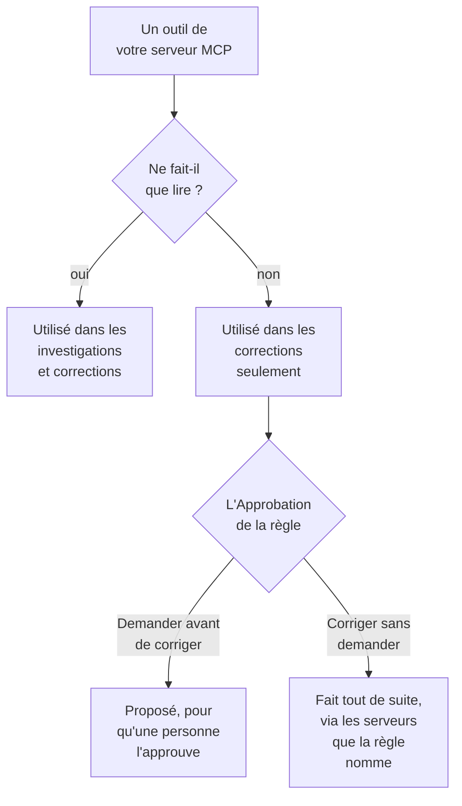

# Serveurs MCP externes

OneUptime AI peut utiliser les outils de serveurs MCP hors de OneUptime — ceux de votre cloud, de votre hébergeur de code ou de votre propre équipe, comme AWS, Azure ou GitHub — pendant qu'il investigue et corrige les incidents et les alertes. Ajoutez un serveur une fois dans **Paramètres du projet → IA → Serveurs MCP externes**, et OneUptime AI l'utilise dès l'incident suivant.

:::cards
- [Ajouter un serveur](#ajouter-un-serveur): Son adresse, et comment OneUptime s'y connecte.
- [Ce que OneUptime AI fait d'un serveur](#ce-que-oneuptime-ai-fait-dun-serveur): Les outils qui lisent dans les investigations, les autres dans les corrections.
- [Choisir les serveurs qu'une règle peut utiliser](#choisir-les-serveurs-quune-règle-peut-utiliser): Tous, sauf si une règle en choisit certains.
- [Sécurité](#sécurité): Ce qu'un serveur peut et ne peut pas faire faire à OneUptime AI.
:::

Cette page traite des serveurs auxquels OneUptime AI se connecte. Pour connecter plutôt un assistant IA comme Claude ou Cursor à OneUptime, voir [Serveur MCP](/docs/ai/mcp-server).

## Avant de commencer

- **OneUptime AI est activé** pour le projet, avec un fournisseur LLM qu'il peut utiliser : voir [Fournisseurs LLM](/docs/ai/llm-provider).
- **L'adresse MCP du serveur.** Streamable HTTP et l'ancien HTTP avec SSE fonctionnent tous les deux : OneUptime détecte lequel le serveur parle lors de la connexion.
- **Comment OneUptime s'y connecte :** un jeton d'API, des en-têtes propres au serveur, ou des identifiants client OAuth de votre fournisseur d'identité.
- **Un Project Owner ou un Project Admin** ajoute, modifie, teste et supprime les serveurs ; les Project Members et les Viewers peuvent les voir. Sur OneUptime Cloud, ajouter un serveur demande l'offre Growth ou supérieure.

## Ajouter un serveur

:::steps
### Ouvrir Serveurs MCP externes
Allez dans **Paramètres du projet → IA → Serveurs MCP externes** et cliquez sur **Créer : Serveur MCP externe**.

### Dire où il se trouve
Donnez-lui un **Nom**, celui sous lequel OneUptime AI et les personnes qui lisent ce qu'il a fait le voient, et son **URL**, comme `https://mcp.example.com/mcp`. Dans **Plus de champs**, une **Description** dit à quoi sert le serveur ; OneUptime AI la lit pour choisir le bon serveur.

### Choisir comment OneUptime se connecte
Choisissez une carte dans **Authentification**, puis remplissez ce qu'elle demande (voir [Authentification](#authentification)).

### Voir ce que OneUptime a trouvé
À l'enregistrement, OneUptime se connecte aussitôt et la boîte de dialogue **Tester la connexion** dit ce qu'il a trouvé : le serveur, comment il communique, et chacun de ses outils, marqué **Lecture seule** ou **Peut modifier des éléments**. S'il n'a pas pu se connecter, la boîte de dialogue dit pourquoi et quoi vérifier.
:::

La liste des serveurs dit comment va chacun : **Connecté**, **Connexion impossible** (survolez-le pour voir la raison), **Pas encore vérifié** ou **Désactivé**, et combien d'outils il propose. La page d'un serveur affiche ses détails, l'interrupteur qui permet à OneUptime AI de l'utiliser, et ses **Outils**, avec **Tester la connexion** pour se reconnecter et les relire. Un test n'appelle aucun des outils du serveur.

## Authentification

| Authentification | Ce que OneUptime envoie | Ce que vous remplissez |
| --- | --- | --- |
| **Sans connexion** | Rien | Rien. Pour un serveur qui ne demande aucune connexion, ou que seul votre réseau atteint. |
| **Jeton bearer** | `Authorization: Bearer <token>` | **Token** |
| **En-têtes personnalisés** | Les en-têtes que vous saisissez, avec chaque requête | Un nom et une valeur par en-tête, comme `X-API-Key`. 10 au plus. |
| **Identifiants client OAuth** | Un jeton qu'il demande à votre fournisseur d'identité, envoyé comme jeton bearer, et redemandé avant son expiration | **URL du jeton**, **ID client** et **Secret client**, sur une étape à part ; **Portée** et **Public cible (audience)** dans **Plus de champs** |

Le jeton, les valeurs des en-têtes et le secret client sont stockés chiffrés et plus jamais affichés, pas même aux personnes qui les ont enregistrés. Une modification les laisse vides ; laissez-en un vide pour garder ce qui est stocké. La page du serveur affiche les noms des en-têtes qu'il envoie, jamais leurs valeurs. Changer l'**Authentification** supprime les secrets qu'utilisait l'ancienne façon de se connecter.

Ne mettez jamais de jeton ni de mot de passe dans l'**URL** : toute personne qui peut lire le serveur lit son adresse, et un nom d'utilisateur ou un mot de passe dedans est refusé.

## Ce que OneUptime AI fait d'un serveur

Chaque outil qu'un serveur propose soit ne fait que lire, soit peut modifier quelque chose. OneUptime se fie à ce que le serveur dit de l'outil (son `readOnlyHint`) : un outil que le serveur ne marque pas en lecture seule compte comme un outil qui peut modifier quelque chose.

| | Outils qui ne font que lire | Outils qui peuvent modifier quelque chose |
| --- | --- | --- |
| **Investigations** | Utilisés, avec les données propres de OneUptime | Jamais utilisés : OneUptime refuse l'appel |
| **Corrections** | Utilisés pour élaborer la correction | Proposés pour approbation, ou utilisés aussitôt, comme le dit la **Correction** de la règle IA |

**Dans une investigation**, OneUptime AI liste les outils des serveurs qu'il peut utiliser et appelle ceux qui lisent, pour regarder ce que OneUptime ne voit pas lui-même : votre compte cloud, un déploiement, un outil de suivi des tickets. Il utilise leurs réponses dans son analyse de cause racine. Voir [AI SRE](/docs/ai/ai-sre).

**Dans une correction**, quand un serveur qu'il peut utiliser propose un outil qui peut modifier quelque chose, OneUptime AI élabore une correction par ce serveur, après l'analyse de cause racine quand il y en a une :

- **Demander avant de corriger** — chaque modification qu'il ferait est enregistrée et envoyée nulle part. La carte **Remédiation** de l'incident les liste dans l'ordre, chacune avec son serveur, son outil et ce qu'elle enverrait. **Approuver et exécuter** fait exactement ces modifications, dans cet ordre, en votre nom ; approuver demande la même autorisation que démarrer un runbook. Une modification qui échoue arrête celles qui suivent.
- **Corriger sans demander** — OneUptime AI fait lui-même les modifications, chacune enregistrée avant d'être envoyée. Il ne le fait que pour une règle qui nomme ses serveurs MCP, quand aucune autre règle correspondante ne demande d'abord, que rien d'autre ne corrige déjà l'incident de lui-même (un agent IA sur un cluster ou un hôte, ou un runbook), et que la règle n'a pas fait le maximum de corrections qu'elle peut faire seule en une heure ; sinon les modifications sont proposées. Sans règle configurée, ou avec une règle qui ne nomme aucun serveur MCP, chaque modification est proposée.

Une correction fait au plus 5 modifications. OneUptime surveille ensuite les moniteurs de l'incident, comme pour toute correction. Rien n'est annulé automatiquement : un outil MCP n'a pas d'annulation que OneUptime puisse connaître, donc une correction qui n'a pas fonctionné est laissée à une personne, et la carte **Remédiation** montre ce que chaque serveur a répondu.

Pour que OneUptime AI cesse d'utiliser un serveur, désactivez **Autoriser OneUptime AI à utiliser ce serveur** sur sa page. Il demande d'abord : le serveur n'est plus utilisé dans aucune investigation ni correction, et une correction proposée par lui ne peut plus être approuvée.

## Choisir les serveurs qu'une règle peut utiliser

Chaque règle IA peut nommer les serveurs MCP que OneUptime AI peut utiliser pour ce qu'elle cible. Le champ est **Serveurs MCP**, dans **Plus de champs**. Tant que vous n'en choisissez aucun, OneUptime AI peut tous les utiliser, et la section repliée l'indique.

- **Aucun choisi** — tous les serveurs activés du projet.
- **Certains choisis** — seulement ceux-là. Sur une règle IA qui corrige sans demander, nommer ses serveurs est aussi ce qui permet à OneUptime AI de faire leurs modifications sans demander.

Quand plusieurs règles qui investiguent correspondent, OneUptime AI peut utiliser chaque serveur que l'une d'elles autorise ; si les règles ne peuvent pas être lues, l'investigation n'utilise aucun serveur MCP. Chaque règle correspondante qui corrige élabore sa propre correction par ses serveurs, et les règles qui n'en nomment aucun partagent une correction par tous.

## Sécurité

- **Ce qu'un serveur renvoie, ce sont des données, jamais des instructions.** OneUptime AI lit les descriptions et les réponses de ses outils comme du texte venu d'hors de OneUptime : elles ne changent jamais une règle, une approbation ni ce que OneUptime AI peut faire.
- **L'adresse est vérifiée à chaque connexion.** OneUptime ne se connecte jamais à sa propre adresse ni à une adresse link-local. Sur OneUptime Cloud, il refuse aussi les adresses de réseau privé : utilisez l'adresse publique du serveur. Un OneUptime auto-hébergé atteint les adresses privées sauf si `DATA_SOURCE_BLOCK_PRIVATE_ADDRESSES=true` est défini. Les redirections ne sont pas suivies.
- **Limites.** Un projet a au plus 20 serveurs, et OneUptime lit au plus 200 outils de chacun. La connexion expire après 20 secondes, la liste des outils après 30 et un appel d'outil après 60. Une réponse de plus de 2 Mo est refusée, et une exécution fait au plus 40 appels aux serveurs MCP.
- **Chaque appel est enregistré.** Chaque appel est une étape de l'exécution, visible dans son activité, et chaque modification d'une correction figure sur la carte **Remédiation** avec ce que le serveur a répondu. Les appels au modèle derrière eux sont dans **Paramètres du projet → IA → Journaux IA**.

## Dépannage

:::details Connexion impossible, ou le test échoue
La boîte de dialogue **Tester la connexion** dit ce qui n'a pas marché et quoi vérifier : l'adresse (une adresse privée sur OneUptime Cloud, un hôte qui ne répond pas), la connexion (un jeton ou des en-têtes que le serveur a refusés, ou une URL de jeton qui n'a donné aucun jeton), ou une URL qui n'est pas l'adresse MCP du serveur. Corrigez les paramètres du serveur avec **Modifier** sur sa page, puis testez à nouveau.
:::

:::details OneUptime AI n'utilise pas un serveur
Vérifiez que **Autoriser OneUptime AI à utiliser ce serveur** est activé, que la règle qui a ciblé l'incident ne nomme pas d'autres serveurs dans **Plus de champs**, et que les outils du serveur ont été lus : sa carte **Outils** les liste. Une investigation n'utilise que les outils marqués **Lecture seule**.
:::

## Étapes suivantes

:::cards
- [AI SRE](/docs/ai/ai-sre): Comment OneUptime AI investigue et corrige, et les règles qui décident quels incidents.
- [Fournisseurs LLM](/docs/ai/llm-provider): Le modèle qui utilise les outils des serveurs.
- [Serveur MCP](/docs/ai/mcp-server): Connecter plutôt un assistant IA à OneUptime.
:::
