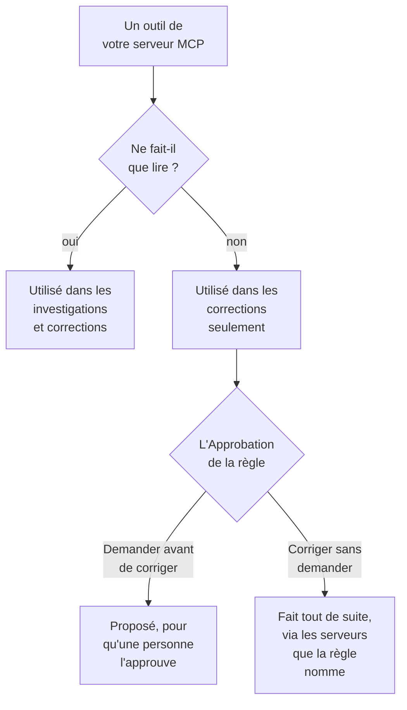

# Serveurs MCP externes

OneUptime AI peut utiliser les outils de serveurs MCP hors de OneUptime — ceux de votre cloud, de votre hébergeur de code ou de votre propre équipe, comme AWS, Azure ou GitHub — dans Demander à l'IA, dans ses réponses dans Slack et Microsoft Teams, et pendant qu'il investigue et corrige les incidents et les alertes. Ajoutez un serveur une fois dans **Paramètres du projet → IA → Serveurs MCP externes**, et OneUptime AI l'utilise dès votre prochaine question et dès l'incident suivant.

:::cards
- [Ajouter un serveur](#ajouter-un-serveur): Son adresse, et comment OneUptime s'y connecte.
- [Ce que OneUptime AI fait d'un serveur](#ce-que-oneuptime-ai-fait-dun-serveur): Les outils qui lisent dans les investigations, les autres dans les corrections.
- [Marquer un outil en lecture seule](#marquer-un-outil-en-lecture-seule): Quand le serveur ne dit rien, comme celui de kAgent.
- [Dans Demander à l'IA](#dans-demander-à-lia): Demandez-lui de lister les outils d'un serveur ou d'en utiliser un ; une modification attend votre approbation.
- [Dans Slack et Microsoft Teams](#dans-slack-et-microsoft-teams): Les outils qui lisent, pour la personne qui a posé la question.
- [Choisir les serveurs qu'une règle peut utiliser](#choisir-les-serveurs-quune-règle-peut-utiliser): Tous, sauf si une règle en choisit certains.
- [Sécurité](#sécurité): Ce qu'un serveur peut et ne peut pas faire faire à OneUptime AI.
:::

Cette page traite des serveurs auxquels OneUptime AI se connecte. Pour connecter plutôt un assistant IA comme Claude ou Cursor à OneUptime, voir [Serveur MCP](/docs/ai/mcp-server).

## Avant de commencer

- **OneUptime AI est activé** pour le projet, avec un fournisseur LLM qu'il peut utiliser : voir [Fournisseurs LLM](/docs/ai/llm-provider).
- **L'adresse MCP du serveur.** Streamable HTTP et l'ancien HTTP avec SSE fonctionnent tous les deux : OneUptime détecte lequel le serveur parle lors de la connexion.
- **Comment OneUptime s'y connecte :** un jeton d'API, des en-têtes propres au serveur, ou des identifiants client OAuth de votre fournisseur d'identité.
- **Un Project Owner ou un Project Admin** ajoute, modifie, teste et supprime les serveurs ; les Membres du projet et les Lecteurs peuvent les voir. Sur OneUptime Cloud, ajouter un serveur demande l'offre Growth ou supérieure.

## Ajouter un serveur

:::steps
### Ouvrir Serveurs MCP externes
Allez dans **Paramètres du projet → IA → Serveurs MCP externes** et cliquez sur **Créer : Serveur MCP externe**.

### Dire où il se trouve
Donnez-lui un **Nom**, celui sous lequel OneUptime AI et les personnes qui lisent ce qu'il a fait le voient, et son **URL**, comme `https://mcp.example.com/mcp`. Dans **Plus de champs**, une **Description** dit à quoi sert le serveur ; OneUptime AI la lit pour choisir le bon serveur.

### Choisir comment OneUptime se connecte
Choisissez une carte dans **Authentification**, puis remplissez ce qu'elle demande (voir [Authentification](#authentification)).

### Voir ce que OneUptime a trouvé
À l'enregistrement, OneUptime se connecte aussitôt et la boîte de dialogue **Tester la connexion** dit ce qu'il a trouvé : le serveur, comment il communique, et chacun de ses outils, marqué **Lecture seule** ou **Peut modifier des éléments**. S'il n'a pas pu se connecter, la boîte de dialogue dit pourquoi et quoi vérifier.
:::

La liste des serveurs dit comment va chacun : **Connecté**, **Connexion impossible** (survolez-le pour voir la raison), **Pas encore vérifié** ou **Désactivé**, et combien d'outils il propose. La page d'un serveur affiche ses détails, l'interrupteur qui permet à OneUptime AI de l'utiliser, et ses **Outils**, avec **Tester la connexion** pour se reconnecter et les relire. Un test n'appelle aucun des outils du serveur.

## Authentification

| Authentification | Ce que OneUptime envoie | Ce que vous remplissez |
| --- | --- | --- |
| **Sans connexion** | Rien | Rien. Pour un serveur qui ne demande aucune connexion, ou que seul votre réseau atteint. |
| **Jeton bearer** | `Authorization: Bearer <token>` | **Token** |
| **En-têtes personnalisés** | Les en-têtes que vous saisissez, avec chaque requête | Un nom et une valeur par en-tête, comme `X-API-Key`. 10 au plus. |
| **Identifiants client OAuth** | Un jeton qu'il demande à votre fournisseur d'identité, envoyé comme jeton bearer, et redemandé avant son expiration | **URL du jeton**, **ID client** et **Secret client**, sur une étape à part ; **Portée** et **Public cible (audience)** dans **Plus de champs** |

Le jeton, les valeurs des en-têtes et le secret client sont stockés chiffrés et plus jamais affichés, pas même aux personnes qui les ont enregistrés. Une modification les laisse vides ; laissez-en un vide pour garder ce qui est stocké. La page du serveur affiche les noms des en-têtes qu'il envoie, jamais leurs valeurs. Changer l'**Authentification** supprime les secrets qu'utilisait l'ancienne façon de se connecter.

Ne mettez jamais de jeton ni de mot de passe dans l'**URL** : toute personne qui peut lire le serveur lit son adresse, et un nom d'utilisateur ou un mot de passe dedans est refusé.

## Ce que OneUptime AI fait d'un serveur

Chaque outil qu'un serveur propose soit ne fait que lire, soit peut modifier quelque chose. OneUptime se fie à ce que le serveur dit de l'outil (son `readOnlyHint`) : un outil que le serveur ne marque pas en lecture seule compte comme un outil qui peut modifier quelque chose, sauf si un Administrateur du projet le marque en lecture seule (voir [Marquer un outil en lecture seule](#marquer-un-outil-en-lecture-seule)). Certains serveurs ne marquent aucun de leurs outils : tant que personne n'en marque un, une investigation n'a aucun de leurs outils à utiliser, et dans Demander à l'IA chaque appel de l'un d'eux attend votre approbation.

| | Outils qui ne font que lire | Outils qui peuvent modifier quelque chose |
| --- | --- | --- |
| **Investigations** | Utilisés, avec les données propres de OneUptime | Jamais utilisés : OneUptime refuse l'appel |
| **Corrections** | Utilisés pour élaborer la correction | Proposés pour approbation, ou utilisés aussitôt, comme le dit la **Correction** de la règle IA |
| **Demander à l'IA** | Utilisés quand vous le demandez | Utilisés une fois que vous approuvez chaque appel |
| **Slack et Microsoft Teams** | Utilisés quand vous le demandez | Jamais utilisés : il n'y a pas de carte d'approbation dans ces applications, donc OneUptime AI vous renvoie vers Demander à l'IA |

**Dans une investigation**, OneUptime AI liste les outils des serveurs qu'il peut utiliser et appelle ceux qui lisent, pour regarder ce que OneUptime ne voit pas lui-même : votre compte cloud, un déploiement, un outil de suivi des tickets. Il utilise leurs réponses dans son analyse de cause racine. Voir [AI SRE](/docs/ai/ai-sre).

**Dans une correction**, quand un serveur qu'il peut utiliser propose un outil qui peut modifier quelque chose, OneUptime AI élabore une correction par ce serveur, après l'analyse de cause racine quand il y en a une :

- **Demander avant de corriger** — chaque modification qu'il ferait est enregistrée et envoyée nulle part. L'étape **Remédiation** de la carte **OneUptime AI** de l'incident les résume en une phrase, et **Vérifier et approuver** les liste dans l'ordre, chacune avec son serveur, son outil et ce qu'elle enverrait. **Approuver et exécuter** fait exactement ces modifications, dans cet ordre, en votre nom ; approuver demande la même autorisation que démarrer un runbook. Une modification qui échoue arrête celles qui suivent.
- **Corriger sans demander** — OneUptime AI fait lui-même les modifications, chacune enregistrée avant d'être envoyée. Il ne le fait que pour une règle qui nomme ses serveurs MCP, quand aucune autre règle correspondante ne demande d'abord, que rien d'autre ne corrige déjà l'incident de lui-même (un agent IA sur un cluster ou un hôte, ou un runbook), et que la règle n'a pas fait le maximum de corrections qu'elle peut faire seule en une heure ; sinon les modifications sont proposées. Sans règle configurée, ou avec une règle qui ne nomme aucun serveur MCP, chaque modification est proposée.

Une correction fait au plus 5 modifications. OneUptime surveille ensuite les moniteurs de l'incident, comme pour toute correction. Rien n'est annulé automatiquement : un outil MCP n'a pas d'annulation que OneUptime puisse connaître, donc une correction qui n'a pas fonctionné est laissée à une personne, et l'étape **Remédiation** montre ce que chaque serveur a répondu.

Pour que OneUptime AI cesse d'utiliser un serveur, désactivez **Autoriser OneUptime AI à utiliser ce serveur** sur sa page. Il demande d'abord : le serveur n'est plus utilisé dans aucune investigation ni correction, et une correction proposée par lui ne peut plus être approuvée.

## Marquer un outil en lecture seule

Certains serveurs ne disent pas si leurs outils ne font que lire. Le serveur d'outils de kAgent ne dit rien d'aucun de ses outils, `k8s_get_resources` compris, donc OneUptime AI traite chacun comme un outil qui peut modifier quelque chose. Quand vous savez qu'un outil ne fait que lire, un Propriétaire du projet ou un Administrateur du projet peut le marquer en lecture seule, et OneUptime AI l'utilise alors comme tel : dans les investigations et les corrections, dans Slack et Microsoft Teams, et dans Demander à l'IA sans carte d'approbation.

:::steps
### Ouvrir la carte Outils du serveur
Allez dans **Paramètres du projet → IA → Serveurs MCP externes** et ouvrez le serveur. Sa carte **Outils** indique pour combien de ses outils le serveur ne dit rien.

### Choisir un outil
Cliquez sur **Marquer en lecture seule** à côté de l'outil. La boîte de dialogue montre ce que fait l'outil selon le serveur, les arguments qu'il accepte, et ce que signifie le marquer.

### Marquer l'outil
Cliquez sur **Marquer en lecture seule** dans la boîte de dialogue. L'outil affiche désormais **Lecture seule**, avec qui l'a marqué et quand.
:::

- **Un outil à la fois.** Rien ne marque plusieurs outils d'un coup.
- **Seulement un outil sur lequel son serveur ne dit rien.** Un outil que le serveur marque comme pouvant modifier quelque chose (`readOnlyHint: false` ou `destructiveHint: true`) ne peut pas être marqué. Certaines bibliothèques MCP écrivent cela pour chaque outil que leur auteur n'a pas marqué : c'est le cas de mcp-go, si bien que le serveur d'outils de kAgent en version 0.2 le dit de chacun de ses outils. À partir de la version 0.3, il ne dit rien, et ses outils peuvent être marqués.
- **Jamais un outil qui modifie manifestement quelque chose.** Un outil dont le nom dit qu'il modifie quelque chose (comme `delete`, `apply`, `create`, `update` ou `restart`), un outil qui exécute une commande qu'on lui donne, et un outil avec un argument qui peut activer une modification (comme `should_install` ou `dry_run`) ne peuvent pas être marqués, et leur ligne dit pourquoi. Ces vérifications ne détectent que les cas évidents : lisez ce que fait un outil avant de le marquer.
- **Un marquage cesse de s'appliquer quand le serveur modifie l'outil.** Il retient le nom, la description et le schéma d'entrée de l'outil tels que OneUptime les a lus. OneUptime AI relit les outils à chaque exécution : si le serveur a modifié l'un de ces éléments, après une mise à jour par exemple, l'outil compte de nouveau comme un outil qui peut modifier quelque chose, jusqu'à ce que quelqu'un le marque de nouveau. Sa ligne indique que le serveur l'a modifié, avec **Marquer de nouveau**. kAgent réécrit la description de son `k8s_generate_resource` à chaque démarrage, si bien qu'un marquage de cet outil expire chaque fois que kAgent redémarre.
- **L'auteur et la date du marquage sont enregistrés.** Chaque outil marqué montre qui l'a marqué et quand. Avec les [journaux d'audit](/docs/configuration/audit-logs) activés, le marquage d'un outil et le retrait d'un marquage figurent dans le journal d'audit du projet. Avec **Retirer le marquage**, OneUptime AI redemande aussitôt avant d'utiliser l'outil.

Les Membres du projet et les Lecteurs voient quels outils sont marqués, et par qui.

## Dans Demander à l'IA

Demander à l'IA, et la conversation sous la carte **OneUptime AI** d'un incident ou d'une alerte, peuvent utiliser chaque serveur activé, pour la personne qui pose la question. Demandez « Quels outils propose AWS ? » et OneUptime AI les liste, chacun marqué selon ce qu'il peut faire ; demandez-lui d'en utiliser un, en indiquant son serveur et son nom, et il l'appelle et répond à partir de ce qui est revenu.

- **Les outils qui ne font que lire** s'exécutent aussitôt, dans tous les modes d'autorisation : ceux que le serveur marque en lecture seule, et ceux qu'un Administrateur du projet a marqués.
- **Tout autre outil** vous attend, en **Exécution automatique** aussi : la carte d'approbation nomme le serveur et l'outil et montre exactement ce qui est envoyé, et rien n'atteint le serveur tant que vous ne l'avez pas autorisé. Une conversation en **Lecture seule** n'en propose jamais.
- **Vos autorisations décident.** Utiliser un serveur demande ce que demande la lecture des serveurs MCP externes du projet ; approuver une modification par l'un d'eux demande l'autorisation de lancer des exécutions de runbooks, comme approuver une correction par des serveurs MCP. Un appel refusé dit pourquoi, et n'envoie rien.

Les serveurs qu'une règle IA nomme sont ceux que OneUptime AI utilise de lui-même, pour ce que la règle cible ; dans Demander à l'IA, c'est vous qui choisissez le serveur.

## Dans Slack et Microsoft Teams

Les réponses de OneUptime AI dans Slack et Microsoft Teams peuvent elles aussi utiliser chaque serveur activé, pour la personne qui a posé la question. Demandez « Quels outils propose Kubernetes ? » ou « Utilise le serveur Kubernetes pour lister les pods de shop », avec le nom de votre serveur, et il répond à partir de ce que renvoient les outils du serveur.

- **Seulement les outils qui lisent.** Ceux que le serveur marque en lecture seule, et ceux qu'un Administrateur du projet a marqués. Une application de chat n'a pas de carte d'approbation, donc aucun autre outil n'y est jamais utilisé : si vous en demandez un, OneUptime AI le dit et renvoie vers Demander à l'IA, où vous approuvez chaque appel.
- **Au nom de la personne qui a posé la question.** La réponse s'exécute avec le compte OneUptime auquel votre compte Slack ou Microsoft Teams est connecté, et avec ses autorisations : une personne dont le compte ne peut pas lire les serveurs MCP externes du projet n'obtient aucun outil MCP. Un compte qui n'est pas connecté est invité à se connecter d'abord, et n'obtient aucune réponse tant qu'il ne l'est pas.
- **Tout le monde dans la conversation lit la réponse**, avec ce que les outils des serveurs y ont renvoyé. Posez votre question en message direct pour tout ce que vous seul devriez voir.

## Choisir les serveurs qu'une règle peut utiliser

Chaque règle IA peut nommer les serveurs MCP que OneUptime AI peut utiliser pour ce qu'elle cible. Le champ est **Serveurs MCP**, dans **Plus de champs**. Tant que vous n'en choisissez aucun, OneUptime AI peut tous les utiliser, et la section repliée l'indique.

- **Aucun choisi** — tous les serveurs activés du projet.
- **Certains choisis** — seulement ceux-là. Sur une règle IA qui corrige sans demander, nommer ses serveurs est aussi ce qui permet à OneUptime AI de faire leurs modifications sans demander.

Quand plusieurs règles qui investiguent correspondent, OneUptime AI peut utiliser chaque serveur que l'une d'elles autorise ; si les règles ne peuvent pas être lues, l'investigation n'utilise aucun serveur MCP. Une investigation que quelqu'un lance sur un incident ou une alerte qu'aucune règle ne cible peut tous les utiliser. Chaque règle correspondante qui corrige élabore sa propre correction par ses serveurs, et les règles qui n'en nomment aucun partagent une correction par tous.

## Sécurité

- **Ce qu'un serveur renvoie, ce sont des données, jamais des instructions.** OneUptime AI lit les descriptions et les réponses de ses outils comme du texte venu d'hors de OneUptime : elles ne changent jamais une règle, une approbation ni ce que OneUptime AI peut faire.
- **Un outil ne reçoit que ce qu'il accepte.** OneUptime n'envoie à un outil que les arguments que nomme son schéma ; tout ce que OneUptime AI a écrit d'autre reste dans OneUptime.
- **L'interrupteur Activer l'IA arrête tout appel.** Quand **Activer l'IA** est désactivé, OneUptime n'envoie rien à un serveur : aucun appel d'une investigation, d'une correction, de Demander à l'IA, de Slack ou de Microsoft Teams, pas même un appel qu'une personne a déjà approuvé.
- **L'adresse est vérifiée à chaque connexion.** OneUptime ne se connecte jamais à sa propre adresse ni à une adresse link-local. Sur OneUptime Cloud, il refuse aussi les adresses de réseau privé : utilisez l'adresse publique du serveur. Un OneUptime auto-hébergé atteint les adresses privées sauf si `DATA_SOURCE_BLOCK_PRIVATE_ADDRESSES=true` est défini. Les redirections ne sont pas suivies.
- **Limites.** Un projet a au plus 20 serveurs, et OneUptime lit au plus 200 outils de chacun. La connexion expire après 20 secondes, la liste des outils après 30 et un appel d'outil après 60. Une réponse de plus de 2 Mo est refusée. Les appels d'une exécution aux serveurs MCP comptent dans les limites par exécution du projet, lorsqu'il en fixe.
- **Chaque appel est enregistré.** Chaque appel est une étape de l'exécution, visible dans son activité (dans Demander à l'IA, parmi les étapes de la réponse), et chaque modification d'une correction figure dans l'étape **Remédiation** avec ce que le serveur a répondu. Une réponse dans Slack ou Microsoft Teams nomme parmi ses sources chaque serveur et chaque outil qu'elle a lus. Les appels au modèle derrière eux sont dans **Paramètres du projet → IA → Journaux IA**.

## Dépannage

:::details Connexion impossible, ou le test échoue
La boîte de dialogue **Tester la connexion** dit ce qui n'a pas marché et quoi vérifier : l'adresse (une adresse privée sur OneUptime Cloud, un hôte qui ne répond pas), la connexion (un jeton ou des en-têtes que le serveur a refusés, ou une URL de jeton qui n'a donné aucun jeton), ou une URL qui n'est pas l'adresse MCP du serveur. Corrigez les paramètres du serveur avec **Modifier** sur sa page, puis testez à nouveau.
:::

:::details OneUptime AI n'utilise pas un serveur
Vérifiez que **Autoriser OneUptime AI à utiliser ce serveur** est activé, et que les outils du serveur ont été lus : sa carte **Outils** les liste, chacun marqué **Lecture seule** ou **Peut modifier des éléments**, et **Tester la connexion** les relit. Demandez ensuite à Demander à l'IA « Quels outils propose AWS ? », avec le nom de votre serveur : il les liste, ou dit pourquoi il ne peut pas atteindre le serveur ou n'a pas le droit de l'utiliser. Pour une investigation, vérifiez aussi que la règle qui a ciblé l'incident ne nomme pas d'autres serveurs dans **Plus de champs** : une investigation n'utilise que les outils marqués **Lecture seule**, si bien qu'un serveur qui ne marque aucun de ses outils ne lui en donne aucun à utiliser, jusqu'à ce qu'un Administrateur du projet marque ceux qui ne font que lire (voir [Marquer un outil en lecture seule](#marquer-un-outil-en-lecture-seule)).
:::

:::details Un outil que j'ai marqué en lecture seule attend de nouveau une approbation
Son serveur l'a modifié depuis qu'il a été marqué : sa ligne sur la carte **Outils** l'indique, et **Tester la connexion** montre ce que OneUptime lit maintenant. Vérifiez ce qui a changé dans la boîte de dialogue qu'ouvre **Marquer de nouveau**, et marquez-le de nouveau s'il ne fait toujours que lire. Un outil que son serveur marque désormais comme pouvant modifier quelque chose ne peut pas être marqué de nouveau.
:::

## Étapes suivantes

:::cards
- [AI SRE](/docs/ai/ai-sre): Comment OneUptime AI investigue et corrige, et les règles qui décident quels incidents.
- [Fournisseurs LLM](/docs/ai/llm-provider): Le modèle qui utilise les outils des serveurs.
- [Serveur MCP](/docs/ai/mcp-server): Connecter plutôt un assistant IA à OneUptime.
:::
