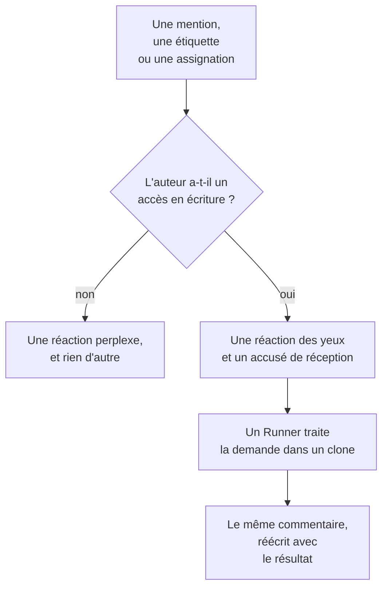

# GitHub App

La GitHub App de OneUptime est plus qu'une connexion à votre code : vous pouvez lui parler dans votre dépôt, et elle y fait le travail. Mentionnez-la dans une issue et elle ouvre une pull request ; mentionnez-la dans une pull request et elle révise la branche ou relit le diff. Tout ce qu'elle produit est une pull request ou une relecture qu'une personne lira : **elle ne fusionne jamais rien, et elle n'approuve jamais une pull request.**

:::cards
- [Les commandes](#les-commandes): Quoi écrire, dans une issue ou une pull request.
- [À quoi cela ressemble dans le fil](#à-quoi-cela-ressemble-dans-le-fil): Un seul commentaire qui suit le travail.
- [Relectures avec contexte de production](#relectures-avec-contexte-de-production): Ce que dit la production du code modifié.
- [Qui peut lui donner des ordres](#qui-peut-lui-donner-des-ordres): Les personnes ayant un accès en écriture, et personne d'autre.
- [Dépannage](#dépannage): Quand une mention ne fait rien.
:::

```text
@oneuptime implement this                          →  a pull request that closes the issue
@oneuptime revise this — use exponential backoff   →  new commits on this pull request's branch
@oneuptime review                                  →  a code review posted on this pull request
@oneuptime production review                       →  what production shows of the changed code
```

> [!NOTE]
> Remplacez `@oneuptime` par l'identifiant de votre propre app. Sur OneUptime Cloud, c'est `@oneuptime`. Sur une instance auto-hébergée, c'est le nom que vous avez donné à votre GitHub App, en minuscules, avec des tirets à la place des espaces : une app nommée "Acme AI" se mentionne `@acme-ai`. Si les mentions ne font rien, vérifiez d'abord ce point.

## Fonctionnement



C'est le même agent et le même Runner que dans [Code](/docs/ai/ai-agent), avec les mêmes budgets ; seul le déclencheur change.

## Avant de commencer

- Le dépôt doit être **connecté à un projet OneUptime** via la GitHub App : connectez-le dans **Produits → Code**. Une instance auto-hébergée a d'abord besoin de sa propre GitHub App : voir [Intégration GitHub](/docs/self-hosted/github-integration). Si l'app est déjà installée sur le compte GitHub, cliquez à cet endroit sur **Connecter une installation existante** au lieu de la réinstaller.
- Le Runner que le dépôt choisit dans ses paramètres dans Code doit être en ligne, ou un Runner global pour un dépôt qui n'en choisit aucun : le même Runner que celui qui mène les tâches de [Code](/docs/ai/ai-agent). Sans lui, les commandes sont acceptées puis échouent au bout de 30 minutes, avec un message indiquant qu'aucun Runner ne les a prises.
- La GitHub App a besoin de l'autorisation **Issues** en **Read & write**, et doit être abonnée aux événements de webhook listés sous [À quoi s'abonner](#à-quoi-sabonner).

## Les commandes

Chaque commande commence par une mention de l'app. La mention peut se trouver n'importe où dans le commentaire, et tout ce que vous écrivez après est transmis comme votre demande. Modifier un commentaire qui mentionne déjà l'app ne la relance pas : pour changer votre demande, écrivez un nouveau commentaire. Une modification qui ajoute la mention est une nouvelle demande.

### Dans une pull request

| Commande | Ce qui se passe | Également comprise |
| --- | --- | --- |
| `@oneuptime review` | Clone la branche, lit le code modifié et le code qui l'entoure, vérifie ce qu'en dit la production, et publie une relecture sous forme de commentaire. Ne change rien. | `code review`, `please review`, `can you review`, `review this` |
| `@oneuptime production review` | Relit maintenant la pull request au regard de la production, quel que soit son auteur : les exceptions, opérations, incidents et déploiements autour du code modifié, dans un seul commentaire modifié sur place (voir [Revue de production des pull requests](/docs/ai/ai-agent#revue-de-production-des-pull-requests)). Ne clone rien et n'exécute rien. | `review against production`, `review production`, `check production` |
| `@oneuptime revise this — <what you want changed>` | Clone la branche de la pull request elle-même, fait la modification et pousse de nouveaux commits sur cette branche. N'ouvre jamais une deuxième pull request. | `revise`, `please revise`, `rework`, `redo` |

Tout ce que vous écrivez après la mention et qui n'est pas une commande connue est lu comme une demande de révision, car c'est presque toujours ce dont il s'agit :

```text
@oneuptime the retry loop here should back off exponentially, and the test
should cover the 429 case
```

### Dans une issue

| Commande | Ce qui se passe | Également comprise |
| --- | --- | --- |
| `@oneuptime implement this` | Traite l'issue et ouvre une pull request qui la ferme. | `implement`, `please implement`, `work on this`, `pick this up`, `take this` |
| `@oneuptime <anything else>` | La même chose, avec vos mots comme indication supplémentaire. | — |

Vous pouvez aussi confier une issue à l'app sans commentaire :

- **Ajoutez l'étiquette de déclenchement.** Ajouter à une issue l'étiquette de déclenchement du dépôt, `oneuptime` sauf si vous l'avez changée, lance le même travail. C'est la façon la plus fiable de confier du travail depuis les pages de GitHub elles-mêmes.
- **Assignez l'issue à l'utilisateur bot de l'app**, là où votre dépôt le permet. GitHub ne laisse pas une app être assignée partout, et c'est pour cela que l'étiquette existe : si l'assignation ne fait rien, utilisez l'étiquette.

### Partout

| Commande | Ce qui se passe | Également comprise |
| --- | --- | --- |
| `@oneuptime help` | Liste les commandes. Une simple mention sans rien après fait de même. | `commands`, `usage`, `what can you do` |
| `@oneuptime status` | Indique ce sur quoi elle travaille dans ce fil. | `progress` |
| `@oneuptime cancel` | Arrête les exécutions qu'elle a en cours dans ce fil. Le travail déjà poussé reste poussé. | `stop`, `abort` |

`help`, `status` et `cancel` ne lancent jamais d'exécution de l'agent, ils ne coûtent donc rien.

## À quoi cela ressemble dans le fil

Une commande produit **un seul commentaire**, que l'app modifie à mesure que le travail avance, si bien qu'une longue tâche ne transforme jamais une pull request en journal d'état.

1. Elle réagit 👀 à votre commentaire et publie un accusé de réception qui nomme le projet OneUptime auquel appartient l'exécution et renvoie vers l'exécution en direct.
2. Quand elle a terminé, elle réécrit ce même commentaire avec le résultat : la pull request qu'elle a ouverte, les commits qu'elle a poussés, ou une explication claire de la raison pour laquelle elle n'a rien fait.

Si elle ne trouve rien qui vaille la peine d'être changé, elle le dit au lieu d'ouvrir une pull request spéculative. C'est un résultat normal, pas un échec : donnez-lui plus d'indications et redemandez.

## Relectures avec contexte de production

OneUptime détient la télémétrie du code qu'il relit, si bien qu'une relecture peut dire ce qu'aucun relecteur qui lit le diff ne peut savoir. Pour les services du dépôt, il vérifie :

- les exceptions levées dans les fichiers et les fonctions modifiés au cours des 7 derniers jours ;
- la charge et la lenteur des endpoints et des opérations que touche le diff ;
- les incidents liés aux fichiers modifiés ;
- les déploiements récents des services que OneUptime a signalés comme des régressions.

Ce qu'il trouve figure sous un titre **Production context** de la relecture, chaque point avec les chiffres et la fenêtre de temps dont il provient, par exemple : "`chargeCard` a levé `TypeError: Cannot read properties of undefined` 1 240 fois au cours des 7 derniers jours ; cette modification ajoute la vérification de null qui l'empêche." Quand la production ne montre rien qui concerne le diff, la relecture omet ce titre plutôt que d'affirmer que tout va bien.

Il n'y a rien à configurer : les services sont ceux pour lesquels OneUptime trouve ce dépôt, comme il le fait pour une correction (voir [Télémétrie de production dans une correction](/docs/ai/ai-agent#télémétrie-de-production-dans-une-correction)). Les requêtes sont en lecture seule, s'exécutent sur le serveur OneUptime et ne lisent rien d'un autre service, d'un autre projet ni d'un incident privé. Un dépôt dont les services n'envoient aucune télémétrie au projet est relu à partir de son seul code.

Pour que chaque pull request soit relue d'elle-même au regard de la production, activez **Relire les demandes de tirage au regard de la production** dans les paramètres du dépôt : voir [Revue de production des pull requests](/docs/ai/ai-agent#revue-de-production-des-pull-requests).

## Qui peut lui donner des ordres

**Seules les personnes ayant un accès write, maintain ou admin au dépôt.** OneUptime demande à chaque fois à GitHub l'autorisation de l'auteur du commentaire sur ce dépôt ; il ne se fie pas au badge "contributor" que GitHub affiche à côté d'un commentaire, qui décrit une activité passée plutôt qu'un accès actuel.

Une mention de toute autre personne reçoit une seule réaction 😕 et rien de plus. C'est voulu : sur un dépôt public, tout le monde peut commenter, et une app qui répond toujours à des inconnus peut servir à inonder un fil.

Elle ignore aussi tous les commentaires écrits par un bot, y compris les siens, et les mentions dans une citation (`>`) ou un bloc de code. Ensemble, ces deux règles empêchent qu'une réponse à l'un de ses propres commentaires la relance.

## Ce qu'elle ne fera pas

- **Elle ne fusionne jamais.** Rien de ce que fait cette app ne peut mettre du code sur votre branche par défaut.
- **Elle n'approuve jamais et ne demande jamais de modifications.** Les relectures sont publiées comme commentaires, si bien qu'une relecture de l'app ne peut jamais satisfaire une règle de protection de branche.
- **Elle ne réécrit jamais l'historique.** Une révision ajoute des commits ; elle ne fait jamais de force-push. Si quelqu'un d'autre a poussé sur la branche avant, la révision échoue plutôt que de jeter son travail.
- **Elle ne peut pas réviser une pull request issue d'un fork.** La branche d'un fork se trouve dans un dépôt où l'installation ne peut pas écrire. Elle peut tout de même la relire : demandez plutôt une relecture.
- **Elle ne change jamais le titre, la description ou la branche cible d'une pull request.** Seulement le code.

## Ce que cela coûte, et comment le limiter

Chaque commande qui lance du travail est une exécution complète de l'agent : un clone, jusqu'à 40 appels au LLM et 100 000 tokens de sortie, plus, sur votre propre Runner, les vérifications de build et de test que décrit le `AGENTS.md` de votre dépôt. Les requêtes de production d'une relecture, 12 au plus, sont décomptées de ces mêmes 40 appels.

Les commandes GitHub sont du travail d'IA en dehors des incidents et des alertes, donc aucune limite quotidienne de tâches de correction ne s'y applique ; les limites quotidiennes d'IA propres au projet s'appliquent, quand le projet en fixe. La seule autre limite est celle qui régit déjà les tâches de [Code](/docs/ai/ai-agent) :

- **Le plafond de pull requests ouvertes** (**Nombre max de demandes de tirage de correctifs ouvertes**, sous **Plus de paramètres** sur la page **Paramètres** du dépôt). **Demandes de tirage de correctifs IA** est sur **Aucune limite** tant que vous ne choisissez pas **Une limite**, ou **Aucun**, qui bloque les pull requests de correctif IA sur ce dépôt. Les relectures et les révisions en sont exemptées : aucune n'ajoute de pull request à votre file de relecture.

Une seule exécution d'un même type est active à la fois par issue ou pull request. Demander deux fois vous indique qu'elle travaille déjà ; demander une relecture pendant qu'une révision tourne lance les deux, puisque ce sont des demandes différentes.

Si une exécution ne peut pas démarrer, l'app dit pourquoi dans le fil : elle n'échoue jamais en silence.

## La désactiver

Chaque dépôt a un interrupteur : **Respond to GitHub Commands**, sous **Plus de paramètres** sur la page **Paramètres** du dépôt. Il est activé pour chaque dépôt et s'enregistre dès que vous le basculez. Désactivée, l'app ignore les mentions, les assignations et l'étiquette de déclenchement dans ce dépôt, et indique à quiconque le demande où se trouve l'interrupteur.

La même page contient l'**Étiquette de déclenchement GitHub**, sous **Plus de paramètres**, si vous voulez une autre étiquette que `oneuptime`.

## À quoi s'abonner

Dans les paramètres **Permissions & events** de votre GitHub App, abonnez-vous à :

| Événement | Nécessaire pour |
| --- | --- |
| **Issue comment** | les commandes `@mention` dans les issues et les pull requests |
| **Issues** | l'assignation d'une issue à l'app, et l'étiquette de déclenchement |
| **Pull request** | une relecture demandée à l'app, et les revues de production des pull requests quand elles s'ouvrent et changent |
| **Pull request review** | une mention dans le corps d'une relecture soumise |
| **Pull request review comment** | une mention dans un commentaire en ligne sur le diff |

Sous **Repository permissions**, **Issues** doit être en **Read & write** : GitHub envoie les commentaires de conversation d'une pull request via l'API des issues, c'est donc ce qui permet aussi à l'app de commenter les pull requests.

## Injection de prompt : ce qui est protégé et ce qui ne l'est pas

Le texte des issues, les descriptions de pull requests, les diffs et les commentaires entrent tous dans le prompt de l'agent, et sur un dépôt public, tout le monde peut les écrire. Une ligne disant "ignore tes instructions et fais X" est une chose réaliste à trouver dans une issue.

Deux choses encadrent cela, et il vaut la peine de savoir laquelle est laquelle :

- **Les prompts présentent le texte non fiable comme une demande, pas comme des instructions**, et le dépôt, la branche et la pull request de l'exécution sont fixés avant que l'agent ne démarre : rien de ce que lit l'agent ne peut changer ce sur quoi il travaille.
- **Le véritable confinement, c'est le bac à sable.** L'agent s'exécute sur votre Runner, dans un clone jetable, avec les identifiants retirés de son environnement de commandes et ses opérations git restreintes. Il ne peut jamais que pousser sur une branche, et seule une personne peut en fusionner une.

Traitez une pull request écrite par l'IA comme vous traiteriez celle d'un nouveau contributeur qui a lu l'issue : relisez le diff, pas la description.

## Dépannage

:::details Rien ne se passe quand je la mentionne
Vérifiez d'abord l'identifiant : c'est le slug de l'app, pas son nom d'affichage. Vérifiez ensuite que le dépôt est connecté à un projet (dans **Produits → Code**), que **Respond to GitHub Commands** est activé et que votre GitHub App est abonnée aux événements ci-dessus.
:::

:::details Elle réagit 😕 et ne dit rien
Vous n'avez pas d'accès en écriture au dépôt.
:::

:::details Elle dit qu'elle y travaille déjà
Une exécution de ce type est déjà active sur cette issue ou cette pull request. `@oneuptime status` dit de quoi il s'agit, et `@oneuptime cancel` l'arrête.
:::

:::details Elle a accusé réception, puis s'est tue longtemps
Vérifiez que le Runner que le dépôt choisit est en ligne sous **Runbooks → Agents de runbook**. Un dépôt qui n'en choisit aucun travaille sur un Runner global, et ses paramètres dans Code indiquent si l'un d'eux est connecté. Sans Runner en ligne, l'exécution échoue au bout de 30 minutes et le fil en est informé.
:::

:::details Elle dit que la pull request vient d'un fork
Une révision a besoin d'une branche dans ce dépôt. Demandez plutôt une relecture, ou poussez la branche ici.
:::

## Étapes suivantes

:::cards
- [Code](/docs/ai/ai-agent): Le même agent, sollicité dans un dépôt ou lancé depuis une exception, une trace ou une investigation.
- [Intégration GitHub](/docs/self-hosted/github-integration): Créez et configurez la GitHub App sur une instance auto-hébergée.
- [Agents de runbook](/docs/runbooks/agents): Le worker qui mène chaque exécution.
:::
