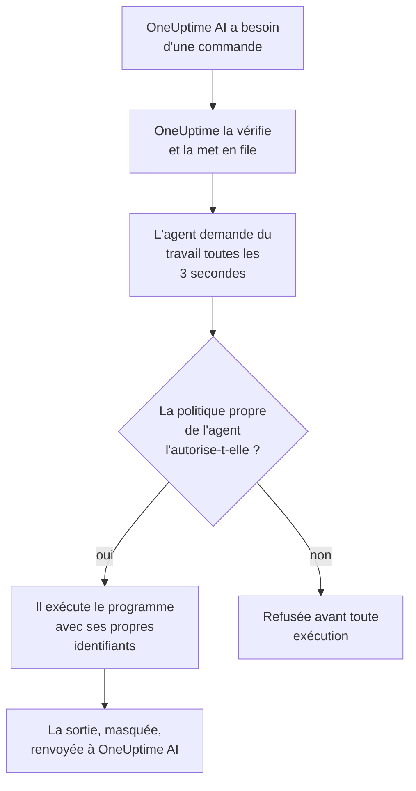

# Agents IA pour l'infrastructure

OneUptime AI peut regarder au-delà de votre télémétrie lorsqu'il investigue un incident ou une alerte. Un petit agent installé à côté de l'une de vos ressources — un hôte Docker ou Podman, un cluster Docker Swarm, un cluster Proxmox, un VMware vCenter, un cluster Ceph, un serveur de base de données ou un hôte Linux — exécute les commandes en lecture seule que OneUptime AI demande, comme `docker logs --tail 200 web`, `pvesh get /cluster/status`, `ceph health detail`, `db long-queries --min-seconds 30` ou `journalctl -u nginx -n 200 --no-pager`, et renvoie leur sortie, si bien que l'analyse des causes racines cite ce que dit la ressource elle-même. Si vous l'autorisez, le même agent applique aussi des correctifs — redémarrer un conteneur, démarrer une VM, remettre un OSD dans le cluster — chacun classé dans un niveau par une politique de commandes et, sauf choix contraire de votre part, approuvé d'abord par une personne. Demander à l'IA, ouvert sur la page de la ressource, exécute les mêmes commandes en lecture seule quand vous le demandez (voir [Demander à l'IA](/docs/ai/ask-ai)).

Un compte AWS, un abonnement Azure ou un projet Google Cloud n'a besoin d'aucun agent pour être investigué : OneUptime le lit en direct, via la connexion en lecture seule avec laquelle il a été connecté. Seuls ses correctifs en nécessitent un, l'agent IA cloud, qui s'exécute dans le compte lui-même et se configure avec une seule commande depuis la page du compte (voir [Dans un compte cloud](#dans-un-compte-cloud)).

Ces agents sont les **agents IA de ressource**. La page de chaque ressource dans le tableau de bord comporte une section **IA** avec trois pages :

- **Analyses** — ce que OneUptime AI a appris sur la ressource au cours des 30 derniers jours : les problèmes qui reviennent sans cesse et pourquoi, avec ce que l'IA a trouvé et l'étape qu'elle suggère, les parties de la ressource à l'origine de la plupart d'entre eux, les correctifs qui n'ont pas aidé ou qui attendent une approbation, ce que l'IA a corrigé d'elle-même, et les risques repérés avant que quiconque soit alerté — avec, en note de bas de page, ce que l'IA elle-même y a fait. Elle fonctionne comme celle d'un cluster — voir [Ce que l'IA a appris sur un cluster](/docs/ai/ai-sre#ce-que-lia-a-appris-sur-un-cluster).
- **Journaux** — tout ce que OneUptime AI a fait sur la ressource, le plus récent en premier : chaque investigation avec son incident ou son alerte et son résumé, chaque correctif proposé ou exécuté, et chaque commande envoyée par l'intermédiaire de l'agent. (Cette page s'appelait auparavant Analyses.)
- **Agent IA** — si l'agent est connecté, ce que l'IA peut faire sur la ressource (investiguer, et comment les correctifs s'exécutent), tout ce qui demande votre attention avec l'étape qui le règle, et, dans le menu **⋯** à côté de l'état de l'agent, **Tester la connexion** et **Réinitialiser l'agent**.

La **Vue d'ensemble** de la ressource se termine par une carte **Agent IA** qui résume la page de l'agent IA : si l'agent est connecté, si l'investigation est activée, comment les correctifs s'exécutent (**Désactivé**, **Demander une approbation**, **Automatique** ou **Contourner l'approbation**) et ce qui demande votre attention, avec un lien vers la page de l'agent IA, où ces réglages se modifient.

:::cards
- [Ressources prises en charge](#ressources-prises-en-charge): Onze types de ressources, une seule image.
- [Installer un agent IA](#installer-un-agent-ia): À côté d'un collecteur que vous exécutez déjà, sur un hôte Linux, ou dans un compte cloud avec une seule commande.
- [Fonctionnement des correctifs](#fonctionnement-des-correctifs): Ce qui peut s'exécuter de soi-même, ce qui attend une personne et ce qui ne s'exécute jamais.
- [Modèle de sécurité](#modèle-de-sécurité): Trois vérifications pour chaque commande, et aucun identifiant venant de OneUptime.
:::

## Fonctionnement

L'agent n'attend jamais de connexion de la part de OneUptime : il contacte OneUptime, demande du travail et n'exécute que ce que sa propre copie de la politique de commandes autorise, avec les identifiants dont il dispose déjà.



## Lien avec l'agent IA Kubernetes

Les clusters Kubernetes ont leur propre agent, l'agent IA Kubernetes, installé par le chart Helm de l'agent Kubernetes — voir [Accès au cluster — laisser OneUptime AI exécuter kubectl](/docs/ai/ai-sre#accès-au-cluster-laisser-oneuptime-ai-exécuter-kubectl). Rien sur cette page ne le modifie. Les agents IA de ressource suivent la même conception :

- **Les mêmes niveaux et les mêmes modes.** Chaque commande est **Read**, **SafeWrite**, **RiskyWrite** ou **Denied**, et les correctifs sont **Désactivé**, **Demander une approbation**, **Automatique** ou **Contourner l'approbation**, avec le même sens que sur un cluster.
- **Les trois mêmes vérifications.** La même politique de commandes est appliquée par les outils IA de OneUptime, de nouveau quand OneUptime met la commande en file, et encore par l'agent avant qu'il n'exécute quoi que ce soit.
- **La même règle pour les identifiants.** L'agent n'utilise que ce que son propre environnement et ses montages lui donnent. OneUptime ne lui envoie jamais d'identifiant.
- **Les mêmes valeurs par défaut.** Les investigations IA sont activées par défaut : une ressource démarre avec l'investigation activée et les correctifs désactivés, comme un cluster, si bien que OneUptime AI investigue avec son agent dès qu'il se connecte, et ne change rien tant que personne n'autorise les correctifs (voir [Se connecter à OneUptime](#se-connecter-à-oneuptime)).

Ce qui diffère :

- **Une seule image pour chaque ressource.** `oneuptime/resource-ai-agent` sert les onze types de ressources, et `ONEUPTIME_AI_AGENT_RESOURCE_TYPE` indique celui que sert un agent. Il s'exécute à côté du collecteur de la ressource comme un conteneur de plus, ou dans le compte cloud qu'il sert, et non depuis un chart Helm.
- **L'accès en écriture est une variable d'environnement.** C'est `ONEUPTIME_AI_ALLOW_WRITES=true` sur l'agent qui lui permet d'appliquer des correctifs, et `ONEUPTIME_AI_WRITE_TARGETS` limite les conteneurs, services, VM, OSD, sessions ou unités qu'ils peuvent toucher. Sur un cluster, ce sont le RBAC du chart et `aiAgent.remediation.namespaces` qui s'en chargent.

Comme l'agent IA Kubernetes, un agent IA de ressource n'est pas un Runner. Il n'apparaît jamais sous Runbooks → Agents de runbook, et il n'est jamais utilisé comme hôte Bash ou SSH pour les runbooks.

## Ressources prises en charge

| Ressource | `ONEUPTIME_AI_AGENT_RESOURCE_TYPE` | Agent | S'enregistre comme (la variable du collecteur) | Exécute | Atteint la ressource via |
| -------------------- | ---------------------------------- | --------------------- | ----------------------------------------------------------------------------------------------- | -------------------------------------------------------------------------------------------------------------------------------------------------- | -------------------------------------------------------------------------- |
| Hôte Docker | `docker` | Agent IA Docker | `DOCKER_HOST_NAME` | `docker` | le socket Docker, `/var/run/docker.sock` |
| Hôte Podman | `podman` | Agent IA Podman | `PODMAN_HOST_NAME` | `docker`, via l'API compatible Docker de Podman | le socket Podman, `/run/podman/podman.sock` |
| Cluster Docker Swarm | `docker-swarm` (ou `swarm`) | Agent IA Docker Swarm | `DOCKER_SWARM_CLUSTER_NAME` | `docker` | le socket Docker d'un nœud manager |
| Cluster Proxmox | `proxmox` | Agent IA Proxmox | `PROXMOX_CLUSTER_NAME` | des commandes `pvesh`, envoyées à l'API Proxmox VE (il n'y a pas de binaire `pvesh` dans l'agent) | `https://PVE_HOST:8006/api2/json`, avec un jeton d'API Proxmox |
| VMware vCenter | `vmware` (ou `vcenter`) | Agent IA VMware | `VMWARE_VCENTER_NAME` | `govc` | l'API de vCenter, avec un utilisateur vSphere |
| Cluster Ceph | `ceph` | Agent IA Ceph | `CEPH_CLUSTER_NAME` | `ceph` | les moniteurs, avec un `ceph.conf` et le trousseau du client propre à l'agent |
| Serveur de base de données | `database` (ou `db`) | Agent IA de base de données | `DATABASE_SERVER_ID`, ou `DATABASE_SYSTEM` + `DATABASE_SERVER_ADDRESS` + `DATABASE_SERVER_PORT` | `db` — une opération d'un catalogue de diagnostics fixe, jamais du SQL | le pilote propre de la base de données, avec un identifiant de connexion à la base |
| Hôte | `host` | Agent IA d'hôte | `HOST_NAME` (vide : le nom d'hôte propre de l'hôte) | `systemctl`, `journalctl`, `df`, `free`, `uptime`, `ps`, `ss`, `ip`, `dmesg`, `lsblk`, `cat`, `top`, `uname`, `hostnamectl`, `timedatectl`, `kill` | `nsenter` dans les namespaces de l'hôte, depuis un conteneur privilégié |
| Compte AWS | `aws` | Agent IA cloud | `AWS_ACCOUNT_ID` (vide : le compte dans lequel il s'exécute) | `cloud` — une opération d'un catalogue fixe, jamais une commande `aws` | les API AWS, avec ses propres rôles IAM |
| Abonnement Azure | `azure` | Agent IA cloud | `AZURE_SUBSCRIPTION_ID` (sa commande de configuration la définit) | `cloud` — une opération d'un catalogue fixe, jamais une commande `az` | Azure Resource Manager, en tant qu'identité managée de sa Container App |
| Projet Google Cloud | `gcp` (ou `google-cloud`) | Agent IA cloud | `GOOGLE_CLOUD_PROJECT` (vide : le projet dans lequel il s'exécute) | `cloud` — une opération d'un catalogue fixe, jamais une commande `gcloud` | les API Google Cloud, en tant que compte de service qui lui est propre |

Serveurs de base de données : l'agent IA de base de données dispose de diagnostics pour PostgreSQL, MySQL (ainsi que MariaDB et Percona Server), Redis (ainsi que Valkey, KeyDB et Dragonfly) et MongoDB. Pour tout autre moteur, il n'exécute rien et l'indique sur la page de l'agent IA de la base de données.

**Tester la connexion**, dans le menu **⋯** à côté de l'état de l'agent sur la page de l'agent IA, exécute ces commandes en lecture seule par l'intermédiaire de l'agent et affiche leur sortie dans la carte de l'agent :

| Ressource | Ce qu'exécute Tester la connexion |
| -------------------- | ---------------------------------------------------- |
| Hôte Docker | `docker version`, `docker info` |
| Hôte Podman | `docker version`, `docker info` |
| Cluster Docker Swarm | `docker version`, `docker node ls` |
| Cluster Proxmox | `pvesh get /version`, `pvesh get /cluster/status` |
| VMware vCenter | `govc about` |
| Cluster Ceph | `ceph health`, `ceph versions` |
| Serveur de base de données | `db ping`, `db version` |
| Hôte | `uptime`, `systemctl list-units --failed --no-pager` |
| Compte AWS | `cloud whoami` |
| Abonnement Azure | `cloud whoami` |
| Projet Google Cloud | `cloud whoami` |

Sur un nœud worker Docker Swarm, `docker node ls` échoue : l'agent IA Docker Swarm doit s'exécuter sur un nœud manager. Un agent démarré sur un worker ne s'enregistre pour le cluster qu'une fois son nœud devenu manager, et le programme d'installation Docker Swarm l'omet sur un nœud qui n'est pas manager.

Sur un compte cloud, `cloud whoami` indique le compte dans lequel agit l'agent IA cloud et l'identité sous laquelle il est connecté, s'il peut modifier quoi que ce soit, les modifications qu'il peut effectuer et l'étiquette qu'il exige, le cas échéant.

## Installer un agent IA

Chaque agent IA de ressource est la même image, `oneuptime/resource-ai-agent:release`. À côté d'un collecteur ou sur un hôte, il n'a besoin de rien dans le tableau de bord : une fois lancé, il s'enregistre auprès de OneUptime et apparaît sur la page de l'agent IA de la ressource en moins d'une minute. Celui d'un compte cloud s'exécute dans le compte, à partir d'une seule commande que la page du compte écrit pour lui (voir [Dans un compte cloud](#dans-un-compte-cloud)).

### À côté d'un collecteur

Pour Docker, Podman, Docker Swarm, Proxmox, VMware, Ceph et les serveurs de base de données, l'agent s'exécute à côté du collecteur que vous utilisez déjà pour cette ressource et partage son `.env` : il dispose déjà de `ONEUPTIME_URL`, de la clé d'ingestion et du nom de la ressource. Le `docker-compose.yml` de chaque collecteur fournit l'agent comme un service de plus, et son `install.sh` le démarre.

| Ressource | Collecteur | Service de l'agent IA (et conteneur) | Où il est configuré |
| -------------------- | ----------------------------------------------------------- | --------------------------------- | ------------------------------------------------------------------------------------- |
| Hôte Docker | [Agent Docker](/docs/telemetry/docker-host#agent-ia) | `oneuptime-docker-ai-agent` | `agents/DockerAgent/docker-compose.yml` ; `install.sh` le démarre comme second conteneur |
| Hôte Podman | [Agent Podman](/docs/telemetry/podman-host#agent-ia) | `oneuptime-podman-ai-agent` | `agents/PodmanAgent/docker-compose.yml` ; `install.sh` le démarre comme second conteneur |
| Cluster Docker Swarm | [Agent Docker Swarm](/docs/telemetry/docker-swarm#agent-ia) | `oneuptime-docker-swarm-ai-agent` | `agents/DockerSwarmAgent/docker-compose.yml`, sur un nœud manager |
| Cluster Proxmox | [Agent Proxmox](/docs/telemetry/proxmox#agent-ia) | `oneuptime-proxmox-ai-agent` | `agents/ProxmoxAgent/docker-compose.yml` |
| VMware vCenter | [Agent VMware](/docs/telemetry/vmware#agent-ia) | `oneuptime-vmware-ai-agent` | `agents/VMwareAgent/docker-compose.yml` |
| Cluster Ceph | [Agent Ceph](/docs/telemetry/ceph#agent-ia) | `oneuptime-ceph-ai-agent` | `agents/CephAgent/docker-compose.yml`, avec le client Ceph propre à l'agent dans `./ceph` |
| Serveur de base de données | [Agent de base de données](/docs/telemetry/databases#agent-ia) | `oneuptime-database-ai-agent` | `agents/DatabaseAgent/docker-compose.yml` |

Un collecteur installé avant l'existence de l'agent IA ne l'exécute pas encore. Relancez son `install.sh` : il démarre désormais aussi l'agent IA (les programmes d'installation Proxmox, VMware, Ceph, base de données et Docker Swarm téléchargent le `docker-compose.yml` actuel, qui contient le service de l'agent IA). Si vous gérez les fichiers vous-même, ajoutez le service du `docker-compose.yml` du collecteur au vôtre et exécutez `docker compose up -d`. La page de l'agent IA de la ressource affiche le service exact pour cette ressource, avec son nom déjà renseigné.

Sans les programmes d'installation, l'agent IA Docker tient en un seul `docker run` :

```bash
docker run -d \
  --name oneuptime-docker-ai-agent \
  --user 0:0 \
  --restart unless-stopped \
  --read-only --tmpfs /tmp \
  -v /var/run/docker.sock:/var/run/docker.sock:ro \
  -e ONEUPTIME_URL="https://oneuptime.com" \
  -e ONEUPTIME_SERVICE_TOKEN="YOUR_TELEMETRY_INGESTION_TOKEN" \
  -e ONEUPTIME_AI_AGENT_RESOURCE_TYPE=docker \
  -e DOCKER_HOST_NAME="my-docker-host" \
  oneuptime/resource-ai-agent:release
```

`DOCKER_HOST_NAME` doit être le nom que signale l'agent Docker. Les programmes d'installation Docker et Podman acceptent `--no-ai-agent` (ou `ONEUPTIME_INSTALL_AI_AGENT=false`) pour omettre l'agent IA, tout comme celui de Docker Swarm. Pour exécuter plus tard un collecteur sans lui, supprimez son service d'agent IA de `docker-compose.yml`, ou supprimez son conteneur avec `docker rm -f`.

### Agent IA d'hôte

Un hôte Linux qui fait remonter ses données via le [Collecteur OpenTelemetry sur l'hôte](/docs/telemetry/host-otel-collector) n'a aucun conteneur OneUptime à côté duquel s'installer, aussi l'agent IA d'hôte est-il fourni avec son propre programme d'installation (`agents/HostAIAgent`) :

```bash
curl -fsSL https://raw.githubusercontent.com/OneUptime/oneuptime/master/agents/HostAIAgent/install.sh -o install.sh
sudo bash install.sh
```

Il demande votre URL OneUptime, la clé d'ingestion de télémétrie du projet et le nom de l'hôte, écrit `/opt/oneuptime-host-ai-agent/.env` et `docker-compose.yml`, et démarre le conteneur `oneuptime-host-ai-agent`. Ajoutez `--systemd` pour l'exécuter plutôt sous l'unité systemd `oneuptime-host-ai-agent`. Il nécessite Docker (le moteur système, pas Docker rootless) avec le plugin Compose ; Podman en mode rootful peut exécuter le même conteneur.

L'agent IA d'hôte exécute les **programmes de l'hôte lui-même** : chaque commande s'exécute sous la forme `nsenter --target 1 --mount --uts --ipc --net --pid -- PROGRAM ARGS`, qui entre dans les namespaces du processus init de l'hôte. Cela nécessite `pid: host`, `privileged: true` et root — voir [Le socket Docker et l'agent IA d'hôte sont root sur l'hôte](#le-socket-docker-et-lagent-ia-dhôte-sont-root-sur-lhôte). Laissez `HOST_NAME` vide pour utiliser le nom d'hôte de la machine, qui est ce que le collecteur signale comme `host.name` sauf si vous l'avez changé ; sinon, donnez-lui le nom affiché sous **Hôtes**.

### Dans un compte cloud

Un compte AWS, un abonnement Azure ou un projet Google Cloud n'a pas de collecteur à côté duquel un agent pourrait s'installer, et OneUptime le lit sans agent (voir [Comptes cloud](#comptes-cloud)). Son agent IA cloud, qui effectue les correctifs, s'exécute dans le compte lui-même et se configure depuis la page du compte avec une seule commande, sans fichier compose ni `.env` :

1. Dans Cloud → Comptes, ouvrez le compte et sélectionnez **Laisser l'IA corriger les problèmes** dans la carte **Agent IA** de sa **Vue d'ensemble**.
2. Répondez à l'unique question, **Jusqu'où l'IA peut-elle aller ?** : **Me demander d'abord**, la valeur par défaut, règle **Correctifs** sur **Demander une approbation**, et **Appliquer d'elle-même les correctifs sûrs** sur **Automatique**. **Plus de champs** contient le reste : les modifications que l'IA peut effectuer, les ressources qu'elle ne doit jamais modifier, ne modifier que les ressources étiquetées `oneuptime-ai=allow`, **Contourner l'approbation**, la lecture des journaux du compte, et les variables de l'agent pour l'exécuter ailleurs.
3. Exécutez la commande affichée dans le shell intégré du cloud, connecté à ce compte. Elle écrit le rôle de l'agent à partir des modifications activées et démarre l'agent, qui se connecte de lui-même en quelques minutes : il n'y a rien à recoller. S'il ne se connecte pas, son journal en indique la raison (voir [Journaux et état](#journaux-et-état)).

| Cloud | L'exécuter dans | Ce que la commande crée |
| -------------------- | ------------------ | ------------------------------------------------------------------------------------------------------------------------------------------------------------------------------------------------------------------ |
| Compte AWS | AWS CloudShell | Une stack CloudFormation, `oneuptime-ai-agent`, qui exécute une tâche ECS Fargate. Son rôle de tâche ne peut qu'endosser le rôle d'écriture `OneUptimeAiAgentWrite`, qui détient les autorisations des modifications activées. La clé avec laquelle il se connecte est conservée dans Secrets Manager, que seul ECS lit. |
| Abonnement Azure | Azure Cloud Shell | Une Container App, `oneuptime-ai-agent`, dans le groupe de ressources `oneuptime-ai-agent`. Son identité managée détient un rôle personnalisé sur l'abonnement, avec les autorisations des modifications activées. La clé avec laquelle il se connecte est un secret Container Apps. |
| Projet Google Cloud | Google Cloud Shell | Un service Cloud Run, `oneuptime-ai-agent`, avec un CPU toujours alloué, qui s'exécute sous le compte de service `oneuptime-ai-agent`, lequel détient un rôle personnalisé sur le projet avec les autorisations des modifications activées. La clé avec laquelle il se connecte est conservée dans Secret Manager, que seul ce compte de service peut lire. |

La commande ne fonctionne que dans le compte pour lequel elle a été écrite : sur AWS, elle ne crée rien dans un shell connecté à un autre compte, et les commandes Azure et Google Cloud nomment leur abonnement ou leur projet à chaque appel. Elle définit `ONEUPTIME_AI_INVESTIGATION=true`, `ONEUPTIME_AI_FIXES` d'après votre réponse, `ONEUPTIME_AI_ALLOW_WRITES=true`, et `ONEUPTIME_AI_CLOUD_ACCOUNT_ID` sur le compte pour lequel elle a été écrite. L'agent s'enregistre comme le compte dans lequel son cloud dit qu'il se trouve et n'en ajoute jamais un à OneUptime : démarré dans un autre compte que celui de sa commande, il est refusé, et le compte pour lequel elle a été écrite en indique la raison sur sa page ; démarré dans un compte qu'aucune connexion du projet ne lit, il est refusé aussi, et son journal le dit.

Pour modifier quoi que ce soit, exécutez à nouveau la commande : ouvrez encore une fois **Laisser l'IA corriger les problèmes**, ou sélectionnez **Modifier** sur la page **Agent IA** du compte, puis exécutez la commande qu'elle écrit. Le rôle ne détient toujours que les modifications activées. La section **IA** d'un compte cloud a deux pages, **Agent IA** et **Journaux**, et ce que coûte l'agent est indiqué dans [Connecter un compte cloud](/docs/telemetry/cloud-accounts#laisser-lia-corriger-les-problèmes). Dans **Activité**, le **Fil d'activité** du compte indique quand l'agent s'est connecté ou a été réinitialisé, et chaque modification de ce que OneUptime AI peut y faire, avec son auteur.

### Se connecter à OneUptime

L'agent s'enregistre avec **la même identité que celle que signale le collecteur** — `DOCKER_HOST_NAME`, `PROXMOX_CLUSTER_NAME`, `CEPH_CLUSTER_NAME`, … (`ONEUPTIME_AI_AGENT_RESOURCE_NAME` la remplace) — de sorte qu'il sert exactement la ressource que la télémétrie du collecteur a créée. Quand OneUptime n'a pas encore de ressource de ce nom, l'enregistrement la crée, si bien qu'un nom différent de celui du collecteur vous donne une seconde ressource vide au lieu d'une erreur. Une base de données s'enregistre par `DATABASE_SERVER_ID` quand il est défini, sinon par son moteur, son adresse et son port ; un `DATABASE_SERVER_ID` qui n'est pas une base de données de ce projet est refusé.

Si le collecteur utilise encore son nom par défaut (`docker-host`, `podman-host`, `docker-swarm`, `proxmox-cluster`, `vmware-vcenter`, `ceph`), chaque ressource installée avec ce nom par défaut remonte dans la même ressource de OneUptime, et les commandes destinées à celle-ci pourraient atteindre n'importe laquelle d'entre elles. L'agent le signale par un avertissement dans son journal ; donnez à chaque ressource un nom unique, sur le collecteur comme sur l'agent.

Il s'authentifie avec la clé d'ingestion de télémétrie du projet — la première définie parmi `ONEUPTIME_API_KEY`, `ONEUPTIME_TELEMETRY_INGESTION_KEY` et `ONEUPTIME_SERVICE_TOKEN`, que les collecteurs définissent déjà — et reçoit une clé qui lui est propre. Tous ses appels sont des `POST` HTTPS vers `<ONEUPTIME_URL>/resource-ai-agent-ingest/…` : il s'enregistre une fois au démarrage, envoie un heartbeat toutes les 30 secondes (il est considéré comme en ligne pendant 5 minutes après le dernier), demande du travail toutes les 3 secondes et se déconnecte quand il s'arrête. Un second agent avec la même identité est refusé tant que le premier est en ligne : un conteneur qui s'arrête proprement se déconnecte, si bien que son remplaçant est admis aussitôt, et après un plantage ou un kill, le remplaçant prend sa place dès que l'ancien n'a rien envoyé pendant 40 secondes après le premier refus. S'il est encore refusé au bout de 10 minutes, un autre agent actif utilise la même identité : l'agent consigne une erreur qui le dit et ne redemande plus que toutes les 5 minutes, jusqu'à ce que vous donniez à chaque ressource son propre nom ou que vous arrêtiez l'autre agent. Un projet compte au plus 250 agents IA de ressource, et au plus 30 nouveaux s'enregistrent par heure. Une fois les 250 atteints, les agents sans nouvelles depuis 7 jours sont supprimés pour faire de la place à un nouveau (la ressource conserve ses réglages IA, et un tel agent qui revient s'enregistre simplement de nouveau).

L'**Investigation** est activée pour chaque ressource dès le départ, si bien que OneUptime AI investigue avec l'agent dès qu'il se connecte. Au-delà, ce que l'IA peut faire sur la ressource est un réglage propre à l'agent (voir [Ce que l'IA peut faire, défini par l'agent](#ce-que-lia-peut-faire-défini-par-lagent)). Un agent qui ne nomme aucun des deux réglages utilise ses valeurs par défaut : il active l'**investigation** pour sa ressource et, s'il autorise les écritures (`ONEUPTIME_AI_ALLOW_WRITES=true`), règle les **Correctifs** sur **Demander une approbation**, sinon sur **Désactivé**. Ses valeurs par défaut ne s'appliquent qu'à une ressource dont personne n'a choisi les réglages IA sur la page de l'agent IA : les réglages que quelqu'un y a enregistrés restent tels quels jusqu'à ce que la configuration de l'agent les nomme, si bien qu'une ressource dont quelqu'un a désactivé l'interrupteur **Investiguer** reste désactivée. Un agent plus ancien que ces réglages ne signale ni l'un ni l'autre, et c'est la page de l'agent IA qui les définit, comme avant.

**Réinitialiser l'agent**, dans le même menu **⋯** de la page de l'agent IA, fait oublier à OneUptime la clé de l'agent une fois que vous avez confirmé ; quiconque la détenait est bloqué, et le véritable agent se réenregistre en quelques minutes. L'agent a besoin d'un serveur OneUptime de la même version que son image, ou plus récent.

### Ce que l'IA peut faire, défini par l'agent

L'investigation et les correctifs se définissent là où l'agent s'exécute — dans le `.env` qu'il partage avec le collecteur, ou dans l'environnement de son conteneur — et OneUptime les suit :

| Variable | Par défaut | Effet |
| ---------------------------- | ------- | ----------------------------------------------------------------------------------------------------------------------------------------------------------------------------------------------------------------------------------------------------- |
| `ONEUPTIME_AI_INVESTIGATION` | vide | `true` permet à l'IA d'exécuter les commandes en lecture seule ci-dessous pendant qu'elle investigue ; `false` la limite aux données dont OneUptime dispose déjà. Vide : activé. |
| `ONEUPTIME_AI_FIXES` | vide | La manière dont l'IA peut appliquer un correctif : `off`, `ask-for-approval`, `automatic` ou `bypass-approval` (voir [Modes de correctif](#modes-de-correctif)). Tout mode autre que `off` exige aussi `ONEUPTIME_AI_ALLOW_WRITES=true`, et `off` garde l'agent en lecture seule même avec cette variable. Vide : `ask-for-approval` quand l'agent autorise les écritures, sinon `off`. |

Par exemple, pour laisser l'IA appliquer des correctifs avec une personne qui approuve chacun d'eux :

```bash
ONEUPTIME_AI_INVESTIGATION=true
ONEUPTIME_AI_FIXES=ask-for-approval
ONEUPTIME_AI_ALLOW_WRITES=true
```

Redémarrez ensuite l'agent (`docker compose up -d`, ou relancez le `install.sh` du collecteur avec ces valeurs définies pour un hôte Docker ou Podman). L'agent signale les deux lors de son enregistrement et à chaque heartbeat, et OneUptime les applique aussitôt à la ressource. La page de l'agent IA de la ressource les affiche alors en lecture seule : **Modifier** montre ces lignes pour l'option choisie au lieu d'enregistrer quoi que ce soit, et OneUptime refuse une modification faite ailleurs — l'API, Terraform, un administrateur principal — tant que l'agent les définit. La liste d'autorisation des commandes reste sur la page. Une valeur que l'agent ne peut pas lire laisse ce réglage désactivé, et l'agent consigne laquelle.

## Ce qu'une investigation peut exécuter

Une investigation n'exécute jamais que des commandes **Read** : elles observent la ressource et ne changent rien. OneUptime AI voit les ressources liées à l'incident ou à l'alerte (par leurs moniteurs et leur télémétrie, au plus 10 par signal) dont l'agent IA est connecté (un compte cloud n'en a pas besoin) et dont l'interrupteur **Investiguer** est activé, et exécute autant de commandes que l'investigation en a besoin (jusqu'à 200 par investigation, un garde-fou contre une boucle qui s'emballe), chacune citée comme n'importe quelle autre preuve. Chaque commande est un programme avec ses arguments — jamais via un shell, si bien que les pipes, les redirections, `;`, `&&`, `$(…)` et `sudo` sont refusés avec un message qui le dit. Une commande dispose de 30 secondes par défaut et de 2 minutes au plus, et sa sortie est plafonnée à 1024 Ko sur l'agent. Rien de cette sortie n'est coupé avant OneUptime AI : une longue sortie est affichée page par page — les 40 000 premiers caractères, puis le reste sur demande. Si un agent ne récupère pas une commande, OneUptime AI cesse d'envoyer des commandes à cette ressource pour le reste de l'investigation.

Ce que chaque type de ressource peut lire est indiqué ci-dessous. C'est la même liste que celle que reçoit l'IA elle-même ; tout ce qui n'y figure pas est refusé.

### Hôtes Docker et Podman

- Conteneurs : `docker ps -a` (aussi `-q`, `-n`, `-l`, `-s`, `--no-trunc`, `--filter`, `--format json`), `docker container inspect web`, `docker inspect --type container web`, `docker top web`, `docker port web`, `docker diff web`. Les valeurs d'environnement dans la sortie d'inspect reviennent masquées.
- Journaux et activité : `docker logs --tail 200 web` ou `docker logs --since 30m web` — un `--tail` d'au plus 2000 ou un `--since` est requis (sans `--tail`, `--since` doit être une durée d'au plus 24h), et `-f` n'est jamais autorisé ; `docker stats --no-stream` ; `docker events --since 30m --until 0s` (les deux bornes sont requises, `--until` sous forme de durée, si bien que la fenêtre se ferme toujours dans le passé).
- Le moteur : `docker info`, `docker version`, `docker system df` (`-v` sous forme de tableau uniquement : `-v --format json` affiche la ligne de commande de chaque étape de build), `docker images`, `docker image inspect nginx:1.27`, `docker network ls`, `docker network inspect bridge`, `docker volume ls`, `docker volume inspect data`.
- `--format json` uniquement (ou `table` pour les listes), jamais un template Go, et aucun des flags globaux de docker (`-H`, `--context`, `--config`, …) : ils pointeraient la CLI vers un autre moteur.

Un hôte Podman exécute la même CLI `docker` et la même politique, via l'API compatible Docker de Podman.

### Clusters Docker Swarm

- Nœuds : `docker node ls`, `docker node ps node-1`, `docker node inspect node-1 --pretty`.
- Services : `docker service ls`, `docker service ps web --no-trunc`, `docker service inspect web --pretty` (les valeurs d'environnement reviennent masquées), `docker service logs --tail 200 web` (un `--tail` d'au plus 2000 ou un `--since` est requis — seul, une durée d'au plus 24h —, jamais `-f`).
- Stacks : `docker stack ls`, `docker stack ps shop`, `docker stack services shop`.
- Le moteur propre du manager : `docker ps -a`, `docker container inspect web`, `docker logs --tail 200 web`, `docker stats --no-stream`, `docker info`, `docker version`, `docker network ls`, et le reste des lectures d'un hôte Docker.

### Clusters Proxmox

Il n'y a pas de `pvesh` dans l'agent. Une commande s'écrit dans la grammaire de `pvesh` — `get` (ou `ls`) et un chemin d'API, les options sous la forme `--name value` — et l'agent la transforme en exactement un `GET` vers l'API Proxmox VE avec son propre jeton. `--output-format json|json-pretty|text` choisit la sortie ; les chaînes de requête ne sont pas acceptées, et une écriture doit nommer son nœud (jamais `localhost`).

- Le cluster : `pvesh get /version`, `pvesh get /cluster/status`, `pvesh get /cluster/resources --type vm`, `pvesh get /cluster/ha/status/current`, `pvesh get /cluster/log --max 50`, `pvesh get /cluster/tasks`, `pvesh get /nodes`, et les listes de réplication, de sauvegarde, de pools et de stockage.
- Un nœud : `pvesh get /nodes/pve1/status`, `pvesh get /nodes/pve1/services`, `pvesh get /nodes/pve1/storage`, `pvesh get /nodes/pve1/disks/list`, `pvesh get /nodes/pve1/rrddata --timeframe hour`, ainsi que son réseau, sa réplication, ses mises à jour APT et son état Ceph.
- Tâches et journaux : `pvesh get /nodes/pve1/tasks --errors 1 --limit 20`, l'état et le journal d'une tâche, `pvesh get /nodes/pve1/syslog --limit 200`, `pvesh get /nodes/pve1/journal --lastentries 200`.
- Invités (`qemu` pour les VM, `lxc` pour les conteneurs) : `pvesh get /nodes/pve1/qemu`, `pvesh get /nodes/pve1/lxc`, `pvesh get /nodes/pve1/qemu/101/status/current`, `pvesh get /nodes/pve1/qemu/101/config` (les secrets comme les mots de passe cloud-init reviennent masqués), les modifications en attente, les snapshots, `pvesh get /nodes/pve1/qemu/101/rrddata --timeframe hour`, et les informations de l'agent invité QEMU comme `pvesh get /nodes/pve1/qemu/101/agent/get-fsinfo`.
- Jamais : quoi que ce soit sous `/access` (utilisateurs, jetons d'API, ACL), les consoles (`vncproxy`, `termproxy`, `spiceproxy`), le moniteur QEMU, les appels exec et fichiers de l'agent invité.

### VMware vCenter

La commande vient en premier, puis ses flags, puis les noms ou chemins d'inventaire (govc ignore les flags écrits après un argument) ; `-dc DATACENTER` choisit un datacenter.

- `govc about`, `govc datacenter.info`, `govc ls /DC/vm`, `govc find . -type m -runtime.powerState poweredOff` — la version et l'inventaire du vCenter (`find` ne filtre que sur les noms, types, état de santé et propriétés d'exécution ; `ls -json` est refusé, car il charge chaque propriété de chaque objet qu'il liste).
- `govc vm.info web-01`, `govc host.info esx-01`, `govc datastore.info datastore1`, `govc pool.info /DC/host/cluster1/Resources` — état d'alimentation, hôte, OS invité, adresse IP, VMware Tools, capacité. `vm.info` est en texte uniquement : `-json` et `-e` sont refusés car ils affichent la `extraConfig` de la VM, où résident les données cloud-init et les mots de passe.
- `govc events -n 50 /DC/vm/web-01`, `govc tasks -n 50` — événements et tâches récents (au plus 500, jamais `-f`).
- `govc metric.sample -n 12 /DC/vm/web-01 cpu.usage.average`, `govc metric.ls /DC/vm/web-01`, `govc object.collect -s /DC/vm/web-01 runtime.powerState` (propriétés d'exécution et de santé uniquement), `govc host.service.ls -host esx-01`, `govc host.date.info -host esx-01`, `govc tags.ls`.
- Jamais : les flags de connexion, d'identifiants, de TLS et de débogage (`-u`, `-k`, `-cert`, `-debug`, `-dump`, …), les opérations sur l'invité (`guest.*`), l'accès aux fichiers des datastores, `esxcli`, `env` et toute commande non listée.

### Clusters Ceph

- Le cluster : `ceph status` (ou `ceph -s`), `ceph health detail`, `ceph df detail`, `ceph versions`, `ceph progress`, `ceph quorum_status`, `ceph log last 100`.
- Les OSD : `ceph osd tree`, `ceph osd df`, `ceph osd perf`, `ceph osd stat`, `ceph osd dump`, `ceph osd blocked-by`, `ceph osd find 3`, `ceph osd metadata 3`, `ceph osd ok-to-stop 3`, `ceph osd safe-to-destroy 3`.
- Pools et placement groups : `ceph osd pool ls detail`, `ceph osd pool stats`, `ceph osd pool get rbd size`, `ceph pg stat`, `ceph pg dump_stuck`, `ceph pg 1.2f query`, `ceph pg ls-by-osd 3`.
- Démons, plantages et cephadm : `ceph mon stat`, `ceph mgr services`, `ceph mgr module ls`, `ceph fs status`, `ceph mds stat`, `ceph balancer status`, `ceph crash ls`, `ceph crash stat`, `ceph orch ps`, `ceph orch ls`, `ceph orch host ls`, `ceph orch device ls`.
- Ajoutez `--format json` (ou `-f json`, `json-pretty`, `plain`) pour une sortie structurée. Aucune autre option n'est acceptée — jamais `-c`, `--keyring`, `--id`, `--admin-daemon`, `-i`, `-o` ou `-w` — et `auth`, `config-key`, `config`, `tell` et `daemon` ne s'exécutent jamais.

### Serveurs de base de données

`db` n'est pas un programme : il nomme une opération d'un catalogue de diagnostics fixe, que l'agent exécute via le pilote propre de la base de données dans une session en lecture seule, avec une limite de temps sur chaque instruction. OneUptime AI n'écrit jamais de SQL, de commande Redis ni de code shell MongoDB. Les flags sont uniquement en forme longue (`--limit 20` ou `--limit=20`).

- `db ping`, `db version` — si le serveur répond, sa version et sa durée de fonctionnement.
- `db sessions --limit 20` (aussi `--state active`, `--user`, `--database` ; `db current-ops` est équivalent) — les sessions et ce que chacune exécute.
- `db long-queries --min-seconds 30`, `db blocking`, `db locks` — les instructions lentes, et qui attend un verrou et qui le détient.
- `db replication`, `db connections`, `db database-sizes`, `db table-sizes --limit 20`, `db top-statements --limit 10` — le retard de réplication, les connexions rapportées à la limite, où partent l'espace et le temps.
- `db settings work_mem` (ou tous les réglages) — jamais un réglage d'identifiants comme `requirepass`.
- Rapports du moteur : `db slowlog`, `db info memory`, `db innodb-status`, `db memory`, `db keyspace`.

Le texte des requêtes dans la sortie est normalisé — chaque littéral de chaîne ou de nombre devient `?` — si bien que les données de vos clients dans une instruction n'atteignent jamais OneUptime.

### Hôtes

- Services : `systemctl status nginx --no-pager -n 50`, `systemctl is-active nginx`, `systemctl list-units --failed --no-pager`, `systemctl list-timers --all`, `systemctl show nginx -p ActiveState,SubState,Result,NRestarts` (`-p` est requis, et seules les propriétés d'état des unités sont autorisées — jamais `Environment`, et jamais un fichier d'unité).
- Journaux : `journalctl -u nginx -n 200 --no-pager` — chaque lecture nécessite `-n` (au plus 2000) ou `--since`, jamais `-f` ; aussi `-p err`, `-k`, `-b`, `--until`, `-g`, `-t`, `-o short-iso|json` ; `journalctl --list-boots`, `journalctl --disk-usage`.
- Ressources : `uptime`, `free -m`, `df -h`, `df -i`, `lsblk -f`, `uname -a`, `hostnamectl`, `timedatectl`, `dmesg -T --level=err,warn`.
- Processus : `ps aux --sort=-%cpu`, `top -b -n 1 -o %MEM`. Les mots de passe dans les lignes de commande reviennent masqués.
- Réseau : `ss -tulpn`, `ss -s`, `ip -br addr`, `ip route`, `ip route get 1.1.1.1`.
- Compteurs du noyau : `cat /proc/loadavg`, `cat /proc/meminfo`, `cat /proc/pressure/memory`, `cat /etc/os-release` — `cat` ne lit qu'une courte liste de fichiers `/proc` et `/etc/os-release`, rien d'autre.
- Un programme par commande, nommé sans chemin : jamais un shell, `sudo` ni aucun autre programme.

### Comptes cloud

OneUptime lit lui-même un compte AWS, un abonnement Azure ou un projet Google Cloud, en direct, via la connexion en lecture seule du compte (voir [Connecter un compte cloud](/docs/telemetry/cloud-accounts)) : ces lectures s'exécutent sur OneUptime et ne nécessitent aucun agent, si bien qu'une investigation lit un compte lié, qu'un agent IA cloud s'y exécute ou non. Une commande est `cloud`, une opération d'un catalogue fixe et l'ID d'une ressource, exactement comme l'inventaire du compte la liste : un ARN comme `arn:aws:ecs:us-east-1:123456789012:service/prod/web`, un ID de ressource Azure comme `/subscriptions/00000000-0000-0000-0000-000000000000/resourceGroups/prod/providers/Microsoft.Web/sites/web`, ou un nom de ressource complet Google Cloud comme `//run.googleapis.com/projects/my-project/locations/us-central1/services/web`. Il n'y a jamais de commande `aws`, `az` ou `gcloud`, et les options sont uniquement longues, chacune donnée une seule fois.

- `cloud describe RESOURCE` — les paramètres et l'état en direct de la ressource. Sur AWS, une ressource qui n'est pas un service ECS, une instance EC2, une instance RDS, un cluster Aurora, un groupe Auto Scaling, une fonction Lambda, un alias Lambda, une file d'attente SQS, un groupe cible ou un équilibreur de charge est lue dans la copie que garde OneUptime de la dernière lecture du compte, marquée NOT LIVE.
- `cloud recent-events RESOURCE [--hours N] [--limit N]` — ce que la plateforme a fait récemment à la ressource : déploiements et événements de service, événements RDS, activités de mise à l'échelle, santé des ressources et entrées du journal d'activité (`--hours` 6 par défaut, jusqu'à 72).
- `cloud target-health RESOURCE` — AWS uniquement : les backends qu'un groupe cible ou un équilibreur de charge considère comme sains, et pourquoi les autres ne le sont pas.
- `cloud quota-usage RESOURCE [--limit N]` — l'utilisation du compte par rapport à ses limites pour le service de la ressource, dans la région de la ressource.
- `cloud read-logs RESOURCE [--filter TEXT] [--minutes N] [--limit N]` — les lignes de journal de la ressource, les plus récentes d'abord, seulement celles qui contiennent `--filter` s'il est fourni (`--minutes` 60 par défaut, jusqu'à 1440). Les lignes de journal peuvent contenir des données client, si bien que cette lecture est désactivée jusqu'à ce que quelqu'un active **Laisser l'IA lire les journaux de ce compte pendant les investigations**, sous **Plus de champs** dans **Laisser l'IA corriger les problèmes**, ce qui est enregistré immédiatement, sans commande à exécuter.
- `cloud whoami` — une lecture qui s'exécute sur l'agent IA cloud : le compte dans lequel il agit, s'il peut modifier quoi que ce soit et quelles modifications. **Tester la connexion**, dans le menu **⋯** à côté de l'état de l'agent, l'exécute.
- `cloud dry-run CHANGE RESOURCE [--flag value]` — l'autre lecture qui s'exécute sur l'agent IA cloud : une modification, écrite exactement comme elle s'exécuterait, vérifiée sans être faite. L'agent la vérifie comme il le ferait avant de la faire (son accès en écriture, les modifications qu'il peut faire, le compte, le tag exigé, l'état de la ressource et les bornes d'une mise à l'échelle), lit la valeur qu'elle remplacerait et s'arrête avant l'appel qui la ferait. Il répond si la modification s'exécuterait, ce qu'elle remplacerait et comment elle serait annulée, ou pourquoi elle serait refusée.

`--limit` vaut 50 lignes par défaut, 200 au plus. La réponse d'une lecture est coupée à 64 Ko, en fin de ligne, et un compte accepte au plus 30 lectures en direct par minute. Demander à l'IA, ouvert sur la page d'une ressource cloud, exécute ces lectures sur le compte de la ressource.

## Fonctionnement des correctifs

Les correctifs sont désactivés tant que vous ne les activez pas, et cela demande deux réglages sur l'agent : `ONEUPTIME_AI_FIXES` réglé sur un mode autre que `off` (voir [Ce que l'IA peut faire, défini par l'agent](#ce-que-lia-peut-faire-défini-par-lagent)), et `ONEUPTIME_AI_ALLOW_WRITES=true` (voir [Accès en écriture sur l'agent](#accès-en-écriture-sur-lagent)). L'un sans l'autre ne change rien. Un agent plus ancien que `ONEUPTIME_AI_FIXES` prend plutôt les **Correctifs** de la page de l'agent IA de la ressource. Les correctifs nécessitent aussi que l'IA soit activée pour le projet (**Activer l'IA** sous Paramètres du projet → IA → Fonctionnalités IA), ce qui est le cas sauf si quelqu'un l'a désactivée. La désactiver arrête aussitôt toute commande qu'envoie OneUptime AI, y compris la commande suivante d'un plan approuvé et un retour arrière ; seul **Tester la connexion**, dans le menu **⋯** à côté de l'état de l'agent, fonctionne encore. Deux interrupteurs du projet décident si quoi que ce soit de nouveau est corrigé : **Corriger automatiquement les nouveaux incidents** (dans **Incidents → IA → Paramètres**) et **Corriger automatiquement les nouvelles alertes** (dans **Alertes → IA → Paramètres**) démarrent désactivés, et tant qu'aucun n'est activé, rien de nouveau de ce type n'est corrigé. La ligne **Correctifs** de la page **Agent IA** indique où en sont les deux, avec un lien vers chacun de ceux qui sont désactivés.

### Modes de correctif

Les correctifs ont les quatre mêmes modes que sur un cluster Kubernetes — `ONEUPTIME_AI_FIXES` les écrit `off`, `ask-for-approval`, `automatic` et `bypass-approval` :

- **Désactivé** — l'IA ne fait qu'investiguer.
- **Demander une approbation** — après l'analyse des causes racines, OneUptime AI établit un diagnostic avec des commandes de lecture et compose le plus petit plan qui traite la cause, par exemple `docker restart web`. Le plan apparaît sur l'incident ou l'alerte avec sa justification, son effet attendu et son retour arrière ; une personne l'approuve d'un clic, et OneUptime exécute exactement ces commandes.
- **Automatique** — les modifications sûres (**SafeWrite**) s'exécutent d'elles-mêmes ; une modification plus risquée (**RiskyWrite**) est proposée à l'approbation, sauf si la liste d'autorisation des commandes de la ressource nomme sa forme exacte.
- **Contourner l'approbation** — chaque modification que la politique autorise, y compris les plus risquées, s'exécute d'elle-même. Ce qui nécessite toujours une personne continue d'en attendre une.

Après l'exécution d'un correctif, OneUptime surveille les moniteurs de l'incident ou de l'alerte. S'ils ne se rétablissent pas, le retour arrière du plan s'exécute et OneUptime AI compose un plan de plus, avec la tentative échouée sous les yeux — au plus deux tours par incident ou alerte. En mode **Automatique**, ce second tour demande une approbation ; en **Contourner l'approbation**, il s'exécute lui aussi de lui-même. Les correctifs sans surveillance sont limités par un disjoncteur à trois par ressource et par heure : au-delà, ou tant qu'un autre tour sans surveillance de OneUptime AI modifie ou vérifie encore la même ressource, un tour propose son plan à l'approbation au lieu de l'exécuter.

Un incident ou une alerte reçoit une seule voie de correctif IA. Lorsqu'il est lié à un cluster Kubernetes dont les correctifs sont activés, c'est le tour du cluster qui s'exécute et aucun tour de ressource. Sinon, la première ressource liée dont les correctifs sont activés et dont l'agent est prêt reçoit le tour, dans cet ordre : hôte Docker, hôte Podman, cluster Docker Swarm, cluster Proxmox, VMware vCenter, cluster Ceph, serveur de base de données, hôte, compte AWS, abonnement Azure, projet Google Cloud. Le tour ne modifie que cette ressource.

### Sûr, plus risqué et jamais

| Niveau | Ce qu'il signifie | S'exécute |
| -------------- | ------------------------------------------------------------------------------------------------------------------------------------- | ------------------------------------------------------------------------------------------------------------ |
| **Read** | Observe la ressource et ne change rien | Dans les investigations et les tours de correctif, toujours |
| **SafeWrite** | Une modification réversible d'exactement un objet nommé : redémarrer un conteneur, démarrer une VM, remettre un OSD dans le cluster, redémarrer une unité | De lui-même en **Automatique** et **Contourner l'approbation** ; après approbation en **Demander une approbation** |
| **RiskyWrite** | Une modification qui peut faire tomber quelque chose ou changer ce qui s'exécute : arrêter, tuer, éteindre, réduire à zéro, une nouvelle image, plusieurs objets à la fois | De lui-même en **Contourner l'approbation**, ou en **Automatique** quand la liste d'autorisation le nomme ; sinon après approbation |
| **Denied** | Tout le reste — surtout tout ce qui exécute du code, supprime des données, lit des identifiants ou que la politique ne connaît pas | Jamais, même quand une personne l'approuve |

Certaines modifications plus risquées **nécessitent toujours une personne** dans tous les modes, Contourner l'approbation compris, et aucune entrée de la liste d'autorisation n'y change rien — elles sont signalées comme telles dans les tableaux ci-dessous.

### Correctifs sur les hôtes Docker et Podman

| | Commandes |
| ------------------- | ----------------------------------------------------------------------------------------------------------------------------------------------------------------------------------------------------------------------------------------------------------------------------------------------------- |
| **Sûr** | `docker restart web` (`-t 30` convient), `docker start web`, `docker unpause web` — un conteneur |
| **Plus risqué** | `docker stop web`, `docker kill -s TERM web` (TERM, INT, HUP, QUIT, USR1, USR2 ou KILL), `docker pause web`, `docker update --memory 1g web` (aussi `--memory-swap`, `--memory-reservation`, `--cpus`, `--cpu-shares`, `--restart`, `--pids-limit`), et `docker restart web api` (plusieurs conteneurs) |
| **Toujours une personne** | — |
| **Jamais** | `docker exec web sh`, `docker run nginx`, `docker rm web`, `docker system prune`, `docker cp web:/etc/passwd .`, `docker compose up -d`, create, build, pull, push, login, commit, save, load, les modifications de réseaux et de volumes, les commandes swarm et tout autre flag d'`update` |

### Correctifs sur les clusters Docker Swarm

| | Commandes |
| ------------------- | --------------------------------------------------------------------------------------------------------------------------------------------------------------------------------------------------------------------------------------------------------------------------------------------------------------------------------------- |
| **Sûr** | `docker service update --force web` (un redémarrage progressif), `docker service rollback web`, `docker service scale web=3` (à 1 ou plus) — un service |
| **Plus risqué** | `docker service scale web=0`, `docker service update --image nginx:1.27 web`, `docker service update --replicas 5 web`, `docker service update --limit-memory 1g web` (aussi les limites de CPU, les réservations et la politique de mise à jour), `docker node update --availability active node-1` |
| **Toujours une personne** | `docker node update --availability drain node-1`, `docker node update --availability pause node-1` |
| **Jamais** | `docker service rm web`, `docker stack deploy -c stack.yml shop`, `docker secret ls`, `docker node rm node-1`, `docker service update --env-add A=b web` (environnement, montages, secrets, réseaux, ports, utilisateur), les configs, la promotion et les labels des nœuds, et `docker restart web` — modifier un conteneur sur le manager n'est pas un correctif Swarm |

Juste avant qu'une modification s'exécute, les agents IA Docker, Podman et Docker Swarm consultent sa cible sur le moteur et refusent une modification dont la cible en fait plus que ce que dit son niveau : arrêter ou tuer un conteneur démarré avec `--rm` (docker le supprimerait ainsi que ses volumes anonymes), démarrer un conteneur ponctuel arrêté créé par `docker compose run` (sa tâche s'exécuterait de nouveau), et toute mise à jour, mise à l'échelle ou retour arrière d'un service de job Swarm (`replicated-job` ou `global-job` : chacun réexécute le job). Une telle modification est laissée à une personne, quelle que soit celle qui l'a approuvée.

### Correctifs sur les clusters Proxmox

Un correctif, c'est `create` et un chemin d'API — un `POST` vers l'API Proxmox VE. `{type}` vaut `qemu` pour une VM et `lxc` pour un conteneur. L'agent suit la tâche qu'un correctif lance jusqu'à ce qu'elle s'arrête, si bien qu'un invité qui ne démarre pas est signalé comme un correctif échoué, avec le journal de la tâche.

| | Commandes |
| ------------------- | -------------------------------------------------------------------------------------------------------------------------------------------------------------------------------------------------------------------------------------------------------------------------------------------------------------------------------------------------------------------------------------------------------------------------------------------------------------------------------------------------------------------------- |
| **Sûr** | `pvesh create /nodes/pve1/qemu/101/status/start`, `pvesh create /nodes/pve1/lxc/102/status/start`, `pvesh create /nodes/pve1/qemu/101/status/resume`, `pvesh create /nodes/pve1/qemu/101/status/reboot` — un invité |
| **Plus risqué** | `pvesh create /nodes/pve1/qemu/101/status/shutdown`, `pvesh create /nodes/pve1/qemu/101/status/stop`, `pvesh create /nodes/pve1/qemu/101/status/suspend`, `pvesh create /nodes/pve1/qemu/101/status/reset`, et `pvesh create /nodes/pve1/services/pveproxy/restart` (démarrage, redémarrage ou rechargement de pveproxy, pvedaemon, pvestatd, pve-ha-lrm, pve-ha-crm, spiceproxy, pvescheduler, pve-firewall, chrony, cron ou postfix) |
| **Toujours une personne** | `pvesh create /nodes/pve1/qemu/101/migrate --target pve2`, `pvesh create /nodes/pve1/services/corosync/restart` (ainsi que le démarrage, le redémarrage ou le rechargement de `pve-cluster`) |
| **Jamais** | `pvesh set /nodes/pve1/qemu/101/config --memory 4096` (toute modification de configuration), `pvesh delete /nodes/pve1/qemu/101`, `pvesh create /nodes/pve1/services/pveproxy/stop` (arrêter un service de nœud), `pvesh create /nodes/pve1/status --command reboot` (redémarrage ou arrêt du nœud), `pvesh create /nodes/pve1/stopall`, `pvesh create /nodes/pve1/qemu/101/snapshot --snapname before`, `pvesh get /access/users`, `pvesh create /nodes/pve1/qemu/101/vncproxy`, `pvesh create /nodes/pve1/qemu/101/agent/exec --command ls` |

### Correctifs sur VMware vCenter

Chaque VM est nommée exactement — de préférence par son chemin d'inventaire complet, car govc applique un nom nu à toutes les VM qui le portent, dans n'importe quel dossier — et chaque hôte ESXi par son seul nom, car un chemin peut nommer un cluster entier. Pas de caractères génériques ni de références d'objets gérés (`vm-42`), et les flags avant les noms.

| | Commandes |
| ------------------- | -------------------------------------------------------------------------------------------------------------------------------------------------------------------------------------------------------------------------------------------------------------------------------------------------------------------------------------------------------------- |
| **Sûr** | `govc vm.power -on /DC/vm/web-01`, `govc vm.power -r /DC/vm/web-01` (un redémarrage propre de l'invité via VMware Tools) — une VM, nommée par son chemin d'inventaire |
| **Plus risqué** | `govc vm.power -s web-01` (arrêt de l'invité), `govc vm.power -off web-01`, `govc vm.power -reset web-01`, `govc vm.power -suspend web-01` (`-force` seulement avec `-off` ou `-reset`), `govc vm.power -on web-01 web-02` (plusieurs VM), `govc vm.power -on web-01` (un nom nu : toutes les VM appelées web-01), `govc host.maintenance.exit esx-01` |
| **Toujours une personne** | `govc vm.migrate -host esx-02 web-01`, `govc host.maintenance.enter esx-01` |
| **Jamais** | `govc vm.destroy web-01` (ainsi que create, clone, change, register), `govc snapshot.create -vm web-01 before`, `govc guest.run -vm web-01 ls`, `govc vm.info -e web-01`, `govc env`, `govc host.esxcli -host esx-01 system version get`, les périphériques et disques, l'accès aux fichiers des datastores, l'ajout, la suppression, le redémarrage et l'arrêt d'hôtes, les permissions, rôles, sessions et licences |

### Correctifs sur les clusters Ceph

Chaque correctif nomme un OSD (`3` ou `osd.3`), un PG (`1.2f`), un démon (tel que `ceph orch ps` le liste), un service ou un rapport de plantage.

| | Commandes |
| ------------------- | -------------------------------------------------------------------------------------------------------------------------------------------------------------------------------------------------------------------------------------------------------------------------------------------------------------------------------------------- |
| **Sûr** | `ceph osd in 3`, `ceph osd unset noout` (aussi norebalance, nobackfill, norecover, noscrub, nodeep-scrub, pause), `ceph orch daemon restart osd.3`, `ceph pg scrub 1.2f`, `ceph pg deep-scrub 1.2f`, et l'archivage d'un rapport de plantage |
| **Plus risqué** | `ceph osd out 3`, `ceph osd down 3`, `ceph osd set noout`, `ceph osd reweight 3 0.8`, `ceph pg repair 1.2f`, `ceph mgr fail`, `ceph orch daemon stop osd.3`, `ceph orch restart rgw.default`, `ceph crash archive-all`, `ceph balancer on` |
| **Toujours une personne** | `ceph osd set pause` (il arrête toutes les E/S clientes), `ceph osd pool set rbd size 3` (et `min_size`) |
| **Jamais** | `ceph osd purge 3` (ainsi que destroy, rm, lost, les modifications de la CRUSH map), `ceph osd pool delete rbd` (ainsi que la création, le renommage ou tout autre réglage de pool), `ceph auth ls`, `ceph config-key ls`, `ceph tell osd.3 injectargs --debug-osd 20`, `ceph --id admin status`, `config`, `daemon`, les modifications de fs et de mon, `mgr module enable`, `orch apply`, `crash rm` |

### Correctifs sur les serveurs de base de données

`12345` ci-dessous est un identifiant de session tel que `db sessions` l'affiche : le pid PostgreSQL, l'id de processlist MySQL, l'id de client Redis ou l'opid MongoDB. L'agent consulte d'abord la session, et ne touche jamais à sa propre connexion, à un thread serveur ou de réplication, ni à une session qui n'existe pas.

| | Commandes |
| ------------------- | ----------------------------------------------------------------------------------------------------------------------------------------------------------------------------------------------------- |
| **Sûr** | `db cancel-query 12345` — annule l'instruction qu'exécute une session ; la session reste connectée (PostgreSQL, MySQL/MariaDB, MongoDB) |
| **Plus risqué** | `db terminate-session 12345` — déconnecte une session et annule sa transaction ouverte (PostgreSQL, MySQL/MariaDB, Redis) |
| **Toujours une personne** | — |
| **Jamais** | `db query "SELECT 1"`, `db sql DROP TABLE users` — pas de SQL, pas de modification de réglages (`ALTER SYSTEM`, `SET GLOBAL`, `CONFIG SET`), pas de `FLUSHALL`, pas de `SHUTDOWN`, aucune modification de schéma, de données, d'utilisateurs ou de réplication |

### Correctifs sur les hôtes

Les unités sont désignées par leur nom complet : `systemctl restart nginx` redémarre `nginx.service`.

| | Commandes |
| ------------------- | -------------------------------------------------------------------------------------------------------------------------------------------------------------------------------------------------------------------------------------------------------------------------------------------------------------------------------------------------------------------- |
| **Sûr** | `systemctl restart nginx`, `systemctl start nginx`, `systemctl reload nginx`, `systemctl reset-failed nginx` (aussi `try-restart` et `reload-or-restart`) — une unité de type service, socket, timer ou path |
| **Plus risqué** | `systemctl stop nginx`, `systemctl restart nginx php-fpm` (plusieurs unités), `journalctl --vacuum-size=500M` (aussi `--vacuum-time`, `--vacuum-files`), et `systemctl reset-failed` sans unité |
| **Toujours une personne** | `systemctl restart sshd` et toute autre modification d'une unité protégée (ssh, `systemd-*`, udev, dbus, polkit, NetworkManager, networking, getty et autovt, docker, containerd, podman, kubelet, le pare-feu, `user@`, et les unités de mise à niveau des paquets comme `apt-daily-upgrade` et `unattended-upgrades`), `systemctl restart docker`, `systemctl restart local-fs.target` (toute unité `.target`, `.mount`, `.automount` ou `.swap`), `kill -TERM 4242` (envoyer un signal à un processus) |
| **Jamais** | `systemctl enable nginx` (ainsi que disable, mask, edit), `systemctl daemon-reload`, `systemctl reboot` (ainsi que poweroff, halt, suspend, rescue, et leurs unités comme `reboot.target` et `runlevel6.target`), `systemctl start debug-shell` (un shell root sans mot de passe), `systemctl cat nginx`, `systemctl show nginx -p Environment`, `journalctl -f -u nginx`, `ip link set eth0 down`, `kill -9 1`, `cat /etc/shadow`, `bash -c uptime`, `sudo systemctl restart nginx`, `dmesg --clear`, `ss -K` |

### Correctifs sur les comptes cloud

Une modification nomme une ressource par son ID, comme une lecture, et ne s'exécute que sur une ressource que liste l'inventaire du compte, si bien que OneUptime AI ne modifie jamais ce dont OneUptime ignore l'existence. Avant d'effectuer une modification, l'agent lit la valeur qu'elle remplace, comme le nombre avant une mise à l'échelle ou la version avant un rollback, et OneUptime écrit l'annulation de la modification à partir de cette valeur, si bien qu'un correctif qui n'a pas aidé est rétabli exactement. Une ressource dont les étiquettes indiquent que du code la déclare (une stack CloudFormation, Terraform, Pulumi et autres) ne reçoit jamais son correctif que sous forme de proposition soumise à approbation, dans tous les modes, parce que la prochaine application du code rétablirait l'ancienne valeur ; le plan nomme le code qui la détient. Le niveau d'une modification dépend du type de ressource qu'elle modifie :

| Modification | AWS | Azure | Google Cloud |
| -------------------- | --------------------------------------------- | --------------------------------------------------------------------------- | -------------------------------------------------- |
| `restart-service` | Sûr : service ECS | Plus risqué : App Service ou Function App, Container App | — |
| `start-instance` | Sûr : instance EC2, instance RDS | Sûr : machine virtuelle | Sûr : VM Compute Engine |
| `scale-out` | Sûr : service ECS, groupe Auto Scaling | Sûr : plan App Service, groupe de machines virtuelles identiques | Sûr : service Cloud Run, groupe d'instances géré |
| `scale-in` | Plus risqué : service ECS, groupe Auto Scaling | Plus risqué : plan App Service, groupe de machines virtuelles identiques | Plus risqué : service Cloud Run, groupe d'instances géré |
| `reboot-instance` | Plus risqué : instance EC2, instance RDS | Plus risqué : machine virtuelle, serveur flexible PostgreSQL, serveur flexible MySQL | Plus risqué : VM Compute Engine, instance Cloud SQL |
| `roll-back-service` | Plus risqué : service ECS, alias Lambda | Plus risqué : App Service ou Function App, Container App | Plus risqué : service Cloud Run |
| `set-concurrency` | Plus risqué : fonction Lambda | — | Plus risqué : service Cloud Run |
| `fail-over-database` | Toujours une personne : cluster Aurora, instance RDS | Toujours une personne : groupe de basculement SQL | Toujours une personne : instance Cloud SQL |
| `stop-instance` | Toujours une personne : instance EC2 | Toujours une personne : machine virtuelle | Toujours une personne : VM Compute Engine |
| `redrive-queue` | Toujours une personne : file d'attente SQS | — | — |

`scale-out` reste dans les limites du maximum du groupe, et au plus double le nombre là où la plateforme n'en fixe pas ; `scale-in` ne descend jamais sous le minimum ni à zéro. `roll-back-service` passe à la version qui s'exécutait avant, ou à celle que nomme `--to` ; sur un App Service, il rebascule un emplacement de déploiement (`--slot`). Écrite en entier, une modification se lit `cloud scale-out arn:aws:ecs:us-east-1:123456789012:service/prod/web --count 4`.

**Jamais**, même quand une personne l'approuve : supprimer ou résilier quoi que ce soit, IAM, groupes de sécurité et règles de pare-feu, secrets et clés, contenu du stockage et des bases de données, types d'instance, snapshots et restaurations, purger une file d'attente, le minimum ou le maximum d'un groupe, et tout ce qui n'est pas dans le tableau.

Avant qu'une personne approuve un correctif qui modifie un compte cloud, OneUptime simule chaque modification proposée, et la carte du correctif sur l'incident ou l'alerte affiche la réponse sous la modification : elle s'exécuterait, avec l'appel qu'elle ferait et son annulation ; elle serait refusée, et pourquoi ; ou la simulation n'a pas pu aboutir. **Relancer la simulation** vérifie à nouveau. Une simulation ne modifie rien : l'agent s'arrête avant l'appel qui ferait la modification, et sur AWS la session du rôle d'écriture qu'il utilise ne peut que lire.

### La liste d'autorisation des commandes

En mode **Automatique**, la **Liste d'autorisation des commandes** de la ressource, sur la page de l'agent IA, permet aux commandes plus risquées que vous nommez de s'exécuter sans approbation. Elle est comparée mot à mot à la commande, et non comme du texte :

- `*` remplace exactement **un mot entier** — un nom, un id, une valeur — jamais une partie de mot, ni des mots ou flags supplémentaires. `docker update --memory * web` autorise n'importe quelle limite de mémoire pour `web` ; `docker stop web-*` ne correspond à rien, car `*` ne remplace jamais une partie de mot.
- Chaque mot de la commande doit figurer dans l'entrée, flags compris, et l'entrée doit comporter au moins deux mots après le programme. `*` ne peut pas remplacer le verbe : `docker *` et `docker * web` sont refusés à l'enregistrement.
- Une entrée qui ne peut jamais pré-approuver une modification est refusée : une commande en lecture seule (les lectures n'ont jamais besoin d'approbation), une commande que la politique refuse, ou une commande pour un autre type de ressource. Une liste contient au plus 50 entrées d'au plus 500 caractères.
- Une entrée avec un `*` à la place de la cible — `docker stop *` pré-approuve l'arrêt de **tous les** conteneurs — vous demande une confirmation avant d'être enregistrée.
- Un chemin Proxmox est un seul mot, il ne peut donc pas contenir de `*` : écrivez une entrée par invité, comme `pvesh create /nodes/pve1/qemu/100/status/shutdown`.
- Rien dans la liste d'autorisation ne passe outre une modification qui nécessite toujours une personne, ni une commande que la politique refuse.

Une entrée valide par ressource : `docker stop web` (Docker et Podman), `docker service update --image nginx:1.27 web` (Docker Swarm), `pvesh create /nodes/pve1/qemu/100/status/shutdown` (Proxmox), `govc vm.power -off web-01` (VMware), `ceph osd out 3` (Ceph), `db terminate-session 12345` (bases de données), `systemctl stop nginx` (hôtes), `cloud scale-in arn:aws:ecs:us-east-1:123456789012:service/prod/web --count 2` (AWS), `cloud restart-service /subscriptions/00000000-0000-0000-0000-000000000000/resourceGroups/prod/providers/Microsoft.Web/sites/web` (Azure), `cloud reboot-instance //compute.googleapis.com/projects/my-project/zones/us-central1-a/instances/web-1` (Google Cloud).

### Qui peut la modifier

Tant que l'agent définit l'investigation et les correctifs, ils se modifient là où il s'exécute, qui que vous soyez, et ce qui suit ne s'applique qu'à la liste d'autorisation des commandes. Pour un agent plus ancien que ces réglages, qui les laisse à la page de l'agent IA : activer les correctifs — tout passage depuis **Désactivé**, vers **Demander une approbation** compris — et les assouplir — passer à **Automatique** ou **Contourner l'approbation**, ou ajouter une entrée à la liste d'autorisation — nécessite un Project Owner, un Project Admin ou la permission **Edit AI Rule**, soit les mêmes personnes qui peuvent créer une règle IA qui corrige sans demander. **Réinitialiser l'agent** nécessite les mêmes personnes. Restreindre — **Désactivé**, un mode moins autonome, la suppression d'entrées de la liste d'autorisation — ainsi que l'interrupteur **Investiguer** sont ouverts à quiconque peut modifier la ressource, tout comme **Tester la connexion** et l'approbation d'un correctif que OneUptime AI propose pour elle. Tout cela exige la permission de modifier cette ressource précise : une permission restreinte à certaines étiquettes, ou aux ressources que vous ou vos équipes possédez, n'atteint que ces ressources, et une entrée de blocage avec étiquettes retire les ressources qui les portent.

## Accès en écriture sur l'agent

Quoi que dise la page de l'agent IA, l'agent lui-même refuse toute modification s'il n'a pas été démarré avec l'accès en écriture. Son environnement en décide :

| Variable | Par défaut | Effet |
| -------------------------------- | ------- | -------------------------------------------------------------------------------------------------------------------------------------------------------------------------------------------------------------------------------------------------- |
| `ONEUPTIME_AI_ALLOW_WRITES` | `false` | `true` est ce qui permet à l'agent d'exécuter des modifications. Toute autre valeur — non définie, `false`, une faute de frappe, `yes` — le garde en lecture seule, et l'agent consigne un avertissement pour une valeur qui n'est ni `true` ni `false`. |
| `ONEUPTIME_AI_WRITE_TARGETS` | vide | Globs séparés par des virgules des cibles qu'une modification peut toucher ; `*` correspond à n'importe quelle suite de caractères, et la comparaison est sensible à la casse. Vide signifie n'importe quelle cible sauf les cibles protégées. Lorsqu'elle est définie, une modification qui ne nomme pas ses cibles est refusée. |
| `ONEUPTIME_AI_PROTECTED_TARGETS` | vide | Globs séparés par des virgules des cibles que OneUptime AI ne doit jamais modifier, en plus de celles que l'agent protège de lui-même. Comparaison insensible à la casse. |
| `ONEUPTIME_AI_CLOUD_OPERATIONS` | vide | Agent IA cloud uniquement : les modifications qu'il peut effectuer, séparées par des virgules, comme `restart-service,scale-out`. Vide : toutes les modifications du catalogue, chacune avec son niveau. Un nom que l'agent ne connaît pas est ignoré, avec un avertissement dans son journal. |
| `ONEUPTIME_AI_CLOUD_REQUIRED_TAG` | vide | Agent IA cloud uniquement : une étiquette sous la forme `key=value`, comme `oneuptime-ai=allow`. L'agent ne modifie alors que les ressources qui la portent (en tant que label sur Google Cloud), et sur AWS son rôle d'écriture n'autorise les modifications que sur ces ressources. Une valeur qui n'est pas `key=value` refuse toute modification. |

Définissez-les dans le `.env` que l'agent partage avec le collecteur (ou dans l'environnement de son conteneur) et redémarrez-le avec `docker compose up -d`. Une liste de plus de 64 entrées, ou avec une entrée de plus de 256 caractères, garde l'agent en lecture seule jusqu'à ce qu'elle soit corrigée. Ceux d'un agent IA cloud viennent de sa commande de configuration, tels que **Modifications que l'IA peut effectuer (leurs niveaux de risque s'appliquent toujours)**, **Ressources que l'IA ne doit jamais modifier** et l'étiquette sous **Plus de champs** dans **Laisser l'IA corriger les problèmes** les définissent : exécutez à nouveau la commande pour les modifier.

L'agent signale ces réglages à OneUptime à chaque heartbeat, si bien que OneUptime refuse déjà un correctif qui en sort quand OneUptime AI le propose, et de nouveau quand quelqu'un l'approuve — il n'atteint jamais l'agent sous forme de correctif échoué. L'agent le refuse aussi, avant d'exécuter quoi que ce soit.

### Cibles d'écriture par ressource

| Ressource | Les cibles d'une modification, telles que `ONEUPTIME_AI_WRITE_TARGETS` les voit | Exemple |
| ----------------------- | ---------------------------------------------------------------------------------------------------------------------------------------------------------------------------------------------------- | ----------------------- |
| Hôtes Docker et Podman | noms ou ids de conteneurs, tels que la commande les écrit | `web-*,api-*` |
| Clusters Docker Swarm | noms de services (`web`, pas `web=3`) et noms de nœuds | `web_*,api_*` |
| Clusters Proxmox | le VMID d'un invité (`101`) ; un service de nœud sous la forme `<node>/<service>` (`pve1/pveproxy`) | `100,101,pve1/pveproxy` |
| VMware vCenter | noms de VM et d'hôtes ou chemins d'inventaire, exactement tels que la commande les écrit — listez les deux formes si vous utilisez des chemins | `web-*,/DC/vm/web/*` |
| Clusters Ceph | `osd.3` (que la commande ait écrit `3` ou `osd.3`), un nom de pool, un id de PG, un nom de démon, un nom de service, `mgr.NAME`, `crash/ID`, et `cluster` pour les modifications à l'échelle du cluster comme `ceph osd set noout` | `osd.*,cluster` |
| Serveurs de base de données | `session:<id>` | `session:*` |
| Hôtes | noms d'unités complets (`nginx.service`), `pid:<pid>` pour un processus, `journal` pour une purge du journal | `nginx.service,app-*` |
| Comptes cloud | l'ID de la ressource : un ARN, un ID de ressource Azure en minuscules, ou un nom de ressource complet Google Cloud | `arn:aws:ecs:*:123456789012:service/prod/*` |

### Ce que l'agent protège de lui-même

OneUptime AI ne modifie jamais l'agent lui-même ni ce dans quoi il s'exécute, quoi que dise `ONEUPTIME_AI_WRITE_TARGETS` :

- **Docker, Podman et Docker Swarm :** le conteneur propre de l'agent (par nom et par id) et son service Swarm, ainsi que les conteneurs des agents Docker, Podman et Docker Swarm de OneUptime — les collecteurs, le poller d'inventaire Swarm et leurs agents IA. Tant que l'agent n'a pas trouvé son propre conteneur, il refuse toute modification.
- **VMware vCenter :** la VM nommée d'après l'hôte de `VCENTER_ENDPOINT` (et son nom court) — normalement l'appliance vCenter elle-même — quel que soit le chemin d'inventaire par lequel une commande la nomme. L'agent ne connaît l'appliance que sous ce nom : lorsque `VCENTER_ENDPOINT` est une adresse IP (l'agent émet alors un avertissement au démarrage), ou que la VM de l'appliance porte un autre nom, mettez cette VM dans `ONEUPTIME_AI_PROTECTED_TARGETS`.
- **Serveurs de base de données :** la propre session de l'agent.
- **Hôtes :** toute unité OneUptime (`oneuptime-*`, y compris celle de l'agent IA d'hôte), le collecteur OpenTelemetry (`otelcol-contrib.service`, `otelcol.service`), le moteur Docker dans lequel il s'exécute (`docker.service`, `docker.socket`, `containerd.service`), ainsi que le propre processus de l'agent et les processus au-dessus de lui.
- **Proxmox :** l'agent ne peut pas savoir dans quel invité il s'exécute. S'il s'exécute dans une VM ou un conteneur du même cluster, mettez ce VMID dans `ONEUPTIME_AI_PROTECTED_TARGETS` ; faites de même avec la VM de l'agent sur VMware.
- **Comptes cloud :** tout ce que sa commande de configuration a créé : sur AWS, la stack `oneuptime-ai-agent`, son cluster et son service ECS, et les rôles `OneUptimeAiAgentTask` et `OneUptimeAiAgentWrite` ; sur Azure, le groupe de ressources `oneuptime-ai-agent` ; sur Google Cloud, le service Cloud Run et le compte de service `oneuptime-ai-agent`.

## Identifiants et moindre privilège

L'agent n'utilise que les identifiants de son propre environnement et de ses montages — le plus souvent ceux du collecteur, issus du même `.env`. Une tâche qui transporte un identifiant est refusée : OneUptime n'en envoie jamais. Quoi que la politique de commandes autorise, la ressource elle-même ne laisse l'agent faire que ce que cet identifiant permet, si bien que l'identifiant est la limite infranchissable. Donnez aux investigations une identité en lecture seule, et aux correctifs une identité distincte avec exactement les droits dont ils ont besoin.

| Ressource | Ce que l'agent utilise | Pour les investigations | Pour les correctifs |
| ---------------------------- | --------------------------------------------------------------------------------------------------------------------------------------------------------------------------------------------------------------------------------------- | --------------------------------------------------------------------- | ---------------------------------------------------------------------------------------------------------------------------------------------------------------------------------------------------------------------------- |
| Docker, Podman, Docker Swarm | Le socket du moteur, monté dans le conteneur (`DOCKER_HOST` indique un autre emplacement) | Il n'existe pas de socket en lecture seule : laissez `ONEUPTIME_AI_ALLOW_WRITES` non défini | `ONEUPTIME_AI_WRITE_TARGETS` sur les conteneurs ou services que l'IA peut modifier |
| Cluster Proxmox | `PVE_API_TOKEN_ID` / `PVE_API_TOKEN_SECRET` (le jeton du collecteur), ou `ONEUPTIME_AI_PVE_API_TOKEN_ID` / `ONEUPTIME_AI_PVE_API_TOKEN_SECRET` s'ils sont définis ; `PVE_HOST`, `PVE_PORT`, `PVE_VERIFY_SSL`, `PVE_CA_FILE` | Le jeton `PVEAuditor` du collecteur | Un jeton propre à l'agent avec `VM.PowerMgmt` (par exemple le rôle `PVEVMUser`) sur `/vms`, ou mieux sur un pool ou des VMID précis ; `Sys.Modify` sur un nœud seulement si l'IA peut redémarrer des services de nœud |
| VMware vCenter | `VCENTER_USERNAME` / `VCENTER_PASSWORD` (l'utilisateur du collecteur), ou `ONEUPTIME_AI_VCENTER_USERNAME` / `ONEUPTIME_AI_VCENTER_PASSWORD` s'ils sont définis ; `VCENTER_ENDPOINT`, `VCENTER_INSECURE_SKIP_VERIFY`, `VCENTER_CA_FILE`, `GOVC_DATACENTER` | L'utilisateur du collecteur avec le rôle **Read-Only** | Un utilisateur propre à l'agent avec `VirtualMachine.Interact.PowerOn`, `PowerOff`, `Reset` et `Suspend`, accordés uniquement sur les dossiers que l'IA peut corriger ; `Host.Config.Maintenance` et les privilèges de migration seulement si vous voulez ces correctifs |
| Cluster Ceph | Le trousseau de son propre client, `client.oneuptime-ai`, et un `ceph.conf` minimal, montés dans `/etc/ceph` (`CEPH_CLIENT_ID`, `CEPH_CONF`, `CEPH_KEYRING`) | `mon 'allow r' mgr 'allow r' osd 'allow r'` — jamais le trousseau admin | Les caps de lecture plus des entrées `allow command` pour exactement les correctifs (le README de l'agent Ceph les liste) |
| Serveur de base de données | `DATABASE_USERNAME` / `DATABASE_PASSWORD` (l'identifiant de connexion du collecteur), ou `ONEUPTIME_AI_DATABASE_USERNAME` / `ONEUPTIME_AI_DATABASE_PASSWORD` s'ils sont définis ; `DATABASE_ENDPOINT` et les réglages TLS | L'identifiant de supervision du collecteur (`pg_monitor` sur PostgreSQL) | Un identifiant propre à l'agent qui peut envoyer des signaux aux autres sessions : `pg_signal_backend` (PostgreSQL), `CONNECTION_ADMIN` (MySQL 8), `+client\|kill` (ACL Redis), l'action `killop` (MongoDB) |
| Hôte | Rien : il s'exécute en mode privilégié en tant que root dans les namespaces de l'hôte | Laissez `ONEUPTIME_AI_ALLOW_WRITES` non défini | `ONEUPTIME_AI_WRITE_TARGETS` sur les unités que l'IA peut modifier |
| Comptes cloud | L'identité de l'endroit où il s'exécute : sur AWS, le rôle de sa tâche ECS, qui ne peut qu'endosser le rôle d'écriture de `ONEUPTIME_AI_AWS_WRITE_ROLE_ARN` ; sur Azure, l'identité managée de sa Container App ; sur Google Cloud, le compte de service de son service Cloud Run | Rien : OneUptime lit le compte via sa connexion en lecture seule | Le rôle qu'écrit sa commande de configuration : les autorisations des modifications activées et les lectures dont elles ont besoin, rien d'autre. Sur AWS, chaque modification endosse `OneUptimeAiAgentWrite` avec une stratégie de session limitée à cette seule modification sur sa seule ressource |

Les README des collecteurs donnent les commandes exactes : les commandes `pveum` pour un jeton de correctifs Proxmox ([ProxmoxAgent](https://github.com/OneUptime/oneuptime/tree/master/agents/ProxmoxAgent)), le rôle vSphere pour les correctifs ([VMwareAgent](https://github.com/OneUptime/oneuptime/tree/master/agents/VMwareAgent)), les caps Ceph de lecture et de correctif ([CephAgent](https://github.com/OneUptime/oneuptime/tree/master/agents/CephAgent)) et les droits de base de données par moteur ([DatabaseAgent](https://github.com/OneUptime/oneuptime/tree/master/agents/DatabaseAgent)). Le rôle d'un agent IA cloud est écrit par sa commande de configuration : désactivez une modification et exécutez à nouveau la commande, et ses autorisations quittent le rôle.

## Modèle de sécurité

### Trois points d'application

Chaque commande est une liste d'arguments, jamais une ligne de shell, et la même politique de commandes — une copie dans OneUptime, une copie identique à l'octet près dans l'agent — décide de son niveau en trois points :

1. **Les outils de OneUptime AI.** L'outil d'investigation refuse tout ce qui n'est pas un Read ; les outils de correctif refusent les commandes Denied, appliquent le mode, la liste d'autorisation et l'accès en écriture signalé par l'agent, et envoient à l'approbation une modification qui nécessite une personne.
2. **Quand OneUptime la met en file.** Chaque commande est vérifiée de nouveau : **Activer l'IA** doit toujours être activé (et est relu quand l'agent récupère la commande), une commande Denied est refusée, une investigation ne peut mettre en file que des Reads, la ressource doit appartenir à ce projet et son agent être en ligne, l'interrupteur d'investigation ou de correctif doit être activé, la tâche ne peut transporter aucun identifiant, et une modification doit correspondre à l'accès en écriture signalé par l'agent. Un projet peut mettre en file au plus 240 commandes d'investigation, 30 commandes de correctif et 60 simulations cloud par heure.
3. **Sur l'agent, avant toute exécution.** L'agent refuse une tâche qui n'est pas une commande IA pour sa propre ressource (l'identité avec laquelle il s'est enregistré, et son id OneUptime), un programme que sa ressource n'exécute pas, une commande que sa propre politique refuse ou classe plus haut que le niveau envoyé par OneUptime, tout ce qui n'est pas un Read dans une investigation, et une modification tant que `ONEUPTIME_AI_ALLOW_WRITES` ne vaut pas `true` ou hors de ses cibles d'écriture.

### Comment une commande s'exécute

- Un programme, sous forme de liste d'arguments, jamais via un shell : les pipes, les redirections, `;`, `&&` et `$(…)` sont refusés avant toute exécution, tout comme `sudo`.
- Un environnement construit pour cette seule commande : rien de ce qui appartient à l'agent — ni sa clé d'ingestion, ni ses réglages de proxy — n'atteint le programme, et `docker`, `govc` et `ceph` reçoivent pour cette seule commande un répertoire personnel privé et vide sous `/tmp`. La CLI `docker` reçoit un `DOCKER_CONFIG` privé et vide, si bien qu'aucun contexte ni assistant d'identifiants ne peut changer sa cible ; `govc` reçoit ses identifiants dans son environnement, jamais sur sa ligne de commande ; `ceph` reçoit les `--conf`, `--keyring` et `--id` propres à l'agent, et une commande ne peut pas en choisir d'autres.
- Une limite de temps (au plus 2 minutes), après laquelle le programme est tué ; sortie plafonnée à 50 Ko.
- Les secrets dans la sortie — valeurs d'environnement dans `docker inspect`, mots de passe cloud-init de Proxmox, clés, jetons et mots de passe dans les journaux et les lignes de commande — sont masqués sur l'agent avant que la sortie ne le quitte, puis de nouveau par OneUptime avant d'être stockés ou montrés au modèle.
- Les conteneurs s'exécutent avec un système de fichiers racine en lecture seule. Les agents IA Proxmox, VMware, Ceph et de base de données s'exécutent sous l'UID 1000 sans aucune capability.
- Un agent IA cloud ne démarre aucun programme : `cloud` nomme une opération de son catalogue, que l'agent réalise sous la forme du seul appel d'API auquel elle correspond, avec les identifiants de l'endroit où il s'exécute. Les lectures s'exécutent sur OneUptime, via la connexion en lecture seule du compte.

### Le socket Docker et l'agent IA d'hôte sont root sur l'hôte

Soyez au clair sur ce que détiennent deux de ces agents :

- **Le socket Docker et Podman est root sur l'hôte.** Quiconque peut lui parler peut démarrer un conteneur privilégié qui monte le système de fichiers de l'hôte. Le monter en lecture seule (`:ro`) n'y change rien : un processus peut toujours se connecter à un socket sur un montage en lecture seule, et chaque appel d'API passe. Sur un manager Docker Swarm, le socket contrôle tout le swarm. Les agents IA Docker, Podman et Docker Swarm s'exécutent en root parce que le socket appartient à root.
- **L'agent IA d'hôte est root sur l'hôte.** Il s'exécute en mode privilégié, en tant que root, dans le namespace pid de l'hôte, et entre dans les namespaces de l'hôte pour chaque commande.

Il n'existe d'identifiant plus fin pour aucun des deux, si bien que pour ces quatre agents, la politique de commandes, `ONEUPTIME_AI_ALLOW_WRITES` et `ONEUPTIME_AI_WRITE_TARGETS` sont la limite — pas le compte. La politique n'exécute jamais `exec`, `run`, `rm`, `prune`, un shell ni un programme hors de sa liste, et l'agent ne se modifie jamais lui-même ni son collecteur. Si c'est plus de confiance que vous ne voulez lui accorder, laissez `ONEUPTIME_AI_ALLOW_WRITES` non défini (les investigations fonctionnent toujours), ou n'exécutez pas l'agent sur cet hôte.

### Ce que OneUptime n'envoie jamais

OneUptime envoie à un agent une commande — le programme, ses arguments et son niveau — et rien d'autre. Il n'envoie jamais de mot de passe, de jeton, de clé ni de réglage de connexion ; une tâche qui en transporte un est refusée lors de sa mise en file, quand l'agent la récupère, et par l'agent lui-même. La clé propre de l'agent est générée à l'enregistrement et seul son hachage est stocké. L'API de OneUptime ne montre un agent qu'aux personnes qui peuvent lire sa ressource.

## Dépannage

### Journaux et état

Commencez par le journal de l'agent, puis par son état. Chaque agent répond sur le port `3877` (l'agent IA Kubernetes utilise le 3876, si bien que les deux peuvent tourner sur une même machine), uniquement sur `127.0.0.1` de son propre réseau (`ONEUPTIME_AI_AGENT_HEALTH_HOST=0.0.0.0` le sert sur toutes les interfaces, pour publier le port), avec `/status/live`, `/status/ready` (aucun des deux n'attend OneUptime) et `/status` — s'il s'est enregistré, la ressource qu'il sert, son dernier heartbeat et sa dernière erreur, s'il peut atteindre la ressource et sinon pourquoi, et si votre OneUptime est trop ancien pour lui :

```bash
docker logs --tail 100 oneuptime-docker-ai-agent
docker exec oneuptime-docker-ai-agent wget -qO- http://127.0.0.1:3877/status
```

Utilisez le nom de conteneur de votre ressource : `oneuptime-docker-ai-agent`, `oneuptime-podman-ai-agent` (avec `podman` au lieu de `docker`), `oneuptime-docker-swarm-ai-agent`, `oneuptime-proxmox-ai-agent`, `oneuptime-vmware-ai-agent`, `oneuptime-ceph-ai-agent`, `oneuptime-host-ai-agent`. Le service de l'agent de base de données n'a pas de nom de conteneur fixe : utilisez donc `docker compose logs --tail=100 oneuptime-database-ai-agent` et `docker compose exec oneuptime-database-ai-agent wget -qO- http://127.0.0.1:3877/status` dans `/opt/oneuptime-database-agent`. L'agent IA d'hôte utilise le réseau de l'hôte, si bien que `curl -s http://127.0.0.1:3877/status` fonctionne sur l'hôte lui-même.

Un agent IA cloud s'exécute dans son cloud, sans conteneur dans lequel faire un `exec` : lisez son journal dans le shell du cloud avec `aws logs tail /oneuptime/oneuptime-ai-agent --since 30m`, `az containerapp logs show --name oneuptime-ai-agent --resource-group oneuptime-ai-agent --tail 100` ou `gcloud run services logs read oneuptime-ai-agent --region "$(gcloud run services list --filter "metadata.name=oneuptime-ai-agent" --format "value(region)" | head -1)" --limit 100`, et son état sur la page **Agent IA** du compte, qui affiche la même commande.

Un réglage manquant ne fait pas planter l'agent : il reste démarré et en bonne santé, indique ce qui manque dans son journal et dans `/status`, et ne fait rien d'autre, si bien que le conteneur ne redémarre jamais en boucle.

### Erreurs courantes

| Ce que vous voyez | Que faire |
| ------------------------------------------------------------------------------------- | --------------------------------------------------------------------------------------------------------------------------------------------------------------------------- |
| `ONEUPTIME_AI_AGENT_RESOURCE_TYPE is not set` (ou un autre réglage requis) | Définissez-le dans le `.env` que l'agent partage avec le collecteur, puis `docker compose up -d`. |
| `This OneUptime server does not have the resource AI agent API` | Mettez OneUptime à niveau, ou exécutez la version de l'image de l'agent qui correspond à votre serveur. L'agent vérifie de nouveau toutes les 5 minutes. |
| `OneUptime refused the agent's API key` | Utilisez une clé d'ingestion de télémétrie du projet qui n'est pas épinglée. |
| `OneUptime refused the registration: …` | Lisez la suite de la ligne : un type de ressource inconnu, une identité vide ou trop longue, un `DATABASE_SERVER_ID` d'un autre projet, ou la limite d'agents du projet. Un agent IA cloud est aussi refusé dans un compte qu'aucune connexion du projet ne lit, ou dans un autre compte que celui de sa commande. |
| `Waiting for this …'s previous AI agent to go offline` | L'ancien conteneur ne s'est pas déconnecté (un plantage ou un kill), le nouveau prend donc sa place dès que l'ancien n'a rien envoyé pendant 40 secondes. Au-delà : un autre agent utilise cette identité. |
| Un avertissement indiquant que le nom est celui par défaut du collecteur | Donnez à la ressource un nom unique sur le collecteur et sur l'agent. |
| `The agent cannot reach this … right now` | Vérifiez le montage du socket, l'adresse, les identifiants ou le trousseau que le message nomme. La page de l'agent IA affiche la même raison. |
| `Refused by the …: … this agent is read-only` | Définissez `ONEUPTIME_AI_ALLOW_WRITES=true` et `ONEUPTIME_AI_FIXES` sur un mode autre que `off`, puis redémarrez l'agent. |
| `ONEUPTIME_AI_FIXES="…" is not one of …, so AI fixes stay off` | Utilisez `off`, `ask-for-approval`, `automatic` ou `bypass-approval` (et `true` ou `false` pour `ONEUPTIME_AI_INVESTIGATION`) ; d'ici là, ce réglage reste désactivé. |
| `ONEUPTIME_AI_FIXES=…, but … is not "true": the agent stays read-only` | Définissez aussi `ONEUPTIME_AI_ALLOW_WRITES=true`, ou `ONEUPTIME_AI_FIXES=off`. |
| Un enregistrement refusé parce que ce que OneUptime AI peut faire est défini par l'agent | L'agent définit l'investigation et les correctifs : modifiez-les là où il s'exécute. **Modifier** sur la page de l'agent IA montre les lignes pour chaque option. |
| Un correctif refusé comme `outside the targets` ou parce que l'agent protège une cible (`protects`) | Ajustez `ONEUPTIME_AI_WRITE_TARGETS` ou `ONEUPTIME_AI_PROTECTED_TARGETS`, ou laissez cette modification à une personne. |
| `OneUptime sent … as …, but this agent's policy reads it as …` | L'agent et OneUptime exécutent des versions différentes : exécutez la version de l'image de l'agent qui correspond à votre serveur. |
| `pipes and redirects are not supported; run one command` | Attendu : les commandes ne passent jamais par un shell. Le refus indique à OneUptime AI d'exécuter une commande à la fois. |
| `Killed (timeout …)` | La ressource n'a pas répondu à temps ; sans aucune sortie, l'agent ne peut pas l'atteindre — vérifiez le réseau entre les deux. |
| Une erreur de Proxmox, de vCenter, de Ceph ou de la base de données indiquant qu'un privilège, un rôle ou une cap manque | L'identifiant est la limite infranchissable : accordez ce que le message nomme (voir [Identifiants et moindre privilège](#identifiants-et-moindre-privilège)), ou laissez cette modification à une personne. |
| `The Cloud AI agent could not check its cloud: …` | Son rôle, son identité managée ou son compte de service a disparu ou manque d'une autorisation, ou il ne peut pas joindre les API de son cloud : exécutez à nouveau la commande de configuration depuis la page du compte. |
| `cloud … is not one of the changes this agent may make` | Activez la modification sous **Plus de champs** dans **Laisser l'IA corriger les problèmes** et exécutez à nouveau la commande : elle donne aussi au rôle de l'agent les autorisations de cette modification. |
| `the agent only changes resources that carry the …` | Ajoutez l'étiquette `oneuptime-ai=allow` à la ressource (un label sur Google Cloud), ou configurez à nouveau l'agent sans l'étiquette. |

Les README des agents [Proxmox](https://github.com/OneUptime/oneuptime/tree/master/agents/ProxmoxAgent), [VMware](https://github.com/OneUptime/oneuptime/tree/master/agents/VMwareAgent), [Ceph](https://github.com/OneUptime/oneuptime/tree/master/agents/CephAgent) et [de base de données](https://github.com/OneUptime/oneuptime/tree/master/agents/DatabaseAgent), ainsi que celui de l'[agent IA d'hôte](https://github.com/OneUptime/oneuptime/tree/master/agents/HostAIAgent), contiennent un tableau de dépannage pour leurs propres erreurs de connexion.

## Ce qui n'est pas couvert

Les clusters Kubernetes utilisent l'agent IA Kubernetes. Un agent IA cloud sert un seul compte AWS, abonnement Azure ou projet Google Cloud, et il n'existe pas d'agent pour toute une AWS Organization : une connexion qui lit une organisation ou un locataire a besoin d'un agent dans chaque compte, abonnement ou projet que l'IA doit corriger. Un correctif sur une ressource déclarée sous forme de code reste une proposition : OneUptime AI n'ouvre aucune pull request sur ce code. Les flottes IoT et les équipements réseau n'ont pas d'agent IA : agir sur eux nécessite des identifiants d'équipement, que OneUptime AI n'utilise que via un Runner que vous exécutez.

## Étapes suivantes

:::cards
- [AI SRE](/docs/ai/ai-sre): Ce que OneUptime AI fait d'un incident, et comment les correctifs sont décidés.
- [Agent Docker](/docs/telemetry/docker-host): Installez le collecteur à côté duquel s'exécute l'agent IA Docker.
- [Collecteur OpenTelemetry sur l'hôte](/docs/telemetry/host-otel-collector): Faites remonter un hôte Linux, puis ajoutez l'agent IA d'hôte.
- [Connecter un compte cloud](/docs/telemetry/cloud-accounts): Connectez le compte que sert un agent IA cloud, puis laissez l'IA y corriger les problèmes.
:::
