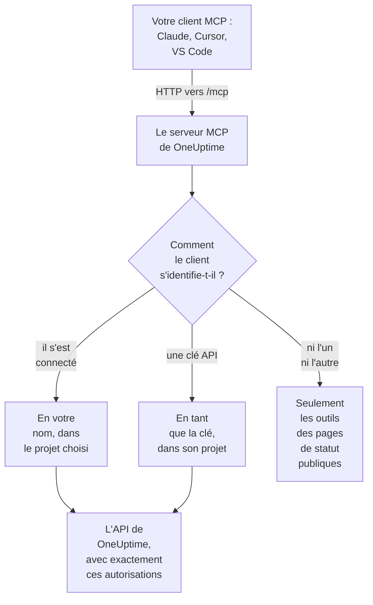

# Serveur MCP

Le serveur MCP de OneUptime permet à un assistant IA de travailler directement avec votre projet OneUptime. Connectez Claude, Cursor, VS Code avec GitHub Copilot ou tout autre client du Model Context Protocol (MCP), et demandez-lui d'examiner un incident, d'interroger des logs et des traces, d'accuser réception d'une alerte ou de configurer un moniteur : il appelle les outils de OneUptime avec vos autorisations, ou celles d'une clé API.

:::cards
- [Connecter un client](#connecter-un-client): Donnez à votre client l'adresse du serveur, puis connectez-vous.
- [Se connecter avec OneUptime](#se-connecter-avec-oneuptime): Ce qu'un client connecté peut faire, et comment le déconnecter.
- [Obtenir votre clé API](#obtenir-votre-clé-api): Pour un agent qui tourne sans surveillance.
- [Dépannage](#dépannage): Problèmes de connexion, d'autorisations et de liaison.
:::

Cette page traite des assistants IA qui se connectent à OneUptime. Pour que OneUptime AI utilise plutôt les outils d'autres serveurs MCP, comme ceux d'AWS ou de GitHub, voir [Serveurs MCP externes](/docs/ai/external-mcp-servers).

## Fonctionnement

Le serveur MCP fait partie de chaque instance OneUptime, à `/mcp` sur la même adresse que le tableau de bord, et utilise le transport streamable HTTP. Il n'y a rien à installer.

- **OneUptime Cloud** : `https://oneuptime.com/mcp`
- **Auto-hébergé** : `https://your-oneuptime-domain.com/mcp`



Le serveur est sans état : il n'émet aucun identifiant de session et chaque requête se suffit à elle-même, si bien qu'il fonctionne derrière des répartiteurs de charge et avec plusieurs réplicas.

## Ce que couvrent les outils

- **Moniteurs** : créer et configurer des moniteurs, vérifier leur état et consulter leur historique.
- **Réponse aux incidents** : créer des incidents, en accuser réception et les résoudre, ajouter des notes internes ou publiques, et les suivre jusqu'à leur résolution.
- **Alertes** : accuser réception des alertes et les résoudre, ajouter des notes, et gérer les états et les gravités des alertes.
- **Équipes et astreinte** : gérer les équipes et les politiques d'astreinte.
- **Pages de statut** : gérer les pages de statut et publier des annonces.
- **Maintenance planifiée** : créer et gérer des événements de maintenance.
- **Télémétrie** : interroger les logs, les métriques, les traces, les exceptions, les logs de moniteurs, les événements de sécurité et plus encore, en lecture seule.

Il existe des outils de création, de lecture, de liste, de mise à jour, de suppression et de comptage pour 42 types d'enregistrements, des outils de liste et de comptage pour 9 types de télémétrie, et des outils conçus pour la réponse aux incidents. Les outils en lecture seule portent `readOnlyHint`, tout outil qui modifie quelque chose porte `destructiveHint`, et seuls les outils des pages de statut publiques portent `openWorldHint`, si bien qu'un client peut lancer seul les appels en lecture seule et vous demander avant toute modification. Un appel d'outil en échec revient comme résultat d'outil (`isError: true`) avec un `statusCode`, les détails et une suggestion, et non comme une erreur du protocole MCP, si bien que l'agent peut lire l'échec et se corriger.

## Avant de commencer

- Une instance OneUptime : OneUptime Cloud ou auto-hébergée.
- Un client MCP, comme Claude Code, Claude, VS Code avec GitHub Copilot ou Cursor.
- Un compte OneUptime pour vous connecter, ou une clé API OneUptime pour un agent qui tourne sans surveillance. Les outils des pages de statut publiques n'ont besoin ni de l'un ni de l'autre.
- Sur OneUptime Cloud, le plan Growth ou supérieur : la connexion d'un client MCP est disponible avec les mêmes plans que les clés API.

## Connecter un client

Donnez au client l'adresse du serveur et rien d'autre. La première fois qu'il a besoin de vos données, il ouvre OneUptime dans votre navigateur pour que vous vous connectiez (voir [Se connecter avec OneUptime](#se-connecter-avec-oneuptime)). Sur une instance auto-hébergée, utilisez `https://your-oneuptime-domain.com/mcp` à la place de `https://oneuptime.com/mcp`.

:::tabs
@tab Claude Code
```bash
claude mcp add --transport http oneuptime https://oneuptime.com/mcp
```
Exécutez ensuite `/mcp` dans Claude Code et choisissez **oneuptime** pour vous connecter.
@tab Claude
Dans Claude, ouvrez **Customize → Connectors**, choisissez **Add custom connector** et saisissez `https://oneuptime.com/mcp`. Claude vous demande de vous connecter à OneUptime la première fois qu'il a besoin de vos données.
@tab VS Code
Ajoutez ceci à votre configuration MCP (voir [VS Code avec GitHub Copilot](#vs-code-avec-github-copilot) pour savoir où elle se trouve). VS Code ouvre OneUptime pour que vous vous connectiez quand vous démarrez le serveur :
```json
{
  "servers": {
    "oneuptime": {
      "type": "http",
      "url": "https://oneuptime.com/mcp"
    }
  }
}
```
@tab Cursor
```json
{
  "mcpServers": {
    "oneuptime": {
      "url": "https://oneuptime.com/mcp"
    }
  }
}
```
:::

Tout autre client qui prend en charge l'autorisation MCP fonctionne de la même façon : donnez-lui l'adresse et il découvre tout le reste. Voir [Se connecter (OAuth 2.1)](#se-connecter-oauth-21) pour le protocole.

Le tableau de bord propose aussi ces étapes, avec l'adresse de votre instance déjà renseignée : **Paramètres du projet → IA → Serveur MCP**. Et depuis n'importe quelle ressource (un moniteur, un incident, une page de statut, etc.), dépliez **Développeurs** dans son menu latéral et choisissez **Assistants IA** : cette page suggère aussi des prompts qui nomment la ressource et son ID, pour que l'assistant la trouve tout de suite. Pour une ressource pour laquelle le serveur MCP n'a pas encore d'outils, comme un workflow, la page montre comment un assistant capable d'exécuter des commandes peut travailler avec elle par l'API REST.

## Se connecter avec OneUptime

Le moyen le plus simple de se connecter est de donner à votre client MCP l'adresse du serveur et rien d'autre. La première fois que le client a besoin de vos données, il ouvre une page OneUptime dans votre navigateur :

:::steps
1. Connectez-vous à OneUptime, si ce n'est pas déjà fait.
2. Choisissez le projet dans lequel le client doit travailler.
3. Choisissez **Lecture et écriture** ou **Lecture seule**.
4. Cliquez sur **Autoriser**.
:::

Le client agit alors en votre nom dans ce projet. Il n'y a aucune clé API à créer, copier ou renouveler, et rien de secret n'est stocké dans un fichier de configuration.

Ce qu'un client connecté peut faire :

- **Il a vos autorisations, jamais plus.** Ce que vos équipes vous permettent dans le projet est ce que le client peut faire. Si votre rôle change ou si vous quittez le projet, cela s'applique dès la requête suivante du client. Quitter le projet déconnecte aussi le client : son autorisation est supprimée, et vous le reconnectez si vous rejoignez de nouveau le projet.
- **Lecture seule veut dire lecture seule.** Un client autorisé en lecture seule peut utiliser les outils `get_`, `list_` et `count_`. Les outils qui créent, mettent à jour, suppriment, accusent réception ou résolvent sont refusés, par le serveur MCP et par l'API OneUptime derrière lui. Vous ne pouvez jamais donner à un client plus d'accès qu'il n'en a demandé.
- **Il vaut pour un seul projet.** Pour utiliser un deuxième projet, connectez de nouveau le client et choisissez ce projet.
- **Il ne fonctionne que par le serveur MCP.** Le jeton d'accès du client est accepté par le point de terminaison MCP et nulle part ailleurs. Il ne peut pas servir à appeler directement l'API REST de OneUptime.
- **Les administrateurs de l'instance n'ont aucun traitement de faveur.** Un client connecté par un administrateur principal a ce que les équipes de cette personne lui accordent dans le projet, pas un accès à toute l'instance.

### Gérer les clients connectés

Chaque client connecté par connexion est listé dans **Paramètres du projet → IA → Serveur MCP**, sous **Clients MCP connectés**, avec la personne qui l'a connecté, ce qu'il peut faire et sa dernière utilisation. Vous voyez les clients que vous avez connectés ; les propriétaires et les administrateurs du projet voient ceux de tout le monde.

Cliquez sur **Déconnecter** pour déconnecter un client. Il cesse de fonctionner immédiatement.

Un client reste connecté tant qu'il est utilisé. Un client qui n'a pas servi depuis 30 jours doit se reconnecter.

### Contrôler qui peut connecter des clients

Par défaut, tout membre du projet peut connecter un client MCP. Pour l'interdire aux membres d'une équipe, ouvrez la page **Autorisations** de l'équipe, ouvrez **Plus de paramètres** en bas et ajoutez l'autorisation **Authorize MCP Client** sous **Bloquer les autorisations**. Les clients que ces membres avaient déjà connectés cessent de fonctionner immédiatement.

Si le projet exige l'authentification unique, connectez-vous au projet avec le SSO dans votre navigateur avant d'autoriser un client. La connexion du client dure aussi longtemps que cette session SSO ; quand elle expire, ou que le fournisseur SSO avec lequel vous vous êtes connecté est désactivé ou supprimé, connectez de nouveau le client.

Sur OneUptime Cloud, la connexion d'un client MCP est disponible avec les mêmes plans que les clés API (Growth et au-delà).

Dans l'Enterprise Edition, chaque modification faite par un client connecté est enregistrée dans le journal d'audit au nom de la personne qui l'a connecté, avec le nom du client. Les modifications faites avec une clé API indiquent le nom de la clé.

## Obtenir votre clé API

Utilisez une clé API pour un agent qui tourne sans surveillance, comme une tâche planifiée ou un pipeline de CI, où personne n'est là pour se connecter.

:::steps
### Créer la clé

Allez dans **Paramètres du projet → Avancé → Clés API** et cliquez sur **Créer : Clé API**. Donnez-lui un nom, comme "MCP Server".

### Choisir ce qu'elle peut faire

Sous **Accès**, choisissez **Lecteur** pour un agent qui ne fait que lire, ou **Administrateur du projet** pour un agent qui crée, met à jour et supprime aussi (voir [Autorisations des clés API](#autorisations-des-clés-api)).

### Copier la clé

Cliquez sur **Créer : Clé API** : la page de la clé s'ouvre. Copiez la clé depuis cette page.
:::

Les clés API appartiennent à un projet : le serveur MCP prend le projet dans la clé, si bien que les outils de création n'ont jamais besoin d'un argument `projectId`.

> [!WARNING]
> Ne donnez jamais une clé maître à un agent IA. Une clé API maître de OneUptime est aussi acceptée dans cet en-tête et donne un accès administrateur à toute l'instance. Utilisez toujours une clé API de projet avec le minimum dont l'agent a besoin : une clé en lecture seule suffit pour tous les outils `get_`, `list_` et `count_`.

## Se connecter avec une clé API

Envoyez la clé dans l'en-tête `x-api-key`. Une requête qui porte une clé API n'est jamais invitée à se connecter. Sur une instance auto-hébergée, utilisez votre propre domaine à la place de `oneuptime.com`.

:::tabs
@tab Claude Code
```bash
claude mcp add --transport http oneuptime https://oneuptime.com/mcp --header "x-api-key: your-api-key-here"
```
@tab Claude Desktop
Ajoutez ceci à `claude_desktop_config.json`, dans `~/Library/Application Support/Claude/` sur macOS, `%APPDATA%\Claude\` sur Windows ou `~/.config/Claude/` sur Linux :
```json
{
  "mcpServers": {
    "oneuptime": {
      "transport": "streamable-http",
      "url": "https://oneuptime.com/mcp",
      "headers": {
        "x-api-key": "your-api-key-here"
      }
    }
  }
}
```
@tab VS Code
La variable d'entrée avec `"password": true` demande la clé au démarrage du serveur, au lieu de la garder en clair :
```json
{
  "servers": {
    "oneuptime": {
      "type": "http",
      "url": "https://oneuptime.com/mcp",
      "headers": {
        "x-api-key": "${input:oneuptime-api-key}"
      }
    }
  },
  "inputs": [
    {
      "type": "promptString",
      "id": "oneuptime-api-key",
      "description": "OneUptime API Key",
      "password": true
    }
  ]
}
```
@tab Cursor
```json
{
  "mcpServers": {
    "oneuptime": {
      "url": "https://oneuptime.com/mcp",
      "headers": {
        "x-api-key": "your-api-key-here"
      }
    }
  }
}
```
:::

## VS Code avec GitHub Copilot

VS Code 1.99 et les versions ultérieures prennent en charge nativement les serveurs MCP dans GitHub Copilot Chat.

:::steps
### Vérifier ce qu'il vous faut

VS Code 1.99 ou ultérieur, avec l'extension GitHub Copilot installée et connectée, et GitHub Copilot Chat activé.

### Ouvrir la configuration MCP

Appuyez sur `Ctrl+Shift+P` (`Cmd+Shift+P` sur macOS), tapez "MCP: Open User Configuration" et appuyez sur Entrée. Cela ouvre, ou crée, le fichier `mcp.json`. Pour un seul espace de travail, créez plutôt `.vscode/mcp.json` dans celui-ci.

### Ajouter OneUptime

Collez la configuration VS Code ci-dessus : celle sans clé, pour vous connecter, ou celle avec une clé API.

### Démarrer le serveur

Appuyez sur `Ctrl+Shift+P` (`Cmd+Shift+P` sur macOS), tapez "MCP: List Servers" et choisissez **oneuptime** pour le démarrer. VS Code vous demande la première fois de faire confiance au serveur, puis de vous connecter ou de saisir votre clé API.

### Interroger Copilot

Ouvrez GitHub Copilot Chat en mode agent et demandez par exemple "Quels moniteurs ai-je dans OneUptime ?", "Montre-moi les incidents récents" ou "Crée un nouveau moniteur pour https://example.com".
:::

## Authentification

Le serveur MCP fonctionne de trois façons.

### Outils publics (sans authentification)

Sans clé API ni connexion, un client peut utiliser les outils publics :

- **`oneuptime_help`** : aide et conseils sur les outils MCP de OneUptime
- **`oneuptime_list_resources`** : les ressources et ce que vous pouvez faire avec chacune
- **`get_public_status_page_overview`** : la vue d'ensemble d'une page de statut publique
- **`get_public_status_page_incidents`** : les incidents d'une page de statut publique
- **`get_public_status_page_scheduled_maintenance`** : ses événements de maintenance planifiée
- **`get_public_status_page_announcements`** : ses annonces

Les outils des pages de statut publiques prennent l'ID d'une page de statut (un UUID) ou son nom de domaine. Pour n'utiliser qu'eux, connectez-vous avec l'adresse et sans identifiants :

```json
{
  "mcpServers": {
    "oneuptime": {
      "transport": "streamable-http",
      "url": "https://oneuptime.com/mcp"
    }
  }
}
```

Les propriétaires d'une page de statut peuvent désactiver l'accès MCP pour cette page : sur la page de statut, ouvrez **MCP** dans la section **IA** de son menu latéral et désactivez **Activer le serveur MCP**. L'interrupteur s'enregistre dès qu'il est basculé. L'accès MCP est activé par défaut. Tant qu'il est désactivé, les quatre outils `get_public_status_page_*` renvoient une erreur pour cette page de statut ; le site web de la page de statut, son flux RSS et son API JSON publique ne sont pas touchés, et les outils de page de statut qui demandent une connexion (`get_status_page`, `list_status_pages`, etc.) continuent de fonctionner pour le projet de la page.

### Se connecter (OAuth 2.1)

Tout autre outil doit savoir qui appelle. Un client qui n'envoie aucun identifiant et appelle l'un d'eux reçoit `401 Unauthorized` avec un en-tête `WWW-Authenticate` qui pointe vers les métadonnées de ressource protégée du serveur. C'est le signal auquel un client MCP réagit pour vous connecter ; `initialize`, `tools/list` et les outils publics ne le demandent jamais.

Le serveur implémente la [spécification d'autorisation de MCP](https://modelcontextprotocol.io/specification/latest/basic/authorization) :

- **Flux** : authorization code OAuth 2.1 avec PKCE (`S256` uniquement). Les jetons d'accès sont envoyés comme `Authorization: Bearer`.
- **Découverte** : métadonnées de ressource protégée (RFC 9728) et métadonnées du serveur d'autorisation (RFC 8414). L'émetteur et la ressource sont tous deux `https://<host>/mcp`.
- **Identité du client** : un Client ID Metadata Document (l'ID client est une URL `https` que le serveur récupère), ou l'enregistrement dynamique de clients (RFC 7591). Aucun client n'a besoin d'être enregistré par un administrateur.
- **Portées** : `mcp:read` pour les outils `get_`, `list_` et `count_` ; `mcp:write` ajoute tous les outils qui modifient quelque chose et inclut `mcp:read`. Un jeton en lecture seule qui appelle un outil d'écriture reçoit `403` avec `error="insufficient_scope"`.
- **Durée de vie des jetons** : un jeton d'accès dure une heure. Un jeton de rafraîchissement dure 30 jours et est remplacé à chaque utilisation ; utiliser un jeton de rafraîchissement déjà remplacé met fin à la connexion.
- **Indicateurs de ressource** (RFC 8707) : un jeton est émis pour `https://<host>/mcp` et n'est accepté nulle part ailleurs.
- **Révocation** (RFC 7009) : révoquer l'un ou l'autre jeton met fin à la connexion.

### Clé API

Un agent qui tourne sans surveillance envoie une clé API OneUptime dans l'un de ces en-têtes :

- `x-api-key` : votre clé API OneUptime
- `Authorization` : un jeton bearer avec votre clé API (par ex. `Bearer your-api-key-here`)

Le schéma `Bearer` n'est pas sensible à la casse. Une requête qui porte une clé API n'est jamais invitée à se connecter.

Sur OneUptime Cloud, les clés API ne fonctionnent que tant que le projet est sur **Growth** ou au-delà. En dessous, chaque outil qui a besoin de la clé répond `402` avec un message qui nomme le plan, et l'agent reçoit la consigne de ne pas réessayer. Rien n'est supprimé : la clé refonctionne telle quelle dès que le projet revient sur Growth, sans rien à reconnecter. Un client connecté par connexion agit en tant que personne et continue de fonctionner ([Clés API et SCIM en dessous de leur plan](/docs/api-reference/api-reference#clés-api-et-scim-sous-leur-offre)).

## Points de terminaison disponibles

| Point de terminaison | Méthode | Description |
| --- | --- | --- |
| `/mcp` | POST | Requêtes JSON-RPC pour les appels d'outils et les autres opérations |
| `/mcp` | GET | Sans en-tête SSE `Accept` : une courte description JSON du serveur. Avec un tel en-tête : `405`, car le serveur sans état n'offre pas de flux SSE autonome (les clients qui suivent la spécification continuent sans lui) |
| `/mcp` | DELETE | Ne fait rien : le serveur est sans état, il n'y a donc aucune session à terminer |
| `/mcp/health` | GET | Vérification de l'état |
| `/mcp/tools` | GET | La liste des outils, en REST simple |

Les clients MCP qui se connectent utilisent aussi les points de terminaison OAuth ci-dessous. Un client les trouve tout seul ; ils sont listés pour ceux qui écrivent un client ou configurent un proxy.

| Point de terminaison | Méthode | Description |
| --- | --- | --- |
| `/mcp/.well-known/oauth-protected-resource` | GET | Métadonnées de ressource protégée (RFC 9728). Aussi à `/.well-known/oauth-protected-resource/mcp` |
| `/.well-known/oauth-authorization-server/mcp` | GET | Métadonnées du serveur d'autorisation (RFC 8414). Aussi à `/mcp/.well-known/oauth-authorization-server` |
| `/mcp/oauth/authorize` | GET | Point de terminaison d'autorisation : là où le client envoie votre navigateur pour vous connecter |
| `/mcp/oauth/token` | POST | Point de terminaison de jeton : échange un code d'autorisation ou un jeton de rafraîchissement |
| `/mcp/oauth/register` | POST | Enregistrement dynamique de clients (RFC 7591) |
| `/mcp/oauth/revoke` | POST | Révocation de jetons (RFC 7009) |

Pour vérifier que le serveur tourne, et lister ses outils :

```bash
curl https://oneuptime.com/mcp/health
curl https://oneuptime.com/mcp/tools
```

## Outils de réponse aux incidents

En plus des outils pour chaque type d'enregistrement, le serveur a des outils conçus pour répondre aux incidents et aux alertes :

- **`acknowledge_incident`** / **`resolve_incident`** : faire passer un incident à l'état Acknowledged ou Resolved du projet, comme le fait le bouton du tableau de bord
- **`acknowledge_alert`** / **`resolve_alert`** : la même chose pour les alertes
- **`add_incident_note`** : ajouter une note à un incident avec `visibility: "internal"` (l'équipe seulement, par défaut) ou `visibility: "public"` (publiée sur la page de statut). Le Markdown est pris en charge
- **`add_alert_note`** : ajouter une note interne à une alerte

Une boucle typique : `list_incidents` → `acknowledge_incident` → enquêter avec `list_logs` → `add_incident_note` (publique) → `resolve_incident`.

L'outil **`oneuptime_whoami`** renvoie le projet auquel appartiennent vos identifiants (son ID et son nom). Pour un client connecté par connexion, il indique aussi sous quel compte il est connecté et s'il peut faire des modifications. C'est un bon premier appel pour qu'un agent se repère, et comme les outils de création prennent `projectId` dans les identifiants, l'agent n'a jamais à passer d'ID de projet.

## Interroger la télémétrie

Les logs, les métriques, les traces (spans), les exceptions, les logs de moniteurs et les autres types de télémétrie sont accessibles par des outils `list_` et `count_` en lecture seule (`list_logs`, `list_metrics`, `list_spans`, `list_exception_instances`, `list_monitor_logs` et leurs jumeaux `count_`). La télémétrie arrive par OpenTelemetry, il n'y a donc pas d'outils de création.

Interrogez toujours la télémétrie avec une plage de temps. Un champ de requête prend une valeur, ou un objet d'opérateur :

```json
{
  "query": {
    "time": { "_type": "GreaterThan", "value": "2026-07-04T00:00:00.000Z" }
  },
  "sort": { "time": "DESC" },
  "limit": 50
}
```

Les opérateurs sont `EqualTo`, `NotEqual`, `IsNull`, `NotNull`, `EqualToOrNull`, `GreaterThan`, `LessThan`, `GreaterThanOrEqual`, `LessThanOrEqual`, `InBetween`, `Search` et `Includes`. Les valeurs de tri sont `"ASC"` ou `"DESC"`.

## Sélection des champs et pagination

Les outils `get_` et `list_` prennent un tableau `select` facultatif de noms de champs. Par défaut, tous les champs lisibles reviennent sauf les plus lourds (colonnes JSON, texte très long et HTML), qu'il faut demander dans `select`.

Les outils de liste paginent avec `limit` (10 par défaut, 100 au plus) et `skip`, et chaque réponse de liste dit exactement ce qu'elle a renvoyé :

```json
{
  "returnedCount": 10,
  "totalCount": 42,
  "skip": 0,
  "limit": 10,
  "hasMore": true,
  "data": ["..."]
}
```

## Exemples d'utilisation

### Questions courantes

```text
"What's the current status of all my monitors?"
"Show me incidents from the last 24 hours"
"List the teams in this project"
"Show me our on-call policies"
```

### Moniteurs et incidents

```text
"Create a new website monitor for https://example.com that checks every 5 minutes"
"Set up an API monitor for https://api.example.com/health with a 30-second timeout"
"Disable the monitor for staging.example.com while we're doing maintenance"
"Create a high-priority incident for the database outage affecting user authentication"
"Add a note to incident #123 saying 'Database connection restored, monitoring for stability'"
"Mark incident #456 as resolved"
```

### Pages de statut

```text
"Update our status page to show 'Investigating Payment Issues' for the payment service"
"Create a status page announcement about scheduled maintenance this weekend"
```

### Requêtes sur les pages de statut publiques (sans clé API)

Ces requêtes fonctionnent sans identifiants, avec les seuls outils des pages de statut publiques :

```text
"What's the current status of status.example.com?"
"Show me recent incidents from the OneUptime status page"
"Are there any scheduled maintenance events on status.acme.com?"
"Get the latest announcements from my public status page with ID abc123-..."
```

### Plusieurs étapes à la fois

```text
"Create a scheduled maintenance window for Saturday 2-4 AM, disable all monitors for api.example.com during that time, and update the status page"
"Show me all monitors that have been down in the last hour, create incidents for any that don't already have one"
```

## Autorisations des clés API

| Ce que fait l'agent | Choisir sous **Accès** |
| --- | --- |
| Lit seulement | **Lecteur**, ou ajoutez des autorisations de lecture sur la page de la clé |
| Crée, met à jour et supprime aussi | **Administrateur du projet**, ou ajoutez le rôle Project Admin sur la page de la clé |

Donnez à chaque clé le minimum dont elle a besoin, renouvelez les clés régulièrement, gardez une clé distincte pour chaque environnement, et surveillez ce que fait chaque clé dans OneUptime.

## Configuration en auto-hébergement

La connexion fonctionne d'emblée sur une instance auto-hébergée. Deux paramètres la modifient :

| Variable d'environnement | Valeur Helm | Ce qu'elle fait |
| --- | --- | --- |
| `DISABLE_MCP_OAUTH` | `mcpOAuth.disabled` | Mettez `true` pour désactiver la connexion. Les points de terminaison OAuth ne sont plus servis et le serveur MCP n'accepte plus que les clés API. Rien n'est supprimé ; les clients connectés refonctionnent quand elle est réactivée. |
| `DISABLE_MCP_OAUTH_CLIENT_ID_METADATA_DOCUMENTS` | `mcpOAuth.disableClientIdMetadataDocuments` | Mettez `true` sur une instance qui ne peut pas joindre internet. Un client peut s'identifier avec une URL que OneUptime récupère ; avec ce paramètre, les clients s'enregistrent plutôt directement auprès de votre instance, ce qui ne demande aucune requête sortante. |

Si vous faites tourner votre propre proxy inverse devant OneUptime, transmettez `/.well-known/oauth-protected-resource` et `/.well-known/oauth-authorization-server` (et tout ce qui se trouve en dessous) à OneUptime en même temps que `/mcp`. L'ingress fourni le fait déjà.

Le serveur construit chaque URL OAuth à partir des paramètres `HOST` et `HTTP_PROTOCOL`, ils doivent donc correspondre à l'adresse que les gens utilisent pour joindre votre instance.

## Dépannage

### Problèmes de connexion

- **Le client ne me demande jamais de me connecter** : le client ne prend peut-être pas en charge l'autorisation MCP, ou il est configuré avec un en-tête de clé API, qui a la priorité. Retirez l'en-tête pour vous connecter à la place.
- **Mon projet est grisé sur la page d'autorisation** : la page indique pourquoi à côté du nom du projet : le plan du projet n'inclut pas la connexion de clients MCP, le projet exige le SSO et ce navigateur ne s'y est pas connecté avec le SSO, ou votre équipe est bloquée pour la connexion de clients.
- **Un outil est refusé comme "read-only"** : le client a été autorisé en lecture seule. Connectez-le de nouveau et choisissez **Lecture et écriture**.
- **Le client a cessé de fonctionner** : il a été déconnecté, n'a pas servi depuis 30 jours, vous avez été retiré du projet, ou la session SSO du projet a expiré ou son fournisseur a été désactivé. Connectez-le de nouveau.
- **Auto-hébergé - le client dit ne pas trouver le serveur d'autorisation** : vérifiez que `HOST` et `HTTP_PROTOCOL` correspondent à votre adresse publique, et que votre proxy transmet les chemins `/.well-known/oauth-*`.

### Erreurs d'autorisation

La clé API, ou pour un client connecté par connexion votre propre compte, a besoin des bonnes autorisations : un accès en lecture pour lister des enregistrements, un accès en écriture pour les créer et les mettre à jour, et un accès en suppression pour les retirer.

### Problèmes de liaison

Vérifiez que l'adresse de OneUptime est correcte et joignable, que la clé API est valide et que le point de terminaison de santé répond (voir [Points de terminaison disponibles](#points-de-terminaison-disponibles)).

### Clé API invalide

- Vérifiez la clé API dans vos paramètres OneUptime, sans espaces ni caractères en trop
- Vérifiez que la clé n'a pas expiré
- Sur OneUptime Cloud, un `402` qui indique que les clés API demandent le plan Growth signifie que le projet est en dessous : passez le projet à un plan supérieur dans **Paramètres du projet → Facturation et factures → Facturation**, et la même clé refonctionne

### Erreurs de session

Le serveur MCP est sans état : il n'émet ni ne suit d'identifiants de session, si bien que chaque requête fonctionne sur n'importe quel réplica. Un client qui envoie un en-tête `mcp-session-id` hérité d'une ancienne version du serveur peut l'omettre ; il est ignoré. Mettez à jour une ancienne configuration de client qui attend du serveur qu'il renvoie un identifiant de session.

## Ressources disponibles

| Domaine | Enregistrements avec des outils de création, de lecture, de liste, de mise à jour, de suppression et de comptage |
| --- | --- |
| Supervision | Monitor, Monitor Status, Monitor Status Event |
| Gestion des incidents | Incident, Incident State, Incident Severity, Incident State Timeline, Incident Public Note, Incident Internal Note, Incident Alert, Postmortem Status |
| Alertes | Alert, Alert State, Alert Severity, Alert State Timeline, Alert Internal Note |
| Pages de statut | Status Page, Status Page Announcement |
| Maintenance planifiée | Scheduled Maintenance Event, Scheduled Maintenance State, Scheduled Maintenance State Timeline |
| Équipes et astreinte | Team, On-Call Policy |
| Étiquettes | Label |
| Sécurité | Security Case, Security Case Evidence, Security Case Note, Security Case Priority, Security Case Status, Security Case Task, Security Detection, Security Playbook |
| Sécurité des données | Data Store, Data Store Finding, Data Store Access Entry, Data Flow, Data Security Issue, Data Security Scan, Data Security Setting, Check Setting, Custom Data Type, Residency Rule |

| Domaine | Télémétrie avec des outils de liste et de comptage seulement |
| --- | --- |
| Observabilité | Log, Metric, Span, Exception Instance, Monitor Log |
| Sécurité | Security Event, Threat Intel Indicator |
| Changements et coûts | Change Event, Kubernetes Cost Allocation |

Les outils sont nommés en snake case : `create_incident`, `get_incident`, `list_incidents`, `update_incident`, `delete_incident` et `count_incidents`, ou `list_logs` et `count_spans` pour la télémétrie.

## Étapes suivantes

:::cards
- [Demander à l'IA](/docs/ai/ask-ai): Interrogez plutôt votre projet depuis OneUptime.
- [Référence de l'API OneUptime](/docs/api-reference/api-reference): L'API REST derrière chaque outil.
- [Autorisations](/docs/permissions/index): Ce qu'un rôle, une équipe ou une clé API peut faire.
:::
