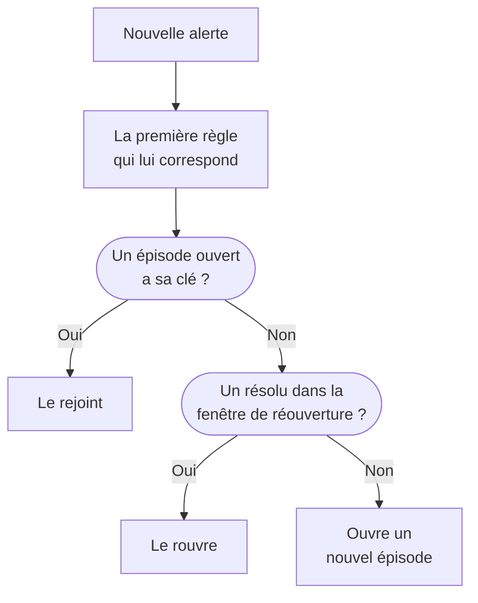

# Épisodes d'alertes et règles de regroupement

Quand une base de données tombe, vingt moniteurs peuvent lever vingt alertes en quelques minutes. Un épisode les réunit en un seul enregistrement que votre équipe prend en compte et résout d'un coup, et une règle de regroupement décide quelles alertes en font partie. Cette page montre comment fonctionne le regroupement, comment configurer une règle et comment un épisode se comporte une fois ouvert.

:::cards
- [Comment fonctionne le regroupement](#comment-fonctionne-le-regroupement): Règles, clés de regroupement et fenêtres de temps.
- [Créer une règle de regroupement](#créer-une-règle-de-regroupement): À partir d'un modèle en un clic, ou la vôtre.
- [Comment se comporte un épisode](#comment-se-comporte-un-épisode): Sa gravité, ses états et quand il se résout.
- [Qui un épisode alerte](#qui-un-épisode-alerte): Les politiques d'astreinte de la règle et celles des alertes elles-mêmes.
:::

## Comment fonctionne le regroupement

Le regroupement s'exécute une fois pour chaque nouvelle alerte, juste après l'exécution de ses politiques d'astreinte. L'alerte est comparée à vos règles de regroupement activées, de haut en bas de la liste, et la première règle qui lui correspond décide de son épisode. Une alerte à laquelle aucune règle ne correspond reste seule.



- **Les conditions de la règle** décident à quelles alertes elle s'applique. Une règle sans condition s'applique à chaque nouvelle alerte.
- **La clé de regroupement** décide quelles alertes partagent un épisode : celles qui ont le même moniteur, la même gravité, le même titre, ou toute combinaison selon laquelle la règle regroupe. Une règle qui ne regroupe selon rien met dans un seul épisode chaque alerte qui lui correspond.
- **La fenêtre de temps** décide combien de temps un épisode continue d'accepter des alertes. Activée, une alerte ne le rejoint que si elle arrive dans la fenêtre suivant la dernière alerte de l'épisode. Désactivée, les alertes correspondantes continuent de le rejoindre jusqu'à ce que l'épisode soit résolu.

Le regroupement a lieu à la création d'une alerte. Une règle que vous ajoutez aujourd'hui regroupe les alertes créées après elle ; elle ne regroupe pas à nouveau celles qui existent déjà.

> [!NOTE]
> Une alerte créée déjà prise en compte peut rejoindre un épisode ouvert mais n'en ouvre jamais, et une alerte créée résolue n'est pas regroupée du tout. Voir [Créée déjà prise en compte ou résolue](/docs/alerts/index#créée-déjà-prise-en-compte-ou-résolue).

## Créer une règle de regroupement

Allez dans **Alertes → Règles → Règles de regroupement**. La section **Règles** du menu latéral commence repliée, dépliez-la donc d'abord.

### Partir d'un modèle

Un projet sans règle de regroupement voit quatre règles toutes prêtes au lieu d'une liste vide ; une fois que vous avez des règles, **Créer à partir d'un modèle** sur la carte les ouvre. **Ajouter une règle** en enregistre une en un clic, activée, en fin de liste et appliquée à chaque nouvelle alerte. Modifiez-la ensuite comme n'importe quelle autre règle.

| Modèle                                              | Regroupe                                                                  | Fenêtre de temps |
| --------------------------------------------------- | ------------------------------------------------------------------------- | ---------------- |
| **Regrouper les alertes d'un même moniteur**        | Un épisode par moniteur                                                   | 30 minutes       |
| **Regrouper les alertes simultanées**               | Un épisode commun, quel que soit le moniteur                              | 10 minutes       |
| **Regrouper les alertes par gravité**               | Un épisode par gravité                                                    | 30 minutes       |
| **Regrouper les répétitions d'une même alerte**     | Un épisode par titre d'alerte, sans tenir compte des chiffres ni de la casse | 1 heure       |

### Créer la vôtre

:::steps
#### Répondre à la question du regroupement

Cliquez sur **Créer une règle personnalisée** sous les modèles, ou sur **Créer une règle de regroupement d'alertes** sur la carte une fois que vous avez des règles. À l'étape **Regroupement**, **Regrouper les alertes par** pose une seule question : **Moniteur**, **Tout ensemble**, **Gravité**, **Titre** ou **Personnalisé**. Le **Nom** suit votre réponse jusqu'à ce que vous saisissiez le vôtre.

#### Régler la fenêtre de temps

**Ne regrouper que les alertes qui arrivent rapprochées** est activé, avec une fenêtre de 30 minutes. Modifiez les minutes, ou désactivez-le pour garder un épisode ouvert jusqu'à sa résolution.

#### Combiner des champs, pour Personnalisé

**Personnalisé** ajoute une étape **Regrouper par** avec cinq interrupteurs : **Regrouper par moniteur**, **Regrouper par gravité d'alerte**, **Regrouper par titre d'alerte**, **Regrouper par étiquettes d'alerte** et **Regrouper par étiquettes de moniteur**. Les étiquettes regroupent selon leur ensemble exact.

#### Restreindre

Sous **Quelles alertes**, **Toutes les alertes**, où démarre une nouvelle règle, regroupe chaque nouvelle alerte. Pour la restreindre, choisissez **Uniquement les alertes qui correspondent aux conditions** et ajoutez des conditions sur les moniteurs, les gravités, les étiquettes, les titres et les descriptions. Cliquez ensuite sur **Créer une règle de regroupement d'alertes**.
:::

Tout ce qu'une règle peut faire d'autre est replié sous **Plus de champs**, à la fin de l'étape **Regroupement**, en trois groupes. Replié, son en-tête nomme ce qu'il contient et indique la valeur de chaque paramètre que la règle utilise, si bien que modifier une règle ne masque jamais ce qu'elle fait.

| Groupe                          | Paramètres                                                                                                 |
| ------------------------------- | ---------------------------------------------------------------------------------------------------------- |
| **Astreinte et propriété**      | Les **Politiques d'astreinte** à exécuter quand la règle ouvre un épisode, et les **Propriétaires de l'épisode**. |
| **Cycle de vie de l'épisode**   | **Rouvrir les épisodes résolus récemment**, **Attendre avant de résoudre un épisode** et **Résoudre les épisodes inactifs**, chacun un interrupteur avec ses minutes. |
| **Détails**                     | La **Description** de la règle, le **Modèle de titre de l'épisode**, le **Modèle de description de l'épisode** et les **Étiquettes de l'épisode**. |

Les règles sont vérifiées de haut en bas de la liste, et la première correspondance l'emporte : faites glisser une règle pour changer sa place. Placez les règles précises au-dessus des règles larges. La colonne **Regroupement** de la liste dit en une phrase ce que fait chaque règle, par exemple « Un épisode par moniteur ».

## Titres des épisodes

Sans modèle, un épisode porte le nom du moniteur de sa première alerte, ou les 50 premiers caractères du titre de l'alerte quand elle n'a pas de moniteur. Avec un **Modèle de titre de l'épisode** ou un **Modèle de description de l'épisode**, ces variables sont remplies. Tapez `{{` dans l'un ou l'autre champ pour en choisir une.

| Variable               | Remplie avec                                                                                    |
| ---------------------- | ----------------------------------------------------------------------------------------------- |
| `{{alertTitle}}`       | Le titre de la première alerte.                                                                 |
| `{{alertDescription}}` | La description de la première alerte.                                                           |
| `{{alertSeverity}}`    | La gravité de la première alerte.                                                               |
| `{{monitorName}}`      | Le nom du moniteur de la première alerte.                                                       |
| `{{alertCount}}`       | Le nombre d'alertes que contient l'épisode, réécrit à mesure que des alertes le rejoignent ou le quittent. |

Une variable pour laquelle la première alerte n'a pas de valeur, ou qui ne figure pas dans cette liste, est omise. Quand la première alerte est privée, `{{alertTitle}}` et `{{alertDescription}}` affichent « Private alert », parce que l'épisode n'est pas privé.

## Comment se comporte un épisode

Un épisode parcourt vos états d'alerte, la même liste que celle des alertes, et a ses propres propriétaires, notes, cause racine et notes de remédiation.

- **Sa gravité monte avec ses alertes.** Il commence avec la gravité de sa première alerte, et prend celle de toute alerte plus grave qui le rejoint, « plus grave » signifiant plus haut dans **Alertes → Paramètres → Gravité de l'alerte**.
- **Son état fait bouger ses alertes.** Prenez en compte ou résolvez un épisode, ou faites-le passer dans un état à vous, et chaque alerte qu'il contient suit, sauf une alerte déjà dans cet état ou au-delà.
- **Il se résout de lui-même** dès que toutes ses alertes sont résolues. **Attendre avant de résoudre un épisode** le garde d'abord ouvert ce nombre de minutes, au cas où une alerte reviendrait.
- **Il peut se rouvrir.** Avec **Rouvrir les épisodes résolus récemment** activé, une alerte correspondante qui arrive dans les minutes suivant la résolution de l'épisode le rouvre, au lieu d'en ouvrir un autre. C'est le seul retour vers le haut de la liste des états, et il ne rouvre pas les alertes de l'épisode.

> [!WARNING]
> **Résoudre les épisodes inactifs** résout un épisode quand aucune nouvelle alerte ne l'a rejoint pendant les minutes que vous fixez, et résout aussi chaque alerte encore ouverte dedans. Utilisez-le pour du bruit dont vous êtes sûr qu'il ne demande aucune réponse.

## Qui un épisode alerte

Les propres politiques d'astreinte d'une alerte s'exécutent à sa création, avant le regroupement, qu'elle rejoigne un épisode ou non. Un épisode ajoute les siennes :

```mermaid title="Une alerte qui ouvre un épisode alerte deux fois ; une qui le rejoint, une fois"
flowchart TB
    alert["Nouvelle alerte"] --> own["Ses propres politiques<br/>s'exécutent"]
    own --> grouped{"Regroupement"}
    grouped -->|"Ouvre un épisode"| ep["Celles de l'épisode<br/>s'exécutent aussi"]
    grouped -->|"Rejoint un épisode"| none["Rien d'autre<br/>ne s'exécute"]
```

- **Un nouvel épisode** exécute les **Politiques d'astreinte** de la règle, plus celles de toute règle correspondante de l'onglet **Règles d'épisode** de **Alertes → Règles → Règles d'astreinte**.
- **Une alerte qui rejoint un épisode ouvert** n'exécute que ses propres politiques. Celles de l'épisode ne s'exécutent pas à nouveau.
- **Répondre à l'appel d'un épisode** prend en compte l'épisode, et avec lui chaque alerte qu'il contient.

> [!TIP]
> Pour alerter une fois par problème plutôt qu'une fois par alerte, placez les politiques d'astreinte sur vos règles de regroupement et retirez-les des alertes : des critères du moniteur, du formulaire de création et de vos règles d'astreinte d'alertes.

Les propriétaires de l'épisode en sont informés aussi : **Épisode d'alerte créé**, **État de l'épisode d'alerte modifié** et **Alerte ajoutée à l'épisode d'alerte** sont activés par e-mail par défaut, dans **Paramètres utilisateur → Paramètres de notification**, dans l'onglet **Alertes**. Les **Propriétaires de l'épisode** de la règle deviennent propriétaires de chaque épisode qu'elle ouvre, et sont prévenus comme n'importe quel autre propriétaire.

## Créer un épisode à la main

:::steps
### Ouvrir le formulaire

Allez dans **Alertes → Tous les épisodes** et cliquez sur **Créer un épisode**. Le formulaire **Créer un nouvel épisode d'alerte** s'ouvre.

### Décrire l'épisode

Dans **Détails de l'épisode**, remplissez le **Titre** et, si vous le souhaitez, une **Gravité de l'alerte** et une **Description**. **État initial** et **Étiquettes** attendent sous **Plus de champs**.

### Choisir qui est alerté et qui en est propriétaire

Dans **Astreinte et propriétaires**, choisissez une **Politique d'astreinte** à exécuter à la création de l'épisode, et ses **Propriétaires**. Cliquez ensuite sur **Créer un épisode**.

Chaque équipe dont vous êtes membre est à un clic sous **Propriétaires**, et le récapitulatif liste les règles de propriétaire qui en ajouteront d'autres.

### Ajouter les alertes

Ouvrez la page **Alertes des membres** de l'épisode, cliquez sur **Ajouter des alertes** et cochez les alertes qui en font partie, autant qu'il vous en faut à la fois. Pour partir plutôt des alertes, sélectionnez-les dans la liste **Alertes** et choisissez **Ajouter à un nouvel épisode** dans **Actions groupées** (voir [Épisodes](/docs/incidents/episodes)).
:::

Un épisode que vous créez n'a pas de règle de regroupement : la liste affiche donc sa **Règle de regroupement** comme **Manuel**, et aucun paramètre de cycle de vie ne s'applique à lui. Il se résout tout de même de lui-même dès que toutes ses alertes sont résolues.

## Ce que montre chaque page d'un épisode

| Section du menu latéral | Pages                                                                       |
| ----------------------- | --------------------------------------------------------------------------- |
| **Vue d'ensemble** | **Vue d'ensemble**, **Chronologie d'état** |
| **Investigation** | **Description**, **Cause racine**, **Notes de remédiation** |
| **Équipe** | **Propriétaires** |
| **Alertes** | **Alertes des membres** |
| **Notes** | **Notes privées** |
| **Développeurs** | **Terraform**, **API**, **Assistants IA** |
| **Avancé** | **Journaux d'audit**, **Supprimer l'épisode** |

**Développeurs** et **Avancé** commencent repliées. Sur la **Vue d'ensemble**, l'en-tête nomme les **Propriétaires** de l'épisode, équipes d'abord, et la première tuile, **Créé**, indique quand l'épisode a été créé — **Automatiquement**, quand une règle de regroupement l'a ouvert. La carte **Ce qui s'est passé** ouvre la page — la description de l'épisode et sa **Cause racine** — puis **Alertes de cet épisode** et le **Flux de l'épisode**, à côté de la carte **Détails de l'épisode** : son numéro, son état, sa gravité, son nombre d'alertes, sa règle de regroupement et ses politiques d'astreinte. Son en-tête propose **Prendre en compte** et **Résoudre**, et **Passer l'épisode à** dans le menu **⋯**.

**Alertes → Épisodes actifs** liste les épisodes pas encore résolus, et le badge à côté les compte.

## Dépannage

:::details Une nouvelle alerte n'a pas rejoint l'épisode attendu
Vérifiez, dans l'ordre : que la règle est activée ; qu'aucune règle au-dessus n'a correspondu à l'alerte en premier ; que l'alerte remplit les conditions de la règle ; qu'elle a la même clé de regroupement que les alertes de l'épisode, comme le même moniteur ; et, avec la fenêtre de temps activée, qu'elle est arrivée dans la fenêtre suivant la dernière alerte de l'épisode. Une alerte créée déjà prise en compte n'ouvre jamais d'épisode, et une alerte créée résolue n'est jamais regroupée.
:::

:::details Nous avons été alertés deux fois pour un seul problème
La politique d'astreinte propre à l'alerte s'est exécutée, et celle du nouvel épisode aussi. Gardez les politiques sur la règle de regroupement, et retirez-les des critères, du formulaire ou des règles d'astreinte de l'alerte.
:::

:::details Un épisode s'est résolu de lui-même
Toutes ses alertes étaient résolues, l'épisode s'est donc résolu une fois son attente écoulée. Quand **Résoudre les épisodes inactifs** est activé, il résout aussi un épisode qui n'a reçu aucune nouvelle alerte pendant cette durée.
:::

## Étapes suivantes

:::cards
- [Règles et paramètres des alertes](/docs/alerts/settings): Les autres règles qui agissent sur les nouvelles alertes et les nouveaux épisodes.
- [États et sévérités des alertes](/docs/alerts/states-and-severities): Les états que traverse un épisode.
- [Règles d'escalade](/docs/on-call/escalation-rules): Comment les politiques qu'exécute un épisode alertent les personnes.
- [Paramètres et automatisation des incidents](/docs/incidents/settings): Les règles de regroupement des incidents.
:::
