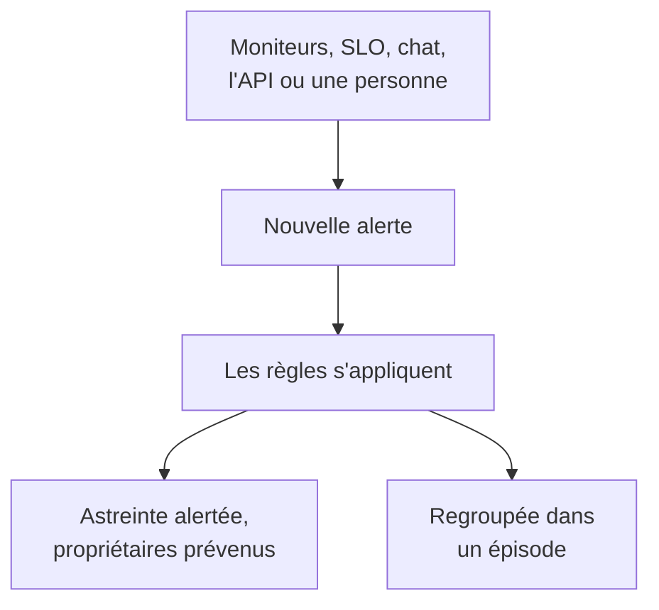

# Vue d'ensemble des alertes

Une alerte signale à votre équipe un problème à examiner avant que vos utilisateurs ne le remarquent : un disque qui se remplit, un certificat sur le point d'expirer, un taux d'erreurs qui grimpe. Elle peut alerter la personne d'astreinte et prévenir ses propriétaires, mais elle n'apparaît jamais sur une page de statut et ne prévient jamais vos abonnés. Cette page explique d'où viennent les alertes, où elles se trouvent dans le tableau de bord et comment votre équipe les traite.

:::cards
- [Alertes et incidents](#alertes-et-incidents): Ce qu'un problème devrait être, et comment les deux se relient.
- [D'où viennent les alertes](#doù-viennent-les-alertes): Moniteurs, SLO, chat, l'API, ou à la main.
- [Créer une alerte à la main](#créer-une-alerte-à-la-main): Deux étapes dans le tableau de bord.
- [Répondre à une alerte](#répondre-à-une-alerte): La prendre en compte, la résoudre ou déclarer un incident.
:::

## Fonctionnement

La plupart des alertes sont levées par un moniteur dont les critères correspondent. D'autres viennent d'un SLO qui consomme son budget d'erreurs, d'une règle de sécurité, d'un appel envoyé depuis Slack ou Microsoft Teams, ou d'une personne. Quelle que soit leur origine, une alerte est toujours le même enregistrement, et les mêmes règles s'y appliquent.

- **Les règles la façonnent.** Les règles de confidentialité, de propriétaire, d'étiquettes et d'astreinte s'exécutent dès la création d'une alerte, et les règles de runbook lancent les procédures correspondantes. Voir [Règles et paramètres des alertes](/docs/alerts/settings).
- **Les politiques d'astreinte alertent les personnes.** Les politiques que nomme l'alerte, plus celles qu'ajoutent ses règles d'astreinte, alertent leurs personnes jusqu'à ce que quelqu'un prenne l'alerte en compte.
- **Les épisodes regroupent le bruit.** Une règle de regroupement réunit les alertes liées dans un épisode, pour que vingt alertes d'une même panne ne fassent qu'une seule chose à traiter. Voir [Épisodes d'alertes et règles de regroupement](/docs/alerts/episodes).

## Alertes et incidents

Les deux enregistrent un problème, et les deux peuvent alerter la personne d'astreinte. Ce qui change, c'est qui le problème touche.

|                                    | Alerte                                                 | Incident                                          |
| ---------------------------------- | ------------------------------------------------------ | ------------------------------------------------- |
| **Ce que c'est**                   | Un problème que votre équipe doit examiner avant que les utilisateurs ne soient touchés | Un problème qui touche vos utilisateurs, comme une panne |
| **Sur les pages de statut**        | Jamais                                                 | Peut s'afficher, et prévient les abonnés          |
| **Notes**                          | Notes privées, pour votre équipe uniquement            | Notes publiques pour les clients, et notes privées |
| **États de départ**                | **Identifié**, **Pris en compte**, **Résolu**          | **Identifié**, **Pris en compte**, **Résolu**     |
| **Gravités de départ**             | **Élevé**, **Faible**                                     | Critical Incident, Major Incident, Minor Incident |
| **Numéros dans un nouveau projet** | `ALT-42`, et `AE-42` pour les épisodes                 | `INC-42`, et `IE-42` pour les épisodes            |

Levez une alerte quand votre équipe doit regarder avant que quiconque à l'extérieur ne remarque quoi que ce soit, et déclarez un incident quand les utilisateurs sont touchés. Quand une alerte s'avère faire partie d'une panne, déclarez un incident à partir d'elle, ou liez-la à l'incident qui l'explique : voir [Alertes liées](/docs/incidents/linked-alerts).

## D'où viennent les alertes

- **Les critères d'un moniteur.** Dans les **Actions** d'un critère, activez **Lorsque les filtres correspondent, créer une alerte.** et remplissez l'alerte qu'il crée : **Titre de l'alerte** et **Gravité**, puis, chacun replié, **Description**, **Propriété et étiquettes**, **Astreinte** et **Plus de champs**, qui contient **Résoudre automatiquement l'alerte**, **Alerte privée** et **Notes de remédiation**. Un critère garde une seule alerte ouverte à la fois, une par série sur un moniteur qui regroupe par un champ, et **Résoudre automatiquement l'alerte** la résout dès que le critère ne correspond plus. Voir [Créer un moniteur](/docs/monitor/create-monitor) et [Modèles d'incident et d'alerte](/docs/monitor/incident-alert-templating).
- **À la main.** Cliquez sur **Créer une alerte** dans la liste des alertes, ou dans l'onglet **Alertes** d'un moniteur, d'un hôte, d'un équipement réseau ou d'une autre ressource, qui choisit cette ressource pour vous. Voir [Créer une alerte à la main](#créer-une-alerte-à-la-main).
- **Le taux de consommation d'un SLO.** Une règle de taux de consommation peut créer une alerte quand un SLO dépense son budget d'erreurs trop vite. Voir [Alertes et incidents de taux de consommation](/docs/slo/burn-rate-alerts).
- **Sites réseau et événements de sécurité.** Un site réseau configuré pour alerter quand il n'est pas en bonne santé ouvre une alerte dès que son agrégation cesse d'être opérationnelle, et vos règles de détection d'événements de sécurité ouvrent aussi des alertes. Voir [Sites réseau (agrégation de santé et disponibilité)](/docs/monitor/network-sites) et [Événements de sécurité (SIEM)](/docs/telemetry/security-events).
- **Un appel.** `/oneuptime page` dans Slack ou Microsoft Teams ouvre une alerte dont le titre est votre message, et alerte les personnes que vous nommez. Les blocs d'appel d'un workflow font de même avec le titre et le message que vous leur donnez. Voir [Alerter quelqu'un depuis Slack](/docs/workspace-connections/slack#alerter-quelquun-depuis-slack) et [Paging](/docs/workflows/components#paging).
- **L'API, Terraform et les workflows.** Les alertes sont une ressource ordinaire : `/api/alert`, la ressource Terraform `oneuptime_alert` et l'étape **Create One Alert** d'un workflow.

## Où trouver les alertes dans le tableau de bord

Ouvrez **Alertes** depuis le menu **Produits** de la barre supérieure. La liste des alertes se trouve à `/dashboard/{projectId}/alerts`, et son menu latéral rassemble tout ce qui concerne les alertes :

| Section               | Ce que vous y faites                                                                                                      |
| --------------------- | ------------------------------------------------------------------------------------------------------------------------- |
| **Alertes**           | **Toutes les alertes** et **Alertes actives**, dont le badge rouge compte les alertes pas encore résolues.                  |
| **Épisodes** | **Tous les épisodes** et **Épisodes actifs** : les alertes liées, regroupées en un seul problème à traiter. |
| **IA**                | **Analyses**, **Journaux** et **Paramètres** : ce que OneUptime AI a appris de vos alertes, tout ce qu'il a fait et ce qu'il a le droit de faire. |
| **Espace de travail** | **Slack** et **Microsoft Teams**, selon ce que le projet a connecté, ou **Connecter Slack ou Teams** s'il n'a ni l'un ni l'autre. |
| **Règles**            | **Règles de regroupement**, **Règles d'astreinte**, **Règles de propriétaire**, **Règles de runbook**, **Règles de confidentialité**, **Règles d'étiquettes**, **Reminder Rules**. |
| **Paramètres**        | **État de l'alerte**, **Gravité de l'alerte**, **Modèles de notes**, **Champs personnalisés**, **Mesures**, **Appartenance aux épisodes**, **Numérotation**. |

**Alertes** et **Épisodes** sont ouvertes ; **IA**, **Espace de travail**, **Règles**, **Paramètres** et **Développeurs** commencent repliées, et une section s'ouvre d'elle-même quand vous êtes sur l'une de ses pages. La configuration des alertes se trouve ici, pas dans les **Paramètres du projet**.

La liste affiche **Numéro d'alerte**, **Titre**, **État**, **Gravité**, **Ressources affectées** (le moniteur de l'alerte en premier), **Créé**, **Durée**, **Étiquettes** et **Propriétaires**. Sélectionnez des alertes pour agir sur plusieurs à la fois : **Prendre en compte**, **Résoudre**, **Modifier l'état**, **Modifier la gravité**, **M'attribuer**, **Ajouter un propriétaire**, **Retirer un propriétaire**, **Ajouter des étiquettes**, **Retirer des étiquettes**, **Lier à un incident**, **Déclarer un incident** ou les supprimer.

Le menu **⋯** au bout de la ligne de chaque alerte fait de même pour cette seule alerte : **Prendre en compte** et **Résoudre** tant que l'alerte peut franchir cette étape, **Modifier l'état**, **Modifier la gravité**, **M'attribuer** tant que vous n'en êtes pas propriétaire, et **Ajouter un propriétaire** pour la confier à quelqu'un d'autre.

## Créer une alerte à la main

:::steps
### Ouvrir le formulaire

Allez dans **Alertes → Toutes les alertes** et cliquez sur **Créer une alerte**. Le formulaire **Créer une nouvelle alerte** s'ouvre sur sa première étape, **Détails de l'alerte**.

### Décrire l'alerte

Remplissez le **Titre** et choisissez une **Gravité de l'alerte** ; les deux sont obligatoires. Ajoutez une **Description** si elle aide. Sous **Plus de champs**, replié, vous pouvez choisir un **État initial**, ajouter des **Étiquettes** ou activer **Alerte privée**. **Propriétaires** s'y trouve aussi : vous devenez de toute façon propriétaire de l'alerte que vous créez, et chaque équipe dont vous êtes membre est à un clic sous le sélecteur. Un administrateur principal, qui gère toute l'installation, est la seule exception : il ne devient pas propriétaire de ce qu'il crée.

### Choisir ce qu'elle touche et qui est alerté

Cliquez sur **Suivant** pour atteindre **Ressources et astreinte**. Choisissez le **Moniteur** concerné et, dans **Autres ressources affectées**, tout autre élément touché, comme des hôtes, des équipements réseau, des clusters Kubernetes ou des services. Dans **Politique d'astreinte**, choisissez les politiques à exécuter à la création de l'alerte.

### La créer

Cliquez sur **Suivant** pour vérifier le récapitulatif, puis sur **Créer une alerte**. La page de l'alerte s'ouvre, et les règles commencent à s'exécuter. Dans le récapitulatif, la ligne **Propriétaires** liste chaque règle de propriétaire qui ajoutera quelqu'un, et qui : voir [Qui en sera propriétaire](/docs/incidents/declaring-incidents#qui-en-sera-propriétaire).
:::

Laissez **État initial** vide, et l'alerte commence là où commence toute nouvelle alerte : dans votre état de création, **Identifié** dans un nouveau projet. Choisir un état ultérieur enregistre une alerte dont quelqu'un s'occupe déjà, ou qui est déjà terminée ; voir [Créée déjà prise en compte ou résolue](#créée-déjà-prise-en-compte-ou-résolue).

## Ce qui se passe à la création d'une alerte

Dès qu'une alerte est créée, OneUptime franchit ces étapes, dans cet ordre :

1. **Elle reçoit un numéro et un état.** Le numéro d'alerte vient d'un compteur propre au projet, affiché avec votre préfixe (`ALT-42`). L'alerte commence dans votre état de création, sauf si le formulaire, l'API ou un workflow en a choisi un autre.
2. **Les règles de confidentialité passent en premier**, pour que tout ce qui suit sache si l'alerte est privée.
3. **Le fil d'activité et vos outils de chat en sont informés.** Une entrée **Alerte créée** est écrite dans le **Fil d'activité de l'alerte**, et les canaux que nomment vos règles Slack et Microsoft Teams sont prévenus ; une règle peut créer un canal pour l'alerte.
4. **Les propriétaires et les étiquettes sont ajoutés** : ceux que nomment les critères du moniteur ou la requête, puis ceux des règles de propriétaire et d'étiquettes qui correspondent.
5. **Les règles d'astreinte ajoutent leurs politiques**, puis les règles de runbook lancent les runbooks qui correspondent.
6. **Les politiques d'astreinte s'exécutent.** Chaque politique de l'alerte alerte ses personnes en parallèle ; l'échec de l'une n'arrête pas les autres.
7. **Les règles de regroupement la placent dans un épisode**, quand l'une d'elles correspond. Voir [Épisodes d'alertes et règles de regroupement](/docs/alerts/episodes).
8. **Les rappels sont planifiés**, quand une règle de rappel correspond, et **OneUptime AI** investigue l'alerte quand **Investiguer les nouvelles alertes** est activé dans **Alertes → IA → Paramètres**, et la corrige quand **Corriger automatiquement les nouvelles alertes** est activé. Voir [AI SRE](/docs/ai/ai-sre).

Une tâche en arrière-plan prévient les propriétaires de l'alerte en moins d'une minute, et le déclencheur de workflow **On Create Alert** lance tout workflow construit dessus.

### Créée déjà prise en compte ou résolue

Une alerte qui commence dans un état ultérieur enregistre un problème dont quelqu'un s'occupe déjà ; elle n'est donc pas traitée comme une nouvelle urgence :

- **Dans votre état de prise en compte ou au-delà**, aucune politique d'astreinte ne s'exécute. L'alerte garde ses politiques, et son fil d'activité indique en une ligne pourquoi personne n'a été alerté. Elle peut rejoindre un épisode ouvert, mais n'en ouvre jamais, car cela alerterait via les politiques de l'épisode.
- **Dans votre état résolu ou au-delà**, l'alerte est terminée : elle n'est regroupée dans aucun épisode, aucun runbook ni aucune remédiation automatique n'agit sur elle, OneUptime AI ne l'investigue pas, et aucun canal Slack ou Microsoft Teams n'est créé pour elle.

Ses règles, ses propriétaires, son fil d'activité et son premier état s'appliquent tout de même dans les deux cas. Les incidents suivent la même règle : voir [Déclaré déjà pris en compte ou résolu](/docs/incidents/declaring-incidents#déclaré-déjà-pris-en-compte-ou-résolu).

## Répondre à une alerte

Ouvrez l'alerte. Son en-tête affiche son état, sa gravité, sa durée, ses propriétaires, ainsi que le moniteur et l'épisode auxquels elle appartient, avec les boutons dont votre prochaine étape a besoin :

- **Prendre en compte** indique que quelqu'un s'en occupe. Cela empêche les politiques d'astreinte de l'alerte d'alerter le niveau suivant.
- **Résoudre** la clôt. L'alerte quitte les **Alertes actives**, et ses rappels s'arrêtent.
- **Changer l'état en**, dans le menu **⋯** à côté, la fait passer dans un état à vous, comme « En investigation ».
- **Déclarer un incident** ouvre un nouvel incident prérempli à partir de l'alerte, quand le problème s'avère toucher les utilisateurs. Voir [Alertes liées](/docs/incidents/linked-alerts).

Passer à un autre état demande une confirmation, avec une note privée facultative repliée sous **Ajouter une note privée**. Ce que fait chaque état est expliqué dans [États et sévérités des alertes](/docs/alerts/states-and-severities).

Pendant que vous la traitez, consignez ce que vous apprenez dans les **Notes privées**, remplissez ses pages **Cause racine** et **Remédiation**, et ajoutez des **Propriétaires**. Le menu **Actions** du **Fil d'activité de l'alerte** exécute aussi un runbook avec **Exécuter le runbook**, ou alerte d'autres personnes avec **Exécuter la politique d'astreinte**.

## Ce que montre chaque page d'une alerte

| Section du menu latéral | Pages                                                                                                        |
| ----------------------- | ------------------------------------------------------------------------------------------------------------ |
| **Vue d'ensemble** | **Vue d'ensemble** et **Chronologie d'état** |
| **Investigation** | **Description**, **Cause racine**, **Remédiation**, **Runbooks**, **Incidents liés** |
| **Équipe** | **Exécutions d'astreinte** et **Propriétaires** : qui a été alerté pour l'alerte, et qui en est propriétaire |
| **Notifications**            | **Journaux de notification** et **Journaux IA** : chaque message envoyé au sujet de l'alerte, et tout ce que l'IA a fait pour elle |
| **Notes**      | **Notes privées**                                                                                            |
| **Développeurs**        | **Terraform**, **API** et **Assistants IA** : l'alerte gérée depuis du code                                  |
| **Avancé** | **Champs personnalisés**, **Paramètres**, **Journaux d'audit**, **Supprimer l'alerte** |

**Vue d'ensemble**, **Investigation**, **Équipe** et **Notes** sont ouvertes ; les autres sections restent repliées jusqu'à ce que vous cliquiez dessus.

- **Vue d'ensemble** — l'en-tête nomme les **Propriétaires** de l'alerte, équipes d'abord, à côté de son moniteur et de son épisode. La tuile **Créé** indique quand et par quoi elle a été créée, deux autres le temps qu'il a fallu pour la prendre en compte et la résoudre ; sa durée est la première information de l'en-tête. La carte **Ce qui s'est passé** ouvre la page — la description de l'alerte et sa **Cause racine** — puis la carte **Investigation IA**, avec **Ask OneUptime AI** en bas, et le **Fil d'activité de l'alerte** consigne tout ce qui est arrivé à l'alerte. À côté se trouvent la carte **Ressources affectées**, la carte **Détails de l'alerte** et les mesures de l'alerte.
- **Chronologie d'état** — chaque état dans lequel l'alerte a été, quand et pendant combien de temps. Voir [La chronologie d'état](/docs/alerts/states-and-severities#la-chronologie-détat).
- **Incidents liés** — les incidents dont cette alerte fait partie, avec **Lier l'incident** et **Déclarer un incident**.
- **Paramètres** — **Qui peut voir cette alerte**, avec l'interrupteur **Alerte privée**, et **Rappels**, avec **Envoyer des rappels**. Chaque interrupteur enregistre dès que vous le basculez.

## Alertes privées

Une alerte privée n'est visible que par ses propriétaires, c'est-à-dire les utilisateurs propriétaires et les membres de ses équipes propriétaires, ainsi que par les administrateurs et propriétaires de votre projet. Personne d'autre dans le projet ne peut l'ouvrir.

Rendez une alerte privée avec **Alerte privée** sous **Plus de champs** dans le formulaire de création ou dans les critères d'un moniteur, avec **Alertes → Règles → Règles de confidentialité**, ou plus tard sur sa page **Paramètres**, qui demande **Rendre cette alerte privée ?** avant de masquer l'alerte. Si vous ne faites partie d'aucune de ces personnes, vous perdez vous aussi l'accès.

Un épisode qu'ouvre une alerte privée n'est pas privé ; il n'affiche donc jamais le titre ni la description de l'alerte : là où son titre ou sa description les reprendraient, on lit « Private alert ».

## Qui est informé d'une alerte

- **L'astreinte.** Les politiques d'astreinte de l'alerte alertent leurs personnes, chacune comme elle l'a configuré dans **Paramètres utilisateur → Règles d'astreinte**, dans l'onglet **Alertes**. Répondre à l'appel prend l'alerte en compte, et les appels s'arrêtent.
- **Ses propriétaires.** Par e-mail, sauf s'ils ont choisi d'autres canaux dans **Paramètres utilisateur → Paramètres de notification**, dans l'onglet **Alertes** : **Alerte créée**, **État de l'alerte modifié** et **Rappel d'alerte** sont activés par défaut, et **Note d'alerte publiée** et **Ajouté comme propriétaire de l'alerte** sont désactivés jusqu'à ce que quelqu'un les active. Une alerte sans propriétaire prévient à la place les propriétaires du projet.
- **Vos outils de chat.** **Alertes → Espace de travail** contient les règles Slack et Microsoft Teams qui publient les alertes et les épisodes dans des canaux. Voir [Slack](/docs/workspace-connections/slack) et [Microsoft Teams](/docs/workspace-connections/microsoft-teams).

## Dépannage

:::details Personne n'a été alerté pour une nouvelle alerte
Ouvrez la page **Exécutions d'astreinte** de l'alerte. Si elle est vide, l'alerte n'avait aucune politique d'astreinte : aucune n'a été choisie dans le formulaire ni dans les critères du moniteur, et aucune règle d'astreinte ne lui correspondait. Si l'alerte a été créée déjà prise en compte ou résolue, son fil d'activité indique que personne n'a été alerté, et pourquoi.
:::

:::details Le moniteur continue d'échouer, mais aucune nouvelle alerte n'apparaît
Un critère garde une seule alerte ouverte à la fois. Tant que cette alerte n'est pas résolue, le moniteur n'ajoute rien de nouveau pour le même critère. Résolvez-la, ou activez **Résoudre automatiquement l'alerte** pour que le moniteur la résolve dès que le critère ne correspond plus.
:::

:::details Un collègue peut ouvrir une alerte que je ne trouve pas
L'alerte est probablement privée. Demandez à un administrateur du projet de vous ajouter comme propriétaire, ou de désactiver **Alerte privée** sur la page **Paramètres** de l'alerte.
:::

## Étapes suivantes

:::cards
- [États et sévérités des alertes](/docs/alerts/states-and-severities): Ce que font la prise en compte et la résolution, et comment ajouter vos propres états.
- [Épisodes d'alertes et règles de regroupement](/docs/alerts/episodes): Faire d'une avalanche d'alertes une seule chose à traiter.
- [Règles et paramètres des alertes](/docs/alerts/settings): Alerter, attribuer, étiqueter et rappeler automatiquement.
- [Alertes liées](/docs/incidents/linked-alerts): Relier des alertes à l'incident qui les explique.
:::
