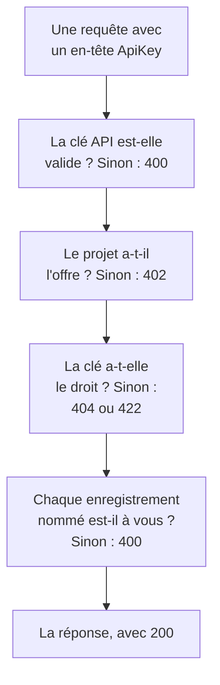

# Référence de l'API OneUptime

Tout ce que vous pouvez faire dans le tableau de bord OneUptime, vous pouvez aussi le faire par son API REST : automatiser les tâches répétitives, relier OneUptime à vos autres outils ou créer vos propres intégrations. Cette page montre comment faire votre première requête, et les règles que suit chaque requête. Chaque point de terminaison et chaque champ figurent dans la [référence complète de l'API](/reference).

:::cards
- [Faire votre première requête](#faire-votre-première-requête): Une clé API, un en-tête et une commande curl.
- [Requêtes et réponses](#requêtes-et-réponses): Les six requêtes de chaque ressource, et ce que signifie chaque code d'état.
- [Les offres et l'API](#les-offres-et-lapi): Ce qu'une offre vend, et ce qui fonctionne encore en dessous.
- [Nommer et écrire des enregistrements](#nommer-et-écrire-des-enregistrements): ID, références, interrupteurs et champs que OneUptime renseigne.
- [États et épisodes](#états-et-épisodes): L'état dans lequel un enregistrement commence et ceux qu'il traverse.
- [Ce qu'une requête peut atteindre](#ce-quune-requête-peut-atteindre): Lectures, modifications et suppressions, un projet à la fois.
:::

## Comment une requête reçoit sa réponse

L'API est organisée selon REST : méthodes et codes d'état HTTP standard, JSON en entrée et en sortie. Chaque requête porte une clé API et passe quelques vérifications. La première vérification qu'elle échoue répond avec un code d'état et `{ "message": "..." }`, donc le message indique ce qui l'a arrêtée.



## Faire votre première requête

Toutes les requêtes à l'API sont authentifiées par une clé API. Une clé appartient à un projet, et fait ce que ses autorisations permettent.

:::steps
### Créer une clé API

Ouvrez **Paramètres du projet → Avancé → Clés API** et cliquez sur **Créer : Clé API**. Donnez-lui un **Nom**, et sous **Accès** choisissez ce qu'elle peut faire : **Administrateur du projet**, **Membre du projet**, **Lecteur**, ou **Choisir les autorisations plus tard** pour ajouter des autorisations une à une sur la page de la clé. La clé expire dans un an, sauf si vous choisissez une autre date sous **Avancé**.

### Copier la clé

La page de la clé s'ouvre. Copiez la **Clé API** depuis la carte **Détails de la clé API**, et gardez-la hors de votre code :

```bash
export ONEUPTIME_API_KEY="your-api-key"
```

### Envoyer une requête

Listez les dix premiers moniteurs. La clé lit son propre projet, donc la requête ne nomme aucun projet :

```bash
curl -X POST 'https://oneuptime.com/api/monitor/get-list?skip=0&limit=10' \
  -H "ApiKey: $ONEUPTIME_API_KEY" \
  -H 'Content-Type: application/json' \
  -d '{ "select": { "name": true } }'
```

La réponse est `{ "data": [...], "count": ... }` : les moniteurs, et combien il y en a au total. Sur une installation auto-hébergée, utilisez votre propre adresse OneUptime à la place de `https://oneuptime.com`.
:::

### Exemples pour chaque ressource

Chaque ressource du tableau de bord OneUptime a une section **Développeurs** dans son menu latéral, repliée jusqu'à ce que vous l'ouvriez. Sa page **API** propose des commandes `curl` prêtes à l'emploi pour cette ressource, pointées vers votre OneUptime et remplies à partir de votre propre projet : lire, modifier et supprimer la ressource depuis sa propre page, ou lister, compter et créer depuis une page de liste (par exemple **Moniteurs**). Les commandes lisent votre clé API dans la variable d'environnement `ONEUPTIME_API_KEY`.

Les exemples sont écrits pour la ressource. Sur la liste **Incidents**, par exemple, la requête de liste montre sa réponse avec votre premier incident, les filtres trouvent les incidents non résolus, d'une gravité, concernant un moniteur ou des sept derniers jours, avec vos propres états, gravités et moniteurs, et la requête de création déclare un incident avec l'une de vos gravités, avec une ligne sur le rôle de chaque champ. La propre page d'un incident le lit avec sa vraie réponse, le passe à une autre de vos gravités et propose ses tâches courantes : l'acquitter et le résoudre (avec les états propres à votre projet), et ajouter des notes internes ou publiques. Chaque page API se termine par les points de terminaison de la ressource.

## Requêtes et réponses

Chaque ressource a les mêmes requêtes, sous `https://oneuptime.com/api` et le chemin de la ressource, comme `/monitor` ou `/incident` :

| Requête | Méthode et chemin | Contenu du corps |
| --- | --- | --- |
| Lister | `POST /api/<resource>/get-list` | `query`, `select` et `sort` |
| Compter | `POST /api/<resource>/count` | `query` |
| En lire un | `POST /api/<resource>/<id>/get-item` | `select` |
| Créer | `POST /api/<resource>` | `{ "data": { ... } }` |
| En modifier un | `PUT /api/<resource>/<id>` | `{ "data": { ... } }`, les champs à modifier |
| En supprimer un | `DELETE /api/<resource>/<id>` | Rien |

`POST /api/<resource>/<id>/update-item` et `POST /api/<resource>/<id>/delete-item` modifient et suppriment aussi un enregistrement, pour les clients qui n'envoient que des `POST`.

### Filtrer, trier et paginer

Une liste ou un comptage prend une `query`. Un champ avec une valeur correspond à cette valeur ; un objet avec un `_type` compare :

| `_type` | Correspond à |
| --- | --- |
| `Search` | Un texte qui contient `value` |
| `NotEqual` | Tout sauf `value` |
| `GreaterThan`, `LessThan` | Des dates plus tardives ou des nombres plus grands, ou plus anciennes et plus petits |
| `InBetween` | Des dates ou des nombres entre `startValue` et `endValue` |
| `Includes` | L'une des valeurs de `value` |
| `IsNull`, `NotNull` | Aucune valeur, ou n'importe quelle valeur |

Un champ d'un enregistrement que la ressource nomme se filtre sous sa relation : `"user": { "name": { "_type": "Search", "value": "ada" } }` trouve les membres d'équipe dont l'utilisateur a un nom qui contient « ada ». Filtrer sur un champ demande l'autorisation de le lire, à travers une relation comme sur la ressource elle-même : un filtre sur un champ que vous ne pouvez pas lire est refusé avec un `422` qui nomme le champ.

`select` nomme les champs à renvoyer, et `_id` revient toujours. `sort` les ordonne, `ASC` ou `DESC` ; sans tri, les plus récents viennent en premier. Une liste renvoie 10 enregistrements tant que vous ne fixez pas `limit`, jusqu'à 10 000, et `skip` en saute d'abord autant : augmentez `skip` de `limit` jusqu'à en avoir `count`. Ajoutez `?output-type=csv` à une requête de liste pour du CSV au lieu de JSON.

Par exemple, les moniteurs dont le nom contient « checkout », créés depuis le début de 2026, les plus récents en premier :

```bash
curl -X POST 'https://oneuptime.com/api/monitor/get-list' \
  -H "ApiKey: $ONEUPTIME_API_KEY" \
  -H 'Content-Type: application/json' \
  -d '{
    "query": {
      "name": { "_type": "Search", "value": "checkout" },
      "createdAt": { "_type": "GreaterThan", "value": "2026-01-01T00:00:00.000Z" }
    },
    "select": { "name": true, "createdAt": true },
    "sort": { "createdAt": "DESC" },
    "limit": 100
  }'
```

Les dates et les identifiants autres que `_id` reviennent enveloppés, sous la forme `{ "_type": "DateTime", "value": "..." }` et `{ "_type": "ObjectID", "value": "..." }` : lisez-les dans `value`.

Chaque identifiant sur lequel une requête filtre ou qu'elle écrit - `_id`, un champ comme `monitorId` et chaque enregistrement qu'une relation liste, comme `"labels": [{ "_id": "..." }]` - est un UUID, envoyé en texte ou enveloppé comme il revient. Tout le reste, comme un texte qui n'est pas un UUID ou un objet à la place d'un identifiant, est refusé avec un `400` qui nomme le champ et indique s'il était dans `query` ou dans `data`, et rien n'est lu ni écrit :

```text
Invalid ID for "currentIncidentStateId" in the query: "resolved". An ID is a UUID, such as "550e8400-e29b-41d4-a716-446655440000".
```

### Codes d'état

| Code | Ce qu'il signifie | Pour en savoir plus |
| --- | --- | --- |
| `200` | La requête est passée. Une liste ou un comptage répond avec les enregistrements que vous pouvez lire, aucun quand il n'y en a pas. | [Lire un enregistrement par son ID](#lire-un-enregistrement-par-son-id) |
| `400` | La requête est incorrecte : la clé API est invalide, une valeur n'est pas autorisée, un champ ne peut pas être écrit, un enregistrement nommé n'est pas à vous, ou elle modifie plusieurs projets à la fois. Le message dit ce qui ne va pas. | [Les enregistrements qu'une requête nomme](#les-enregistrements-quune-requête-nomme) |
| `402` | L'offre du projet n'inclut pas ce que la requête utilise. Le message nomme l'offre. | [Fonctionnalités que votre offre n'inclut pas](#fonctionnalités-que-votre-offre-ninclut-pas) |
| `404` | L'enregistrement n'existe pas, se trouve dans un autre projet, ou vous n'avez pas le droit de le lire : la même réponse dans chaque cas. | [Modifier ou supprimer un enregistrement que vous ne pouvez pas lire](#modifier-ou-supprimer-un-enregistrement-que-vous-ne-pouvez-pas-lire) |
| `422` | Vous n'avez pas le droit de faire cela : la clé API n'a aucune autorisation pour ce type d'enregistrement, vous pouvez lire l'enregistrement mais pas le modifier, ou les étiquettes d'une autorisation l'excluent. Le message dit pourquoi. | [Modifier ou supprimer un enregistrement que vous ne pouvez pas lire](#modifier-ou-supprimer-un-enregistrement-que-vous-ne-pouvez-pas-lire) |
| `500` | Quelque chose a échoué côté serveur. Quand le propriétaire d'un nouvel enregistrement ne peut pas être écrit, l'enregistrement est retiré, donc la création peut être retentée. | [Les enregistrements qu'une requête nomme](#les-enregistrements-quune-requête-nomme) |

## Les offres et l'API

### Fonctionnalités que votre offre n'inclut pas

Sur OneUptime Cloud, certaines ressources sont vendues dans une offre : les fournisseurs d'authentification unique et les connexions SCIM dans **Scale** ; les clés API, les plannings d'astreinte, ainsi que les règles de notification et résumés Slack et Microsoft Teams dans **Growth**, entre autres. En créer, en modifier ou en activer une exige cette offre. En dessous, la requête est refusée avec `402 Payment Required`, et le message nomme l'offre.

Certains réglages d'une ressource sont vendus dans une offre de la même façon. Par exemple : une page d'état privée, qui masque l'une de ses listes, ou qui a du HTML, du CSS ou du JavaScript personnalisés, des rapports par e-mail, des abonnés SMS, Slack, Microsoft Teams ou webhook, ou une liste d'adresses IP autorisées ; un tableau de bord partagé publiquement, ou sa liste d'adresses IP autorisées ; la liste d'adresses IP autorisées d'un formulaire ; les journaux d'audit d'un projet. Le guide de chacun, et le tableau de bord à côté du réglage, nomment l'offre requise. Un tel réglage exige son offre chaque fois qu'il est écrit - quand la ressource est créée avec lui comme quand il est modifié ensuite -, donc une création qui en active un en dessous de l'offre est refusée avec `402` aussi. Un réglage laissé à sa valeur par défaut, ou remis à celle-ci, fonctionne avec toutes les offres : une création qui ne touche pas à ces réglages passe, tout comme une configuration Terraform qui ne les définit pas.

Ce qu'un projet possède déjà reste gérable quelle que soit son offre, par exemple après la fin d'un essai ou une baisse d'offre :

- vous pouvez supprimer ces enregistrements ;
- vous pouvez en désactiver un, sur une ressource qui a un champ `isEnabled`, en envoyant `"isEnabled": false` et rien d'autre ;
- vous pouvez lister et lire ceux qu'un projet doit retrouver après une baisse d'offre - pour les désactiver, ou pour voir ce qui s'est arrêté : fournisseurs d'authentification unique, connexions SCIM, clés API et leurs autorisations, plannings d'astreinte, ainsi que règles de notification et résumés Slack et Microsoft Teams.

Les autorisations habituelles décident toujours qui peut faire quoi, exactement comme avec l'offre. Lire les autres ressources qu'une offre vend, comme les modèles, les champs personnalisés, les groupes de moniteurs, les journaux d'astreinte et les soumissions de formulaires, exige toujours l'offre : les lire, c'est utiliser la fonctionnalité. Les autorisations d'une clé API ne sont pas supprimées une à une en dessous de **Growth**, car supprimer une autorisation de blocage donnerait plus d'accès à la clé ; supprimez plutôt la clé.

### Clés API et SCIM sous leur offre

Sur OneUptime Cloud, les clés API d'un projet ne fonctionnent que tant que le projet est sur **Growth** ou au-delà, et ses connexions SCIM - celles du projet et celles de ses pages d'état - ne fonctionnent pleinement que tant qu'il est sur **Scale** ou au-delà. Quand le projet passe sous cette offre :

- Chaque requête faite avec l'une des clés API du projet est refusée avec `402 Payment Required`, quoi qu'elle demande : l'API REST, et tout ce qui l'appelle avec une clé API - Terraform, la CLI `oneuptime`, les clients MCP connectés avec une clé API, les workflows qui en envoient une dans un en-tête de requête, et vos propres scripts. Le message nomme l'offre : `API keys need the Growth plan. This project's plan does not include them, so its API keys stopped working. The keys are kept: upgrade the project to Growth in Project Settings > Billing and Invoices > Billing and they work again.`
- Ses connexions SCIM ne font plus que retirer des personnes. Désactiver et supprimer des personnes, et les retirer de groupes, fonctionne toujours, donc quiconque part perd quand même son accès ; chaque requête SCIM qui ajouterait ou modifierait des personnes ou des groupes est refusée avec `402`, au format d'erreur SCIM, pour que votre fournisseur d'identité montre pourquoi ([SCIM sous l'offre Scale](/docs/identity/scim#en-dessous-du-plan-scale)).

Rien n'est supprimé ni désactivé. Les clés et les connexions sont conservées, et elles refonctionnent pleinement, telles quelles, dès que le projet revient sur l'offre : aucune nouvelle clé à créer, rien à reconfigurer dans votre fournisseur d'identité. Un changement d'offre prend effet en moins d'une minute.

En dessous de **Growth**, **Paramètres du projet** > **Avancé** > **Clés API** liste les clés que le projet a encore et indique qu'elles se sont arrêtées, donc n'importe laquelle peut être supprimée (révoquée) avec toutes les offres. Créer ou modifier des clés exige **Growth**. **Paramètres du projet** > **Facturation et factures** > **Facturation** indique combien de clés API une offre inférieure arrête et combien de connexions SCIM elle limite, pour chaque offre que vous pouvez choisir, et ce que l'offre du projet a arrêté ; les propriétaires du projet reçoivent un e-mail quand un changement d'offre les arrête. Les propriétaires des projets qui étaient déjà sous ces offres quand cela a commencé reçoivent un seul e-mail indiquant ce qui s'est arrêté et comment le réactiver.

Seules les clés API et les connexions SCIM d'un projet sont concernées. Les personnes ne le sont pas : la connexion au tableau de bord, et les clients MCP connectés par connexion, fonctionnent comme avant. Les clés d'ingestion de télémétrie, les clés de sonde et les clés d'agent ne sont pas des clés API, et continuent de fonctionner. Les installations auto-hébergées n'ont pas d'offres, donc rien ne change pour elles.

## Nommer et écrire des enregistrements

### Trouver l'ID d'une ressource

Les requêtes qui lisent, modifient ou suppriment une ressource la nomment par son ID, un UUID. Sur la propre page de la ressource, sa carte de détails se termine par une petite ligne **ID** qui montre le début de l'ID : cliquez sur l'ID, ou sur le bouton de copie à côté, pour copier l'ID entier. Les listes qui le proposent ont **Afficher l'ID** dans le menu **⋯** d'une ligne, et l'ID est aussi la dernière partie de l'adresse de la page. L'ID de votre projet est la première chose de la carte **Détails du projet** dans **Paramètres du projet → Projet**.

### Les enregistrements qu'une requête nomme

De nombreuses ressources nomment d'autres enregistrements : un moniteur ses étiquettes et ses sondes, un abonné d'une page d'état sa page d'état, un équipement réseau son site, un membre d'un incident l'incident et le rôle. Chaque règle ci-dessous vaut pour l'API, Terraform et les workflows :

| Quand une requête | elle doit | Sinon |
| --- | --- | --- |
| nomme un enregistrement par son ID | nommer un enregistrement de votre projet | `400` |
| crée un enregistrement lu à travers un autre, comme une note | le créer sous un enregistrement que vous pouvez lire | `400`, ou `422` sans autorisation de lire ce type d'enregistrement |
| déplace un enregistrement sous un autre | le déplacer sous un enregistrement que vous pouvez lire | `400` |
| liste des enregistrements, ou en nomme un dans un champ propre | nommer des enregistrements que votre autorisation de lecture atteint | `400` |
| nomme un réglage qui contient des identifiants | venir de quelqu'un qui peut lire ce type de réglage | `400` |
| crée ou réétiquette un enregistrement avec une autorisation limitée à des étiquettes | donner à l'enregistrement l'une de ces étiquettes | `422` |
| nomme un enregistrement de deux façons | nommer le même enregistrement les deux fois | `400` |

#### Chaque ID doit appartenir à votre projet

Chaque ID que vous envoyez pour un enregistrement qu'une ressource nomme doit être un enregistrement de votre projet — les sélecteurs du tableau de bord ne proposent rien d'autre — et les requêtes de Terraform et des workflows sont soumises à la même règle. Un ID d'un enregistrement d'un autre projet et un ID qui n'existe pas sont refusés de la même façon, avec un `400` qui nomme le champ et l'ID :

```text
This network device references records that are not in this project: Network Site "…". Please pick values from this project and try again.
```

Les personnes sont vérifiées par leur appartenance : quelqu'un qui n'est pas membre du projet est refusé de la même façon. Une sonde globale, que chaque projet peut utiliser, compte comme celle de votre projet. La modification d'une ressource ne vérifie que les ID que la modification ajoute, donc une ressource qui nomme quelque chose qui a disparu depuis peut toujours être enregistrée.

#### Enregistrements lus à travers un autre

Un enregistrement lu à travers un autre - les notes et la chronologie des états d'un incident ou d'une alerte, les annonces, domaines et groupes d'une page d'état - doit aussi en nommer un que vous pouvez lire, selon la règle que suit sa lecture : un incident hors des étiquettes ou des propriétaires que votre autorisation de lire les incidents atteint, portant une étiquette qu'un blocage sur la lecture des incidents retire, ou marqué privé sans que vous fassiez partie de ses propriétaires, directement ou par une équipe (les propriétaires et administrateurs du projet voient chaque incident, alerte et épisode privés), est refusé avec le même `400`, et rien n'est écrit. Chaque page d'état qu'une annonce nomme doit être une page que vous pouvez lire, et une clé dont l'autorisation de lire les pages d'état n'en atteint que certaines doit en nommer au moins une. Une autorisation de créer un tel enregistrement exige une autorisation de lire l'enregistrement sous lequel il est créé ; sans elle, la création est refusée avec un `422` qui nomme les autorisations qui la permettraient :

```text
You do not have permissions to create Incident Internal Note. It is read through its Incident, and you need one of these permissions to read Incidents: …
```

Une modification qui déplace un tel enregistrement suit la même règle : chaque enregistrement qu'elle ajoute comme parent - une autre page d'état pour une annonce, un autre service pour un enregistrement lu à travers son service - doit être un enregistrement que vous pouvez lire, sinon la modification est refusée avec le même `400` et rien n'est écrit. Les parents qu'un enregistrement a déjà ne sont pas revérifiés, et une modification qui ne le laisse sous aucun exige une autorisation de lire ce type d'enregistrement qui les atteint tous, comme une création qui n'en nomme aucun.

#### Propriétaires

Les propriétaires d'une ressource - les enregistrements de propriétaires utilisateurs et équipes d'un moniteur, d'une stratégie d'astreinte, d'un tableau de bord et de toute autre ressource avec des propriétaires - sont lus à travers la ressource qu'ils possèdent de la même façon : les lister, les lire, les ajouter et les retirer exige une autorisation de lire cette ressource, sous ses étiquettes et ses propriétaires, et un enregistrement de propriétaire d'une ressource que vous ne pouvez pas lire reçoit la réponse comme s'il n'existait pas. Les ajouter et les retirer suit aussi la portée de l'autorisation qui le permet : une autorisation de portée `Owned` n'atteint que les propriétaires des ressources dont vous ou l'une de vos équipes êtes propriétaires, et l'ajout d'un propriétaire à toute autre ressource est refusé par un `422` qui le dit.

#### Enregistrements qu'une écriture liste ou nomme

Les enregistrements qu'une création ou une modification liste - les moniteurs et stratégies d'astreinte d'un incident, les services d'une alerte, les pages d'état d'un événement de maintenance planifiée, les runbooks d'une règle - s'en tiennent à votre autorisation de lire ce type d'enregistrement quand vous en avez une, et dans tous les cas à un blocage avec étiquettes sur sa lecture : un enregistrement hors de ce cadre est refusé avec le même `400`. Une modification ne vérifie que les enregistrements qu'elle ajoute à une liste, donc ceux que la liste contient déjà restent.

L'enregistrement unique qu'une création ou une modification nomme dans un champ propre - le moniteur d'une alerte, le moniteur qu'affiche une ressource de page d'état, le service d'un budget de coûts, l'incident auquel une exécution de runbook est liée - suit la même règle, sous l'un ou l'autre de ses noms : un enregistrement hors de votre autorisation de lire ce type d'enregistrement, ou portant une étiquette qu'un blocage sur sa lecture retire, est refusé avec le même `400`. Une modification ne le vérifie que lorsqu'elle nomme un autre enregistrement que celui que le champ contient déjà. Les sondes globales et les agents IA de OneUptime, que chaque projet peut utiliser, restent ouverts à tous les projets. Les enregistrements qu'un modèle remplit pour vous sont vérifiés de la même façon une fois remplis, avant que rien ne soit enregistré : les moniteurs, pages d'état et stratégies d'astreinte qu'un modèle d'incident ajoute à un incident déclaré à partir de lui doivent être des enregistrements que vous pouvez lire, comme si vous les aviez choisis.

#### Réglages qui contiennent des identifiants

Un réglage qui contient des identifiants - un serveur SMTP, un fournisseur d'appels et de SMS, des identifiants SNMP, une connexion d'appel vidéo, une clé API, un serveur MCP externe - n'est nommé que par quelqu'un qui peut lire ce type de réglage : `smtpConfig` et `callSmsConfig` d'une page d'état, `projectCallSMSConfig` d'une stratégie d'appels entrants, `snmpCredentialProfile` d'un équipement réseau ou d'un site, la connexion d'appel vidéo `videoCallConnection` d'un incident ou d'une alerte, `apiKey` d'une autorisation de clé API et `externalMcpServers` d'une règle IA. En nommer un sans autorisation de lire ce type de réglage - ou avec une autorisation qu'un blocage sans étiquettes retire - est refusé avec le même `400`, sous l'un ou l'autre de ses noms ; une modification qui conserve le réglage qu'un enregistrement nomme déjà n'est pas concernée. La recherche de numéros et la liste des numéros possédés d'une stratégie d'appels entrants exigent la même lecture de la configuration d'appels et de SMS qu'elles nomment.

#### Étiquettes et propriétaires à la création

Une autorisation de créer limitée à des étiquettes ne crée que des enregistrements portant l'une de ses étiquettes - pour un enregistrement sans étiquettes propres, des enregistrements sous un enregistrement qui en porte une -, sauf si une autre autorisation de créer ce type d'enregistrement atteint tout le projet, et un blocage avec étiquettes sur une autorisation de créer refuse un enregistrement portant l'une de ses étiquettes. Une création hors de ce cadre est refusée avec un `422` qui nomme les étiquettes :

```text
Your access lets you create Status Pages only with one of these labels: Production. Add one of them and try again.
```

Une autorisation de créer de portée **Owned** ne crée un moniteur, une page d'état ou un autre enregistrement ayant ses propres propriétaires que pour une personne, qui devient l'un de ses propriétaires, et une note ou un autre enregistrement qui tient ses propriétaires de l'enregistrement auquel il appartient que sous un enregistrement que vous ou l'une de vos équipes possédez.

Le créateur devient propriétaire juste après l'enregistrement, avant que quoi que ce soit d'autre ne lui arrive. Si la ligne de propriétaire ne peut pas être écrite, l'enregistrement est retiré et la création est refusée avec un `500`, pour qu'aucun enregistrement ne reste que son créateur ne pourrait pas atteindre.

#### Un changement d'étiquettes

Un changement des étiquettes que porte un enregistrement - ses propres étiquettes ou, pour un enregistrement sans étiquettes propres, les enregistrements qu'il nomme - s'en tient de la même façon à votre autorisation de modifier ce type d'enregistrement : avec une autorisation limitée à des étiquettes, l'enregistrement en garde au moins une, sauf si une autre autorisation de le modifier atteint tout le projet, et un blocage avec étiquettes sur une autorisation de modifier refuse de lui donner l'une de ses étiquettes. Un tel changement est refusé avec un `422` qui nomme les étiquettes :

```text
Your access lets you change Monitors only with one of these labels: Production. Keep one of them and try again.
```

#### Nommer un enregistrement de deux façons

Un enregistrement peut être nommé de deux façons : par son champ d'ID (`monitorId`), ou par la relation (`"monitor": { "_id": "…" }`), ce qu'envoient les formulaires du tableau de bord. Envoyez l'une des deux. Si une requête envoie les deux, elles doivent nommer le même enregistrement : une requête dont les deux divergent — deux ID différents, ou un ID et une valeur vide — est refusée avec un `400` qui nomme les deux champs :

```text
Conflicting Monitor references were provided. monitorId and monitor are names for the same field and must hold the same value: send only one of them, or the same id in each.
```

Les deux noms sont vérifiés de la même façon. Les règles sur l'enregistrement que vous nommez s'appliquent quel que soit le nom sous lequel vous l'envoyez : le groupe parent d'un groupe de page d'état doit être sur la même page d'état, une page d'état accepte au plus trois liens d'en-tête, et le nom d'un groupe doit être unique sur sa page d'état.

### Interrupteurs

Un champ activé ou désactivé - `isEnabled`, `isVisibleOnStatusPage`, `isArchived` et tout autre champ `true` ou `false` - prend `true` ou `false`. Le texte et les nombres que la base de données lit comme l'une de ces valeurs sont pris comme cette valeur, de la même façon pour l'API, Terraform et les workflows : `"true"`, `"yes"`, `"on"`, `"1"` et `1` valent `true`, et `"false"`, `"no"`, `"off"`, `"0"` et `0` valent `false`, quelle que soit la casse. Tout ce que OneUptime fait de l'enregistrement le traite aussi comme cette valeur : un événement de maintenance planifiée envoyé avec `"isVisibleOnStatusPage": "true"` montre ses images sur la page d'état, et `"isEnabled": "false"` désactive une ressource sous son offre comme le fait `false`. Toute autre valeur, comme `"maybe"`, `""` ou `2`, est refusée avec un `400` qui nomme le champ :

```text
isVisibleOnStatusPage must be true or false.
```

Une mise à jour qui écrit les valeurs d'un enregistrement telles qu'elles sont déjà ne change rien : elle ne lance pas les workflows **On Update** de l'enregistrement, n'envoie pas de mises à jour en direct et n'ajoute pas d'entrée au journal d'audit. `false` écrit par-dessus `false` compte comme la même valeur, tout comme `"false"` écrit par-dessus `false`, un nombre écrit sous forme de texte, une heure écrite comme le même instant dans un autre format, et des étiquettes écrites comme les mêmes étiquettes dans n'importe quel ordre. Quand une mise à jour modifie certaines valeurs et en réécrit d'autres telles quelles, son entrée de journal d'audit ne liste que les valeurs modifiées, et le **Fields to watch** d'un workflow n'entend que celles-là.

### Où un projet a été acheté

Le revendeur, l'offre du revendeur et la licence du revendeur d'un projet (`resellerId`, `resellerPlanId`, `resellerLicenseId`, et les relations `reseller` et `resellerPlan`) sont définis par OneUptime seul : quand un projet est créé avec le code promotionnel d'un revendeur, et quand le revendeur change l'offre. Une création ou une modification d'un projet qui en envoie un est refusée avec un `400` qui nomme le champ, quel que soit l'expéditeur :

```text
User is not allowed to create on resellerId column of Project. No permission allows it: the column is set by the server, not by a request.
```

### Qui a créé un enregistrement

OneUptime enregistre qui a créé un enregistrement — et qui l'a archivé, résolu, acquitté ou déclenché — à partir de la requête elle-même : la personne connectée, ou personne quand la requête vient avec une clé API ou d'un workflow. Ces champs (`createdByUserId` et les autres champs qui se terminent par `ByUserId`, avec leurs relations comme `createdByUser`) sont en lecture seule, tout comme le moment où un enregistrement a été archivé ou résolu (`archivedAt`, `markedAsResolvedAt`, `markedAsArchivedAt`) : activer `isArchived` ou `isResolved` enregistre qui l'a fait et quand, et le désactiver efface les deux. Envoyer un interrupteur tel qu'il est déjà conserve qui l'a basculé, et quand.

La référence de l'API marque ces champs en lecture seule. Une valeur qu'une requête envoie pour l'un d'eux à côté d'autres modifications est ignorée, donc le reste de la modification passe ; une mise à jour qui n'envoie rien d'autre est refusée avec un message qui nomme les champs. Les enregistrements que OneUptime crée lui-même au nom de quelqu'un — une note publiée depuis Slack ou Microsoft Teams, un compte créé par une invitation — nomment cette personne.

## États et épisodes

### L'état dans lequel commence un nouvel enregistrement

Un incident, une alerte, un épisode d'incident et un épisode d'alerte peuvent être créés dans n'importe quel état de votre projet, comme le fait le champ **État initial** de leurs formulaires de création : envoyez `currentIncidentStateId` (incidents et épisodes d'incident) ou `currentAlertStateId` (alertes et épisodes d'alerte), ou la relation. L'enregistrement commence dans cet état et sa chronologie des états commence par lui. Sans lui, il commence dans l'état de création de votre projet, celui marqué `isCreatedState` — ou, pour un incident déclaré à partir d'un modèle qui a un état initial, dans celui du modèle. Un état d'un autre projet est refusé comme tout autre enregistrement. `current_incident_state_id` et `current_alert_state_id` dans Terraform fonctionnent de la même façon. Un enregistrement créé dans votre état d'acquittement ou au-delà n'alerte personne, et un enregistrement créé résolu n'est en plus ni regroupé, ni corrigé automatiquement, ni examiné par l'IA, et n'obtient pas de canal Slack ou Microsoft Teams — voir [Déclaré déjà acquitté ou résolu](/docs/incidents/declaring-incidents#déclaré-déjà-pris-en-compte-ou-résolu).

### Changer l'état d'un enregistrement

L'état d'un enregistrement change par une ligne de sa chronologie des états - `POST /api/incident-state-timeline`, `/api/alert-state-timeline`, `/api/incident-episode-state-timeline`, `/api/alert-episode-state-timeline` ou `/api/scheduled-maintenance-state-timeline` - ou par une mise à jour qui écrit son état actuel (`currentIncidentStateId`, `currentAlertStateId`, `currentScheduledMaintenanceStateId`, ou la relation), qui enregistre la même ligne. Dans les deux cas, une seule règle encadre le passage, pour un épisode comme pour un incident, une alerte ou un événement de maintenance planifiée : un état antérieur à l'état actuel de l'enregistrement dans l'ordre de votre projet est refusé avant que rien ne soit enregistré, tout comme l'état dans lequel il se trouve déjà :

```text
Episode cannot transition to Acknowledged state from Resolved state because Acknowledged is before Resolved in the order of incident states.
```

Un état défini par erreur se corrige en supprimant sa ligne de la chronologie des états de l'enregistrement. Voir [L'ordre est une vraie contrainte](/docs/incidents/states-and-severities#lordre-est-une-vraie-contrainte-pas-une-préférence-daffichage).

### L'épisode dans lequel se trouve un incident ou une alerte

`incidentEpisodeId` d'un incident et `alertEpisodeId` d'une alerte — et leurs relations `incidentEpisode` et `alertEpisode` — nomment le dernier épisode auquel l'enregistrement a été ajouté et dont il est encore membre, ou rien. Ils sont en lecture seule : OneUptime les définit à partir des membres de l'épisode. Pour mettre un incident dans un épisode, créez un Incident Episode Member (`POST /api/incident-episode-member` avec `incidentEpisodeId` et `incidentId`) ; pour l'en retirer, supprimez ce membre, et l'incident nomme alors le dernier épisode dans lequel il se trouve encore, ou aucun. Les alertes fonctionnent de la même façon avec les Alert Episode Members (`/api/alert-episode-member`, avec `alertEpisodeId` et `alertId`). Les règles de regroupement ajoutent les incidents et les alertes aux épisodes de la même façon. Une création ou une mise à jour d'un incident ou d'une alerte qui envoie son épisode est refusée, quel que soit l'expéditeur — l'API, Terraform, les outils MCP ou un workflow. Dans Terraform, `incident_episode_id` et `alert_episode_id` peuvent être lus mais pas définis ; les ressources `oneuptime_incident_episode_member` et `oneuptime_alert_episode_member` gèrent l'appartenance.

## Ce qu'une requête peut atteindre

### Modifier ou supprimer un enregistrement que vous ne pouvez pas lire

Une modification ou une suppression n'atteint que les enregistrements que la clé API - ou la personne connectée - peut lire. Un enregistrement hors de ses étiquettes ou de ses propriétaires, derrière un blocage sur la lecture, ou lu à travers un autre enregistrement qu'elle ne peut pas lire (la note d'un incident, l'annonce d'une page d'état) ne peut pas non plus être modifié ou supprimé. Une autorisation de modifier ou de supprimer un type d'enregistrement fonctionne avec l'autorisation de le lire, et une autorisation de modifier les notes d'un incident avec une autorisation de lire les incidents.

Une requête qui modifie ou supprime un enregistrement par son ID - `PUT /api/<resource>/<id>` ou `POST /api/<resource>/<id>/update-item`, `DELETE /api/<resource>/<id>` ou `POST /api/<resource>/<id>/delete-item` - et n'atteint rien répond :

- `404` quand l'enregistrement n'existe pas, se trouve dans un autre projet, ou vous n'avez pas le droit de le lire - la même réponse dans chaque cas :

```text
Incident not found.
```

- `422` quand vous pouvez lire l'enregistrement mais pas le modifier ou le supprimer, avec la raison :

```text
You do not have permission to update this incident.
```

Une suppression qui n'atteignait rien répondait autrefois `200`. Les mises à jour et suppressions par requête, comme les étapes de mise à jour et de suppression d'un workflow, répondent avec le nombre d'enregistrements modifiés, `0` quand elles n'en ont atteint aucun. Terraform lit un `404` lors de `terraform destroy` comme une ressource déjà disparue.

La télémétrie suit la même règle. Une suppression de journaux, de traces, de métriques, d'exceptions, de profils ou d'enregistrements de session atteint les lignes des ressources - services, hôtes, clusters et autres - dont vous pouvez à la fois lire et supprimer la télémétrie, et se fait un projet à la fois : une requête sur tous vos projets est refusée. Une suppression d'une ligne par son ID qui n'atteint rien répond `404` ou `422` comme ci-dessus.

### Les modifications se font un projet à la fois

Une mise à jour ou une suppression des enregistrements d'un projet se fait dans le projet que la requête nomme : l'en-tête `tenantid`, ou, pour une clé API, le propre projet de la clé. Une mise à jour ou une suppression d'un utilisateur connecté qui ne nomme aucun projet, ou qui interroge tous ses projets avec l'en-tête `is-multi-tenant-query`, est refusée avec `400` :

```text
Changes to incidents are made in one project at a time. Please pass the project ID in the 'tenantid' header.
```

Une telle requête échouait autrefois avec `500`. Les lectures peuvent toujours interroger tous vos projets.

### Lire un enregistrement par son ID

Une lecture d'un enregistrement par son ID - `POST /api/<resource>/<id>/get-item` - répond `404` quand l'enregistrement n'existe pas, se trouve dans un autre projet, ou vous n'avez pas le droit de le lire, la même réponse dans chaque cas :

```text
Incident not found.
```

Elle répondait autrefois `200` avec un corps vide. Une liste (`get-list`) et un comptage répondent toujours `200` avec les enregistrements que vous pouvez lire, aucun quand il n'y en a pas. Le fournisseur Terraform lit un `404` lors d'un rafraîchissement comme une ressource disparue et la retire de l'état, si bien que le plan suivant la recrée : donnez à la clé API qu'il utilise les autorisations, et les étiquettes, pour lire chaque ressource qu'il gère. Les outils MCP répondent à un `404` par une erreur qui renvoie vers l'outil de liste correspondant, et la CLI se termine avec le code `3`.

## La référence complète des points de terminaison

Chaque ressource, point de terminaison et champ figure dans la [référence de l'API OneUptime](/reference). Elle est disponible en plusieurs langues : votre langue est déduite de votre navigateur, et vous pouvez en changer à tout moment avec le sélecteur en haut de la page.

## Dépannage

:::details Chaque requête répond 400 Invalid API Key
L'en-tête `ApiKey` est vide, n'est pas une clé, ou nomme une clé qui a expiré ou a été réinitialisée. Copiez à nouveau la clé depuis sa page sous **Paramètres du projet → Avancé → Clés API**, où figure aussi sa date **Expire**.
:::

:::details Chaque requête répond 402 Payment Required
Sur OneUptime Cloud, les clés API ne fonctionnent que tant que le projet est sur l'offre **Growth** ou supérieure. Les clés sont conservées, et refonctionnent telles quelles dès que le projet revient sur l'offre : voir [Clés API et SCIM sous leur offre](#clés-api-et-scim-sous-leur-offre).
:::

:::details Chaque requête répond 422 You do not have permissions
La clé API n'a aucune autorisation pour ce type d'enregistrement. Une clé créée avec **Choisir les autorisations plus tard** ne peut rien faire tant qu'elle n'en a pas reçu : ouvrez-la dans **Paramètres du projet → Avancé → Clés API**, puis cliquez sur **Ajouter un rôle** ou **Ajouter une permission**. Le message nomme les autorisations qui laisseraient passer la requête.
:::

:::details Un enregistrement que je vois dans le tableau de bord répond 404
La clé API ne lit que ce que ses autorisations, et leurs étiquettes, atteignent, et une clé peut atteindre moins que votre propre compte. Donnez à la clé une autorisation qui atteint l'enregistrement : voir [Lire un enregistrement par son ID](#lire-un-enregistrement-par-son-id).
:::

:::details Une mise à jour répond 400 Invalid request body
Une mise à jour envoie les champs à modifier dans `data`, sous la forme `{ "data": { "name": "New name" } }`. Un corps sans cela est refusé, plutôt que de répondre `200` sans rien modifier :

```text
Invalid request body. The update payload should be an object of the form { "data": { ...fields to update... } }.
```
:::

:::details Une écriture répond 400 et nomme un champ et un ID
L'ID nomme un enregistrement d'un autre projet, un enregistrement qui n'existe pas, ou un que vos autorisations n'atteignent pas. Voir [Les enregistrements qu'une requête nomme](#les-enregistrements-quune-requête-nomme).
:::

## Prochaines étapes

:::cards
- [Utilisateurs, équipes et autorisations](/docs/permissions/index): Ce que les autorisations et les étiquettes d'une clé API atteignent.
- [Fournisseur Terraform](/docs/terraform/index): Gérer les ressources OneUptime sous forme de code, par la même API.
- [CLI OneUptime](/docs/cli/index): Appeler l'API depuis votre terminal et vos scripts.
- [Serveur MCP](/docs/ai/mcp-server): Laisser des assistants IA travailler avec votre projet.
:::
