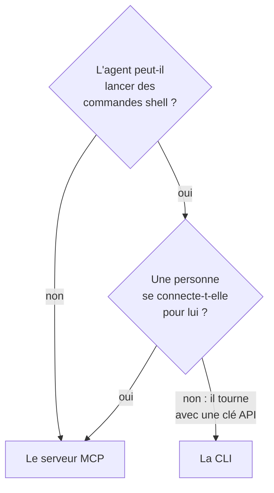

# CLI pour les agents IA

Un agent IA qui peut lancer des commandes shell, comme un agent de code dans votre éditeur ou une tâche de votre pipeline, peut travailler avec OneUptime par la CLI plutôt que par le [serveur MCP](/docs/ai/mcp-server). Cette page dit quand chacun convient, et comment un agent installe la CLI, s'y retrouve et lit ses réponses.

:::cards
- [La CLI ou le serveur MCP](#la-cli-ou-le-serveur-mcp): Lequel un agent devrait utiliser.
- [La préparer pour un agent](#la-préparer-pour-un-agent): Installez-la, et donnez-lui une clé dans l'environnement.
- [Comment un agent s'y retrouve](#comment-un-agent-sy-retrouve): Les ressources, leurs champs et l'aide.
- [Lire les réponses](#lire-les-réponses): Du JSON pour chaque commande, erreurs comprises.
:::

## La CLI ou le serveur MCP

Les deux atteignent l'API de OneUptime, et font ce que leurs identifiants permettent. Ils diffèrent par ce dont l'agent a besoin pour les atteindre :



| | La CLI | Le serveur MCP |
| --- | --- | --- |
| L'agent a besoin | D'un shell, et de Node.js 22 ou plus récent | D'un client MCP, comme Claude ou Cursor |
| Il se connecte avec | Une clé API du projet, dans `ONEUPTIME_API_KEY` | Votre compte OneUptime, ou une clé API |
| Il atteint | Chaque ressource de l'API, 450 et plus | Les enregistrements et la télémétrie pour lesquels il a des outils, et des outils de réponse aux incidents |
| Il convient à | Des scripts que l'agent écrit pour que des personnes les gardent, des vérifications dans un pipeline, et le travail sur de nombreux enregistrements | Une conversation : examiner un incident, mettre en place un moniteur |

Utilisez la CLI quand l'agent lance déjà des commandes, comme le fait un agent de code, ou quand ce qu'il construit doit continuer de tourner sans lui : un script dans un dépôt, une étape d'un pipeline. Utilisez le serveur MCP quand une personne parle à l'agent dans un client de chat, pour que l'agent travaille avec ses autorisations et que le client demande avant une modification.

## La préparer pour un agent

Chaque OneUptime sert le script d'installation de la CLI de sa propre version : les commandes ci-dessous le téléchargent depuis `https://oneuptime.com`, remplacez donc cette adresse par votre URL sur un OneUptime auto-hébergé. Le script est d'abord enregistré dans `install.sh`, pour que vous puissiez le lire avant de le lancer :

```bash
curl -fsSL https://oneuptime.com/install/cli -o install.sh
ONEUPTIME_URL=https://oneuptime.com bash install.sh
```

Donnez à l'agent une clé API du projet avec seulement l'accès dont son travail a besoin, dans l'environnement plutôt que sur la ligne de commande, et faites-lui d'abord vérifier la clé :

```bash
export ONEUPTIME_API_KEY="your-api-key"
export ONEUPTIME_URL=https://oneuptime.com
oneuptime whoami --check -o json
```

Créez la clé dans **Paramètres du projet → Avancé → Clés API** : voir [Créer une clé API](/docs/api-reference/api-reference#créer-une-clé-api). Une clé qui ne peut que lire laisse l'agent regarder, et rien d'autre.

## Comment un agent s'y retrouve

La CLI dit ce qu'elle sait faire, sans clé API et sans requête :

| Commande | Ce qu'elle répond |
| --- | --- |
| `oneuptime resources -o json` | Chaque ressource : sa commande, ses noms, son chemin d'API, ses opérations et ses actions |
| `oneuptime incident fields -o json` | Les champs d'une ressource : le rôle de chacun, son type, si une création en a besoin, et son option |
| `oneuptime incident create --help` | Les arguments et les options d'une commande |

Un champ qui contient un ID dit de quelle ressource vient l'ID, pour que l'agent liste d'abord cette ressource : `incidentSeverityId` prend un ID dans `oneuptime incident-severity list`. Un champ qui nomme une personne accepte aussi son adresse e-mail, comme avec `--user-email`.

## Lire les réponses

Faites ajouter `-o json`, ou `--json`, à chaque commande par l'agent. Chaque commande répond alors en JSON, y compris celles dont la réponse est une phrase, et une erreur est un seul objet JSON sur la sortie d'erreur standard :

```bash
oneuptime incident acknowledge 6f1c2a40-3b1e-4c55-9a0b-3e2f8d7c1a11 -o json
```

```json
{
  "_id": "6f1c2a40-3b1e-4c55-9a0b-3e2f8d7c1a11",
  "action": "acknowledge",
  "changed": true,
  "state": {
    "_id": "0b7d5e2c-8f4a-4d1b-9c3e-5a6f7b8c9d0e",
    "name": "Acknowledged"
  }
}
```

Le code de sortie dit ce qui s'est passé : `0` quand cela a fonctionné, `1` quand cela a échoué, `2` quand la clé API manque ou est refusée, et `3` quand l'enregistrement n'existe pas. Le JSON d'une erreur a le même code dans `exitCode`, et dans `hint` ce qu'il faut faire ensuite. Voir [Formats de sortie](/docs/cli/output-formats#json) et [Codes de sortie](/docs/cli/scripting#codes-de-sortie).

## Étapes suivantes

:::cards
- [Opérations sur les ressources](/docs/cli/resource-operations): Chaque opération, avec ses options et ses filtres.
- [Référence des commandes](/docs/cli/command-reference): Chaque commande, option et valeur par défaut.
- [Serveur MCP](/docs/ai/mcp-server): Connectez plutôt un client de chat à OneUptime.
:::
