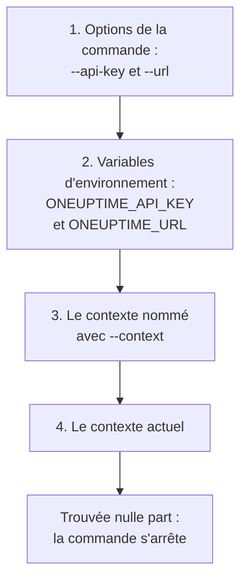

# Authentification

Chaque requête envoyée par la CLI porte une clé API de votre projet. Enregistrez les clés une fois avec `oneuptime login`, un contexte par environnement, ou donnez-les à une commande dans des options ou des variables d'environnement, comme le font les scripts. Cette page montre chaque façon de faire, et celle qu'une commande utilise quand il y en a plusieurs.

:::cards
- [Se connecter](#se-connecter): Enregistrer une clé API et l'adresse de votre OneUptime.
- [Contextes](#contextes): Une connexion enregistrée par projet ou par environnement, et le passage de l'une à l'autre.
- [Les identifiants qu'une commande utilise](#les-identifiants-quune-commande-utilise): D'abord les options, puis les variables d'environnement, puis les contextes.
- [Dépannage](#dépannage): Aucun identifiant trouvé, clés non valides et refus.
:::

## Avant de commencer

Il vous faut une clé API de votre projet. Créez-en une dans **Paramètres du projet → Avancé → Clés API** avec **Créer : Clé API**, et donnez-lui l'accès dont vos commandes ont besoin : voir [Créer une clé API](/docs/api-reference/api-reference#créer-une-clé-api). Une clé fait ce que ses autorisations permettent : une clé qui ne peut que lire des enregistrements peut les lister et les lire, mais pas les modifier.

Sur OneUptime Cloud, les clés API ne fonctionnent que tant que le projet a l'offre **Growth** ou une offre supérieure. En dessous, chaque commande répond `API error (402)` avec un message qui nomme l'offre, jusqu'à ce que le projet passe à une offre supérieure ; la même clé fonctionne alors de nouveau. Voir [Clés API et SCIM sous leur offre](/docs/api-reference/api-reference#clés-api-et-scim-sous-leur-offre).

## Se connecter

`oneuptime login` enregistre une clé API et l'adresse de votre OneUptime comme contexte, et en fait le contexte actuel :

```bash
oneuptime login <api-key> <instance-url> [--context-name <name>]
```

| Argument ou option | Ce que c'est |
| --- | --- |
| `<api-key>` | Une clé API de votre projet |
| `<instance-url>` | L'adresse de votre OneUptime : `https://oneuptime.com`, ou celle de votre propre serveur, comme `https://oneuptime.example.com` |
| `--context-name <name>` | Le nom sous lequel enregistrer le contexte. Par défaut : `default` |

Par exemple, un contexte nommé `production` :

```bash
oneuptime login <api-key> https://oneuptime.com --context-name production
```

Elle répond `Logged in successfully. Context "production" is now active.` Une barre oblique à la fin de l'adresse est retirée, et une nouvelle connexion sous le même nom remplace ce contexte.

> [!NOTE]
> `login` enregistre la clé sans interroger OneUptime à son sujet. Lancez une commande, comme `oneuptime incident count`, pour voir que la clé fonctionne.

## Contextes

Un contexte est une connexion enregistrée : un nom, une adresse et une clé API. Enregistrez-en un par projet ou par environnement, puis choisissez-en un pour toutes les commandes qui suivent, ou pour une seule commande.

:::steps
### Enregistrer un contexte par environnement

```bash
oneuptime login <production-api-key> https://oneuptime.com --context-name production
oneuptime login <staging-api-key> https://oneuptime.example.com --context-name staging
```

Chaque connexion fait de son contexte le contexte actuel : c'est donc `staging` qui est actuel maintenant.

### Les lister

```bash
oneuptime context list
```

```text
┌───┬────────────┬───────────────────────────────┐
│   │ Name       │ URL                           │
├───┼────────────┼───────────────────────────────┤
│   │ production │ https://oneuptime.com         │
├───┼────────────┼───────────────────────────────┤
│ * │ staging    │ https://oneuptime.example.com │
└───┴────────────┴───────────────────────────────┘
```

Le `*` marque le contexte actuel. Les clés API ne sont jamais listées.

### Passer à un autre contexte

```bash
oneuptime context use production
```

Elle répond `Switched to context "production".` et les commandes qui suivent l'utilisent.

### Utiliser un contexte pour une seule commande

```bash
oneuptime incident list --context staging
```

Le contexte actuel reste tel qu'il était.
:::

| Commande | Ce qu'elle fait |
| --- | --- |
| `oneuptime context list` | Liste les contextes enregistrés ; `*` marque l'actuel. Avec `-o json`, le `name`, l'`apiUrl` et le `isCurrent` de chaque contexte, jamais sa clé |
| `oneuptime context use <name>` | Fait d'un contexte enregistré le contexte actuel |
| `oneuptime context current` | Affiche le nom, l'URL et la clé API du contexte actuel, la clé masquée sauf ses quatre premiers et quatre derniers caractères |
| `oneuptime context delete <name>` | Supprime un contexte enregistré. Si c'était le contexte actuel, le premier contexte restant devient l'actuel |

## Les identifiants qu'une commande utilise

Une commande a besoin d'une clé API et d'une URL. Elle prend chacune des deux au premier de ces endroits qui en a une :



Vous pouvez donc les combiner : par exemple une clé API tirée d'une variable d'environnement avec l'URL du contexte actuel. Les variables d'environnement conviennent aux scripts et aux tâches de CI, qui n'ont pas de contextes enregistrés :

:::tabs
@tab Linux
```bash
export ONEUPTIME_API_KEY=<api-key>
export ONEUPTIME_URL=https://oneuptime.com
oneuptime incident list
```
@tab macOS
```bash
export ONEUPTIME_API_KEY=<api-key>
export ONEUPTIME_URL=https://oneuptime.com
oneuptime incident list
```
@tab Windows
```powershell
$env:ONEUPTIME_API_KEY = "<api-key>"
$env:ONEUPTIME_URL = "https://oneuptime.com"
oneuptime incident list
```
:::

Les options passent avant tout le reste, pour une seule commande :

```bash
oneuptime --api-key <api-key> --url https://oneuptime.com incident list
```

> [!WARNING]
> Une clé donnée en option se retrouve dans l'historique de votre shell, et les autres utilisateurs de la machine peuvent la voir dans la liste des processus. Sur une machine partagée, utilisez plutôt un contexte ou une variable d'environnement.

## Vérifier ce que la CLI va utiliser

`oneuptime whoami` affiche l'URL et la clé API que la prochaine commande utilisera, et le contexte dont elles viennent :

```bash
oneuptime whoami
```

```text
URL:     https://oneuptime.com
API Key: 4f1c****0a13
Context: production
```

Seuls les quatre premiers et les quatre derniers caractères de la clé sont affichés. La ligne `Context` n'apparaît que si l'URL et la clé sont celles du contexte, et non des valeurs remplacées par une option ou une variable d'environnement. `whoami` lit vos réglages sans appeler OneUptime : il montre ce qu'une commande enverra, pas si OneUptime l'accepte. Quand rien n'est enregistré ni défini, il répond :

```text
Not authenticated. Run `oneuptime login` to authenticate.
```

## Le fichier de configuration

`oneuptime login` enregistre les contextes dans `~/.oneuptime/config.json`, dans votre dossier personnel (`%USERPROFILE%\.oneuptime\config.json` sous Windows). La CLI le crée de sorte que seul votre utilisateur puisse le lire et l'écrire (mode `0600`) :

```json title="~/.oneuptime/config.json"
{
  "currentContext": "production",
  "contexts": {
    "production": {
      "name": "production",
      "apiUrl": "https://oneuptime.com",
      "apiKey": "<api-key>"
    },
    "staging": {
      "name": "staging",
      "apiUrl": "https://oneuptime.example.com",
      "apiKey": "<api-key>"
    }
  }
}
```

Le fichier contient les clés API telles quelles : gardez-le hors des dossiers partagés, des sauvegardes et des dépôts. Pour vous déconnecter d'un contexte, supprimez-le avec `oneuptime context delete <name>` ; pour vous déconnecter de tous, supprimez le fichier. Une clé qui a pu fuiter reste valide jusqu'à ce que vous la supprimiez dans OneUptime, dans **Paramètres du projet → Avancé → Clés API**.

Les formats de sortie et la taille des listes ne sont pas enregistrés ici : passez `-o` et `--limit` à chaque commande.

## Dépannage

:::details Le message « No credentials found »
`Authentication error: No credentials found.` signifie qu'aucune option, variable d'environnement ou contexte enregistré n'a donné à la commande sa clé API et son URL. Lancez `oneuptime login`, ou définissez à la fois `ONEUPTIME_API_KEY` et `ONEUPTIME_URL`. La commande se termine avec le code `2`.
:::

:::details Le message « API error (400): Invalid API Key »
La clé n'est pas une clé API de OneUptime, a expiré ou a été réinitialisée. Copiez-la de nouveau depuis sa page dans **Paramètres du projet → Avancé → Clés API**, où se trouve aussi sa date sous **Expire**, et reconnectez-vous sous le même nom de contexte. La commande se termine avec le code `2`.
:::

:::details Le message « API error (402): API keys need the Growth plan »
Sur OneUptime Cloud, le projet est en dessous de l'offre **Growth**, ses clés API ont donc cessé de fonctionner. Passez le projet à une offre supérieure, et la même clé fonctionne de nouveau : rien à changer dans la CLI.
:::

:::details Le message « API error (422): You do not have permissions »
Les autorisations de la clé ne couvrent pas ce que la commande demande. Donnez à la clé un rôle ou une autorisation sur sa page dans **Paramètres du projet → Avancé → Clés API** : le message nomme les autorisations qui laisseraient passer la requête.
:::

:::details Le message « Context "staging" does not exist »
Aucun contexte de ce nom n'est enregistré. `oneuptime context list` affiche les noms qui existent.
:::

:::details whoami affiche une autre URL ou une autre clé que le contexte
Une variable d'environnement ou une option remplace la valeur du contexte. `env | grep ONEUPTIME` affiche les variables définies, et `unset ONEUPTIME_API_KEY ONEUPTIME_URL` vous ramène à vos contextes.
:::

:::details La requête vers l'adresse échoue
`Error: Request failed to https://...` signifie que la CLI n'a pas pu joindre OneUptime à cette adresse. Vérifiez l'URL avec `oneuptime whoami` : c'est l'adresse à laquelle vous ouvrez OneUptime, avec `https://`, comme `https://oneuptime.com`.
:::

## Étapes suivantes

:::cards
- [Opérations sur les ressources](/docs/cli/resource-operations): Lister, lire, créer, modifier, supprimer et compter des enregistrements.
- [Scripts et CI/CD](/docs/cli/scripting): Donner sa clé à un pipeline dans des variables d'environnement.
- [Référence de l'API OneUptime](/docs/api-reference/api-reference): Ce qu'une clé API peut faire, et ce que signifie chaque réponse.
:::
