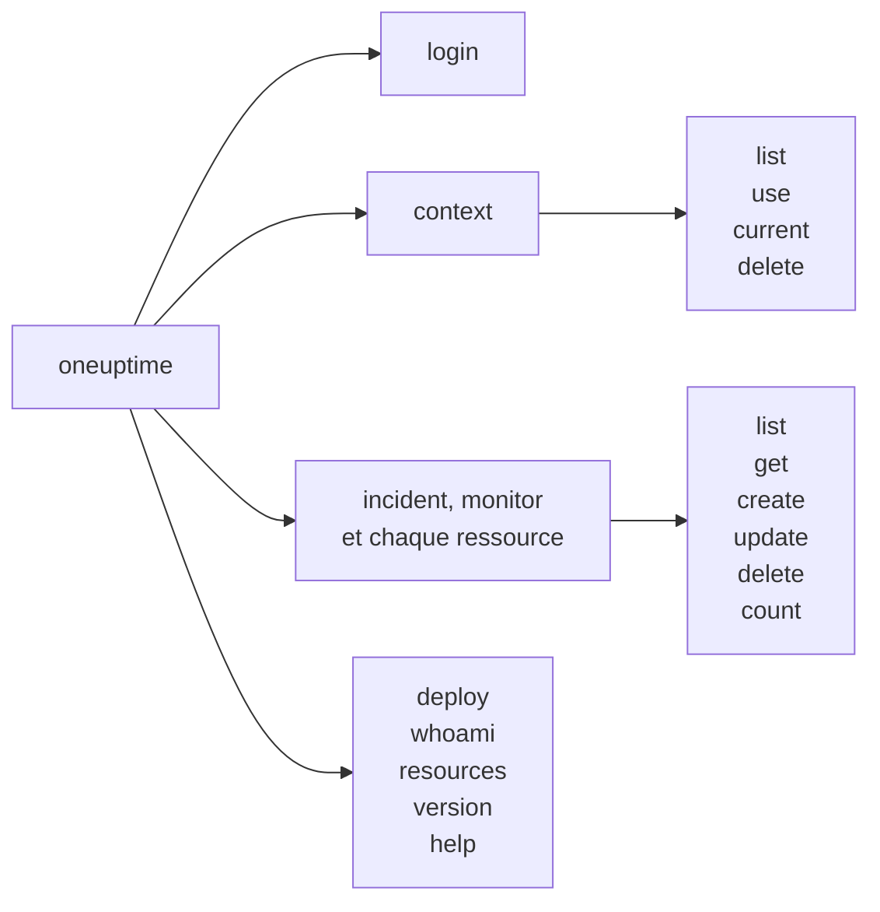

# Référence des commandes

Chaque commande de la CLI `oneuptime`, avec ses arguments, ses options et ses valeurs par défaut. Ajoutez `--help` à n'importe quelle commande pour voir la même chose dans votre terminal.

:::cards
- [Options globales](#options-globales): Les options que prend chaque commande.
- [Connexion et contextes](#connexion-et-contextes): login et les commandes context.
- [Commandes des ressources](#commandes-des-ressources): list, get, create, update, delete et count.
- [Autres commandes](#autres-commandes): deploy, whoami, resources, version et help.
:::

## Les commandes



## Options globales

| Option | Ce qu'elle fait | Par défaut |
| --- | --- | --- |
| `--api-key <key>` | La clé API pour cette commande | `ONEUPTIME_API_KEY`, puis la clé du contexte |
| `--url <url>` | L'adresse de votre OneUptime pour cette commande | `ONEUPTIME_URL`, puis l'URL du contexte |
| `--context <name>` | Le contexte enregistré à utiliser pour cette commande | Le contexte actuel |
| `-o, --output <format>` | `json`, `table` ou `wide` | `table` dans un terminal, `json` dans un pipe |
| `--no-color` | Affiche sans couleurs | Des couleurs, sauf si `NO_COLOR` est défini |
| `-V, --version` | Affiche la version de la CLI | |
| `-h, --help` | Affiche l'aide d'une commande | |

Les options se placent avant ou après la commande : `oneuptime --context staging incident list` et `oneuptime incident list --context staging` font la même chose.

## Connexion et contextes

### `oneuptime login`

Enregistre une clé API et une adresse comme contexte, et en fait le contexte actuel. Voir [Se connecter](/docs/cli/authentication#se-connecter).

```bash
oneuptime login <api-key> <instance-url> [--context-name <name>]
```

| Argument ou option | Obligatoire | Ce que c'est | Par défaut |
| --- | --- | --- | --- |
| `<api-key>` | Oui | Une clé API de votre projet | |
| `<instance-url>` | Oui | L'adresse de votre OneUptime, comme `https://oneuptime.com` | |
| `--context-name <name>` | Non | Le nom sous lequel enregistrer le contexte | `default` |

### `oneuptime context list`

Liste les contextes enregistrés ; `*` marque l'actuel. Les clés API ne sont jamais listées.

```bash
oneuptime context list [-o <format>]
```

| Option | Obligatoire | Ce que c'est |
| --- | --- | --- |
| `-o, --output <format>` | Non | `json`, `table` ou `wide`. Le JSON donne le `name`, l'`apiUrl` et le `isCurrent` de chaque contexte |

### `oneuptime context use`

Fait d'un contexte enregistré le contexte actuel.

```bash
oneuptime context use <name>
```

| Argument | Obligatoire | Ce que c'est |
| --- | --- | --- |
| `<name>` | Oui | Le nom d'un contexte enregistré |

### `oneuptime context current`

Affiche le nom et l'URL du contexte actuel, et sa clé API masquée sauf ses quatre premiers et quatre derniers caractères.

```bash
oneuptime context current
```

### `oneuptime context delete`

Supprime un contexte enregistré. Si c'était le contexte actuel, le premier contexte restant devient l'actuel.

```bash
oneuptime context delete <name>
```

| Argument | Obligatoire | Ce que c'est |
| --- | --- | --- |
| `<name>` | Oui | Le nom d'un contexte enregistré |

## Commandes des ressources

`<resource>` est la commande d'un type d'enregistrement, tirée des tableaux [Ressources](#ressources), comme `incident` ou `monitor`. Voir [Opérations sur les ressources](/docs/cli/resource-operations) pour des exemples.

### `oneuptime <resource> list`

Liste des enregistrements, les plus récents d'abord. Les étiquettes sont plutôt listées par nom, les étiquettes numérotées d'abord (`2. Team` avant `10. Owner`).

```bash
oneuptime <resource> list [--query <json>] [--limit <n>] [--skip <n>] [--sort <json>] [-o <format>]
```

| Option | Ce qu'elle fait | Par défaut |
| --- | --- | --- |
| `--query <json>` | Un filtre, en JSON | Chaque enregistrement que la clé peut lire |
| `--limit <n>` | Le nombre maximal d'enregistrements à renvoyer, jusqu'à 10 000 | `10` |
| `--skip <n>` | Combien d'enregistrements passer d'abord | `0` |
| `--sort <json>` | L'ordre, en JSON : `{"<field>":"ASC"}` ou `{"<field>":"DESC"}` | Les plus récents d'abord |
| `-o, --output <format>` | `json`, `table` ou `wide` | `table` dans un terminal, `json` dans un pipe |

### `oneuptime <resource> get`

Lit un enregistrement. Enregistrements seulement : la télémétrie n'a pas de `get`.

```bash
oneuptime <resource> get <id> [-o <format>]
```

| Argument ou option | Obligatoire | Ce que c'est |
| --- | --- | --- |
| `<id>` | Oui | L'ID de l'enregistrement, un UUID |
| `-o, --output <format>` | Non | `json`, `table` ou `wide` |

### `oneuptime <resource> create`

Crée un enregistrement et l'affiche.

```bash
oneuptime <resource> create (--data <json> | --file <path>) [-o <format>]
```

| Option | Obligatoire | Ce que c'est |
| --- | --- | --- |
| `--data <json>` | L'une des deux | L'enregistrement, en JSON |
| `--file <path>` | L'une des deux | Un fichier JSON contenant l'enregistrement. Donné avec `--data`, c'est le fichier qui est utilisé |
| `-o, --output <format>` | Non | `json`, `table` ou `wide` |

### `oneuptime <resource> update`

Modifie les champs que vous donnez. Enregistrements seulement : la télémétrie n'a pas d'`update`.

```bash
oneuptime <resource> update <id> --data <json> [-o <format>]
```

| Argument ou option | Obligatoire | Ce que c'est |
| --- | --- | --- |
| `<id>` | Oui | L'ID de l'enregistrement |
| `--data <json>` | Oui | Les champs à modifier, en JSON |
| `-o, --output <format>` | Non | `json`, `table` ou `wide` |

### `oneuptime <resource> delete`

Supprime un enregistrement immédiatement, sans demander. Enregistrements seulement : la télémétrie n'a pas de `delete`.

```bash
oneuptime <resource> delete <id> [--force]
```

| Argument ou option | Obligatoire | Ce que c'est |
| --- | --- | --- |
| `<id>` | Oui | L'ID de l'enregistrement |
| `--force` | Non | Accepté et ne change rien : `delete` ne demande jamais de confirmation |

### `oneuptime <resource> count`

Compte des enregistrements et affiche le nombre.

```bash
oneuptime <resource> count [--query <json>] [-o <format>]
```

| Option | Obligatoire | Ce que c'est |
| --- | --- | --- |
| `--query <json>` | Non | Un filtre, en JSON. Sans filtre, chaque enregistrement que la clé peut lire |
| `-o, --output <format>` | Non | `json`, `table` ou `wide` |

### Ressources

Les enregistrements prennent `list`, `get`, `create`, `update`, `delete` et `count` :

| Domaine | Commandes |
| --- | --- |
| Surveillance | `monitor`, `monitor-status`, `monitor-status-event` |
| Incidents | `incident`, `incident-state`, `incident-severity`, `incident-state-timeline`, `incident-public-note`, `incident-internal-note`, `incident-alert`, `postmortem-status` |
| Alertes | `alert`, `alert-state`, `alert-severity`, `alert-state-timeline`, `alert-internal-note` |
| Pages de statut | `status-page`, `status-page-announcement` |
| Maintenance planifiée | `scheduled-maintenance-event`, `scheduled-maintenance-state`, `scheduled-maintenance-state-timeline` |
| Équipes et astreinte | `team`, `on-call-policy` |
| Sécurité | `security-case`, `security-case-note`, `security-case-priority`, `security-case-status`, `security-detection`, `security-playbook` |
| Libellés | `label` |

La télémétrie prend `list`, `create` et `count` :

| Domaine | Commandes |
| --- | --- |
| Observabilité | `log`, `metric`, `span`, `exception-instance`, `monitor-log` |
| Sécurité | `security-event`, `threat-intel-indicator` |
| Changements et coûts | `change-event`, `kubernetes-cost-allocation` |

La CLI sort en même temps que OneUptime : `oneuptime resources` liste donc les commandes de la version que vous avez installée.

### Requêtes à l'API

Chaque opération est une requête à l'API, avec la clé dans l'en-tête `APIKey`. `<path>` est le chemin d'API de la ressource, donné par `oneuptime resources` : `/incident` pour `incident`, `/on-call-duty-policy` pour `on-call-policy`.

| Opération | Requête | Corps |
| --- | --- | --- |
| `list` | `POST /api/<path>/get-list` | `query`, `select`, `skip`, `limit` et `sort` |
| `get` | `POST /api/<path>/<id>/get-item` | `select` |
| `create` | `POST /api/<path>` | `{"data": ...}` |
| `update` | `PUT /api/<path>/<id>/` | `{"data": ...}` |
| `delete` | `DELETE /api/<path>/<id>/` | Aucun |
| `count` | `POST /api/<path>/count` | `query` |

## Autres commandes

### `oneuptime deploy`

Enregistre un déploiement, ou un autre changement, depuis un pipeline : il est dessiné sur les graphiques du service et lu par OneUptime AI quand il investigue un incident. La commande écrit avec une clé d'ingestion de télémétrie, pas avec une clé API. Voir [Déploiements et changements](/docs/telemetry/change-events).

```bash
oneuptime deploy [--service <name>] [--service-version <version>] [--previous-version <version>] [--commit <sha>] [--repository <url>] [--branch <name>] [--pull-request <number>] [--environment <name>] [--title <title>] [--description <text>] [--type <type>] [--time <time>] [--attribute <key=value...>] [--ingestion-key <key>]
```

| Option | Obligatoire | Ce que c'est | Par défaut |
| --- | --- | --- | --- |
| `--service <name>` | Non | Le service qui a été déployé | Un changement qui concerne tout le projet |
| `--service-version <version>` | Non | La version déployée | |
| `--previous-version <version>` | Non | La version qu'elle a remplacée | |
| `--commit <sha>` | Non | Le commit déployé | |
| `--repository <url>` | Non | Le dépôt où se trouve le commit | |
| `--branch <name>` | Non | La branche déployée | |
| `--pull-request <number>` | Non | La pull request déployée | |
| `--environment <name>` | Non | L'environnement de déploiement | |
| `--title <title>` | Non | Le titre du changement ; un autre type qu'un déploiement en a besoin | `Deploy <version>` |
| `--description <text>` | Non | Les détails du changement | |
| `--type <type>` | Non | Le type de changement, comme `config-change` ou `rollback` | `deployment` |
| `--time <time>` | Non | Quand il a eu lieu, comme `2026-10-19T10:00:00Z` | Maintenant |
| `--attribute <key=value...>` | Non | D'autres attributs, sous la forme `key=value`, un ou plusieurs | |
| `--ingestion-key <key>` | Non | Une clé d'ingestion de télémétrie du projet | `ONEUPTIME_TELEMETRY_INGESTION_KEY` |

### `oneuptime whoami`

Affiche l'URL et la clé API que la prochaine commande utilisera, la clé masquée, et le contexte dont elles viennent. Elle n'appelle pas OneUptime. Voir [Vérifier ce que la CLI va utiliser](/docs/cli/authentication#vérifier-ce-que-la-cli-va-utiliser).

```bash
oneuptime whoami
```

### `oneuptime resources`

Liste chaque type d'enregistrement pour lequel la CLI a une commande : sa commande, ses noms au singulier et au pluriel, son type et son chemin d'API, et le total.

```bash
oneuptime resources [--type <type>] [-o <format>]
```

| Option | Obligatoire | Ce que c'est | Par défaut |
| --- | --- | --- | --- |
| `--type <type>` | Non | `database` pour les enregistrements, `analytics` pour la télémétrie | Les deux |
| `-o, --output <format>` | Non | `json`, `table` ou `wide`. Le JSON donne le `name`, le `singularName`, le `pluralName`, le `modelType` et l'`apiPath` de chacun | `table` dans un terminal, `json` dans un pipe |

### `oneuptime version`

Affiche la version de la CLI, comme le fait `oneuptime --version`.

```bash
oneuptime version
```

### `oneuptime help`

Affiche l'aide de la CLI, ou celle d'une commande.

```bash
oneuptime help [command]
```

## Variables d'environnement

| Variable | Ce qu'elle fait |
| --- | --- |
| `ONEUPTIME_API_KEY` | La clé API, quand aucune option `--api-key` n'en donne une |
| `ONEUPTIME_URL` | L'adresse de votre OneUptime, quand aucune option `--url` n'en donne une |
| `ONEUPTIME_TELEMETRY_INGESTION_KEY` | La clé d'ingestion de télémétrie avec laquelle `oneuptime deploy` écrit, quand aucune option `--ingestion-key` n'en donne une |
| `NO_COLOR` | Définie avec n'importe quelle valeur, elle désactive les couleurs |

## Fichiers

| Fichier | Ce qu'il contient |
| --- | --- |
| `~/.oneuptime/config.json` | Les contextes enregistrés, leurs clés API et le contexte actuel |

## Codes de sortie

| Code | Signification |
| --- | --- |
| `0` | Cela a fonctionné |
| `1` | Cela a échoué : OneUptime a refusé la requête, ou la commande était erronée |
| `2` | Aucune clé API utilisable : aucune trouvée, non valide, ou sous son offre |
| `3` | Introuvable : OneUptime a répondu `404` |

Voir [Codes de sortie](/docs/cli/scripting#codes-de-sortie) pour des exemples.

## Étapes suivantes

:::cards
- [Vue d'ensemble de la CLI](/docs/cli/index): Installer la CLI et lancer vos premières commandes.
- [Opérations sur les ressources](/docs/cli/resource-operations): Des exemples de chaque opération.
- [Scripts et CI/CD](/docs/cli/scripting): La CLI dans les scripts et les pipelines.
:::
