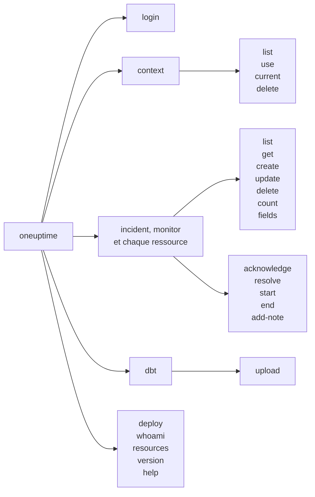

# Référence des commandes

Chaque commande de la CLI `oneuptime`, avec ses arguments, ses options et ses valeurs par défaut. Ajoutez `--help` à n'importe quelle commande pour voir la même chose dans votre terminal.

:::cards
- [Options globales](#options-globales): Les options que prend chaque commande.
- [Connexion et contextes](#connexion-et-contextes): login et les commandes context.
- [Commandes des ressources](#commandes-des-ressources): Les opérations, les champs et les actions de chaque ressource.
- [Autres commandes](#autres-commandes): deploy, dbt upload, data-checks apply, whoami, resources, version et help.
:::

## Les commandes



## Options globales

| Option | Ce qu'elle fait | Par défaut |
| --- | --- | --- |
| `--api-key <key>` | La clé API pour cette commande | `ONEUPTIME_API_KEY`, puis la clé du contexte |
| `--url <url>` | L'adresse de votre OneUptime pour cette commande | `ONEUPTIME_URL`, puis l'URL du contexte |
| `--context <name>` | Le contexte enregistré à utiliser pour cette commande | Le contexte actuel |
| `-o, --output <format>` | `json`, `table` ou `wide` | `table` dans un terminal, `json` dans un pipe |
| `--json` | Équivaut à `-o json` | |
| `--no-color` | Affiche sans couleurs | Des couleurs, sauf si `NO_COLOR` est défini |
| `-V, --version` | Affiche la version de la CLI | |
| `-h, --help` | Affiche l'aide d'une commande | |

Les options se placent avant ou après la commande : `oneuptime --context staging incident list` et `oneuptime incident list --context staging` font la même chose.

Chaque commande accepte `-o` et `--json` : les tableaux ci-dessous les omettent donc. Une commande dont la réponse est une phrase, comme `delete`, affiche la phrase, sauf si `-o json` ou `--json` demande du JSON : voir [Formats de sortie](/docs/cli/output-formats#json).

## Connexion et contextes

### `oneuptime login`

Enregistre une clé API et une adresse comme contexte, et en fait le contexte actuel. Voir [Se connecter](/docs/cli/authentication#se-connecter).

```bash
oneuptime login <api-key> <instance-url> [--context-name <name>]
```

| Argument ou option | Obligatoire | Ce que c'est | Par défaut |
| --- | --- | --- | --- |
| `<api-key>` | Oui | Une clé API de votre projet | |
| `<instance-url>` | Oui | L'adresse de votre OneUptime, comme `https://oneuptime.com` | |
| `--context-name <name>` | Non | Le nom sous lequel enregistrer le contexte | `default` |

### `oneuptime context list`

Liste les contextes enregistrés ; `*` marque le contexte actuel. Les clés API ne sont jamais listées : le JSON donne pour chaque contexte `name`, `apiUrl` et `isCurrent`.

```bash
oneuptime context list
```

### `oneuptime context use`

Fait d'un contexte enregistré le contexte actuel.

```bash
oneuptime context use <name>
```

| Argument | Obligatoire | Ce que c'est |
| --- | --- | --- |
| `<name>` | Oui | Le nom d'un contexte enregistré |

### `oneuptime context current`

Affiche le nom et l'URL du contexte actuel, et sa clé API masquée sauf ses quatre premiers et quatre derniers caractères.

```bash
oneuptime context current
```

### `oneuptime context delete`

Supprime un contexte enregistré. Si c'était le contexte actuel, le premier contexte restant devient l'actuel.

```bash
oneuptime context delete <name>
```

| Argument | Obligatoire | Ce que c'est |
| --- | --- | --- |
| `<name>` | Oui | Le nom d'un contexte enregistré |

## Commandes des ressources

`<resource>` est la commande d'un type d'enregistrement, tirée du tableau [Ressources](#ressources), comme `incident` ou `monitor`. Une ressource a les opérations que l'API accepte pour elle, la plupart les six, et `oneuptime <resource> --help` liste les siennes. Voir [Opérations sur les ressources](/docs/cli/resource-operations) pour des exemples.

### `oneuptime <resource> list`

Liste des enregistrements, les plus récents d'abord. Les étiquettes sont plutôt listées par nom, les étiquettes numérotées d'abord (`2. Team` avant `10. Owner`).

```bash
oneuptime <resource> list [--query <json>] [--limit <n>] [--skip <n>] [--sort <json>] [--fields <names>] [--all]
```

| Option | Ce qu'elle fait | Par défaut |
| --- | --- | --- |
| `--query <json>` | Un filtre, en JSON | Chaque enregistrement que la clé peut lire |
| `--limit <n>` | Le nombre maximal d'enregistrements à renvoyer, jusqu'à 10 000 | `10` |
| `--skip <n>` | Combien d'enregistrements passer d'abord | `0` |
| `--sort <json>` | L'ordre, en JSON : `{"<field>":"ASC"}` ou `{"<field>":"DESC"}` | Les plus récents d'abord |
| `--fields <names>` | Les champs à renvoyer, séparés par des virgules ; un champ d'un enregistrement lié après un point, comme dans `currentIncidentState.name` | Chaque champ que la clé peut lire |
| `--all` | Chaque enregistrement qui correspond, 100 à la fois, jusqu'à 100 000, à la place de `--limit` et `--skip`. Enregistrements seulement : la télémétrie n'a pas de `--all` | |

### `oneuptime <resource> get`

Lit un enregistrement.

```bash
oneuptime <resource> get <id> [--fields <names>]
```

| Argument ou option | Obligatoire | Ce que c'est |
| --- | --- | --- |
| `<id>` | Oui | L'ID de l'enregistrement, un UUID |
| `--fields <names>` | Non | Les champs à renvoyer, séparés par des virgules. Par défaut : chaque champ que la clé peut lire |

### `oneuptime <resource> create`

Crée un enregistrement et l'affiche.

```bash
oneuptime <resource> create [--<field> <value>]... [--data <json>] [--file <path>]
```

| Option | Obligatoire | Ce que c'est |
| --- | --- | --- |
| `--<field> <value>` | Les champs qu'une création doit donner | La valeur d'un champ : `--title <text>`, `--incident-severity-id <id>`, `--labels <ids>`. `oneuptime <resource> create --help` les liste. Enregistrements seulement |
| `--data <json>` | Non | L'enregistrement, en JSON |
| `--file <path>` | Non | Un fichier JSON contenant l'enregistrement. Donné avec `--data`, c'est le fichier qui est utilisé |

Les options s'ajoutent à `--data` ou `--file`. Un champ qui nomme une personne par son ID d'utilisateur a aussi une option qui la nomme par son adresse e-mail : `--user-email` à côté de `--user-id`.

### `oneuptime <resource> update`

Modifie les champs que vous donnez.

```bash
oneuptime <resource> update <id> [--<field> <value>]... [--data <json>] [--file <path>]
```

| Argument ou option | Obligatoire | Ce que c'est |
| --- | --- | --- |
| `<id>` | Oui | L'ID de l'enregistrement |
| `--<field> <value>` | Non | Un champ à modifier : `oneuptime <resource> update --help` les liste. Enregistrements seulement |
| `--data <json>` | Non | Les champs à modifier, en JSON |
| `--file <path>` | Non | Un fichier JSON contenant les champs à modifier. Donné avec `--data`, c'est le fichier qui est utilisé |

### `oneuptime <resource> delete`

Supprime un enregistrement immédiatement, sans demander.

```bash
oneuptime <resource> delete <id> [--force]
```

| Argument ou option | Obligatoire | Ce que c'est |
| --- | --- | --- |
| `<id>` | Oui | L'ID de l'enregistrement |
| `--force` | Non | Accepté et ne change rien : `delete` ne demande jamais de confirmation |

### `oneuptime <resource> count`

Compte des enregistrements et affiche le nombre.

```bash
oneuptime <resource> count [--query <json>]
```

| Option | Obligatoire | Ce que c'est |
| --- | --- | --- |
| `--query <json>` | Non | Un filtre, en JSON. Sans filtre, chaque enregistrement que la clé peut lire |

### `oneuptime <resource> fields`

Liste les champs de la ressource : le rôle de chacun, son type, si une création doit le donner, et l'option qui le définit. Elle les lit dans la CLI elle-même, sans clé API ni requête.

```bash
oneuptime <resource> fields
```

### `oneuptime <resource> acknowledge`

Fait passer un incident, une alerte ou un épisode de l'un d'eux à l'état pris en compte de votre projet, comme le fait le bouton du tableau de bord. Un enregistrement déjà pris en compte, ou au-delà, reste tel quel.

```bash
oneuptime <resource> acknowledge <id>
```

| Argument | Obligatoire | Ce que c'est |
| --- | --- | --- |
| `<id>` | Oui | L'ID de l'enregistrement |

### `oneuptime <resource> resolve`

Fait passer un incident, une alerte ou un épisode de l'un d'eux à l'état résolu de votre projet.

```bash
oneuptime <resource> resolve <id>
```

| Argument | Obligatoire | Ce que c'est |
| --- | --- | --- |
| `<id>` | Oui | L'ID de l'enregistrement |

### `oneuptime <resource> start`

Fait passer un événement de maintenance à l'état en cours de votre projet.

```bash
oneuptime <resource> start <id>
```

| Argument | Obligatoire | Ce que c'est |
| --- | --- | --- |
| `<id>` | Oui | L'ID de l'événement |

### `oneuptime <resource> end`

Fait passer un événement de maintenance à l'état terminé de votre projet.

```bash
oneuptime <resource> end <id>
```

| Argument | Obligatoire | Ce que c'est |
| --- | --- | --- |
| `<id>` | Oui | L'ID de l'événement |

### `oneuptime <resource> add-note`

Ajoute une note à un incident, une alerte, un épisode de l'un d'eux ou un événement de maintenance.

```bash
oneuptime <resource> add-note <id> --note <markdown> [--public]
```

| Argument ou option | Obligatoire | Ce que c'est |
| --- | --- | --- |
| `<id>` | Oui | L'ID de l'enregistrement |
| `--note <markdown>` | Oui | La note, en Markdown |
| `--public` | Non | La publie sur les pages de statut de l'enregistrement, où ses abonnés sont prévenus. Incidents, leurs épisodes et maintenances planifiées seulement |

### Ressources

Chaque ressource de l'API de OneUptime est une commande, avec les opérations que l'API accepte pour elle, `fields`, et les actions des enregistrements qui en ont :

{{CLI_RESOURCE_COMMANDS}}

La CLI sort en même temps que OneUptime : `oneuptime resources` liste donc les commandes de la version que vous avez installée.

### Requêtes à l'API

Chaque opération est une requête à l'API, avec la clé dans l'en-tête `APIKey`. `<path>` est le chemin d'API de la ressource, donné par `oneuptime resources` : `/incident` pour `incident`, `/on-call-duty-policy` pour `on-call-policy`.

| Opération | Requête | Corps |
| --- | --- | --- |
| `list` | `POST /api/<path>/get-list` | `query`, `select`, `skip`, `limit` et `sort` |
| `get` | `POST /api/<path>/<id>/get-item` | `select` |
| `create` | `POST /api/<path>` | `{"data": ...}` |
| `update` | `PUT /api/<path>/<id>/` | `{"data": ...}` |
| `delete` | `DELETE /api/<path>/<id>/` | Aucun |
| `count` | `POST /api/<path>/count` | `query` |

Une action lit les états de votre projet et l'enregistrement, puis crée une ligne de la chronologie des états de l'enregistrement, comme le fait le bouton du tableau de bord : `acknowledge` sur un incident crée un `incident-state-timeline`. `add-note` crée un `incident-internal-note`, ou avec `--public` un `incident-public-note`. Une option d'e-mail liste d'abord les membres d'équipe du projet qui ont cette adresse. Quand OneUptime refuse un champ que la clé ne peut pas lire, une liste ou une lecture redemande sans lui.

## Autres commandes

### `oneuptime deploy`

Enregistre un déploiement, ou un autre changement, depuis un pipeline : il est dessiné sur les graphiques du service et lu par OneUptime AI quand il investigue un incident. La commande écrit avec une clé d'ingestion de télémétrie, pas avec une clé API. Voir [Déploiements et changements](/docs/telemetry/change-events).

```bash
oneuptime deploy [--service <name>] [--service-version <version>] [--previous-version <version>] [--commit <sha>] [--repository <url>] [--branch <name>] [--pull-request <number>] [--environment <name>] [--title <title>] [--description <text>] [--type <type>] [--time <time>] [--attribute <key=value...>] [--ingestion-key <key>]
```

| Option | Obligatoire | Ce que c'est | Par défaut |
| --- | --- | --- | --- |
| `--service <name>` | Non | Le service qui a été déployé | Un changement qui concerne tout le projet |
| `--service-version <version>` | Non | La version déployée | |
| `--previous-version <version>` | Non | La version qu'elle a remplacée | |
| `--commit <sha>` | Non | Le commit déployé | |
| `--repository <url>` | Non | Le dépôt où se trouve le commit | |
| `--branch <name>` | Non | La branche déployée | |
| `--pull-request <number>` | Non | La pull request déployée | |
| `--environment <name>` | Non | L'environnement de déploiement | |
| `--title <title>` | Non | Le titre du changement ; un autre type qu'un déploiement en a besoin | `Deploy <version>` |
| `--description <text>` | Non | Les détails du changement | |
| `--type <type>` | Non | Le type de changement, comme `config-change` ou `rollback` | `deployment` |
| `--time <time>` | Non | Quand il a eu lieu, comme `2026-10-19T10:00:00Z` | Maintenant |
| `--attribute <key=value...>` | Non | D'autres attributs, sous la forme `key=value`, un ou plusieurs | |
| `--ingestion-key <key>` | Non | Une clé d'ingestion de télémétrie du projet | `ONEUPTIME_TELEMETRY_INGESTION_KEY` |

### `oneuptime dbt upload`

Envoie les artefacts d'un projet dbt après un build, depuis la CI ou une tâche dbt Cloud, à l'Observabilité des données. Ses modèles apparaissent sur les tables qu'ils construisent, avec leur lignage, ses tests apparaissent à côté des vérifications de OneUptime et peuvent déclencher des alertes, et chaque build est une exécution du pipeline du projet. La commande lit `manifest.json` et `run_results.json` dans le dossier cible de dbt, n'envoie que ce que l'Observabilité des données en lit, et écrit avec une clé d'ingestion de télémétrie, pas avec une clé API. La page Documentation de l'Observabilité des données, dans votre tableau de bord, la montre dans une tâche de CI.

```bash
oneuptime dbt upload [--target-path <dir>] [--manifest <file>] [--run-results <file>] [--project <name>] [--ingestion-key <key>]
```

| Option | Obligatoire | Ce que c'est | Par défaut |
| --- | --- | --- | --- |
| `--target-path <dir>` | Non | Le dossier où dbt a écrit ses artefacts | `target` |
| `--manifest <file>` | Non | Le manifeste à envoyer | `manifest.json` dans le dossier cible |
| `--run-results <file>` | Non | Les résultats d'exécution à envoyer | `run_results.json` dans le dossier cible |
| `--project <name>` | Non | Le nom du projet dbt, nécessaire seulement quand aucun manifeste n'est envoyé | Le projet du manifeste |
| `--ingestion-key <key>` | Non | Une clé d'ingestion de télémétrie du projet | `ONEUPTIME_TELEMETRY_INGESTION_KEY` |

### `oneuptime data-checks apply`

Fait correspondre les contrôles de données du projet à un fichier YAML, afin qu'ils soient conservés dans un dépôt et relus comme du code. Une erreur n'importe où dans le fichier n'applique rien et se termine par une erreur. Le format du fichier est décrit dans [Contrôles et rapprochements](/docs/data-observability/checks).

```bash
oneuptime data-checks apply <file> [--dry-run] [--prune]
```

| Option | Obligatoire | Ce que c'est | Par défaut |
| --- | --- | --- | --- |
| `--dry-run` | Non | Dit ce qui changerait, et ne change rien | Désactivé |
| `--prune` | Non | Supprime les contrôles qu'un apply précédent a créés et que le fichier ne nomme plus | Désactivé |

### `oneuptime whoami`

Affiche l'URL et la clé API que la prochaine commande utilisera, avec la clé masquée, et le contexte d'où elles viennent. Sans `--check`, elle n'appelle pas OneUptime. Voir [Vérifier ce que la CLI va utiliser](/docs/cli/authentication#vérifier-ce-que-la-cli-va-utiliser).

```bash
oneuptime whoami [--check]
```

| Option | Obligatoire | Ce que c'est |
| --- | --- | --- |
| `--check` | Non | Demande à OneUptime s'il accepte la clé, et affiche le projet de la clé, la version de votre OneUptime et celle de la CLI |

### `oneuptime resources`

Liste chaque type d'enregistrement pour lequel la CLI a une commande : sa commande, ses noms au singulier et au pluriel, son type et son chemin d'API, et le total. Le JSON donne pour chacun `name`, `singularName`, `pluralName`, `modelType`, `apiPath`, `operations` et `actions`.

```bash
oneuptime resources [--type <type>]
```

| Option | Obligatoire | Ce que c'est | Par défaut |
| --- | --- | --- | --- |
| `--type <type>` | Non | `database` pour les enregistrements, `analytics` pour la télémétrie | Les deux |

### `oneuptime version`

Affiche la version de la CLI, comme le fait `oneuptime --version`.

```bash
oneuptime version
```

### `oneuptime help`

Affiche l'aide de la CLI, ou celle d'une commande.

```bash
oneuptime help [command]
```

## Variables d'environnement

| Variable | Ce qu'elle fait |
| --- | --- |
| `ONEUPTIME_API_KEY` | La clé API, quand aucune option `--api-key` n'en donne une |
| `ONEUPTIME_URL` | L'adresse de votre OneUptime, quand aucune option `--url` n'en donne une |
| `ONEUPTIME_TELEMETRY_INGESTION_KEY` | La clé d'ingestion de télémétrie avec laquelle `oneuptime deploy` écrit, quand aucune option `--ingestion-key` n'en donne une |
| `NO_COLOR` | Définie avec n'importe quelle valeur, elle désactive les couleurs |

## Fichiers

| Fichier | Ce qu'il contient |
| --- | --- |
| `~/.oneuptime/config.json` | Les contextes enregistrés, leurs clés API et le contexte actuel |

## Codes de sortie

| Code | Signification |
| --- | --- |
| `0` | Cela a fonctionné |
| `1` | Cela a échoué : OneUptime a refusé la requête, ou la commande était erronée |
| `2` | Aucune clé API utilisable : aucune trouvée, non valide, ou sous son offre |
| `3` | Introuvable : OneUptime a répondu `404` |

Voir [Codes de sortie](/docs/cli/scripting#codes-de-sortie) pour des exemples.

## Étapes suivantes

:::cards
- [Vue d'ensemble de la CLI](/docs/cli/index): Installer la CLI et lancer vos premières commandes.
- [Opérations sur les ressources](/docs/cli/resource-operations): Des exemples de chaque opération.
- [Scripts et CI/CD](/docs/cli/scripting): La CLI dans les scripts et les pipelines.
:::
