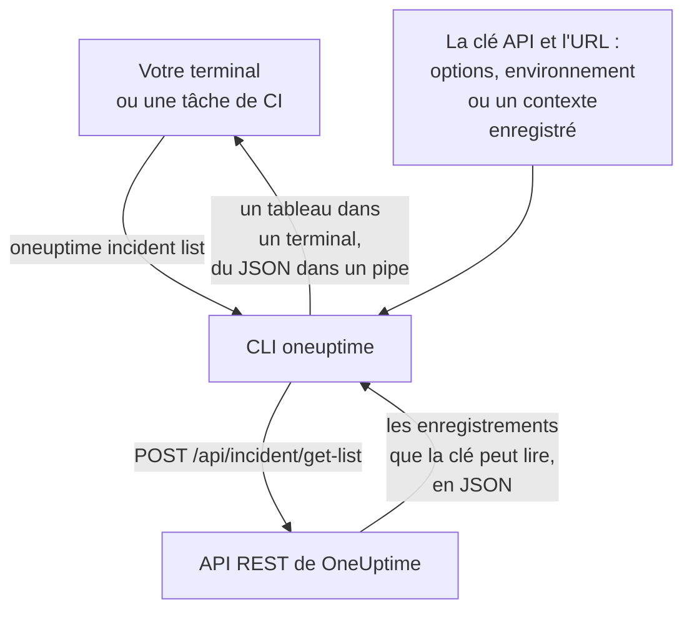

# Vue d'ensemble de la CLI

La CLI de OneUptime, `oneuptime`, gère votre projet OneUptime depuis un terminal ou un script. Elle liste, lit, crée, modifie, supprime et compte les moniteurs, incidents, alertes, pages de statut et les autres enregistrements que l'API de OneUptime propose, avec une clé API de votre projet.

:::cards
- [Comment fonctionne la CLI](#comment-fonctionne-la-cli): Une commande, une requête à l'API, une réponse.
- [Installer la CLI](#installer-la-cli): Une commande npm, et la version à choisir.
- [Lancer vos premières commandes](#lancer-vos-premières-commandes): Enregistrez votre clé API, puis listez vos incidents.
- [Les commandes en un coup d'œil](#les-commandes-en-un-coup-dœil): Chaque commande, et la page qui l'explique.
:::

## Comment fonctionne la CLI

Chaque commande envoie une requête à l'API REST de OneUptime et affiche la réponse. La CLI prend la clé API et l'adresse de votre OneUptime dans des options, des variables d'environnement ou un contexte enregistré par `oneuptime login`. La clé décide de ce qu'une commande peut lire et modifier, exactement comme pour l'API.



Les commandes des enregistrements sont livrées avec la CLI : chaque type d'enregistrement que l'API de OneUptime ouvre aux outils en a une, les mêmes enregistrements pour lesquels le [serveur MCP](/docs/ai/mcp-server) a des outils. Lancez `oneuptime resources` pour les lister.

## Avant de commencer

- **Node.js et npm**, dans une version LTS actuelle, pour installer la CLI.
- **Une clé API de votre projet.** Créez-en une dans **Paramètres du projet → Avancé → Clés API** avec **Créer : Clé API** : voir [Créer une clé API](/docs/api-reference/api-reference#créer-une-clé-api).
- **Sur OneUptime Cloud, l'offre Growth ou supérieure.** Les clés API d'un projet ne fonctionnent qu'avec elle : voir [Clés API et SCIM sous leur offre](/docs/api-reference/api-reference#clés-api-et-scim-sous-leur-offre).

## Installer la CLI

Installez le paquet `@oneuptime/cli` depuis npm. Il ajoute la commande `oneuptime`, et `--version` affiche la version installée :

```bash
npm install -g @oneuptime/cli
oneuptime --version
```

La CLI sort en même temps que OneUptime et porte le même numéro de version. Sur un OneUptime auto-hébergé, installez la CLI de la version de votre OneUptime, afin que ses commandes correspondent aux enregistrements de votre serveur :

```bash
npm install -g @oneuptime/cli@<your-oneuptime-version>
```

> [!WARNING]
> Les versions de la CLI antérieures à 14.0.64 s'arrêtent dès leur démarrage, avec une erreur telle que `Cannot find module 'Common/Models/DatabaseModels/Index'`. Installez la 14.0.64 ou une version ultérieure avec `npm install -g @oneuptime/cli@latest`. Sur un OneUptime auto-hébergé antérieur à 14.0.64, [mettez d'abord OneUptime à niveau](/docs/installation/upgrading#comment-faire-la-mise-à-niveau), puis installez la CLI de la version vers laquelle vous l'avez mis à niveau.

## Lancer vos premières commandes

:::steps
### Enregistrer votre clé API

Connectez-vous avec la clé et l'adresse de votre OneUptime. La CLI les enregistre comme un contexte nommé `default` et l'utilise désormais :

```bash
oneuptime login <your-api-key> https://oneuptime.com
```

Elle répond `Logged in successfully. Context "default" is now active.` Sur un OneUptime auto-hébergé, utilisez son adresse à la place de `https://oneuptime.com`.

### Lister vos incidents

```bash
oneuptime incident list
```

Les dix incidents les plus récents s'affichent sous forme de tableau. `login` enregistre la clé sans la vérifier : c'est donc cette commande qui montre la première que la clé fonctionne. Si elle est refusée, voir [Dépannage](/docs/cli/authentication#dépannage).

### Voir ce que vous pouvez gérer d'autre

```bash
oneuptime resources
```

La liste montre chaque type d'enregistrement avec lequel vous pouvez travailler, et sa commande, comme `monitor`, `status-page` ou `on-call-policy`.
:::

## Les commandes en un coup d'œil

| Commande | Ce qu'elle fait | En savoir plus |
| --- | --- | --- |
| `oneuptime login <api-key> <instance-url>` | Enregistre une clé API et une adresse comme contexte | [Authentification](/docs/cli/authentication#se-connecter) |
| `oneuptime context list`, `use`, `current`, `delete` | Liste, change, affiche et supprime les contextes enregistrés | [Authentification](/docs/cli/authentication#contextes) |
| `oneuptime whoami` | Affiche l'URL et la clé API que la prochaine commande utilisera | [Authentification](/docs/cli/authentication#vérifier-ce-que-la-cli-va-utiliser) |
| `oneuptime deploy` | Enregistre un déploiement, ou un autre changement, pour les graphiques et OneUptime AI | [Déploiements et changements](/docs/telemetry/change-events) |
| `oneuptime <resource> list`, `get`, `create`, `update`, `delete`, `count` | Travaille avec un type d'enregistrement | [Opérations sur les ressources](/docs/cli/resource-operations) |
| `oneuptime resources` | Liste les types d'enregistrements, avec leurs commandes | [Référence des commandes](/docs/cli/command-reference#oneuptime-resources) |
| `oneuptime version` | Affiche la version de la CLI | [Référence des commandes](/docs/cli/command-reference#oneuptime-version) |
| `oneuptime help [command]` | Affiche l'aide d'une commande | [Obtenir de l'aide](#obtenir-de-laide) |

## Options globales

Ces options fonctionnent avec chaque commande, avant ou après elle :

| Option | Ce qu'elle fait |
| --- | --- |
| `--api-key <key>` | La clé API pour cette commande, à la place de celle enregistrée |
| `--url <url>` | L'adresse de votre OneUptime pour cette commande |
| `--context <name>` | Un contexte enregistré pour cette commande, à la place du contexte actuel |
| `-o, --output <format>` | `table`, `json` ou `wide` : voir [Formats de sortie](/docs/cli/output-formats) |
| `--no-color` | Affiche sans couleurs |
| `-V, --version` | Affiche la version de la CLI |
| `-h, --help` | Affiche l'aide de la commande |

## Obtenir de l'aide

Chaque commande a sa propre aide, avec ses arguments, ses options et ses valeurs par défaut :

```bash
oneuptime --help
oneuptime help incident
oneuptime incident list --help
```

## Étapes suivantes

:::cards
- [Authentification](/docs/cli/authentication): Des contextes pour chaque environnement, et la clé qu'une commande utilise.
- [Opérations sur les ressources](/docs/cli/resource-operations): Lister, lire, créer, modifier, supprimer et compter des enregistrements.
- [Formats de sortie](/docs/cli/output-formats): Des tableaux pour les humains, du JSON pour les scripts.
- [Scripts et CI/CD](/docs/cli/scripting): Codes de sortie, jq et pipelines.
- [Référence des commandes](/docs/cli/command-reference): Chaque commande, option et valeur par défaut.
:::
