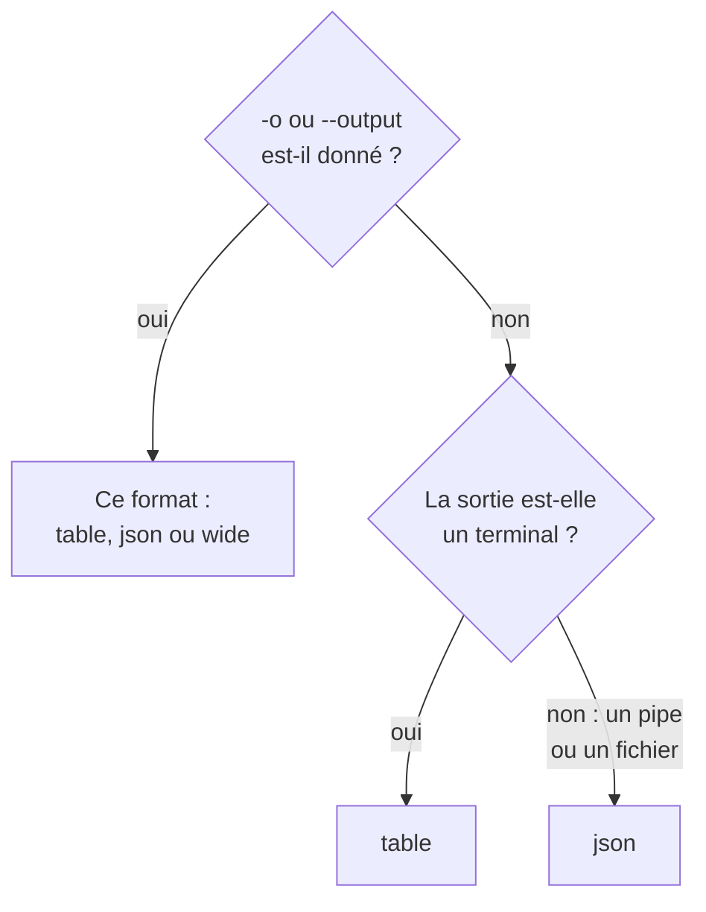

# Formats de sortie

La CLI affiche un tableau quand vous lisez sa réponse dans un terminal, et du JSON quand un script ou un autre programme la lit. Choisissez le format de n'importe quelle commande avec `-o` ou `--output`.

:::cards
- [Comment le format est choisi](#comment-le-format-est-choisi): Un terminal reçoit un tableau, un pipe reçoit du JSON.
- [Tableau](#tableau): Six colonnes, chaque valeur coupée à 60 caractères.
- [JSON](#json): Chaque champ, en entier, pour les scripts et jq.
- [Large](#large): Un tableau avec toutes les colonnes.
:::

## Comment le format est choisi



| Format | Ce qu'il affiche | Idéal pour |
| --- | --- | --- |
| `table` | Un tableau de six colonnes au plus ; un seul enregistrement sous forme d'une ligne par champ | Lire dans un terminal |
| `json` | La réponse telle que OneUptime l'a envoyée, indentée de deux espaces | Les scripts, `jq` et les fichiers |
| `wide` | Un tableau avec une colonne pour chaque champ | Comparer de nombreux champs d'un coup d'œil |

`-o` fonctionne avec chaque commande qui affiche des enregistrements : `list`, `get`, `create`, `update` et `count` d'une ressource, `oneuptime resources` et `oneuptime context list`. Il peut se placer n'importe où sur la ligne de commande. Toute autre valeur est refusée avant l'envoi d'une requête :

```text
error: option '-o, --output <format>' argument 'yaml' is invalid. Allowed choices are json, table, wide.
```

## Tableau

Un tableau est le format par défaut dans un terminal. `oneuptime resources --type analytics`, par exemple, affiche celui-ci :

```text
┌────────────────────────────┬────────────────────────────┬─────────────────────────────┬───────────┬─────────────────────────────┐
│ Command                    │ Singular                   │ Plural                      │ Type      │ API Path                    │
├────────────────────────────┼────────────────────────────┼─────────────────────────────┼───────────┼─────────────────────────────┤
│ log                        │ Log                        │ Logs                        │ analytics │ /logs                       │
├────────────────────────────┼────────────────────────────┼─────────────────────────────┼───────────┼─────────────────────────────┤
│ span                       │ Span                       │ Spans                       │ analytics │ /span                       │
├────────────────────────────┼────────────────────────────┼─────────────────────────────┼───────────┼─────────────────────────────┤
│ metric                     │ Metric                     │ Metrics                     │ analytics │ /metrics                    │
├────────────────────────────┼────────────────────────────┼─────────────────────────────┼───────────┼─────────────────────────────┤
│ exception-instance         │ Exception Instance         │ Exception Instances         │ analytics │ /exceptions                 │
├────────────────────────────┼────────────────────────────┼─────────────────────────────┼───────────┼─────────────────────────────┤
│ monitor-log                │ Monitor Log                │ Monitor Logs                │ analytics │ /monitor-log                │
├────────────────────────────┼────────────────────────────┼─────────────────────────────┼───────────┼─────────────────────────────┤
│ kubernetes-cost-allocation │ Kubernetes Cost Allocation │ Kubernetes Cost Allocations │ analytics │ /kubernetes-cost-allocation │
├────────────────────────────┼────────────────────────────┼─────────────────────────────┼───────────┼─────────────────────────────┤
│ security-event             │ Security Event             │ Security Events             │ analytics │ /security-events            │
├────────────────────────────┼────────────────────────────┼─────────────────────────────┼───────────┼─────────────────────────────┤
│ change-event               │ Change Event               │ Change Events               │ analytics │ /change-events              │
├────────────────────────────┼────────────────────────────┼─────────────────────────────┼───────────┼─────────────────────────────┤
│ threat-intel-indicator     │ Threat Intel Indicator     │ Threat Intel Indicators     │ analytics │ /threat-intel-indicators    │
└────────────────────────────┴────────────────────────────┴─────────────────────────────┴───────────┴─────────────────────────────┘

Total: 9 resources
```

Pour une liste d'enregistrements, un tableau affiche au plus six colonnes : d'abord `_id`, `name`, `title`, `status`, `createdAt` et `updatedAt`, celles que les enregistrements ont, puis les champs suivants des enregistrements dans l'ordre. Les colonnes sont prises dans le premier enregistrement. Une valeur de plus de 60 caractères est coupée à ses 57 premiers, suivis de `...`.

Un seul enregistrement, tel que `get` et `create` l'affichent, est un tableau de deux colonnes : le nom du champ et sa valeur, une ligne par champ.

OneUptime envoie les dates et les ID des autres enregistrements sous forme d'objets, comme `{"_type":"DateTime","value":"2026-10-14T09:12:44.000Z"}`, et un tableau les affiche sous forme de ce texte. Leur valeur se trouve dans `value` : voir [JSON](#json).

## JSON

Le JSON est la réponse telle que OneUptime l'a envoyée, indentée de deux espaces : une liste est un tableau d'enregistrements, et un seul enregistrement est un objet.

```bash
oneuptime incident list --limit 1 -o json
```

```json
[
  {
    "_id": "6f1c2a40-3b1e-4c55-9a0b-3e2f8d7c1a11",
    "createdAt": {
      "_type": "DateTime",
      "value": "2026-10-14T09:12:44.000Z"
    },
    "title": "Checkout API is down",
    "currentIncidentStateId": {
      "_type": "ObjectID",
      "value": "0b7d5e2c-8f4a-4d1b-9c3e-5a6f7b8c9d0e"
    }
  }
]
```

Un enregistrement a chaque champ que la clé peut lire ; celui-ci est réduit à quatre. Le `_id` propre d'un enregistrement est du texte, et les autres ID et les dates sont des objets dont `value` contient la valeur :

```bash
oneuptime incident list -o json | jq -r '.[] | "\(.createdAt.value)  \(.title)"'
```

Quand la sortie n'est pas un terminal, comme dans `oneuptime incident list | jq '.[].title'`, la CLI affiche du JSON sans `-o json`. Écrivez quand même `-o json` dans les scripts, afin qu'ils n'en dépendent pas.

## Large

`-o wide` est un tableau avec une colonne pour chaque champ des enregistrements. Chaque valeur reste coupée à 60 caractères, et les enregistrements ont de nombreux champs : un tableau large est donc très large. Parcourez-le avec `less -S`.

```bash
oneuptime incident list -o wide | less -S
```

## Couleurs

Les en-têtes des tableaux sont cyan ; les messages sont verts quand quelque chose a fonctionné, bleus pour les informations et rouges pour les erreurs. Désactivez les couleurs avec `--no-color`, ou en donnant n'importe quelle valeur à `NO_COLOR` :

```bash
oneuptime incident list --no-color
NO_COLOR=1 oneuptime incident list
```

## Ce que chaque commande affiche

Les enregistrements et les comptes vont sur la sortie standard, et les erreurs sur la sortie d'erreur standard : un pipe ne lit donc que la réponse.

| Commande | Dans un tableau | En JSON |
| --- | --- | --- |
| Un `list` qui ne trouve rien | `No results found.` | `[]` |
| Un `get` ou un `create` | Une ligne par champ | L'enregistrement |
| Un `count` | Le nombre | Le nombre |
| Un `update` | Une ligne vide | `{}` |
| Un `delete` | `Monitor <id> deleted successfully.` | La même ligne |

## Étapes suivantes

:::cards
- [Scripts et CI/CD](/docs/cli/scripting): Lire le JSON avec jq dans des scripts et des pipelines.
- [Opérations sur les ressources](/docs/cli/resource-operations): Les opérations dont ce sont les réponses.
- [Référence des commandes](/docs/cli/command-reference): Chaque commande et chaque option.
:::
