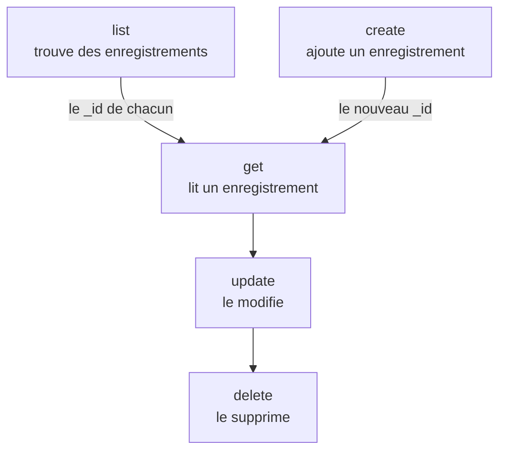

# Opérations sur les ressources

Chaque type d'enregistrement est une commande à part entière, comme `incident`, `monitor` ou `status-page`, et chacune prend les mêmes opérations : `list`, `get`, `create`, `update`, `delete` et `count`. Cette page montre chaque opération, avec les filtres, la pagination et le JSON dans lequel un enregistrement s'écrit.

:::cards
- [Trouver la commande d'un enregistrement](#trouver-la-commande-dun-enregistrement): oneuptime resources les liste toutes.
- [Lister des enregistrements](#lister-des-enregistrements): Filtrer, trier et paginer.
- [Créer un enregistrement](#créer-un-enregistrement): À partir de JSON sur la ligne de commande ou dans un fichier.
- [Supprimer un enregistrement](#supprimer-un-enregistrement): Immédiatement, sans retour en arrière.
:::

## Comment les opérations s'articulent

Lire, modifier et supprimer un enregistrement demandent son ID. Lister, compter et créer n'en demandent aucun, et une liste ou une création vous donne les ID que prennent les autres :



Un ID est un UUID, comme `6f1c2a40-3b1e-4c55-9a0b-3e2f8d7c1a11`. Vous pouvez aussi en copier un depuis la page de l'enregistrement dans OneUptime : voir [Trouver l'ID d'une ressource](/docs/api-reference/api-reference#trouver-lid-dune-ressource).

## Trouver la commande d'un enregistrement

```bash
oneuptime resources
```

La liste montre chaque type d'enregistrement avec sa commande, ses noms, son type et son chemin d'API. Il existe deux types :

| Type | Ce qu'il contient | Opérations |
| --- | --- | --- |
| `database` | Les enregistrements que vous gérez : moniteurs, incidents, alertes, pages de statut, équipes et plus encore | `list`, `get`, `create`, `update`, `delete`, `count` |
| `analytics` | La télémétrie : logs, spans, métriques, exceptions et autres événements | `list`, `create`, `count` |

Affichez un seul type avec `oneuptime resources --type database` ou `--type analytics`. La [Référence des commandes](/docs/cli/command-reference#ressources) liste chaque commande.

## Lister des enregistrements

```bash
oneuptime <resource> list [--query <json>] [--limit <n>] [--skip <n>] [--sort <json>] [-o <format>]
```

| Option | Ce qu'elle fait | Par défaut |
| --- | --- | --- |
| `--query <json>` | Ne renvoie que les enregistrements qui correspondent : voir [Filtrer une liste](#filtrer-une-liste) | Chaque enregistrement que la clé peut lire |
| `--limit <n>` | Le nombre maximal d'enregistrements à renvoyer, jusqu'à 10 000 | `10` |
| `--skip <n>` | Combien d'enregistrements correspondants passer d'abord | `0` |
| `--sort <json>` | L'ordre, comme `{"createdAt":"ASC"}`, ou `"DESC"` pour les plus récents d'abord | Les plus récents d'abord |
| `-o, --output <format>` | `table`, `json` ou `wide` | `table` dans un terminal, `json` dans un pipe |

```bash
# The ten newest incidents
oneuptime incident list

# The oldest monitors first, 50 at a time: the second page
oneuptime monitor list --sort '{"createdAt":"ASC"}' --limit 50 --skip 50

# Every field of each incident, as JSON
oneuptime incident list -o json
```

Une liste demande à OneUptime chaque champ de chaque enregistrement que la clé peut lire. Un tableau en affiche six ; le JSON les affiche tous (voir [Formats de sortie](/docs/cli/output-formats)). Pour parcourir tous les enregistrements, augmentez `--skip` de `--limit` jusqu'à ce qu'une page revienne vide ; `count` indique combien il y en a.

Les étiquettes sont listées par nom plutôt que des plus récentes aux plus anciennes : les étiquettes dont le nom commence par un nombre viennent d'abord, dans l'ordre de ce nombre (`2. Team` avant `10. Owner`), puis les autres par ordre alphabétique. Pour les lister dans un autre ordre, indiquez `--sort`.

### Filtrer une liste

`--query` prend le même filtre que l'API : un champ avec une valeur correspond à cette valeur, et un objet avec un `_type` compare.

| Filtre | Correspond à |
| --- | --- |
| `{"title":"Checkout API is down"}` | Les enregistrements qui ont exactement cette valeur |
| `{"title":{"_type":"Search","value":"checkout"}}` | Un texte qui contient la valeur |
| `{"createdAt":{"_type":"GreaterThan","value":"2026-10-01T00:00:00.000Z"}}` | Des dates plus tardives, ou des nombres plus grands |
| `{"currentIncidentState":{"isResolvedState":false}}` | Un champ d'un enregistrement que la ressource nomme : ici, les incidents qui ne sont pas résolus |

```bash
oneuptime incident list --query '{"title":{"_type":"Search","value":"checkout"}}'
```

[Filtrer, trier et paginer](/docs/api-reference/api-reference#filtrer-trier-et-paginer) dans la référence de l'API liste chaque `_type`.

## Lire un enregistrement

```bash
oneuptime <resource> get <id> [-o <format>]
```

```bash
oneuptime incident get 6f1c2a40-3b1e-4c55-9a0b-3e2f8d7c1a11
```

Un tableau affiche une ligne pour chaque champ de l'enregistrement, chaque valeur coupée à 60 caractères ; `-o json` affiche les valeurs entières. Un ID qui ne nomme aucun enregistrement que votre clé peut lire répond `Not found`, et la commande se termine avec le code `3`.

## Créer un enregistrement

```bash
oneuptime <resource> create --data <json> [-o <format>]
oneuptime <resource> create --file <path> [-o <format>]
```

`--data` prend l'enregistrement en JSON, et `--file` le lit dans un fichier JSON. Donnez l'un des deux ; si les deux sont donnés, c'est le fichier qui est utilisé. Les champs sont ceux de l'API, et la [référence de l'API](/reference) liste ceux de chaque ressource. Le projet vient de la clé API : un enregistrement ne le nomme donc jamais.

```bash
# A manual monitor
oneuptime monitor create --data '{"name":"Checkout API","monitorType":"Manual"}'

# An incident with one of your severities
oneuptime incident create --data '{"title":"Checkout API is down","incidentSeverityId":"<severity-id>"}'

# The same incident, from a file
oneuptime incident create --file incident.json
```

La CLI affiche le nouvel enregistrement, avec son `_id`. Un incident commence dans l'état de création de votre projet, sauf si `currentIncidentStateId` en nomme un autre : voir [L'état dans lequel commence un nouvel enregistrement](/docs/api-reference/api-reference#létat-dans-lequel-commence-un-nouvel-enregistrement). Pour trouver les ID de vos niveaux de gravité :

```bash
oneuptime incident-severity list -o json | jq -r '.[] | "\(._id)  \(.name)"'
```

> [!TIP]
> Sous Windows, mettez le JSON dans un fichier et utilisez `--file` : PowerShell et l'Invite de commandes mettent le JSON entre guillemets sur la ligne de commande autrement que Bash.

## Mettre à jour un enregistrement

```bash
oneuptime <resource> update <id> --data <json> [-o <format>]
```

`--data` est obligatoire et ne contient que les champs à modifier :

```bash
# Rename a monitor
oneuptime monitor update <monitor-id> --data '{"name":"Checkout API (EU)"}'

# Move an incident to your resolved state
oneuptime incident update <incident-id> --data '{"currentIncidentStateId":"<resolved-state-id>"}'
```

OneUptime répond à une mise à jour par un objet vide : la CLI affiche une ligne vide, ou `{}` avec `-o json`. Lancez `get` pour voir l'enregistrement tel qu'il est maintenant. Faire passer un incident à un autre état de cette façon enregistre le changement sur sa chronologie, comme le fait le tableau de bord, et un état antérieur à son état actuel est refusé. Pour trouver l'ID de l'état résolu, le premier dans l'ordre de votre projet :

```bash
oneuptime incident-state list --query '{"isResolvedState":true}' --sort '{"order":"ASC"}' --limit 1 -o json | jq -r '.[0]._id'
```

## Supprimer un enregistrement

```bash
oneuptime <resource> delete <id>
```

```bash
oneuptime monitor delete 6f1c2a40-3b1e-4c55-9a0b-3e2f8d7c1a11
```

Elle répond `Monitor 6f1c2a40-3b1e-4c55-9a0b-3e2f8d7c1a11 deleted successfully.`

> [!CAUTION]
> `delete` supprime l'enregistrement immédiatement. La CLI ne vous demande pas de confirmer, et rien ne permet d'annuler. Elle accepte `--force`, pour les scripts écrits avec, et `--force` ne change rien.

## Compter des enregistrements

```bash
oneuptime <resource> count [--query <json>]
```

```bash
# Every incident
oneuptime incident count

# Incidents that are not resolved
oneuptime incident count --query '{"currentIncidentState":{"isResolvedState":false}}'
```

La CLI affiche un seul nombre, le même dans un tableau et en JSON, qu'un script peut donc lire tel quel.

## Ce que chaque type permet

| Opération | `database` | `analytics` |
| --- | --- | --- |
| `list` | Oui | Oui |
| `get` | Oui | Non |
| `create` | Oui | Oui |
| `update` | Oui | Non |
| `delete` | Oui | Non |
| `count` | Oui | Oui |

## Dépannage

:::details Le message « Not found: API error (404) »
L'enregistrement n'existe pas, se trouve dans un autre projet, ou la clé ne peut pas le lire : OneUptime répond de la même façon dans chaque cas. Vérifiez l'ID avec `list`, et les autorisations de la clé. La commande se termine avec le code `3`.
:::

:::details Le message « API error (422): You do not have permissions to select on »
Une liste ou une lecture demande chaque champ de l'enregistrement, et la clé ne peut pas lire l'un d'eux : le message nomme le champ et les autorisations qui peuvent le lire. Donnez à la clé l'une de ces autorisations.
:::

:::details Le message « Error: Invalid JSON »
La valeur de `--query`, `--sort` ou `--data` n'est pas du JSON. Avec Bash et zsh, entourez-la d'apostrophes ; sous Windows, mettez un enregistrement dans un fichier et utilisez `--file`.
:::

:::details API error (400) lors d'une création ou d'une mise à jour
OneUptime a refusé un champ : le message le nomme. `No fields to update` signifie que `--data` ne contenait aucun champ à modifier.
:::

## Étapes suivantes

:::cards
- [Formats de sortie](/docs/cli/output-formats): Lire les réponses sous forme de tableaux ou de JSON.
- [Scripts et CI/CD](/docs/cli/scripting): Utiliser ces opérations dans des scripts et des pipelines.
- [Référence des commandes](/docs/cli/command-reference): Chaque commande, option et valeur par défaut.
:::
