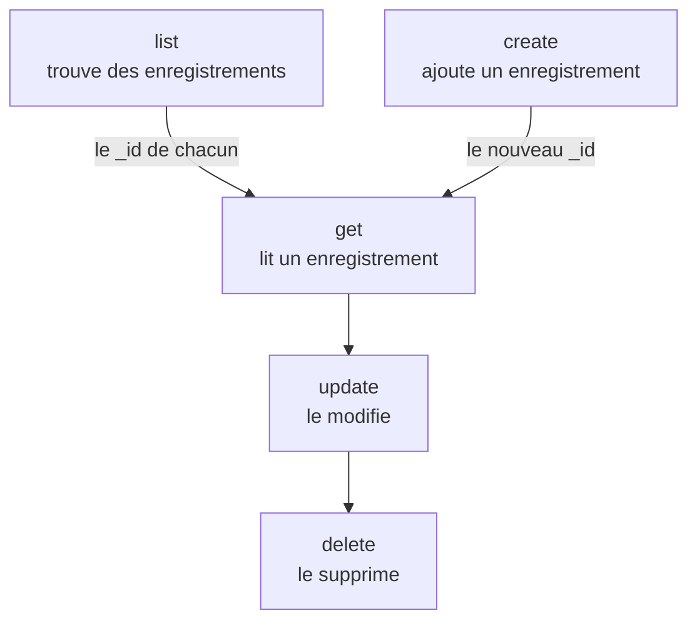

# Opérations sur les ressources

Chaque type d'enregistrement est une commande à part entière, comme `incident`, `monitor` ou `status-page`, avec les opérations que l'API accepte pour lui : pour la plupart, `list`, `get`, `create`, `update`, `delete` et `count`. Cette page montre chaque opération, avec les filtres, la pagination et les options avec lesquelles s'écrit un enregistrement, et les commandes qui font ce que font les boutons du tableau de bord.

:::cards
- [Trouver la commande d'un enregistrement](#trouver-la-commande-dun-enregistrement): oneuptime resources les liste toutes.
- [Lister des enregistrements](#lister-des-enregistrements): Filtrer, trier et paginer.
- [Créer un enregistrement](#créer-un-enregistrement): Une option pour chaque champ, ou l'enregistrement en JSON.
- [Prendre en compte, résoudre et ajouter des notes](#prendre-en-compte-résoudre-et-ajouter-des-notes): Les boutons du tableau de bord, en commandes.
- [Supprimer un enregistrement](#supprimer-un-enregistrement): Immédiatement, sans retour en arrière.
:::

## Comment les opérations s'articulent

Lire, modifier et supprimer un enregistrement demandent son ID. Lister, compter et créer n'en demandent aucun, et une liste ou une création vous donne les ID que prennent les autres :



Un ID est un UUID, comme `6f1c2a40-3b1e-4c55-9a0b-3e2f8d7c1a11`. Vous pouvez aussi en copier un depuis la page de l'enregistrement dans OneUptime : voir [Trouver l'ID d'une ressource](/docs/api-reference/api-reference#trouver-lid-dune-ressource).

## Trouver la commande d'un enregistrement

```bash
oneuptime resources
```

La liste montre chaque type d'enregistrement avec sa commande, ses noms, son type et son chemin d'API. Il existe deux types :

| Type | Ce qu'il contient |
| --- | --- |
| `database` | Les enregistrements que vous gérez : moniteurs, incidents, alertes, pages de statut, équipes et plus encore |
| `analytics` | La télémétrie : logs, spans, métriques, exceptions et autres événements |

Affichez un seul type avec `oneuptime resources --type database` ou `--type analytics`. La [Référence des commandes](/docs/cli/command-reference#ressources) liste chaque commande.

Une ressource accepte les opérations que l'API accepte pour elle. La plupart les acceptent toutes les six ; une ressource que OneUptime écrit lui-même, comme un journal d'e-mails, est en lecture seule. `oneuptime <resource> --help` liste les sous-commandes d'une ressource.

## Voir les champs d'une ressource

`fields` liste les champs d'une ressource à partir de la CLI elle-même, sans clé API ni requête :

```bash
oneuptime incident fields
```

Chaque champ a son type, son rôle, l'indication qu'une création doit le donner ou non, et l'option qui le définit. Un champ qui contient un ID nomme la ressource à laquelle l'ID appartient : `incidentSeverityId` en prend un dans `oneuptime incident-severity list`. Avec `-o json`, un script ou un agent IA lit la même chose, avec les mêmes clés pour chaque champ : `name`, `title`, `type`, `description`, `required`, `create`, `update`, `read`, `flag`, `emailFlag` et `relatedResource`.

## Lister des enregistrements

```bash
oneuptime <resource> list [--query <json>] [--limit <n>] [--skip <n>] [--sort <json>] [--fields <names>] [--all] [-o <format>]
```

| Option | Ce qu'elle fait | Par défaut |
| --- | --- | --- |
| `--query <json>` | Ne renvoie que les enregistrements qui correspondent : voir [Filtrer une liste](#filtrer-une-liste) | Chaque enregistrement que la clé peut lire |
| `--limit <n>` | Le nombre maximal d'enregistrements à renvoyer, jusqu'à 10 000 | `10` |
| `--skip <n>` | Combien d'enregistrements correspondants passer d'abord | `0` |
| `--sort <json>` | L'ordre, comme `{"createdAt":"ASC"}`, ou `"DESC"` pour les plus récents d'abord | Les plus récents d'abord |
| `--fields <names>` | Les champs à renvoyer, séparés par des virgules, comme `title,createdAt` | Chaque champ que la clé peut lire |
| `--all` | Chaque enregistrement qui correspond, page après page, à la place de `--limit` et `--skip`. Enregistrements seulement | |
| `-o, --output <format>` | `table`, `json` ou `wide` | `table` dans un terminal, `json` dans un pipe |

```bash
# The ten newest incidents
oneuptime incident list

# The oldest monitors first, 50 at a time: the second page
oneuptime monitor list --sort '{"createdAt":"ASC"}' --limit 50 --skip 50

# Every field of each incident, as JSON
oneuptime incident list -o json

# The title, the state and the creation date of every incident
oneuptime incident list --all --fields title,currentIncidentState.name,createdAt -o json
```

Une liste demande à OneUptime chaque champ de chaque enregistrement que la clé peut lire. `--fields` demande à la place ceux qu'il nomme, et, après un point, un champ d'un enregistrement lié, comme dans `currentIncidentState.name`. Un tableau affiche six champs ; le JSON les affiche tous (voir [Formats de sortie](/docs/cli/output-formats)). `--all` lit chaque page, 100 enregistrements à la fois, jusqu'à 100 000 ; `count` indique combien il y en a.

Les étiquettes sont listées par nom plutôt que des plus récentes aux plus anciennes : les étiquettes dont le nom commence par un nombre viennent d'abord, dans l'ordre de ce nombre (`2. Team` avant `10. Owner`), puis les autres par ordre alphabétique. Pour les lister dans un autre ordre, indiquez `--sort`.

### Filtrer une liste

`--query` prend le même filtre que l'API : un champ avec une valeur correspond à cette valeur, et un objet avec un `_type` compare.

| Filtre | Correspond à |
| --- | --- |
| `{"title":"Checkout API is down"}` | Les enregistrements qui ont exactement cette valeur |
| `{"title":{"_type":"Search","value":"checkout"}}` | Un texte qui contient la valeur |
| `{"createdAt":{"_type":"GreaterThan","value":"2026-10-01T00:00:00.000Z"}}` | Des dates plus tardives, ou des nombres plus grands |
| `{"currentIncidentState":{"isResolvedState":false}}` | Un champ d'un enregistrement que la ressource nomme : ici, les incidents qui ne sont pas résolus |

```bash
oneuptime incident list --query '{"title":{"_type":"Search","value":"checkout"}}'
```

[Filtrer, trier et paginer](/docs/api-reference/api-reference#filtrer-trier-et-paginer) dans la référence de l'API liste chaque `_type`.

## Lire un enregistrement

```bash
oneuptime <resource> get <id> [--fields <names>] [-o <format>]
```

```bash
oneuptime incident get 6f1c2a40-3b1e-4c55-9a0b-3e2f8d7c1a11
```

Un tableau affiche une ligne pour chaque champ de l'enregistrement, chaque valeur coupée à 60 caractères ; `-o json` affiche les valeurs entières. Un ID qui ne nomme aucun enregistrement que votre clé peut lire répond `Not found`, et la commande se termine avec le code `3`.

## Créer un enregistrement

```bash
oneuptime <resource> create [--<field> <value>]... [--data <json>] [--file <path>] [-o <format>]
```

Chaque champ qu'accepte une création a une option : `--title <text>`, `--incident-severity-id <id>`, `--labels <ids>` pour des ID séparés par des virgules, `--is-visible-on-status-page [true|false]` pour un champ oui ou non, vrai quand l'option est donnée seule, et `--monitor-steps <json>` pour un champ qui contient du JSON. `oneuptime <resource> create --help` les liste, et [`fields`](#voir-les-champs-dune-ressource) indique le rôle de chacun. Le projet vient de la clé API : un enregistrement ne le nomme donc jamais.

```bash
# A manual monitor
oneuptime monitor create --name "Checkout API" --monitor-type Manual

# An incident with one of your severities
oneuptime incident create --title "Checkout API is down" --incident-severity-id <severity-id>

# The same incident, from a file
oneuptime incident create --file incident.json
```

`--data` prend l'enregistrement en JSON, et `--file` le lit dans un fichier JSON, avec les champs de l'API : la [référence de l'API](/reference) liste ceux de chaque ressource. Si les deux sont donnés, c'est le fichier qui est utilisé, et les options s'ajoutent à l'un comme à l'autre.

Un champ qui nomme une personne par son ID d'utilisateur a une seconde option qui la nomme par son adresse e-mail : `--user-email` à côté de `--user-id`, `--owner-user-emails` à côté de `--owner-users`. La CLI la trouve parmi les membres du projet de la clé API et les personnes qui y sont invitées. Un membre d'équipe nommé par une adresse que personne n'a dans le projet y est invité, comme quand on l'invite depuis le tableau de bord :

```bash
oneuptime team-member create --team-id <team-id> --user-email alice@example.com
```

La CLI affiche le nouvel enregistrement, avec son `_id`. Un incident commence dans l'état de création de votre projet, sauf si `currentIncidentStateId` en nomme un autre : voir [L'état dans lequel commence un nouvel enregistrement](/docs/api-reference/api-reference#létat-dans-lequel-commence-un-nouvel-enregistrement). Pour trouver les ID de vos niveaux de gravité :

```bash
oneuptime incident-severity list -o json | jq -r '.[] | "\(._id)  \(.name)"'
```

> [!TIP]
> Sous Windows, donnez les champs avec leurs options, ou mettez le JSON dans un fichier et utilisez `--file` : PowerShell et l'Invite de commandes mettent le JSON entre guillemets sur la ligne de commande autrement que Bash.

## Mettre à jour un enregistrement

```bash
oneuptime <resource> update <id> [--<field> <value>]... [--data <json>] [--file <path>] [-o <format>]
```

Ne donnez que les champs à modifier, avec leurs options ou en JSON :

```bash
# Rename a monitor
oneuptime monitor update <monitor-id> --name "Checkout API (EU)"

# Record an incident's root cause
oneuptime incident update <incident-id> --root-cause "A full disk on the primary database"
```

OneUptime répond à une mise à jour par un objet vide : la CLI affiche une ligne vide, ou `{}` avec `-o json`. Lancez `get` pour voir l'enregistrement tel qu'il est maintenant. Pour faire passer un incident à un autre état, donnez `--current-incident-state-id` : le changement est enregistré sur sa chronologie, comme le fait le tableau de bord, et un état antérieur à son état actuel est refusé. [`acknowledge` et `resolve`](#prendre-en-compte-résoudre-et-ajouter-des-notes) trouvent l'état pour vous. Pour trouver l'ID de l'état résolu, le premier dans l'ordre de votre projet :

```bash
oneuptime incident-state list --query '{"isResolvedState":true}' --sort '{"order":"ASC"}' --limit 1 -o json | jq -r '.[0]._id'
```

## Prendre en compte, résoudre et ajouter des notes

Les incidents, les alertes, leurs épisodes et les événements de maintenance ont des commandes pour ce que font les boutons du tableau de bord sur eux :

| Commande | Ce qu'elle fait | Ressources |
| --- | --- | --- |
| `acknowledge <id>` | Fait passer l'enregistrement à l'état pris en compte de votre projet | `incident`, `alert`, `incident-episode`, `alert-episode` |
| `resolve <id>` | Le fait passer à l'état résolu de votre projet | Les quatre mêmes |
| `start <id>` | Fait passer l'événement à l'état en cours de votre projet | `scheduled-maintenance-event` |
| `end <id>` | Le fait passer à l'état terminé de votre projet | `scheduled-maintenance-event` |
| `add-note <id> --note <markdown>` | Ajoute une note que seules les personnes qui peuvent voir l'enregistrement peuvent lire, ou avec `--public` une note sur les pages de statut de l'enregistrement | Les cinq |

```bash
oneuptime incident acknowledge 6f1c2a40-3b1e-4c55-9a0b-3e2f8d7c1a11
oneuptime incident add-note 6f1c2a40-3b1e-4c55-9a0b-3e2f8d7c1a11 --note "Rolled back the 14:05 deploy."
oneuptime incident resolve 6f1c2a40-3b1e-4c55-9a0b-3e2f8d7c1a11
```

`acknowledge` répond `Incident 6f1c2a40-3b1e-4c55-9a0b-3e2f8d7c1a11 acknowledged: it is in Acknowledged now.` Un enregistrement déjà dans cet état, ou au-delà, reste tel quel : la commande le dit, et se termine avec `0`. Avec `-o json`, elle répond avec le `_id` de l'enregistrement, l'`action`, si quelque chose a changé (`changed`), et l'état `state` où se trouve l'enregistrement. Les alertes et les épisodes d'alertes n'acceptent que des notes internes.

## Supprimer un enregistrement

```bash
oneuptime <resource> delete <id>
```

```bash
oneuptime monitor delete 6f1c2a40-3b1e-4c55-9a0b-3e2f8d7c1a11
```

Elle répond `Monitor 6f1c2a40-3b1e-4c55-9a0b-3e2f8d7c1a11 deleted successfully.` Avec `-o json`, elle répond avec le `_id` de l'enregistrement et `"deleted": true`.

> [!CAUTION]
> `delete` supprime l'enregistrement immédiatement. La CLI ne vous demande pas de confirmer, et rien ne permet d'annuler. Elle accepte `--force`, pour les scripts écrits avec, et `--force` ne change rien.

## Compter des enregistrements

```bash
oneuptime <resource> count [--query <json>]
```

```bash
# Every incident
oneuptime incident count

# Incidents that are not resolved
oneuptime incident count --query '{"currentIncidentState":{"isResolvedState":false}}'
```

La CLI affiche un seul nombre, le même dans un tableau et en JSON, qu'un script peut donc lire tel quel.

## Dépannage

:::details Le message « Not found: API error (404) »
L'enregistrement n'existe pas, se trouve dans un autre projet, ou la clé ne peut pas le lire : OneUptime répond de la même façon dans chaque cas. Vérifiez l'ID avec `list`, et les autorisations de la clé. La commande se termine avec le code `3`.
:::

:::details Le message « Left out fields this API key may not read »
Une liste ou une lecture demande chaque champ de l'enregistrement, et OneUptime refuse un champ que la clé ne peut pas lire : la CLI redemande sans lui, et nomme les champs laissés de côté sur la sortie d'erreur standard. Donnez à la clé une autorisation qui les lit, ou nommez les champs dont vous avez besoin avec `--fields` : un champ nommé que la clé ne peut pas lire arrête la commande avec `API error (422)`.
:::

:::details Le message « Error: Invalid JSON »
La valeur de `--query`, `--sort` ou `--data` n'est pas du JSON. Avec Bash et zsh, entourez-la d'apostrophes ; sous Windows, donnez les champs avec leurs options, ou mettez un enregistrement dans un fichier et utilisez `--file`.
:::

:::details API error (400) lors d'une création ou d'une mise à jour
OneUptime a refusé un champ : le message le nomme, et `oneuptime <resource> fields` liste les champs avec les options qui les définissent. Une commande qui ne donne aucun champ est refusée avant d'être envoyée, avec les options à donner.
:::

:::details Le message « No one in this project, or invited to it, has the email address »
Une option d'e-mail nomme quelqu'un qui n'est ni membre du projet de la clé API ni invité à y entrer. Invitez cette personne avec `oneuptime team-member create --team-id <team-id> --user-email <email>`, ou nommez-la par son ID d'utilisateur.
:::

## Étapes suivantes

:::cards
- [Formats de sortie](/docs/cli/output-formats): Lire les réponses sous forme de tableaux ou de JSON.
- [Scripts et CI/CD](/docs/cli/scripting): Utiliser ces opérations dans des scripts et des pipelines.
- [Référence des commandes](/docs/cli/command-reference): Chaque commande, option et valeur par défaut.
:::
