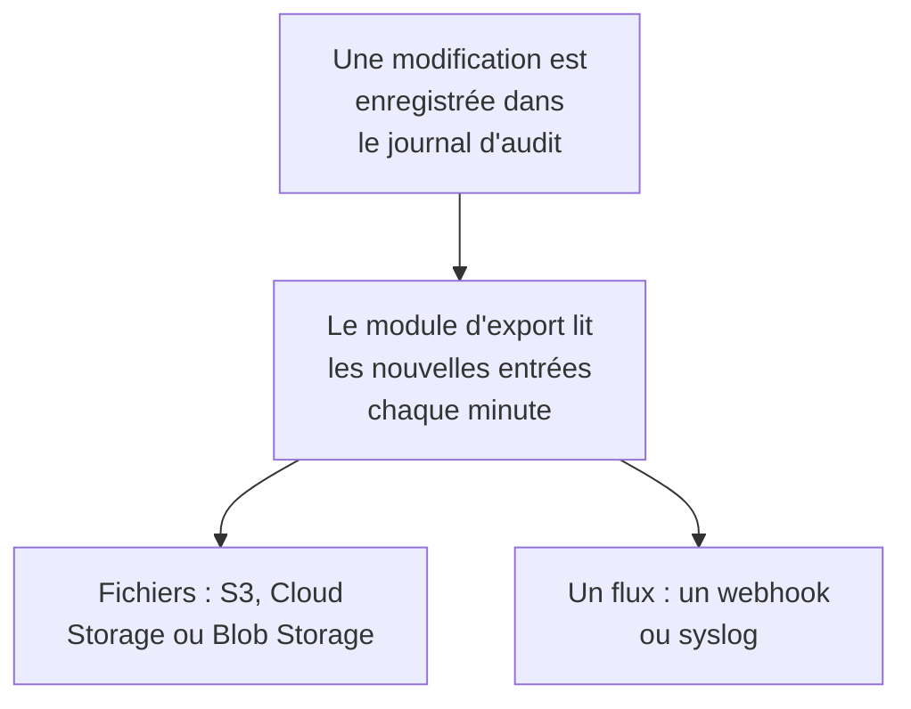

# Export du journal d'audit

Envoyez le journal d'audit, au fil de son enregistrement, vers le stockage ou le service de votre choix : Amazon S3 ou un stockage compatible S3, Google Cloud Storage, Azure Blob Storage, un webhook ou syslog. Gardez-y les entrées aussi longtemps que vos contrôles de conformité l'exigent, et recherchez-les dans votre SIEM. Les propriétaires et les administrateurs d'un projet exportent son journal d'audit depuis les paramètres du projet, et les administrateurs principaux exportent celui de tous les projets depuis l'Admin Dashboard. Il fait partie du forfait Enterprise sur OneUptime Cloud, et de l'Enterprise Edition quand vous hébergez vous-même.

:::cards
- [Configurer un export](#configurer-un-export): Choisir une destination, la tester, l'enregistrer.
- [Ce qui est envoyé](#ce-qui-est-envoyé): Un objet JSON par entrée, dans un schéma stable.
- [Quand les entrées sont envoyées](#quand-les-entrées-sont-envoyées): Chaque minute, chaque entrée une fois, dans l'ordre.
- [Quand une destination échoue](#quand-une-destination-échoue): Les nouvelles tentatives, l'erreur, et rien n'est sauté.
:::

## Comment une entrée atteint votre destination



- **Un export, une destination.** Un projet peut avoir plusieurs exports, chacun envoyant chaque entrée vers sa propre destination.
- **Celui d'un projet, ou celui de l'instance.** L'export d'un projet envoie les entrées de ce projet. Un export configuré dans l'Admin Dashboard envoie les entrées de tous les projets qui enregistrent des journaux d'audit.
- **Depuis sa création.** Un export envoie ce qui est enregistré après sa création, sauf si vous réglez **Exporter à partir du** sur une date antérieure.

## Avant de commencer

- **Sur OneUptime Cloud, le forfait Enterprise.** Avec les autres forfaits, la page montre ce que fait la fonctionnalité et comment l'obtenir.
- **Quand vous hébergez vous-même, l'Enterprise Edition**, avec une licence qui inclut les journaux d'audit. Voir [Édition Enterprise](/docs/self-hosted/enterprise).
- **La journalisation d'audit activée** dans chaque projet que vous exportez. Voir [Journaux d'audit](/docs/configuration/audit-logs).
- **Un Project Owner ou un Project Admin** pour exporter le journal d'audit d'un projet, ou un administrateur principal pour exporter celui de l'instance.

## Configurer un export

:::steps
### Ouvrir la page d'export

Pour un projet, allez dans **Paramètres du projet → Journaux d'audit → Export**. Pour toute l'instance, allez dans **Paramètres → Export du journal d'audit** dans l'Admin Dashboard.

### Choisir une destination

Cliquez sur **Ajouter un export** et choisissez l'une des six destinations ci-dessous. La destination d'un export ne peut plus être changée ensuite.

### Indiquer comment la joindre

Remplissez ce que la destination demande. Les réglages que la plupart des gens laissent tels quels attendent sous **Plus de champs**, et **Guide de configuration** ouvre la section de la destination sur cette page.

### Envoyer un test

Cliquez sur **Écrire un fichier de test** ou **Envoyer une entrée de test**. Un stockage reçoit le fichier `oneuptime-audit-log-export-test.ndjson.gz` dans son dossier, et un webhook ou syslog reçoit une entrée dont l'action est `Test`. Un test qui échoue dit quoi corriger.

### Démarrer l'export

Cliquez sur **Suivant**, nommez l'export, puis cliquez sur **Démarrer l'export**. Les premières entrées arrivent en quelques minutes.
:::

La ligne de l'export montre où il en est : **Export en cours**, **En échec**, **En pause**, **En attente d'entrées** ou **Démarrage**. **Envoyer un test** envoie un test avec les réglages enregistrés, et **Modifier** les change : un identifiant laissé vide garde celui qui est enregistré.

## Destinations

| Destination | Ce qui arrive | Se connecte avec |
| --- | --- | --- |
| [Amazon S3](#amazon-s3) | Des fichiers NDJSON compressés | Une clé d'accès |
| [Stockage compatible S3](#stockage-compatible-s3) | Des fichiers NDJSON compressés | Une clé d'accès |
| [Google Cloud Storage](#google-cloud-storage) | Des fichiers NDJSON compressés | Une clé de compte de service |
| [Azure Blob Storage](#azure-blob-storage) | Des fichiers NDJSON compressés | Un jeton SAS ou une clé d'accès |
| [Webhook](#webhook) | Des requêtes HTTPS | Un en-tête et un secret de signature, facultatifs |
| [Syslog](#syslog) | Des messages RFC 5424 | Rien |

### Amazon S3

| Champ | Quoi saisir |
| --- | --- |
| **Bucket** | Le bucket où les fichiers sont écrits. |
| **Région** | La région du bucket. Elle vaut d'abord `us-east-1`. |
| **ID de clé d'accès** | Une clé d'accès qui peut écrire des objets dans le bucket. |
| **Clé d'accès secrète** | Le secret de la clé. |
| **Dossier** | Sous **Plus de champs**. Laissé vide, les fichiers vont dans `oneuptime/audit-logs/`. |

La clé n'a besoin que de `s3:PutObject` sur le dossier :

```json
{
  "Version": "2012-10-17",
  "Statement": [
    {
      "Effect": "Allow",
      "Action": "s3:PutObject",
      "Resource": "arn:aws:s3:::my-audit-logs/oneuptime/audit-logs/*"
    }
  ]
}
```

### Stockage compatible S3

Les mêmes champs qu'Amazon S3, après un **Point de terminaison** : l'adresse S3 du stockage, comme `https://minio.example.com:9000` ou `https://<account>.r2.cloudflarestorage.com`. Réglez **Région** sur celle qu'attend le stockage : `us-east-1` pour MinIO et la valeur par défaut de Wasabi, `auto` pour Cloudflare R2.

### Google Cloud Storage

Saisissez le **Bucket** et collez une **Clé de compte de service** (JSON) dont le compte de service a le rôle Storage Object Creator sur le bucket. **Dossier** attend sous **Plus de champs**.

### Azure Blob Storage

Saisissez le **Compte de stockage** et le **Conteneur**, puis choisissez sous **Se connecter avec** : un **Jeton SAS** avec les autorisations Create et Write sur le conteneur, ou une **Clé d'accès** du compte de stockage. Un jeton SAS peut être limité à ce conteneur : c'est donc le choix le plus sûr. **Cloud** et **Dossier** attendent sous **Plus de champs**.

### Webhook

OneUptime envoie chaque lot par POST à l'**URL**, sous forme de tableau JSON (`application/json`) ou d'une entrée par ligne (`application/x-ndjson`), selon **Format du corps**, avec ces en-têtes :

| En-tête | Valeur |
| --- | --- |
| `X-OneUptime-Event` | `audit-log-export` |
| `X-OneUptime-Batch-Id` | L'id de la première entrée du lot : le même lot envoyé à nouveau porte le même id. |
| `X-OneUptime-Entry-Count` | Le nombre d'entrées que contient le corps. |
| `X-OneUptime-Signature` | `sha256=` suivi du HMAC-SHA256 du corps, calculé avec le **Secret de signature**, quand il est défini. |

L'**Identifiant**, comme `Bearer <token>`, est envoyé dans l'en-tête choisi sous **Nom de l'en-tête**, `Authorization` sauf si vous le changez. **Format du corps**, **Nom de l'en-tête** et **Secret de signature** attendent sous **Plus de champs**. Toute réponse 2xx vaut livraison. Un `413` coupe le lot en deux, et tout autre refus renvoie plus tard le lot entier.

### Syslog

Chaque entrée est un message RFC 5424 envoyé à l'**Hôte** et au **Port**, en TLS sur le port `6514` sauf si **Protocole** indique TCP, avec la facility 13 (log audit) et la severity 6 (informational) :

```text
<110>1 2026-10-24T09:15:03.000Z oneuptime.example.com oneuptime - audit-log - {"schemaVersion":1,"id":"..."}
```

Les messages sont délimités par comptage d'octets (RFC 5425), sauf si **Délimitation** indique un message par ligne. Un récepteur dont le certificat a été signé par une AC privée a besoin du certificat de cette AC dans **Certificat de l'AC**. Les deux attendent sous **Plus de champs**.

## Ce qui est envoyé

Chaque entrée est un objet JSON, dont les clés sont toujours dans cet ordre :

| Clé | Ce qu'elle contient |
| --- | --- |
| `schemaVersion` | `1`. Un changement de schéma vient avec une nouvelle version. |
| `id` | L'id de l'entrée. La même entrée envoyée deux fois a le même id. |
| `createdAt` | Quand la modification a été enregistrée, en UTC. |
| `projectId` | Le projet dans lequel la modification a été faite. |
| `action` | `Create`, `Update`, `Delete` ou `Download`. |
| `resourceType`, `resourceId`, `resourceName` | Ce qui a été modifié. |
| `rootResourceType`, `rootResourceId` | La ressource à laquelle elle appartient, comme un SLO pour sa règle. |
| `userId`, `userName`, `userEmail`, `userType` | Qui a fait la modification. |
| `apiKeyId`, `apiKeyName` | La clé API avec laquelle elle a été faite, le cas échéant. |
| `mcpOAuthGrantId`, `mcpClientName` | Le client MCP par lequel elle a été faite, le cas échéant. |
| `workflowId`, `workflowName` | Le workflow qui l'a faite, le cas échéant. |
| `changes` | Chaque champ modifié : `field`, avec `oldValue` et `newValue`. |

Un fichier contient une entrée par ligne, compressée avec gzip, et il est classé selon l'heure de sa première entrée : `oneuptime/audit-logs/2026/10/24/09/20261024T091503Z_<first entry id>.ndjson.gz`.

Les clés, jetons et mots de passe ne sortent jamais : ils sont enregistrés comme `[REDACTED]`, et les champs que personne ne peut lire sont omis de chaque entrée.

## Quand les entrées sont envoyées

- **Chaque minute.** Les entrées enregistrées il y a plus d'une minute sont lues de la plus ancienne à la plus récente et envoyées par lots : jusqu'à 5 000 entrées ou 16 Mo par fichier, et 500 entrées par requête webhook ou connexion syslog.
- **Les fichiers ne sont pas écrits à chaque entrée.** Un fichier est écrit quand un lot est plein ou que sa première entrée a cinq minutes.
- **Chaque entrée une fois, dans l'ordre.** Après chaque livraison, l'export retient la dernière entrée envoyée : un redémarrage ou un autre worker reprend donc à partir de là.
- **Une répétition se reconnaît.** Un lot renvoyé après un plantage écrit le même nom de fichier ou porte le même `X-OneUptime-Batch-Id`, et chaque entrée porte son `id`.

## Quand une destination échoue

Un lot est tenté trois fois, à quelques secondes d'intervalle, puis l'export attend avant de réessayer : une minute, puis deux, quatre et ainsi de suite, jusqu'à une heure. Sa ligne indique **En échec**, et **Voir l'erreur** montre ce que la destination a répondu et quand aura lieu la prochaine tentative.

Rien n'est sauté : les entrées attendent dans le journal d'audit, et la prochaine livraison qui réussit rattrape le retard depuis la plus ancienne. Chaque entrée est tout de même supprimée dès qu'elle est plus ancienne que la rétention avec laquelle elle a été enregistrée, envoyée ou non : corrigez donc un export en échec dans ce délai. Une rétention plus longue ne garde plus longtemps que les entrées enregistrées après sa modification.

Un export en échec envoie un e-mail à ceux qui peuvent le corriger : aux propriétaires du projet pour l'export d'un projet, et à tous les administrateurs principaux pour celui de l'instance. Le premier e-mail part après 30 minutes d'échecs, avec ce que la destination a répondu. Un second part un jour avant la suppression de la plus ancienne entrée que l'export n'a pas envoyée, avec le moment où des entrées commencent à être perdues. Chacun part une fois tant que les échecs durent, et une livraison qui réussit les remet tous deux à zéro.

Pour mettre un export en pause, choisissez **Désactiver** dans le menu de sa ligne : il garde sa place, et **Activer** envoie ce qui a été enregistré entre-temps. Sur OneUptime Cloud, un projet qui quitte le forfait Enterprise cesse d'exporter, et ses exports attendent sous la carte de mise à niveau, où ils peuvent être désactivés ou supprimés. Quand vous hébergez vous-même, l'export s'arrête tant que la licence n'inclut pas les journaux d'audit, et reprend là où il s'était arrêté dès qu'une licence les inclut.

## Dépannage

:::details Le test indique que l'accès est refusé
La clé, le jeton ou le compte de service n'a pas le droit d'écrire là où l'export écrit. Donnez-lui l'autorisation de créer des objets dans le dossier, comme le montre la section de chaque destination ci-dessus, puis renvoyez le test.
:::

:::details Le test ne parvient pas à joindre l'adresse
L'export d'un projet sur OneUptime Cloud ne peut pas joindre une adresse de réseau privé. Quand vous hébergez vous-même, il le peut, sauf si `DATA_SOURCE_BLOCK_PRIVATE_ADDRESSES` vaut `true`, et un export configuré dans l'Admin Dashboard le peut toujours. Les adresses de bouclage et link-local ne sont jamais jointes.
:::

:::details Rien n'arrive
Vérifiez que la journalisation d'audit est activée dans le projet, et que quelqu'un a modifié quelque chose après l'enregistrement de l'export. Un stockage ne reçoit un fichier qu'une fois un lot plein ou âgé de cinq minutes.
:::

## Étapes suivantes

:::cards
- [Journaux d'audit](/docs/configuration/audit-logs): Ce qui est enregistré, et combien de temps c'est conservé.
- [Utilisateurs, équipes et autorisations](/docs/permissions/index): Décider qui peut configurer un export.
- [Édition Enterprise](/docs/self-hosted/enterprise): Les journaux d'audit sur une installation auto-hébergée.
:::
