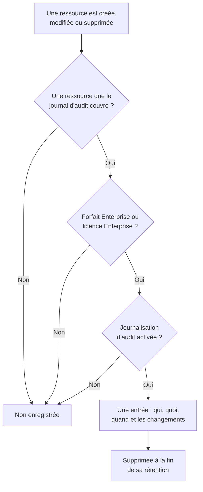

# Journaux d'audit

Le journal d'audit enregistre qui a modifié quoi dans votre projet : chaque création, modification et suppression des ressources qu'il couvre, avec les valeurs avant et après. Servez-vous-en pour savoir qui a désactivé un moniteur ou modifié une clé API, et pour garder une trace lors des contrôles de conformité. Il fait partie du forfait Enterprise sur OneUptime Cloud, et de l'Enterprise Edition quand vous hébergez vous-même.

:::cards
- [Activer la journalisation d'audit](#activer-la-journalisation-daudit): Elle est désactivée au départ dans chaque projet.
- [Lire le journal d'audit](#lire-le-journal-daudit): Qui a modifié quoi, et quand.
- [Ce qui est enregistré](#ce-qui-est-enregistré): Les ressources et les actions qu'il couvre.
- [Combien de temps les entrées sont conservées](#combien-de-temps-les-entrées-sont-conservées): De 7 à 180 jours.
:::

## Comment une modification devient une entrée

- **Elle est désactivée au départ.** Un projet n'enregistre rien tant que personne n'active la journalisation d'audit, et rien d'avant ce moment.
- **Elle enregistre ce que font les gens.** Une modification faite par une personne, une clé API, un client MCP ou un workflow est enregistrée. Une modification que OneUptime fait de lui-même, comme celle d'une tâche de fond, est laissée de côté, sauf si vous activez **Stocker les événements système**.
- **Les entrées ne peuvent pas être modifiées.** Personne ne peut modifier ni supprimer une entrée, dans le tableau de bord ou par l'API. Une entrée ne disparaît qu'à la fin de sa rétention.

## Avant de commencer

- **Sur OneUptime Cloud, le forfait Enterprise.** Avec les autres forfaits, les pages du journal d'audit montrent ce que fait la fonctionnalité et comment l'obtenir.
- **Quand vous hébergez vous-même, l'Enterprise Edition**, avec une licence qui inclut les journaux d'audit. Voir [Édition Enterprise](/docs/self-hosted/enterprise).
- **Un rôle qui peut lire le journal d'audit.** Project Owner, Project Admin, Settings Admin, ou l'autorisation **Read Audit Log**. Activer la journalisation d'audit et modifier ses paramètres demande un Project Owner, un Project Admin, ou l'autorisation de modifier le projet.

## Activer la journalisation d'audit

:::steps
### Ouvrir les paramètres du journal d'audit

Allez dans **Paramètres du projet → Journaux d'audit → Paramètres**. **Journaux d'audit** est replié au départ dans le menu latéral : cliquez dessus pour l'ouvrir.

### Modifier les paramètres

Cliquez sur **Edit Audit Log Settings**.

### L'activer

Activez **Activer les journaux d'audit**, réglez **Rétention (jours)**, et choisissez s'il faut **Stocker les événements système**. Cliquez sur **Enregistrer les modifications**.
:::

| Paramètre | Valeur de départ | Ce qu'il fait |
| --- | --- | --- |
| **Activer les journaux d'audit** | Désactivé | Enregistre dès maintenant les modifications des ressources du projet. |
| **Rétention (jours)** | 7 | Le nombre de jours de conservation de chaque entrée : de 7 à 180. |
| **Stocker les événements système** | Désactivé | Enregistre aussi les modifications que OneUptime fait de lui-même, lancées par aucune personne ni aucune clé. |

Une modification de ces paramètres s'applique en moins d'une minute.

## Lire le journal d'audit

**Paramètres du projet → Journaux d'audit → Journaux d'audit** liste chaque entrée du projet, les plus récentes d'abord :

| Colonne | Ce qu'elle montre |
| --- | --- |
| **Quand** | Il y a combien de temps, avec la date et l'heure. |
| **Action** | `Create`, `Update` ou `Delete`, ou `Download` pour un fichier de capture de paquets que quelqu'un a téléchargé. |
| **Ressource** | Le nom de la ressource, qui l'ouvre tant qu'elle existe, et son type. |
| **Acteur** | Qui a fait la modification : une personne, une clé API, un workflow, ou `System` pour une modification que OneUptime a faite de lui-même. La modification d'une personne faite via un client MCP indique lequel. |
| **Modifications** | Combien de champs ont changé, ou ont été capturés pour une création ou une suppression. Cliquez dessus pour voir chaque champ. |

Filtrez par **Type de ressource**, **Nom de la ressource**, **Action**, **E-mail de l'utilisateur** ou **Heure**. Une modification ne liste que les champs qui ont changé, avant et après, et un enregistrement qui ne change rien n'ajoute aucune entrée.

Les moniteurs, les incidents, les alertes, les pages de statut, les SLO et bien d'autres ressources ont aussi leur propre page **Journaux d'audit**, dans une section repliée de leur menu latéral comme **Avancé**. Elle ne liste que les entrées de cette ressource, avec celles de ce qui lui appartient : la page d'un SLO montre aussi ses règles et ses propriétaires.

## Ce qui est enregistré

| Ressource | **Type de ressource** dans le journal |
| --- | --- |
| Moniteurs | `Monitor` |
| Incidents | `Incident` |
| Alertes | `Alert` |
| Pages de statut | `Status Page` |
| Événements de maintenance planifiée | `Scheduled Maintenance Event` |
| Politiques d'astreinte | `On-Call Policy` |
| SLO | `Service Level Objective` |
| Les règles et propriétaires d'un SLO | `SLO Burn Rate Rule`, `SLO Monitor Rule`, `Service Level Objective User Owner`, `Service Level Objective Team Owner` |
| Équipes | `Team` |
| Rôles personnalisés, et les équipes et clés API qui en reçoivent un | `Custom Role`, `Team Custom Role`, `API Key Custom Role` |
| Étiquettes | `Label` |
| États et gravités d'incident | `Incident State`, `Incident Severity` |
| États et gravités d'alerte | `Alert State`, `Alert Severity` |
| Statuts de moniteur | `Monitor Status` |
| États de maintenance planifiée | `Scheduled Maintenance State` |
| Rôles d'incident | `Incident Role` |
| Statuts de post-mortem | `Postmortem Status` |
| Clés API | `API Key` |
| Clients MCP que les personnes connectent | `MCP Client Authorization` |
| Éléments d'inventaire | `Inventory Item` |
| Configurations du collecteur | `Collector Config` |
| vCenter | `vCenter` |
| Captures de paquets, et leurs téléchargements | `Packet Capture` |
| Dossiers de sécurité, playbooks et leurs exécutions, et entités protégées | `Security Case`, `Security Playbook`, `Security Playbook Run`, `Protected Entity` |
| Exports du journal d'audit | `Audit Log Export` |

Un administrateur qui ajoute ou retire une méthode de notification ou une règle d'astreinte personnelle sur le compte de quelqu'un d'autre est aussi enregistré, sans l'adresse ni le numéro lui-même.

Les autres enregistrements ne figurent pas dans le journal d'audit, comme qui fait partie d'une équipe, ou une autorisation ajoutée seule à une équipe. Les champs que personne ne peut lire sont omis de chaque entrée, et les clés, jetons et mots de passe sont enregistrés comme `[REDACTED]` : l'entrée montre qu'ils ont changé, jamais leur valeur.

## Combien de temps les entrées sont conservées

Chaque entrée est conservée pendant la **Rétention (jours)** qu'avait le projet au moment de son enregistrement, puis supprimée. Une nouvelle rétention s'applique aux nouvelles entrées : les entrées déjà enregistrées gardent leurs dates.

Pour garder des entrées plus de 180 jours, envoyez-les au fil de leur enregistrement vers votre propre stockage ou votre SIEM : voir [Export du journal d'audit](/docs/configuration/audit-log-export). Vous pouvez aussi les lire par l'API avec une clé API qui détient **Read Audit Log**, et les stocker là où vous en avez besoin. Voir [Référence de l'API OneUptime](/docs/api-reference/api-reference).

## Quand le forfait ou la licence n'inclut plus les journaux d'audit

- **Sur OneUptime Cloud**, un projet qui quitte le forfait Enterprise cesse d'enregistrer, et ses pages de journal d'audit affichent la carte de mise à niveau jusqu'à ce qu'il revienne à ce forfait.
- **Quand vous hébergez vous-même**, la journalisation d'audit cesse d'enregistrer quand l'essai Enterprise ou la période de grâce se termine sans licence, ou quand la licence n'inclut pas les journaux d'audit. Le journal d'audit l'indique en rouge. Les entrées déjà enregistrées sont conservées, et l'enregistrement reprend avec les mêmes paramètres dès qu'une licence est activée. Voir [Quand une licence expire ou manque](/docs/self-hosted/enterprise#quand-une-licence-expire-ou-manque).

## Dépannage

:::details Le journal d'audit est vide
La journalisation d'audit est désactivée au départ, et n'enregistre rien d'avant son activation. Si la liste indique que la journalisation d'audit est désactivée, suivez son lien vers les paramètres et activez-la. Sinon, modifiez un moniteur ou un incident et actualisez la liste.
:::

:::details Une modification manque dans le journal d'audit
Vérifiez que la ressource figure dans [Ce qui est enregistré](#ce-qui-est-enregistré), et que la modification a été faite après l'activation de la journalisation d'audit. Une modification que OneUptime a faite de lui-même n'est enregistrée qu'avec **Stocker les événements système** activé.
:::

## Étapes suivantes

:::cards
- [Export du journal d'audit](/docs/configuration/audit-log-export): Envoyer le journal d'audit vers votre propre stockage ou votre SIEM.
- [Utilisateurs, équipes et autorisations](/docs/permissions/index): Décider qui peut lire le journal d'audit.
- [Paramètres du projet](/docs/configuration/project-settings): Les autres paramètres du projet.
- [Facturation et utilisation](/docs/configuration/billing): Changer le forfait du projet.
- [Édition Enterprise](/docs/self-hosted/enterprise): Les journaux d'audit sur une installation auto-hébergée.
:::
