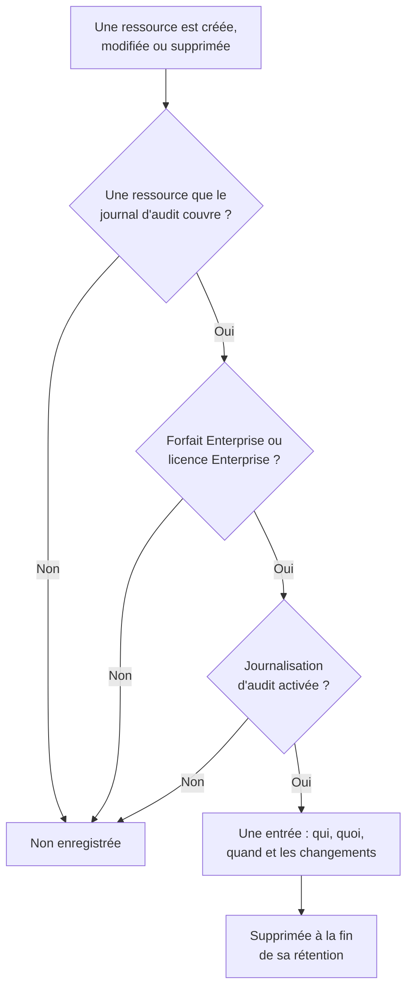

# Journaux d'audit

Le journal d'audit enregistre qui a modifié quoi dans votre projet : chaque création, modification et suppression des ressources qu'il couvre, avec les valeurs avant et après, et chaque fois que quelqu'un se connecte ou se déconnecte. Servez-vous-en pour savoir qui a désactivé un moniteur ou modifié une clé API, qui s'est connecté et d'où, et pour garder une trace lors des contrôles de conformité. Il fait partie du forfait Enterprise sur OneUptime Cloud, et de l'Enterprise Edition quand vous hébergez vous-même.

:::cards
- [Activer la journalisation d'audit](#activer-la-journalisation-daudit): Elle est désactivée au départ dans chaque projet.
- [Lire le journal d'audit](#lire-le-journal-daudit): Qui a modifié quoi, et quand.
- [Ce qui est enregistré](#ce-qui-est-enregistré): Les ressources et les actions qu'il couvre.
- [Connexions et sessions](#connexions-et-sessions): Qui s'est connecté, et comment chaque session s'est terminée.
- [Combien de temps les entrées sont conservées](#combien-de-temps-les-entrées-sont-conservées): De 7 à 180 jours.
:::

## Comment une modification devient une entrée

- **Elle est désactivée au départ.** Un projet n'enregistre rien tant que personne n'active la journalisation d'audit, et rien d'avant ce moment.
- **Elle enregistre ce que font les gens.** Une modification faite par une personne, une clé API, un client MCP ou un workflow est enregistrée. Une modification que OneUptime fait de lui-même, comme celle d'une tâche de fond, est laissée de côté, sauf si vous activez **Stocker les événements système**.
- **Les entrées ne peuvent pas être modifiées.** Personne ne peut modifier ni supprimer une entrée, dans le tableau de bord ou par l'API. Une entrée ne disparaît qu'à la fin de sa rétention.

## Avant de commencer

- **Sur OneUptime Cloud, le forfait Enterprise.** Avec les autres forfaits, les pages du journal d'audit montrent ce que fait la fonctionnalité et comment l'obtenir.
- **Quand vous hébergez vous-même, l'Enterprise Edition**, avec une licence qui inclut les journaux d'audit. Voir [Édition Enterprise](/docs/self-hosted/enterprise).
- **Un rôle qui peut lire le journal d'audit.** Project Owner, Project Admin, Settings Admin, ou l'autorisation **Read Audit Log**. Activer la journalisation d'audit et modifier ses paramètres demande un Project Owner, un Project Admin, ou l'autorisation de modifier le projet.

## Activer la journalisation d'audit

:::steps
### Ouvrir les paramètres du journal d'audit

Allez dans **Paramètres du projet → Journaux d'audit → Paramètres**. **Journaux d'audit** est replié au départ dans le menu latéral : cliquez dessus pour l'ouvrir.

### Modifier les paramètres

Cliquez sur **Edit Audit Log Settings**.

### L'activer

Activez **Activer les journaux d'audit**, réglez **Rétention (jours)**, et choisissez s'il faut **Stocker les événements système**. Cliquez sur **Enregistrer les modifications**.
:::

| Paramètre | Valeur de départ | Ce qu'il fait |
| --- | --- | --- |
| **Activer les journaux d'audit** | Désactivé | Enregistre dès maintenant les modifications des ressources du projet. |
| **Rétention (jours)** | 7 | Le nombre de jours de conservation de chaque entrée : de 7 à 180. |
| **Stocker les événements système** | Désactivé | Enregistre aussi les modifications que OneUptime fait de lui-même, lancées par aucune personne ni aucune clé. |

Une modification de ces paramètres s'applique en moins d'une minute.

## Lire le journal d'audit

**Paramètres du projet → Journaux d'audit → Journaux d'audit** liste chaque entrée du projet, les plus récentes d'abord :

| Colonne | Ce qu'elle montre |
| --- | --- |
| **Quand** | Il y a combien de temps, avec la date et l'heure. |
| **Action** | `Create`, `Update` ou `Delete`, `Download` pour un fichier de capture de paquets que quelqu'un a téléchargé, ou `Sign In`, `Sign Out`, `Session Timeout` ou `Session Revoked` pour une session. |
| **Ressource** | Le nom de la ressource, qui l'ouvre tant qu'elle existe, et son type. |
| **Acteur** | Qui a fait la modification : une personne, une clé API, un workflow, ou `System` pour une modification que OneUptime a faite de lui-même. La modification d'une personne faite via un client MCP indique lequel. |
| **Modifications** | Combien de champs ont changé, ou ont été capturés pour une création ou une suppression. Pour une session, comment elle s'est connectée ou pourquoi elle s'est terminée. Cliquez dessus pour voir chaque champ. |

Filtrez par **Type de ressource**, **Nom de la ressource**, **Action**, **E-mail de l'utilisateur** ou **Heure**. Une modification ne liste que les champs qui ont changé, avant et après, et un enregistrement qui ne change rien n'ajoute aucune entrée.

Une ressource sans nom propre est nommée par ce qui la nomme dans OneUptime : une exception par son type et le début de son message, les identifiants, les adresses et tout ce qui ressemble à un secret étant masqués, une exécution de runbook par son runbook, le numéro de téléphone d'une politique d'appels entrants par le numéro, et un modèle ou un domaine par son propre nom.

Les moniteurs, les incidents, les alertes, les pages de statut, les SLO et bien d'autres ressources ont aussi leur propre page **Journaux d'audit**, dans une section repliée de leur menu latéral comme **Avancé**. Elle ne liste que les entrées de cette ressource, avec celles de ce qui lui appartient : la page d'un SLO montre aussi ses règles et ses propriétaires.

## Ce qui est enregistré

Tout ce que les personnes créent, modifient ou suppriment dans un projet est enregistré : moniteurs, incidents, alertes, pages de statut, workflows et leurs étapes, files d'attente, tableaux de bord, politiques d'astreinte, équipes et qui en fait partie, clés d'API et chaque réglage. **Type de ressource** indique sur quoi porte une entrée, par exemple `Monitor`, `Workflow` ou `Queue`.

| Non enregistré | Pourquoi |
| --- | --- |
| Journaux de messages | Chacun est déjà la trace d'un e-mail, d'un SMS, d'un appel, d'une notification push ou d'un message de chat que OneUptime a envoyé ou reçu. |
| Traces d'exécutions | Chacune est déjà la trace d'une exécution de workflow, d'une escalade d'astreinte, d'une analyse, d'une importation ou d'une exécution d'IA. |
| Ce que signalent les agents et la télémétrie | Les ressources découvertes, les relevés et l'utilisation changent à chaque rapport, pas parce que quelqu'un les a modifiés. |
| Flux d'activité | Un flux affiche des modifications que le journal d'audit enregistre déjà. |
| L'état de travail de OneUptime | Les sessions des lecteurs des pages de statut, les tâches en attente et les autres états que OneUptime conserve pendant son travail. |
| La configuration des notifications propre à une personne | Les adresses, les numéros et les règles d'astreinte personnelles de chaque personne n'appartiennent qu'à elle. |
| Les préférences propres à une personne | Les produits que chaque personne épingle dans sa propre barre supérieure n'appartiennent qu'à elle, et elle seule les voit. |

Un administrateur qui ajoute ou retire une méthode de notification ou une règle d'astreinte personnelle sur le compte de quelqu'un d'autre est aussi enregistré, sans l'adresse ni le numéro lui-même.

Les champs que seul OneUptime écrit, comme le moment où un hôte a été vu pour la dernière fois, sont omis de chaque entrée, tout comme les champs que personne ne peut lire. Quand OneUptime en écrit un parce que quelqu'un le lui a demandé, comme fusionner une exception avec une autre ou réinitialiser l'URL d'un webhook, l'entrée l'enregistre comme une modification de cette personne. Les clés, jetons et mots de passe sont enregistrés comme `[REDACTED]` : l'entrée montre qu'ils ont changé, jamais leur valeur. Les étapes d'un workflow sont enregistrées comme ce qui a changé, en nommant les réglages d'une étape mais jamais ce qui y a été saisi, et le déplacement d'une étape sur le canevas n'est pas enregistré.

Ce que OneUptime fait parce que quelqu'un le lui a demandé est aussi enregistré comme une modification de cette personne, que le projet stocke ou non les événements système :

- Lancer, approuver, terminer, ignorer et annuler une exécution de runbook. Ses étapes sont enregistrées comme ce qui a été fait à chacune, par exemple `Approved "Restart the API" (step 3)`, jamais avec ce qu'une étape a affiché.
- Ce qu'une règle change quand quelqu'un l'exécute : les libellés et les propriétaires qu'elle ajoute, les enregistrements qu'une règle de confidentialité rend privés, les appareils qu'une règle d'affectation de site déplace, les appareils et les moniteurs qu'une règle d'import automatique crée, et ce qu'une règle de moniteurs d'une page de statut ou d'un SLO change sur sa page ou son SLO.
- L'achat, l'association et la libération du numéro de téléphone d'une politique d'appels entrants.
- La résolution d'une alerte de données que quelqu'un marque comme attendue ou comme n'étant pas un problème.
- La réinitialisation du lien d'un flux de calendrier.
- Les équipes que quelqu'un rejoint en se connectant avec SSO.

Ce qu'une règle fait d'elle-même est une modification de OneUptime lui-même, enregistrée quand **Stocker les événements système** est activé : les libellés et les propriétaires qu'une règle ajoute à la création d'un enregistrement, et un enregistrement qu'elle rend alors privé ; les appareils et les moniteurs qu'une règle d'import automatique crée à partir de nouveaux résultats d'analyse ; et ce qu'une règle de moniteurs d'une page de statut ou d'un SLO change quand une règle, un moniteur ou un libellé est enregistré.

La réinitialisation de l'agent IA d'un hôte, d'un cluster ou d'un compte cloud est enregistrée sur la page **Journaux d'audit** propre à cette ressource, comme la modification de `aiAgentResetAt` par la personne qui l'a réinitialisé : qui, et quand. De même pour la création d'une clé pour l'agent IA d'un compte cloud : les clés apparaissent comme modifiées, jamais avec une clé ou un hachage. Ce qu'un agent signale quand il se connecte et se manifeste reste exclu, comme avant.

## Connexions et sessions

Chaque fois qu'un membre du projet se connecte à OneUptime, le journal d'audit l'enregistre, puis à nouveau quand cette session se termine. Une connexion se fait à OneUptime, pas à un seul projet, donc chaque projet dont la personne est membre l'enregistre.

| Action | Quand elle est enregistrée |
| --- | --- |
| `Sign In` | Quelqu'un se connecte : avec un mot de passe ou un lien de connexion, une clé d'accès, Google, Microsoft, Vercel ou l'authentification unique. |
| `Sign Out` | La personne se déconnecte. |
| `Session Timeout` | OneUptime met fin à la session à son échéance : le délai d'inactivité ou la durée de session fixés par un administrateur du serveur, ou 30 jours sans utilisation. |
| `Session Revoked` | OneUptime met fin à la session parce que le mot de passe a changé, que le compte a été bloqué, ou qu'un administrateur du serveur a réinitialisé ou exigé l'authentification à deux facteurs. |

La **Ressource** d'une entrée est la session, nommée d'après l'appareil depuis lequel elle s'est connectée, par exemple `Chrome 130 on macOS`. Son **Acteur** est la personne à qui appartient la session, donc filtrer par **E-mail de l'utilisateur** trouve toutes ses connexions et sessions. Ses détails indiquent comment la personne s'est connectée et avec quel second facteur, l'adresse IP et la localisation, et, pour une session terminée, quand elle s'est connectée, quand elle a été utilisée pour la dernière fois et quand elle a expiré. Le fournisseur SSO propre à un projet n'est nommé que dans le journal d'audit de ce projet.

Les connexions et les sessions sont enregistrées que le projet stocke ou non les événements système. Une durée de session ou 30 jours sans utilisation sont enregistrés dans les minutes qui suivent leur échéance. Un délai d'inactivité est enregistré quand l'onglet ouvert de la personne ou l'application mobile contacte de nouveau OneUptime.

## Combien de temps les entrées sont conservées

Chaque entrée est conservée pendant la **Rétention (jours)** qu'avait le projet au moment de son enregistrement, puis supprimée. Une nouvelle rétention s'applique aux nouvelles entrées : les entrées déjà enregistrées gardent leurs dates. Via l'API aussi, une rétention est un nombre entier de jours de 7 à 180 : toute autre valeur est refusée.

Pour garder des entrées plus de 180 jours, envoyez-les au fil de leur enregistrement vers votre propre stockage ou votre SIEM : voir [Export du journal d'audit](/docs/configuration/audit-log-export). Vous pouvez aussi les lire par l'API avec une clé API qui détient **Read Audit Log**, et les stocker là où vous en avez besoin. Voir [Référence de l'API OneUptime](/docs/api-reference/api-reference).

## Quand le forfait ou la licence n'inclut plus les journaux d'audit

- **Sur OneUptime Cloud**, un projet qui quitte le forfait Enterprise cesse d'enregistrer, et ses pages de journal d'audit affichent la carte de mise à niveau jusqu'à ce qu'il revienne à ce forfait.
- **Quand vous hébergez vous-même**, la journalisation d'audit cesse d'enregistrer quand l'essai Enterprise ou la période de grâce se termine sans licence, ou quand la licence n'inclut pas les journaux d'audit. Le journal d'audit l'indique en rouge. Les entrées déjà enregistrées sont conservées, et l'enregistrement reprend avec les mêmes paramètres dès qu'une licence est activée. Voir [Quand une licence expire ou manque](/docs/self-hosted/enterprise#quand-une-licence-expire-ou-manque).

## Dépannage

:::details Le journal d'audit est vide
La journalisation d'audit est désactivée au départ, et n'enregistre rien d'avant son activation. Si la liste indique que la journalisation d'audit est désactivée, suivez son lien vers les paramètres et activez-la. Sinon, modifiez un moniteur ou un incident et actualisez la liste.
:::

:::details Une modification manque dans le journal d'audit
Vérifiez que la ressource figure dans [Ce qui est enregistré](#ce-qui-est-enregistré), et que la modification a été faite après l'activation de la journalisation d'audit. Une modification que OneUptime a faite de lui-même n'est enregistrée qu'avec **Stocker les événements système** activé.
:::

## Étapes suivantes

:::cards
- [Export du journal d'audit](/docs/configuration/audit-log-export): Envoyer le journal d'audit vers votre propre stockage ou votre SIEM.
- [Utilisateurs, équipes et autorisations](/docs/permissions/index): Décider qui peut lire le journal d'audit.
- [Paramètres du projet](/docs/configuration/project-settings): Les autres paramètres du projet.
- [Facturation et utilisation](/docs/configuration/billing): Changer le forfait du projet.
- [Édition Enterprise](/docs/self-hosted/enterprise): Les journaux d'audit sur une installation auto-hébergée.
:::
