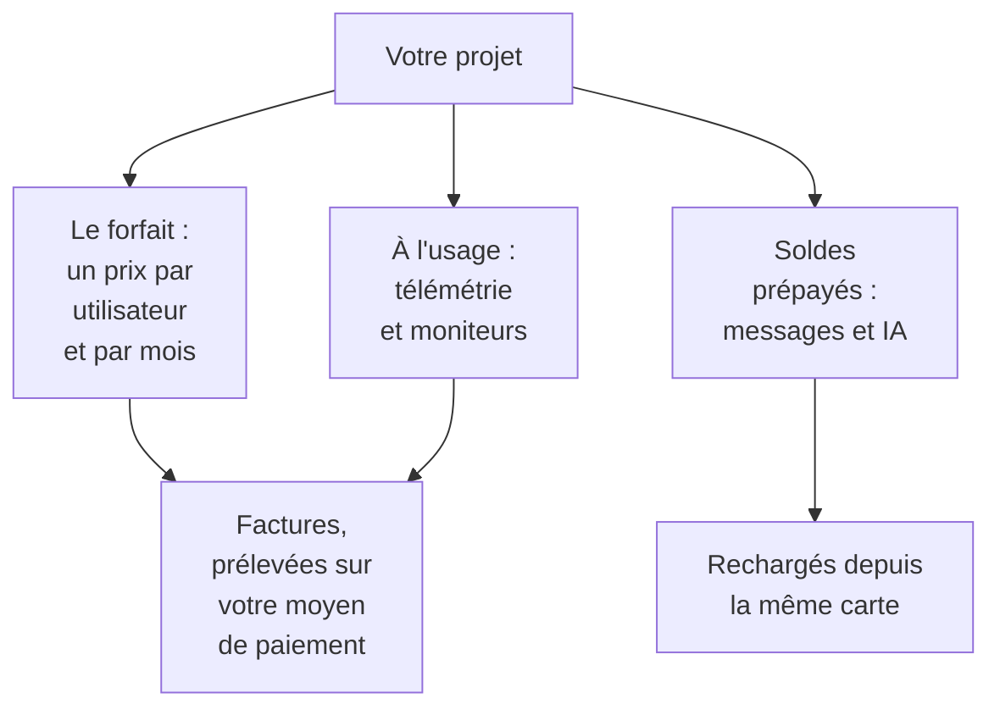

# Facturation et utilisation

Sur OneUptime Cloud, un projet paie son forfait, par utilisateur, et ce qu'il consomme : la télémétrie, les moniteurs actifs, ainsi que les messages et le travail de l'IA qu'il paie à partir de soldes prépayés. Cette page montre où voir et modifier chacun d'eux, et qui le peut. Une installation auto-hébergée n'a pas de facturation, ni aucune de ces pages.

:::cards
- [Votre forfait et vos sièges](#votre-forfait-et-vos-sièges): Ce que coûte le forfait, et qui compte comme un siège.
- [Moyens de paiement](#moyens-de-paiement): La carte sur laquelle vos factures sont prélevées.
- [Factures](#factures): Les payer, les télécharger et vérifier ce que vous avez consommé.
- [Soldes prépayés](#soldes-prépayés): Messages et IA, rechargés à la main ou automatiquement.
:::

## Ce que paie un projet

| Quoi | Comment c'est facturé |
| --- | --- |
| Le forfait | Un prix par utilisateur et par mois, facturé mensuellement ou annuellement. Chaque personne du projet est un siège. |
| Télémétrie | $0.10 par GB ingéré, avec 15 jours de rétention. Une rétention plus longue coûte plus, et une rétention de moins de 7 jours est facturée comme 7 jours : voir [Ce que coûte la rétention](/docs/telemetry/data-retention#ce-que-coûte-la-rétention). |
| Session replays | $2 par GB, avec 15 jours de rétention. |
| Moniteurs actifs | $1 par moniteur et par mois. Tout moniteur sauf un moniteur manuel est actif, même quand il est désactivé. |
| SMS, appels, WhatsApp et Telegram | Payés sur le solde du projet à l'envoi de chaque message. |
| OneUptime AI | Payée sur les crédits IA du projet, sauf si elle tourne sur votre propre fournisseur LLM. |

La [page des tarifs](https://oneuptime.com/pricing) compare les forfaits.

## Avant de commencer

- **OneUptime Cloud.** La section **Facturation et factures** des **Paramètres du projet** n'existe que sur OneUptime Cloud, et elle est repliée au départ : cliquez sur son titre pour l'ouvrir.
- **Un rôle qui peut lire la facturation.** Les Project Owners, les personnes avec **Manage Billing** et les trois rôles de facturation lisent chaque page de facturation. Voir [Qui peut faire quoi](#qui-peut-faire-quoi).

## Votre forfait et vos sièges

Allez dans **Paramètres du projet → Facturation et factures → Facturation**. La carte **Forfait actuel** montre le forfait du projet et son prix par utilisateur, et **Sièges** : un pour chaque personne du projet.

Une personne compte comme un siège dès que vous l'invitez, avant même qu'elle accepte, jusqu'à ce que vous la retiriez. Pour changer le nombre de sièges, invitez ou retirez des personnes : voir [Inviter des personnes](/docs/permissions/inviting-people).

## Changer de forfait

:::steps
### Ajouter d'abord un moyen de paiement

Un changement de forfait demande un moyen de paiement. Sans lui, **Changer de forfait** ouvre **Ajouter un moyen de paiement** à la place : voir [Moyens de paiement](#moyens-de-paiement).

### Cliquer sur Changer de forfait

Sur la carte **Forfait actuel**, cliquez sur **Changer de forfait**. **Plan annuel** est activé au départ : désactivez-le pour voir les prix mensuels.

### Choisir le forfait

Chaque forfait affiche son prix par utilisateur. La note sous les forfaits dit ce qu'il advient de votre essai : **Your free trial carries over** tant que le projet est encore en période d'essai, et **Changing plan does not start a free trial** une fois qu'il ne l'est plus.

### Enregistrer le changement

Cliquez sur **Enregistrer les modifications**. Un forfait payant est facturé dès que vous y passez, et chaque personne que vous invitez sur ce forfait est facturée au moment de l'invitation.
:::

Les clés API ne fonctionnent qu'à partir du forfait Growth, et sous le forfait Scale, les connexions SCIM ne font plus que retirer des personnes. Un forfait qui les arrête indique combien sont concernées avant que vous le choisissiez, et la page **Facturation** affiche **Non inclus dans ce forfait** tant qu'elles sont arrêtées. Rien n'est supprimé : elles fonctionnent de nouveau avec un forfait qui les inclut.

> [!NOTE]
> Vous avez acheté OneUptime via un revendeur ou une marketplace cloud (AWS Marketplace, Microsoft Marketplace, Google Cloud Marketplace ou Vercel Marketplace) ? La page **Facturation** l'indique. Un revendeur change votre forfait pour vous, et une marketplace facture le forfait et l'utilisation du projet sur votre facture cloud.

## Moyens de paiement

La carte **Moyens de paiement** liste les cartes du projet. Les factures sont prélevées automatiquement sur celle par défaut.

:::steps
### Cliquer sur Ajouter un mode de paiement

Sur la carte **Moyens de paiement**, cliquez sur **Ajouter un mode de paiement**.

### Saisir la carte

Saisissez les informations de paiement et cliquez sur **Save payment method**. Le moyen que vous ajoutez devient celui par défaut, et en ajouter un active la facturation à l'usage. Cela ne change pas votre forfait.
:::

- **Définir par défaut** fait d'un autre moyen de la liste celui sur lequel les factures sont prélevées.
- **Re-sync Autopay**, sur le moyen par défaut, corrige un renouvellement qui prélève encore une ancienne carte.
- Le projet garde au moins un moyen de paiement : ajoutez-en un autre avant de supprimer le dernier.

## Adresse de facturation et e-mail des factures

La carte **Détails de l'entreprise / Adresse de facturation** contient ce que vos factures disent de vous. Cliquez sur **Mettre à jour** et remplissez deux étapes :

| Étape | Champs |
| --- | --- |
| **Adresse de facturation** | **Détails de l'entreprise / Adresse de facturation** : la raison sociale de votre entreprise, son adresse et son numéro fiscal ou de TVA. **Pays** : votre pays de facturation. |
| **Factures** | **E-mail finance / comptabilité** : où vont les factures, les reçus et les avis de facturation, plusieurs adresses séparées par des virgules. **Envoyer les factures par e-mail** : envoyer chaque facture à cette adresse dès son émission. |

## Factures

**Paramètres du projet → Facturation et factures → Factures** liste les factures du projet, chacune avec son **Numéro de facture**, sa **Date de la facture**, son **Montant** et son **Statut de la facture**.

- **Payer la facture** paie une facture qui reste due.
- **Télécharger** ouvre la facture en PDF. Sur une facture qui reste due, il se trouve dans le menu **⋯** de la ligne.

Quand votre banque traite encore un paiement, OneUptime l'indique : certaines banques mettent jusqu'à 2 jours pour confirmer un paiement par carte, et la facture se met à jour d'elle-même. Ne la payez pas une seconde fois.

## Historique d'utilisation

**Paramètres du projet → Facturation et factures → Historique d'utilisation** montre la télémétrie que le projet a envoyée, une ligne par produit, service et jour :

| Colonne | Ce qu'elle montre |
| --- | --- |
| **Produit** | Les journaux, les traces, les métriques et les autres types de télémétrie. |
| **Jour** | Le jour de l'envoi. |
| **Service** | Le service, ou l'hôte, le cluster ou l'autre ressource, qui l'a envoyée. |
| **Données ingérées (en GB)** | La quantité arrivée. |
| **Conservation des données (en jours)** | La durée de conservation. |
| **Coût total** | Ce qu'elle a coûté, en dollars américains. |

L'utilisation d'un jour apparaît une fois la journée terminée. Filtrez par **Produit**, **Jour** ou **Service** pour trouver ce qui a augmenté.

## Soldes prépayés

Les SMS, les appels téléphoniques et les messages WhatsApp et Telegram sont payés sur le solde du projet, et OneUptime AI sur ses crédits IA. Vous alimentez chacun à l'avance :

| Solde | Où |
| --- | --- |
| SMS, appels, WhatsApp et Telegram | **Paramètres du projet → Notifications → Paramètres de notification** |
| OneUptime AI | **Paramètres du projet → IA → Crédits IA** |

:::steps
### Le recharger maintenant

Sur la carte **Solde actuel** de la page, cliquez sur **Recharger le solde**. Saisissez un montant de $20 à $1,000 et cliquez sur **Recharger**. Le montant est prélevé sur la carte du projet.

### Ou le laisser se recharger

Sur la carte **Rechargement automatique**, cliquez sur **Modifier la recharge automatique** et activez **Activer la recharge automatique**. Elle est désactivée au départ. Une fois activée, OneUptime ajoute $20 chaque fois que le solde descend à $10, ou les montants que vous choisissez.
:::

Quand un solde ne peut pas payer, le message n'est pas envoyé ou OneUptime AI s'arrête, et les propriétaires du projet reçoivent un e-mail. Voir [Quand une alerte n'est pas envoyée](/docs/on-call/escalation-rules#quand-une-alerte-nest-pas-envoyée) et [Quand les crédits IA sont épuisés](/docs/ai/ai-sre#quand-les-crédits-ia-sont-épuisés).

## Qui peut faire quoi

| Pour | Il faut |
| --- | --- |
| Lire les pages de facturation : le forfait, les factures, l'utilisation, les soldes et les moyens de paiement | Project Owner, **Manage Billing**, **Billing Admin**, **Billing Member** ou **Billing Viewer** |
| Télécharger une facture | Project Owner, Project Admin, **Manage Billing**, **Read Invoices**, **Billing Admin** ou **Billing Member** |
| Modifier l'adresse de facturation et l'e-mail des factures | Project Owner, **Manage Billing**, **Billing Admin** ou **Billing Member** |
| Activer ou désactiver les SMS, les appels, WhatsApp ou Telegram | Project Owner, **Manage Billing** ou **Billing Admin** |
| Ajouter un moyen de paiement | Project Owner, **Manage Billing** ou **Create Payment Method** |
| Payer une facture | Project Owner, **Manage Billing** ou **Edit Invoices** |
| Changer de forfait, recharger un solde ou modifier la recharge automatique | Project Owner ou **Manage Billing** |

Un bouton que vous ne pouvez pas utiliser apparaît verrouillé et dit qui le peut. Voir [Utilisateurs, équipes et autorisations](/docs/permissions/index#équipes) pour les rôles de facturation.

## Paramètres qui demandent un forfait

Sur OneUptime Cloud, ces paramètres d'administration demandent un forfait. Une page dont vous n'avez pas le forfait montre ce que fait la fonctionnalité et le forfait qu'il lui faut.

| Paramètre | Le forfait qu'il demande |
| --- | --- |
| Étiquettes | Growth |
| Clés API | Growth |
| Vos propres serveurs SMTP et comptes Twilio | Growth |
| Vos propres fournisseurs LLM | Growth |
| Connecter des clients MCP | Growth |
| Créer des équipes | Scale |
| SSO, OIDC et SCIM | Scale |
| Surcharges de rétention | Scale |
| Journaux d'audit | Enterprise |

## Résilier le forfait

Pour ne plus payer un projet, supprimez-le : la facturation s'arrête quand il est supprimé. Voir [Supprimer le projet](/docs/configuration/project-settings#supprimer-le-projet). Un projet acheté via un revendeur se résilie auprès du revendeur, et un projet acheté via une marketplace cloud sur la marketplace.

## Dépannage

:::details "Add a payment method in Project Settings > Billing and Invoices > Billing before using paid monitoring or telemetry"
Un projet au forfait Free a besoin d'un moyen de paiement avant de créer des moniteurs actifs ou d'envoyer de la télémétrie, car ils sont payés à l'usage. Ajoutez-en un dans [Moyens de paiement](#moyens-de-paiement). Les moniteurs manuels restent gratuits.
:::

:::details Une bannière rouge indique que des factures sont impayées
Un projet avec des factures impayées devient inactif, et il est supprimé si elles restent impayées. Ouvrez **Factures** et cliquez sur **Payer la facture** sur chacune qui reste due.
:::

:::details Changer de forfait ouvre Ajouter un moyen de paiement
Le projet n'a pas encore de moyen de paiement. Ajoutez-en un, puis changez de forfait.
:::

:::details L'historique d'utilisation est vide
L'utilisation est comptée par jour, et une journée apparaît une fois terminée. Un projet qui n'a envoyé aucune télémétrie n'a aucune ligne.
:::

## Étapes suivantes

:::cards
- [Paramètres du projet](/docs/configuration/project-settings): Tout le reste de ce qui s'applique au projet entier.
- [Inviter des personnes](/docs/permissions/inviting-people): Ajouter les personnes pour qui vos sièges existent.
- [Rétention des données](/docs/telemetry/data-retention): Garder la télémétrie aussi longtemps que nécessaire, et pas plus.
- [Filtres de suppression et règles de masquage](/docs/telemetry/drop-filters-and-scrub-rules): Ne plus payer la télémétrie que vous n'utilisez pas.
:::
