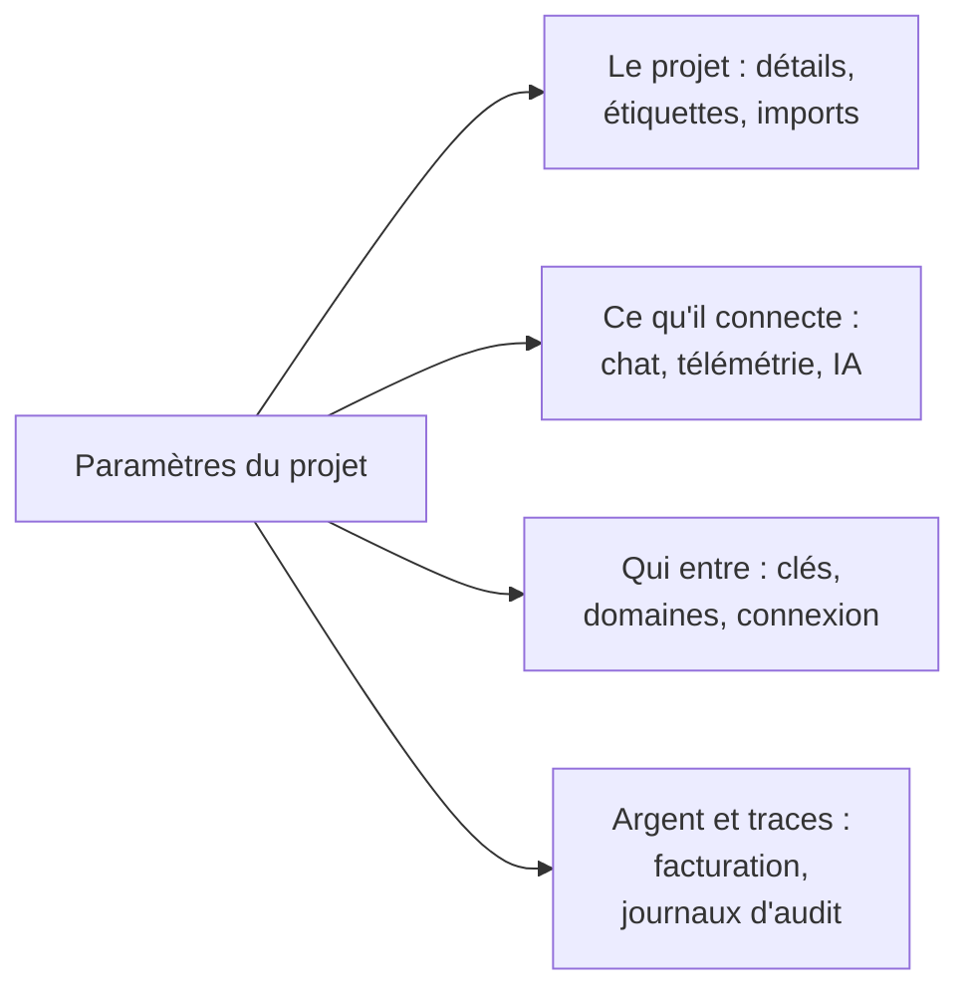

# Paramètres du projet

Les paramètres du projet contiennent ce qui s'applique au projet entier : son nom, les outils auxquels il se connecte, ses clés, la façon dont les personnes se connectent, sa facturation et sa piste d'audit. Vous réglez l'essentiel une fois et y revenez rarement. Cette page en est une carte, et couvre les paramètres qui n'ont pas de page à eux : les détails du projet, les étiquettes, les drapeaux de fonctionnalités et la suppression du projet.

:::cards
- [Trouver un paramètre](#trouver-un-paramètre): Ce que contient chaque section du menu latéral.
- [Les détails du projet](#les-détails-du-projet): Son nom, son ID et l'accès du support.
- [Étiquettes](#étiquettes): Des marqueurs pour les ressources, les autorisations et les règles.
- [Supprimer le projet](#supprimer-le-projet): Ce qu'il faut, et ce qui part avec.
:::

## Ouvrir les paramètres du projet

Allez dans **Produits → Paramètres → Paramètres du projet**. Le menu latéral regroupe les pages en sections, et seule **Basique** est ouverte au départ : cliquez sur le titre d'une section pour l'ouvrir. Une section s'ouvre d'elle-même sur toute page qu'elle contient.

## Avant de commencer

- **Un rôle qui peut modifier le projet.** Les Project Owners et les Project Admins modifient la plupart de ces paramètres. La facturation, les canaux de notification et la suppression du projet demandent davantage, comme le dit chaque section.
- **Sur OneUptime Cloud, le forfait qui inclut un paramètre.** Certains paramètres demandent un forfait : voir [Paramètres qui demandent un forfait](/docs/configuration/billing#paramètres-qui-demandent-un-forfait).

## Trouver un paramètre

| Section | Pages | Où en lire plus |
| --- | --- | --- |
| **Basique** | **Projet**, **Étiquettes** | [Les détails du projet](#les-détails-du-projet), [Étiquettes](#étiquettes) |
| **Espace de travail** | **Slack**, **Microsoft Teams**, **Appels vidéo** | [Slack](/docs/workspace-connections/slack), [Microsoft Teams](/docs/workspace-connections/microsoft-teams), [Appels vidéo](/docs/workspace-connections/video-calls) |
| **Télémétrie & APM** | **Clés d'ingestion**, **Rétention des données** | [Clés d'ingestion](/docs/telemetry/ingestion-keys), [Rétention des données](/docs/telemetry/data-retention) |
| **Notifications** | **Paramètres de notification**, **Journaux de notification**, **Applications mobiles** | [Notifications](#notifications) |
| **IA** | **Fonctionnalités IA**, **Fournisseurs LLM**, **Serveurs MCP externes**, **Crédits IA**, **Journaux IA**, **Serveur MCP** | [Fournisseurs LLM](/docs/ai/llm-provider), [Serveurs MCP externes](/docs/ai/external-mcp-servers), [Serveur MCP](/docs/ai/mcp-server), [AI SRE](/docs/ai/ai-sre#maîtrise-des-coûts) |
| **Avancé** | **Domaines**, **Clés API**, **Drapeaux de fonctionnalités**, **Importer depuis un autre outil** | [Domaines personnalisés](/docs/status-pages/branding-and-domains#domaines-personnalisés), [Clés API](/docs/permissions/index#clés-dapi), [Drapeaux de fonctionnalités](#drapeaux-de-fonctionnalités), [Quitter Opsgenie](/docs/moving-to-oneuptime/opsgenie) et les autres guides de migration |
| **Sécurité** | **SSO**, **SCIM** | [SSO](/docs/identity/sso), [SCIM](/docs/identity/scim) |
| **Facturation et factures** | **Facturation**, **Historique d'utilisation**, **Factures** | [Facturation et utilisation](/docs/configuration/billing) |
| **Journaux d'audit** | **Journaux d'audit**, **Paramètres**, **Export** | [Journaux d'audit](/docs/configuration/audit-logs), [Export du journal d'audit](/docs/configuration/audit-log-export) |
| **Zone de danger** | **Zone de danger** | [Supprimer le projet](#supprimer-le-projet) |

**Facturation et factures** et **Crédits IA** n'existent que sur OneUptime Cloud : une installation auto-hébergée n'a pas de facturation.

## Les détails du projet

**Paramètres du projet → Basique → Projet** contient deux cartes.

**Détails du projet** montre le nom du projet et son ID :

- **Nom du projet** : cliquez sur **Modifier : Projet** pour renommer le projet. Un nom compte au moins 2 caractères. Renommer demande un Project Owner, ou l'autorisation de modifier le projet ou de gérer la facturation.
- **ID du projet** : copiez-le pour l'API, la CLI et Terraform, ou quand vous écrivez au support.
- **Résidence des données** : sur OneUptime Cloud, l'endroit où les données de votre projet doivent être conservées, quand OneUptime l'a enregistré. Seul OneUptime le définit.

**Accès du support client**, sur OneUptime Cloud, décide si l'équipe de support de OneUptime peut ouvrir le projet. Activez **Autoriser le support OneUptime à accéder à ce projet** quand vous voulez son aide : OneUptime demande d'abord, car le support peut alors voir et modifier tout le projet, et vous cliquez sur **Autoriser le support**. Désactivez-le une fois qu'il a terminé : c'est enregistré aussitôt. Les Project Owners et les Project Admins le modifient.

## Étiquettes

Les étiquettes sont des marqueurs que vous posez sur les moniteurs, les incidents, les pages de statut et d'autres ressources. Elles filtrent et regroupent les listes, et elles restreignent la portée des autorisations d'une équipe et des règles du projet.

:::steps
### Ouvrir les étiquettes

Allez dans **Paramètres du projet → Basique → Étiquettes**.

### Créer une étiquette

Cliquez sur **Créer : Étiquette**. Donnez-lui un **Nom** et, si vous le souhaitez, une **Description**. **Couleur de l'étiquette** est déjà choisie, une couleur qu'aucune étiquette de la page n'utilise encore : choisissez-en une autre si vous préférez. Cliquez sur **Créer : Étiquette** pour l'enregistrer.
:::

Sur OneUptime Cloud, créer et modifier des étiquettes demande le forfait Growth. Voir [Étiquettes](/docs/permissions/index#étiquettes) pour la façon dont les étiquettes restreignent les autorisations, et [Règles d'étiquettes et de propriétaires](/docs/configuration/label-and-owner-rules) pour étiqueter les ressources à leur création.

Dans une liste, les étiquettes d'un enregistrement s'affichent les unes sous les autres ; quand il y en a plus de quatre, les trois premières s'affichent avec un lien vers les autres. Partout où des étiquettes sont listées (dans les listes, sur la page d'un enregistrement et dans chaque sélecteur d'étiquettes), elles suivent l'ordre naturel : les étiquettes dont le nom commence par un nombre viennent d'abord, dans l'ordre de ce nombre (`2. Team` avant `10. Owner`), puis les autres par ordre alphabétique, majuscules et minuscules confondues. Pour choisir l'ordre de vos étiquettes, faites commencer leur nom par un nombre, comme `1. Category` et `2. Subcategory`.

### Archiver une étiquette

Pour retirer une étiquette, archivez-la depuis le menu **⋯** de sa ligne au lieu de la supprimer. Tout ce qui a l'étiquette la conserve, et vous pouvez toujours filtrer par celle-ci, mais personne ne peut plus l'ajouter à quoi que ce soit : chaque sélecteur d'étiquettes l'exclut, et l'API, Terraform et MCP la refusent. La boîte de dialogue liste les règles et permissions configurées pour utiliser l'étiquette, qui continuent à l'utiliser tant que vous ne les modifiez pas. Les étiquettes archivées sont listées à part, dans la section repliée **Étiquettes archivées**, où **Désarchiver** en remet une. **Supprimer** liste d'abord tout ce dont l'étiquette serait retirée, et propose **Archiver plutôt**.

## Notifications

**Paramètres du projet → Notifications** contient la façon dont le projet envoie ses notifications :

- **Paramètres de notification** : la carte **Canaux de notification** active ou désactive les SMS, les appels téléphoniques, WhatsApp et Telegram pour le projet. Les quatre sont désactivés au départ. Un Project Owner, un **Administrateur de la facturation** ou une personne avec **Manage Billing** les active. La page contient aussi, repliés sous **Plus de paramètres**, les propres serveurs de messagerie du projet, dans **Configurations SMTP personnalisées** (voir [SMTP](/docs/emails/smtp)), et son propre compte Twilio (voir [Intégration Twilio](/docs/self-hosted/twilio-integration)). Sur OneUptime Cloud, elle contient le solde qui paie ces messages : voir [Soldes prépayés](/docs/configuration/billing#soldes-prépayés).
- **Journaux de notification** : chaque notification que le projet a envoyée, avec un onglet par canal : **E-mail**, **SMS**, **WhatsApp**, **Telegram**, **Webhook**, **Appel**, **Push** et **Espace de travail**.
- **Applications mobiles** : où obtenir les applications iOS et Android. Voir [Vue d'ensemble des applications](/docs/mobile-desktop-apps/index).

## Drapeaux de fonctionnalités

**Paramètres du projet → Avancé → Drapeaux de fonctionnalités** active ou désactive des fonctionnalités facultatives pour le projet. Chacune est un interrupteur qui s'enregistre quand vous le basculez. Aujourd'hui, la page contient **Groupes de moniteurs**, désactivé dans un nouveau projet : activez-le pour ajouter les groupes de moniteurs au menu Moniteurs. Le désactiver ne supprime aucun groupe. Voir [Groupes de moniteurs](/docs/monitor/monitor-groups).

## Supprimer le projet

Supprimer un projet supprime tout ce qu'il contient, pour chaque membre : ses moniteurs, ses incidents, ses pages de statut, sa configuration d'astreinte et sa télémétrie. Rien ne le ramène.

:::steps
### Ouvrir la zone de danger

Allez dans **Paramètres du projet → Zone de danger**.

### Cliquer sur Supprimer le projet

Cliquez sur **Supprimer le projet**. Une boîte de dialogue vous demande de confirmer.

### Saisir le nom du projet

Saisissez le nom exactement tel qu'il est. **Supprimer le projet** reste verrouillé tant que vous ne l'avez pas fait. Sur OneUptime Cloud, la boîte de dialogue demande aussi pourquoi vous partez : la réponse est facultative.

### Confirmer

Cliquez sur **Supprimer le projet**. OneUptime supprime le projet et vous en fait sortir.
:::

> [!CAUTION]
> La suppression du projet est irréversible. Elle demande un Project Owner, ou l'autorisation de supprimer le projet.

Sur OneUptime Cloud, supprimer le projet est la façon de résilier son forfait : la facturation s'arrête quand le projet est supprimé. Un projet facturé via une marketplace cloud reçoit un dernier prélèvement pour son utilisation, et son achat sur la marketplace reste actif jusqu'à ce que vous l'y résiliiez.

## Dépannage

:::details Une section du menu latéral semble manquer
Toutes les sections sauf **Basique** sont repliées au départ. Cliquez sur le titre de la section pour l'ouvrir. Sur une installation auto-hébergée, il n'y a ni section **Facturation et factures** ni page **Crédits IA**.
:::

:::details Modifier : Projet est verrouillé
Renommer le projet demande un Project Owner, ou l'autorisation de modifier le projet ou de gérer la facturation. Le bouton verrouillé nomme l'autorisation qu'il vous faut.
:::

:::details Supprimer le projet reste verrouillé dans la boîte de dialogue
Saisissez le nom du projet exactement comme la boîte de dialogue l'affiche : la casse compte.
:::

## Étapes suivantes

:::cards
- [Inviter des personnes](/docs/permissions/inviting-people): Faire entrer votre équipe dans le projet.
- [Facturation et utilisation](/docs/configuration/billing): Votre forfait, vos moyens de paiement, vos factures et votre utilisation.
- [Journaux d'audit](/docs/configuration/audit-logs): Voir qui a modifié quoi dans le projet.
- [SSO](/docs/identity/sso): Laisser les personnes se connecter avec votre fournisseur d'identité.
:::
