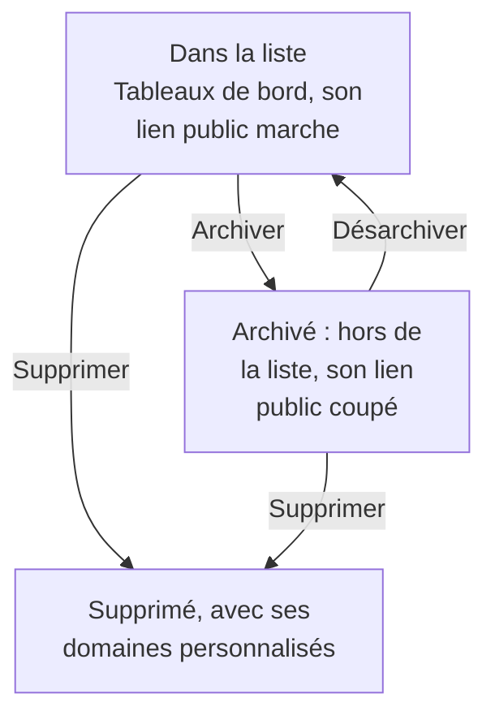

# Configuration et permissions des tableaux de bord

Une fois que vous avez un tableau de bord qui mérite d'être gardé, cette page explique qui peut le lire et le modifier, comment les propriétaires et les étiquettes organisent vos tableaux de bord, et comment en copier, exporter, archiver et supprimer un.

:::cards
- [Qui peut faire quoi](#qui-peut-faire-quoi): Les autorisations derrière chaque action, et qui les détient.
- [Propriétaires](#propriétaires): Les utilisateurs et les équipes auxquels un tableau de bord appartient.
- [Dupliquer un tableau de bord](#dupliquer-un-tableau-de-bord): Une copie sûre, numérotée pour vous.
- [Archiver un tableau de bord](#archiver-un-tableau-de-bord): Ranger un tableau de bord sans le supprimer.
:::

## Qui peut faire quoi

Les tableaux de bord suivent les [autorisations](/docs/permissions/index) de votre projet. Chaque action demande l'une d'elles, détenue par l'intermédiaire d'une équipe :

| Pour | Il faut |
| --- | --- |
| Lire les tableaux de bord | `ReadDashboard`, ou un rôle de projet : Project Owner, Project Admin, Project Member, Viewer, ou un rôle Settings |
| Créer des tableaux de bord | `CreateDashboard`, Project Owner ou Project Admin |
| Modifier un tableau de bord : ses widgets, ses variables, son partage, son image de marque, et l'archiver | `EditDashboard`, Project Owner ou Project Admin |
| Supprimer un tableau de bord | `DeleteDashboard`, Project Owner ou Project Admin |
| Ajouter et retirer des propriétaires | Les autorisations sur les propriétaires de tableaux de bord, Project Owner, Project Admin ou Project Member |
| Ajouter et modifier des domaines personnalisés | Les autorisations sur les domaines de tableaux de bord, Project Owner, Project Admin, Project Member, Settings Admin ou Settings Member |
| Créer des règles de propriétaire et des règles d'étiquettes | Les autorisations sur les règles, Project Owner ou Project Admin |

Un Project Member lit donc chaque tableau de bord, mais a besoin de `CreateDashboard` et de `EditDashboard` pour en construire. La lecture, la modification et la suppression peuvent chacune être limitées aux tableaux de bord qu'une équipe possède, ou aux tableaux de bord qui portent certaines étiquettes : voir [Portée : jusqu'où va une autorisation accordée](/docs/permissions/index#portée-jusquoù-va-une-autorisation-accordée).

Attribuez-les sur la page **Autorisations** d'une équipe : ouvrez **Produits → Équipes** et choisissez l'équipe.

Qui peut voir un tableau de bord hors du projet est une autre question, à laquelle répond sa page **Partage** : voir [Accès aux tableaux de bord publics](#accès-aux-tableaux-de-bord-publics).

## Propriétaires

Les **propriétaires** d'un tableau de bord sont les utilisateurs et les équipes auxquels il appartient. Ajoutez-les sur la page **Propriétaires** du tableau de bord, ou sélectionnez plusieurs tableaux de bord dans la liste **Tableaux de bord** et ajoutez des propriétaires à tous en une fois.

Les propriétaires restreignent l'accès quand vous le demandez : une autorisation d'équipe limitée aux tableaux de bord que possède l'équipe n'atteint que les tableaux de bord qui listent cette équipe, ou la personne qui agit, comme propriétaire. La propriété seule n'accorde rien.

La liste **Tableaux de bord** affiche les propriétaires de chaque tableau de bord, et son filtre **Propriétaire** trouve les tableaux de bord qu'une personne ou une équipe possède.

## Étiquettes

Les étiquettes sont des marqueurs qui organisent les tableaux de bord. Ajoutez-les sur la page **Vue d'ensemble** du tableau de bord, où vous modifiez aussi son nom et sa description, ou à plusieurs tableaux de bord à la fois depuis la liste **Tableaux de bord**.

Usages courants :

- **Par équipe** : `team:platform`, `team:checkout`, `team:growth`.
- **Par environnement** : `env:prod`, `env:staging`.
- **Par usage** : `purpose:oncall`, `purpose:exec`, `purpose:investigation`.

Le filtre **Étiquettes** de la liste **Tableaux de bord** est le moyen le plus rapide de trouver un tableau de bord dans un projet qui en a accumulé beaucoup. Les étiquettes limitent aussi les autorisations : une autorisation d'équipe restreinte à certaines étiquettes n'atteint que les tableaux de bord qui portent l'une d'elles.

## Règles de propriétaire et d'étiquettes

Au lieu d'ajouter propriétaires et étiquettes à la main, laissez des règles le faire. Sous **Paramètres** dans le menu latéral **Tableaux de bord**, les **Règles de propriétaire** ajoutent des propriétaires et les **Règles d'étiquettes** des étiquettes à chaque nouveau tableau de bord qui leur correspond : selon les étiquettes qu'il porte déjà, ou selon un motif dans son nom ou sa description. [Règles d'étiquettes et de propriétaires](/docs/configuration/label-and-owner-rules) explique comment les règles correspondent, et comment en appliquer une aux tableaux de bord que vous avez déjà.

## Accès aux tableaux de bord publics

Qui peut voir un tableau de bord hors du projet est un choix unique sur sa page **Partage** (aussi **⋯ → Partager** sur le tableau de bord lui-même ; voir [Partage et tableaux de bord publics](/docs/dashboards/sharing)) :

1. **Uniquement les personnes de ce projet** (par défaut) — le tableau de bord n'a pas de lien public ; son adresse publique affiche une page « introuvable ».
2. **Toute personne disposant du lien** — quiconque a le lien public peut le voir, sans se connecter.
3. **Toute personne disposant du lien et d'un mot de passe** — les visiteurs saisissent un mot de passe avant que le tableau de bord n'apparaisse.

Sous **Plus de paramètres** sur la même page, la **Liste d'autorisation IP** (offre Scale) rejette les requêtes vers le lien public de toute adresse IP qui n'y figure pas. La configuration publique la plus verrouillée est **Toute personne disposant du lien et d'un mot de passe** avec une liste d'autorisation IP — utile pour les portails partenaires où vous voulez les deux protections.

## Dupliquer un tableau de bord

Pour copier un tableau de bord, ouvrez-le, allez sur sa page **Paramètres** et cliquez sur **Dupliquer : Tableau de bord**. Le nom de la copie est rempli pour vous : le nom du tableau de bord, numéroté au-delà des noms que le projet possède déjà (« Checkout API » est copié en « Checkout API 2 », et une copie de celui-ci en « Checkout API 3 »). Changez-le si vous voulez, confirmez avec **Dupliquer : Tableau de bord**, et la copie s'ouvre. Elle a les widgets, les variables, la description et les étiquettes du tableau de bord. L'image de marque et les domaines personnalisés restent avec l'original, et le partage public démarre toujours désactivé, pour que vous décidiez de l'activer ou non.

C'est la bonne démarche quand vous voulez dériver un modèle (comme « notre tableau de bord d'astreinte ») en une copie propre à un service.

## Exporter et importer

Un tableau de bord voyage en JSON :

- **Exporter : Tableau de bord**, sur la page **Paramètres** du tableau de bord, le télécharge sous forme de fichier JSON. Pour en exporter plusieurs, sélectionnez-les dans la liste **Tableaux de bord** et choisissez **Exporter en JSON**.
- **Importer du JSON**, au-dessus de la liste **Tableaux de bord**, crée des tableaux de bord à partir d'un tel fichier, dans ce projet ou dans un autre.

Un export contient les paramètres propres du tableau de bord, dont ses widgets et ses variables. Ses propriétaires et ses étiquettes en sont exclus, et les widgets qui pointent vers des ressources de ce projet, comme un SLO ou une source de données, peuvent demander de les choisir à nouveau dans un autre projet.

## Archiver un tableau de bord

Archivez un tableau de bord que vous n'utilisez plus mais que vous voulez garder. Un tableau de bord archivé quitte la liste **Tableaux de bord** et, s'il est public, son lien public cesse de fonctionner — son URL et ses domaines personnalisés répondent "Dashboard not found". Ses widgets, ses variables, son image de marque, ses domaines et ses paramètres publics sont tous conservés : le désarchiver le remet donc exactement comme il était, lien public compris.

Pour archiver un tableau de bord, ouvrez-le, allez sur sa page **Paramètres** et cliquez sur **Archiver**. Pour en archiver plusieurs, sélectionnez-les dans la liste **Tableaux de bord** et choisissez **Archiver**. Pour en récupérer un, ouvrez **Tableaux de bord → Avancé → Archivé**, sélectionnez-le et choisissez **Désarchiver**, ou ouvrez-le et cliquez sur **Désarchiver** dans le bandeau en haut de ses pages.

L'archivage est l'alternative réversible à la suppression : choisissez-le d'abord en cas de doute.

## Supprimer un tableau de bord

Ouvrez la page **Supprimer** du tableau de bord. La suppression est irréversible : le tableau de bord, ses widgets et ses variables, et tous les domaines personnalisés qui y sont attachés sont supprimés. Votre télémétrie n'est pas touchée.

Si le tableau de bord est public sur un domaine personnalisé, l'adresse cesse de répondre dès que vous le supprimez. Pour continuer à servir l'adresse, ajoutez le domaine à un autre tableau de bord après avoir supprimé celui-ci : un domaine appartient à un seul tableau de bord à la fois.

## Journaux d'audit

La page **Journaux d'audit** du tableau de bord liste chaque modification faite au tableau de bord, et qui l'a faite. Les journaux d'audit font partie de l'offre Enterprise et de l'[Édition Enterprise](/docs/self-hosted/enterprise).

## Conservation des données et sauvegardes

Les tableaux de bord eux-mêmes n'expirent pas. Les données qu'ils affichent suivent les paramètres de conservation de votre projet : avec la plage temporelle réglée sur les 3 derniers mois, un projet qui garde ses journaux 15 jours en affiche les 15 derniers jours.

Si vous hébergez OneUptime vous-même, une sauvegarde régulière de la base de données suffit : la configuration d'un tableau de bord est stockée avec le reste de votre projet. Sur OneUptime Cloud, les sauvegardes sont faites pour vous. Pour une copie à vous, exportez le tableau de bord en JSON, ou lisez-le avec l'[API OneUptime](/docs/api-reference/api-reference).

## Prochaines étapes

:::cards
- [Partage et tableaux de bord publics](/docs/dashboards/sharing): Liens publics, mots de passe, listes d'autorisation IP et domaines personnalisés.
- [Utilisateurs, équipes et autorisations](/docs/permissions/index): Équipes, rôles, portées et blocages.
- [Variables et filtres de tableau de bord](/docs/dashboards/variables): Un tableau de bord pour chaque service.
- [Présentation des tableaux de bord](/docs/dashboards/index): La vue d'ensemble.
:::
