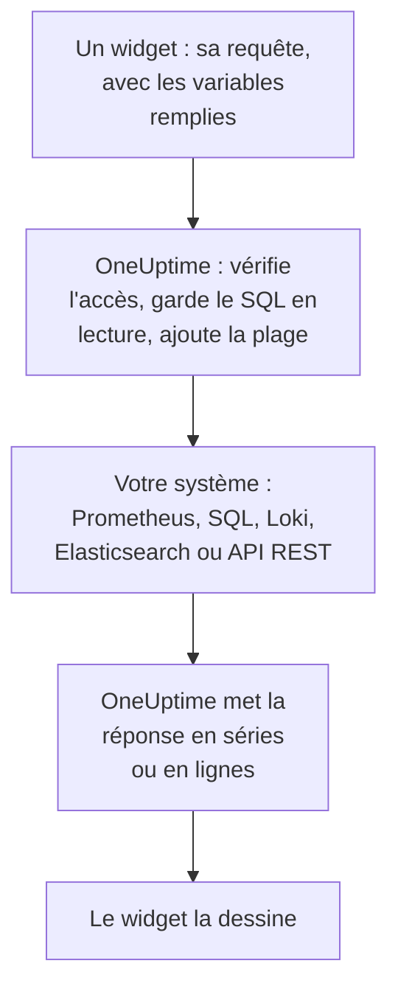

# Sources de données externes

Une source de données externe connecte un système extérieur à OneUptime, comme Prometheus, une base de données SQL, ClickHouse, Loki, Elasticsearch ou une API REST, pour que vos tableaux de bord puissent afficher ses données à côté des vôtres. Vous connectez le système une fois ; chaque widget exécute ensuite une requête en lecture seule dans le langage de ce système.

:::cards
- [Connecter une source de données](#connecter-une-source-de-données): Choisir le type, puis indiquer où elle se trouve et comment s'y connecter.
- [Écrire une requête](#écrire-une-requête): PromQL, SQL, LogQL, Query DSL ou une requête HTTP.
- [Limites](#limites): Les délais et plafonds qui protègent les deux côtés.
- [Sécurité](#sécurité): Des requêtes en lecture seule et des identifiants en écriture seule.
:::

## Déroulement d'une requête

Le widget envoie sa requête à OneUptime, avec les variables déjà remplies. OneUptime vérifie que vous pouvez lire la source de données, ajoute la plage temporelle et interroge votre système avec les identifiants qu'il conserve. Il met la réponse en forme de séries temporelles ou de lignes que le widget dessine.



## Avant de commencer

- **Une offre qui l'inclut.** Sur OneUptime Cloud, créer et modifier des sources de données nécessite l'offre **Growth**. La suppression fonctionne avec toutes les offres.
- **Une autorisation pour les ajouter.** Les propriétaires et administrateurs du projet peuvent ajouter des sources de données ; les autres ont besoin de `CreateDataSource`, avec `EditDataSource` et `DeleteDataSource` pour les modifier et les supprimer. Toutes les personnes qui peuvent lire les sources de données du projet, membres et observateurs compris, voient les données de leurs widgets.
- **Un compte en lecture seule.** Les tableaux de bord ne font que lire. Connectez les bases de données avec un compte qui ne peut que lire, et les sources HTTP avec un jeton qui ne peut qu'interroger.
- **Un accès réseau.** Le serveur d'API de OneUptime se connecte à votre système, il doit donc pouvoir l'atteindre : voir [Sécurité](#sécurité) pour les adresses refusées.

## Systèmes pris en charge

| Type | Langage de requête | Fonctionne avec |
| --- | --- | --- |
| Prometheus | PromQL | Prometheus, Thanos, Cortex, Mimir, VictoriaMetrics |
| PostgreSQL | SQL | PostgreSQL, TimescaleDB, CockroachDB |
| MySQL | SQL | MySQL, MariaDB |
| Microsoft SQL Server | T-SQL | SQL Server, Azure SQL |
| ClickHouse | SQL | ClickHouse, via son interface HTTP |
| Grafana Loki | LogQL | Loki et les points de terminaison compatibles Loki |
| Elasticsearch | Query DSL (JSON) | Elasticsearch, OpenSearch |
| REST API | Request (JSON) | Toute API HTTP(S) qui répond en JSON |

## Connecter une source de données

:::steps
### Ouvrir Sources de données

Ouvrez **Produits → Tableaux de bord**, dépliez **Paramètres** dans le menu latéral et cliquez sur **Sources de données**.

### Choisir le type

Cliquez sur **Créer : Source de données**. La boîte de dialogue **Choisir un type de source de données** regroupe les types selon ce qu'ils contiennent : métriques, journaux, bases de données, recherche et API. Cliquez sur l'un d'eux.

### La nommer

Sous **Informations de base**, donnez-lui un **Nom**, comme « Production Prometheus », et une **Description** si vous le souhaitez.

### Indiquer où elle se trouve

Sous **Connexion**, une source HTTP prend l'**URL** à laquelle elle répond. Une base de données prend son **Hôte de la base de données**, son **Port de la base de données** (laissez-le vide pour 5432, 3306, 1433 ou 8123) et son **Nom de la base de données**.

### Indiquer comment se connecter

Sous **Authentification**, saisissez un **Nom d'utilisateur** et un **Mot de passe**, ou, pour une source HTTP, un **Jeton d'API**, envoyé comme jeton bearer. **Plus de champs** contient **En-têtes HTTP personnalisés**, comme `{ "X-Scope-OrgID": "tenant-1" }`, et **Options supplémentaires** : `sslEnabled` et `sslRejectUnauthorized` pour les bases de données, `elasticsearchIndex` pour Elasticsearch, qui lit tous les index (`*`) sans lui.

### La tester

Cliquez sur **Créer : Source de données**, puis sur **Tester** dans sa ligne. OneUptime se connecte avec les informations fournies et indique si cela a fonctionné ou ce qui n'a pas marché.
:::

Pour modifier une source de données plus tard, ouvrez-la depuis la liste. **Modifier** sur **Détails de la source de données** change tout sauf ses secrets ; **Mettre à jour les identifiants** remplace le mot de passe, le jeton ou les en-têtes, et laisse tels quels les champs que vous laissez vides ; **Tester** la vérifie à nouveau.

## L'utiliser dans un widget

Modifiez un tableau de bord, cliquez sur **Ajouter un widget** et choisissez un widget du groupe External Data Sources : un **Graphique**, une **Valeur**, une **Jauge** ou un **Tableau**. Dans ses paramètres :

- Choisissez la **Source de données** et écrivez la **Requête**. L'éditeur nomme le langage de requête et montre un exemple pour le type.
- Dans un graphique, **Ajouter une requête** superpose d'autres requêtes sur les mêmes axes, et **Légende (facultative)** nomme chaque série d'après ses étiquettes : `{{instance}} — errors` écrit l'étiquette `instance` de la série en tête.
- Pour une valeur ou une jauge, **Reduce** ramène les points à un nombre : la dernière valeur (par défaut), la première, la moyenne, la somme, le minimum ou le maximum. **Unit** ajoute un suffixe, et met à l'échelle les unités connues : `Bytes` s'affiche 1.5 MB, `ms` 2.4 s.
- Dans un tableau, toute requête en lecture seule fonctionne, et ses lignes s'affichent telles qu'elles reviennent.

## Écrire une requête

Chaque type prend son propre langage, avec les mêmes règles pour ce qui revient :

- **Les graphiques, valeurs et jauges ont besoin de séries temporelles.** Une requête SQL renvoie une colonne de temps nommée `time`, `timestamp`, `date` ou `ts`, et une colonne numérique `value` (ou sa première colonne numérique) ; chaque autre colonne devient une étiquette de série. Elasticsearch a besoin d'une agrégation `date_histogram`, et Loki d'une requête de métriques comme `rate()` ou `count_over_time()`.
- **Les tableaux affichent des lignes** telles que la requête les renvoie : lignes SQL, séries Prometheus, lignes de journal Loki, résultats Elasticsearch, ou les objets du `rowsPath` d'une API REST.

:::tabs
@tab Prometheus
```text title="PromQL"
sum by (job) (rate(http_requests_total{job=~"{{job}}"}[5m]))
```
@tab SQL
```sql title="SQL"
SELECT date_trunc('minute', created_at) AS time, COUNT(*) AS value
FROM orders
WHERE created_at BETWEEN $__startTime AND $__endTime
GROUP BY 1
ORDER BY 1
```
@tab Loki
```text title="LogQL"
sum by (app) (rate({app="api"} |= "error" [5m]))
```
@tab Elasticsearch
```json title="Query DSL"
{
  "query": { "range": { "@timestamp": { "gte": "$__startTime", "lte": "$__endTime" } } },
  "aggs": {
    "over_time": {
      "date_histogram": { "field": "@timestamp", "fixed_interval": "1m" }
    }
  }
}
```
@tab REST API
```json title="Request"
{
  "path": "/api/stats?from=$__startTimeMs&to=$__endTimeMs",
  "method": "GET",
  "rowsPath": "data.items",
  "timestampField": "time",
  "valueField": "count",
  "seriesField": "service"
}
```
:::

### Macros de temps

Prometheus et Loki reçoivent la plage temporelle du tableau de bord avec chaque requête, leurs requêtes n'ont donc besoin de rien d'autre. Les autres types placent la plage temporelle là où vous écrivez une macro :

| Macro | Devient | Dans |
| --- | --- | --- |
| `$__startTime`, `$__endTime` | Le début et la fin de la plage, en UTC : `'2026-10-13 09:00:00'` en SQL, ISO 8601 ailleurs | SQL, Elasticsearch, REST API |
| `$__startTimeMs`, `$__endTimeMs` | Les mêmes, en millisecondes depuis 1970 | SQL, Elasticsearch, REST API |
| `$__rangeSeconds` | La durée de la plage, en secondes | SQL |

Les macros SQL sont écrites en UTC : faites tourner vos sessions de base de données en UTC, ou convertissez dans la requête.

### Variables du tableau de bord

Écrivez `{{name}}` n'importe où dans une requête, et le widget y place la valeur de la variable avant d'envoyer la requête. Plusieurs valeurs d'une variable à choix multiple sont jointes par `|`, ce dont a besoin un comparateur d'expression régulière PromQL ou LogQL : `job=~"{{job}}"`. Une variable sans choix laisse l'espace réservé tel qu'écrit, pour que l'erreur le nomme. [Variables et filtres de tableau de bord](/docs/dashboards/variables) explique comment en ajouter une.

## Limites

Chaque requête est bornée, pour qu'un tableau de bord de vingt widgets actualisé chaque minute ne puisse surcharger ni OneUptime ni votre système :

| Limite | Valeur |
| --- | --- |
| Connexion | 10 secondes |
| Exécution d'une requête | 30 secondes |
| Points dans une réponse en série temporelle | 11 000 |
| Lignes dans un tableau | 1 000 |
| Séries dans une réponse | 100 |
| Réponse d'une source HTTP | 20 MB |

Les requêtes de plage vers Prometheus et Loki demandent environ 250 points sur la plage temporelle, pas plus serrés que 10 secondes et pas plus espacés qu'un jour.

## Sécurité

- **Le SQL reste en lecture seule.** Une requête doit être une seule instruction qui commence par `SELECT`, `WITH`, `SHOW`, `EXPLAIN`, `DESCRIBE` ou `DESC`. Les mots qui écrivent ou modifient une session, comme `INSERT`, `UPDATE`, `DELETE`, `DROP`, `INTO` ou `SET`, sont refusés partout hors des chaînes et des noms entre guillemets : mettez donc entre guillemets une colonne qui porte un de ces noms. Écrivez un guillemet dans une chaîne en le doublant (`''`) : une barre oblique inverse devant un guillemet est refusée. Les sessions PostgreSQL, MySQL et ClickHouse sont aussi en lecture seule. SQL Server n'a pas de session en lecture seule : connectez-le avec un identifiant qui ne peut que lire.
- **Les identifiants sont en écriture seule.** **Mot de passe**, **Jeton d'API** et **En-têtes HTTP personnalisés** sont chiffrés au repos, et l'API ne les renvoie jamais, pas même à vous.
- **Les adresses sont vérifiées.** Le loopback, le link-local (où se trouvent les métadonnées du cloud) et les autres adresses réservées sont refusés partout. Les adresses privées sont refusées sur OneUptime Cloud, et autorisées sur une installation auto-hébergée sauf si `DATA_SOURCE_BLOCK_PRIVATE_ADDRESSES` vaut `true` : voir [Accès au réseau privé](/docs/self-hosted/private-network-access).
- **Les tableaux de bord publics ne les exécutent jamais.** Les widgets du groupe External Data Sources sont retirés d'un [tableau de bord public](/docs/dashboards/sharing), requêtes comprises.

## Dépannage

:::details Le test indique qu'il ne peut pas se connecter
Vérifiez l'URL, ou l'hôte et le port, depuis l'endroit où OneUptime s'exécute : un pare-feu, une adresse privée sur OneUptime Cloud ou une base de données qui n'écoute que sur sa propre machine se ressemblent vus d'ici. Pour une base de données qui exige TLS, ajoutez `{ "sslEnabled": true }` sous **Options supplémentaires**.
:::

:::details "Only read-only queries are allowed"
La requête ne commence pas par `SELECT`, `WITH`, `SHOW`, `EXPLAIN`, `DESCRIBE` ou `DESC`. Envoyez une seule instruction qui ne fait que lire : une seconde instruction après un `;` est aussi refusée, avec "Only a single SQL statement is allowed per query."
:::

:::details "Query contains a keyword that is not allowed"
Un mot qui écrit apparaît hors d'une chaîne, souvent comme nom de colonne, comme `delete` ou `set`. Mettez-le entre guillemets comme le fait la base de données : `"delete"` en PostgreSQL, `[delete]` en SQL Server, et entre accents graves en MySQL et ClickHouse.
:::

:::details Le graphique reste vide, mais le tableau affiche des lignes
La requête renvoie des lignes, mais aucune série temporelle. Nommez la colonne de temps `time` et le nombre `value` en SQL, ajoutez une agrégation `date_histogram` en Elasticsearch, ou transformez une requête de journaux Loki en requête de métriques avec `rate()` ou `count_over_time()`.
:::

:::details Des données manquent
La réponse a atteint une [limite](#limites). Réduisez la plage temporelle, filtrez la requête, ou agrégez-la en moins de séries.
:::

## Prochaines étapes

:::cards
- [Widgets de tableau de bord](/docs/dashboards/widgets): Chaque widget, groupe External Data Sources compris.
- [Variables et filtres de tableau de bord](/docs/dashboards/variables): Des variables pour vos requêtes.
- [Accès au réseau privé](/docs/self-hosted/private-network-access): Atteindre des systèmes d'un réseau privé depuis une installation auto-hébergée.
- [Configuration et permissions des tableaux de bord](/docs/dashboards/configuration): Qui peut ajouter des sources de données, et qui les lit.
:::
