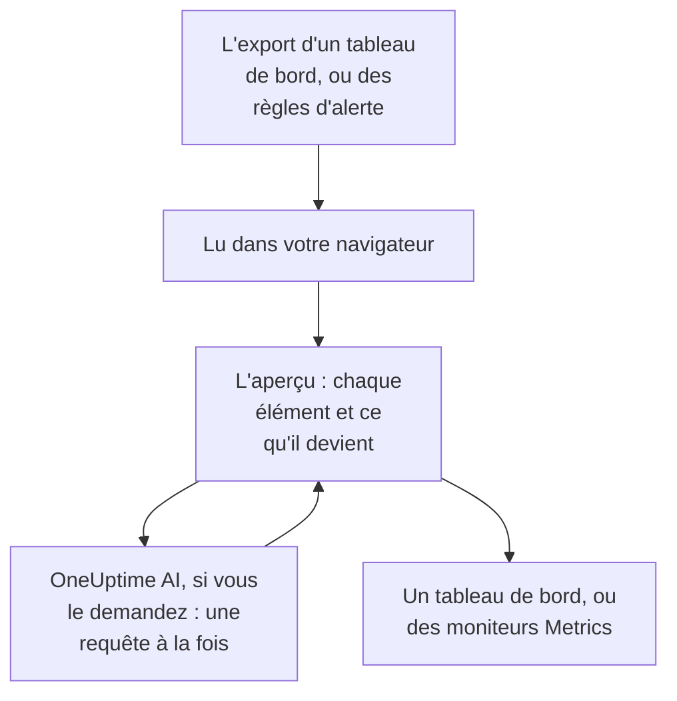

# Importer depuis Grafana et Datadog

Faites venir dans OneUptime un tableau de bord construit dans Grafana ou Datadog, ou les règles d'alerte écrites pour Prometheus, Grafana ou Datadog. Vous collez ou téléversez le fichier, vous voyez ce que devient chaque panneau et chaque règle, et ce n'est qu'ensuite que vous créez le tableau de bord ou les moniteurs.

:::cards
- [Importer un tableau de bord](#importer-un-tableau-de-bord): Le modèle JSON d'un tableau de bord Grafana, ou l'export d'un tableau de bord Datadog.
- [Importer des règles d'alerte](#importer-des-règles-dalerte): Fichiers de règles Prometheus, règles d'alerte Grafana et moniteurs Datadog.
- [Comment chaque élément est converti](#comment-chaque-élément-est-converti): Exactement, approximativement ou pas du tout, et pourquoi.
- [Convertir une requête avec OneUptime AI](#convertir-une-requête-avec-oneuptime-ai): Pour une requête qu'aucune règle ne convertit.
:::

## Comment se déroule un import

OneUptime lit le fichier dans votre navigateur et convertit chaque panneau, widget, variable et règle séparément. L'aperçu les liste tous avec ce que devient chacun. Rien n'est créé tant que vous ne choisissez pas de le créer, et c'est alors créé avec vos propres autorisations, comme le créent les formulaires de tableau de bord et de moniteur.

## Avant de commencer

- Les widgets et moniteurs importés lisent les métriques propres à ce projet avec PromQL. Envoyez-les avec Prometheus remote write, OpenTelemetry ou le Datadog Agent : elles gardent les noms qu'elles y ont.
- Importer un tableau de bord demande un rôle qui peut créer des tableaux de bord, et importer des règles d'alerte un rôle qui peut créer des moniteurs.
- Un fichier peut faire jusqu'à 10 Mo, et jusqu'à 500 de ses panneaux ou règles sont lus.

## Importer un tableau de bord

:::steps
### Ouvrir l'import de tableau de bord

Ouvrez **Produits → Tableaux de bord**, puis **Plus d'options → Import from Grafana or Datadog**.

### Coller le tableau de bord

Dans Grafana, copiez le modèle JSON depuis les paramètres du tableau de bord. Dans Datadog, exportez le JSON du tableau de bord. Collez-le, ou choisissez **Upload a File**, puis choisissez **Aperçu**.

### Créer le tableau de bord

Vérifiez ce que devient chaque panneau et chaque variable, nommez le tableau de bord et choisissez **Créer un tableau de bord**. Le nouveau tableau de bord s'ouvre.
:::

Le PromQL de Grafana est gardé tel qu'il est écrit : OneUptime remplit `$__interval`, `$__rate_interval` et `$__range` comme le fait Grafana, et une variable sur All correspond à toutes les valeurs. Une requête Datadog devient du PromQL sur les métriques que le Datadog Agent a envoyées : `avg:system.cpu.user{host:web-1}` lit `system_cpu_user{host="web-1"}`.

## Importer des règles d'alerte

:::steps
### Ouvrir l'import d'alertes

Ouvrez **Produits → Moniteurs**, puis **Plus d'options → Import Alerts**.

### Coller les règles

Collez un fichier de règles Prometheus ou une ressource PrometheusRule, l'export des règles d'alerte de Grafana, ou des moniteurs Datadog exportés en JSON, puis choisissez **Aperçu**.

### Créer les moniteurs

Décochez les règles dont vous ne voulez pas, choisissez sous **When a rule fires** ce qu'ouvre une règle qui se déclenche, puis choisissez **Créer des moniteurs**.
:::

Chaque règle devient un moniteur Metrics avec une requête PromQL, la condition de la règle et sa fenêtre. Il ouvre une alerte, ou un incident, pour chaque série qui dépasse le seuil, et le résout quand la série se rétablit. Son titre et sa description viennent du résumé ou du message de la règle, avec les étiquettes de la série remplies.

## Comment chaque élément est converti

| Statut | Ce qu'il signifie |
| --- | --- |
| **Converted exactly** | Il lit les mêmes données et les montre de la même façon. |
| **Converted approximately** | Il est créé, et ses notes disent ce qui diffère. |
| **Not converted** | Rien n'est créé pour lui, et ses notes disent pourquoi. |

Les règles d'enregistrement, les règles d'alerte sur des journaux, les widgets Datadog qui lisent des journaux, des traces ou des événements, et les moniteurs d'anomalies, de valeurs aberrantes et de prévisions de Datadog ne sont pas convertis.

## Convertir une requête avec OneUptime AI

Une requête qu'aucune règle ne convertit affiche **Convert with OneUptime AI**, qui demande que l'IA soit activée pour le projet. Seule cette requête, avec les noms des variables du tableau de bord, part vers le [fournisseur LLM](/docs/ai/llm-provider) de votre projet. Sa réponse est vérifiée comme n'importe quelle requête et vous est montrée : choisissez **Use This Query** pour l'utiliser. Rien n'est créé tant que vous ne créez pas le tableau de bord ou les moniteurs.

## Prochaines étapes

:::cards
- [Widgets de tableau de bord](/docs/dashboards/widgets): Changez ce que montre un widget importé.
- [Variables et filtres de tableau de bord](/docs/dashboards/variables): Les variables qu'un import a créées.
- [Surveillance des métriques](/docs/monitor/metrics-monitor): Les moniteurs qu'un import a créés.
- [PromQL](/docs/telemetry/promql): Le langage que lisent les widgets et moniteurs importés.
:::
