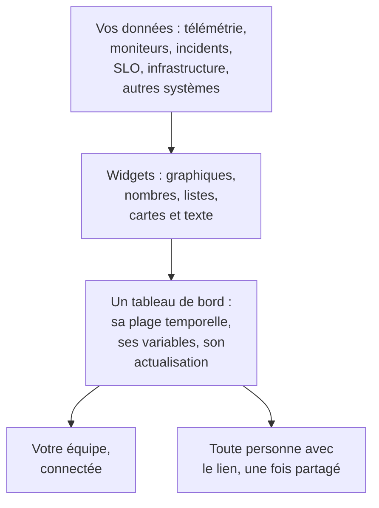

# Présentation des tableaux de bord

Un tableau de bord est une page de widgets que vous disposez vous-même : des graphiques de vos métriques, journaux et traces, des listes d'incidents, d'alertes et de moniteurs, vos SLO et votre infrastructure, et même des données de systèmes extérieurs à OneUptime. Créez-en un pour l'écran d'astreinte, le point du matin d'une équipe ou une page pour vos clients, et partagez-le avec votre projet ou avec toute personne qui a le lien.

:::cards
- [Fonctionnement d'un tableau de bord](#fonctionnement-dun-tableau-de-bord): D'où viennent ses données et qui le voit.
- [Trouver vos tableaux de bord](#trouver-vos-tableaux-de-bord): La liste Tableaux de bord et les pages propres à chaque tableau de bord.
- [Créer votre premier tableau de bord](#créer-votre-premier-tableau-de-bord): D'un modèle à une page partagée en cinq étapes.
- [Un exemple : un tableau de bord d'astreinte](#un-exemple-un-tableau-de-bord-dastreinte): Une page qui fonctionne pour chaque service.
:::

## Fonctionnement d'un tableau de bord

Chaque widget lit une source, dans la plage temporelle du tableau de bord et filtrée par ses variables. Toutes les personnes qui ouvrent le tableau de bord voient les mêmes widgets : votre équipe une fois connectée, et les visiteurs par son lien public dès que vous le partagez.

| Terme | Signification |
| --- | --- |
| Tableau de bord | Une page : un nom, une grille de widgets, une plage temporelle, des variables et un réglage d'actualisation automatique. |
| Widget | Une tuile de la grille : un graphique, un nombre, une liste, une carte, une horloge ou un bloc de texte. |
| Variable | Un sélecteur dans la barre d'outils qui restreint chaque widget compatible à un service, un hôte ou un client. |
| Plage temporelle | La fenêtre que lisent tous les graphiques et nombres. Un tableau de bord s'ouvre sur sa valeur par défaut, la dernière heure sauf si quelqu'un en choisit une autre en le modifiant, et chaque lecteur peut choisir la sienne. |
| Actualisation automatique | La fréquence à laquelle les widgets relisent leurs données : désactivée, ou toutes les 5 secondes à 15 minutes. |
| Lecture et modification | Un tableau de bord s'ouvre en lecture. Le modifier est une étape à part, qui se termine en enregistrant ou en annulant vos modifications. |

## À quoi servent les tableaux de bord

- **Une page « tout va bien ? »** pour la personne d'astreinte, le point quotidien d'une équipe ou un écran au mur.
- **Voir les liens** : un pic de CPU à côté d'une hausse de latence et d'un incident ouvert saute aux yeux sur une seule page, et passe facilement inaperçu sur trois.
- **Enquêter** : placez côte à côte les graphiques que vous rouvrez sans cesse, et faites glisser sur un pic pour lire chaque widget à ce moment-là.
- **Partager hors de l'équipe** : une page de performances pour un client ou un partenaire, protégée par un mot de passe ou une liste d'autorisation IP si vous le souhaitez.

## Trouver vos tableaux de bord

Ouvrez **Produits → Tableaux de bord**. La liste **Tableaux de bord** affiche les tableaux de bord du projet avec leurs descriptions, étiquettes et propriétaires. Cherchez par nom ou par description, affinez la liste avec les filtres **Propriétaire** et **Étiquettes**, ou sélectionnez plusieurs tableaux de bord pour changer leurs étiquettes ou leurs propriétaires, les archiver ou les exporter en JSON.

Le menu latéral de la liste regroupe les pages qui gèrent l'ensemble de vos tableaux de bord :

| Page | Ce que vous y faites |
| --- | --- |
| **Tableaux de bord** | Les tableaux de bord du projet. Créez-en un, ou importez des tableaux de bord avec **Importer du JSON**. |
| **Tableaux de bord → Playlists** | [Afficher les tableaux de bord l'un après l'autre](/docs/dashboards/playlists) sur un écran, comme le mur d'un NOC. |
| **Paramètres → Règles de propriétaire** | Ajouter automatiquement des propriétaires aux nouveaux tableaux de bord. |
| **Paramètres → Règles d'étiquettes** | Ajouter automatiquement des étiquettes aux nouveaux tableaux de bord. |
| **Paramètres → Sources de données** | Connecter Prometheus, des bases SQL, ClickHouse, Loki, Elasticsearch ou une API REST. |
| **Avancé → Archivé** | Les tableaux de bord que vous avez archivés. Désarchivez-les depuis cette page. |

Ouvrez un tableau de bord : son propre menu latéral contient ces pages. Chaque section sauf **Basique** est repliée au départ : cliquez sur son titre pour l'ouvrir.

| Page | Ce que vous y faites |
| --- | --- |
| **Tableau de bord** | Le tableau de bord lui-même. Lisez-le, ou modifiez-le depuis son menu **⋯**. |
| **Vue d'ensemble** | Son nom, sa description et ses étiquettes. |
| **Partage** | Qui peut le voir, son lien public, et une liste d'autorisation IP sous Plus de paramètres. |
| **Propriétaires** | Les utilisateurs et équipes à qui il appartient. |
| **Image de marque** | Titre de page, description, logo, thème et favicon du tableau de bord public. |
| **Domaines personnalisés** | Héberger le tableau de bord public sur votre propre domaine. |
| **Paramètres** | Dupliquer, exporter ou archiver le tableau de bord. |
| **Journaux d'audit** | Chaque modification apportée au tableau de bord, et qui l'a faite. |
| **Supprimer** | Supprimer définitivement le tableau de bord. |

## Créer votre premier tableau de bord

:::steps
1. **Créer** — Choisissez un modèle, ou **Partir de zéro**. Un modèle remplit le nom et s'ouvre avec ses widgets ; un tableau de bord parti de zéro s'ouvre vide, avec **Ajouter un widget** sur son canevas.
2. **Ajouter des widgets** — Choisissez un widget dans le catalogue, indiquez dans ses paramètres ce qu'il lit, puis faites-le glisser à sa place et redimensionnez-le.
3. **Ajouter des variables si besoin** — Une variable `service`, par exemple, permet à un seul tableau de bord d'afficher n'importe quel service.
4. **Enregistrer** — Cliquez sur **Enregistrer les modifications**. Rien de ce que vous changez pendant la modification n'est conservé avant cela.
5. **(Facultatif) Partager publiquement** — Choisissez **⋯ → Partager** sur le tableau de bord et indiquez qui peut le voir : toute personne disposant du lien, ou toute personne disposant du lien et d'un mot de passe.
:::

[Créer un tableau de bord](/docs/dashboards/authoring) détaille chaque étape.

## Un exemple : un tableau de bord d'astreinte

L'objectif : une page pour le service checkout, avec sa latence, son taux d'erreur, ses incidents ouverts et ses derniers journaux, qui fonctionne aussi pour tous les autres services.

1. Cliquez sur **Créer un tableau de bord**, choisissez **Partir de zéro** et nommez le tableau de bord « Checkout on-call ».
2. Cliquez sur **Ajouter un widget** et ajoutez un **Graphique** de votre métrique de latence des requêtes, agrégée en P95.
3. À côté, ajoutez une **Valeur** de votre taux d'erreur, avec un seuil d'avertissement de 1 et un seuil critique de 5.
4. En dessous, ajoutez une **Liste des incidents** filtrée sur les incidents non résolus, et un **Flux de journaux** des journaux du service.
5. Ouvrez **Variables**, ajoutez une variable nommée `service` avec la source Telemetry Attribute et la clé d'attribut `service.name`, et donnez-lui la valeur par défaut `checkout`.
6. Cliquez sur **Enregistrer les modifications**. Choisissez `payments` dans le sélecteur `service` de la barre d'outils : le graphique, la valeur et le flux de journaux passent au service payments, et la liste des incidents continue d'afficher chaque incident non résolu.

## La place des tableaux de bord dans OneUptime

- **Les moniteurs et la télémétrie** sont l'origine des données. Chaque métrique, journal et trace que vous envoyez peut figurer sur un widget.
- **Les incidents et les alertes** apparaissent dans les widgets **Liste des incidents** et **Liste des alertes**. Un tableau de bord ne fait que les afficher : vous les traitez sur leurs propres pages.
- **Les pages de statut** indiquent à vos clients si votre service fonctionne. Les tableaux de bord montrent en détail comment il se comporte. Les deux fonctionnent côte à côte.
- **Les workflows** agissent sur ce qui se passe. Les tableaux de bord sont l'endroit où vous le lisez.

## Prochaines étapes

:::cards
- [Créer un tableau de bord](/docs/dashboards/authoring): Créer un tableau de bord, le modifier et enregistrer vos modifications.
- [Widgets de tableau de bord](/docs/dashboards/widgets): Chaque widget, et lequel choisir.
- [Variables et filtres de tableau de bord](/docs/dashboards/variables): Un tableau de bord pour chaque service, hôte ou client.
- [Partage et tableaux de bord publics](/docs/dashboards/sharing): Liens publics, mots de passe, listes d'autorisation IP et domaines personnalisés.
:::
