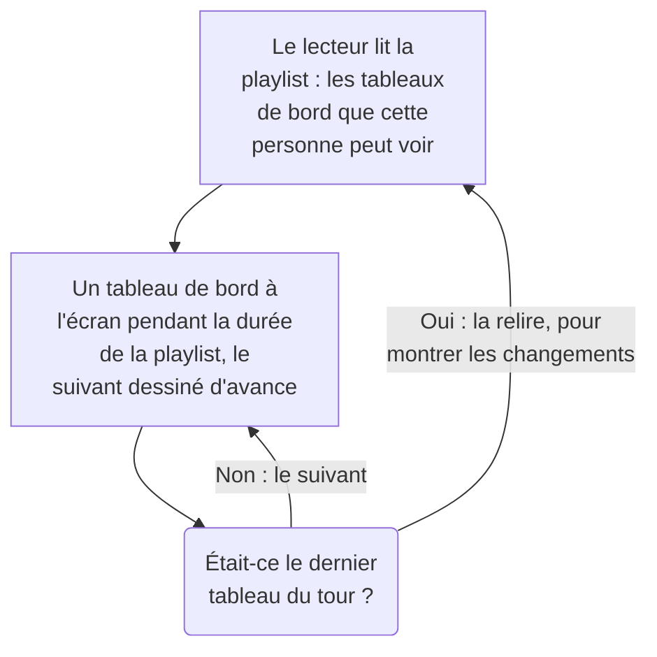

# Playlists de tableaux de bord

Une playlist affiche une série de tableaux de bord l'un après l'autre sur un écran que personne ne touche, comme le mur d'un NOC ou la télévision d'une équipe : chaque tableau de bord pendant la durée que vous choisissez, en boucle, jusqu'à ce que quelqu'un la mette en pause. Créez la playlist une fois, ouvrez son lecteur sur l'écran et laissez-le tourner.

:::cards
- [Comment une playlist se déroule](#comment-une-playlist-se-déroule): L'ordre, les tours et ce que montre chaque tableau de bord.
- [Créer une playlist](#créer-une-playlist): Un nom, ses tableaux de bord dans l'ordre et la durée d'affichage de chacun.
- [La lire sur un écran](#la-lire-sur-un-écran): La barre du lecteur, ses boutons et ses touches.
- [Qui voit quoi](#qui-voit-quoi): Les autorisations, et les tableaux de bord qu'une personne n'a pas le droit de lire.
:::

## Comment une playlist se déroule

Le lecteur affiche le premier tableau de bord de la playlist, puis le suivant quand son temps est écoulé, et recommence au premier après le dernier. Chaque tableau de bord s'ouvre tel que ses éditeurs l'ont enregistré : sur sa propre plage de temps par défaut, son actualisation automatique et ses variables, quoi que dise l'adresse du lecteur. Pendant qu'un tableau de bord est à l'écran, le lecteur dessine le suivant hors de vue, de sorte que l'écran ne reste jamais vide entre deux d'entre eux.

Une playlist désigne ses tableaux de bord et ne les copie jamais : une modification qu'un éditeur enregistre sur un tableau de bord est à l'écran la prochaine fois que vient son tour. Le lecteur relit la playlist avant chaque tour, si bien qu'un tableau de bord ajouté, déplacé ou retiré apparaît en l'espace d'un tour, sans recharger l'écran ; si cette lecture échoue, l'écran rejoue le tour qu'il a déjà.

## Créer une playlist

:::steps
### Ouvrir les playlists
Ouvrez **Produits → Tableaux de bord**, puis **Playlists** dans le menu latéral. La liste indique combien de tableaux de bord compte chaque playlist et combien de temps chacun est affiché, avec **Lire** sur chaque ligne.

### La nommer
Cliquez sur **Créer : Playlist** et donnez-lui un **Nom** qui dit où elle est diffusée, par exemple « Mur du NOC ».

### Ajouter ses tableaux de bord
Sous **Tableaux de bord**, choisissez chacun dans **Ajouter un tableau de bord**, dans l'ordre où l'écran les affiche. Les boutons de la ligne d'un tableau de bord le déplacent vers le haut ou vers le bas, ou le retirent. Les tableaux de bord archivés ne sont pas proposés.

### Choisir la durée d'affichage
**Afficher chaque tableau de bord pendant** commence à une minute ; choisissez une durée de 15 secondes à une heure. Cliquez sur **Créer : Playlist**.
:::

La page de la playlist liste ses tableaux de bord dans l'ordre, la durée d'affichage de chacun et le **Lien du lecteur**. **Modifier la playlist** change le nom, les tableaux de bord, leur ordre et la durée. **Supprimer : Playlist de tableaux de bord**, en bas de la page, supprime la playlist et jamais ses tableaux de bord.

Par l'API et Terraform, une playlist est un `name`, ses `dashboards` sous forme de liste comme `[{"dashboardId": "<id>"}]` dans l'ordre où ils sont affichés, au plus 100, et `intervalInSeconds`, un nombre entier quelconque de secondes de 10 à 86400 (un jour). Une valeur hors de ces limites est refusée, avec ce qui ne va pas.

## La lire sur un écran

Cliquez sur **Lire** sur la ligne de la playlist ou sur sa page. Le lecteur remplit la fenêtre du navigateur, par-dessus le reste de OneUptime ; **Plein écran** remplit tout l'écran. Pour démarrer un écran tout seul, ouvrez-y le **Lien du lecteur** et ajoutez-le aux favoris : le lien ouvre aussitôt le lecteur.

La barre du lecteur nomme le tableau de bord à l'écran, la playlist, où en est le tour (« 2 sur 5 ») et le tableau de bord qui vient ensuite. Une ligne sous la barre se remplit pendant le tour d'un tableau de bord. Les boutons de la barre passent au tableau de bord précédent, mettent en pause ou lisent, et passent au suivant ; sur un ordinateur, ces touches font de même :

| Touches | Ce qu'elles font |
| --- | --- |
| `Space` | **Mettre en pause ou lire**. En pause, le tableau de bord reste à l'écran et la barre indique **En pause**. |
| `Right Arrow` | **Tableau de bord suivant**. |
| `Left Arrow` | **Tableau de bord précédent**. |
| `F` | **Plein écran**, ou en sortir. |
| `Esc` | **Quitter le lecteur**, retour à la page de la playlist. En plein écran, le premier `Esc` ne fait que quitter le plein écran. |
| `?` | **Afficher les raccourcis clavier**. |

Un tableau de bord vers lequel vous allez, le suivant ou le précédent, a droit à un tour complet. Sur une page lue de droite à gauche, comme en persan, les flèches s'inversent : `Left Arrow` passe au tableau de bord suivant. Pendant la lecture, le lecteur empêche l'écran de se mettre en veille, quand le navigateur le permet.

## Qui voit quoi

Les playlists ont leurs propres autorisations, détenues par l'intermédiaire d'une équipe comme celles des tableaux de bord :

| Pour | Il faut |
| --- | --- |
| Voir et lire les playlists | `ReadDashboardPlaylist`, ou un rôle de projet : Project Owner, Project Admin, Project Member, Viewer, ou un rôle Settings |
| Créer des playlists | `CreateDashboardPlaylist`, Project Owner ou Project Admin |
| Modifier une playlist : son nom, ses tableaux de bord et sa durée | `EditDashboardPlaylist`, Project Owner ou Project Admin |
| Supprimer une playlist | `DeleteDashboardPlaylist`, Project Owner ou Project Admin |

Une playlist ne montre jamais un tableau de bord à quelqu'un qui n'a pas le droit de le lire. Le lecteur ne lit que les tableaux de bord que la personne connectée à l'écran peut lire et qui ne sont pas archivés, et saute les autres : un tableau de bord supprimé, un tableau de bord archivé, ou un tableau de bord que ses autorisations lui interdisent. La page de la playlist indique pourquoi elle saute chacun d'eux. Enregistrer une playlist conserve les tableaux de bord qu'elle contient et que l'éditeur ne peut pas voir, si bien que rien de ce qu'une autre personne y a mis n'est perdu.

| Quand le lecteur trouve | Il affiche |
| --- | --- |
| Des tableaux de bord qu'il peut montrer | Chacun à son tour. |
| Aucun tableau de bord qu'il peut montrer | **Rien à afficher pour l'instant**, et il regarde de nouveau chaque minute. |
| La playlist supprimée, ou que la personne n'a pas le droit de lire | **Playlist introuvable**. |
| Une lecture qui a échoué | **Impossible de charger cette playlist**, et il réessaie chaque minute, ou sur **Réessayer**. |

> [!NOTE]
> Le lecteur est destiné à une personne connectée à OneUptime. Pour faire tourner une playlist sur un écran, connectez-vous sur cet écran avec un compte qui peut lire la playlist et ses tableaux de bord, par exemple un membre d'équipe ayant le rôle Viewer.

## Prochaines étapes

:::cards
- [Créer un tableau de bord](/docs/dashboards/authoring): Construisez les tableaux de bord qu'une playlist affiche.
- [Variables et filtres de tableau de bord](/docs/dashboards/variables): La sélection enregistrée sur laquelle chaque tableau de bord s'ouvre.
- [Partage et tableaux de bord publics](/docs/dashboards/sharing): Montrer un tableau de bord à des personnes qui ne se connectent pas.
- [Configuration et permissions des tableaux de bord](/docs/dashboards/configuration): Propriétaires, étiquettes et qui peut lire un tableau de bord.
:::
