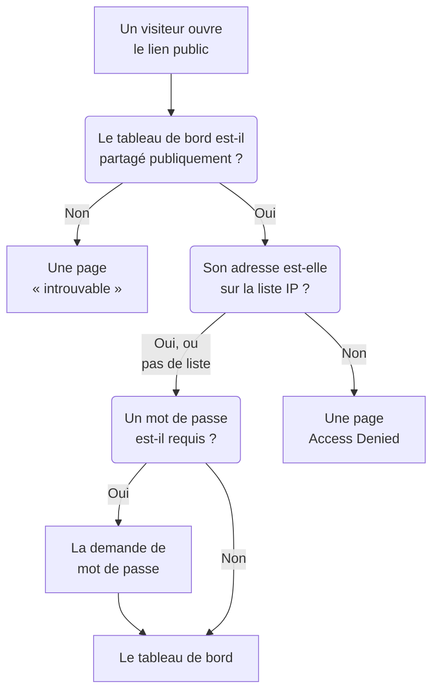

# Partage et tableaux de bord publics

Par défaut, un tableau de bord est privé à votre projet : seules les personnes qui se connectent à votre projet peuvent le voir. Vous pouvez aussi le partager par un lien public, protéger ce lien par un mot de passe, le limiter à certaines adresses IP et l'héberger sur votre propre domaine. Cette page couvre ces quatre possibilités.

:::cards
- [Qui peut voir un tableau de bord](#qui-peut-voir-un-tableau-de-bord): Un choix parmi trois, avec l'offre que chacun demande.
- [Partager avec un mot de passe](#partager-avec-un-mot-de-passe): Partagez le lien, puis le mot de passe, avec les personnes qui doivent le voir.
- [Liste d'autorisation IP](#liste-dautorisation-ip): N'ouvrir le lien public qu'à votre bureau ou à votre VPN.
- [Domaines personnalisés](#domaines-personnalisés): Servir le tableau de bord sur votre propre domaine, avec un certificat gratuit.
:::

## Le parcours d'un visiteur

Un visiteur qui ouvre le lien public d'un tableau de bord rencontre chacune de ces vérifications à tour de rôle. Les membres du projet qui se connectent à OneUptime voient le tableau de bord dans le produit, quel que soit votre choix ici.



## Qui peut voir un tableau de bord

Ouvrez le tableau de bord et choisissez **⋯ → Partager**, ou ouvrez **Partage** dans le menu latéral du tableau de bord. La carte **Qui peut voir ce tableau de bord** est un choix unique :

- **Uniquement les personnes de ce projet** (par défaut) : les membres voient le tableau de bord quand ils se connectent à OneUptime. Il n'a pas de lien public : son adresse publique affiche la même page « introuvable » qu'une adresse sans tableau de bord, et rien sur le tableau de bord, pas même son nom.
- **Toute personne disposant du lien** : le tableau de bord est public. Quiconque a son lien peut le voir, sans se connecter.
- **Toute personne disposant du lien et d'un mot de passe** : les visiteurs ouvrent le lien, puis saisissent un mot de passe que vous partagez avec eux. Personne n'a besoin d'un compte.

Choisir une option demande confirmation, en indiquant ce qui change pour les visiteurs, puis s'applique aussitôt. Choisir **Toute personne disposant du lien et d'un mot de passe** demande le mot de passe dans la même boîte de dialogue quand le tableau de bord n'en a pas ; tant que c'est le choix en vigueur, **Changer le mot de passe** le remplace. Tant que le tableau de bord est public, les adresses auxquelles les visiteurs l'ouvrent figurent sous le choix : d'abord ses domaines personnalisés, puis son lien public, chacune avec **Copier le lien**. Un domaine personnalisé qui n'est pas encore en ligne est marqué **Pas encore en ligne**, avec la raison.

Au sein du projet, les propriétaires et les étiquettes déterminent qui voit quoi — voir [Configuration et permissions des tableaux de bord](/docs/dashboards/configuration). Une personne qui peut voir le tableau de bord sans pouvoir le modifier voit le choix et peut copier le lien public, mais ne peut pas le changer.

Sur OneUptime Cloud, partager un tableau de bord nécessite l'offre **Growth** : avec une offre inférieure, les deux choix publics indiquent l'offre requise et ne peuvent pas être sélectionnés. Rendre un tableau de bord de nouveau privé — **Uniquement les personnes de ce projet** — fonctionne avec toutes les offres, si bien qu'un tableau de bord resté public à la fin d'un essai, ou après un passage à une offre inférieure, peut toujours cesser d'être partagé ; la boîte de dialogue indique que le partager à nouveau nécessite **Growth**. Passer de **Toute personne disposant du lien** à **Toute personne disposant du lien et d'un mot de passe**, et changer le mot de passe, fonctionne avec toutes les offres. Un tableau de bord créé par l'API ou Terraform est soumis aux mêmes offres : créé public, il nécessite **Growth**, et créé avec une liste d'autorisation IP, **Scale**.

Le choix est stocké dans trois colonnes, que l'API et Terraform lisent et écrivent comme avant : `isPublicDashboard`, `enableMasterPassword` et `masterPassword`. Seul un tableau de bord public a un lien public, et ses visiteurs doivent saisir le mot de passe chaque fois que `enableMasterPassword` est activé. Un tableau de bord public avec `enableMasterPassword` activé mais sans mot de passe défini ne laisse entrer personne par son lien public : la page **Partage** l'affiche comme **Toute personne disposant du lien et d'un mot de passe**, indique que personne ne peut encore ouvrir le lien, et propose **Définir le mot de passe**. Choisir **Uniquement les personnes de ce projet** désactive aussi `enableMasterPassword` et conserve le mot de passe, si bien qu'un nouveau partage avec mot de passe peut le réutiliser.

## Tableaux de bord publics

Un tableau de bord public :

- S'ouvre toujours en lecture. Les visiteurs ne peuvent pas le modifier et ne voient jamais ses contrôles de modification.
- Inclut les variables que vous avez ajoutées. Les visiteurs choisissent dans les mêmes sélecteurs que votre équipe, et peuvent changer la plage temporelle, zoomer, activer l'actualisation automatique et passer en plein écran. Il s'ouvre sur la période et l'actualisation automatique par défaut du tableau de bord, et le navigateur de chaque visiteur se souvient de ses propres choix.
- Permet aux visiteurs de [trier ses listes et ses tableaux](/docs/dashboards/widgets#trier-les-listes-et-les-tableaux) en cliquant sur un en-tête de colonne, comme le fait votre équipe. Le navigateur de chaque visiteur se souvient de son propre tri, et OneUptime trie lui-même toute la liste, toujours selon l'une des colonnes du widget.
- Utilise l'image de marque définie sur la page **Image de marque** du tableau de bord : titre de page, description, logo, thème, favicon.
- Permet à chaque visiteur de passer du tableau de bord clair au sombre, et inversement, avec un bouton soleil ou lune dans sa barre d'outils ; [Thème](#thème) explique comment.

Traitez le partage d'un tableau de bord comme la publication d'une page web. Chaque widget qu'il contient devient lisible par toute personne disposant du lien. Regardez ce qu'il y a sur le canevas avant de le partager.

Chaque widget ne publie que ce qu'il dessine, et seulement pour les ressources sur lesquelles il a été configuré. Un widget SLO, par exemple, publie les chiffres clés de ce SLO mais jamais sa définition — voir [SLO](/docs/dashboards/widgets#slo). Les widgets à **Source de données** externe sont l'exception : ils sont entièrement retirés d'un tableau de bord public au lieu d'être affichés, car leur configuration est la requête elle-même. Quelques autres widgets ne peuvent pas s'afficher sans session connectée, et l'indiquent à leur place : [Sur un tableau de bord public](/docs/dashboards/widgets#sur-un-tableau-de-bord-public) les liste.

## Partager avec un mot de passe

Choisissez **Toute personne disposant du lien et d'un mot de passe** et saisissez le mot de passe dans la boîte de dialogue. Les visiteurs voient une demande de mot de passe avant que le tableau de bord n'apparaisse. La demande affiche le nom, le titre de page et le favicon du tableau de bord, dans le thème du tableau de bord, et rien d'autre : sa description, son logo et ses widgets apparaissent une fois le mot de passe saisi. Le mot de passe est stocké sous forme de hachage — personne ne peut le relire. Un nouveau mot de passe fonctionne aussitôt ; les personnes qui ont saisi l'ancien peuvent continuer à voir le tableau de bord pendant 7 jours au plus.

Utilisez un mot de passe quand :

- Vous voulez partager avec un partenaire ou un client sans que l'URL soit utile si elle fuit.
- Le tableau de bord est « semi-public » — assez ouvert pour ne pas inviter chaque lecteur comme membre d'équipe, mais pas assez pour le mettre sur Internet.

Pour un contrôle plus fort (un compte par lecteur, une trace de qui a consulté quoi), gardez le tableau de bord sur **Uniquement les personnes de ce projet** et invitez plutôt les lecteurs comme membres d'équipe en lecture seule.

## Liste d'autorisation IP

Sous **Plus de paramètres** sur la page **Partage**, la section **Liste d'autorisation IP** (la colonne `ipWhitelist`) limite le lien public aux adresses IP ou plages IPv4 que vous listez, une par ligne, par exemple `203.0.113.7` ou `10.0.0.0/8`. Elle s'applique avec ou sans mot de passe ; les membres du projet qui se connectent ne sont pas concernés. Laissez-la vide pour autoriser toutes les adresses. Elle s'enregistre seule, à part du choix, et la modifier nécessite l'offre **Scale** sur OneUptime Cloud ; la vider fonctionne avec toutes les offres. Tant qu'une liste est en vigueur, l'en-tête replié de **Plus de paramètres** affiche **Liste d'autorisation IP** avec le nombre d'entrées qu'elle contient. En auto-hébergement, la modifier fait partie de l'Enterprise Edition : sur la Community Edition, une liste déjà définie continue de s'appliquer et ne peut qu'être supprimée.

Utilisez-la quand :

- Le tableau de bord ne doit être accessible que depuis votre bureau ou votre VPN.
- Un portail fournisseur ne doit être accessible que depuis ses adresses IP connues.
- Vous voulez une protection supplémentaire en plus d'un mot de passe.

Les requêtes de toute autre adresse IP sont rejetées avec une page **Access Denied** qui ne montre rien du tableau de bord : ni son nom, ni son image de marque, ni sa demande de mot de passe. Une ligne qui n'est ni une adresse IP ni une plage IPv4 est refusée à l'enregistrement, car le serveur l'ignorerait.

## Domaines personnalisés

Par défaut, un tableau de bord public est servi à son lien public, sur l'adresse de OneUptime. Pour l'héberger sur votre propre sous-domaine, comme `dashboard.acme.com`, ouvrez **Image de marque → Domaines personnalisés** dans le menu latéral du tableau de bord. Cela fonctionne exactement comme la page **Domaines personnalisés** d'une page de statut.

La carte s'intitule **Domaines personnalisés** et dit quoi faire : faites pointer l'enregistrement CNAME de chaque domaine vers l'enregistrement CNAME de tableau de bord de votre installation, et OneUptime émet le certificat SSL du domaine et le renouvelle pour vous. Le tableau a deux colonnes, **Domaine** et **Statut**.

Mettre le tableau de bord sur votre propre domaine se fait en trois étapes, et seules les deux premières vous reviennent :

1. **Ajouter le domaine** : un sous-domaine et l'un de vos domaines vérifiés.
2. **Ajouter son enregistrement CNAME** chez votre fournisseur DNS. La boîte de dialogue **Configuration DNS** s'ouvre avec l'enregistrement dès que vous ajoutez le domaine.
3. **Le certificat SSL gratuit est émis automatiquement** dès que l'enregistrement est trouvé. Il n'y a aucun bouton à presser.

Une fois vérifié, le tableau de bord est accessible à la fois sur votre domaine personnalisé et sur l'URL d'origine.

### Ajouter le domaine

Cliquez sur **Créer : Domaine du tableau de bord**. La boîte de dialogue tient sur une page :

- **Sous-domaine** : le libellé seul, avec l'exemple `dashboard (leave blank for root)`. Saisissez seulement `dashboard`, pas le nom d'hôte complet. Laissez-le vide ou saisissez `@` pour utiliser le domaine racine (apex).
- **Domaine** : les domaines vérifiés sous **Paramètres du projet → Avancé → Domaines**, où vous prouvez qu'un domaine vous appartient avec un enregistrement TXT. Un domaine que vous n'avez pas vérifié n'est pas listé, car il serait refusé. Le lien **Ajouter un domaine** à côté du champ ouvre cette page dans un nouvel onglet.
- **Plus de champs** : replié. Tant qu'il est replié, son en-tête indique quel certificat le domaine utilisera : « Nous émettons un certificat SSL gratuit pour ce domaine et le renouvelons automatiquement. » Ouvrez-le seulement pour utiliser votre propre certificat (voir plus bas).

Cliquez sur **Créer : Domaine du tableau de bord**. La boîte de dialogue se ferme et la **Configuration DNS** du nouveau domaine s'ouvre. Le nom complet d'un domaine est fixé quand vous l'ajoutez : **Modifier** ne change donc que son certificat. Pour utiliser un autre sous-domaine, ajoutez ce domaine et supprimez l'ancien.

### Configuration DNS et Vérifier maintenant

La boîte de dialogue **Configuration DNS** affiche l'enregistrement à ajouter chez votre fournisseur DNS, un champ par ligne, chacun avec un bouton de copie : **Type** `CNAME`, **Nom** le domaine complet que vous avez ajouté, et **Valeur** l'enregistrement CNAME de tableau de bord de votre installation. Pour un domaine racine, sans sous-domaine, la boîte de dialogue ajoute une note : de nombreux fournisseurs DNS n'y autorisent pas d'enregistrement CNAME, utilisez donc plutôt l'enregistrement ALIAS, ANAME ou d'aplatissement CNAME de votre fournisseur, avec la même valeur.

OneUptime vérifie chaque domaine non vérifié toutes les 15 minutes, et quand la vérification trouve l'enregistrement, elle commande le certificat Let's Encrypt gratuit du domaine dans la même vérification, que vous reveniez ou non. Pour vérifier tout de suite, cliquez sur **Vérifier maintenant** :

- **L'enregistrement n'est pas encore trouvé.** La boîte de dialogue reste ouverte et indique quel enregistrement elle a cherché. Un nouvel enregistrement DNS peut mettre un moment à apparaître. Cliquez de nouveau sur **Vérifier maintenant** plus tard, ou laissez faire la vérification toutes les 15 minutes.
- **L'enregistrement est trouvé.** La boîte de dialogue indique « Votre enregistrement CNAME est vérifié. » et ce qu'il advient ensuite du certificat. Le certificat gratuit est commandé à ce moment-là, et il est généralement actif en moins de 15 minutes.

Tant qu'un domaine n'est pas vérifié et que son certificat n'est pas en place, sa ligne propose une action **Configuration DNS** qui ouvre la même boîte de dialogue. Sur un domaine vérifié dont la commande de certificat échoue sans cesse, ou dont le certificat a expiré, **Vérifier maintenant** y recommande et montre pourquoi la dernière commande a échoué. Il commande au plus une fois par domaine toutes les 15 minutes ; entre-temps, OneUptime continue d'essayer de lui-même, en attendant un peu plus après chaque échec consécutif. Le renouvellement est automatique, bien avant l'expiration du certificat, et une vérification DNS échouée ne retire jamais un certificat encore valide.

### Lire la colonne Statut

La colonne **Statut** indique où en est chaque domaine sur la voie du HTTPS, dans l'un de huit états, les mêmes que pour les pages de statut. Quand une commande a échoué, la raison figure sur la ligne en dessous.

| Ce qu'indique la colonne Statut | Ce que cela signifie |
| --- | --- |
| En attente du DNS : ajoutez l'enregistrement CNAME. | L'enregistrement CNAME n'est pas encore trouvé. Ouvrez **Configuration DNS** pour l'enregistrement, ajoutez-le chez votre fournisseur DNS, puis cliquez sur **Vérifier maintenant** ou attendez la vérification toutes les 15 minutes. |
| Émission d'un certificat gratuit, généralement en moins de 15 minutes. | L'enregistrement est vérifié, et le certificat est en cours de commande ou d'écriture. Rien à faire. |
| Impossible d'émettre un certificat gratuit pour l'instant. Nous continuons d'essayer. | L'enregistrement est vérifié, mais la commande de son certificat a échoué, pour la raison indiquée en dessous. Corrigez la cause, puis ouvrez **Configuration DNS** et cliquez sur **Vérifier maintenant** pour recommander tout de suite. |
| Certificat expiré. Nous continuons d'essayer de le renouveler. | Le certificat du domaine a expiré parce que ses renouvellements ont échoué. Ouvrez **Configuration DNS** et cliquez sur **Vérifier maintenant** pour le renouveler tout de suite et voir pourquoi. |
| Certificat émis, renouvelé automatiquement. | Terminé. Le domaine sert son certificat en HTTPS, et OneUptime le renouvelle. |
| Certificat émis, mais son renouvellement a échoué. Nous continuons d'essayer. | Le domaine sert encore un certificat valide, mais son dernier renouvellement a échoué, pour la raison indiquée en dessous. OneUptime réessaie bien avant l'expiration du certificat. |
| Utilise votre certificat téléversé. | L'enregistrement est vérifié, et le domaine est servi avec le certificat que vous avez téléversé. |
| Vérifié. Utilise le HTTPS de votre propre proxy. | Sur une installation auto-hébergée sans clé de compte Let's Encrypt, l'enregistrement est vérifié et le domaine est en ligne. Son HTTPS revient à votre propre proxy, sauf si vous téléversez un certificat. |

Si une commande échoue, les causes habituelles sont un enregistrement CAA de votre domaine qui n'autorise pas `letsencrypt.org` et, sur une installation auto-hébergée, un serveur que Let's Encrypt ne peut pas joindre sur le port 80.

### Votre propre certificat, et la réémission

Pour utiliser votre propre certificat, ouvrez **Plus de champs** en ajoutant le domaine, activez **Téléverser un certificat personnalisé**, et collez le **Certificat** et sa **Clé privée du certificat**. OneUptime le sert en moins de 15 minutes au lieu de commander un certificat Let's Encrypt, et il remplace tout certificat Let's Encrypt que le domaine avait avant. Renouveler un certificat téléversé vous revient : modifiez le domaine et collez le nouveau. Si le domaine avait un certificat gratuit auparavant, OneUptime continue de le renouveler pendant que le vôtre est utilisé, si bien que revenir en arrière est immédiat.

Une fois qu'un certificat gratuit a été commandé pour un domaine, sa ligne affiche **Reissue SSL**, qui demande à Let's Encrypt un tout nouveau certificat quand vous en voulez un avant le renouvellement automatique. Chaque domaine peut être réémis une fois toutes les 24 heures.

Sur une installation auto-hébergée, les domaines personnalisés de tableaux de bord sont activés par la variable d'environnement `DASHBOARD_CNAME_RECORD` (`dashboard.cnameRecord` dans le chart Helm), la cible vers laquelle pointent vos enregistrements CNAME. Sans elle, la carte et la boîte de dialogue **Configuration DNS** affichent "Custom Domains not enabled for this OneUptime installation" au lieu d'un enregistrement, et OneUptime ne vérifie aucun domaine et ne commande aucun certificat pour les tableaux de bord. Une installation sans clé de compte Let's Encrypt (`LETS_ENCRYPT_ACCOUNT_KEY`, `letsEncrypt.accountKey` dans le chart Helm) ne commande aucun certificat : un domaine de tableau de bord est en ligne dès que son enregistrement est vérifié, servi avec le HTTPS de votre propre proxy ou un certificat que vous téléversez.

### Qui peut vérifier et réémettre

**Vérifier maintenant**, la commande du certificat d'un domaine et **Reissue SSL** modifient le domaine : ils nécessitent donc l'autorisation de le modifier, **Edit Dashboard Domain**, ou un rôle qui l'inclut (Project Owner, Project Admin, Project Member, Settings Admin ou Settings Member).

Une personne qui peut seulement lire le domaine, comme un Viewer ou un Settings Viewer, voit toujours la colonne **Statut** et l'enregistrement à ajouter dans **Configuration DNS**. Pour elle, **Vérifier maintenant** et **Reissue SSL** sont verrouillés, et indiquent l'autorisation nécessaire. OneUptime continue de vérifier chaque domaine et de commander son certificat de lui-même dans tous les cas.

Il en va de même pour les clés d'API. Une clé qui peut seulement lire les domaines de tableaux de bord ne peut pas appeler `verify-cname`, `order-ssl` ou `reissue-ssl` sur `/dashboard-domain`. Donnez-lui **Read Dashboard Domain** et **Edit Dashboard Domain** si elle en a besoin.

Un domaine appartient à un seul tableau de bord du projet à la fois. Vous pouvez associer plusieurs domaines personnalisés à un même tableau de bord si vous servez le même contenu à plusieurs publics : un tableau de bord client à votre marque, un tableau de bord partenaire co-brandé, ou une page de santé publique avec sa propre URL. Un nom déjà utilisé par une page de statut ou un formulaire, dans n'importe quel projet, est refusé : un domaine affiche une seule page de statut, un seul tableau de bord ou un seul formulaire.

## Image de marque

Sur la page **Image de marque** du tableau de bord, vous pouvez configurer :

- **Titre de la page** — ce qui s'affiche dans l'onglet du navigateur et en haut de la page.
- **Description de la page** — la description utilisée par les moteurs de recherche et les aperçus de liens.
- **Logo** — une image affichée dans l'en-tête du tableau de bord public.
- **Thème** — clair, sombre, ou selon le réglage de l'appareil de chaque visiteur ; voir [Thème](#thème).
- **Favicon** — la petite icône dans l'onglet du navigateur.

Le logo et le favicon sont des fichiers téléversés dans le projet du tableau de bord, et c'est vérifié à chaque enregistrement — depuis le tableau de bord, l'API, Terraform ou un workflow. Un fichier téléversé dans un autre projet est refusé avec les mots que reçoit un fichier qui n'existe plus : "The logo's file could not be found. Upload the logo again." ou "The favicon's file could not be found. Upload the favicon again." Le tableau de bord public n'affiche que des images de son propre projet.

Le titre et la description de la page figurent aussi en tête de la barre d'outils du tableau de bord pour votre équipe, à la place de son nom et de sa description. Le logo, le thème et le favicon ne s'appliquent qu'au tableau de bord public.

Les visiteurs ne voient l'image de marque qu'une fois autorisés à voir le tableau de bord. Avant la saisie du mot de passe, un tableau de bord partagé avec un mot de passe n'affiche que son titre de page, son favicon et son thème, et les moteurs de recherche et aperçus de liens voient son titre de page mais pas sa description. Un tableau de bord avec une liste d'autorisation IP n'affiche son image de marque qu'aux adresses de la liste, et les moteurs de recherche et aperçus de liens n'en voient rien.

### Thème

La carte **Thème**, juste sous le logo, définit l'apparence du tableau de bord public pour ses visiteurs. Choisissez l'une de ses trois options et elle est enregistrée aussitôt ; il n'y a pas de bouton **Modifier**.

| Option | Ce que voient les visiteurs |
| ------ | ----------------- |
| **Clair** | Le tableau de bord clair, quel que soit le réglage de leur appareil. Les tableaux de bord créés avant l'existence de ce réglage sont en **Clair**, ils gardent donc l'apparence qu'ils ont toujours eue. |
| **Sombre** | Le tableau de bord sombre, quel que soit le réglage de leur appareil. |
| **Selon l'appareil de chaque visiteur** | Clair ou sombre, selon le réglage de leur appareil, et il change avec lui tant que le tableau de bord est ouvert. |

Quel que soit votre choix, un bouton soleil ou lune dans la barre d'outils du tableau de bord permet à chaque visiteur de passer au tableau de bord clair ou sombre, ou de revenir au thème que vous avez défini, et son navigateur retient ce choix pour chaque tableau de bord public de cette adresse. Sur le tableau de bord sombre, le logo est posé sur un fond clair, si bien qu'un logo conçu pour une page blanche reste lisible.

Un tableau de bord créé à partir de maintenant commence avec **Selon l'appareil de chaque visiteur**. Dans l'API et dans Terraform, le champ est `theme`, avec l'une des valeurs `Light`, `Dark` ou `System` (**Selon l'appareil de chaque visiteur**), écrites exactement ainsi ; toute autre valeur est refusée. Une configuration Terraform qui ne définit aucun `theme` reçoit `Light`, si bien qu'une configuration écrite avant ce réglage ne planifie jamais de changement sur un tableau de bord qu'elle gère.

Le thème figure dans le HTML du tableau de bord, qui est donc dessiné dans ce thème dès le départ : un tableau de bord sombre ne clignote pas en blanc pendant son chargement, et sa demande de mot de passe est elle aussi dessinée dans ce thème. Chaque widget le suit ; le code d'un widget HTML peut styliser le thème sombre, comme l'explique [HTML](/docs/dashboards/widgets#html). Les pages **Access Denied** et « introuvable » ne montrent rien d'un tableau de bord, elles suivent donc le visiteur : son propre choix, sinon son appareil.

## Intégration

Vous pouvez intégrer un tableau de bord public dans votre propre site avec une iframe, à son lien public ou à l'un de ses domaines personnalisés :

```html title="embed.html"
<iframe
  src="https://dashboard.acme.com"
  width="100%"
  height="800"
  frameborder="0"
></iframe>
```

Si le tableau de bord est partagé avec un mot de passe, les visiteurs verront la demande de mot de passe dans l'iframe.

Pour donner à un tableau de bord intégré l'apparence de votre site, ajoutez `?theme=light` ou `?theme=dark` à son adresse, comme dans `https://dashboard.acme.com/?theme=dark` : le tableau de bord est alors dessiné dans ce thème pour tous ceux qui ouvrent cette adresse, quels que soient son propre thème et le choix du visiteur, et sa barre d'outils n'a pas de bouton de thème. `?theme=system` suit l'appareil de chaque visiteur. Le thème est conservé à travers la demande de mot de passe.

## Envoyer un lien

Le lien public ouvre le tableau de bord sur ses valeurs par défaut enregistrées. Pour envoyer un lien qui s'ouvre sur une valeur précise, ajoutez-y la variable sous la forme `?var-<name>=<value>`, comme le fait la barre d'adresse quand un visiteur choisit une valeur ; plusieurs valeurs se séparent par des virgules. Pour qu'il s'ouvre sur une plage temporelle ou une actualisation automatique à lui, ajoutez de la même façon `range` et `refresh` : `?range=1d&refresh=1m` s'ouvre sur la dernière journée, actualisée chaque minute, comme pour un écran mural. `range` accepte `5m`, `15m`, `30m`, `1h`, `2h`, `3h`, `1d`, `2d`, `7d`, `14d`, `1mo` ou `3mo`, et `refresh` accepte `off`, `5s`, `10s`, `30s`, `1m`, `5m` ou `15m`. Ils l'emportent sur les valeurs par défaut du tableau de bord et sur les choix du visiteur, qui peut toujours les changer. Pour ouvrir le tableau de bord dans un thème, ajoutez `theme=light`, `theme=dark` ou `theme=system`, comme le décrit [Intégration](#intégration).

## Prochaines étapes

:::cards
- [Configuration et permissions des tableaux de bord](/docs/dashboards/configuration): Propriétaires, étiquettes et qui peut changer le partage.
- [Variables et filtres de tableau de bord](/docs/dashboards/variables): Les sélecteurs qu'utilisent les visiteurs, et les liens qui gardent une sélection.
- [Widgets de tableau de bord](/docs/dashboards/widgets): Ce que chaque widget publie sur un tableau de bord public.
- [Vue d'ensemble des pages de statut](/docs/status-pages/index): Dire à vos clients si votre service fonctionne.
:::
