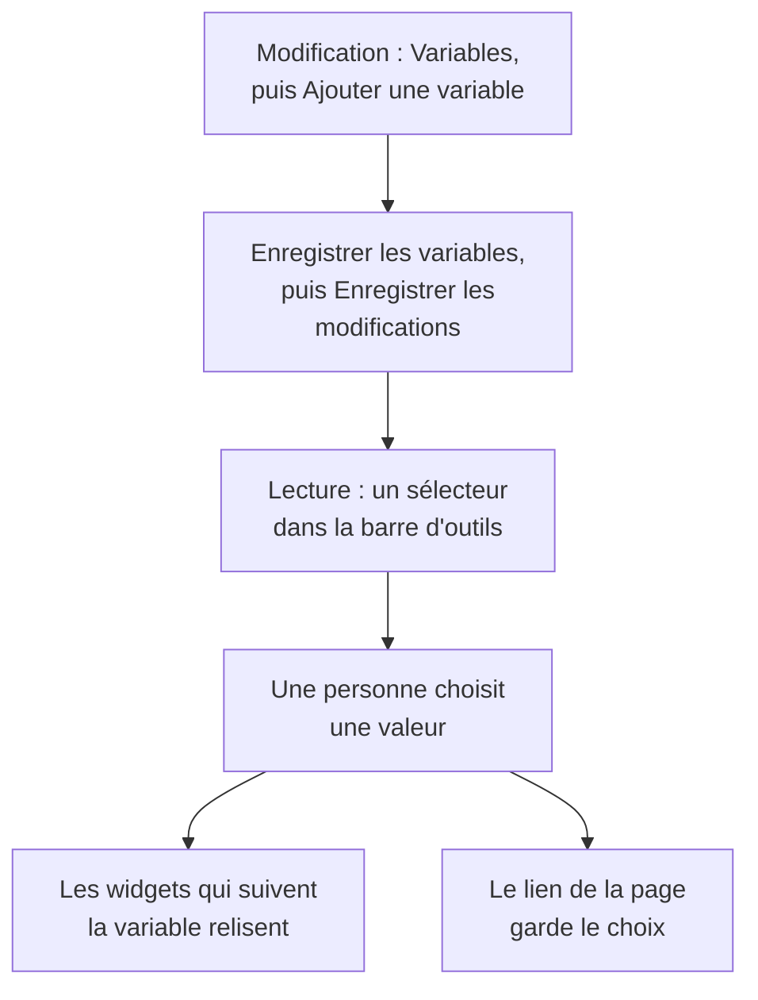

# Variables et filtres de tableau de bord

Une variable est un sélecteur dans la barre d'outils du tableau de bord. Ajoutez une variable `service` et les mêmes graphiques affichent `checkout`, `payments` ou `search` : les personnes choisissent dans la barre d'outils au lieu que vous construisiez trois tableaux de bord presque identiques.

:::cards
- [Ajouter une variable](#ajouter-une-variable): La nommer, choisir d'où viennent ses valeurs, enregistrer.
- [Sources de variables](#sources-de-variables): Telemetry Attribute, Project Labels, Custom List et Text Input.
- [Comment les widgets utilisent une variable](#comment-les-widgets-utilisent-une-variable): Quels widgets suivent quelles variables.
- [Des liens qui gardent la sélection](#des-liens-qui-gardent-la-sélection): Envoyer un lien qui s'ouvre sur le même service.
:::

## Fonctionnement d'une variable

Vous définissez les variables en modifiant le tableau de bord, et elles sont enregistrées avec lui. En lecture, chacune est un sélecteur dans la barre d'outils. Quand une personne choisit une valeur, chaque widget qui suit la variable relit ses données, et le lien de la page garde le choix.



## Ajouter une variable

:::steps
### Ouvrir la boîte de dialogue des variables

Ouvrez le tableau de bord, choisissez **⋯ → Modifier le tableau de bord**, puis cliquez sur **Variables** dans la barre d'outils. La boîte de dialogue **Variables du tableau de bord** liste les variables du tableau de bord ; le bouton de la barre d'outils les compte.

### En ajouter une

Cliquez sur **Ajouter une variable**. Une nouvelle variable lit un attribut de télémétrie ; choisissez une autre **Source** si vous en avez besoin.

### La renseigner

Donnez-lui un **Nom**, qu'utilisent les widgets et les liens, comme `service` : des lettres, des chiffres et des tirets bas, commençant par une lettre ou un tiret bas, et différent des autres noms du tableau de bord. Ajoutez une **Étiquette** pour la barre d'outils si vous le souhaitez, une valeur **Par défaut** de départ, et cochez **Autoriser la sélection multiple** pour permettre de choisir plusieurs valeurs.

### L'enregistrer

Cliquez sur **Enregistrer les variables**, puis sur **Enregistrer les modifications** dans la barre d'outils. Le sélecteur de la variable apparaît dans la barre d'outils une fois le tableau de bord revenu en lecture.
:::

Pour modifier ou supprimer une variable plus tard, rouvrez la boîte de dialogue : changez ses champs, ou cliquez sur la corbeille à côté.

## Sources de variables

La **Source** décide d'où viennent les valeurs d'une variable, et quels widgets la suivent.

| Source | D'où viennent ses valeurs | Choix multiple |
| --- | --- | --- |
| Telemetry Attribute | Les valeurs d'une clé d'attribut dans vos métriques, comme `service.name` | Oui |
| Project Labels | Les étiquettes du projet que vous autorisez, de 1 à 1 000 | Oui |
| Custom List | Des valeurs que vous saisissez, séparées par des virgules, comme `prod, staging` | Oui |
| Text Input | Ce que la personne saisit | Non |

### Telemetry Attribute

Définissez la **Clé d'attribut**, comme `service.name`, `host.name` ou `k8s.namespace.name` ; le champ suggère les clés que porte votre télémétrie. Le sélecteur propose jusqu'à 100 valeurs de cette clé, lues dans vos métriques de la dernière journée, si bien qu'un nouveau service y apparaît sans que vous modifiiez le tableau de bord.

C'est la source la plus courante, car elle n'a besoin d'aucune liste propre : les valeurs sont celles que vous envoyez déjà.

### Project Labels

Choisissez des étiquettes de projet existantes à proposer dans une liste du tableau de bord. Par exemple, créez une variable nommée `UNIT`, réglez sa source sur **Étiquettes du projet**, et choisissez les étiquettes `0660` et `0661`.

Le tableau de bord enregistre les identifiants et les noms affichés des étiquettes choisies. Le filtrage utilise les identifiants, donc renommer une étiquette de projet ne casse pas sa liaison. Les noms affichés sont enregistrés avec le tableau de bord ; resélectionnez une étiquette renommée dans l'éditeur de variables pour mettre à jour son nom affiché. Les tableaux de bord publics affichent ces mêmes choix enregistrés.

Dans un widget **Liste des moniteurs**, ouvrez **Filtres → Variable d'étiquette** et sélectionnez `UNIT`. Choisir `0660` affiche alors les moniteurs qui portent cette étiquette. Les autres widgets ne sont pas concernés, sauf s'ils prennent en charge et lient explicitement la variable : la **Liste des SLO** a le même réglage **Variable d'étiquette**.

Les filtres fixes du widget restent appliqués. Par exemple, avec une étiquette fixe `network` et `UNIT` réglé sur `0660`, un moniteur doit porter les deux étiquettes. Plusieurs unités choisies correspondent à n'importe laquelle d'entre elles. Choisir **Tous** ne retire que la condition de la variable et conserve les filtres fixes d'étiquette, de statut et de type de moniteur.

Une variable absente ou une sélection hors de ses choix configurés affiche une erreur. Une étiquette choisie sans moniteur correspondant affiche la liste vide. Retirez explicitement la liaison du widget quand elle n'est plus utile.

### Custom List et Text Input

Une Custom List propose les valeurs que vous saisissez, séparées par des virgules. Un Text Input permet de saisir n'importe quelle valeur, comme une adresse IP ou un identifiant de requête. Ni l'une ni l'autre ne filtre un widget à elle seule : leurs valeurs vont là où vous écrivez `{{name}}` (voir ci-dessous).

Une variable Query d'un tableau de bord plus ancien est conservée et affiche une zone de texte dans la barre d'outils : OneUptime ne charge plus ses valeurs depuis une requête.

## Choix multiple et valeurs par défaut

Avec **Autoriser la sélection multiple** coché, les personnes choisissent une ou plusieurs valeurs, et les widgets affichent n'importe laquelle d'entre elles. Une sélection vide signifie **Tous**, et une variable à choix multiple démarre toujours sur **Tous**, d'où sa valeur **Par défaut** grisée.

Une variable à choix unique démarre sur sa valeur **Par défaut**, ou sur **Tous** si elle n'en a pas. **Tous** retire le filtre de la variable, et les widgets affichent tout.

Utilisez le choix multiple pour comparer « checkout et payments ensemble » sans quitter le tableau de bord. Évitez-le quand les chiffres ne s'additionnent pas d'une valeur à l'autre, comme une moyenne de moyennes.

## Comment les widgets utilisent une variable

Chaque source atteint les widgets à sa manière :

- Les variables **Attribut de télémétrie** filtrent des widgets sans rien régler sur eux : chaque graphique, valeur, jauge et tableau de métriques ; le **Graphique de journaux**, le **Flux de journaux**, le **Graphique de traces** et le **Tableau des traces** ; et les listes d'infrastructure dont les ressources portent l'attribut, comme `host.name` sur les listes d'hôtes et `k8s.namespace.name` sur les listes Kubernetes. Le graphique d'une métrique sans cet attribut n'affiche aucune donnée tant qu'une valeur est choisie : choisissez **Tous** pour le revoir. La **Liste des traces** et les listes d'incidents et d'alertes ne les suivent pas.
- Les variables **Étiquettes du projet** filtrent une **Liste des moniteurs** ou une **Liste des SLO** dont la **Variable d'étiquette** les nomme.
- **N'importe quelle variable** peut s'écrire dans du texte sous la forme `{{name}}` : dans un [widget HTML](/docs/dashboards/widgets#html), dans la requête d'une [source de données externe](/docs/dashboards/data-sources), et dans le titre d'une **Liste des moniteurs** ou d'une **Liste des SLO**. Un titre comme `{{UNIT}} NETWORK` affiche `0660 NETWORK`, `0660, 0661 NETWORK` ou `All NETWORK`. Un titre ne règle que le texte affiché ; configurez la **Variable d'étiquette** pour filtrer la requête des moniteurs.

Le [widget SLO](/docs/dashboards/widgets#slo) peut suivre une variable Telemetry Attribute sur la clé `sloName`, pour que les personnes choisissent quel SLO il affiche.

## Des liens qui gardent la sélection

Le lien de la page porte le choix de chaque variable sous la forme `?var-<name>=<value>`, plusieurs valeurs séparées par des virgules, si bien qu'un lien copié s'ouvre avec la même sélection, y compris un **Tous** explicite. Un lien comme celui-ci s'ouvre sur le service payments :

```text title="A dashboard link with a variable"
https://oneuptime.com/dashboard/<project-id>/dashboards/<dashboard-id>?var-service=payments
```

Le lien porte aussi la plage temporelle et l'actualisation automatique que vous avez choisies, sous la forme `range` et `refresh`, pour que les personnes à qui vous l'envoyez voient ce que vous voyez. [Envoyer un lien](/docs/dashboards/sharing#envoyer-un-lien) donne leurs valeurs.

## Un exemple : un tableau de bord pour chaque service

Un tableau de bord de service a généralement :

1. Une variable `service`, source Telemetry Attribute, clé d'attribut `service.name`, avec votre service le plus suivi par défaut. Laissez le choix multiple désactivé, pour que les graphiques montrent un service à la fois.
2. Une variable `namespace`, source Telemetry Attribute, clé d'attribut `k8s.namespace.name`, avec le choix multiple activé pour comparer des namespaces.
3. Une variable `environment`, source Custom List, valeurs `prod, staging`, utilisée comme `{{environment}}` dans la requête d'une source de données.
4. Des widgets qui lisent ces attributs : des graphiques et valeurs des métriques du service, un flux de journaux, et une liste de pods Kubernetes.

Le résultat : un tableau de bord pour chaque service, avec trois sélecteurs en haut.

## Prochaines étapes

:::cards
- [Widgets de tableau de bord](/docs/dashboards/widgets): Quels widgets suivent quelles variables.
- [Sources de données externes](/docs/dashboards/data-sources): Mettre une variable dans une requête PromQL ou SQL.
- [Partage et tableaux de bord publics](/docs/dashboards/sharing): Les variables sur un tableau de bord public.
- [Créer un tableau de bord](/docs/dashboards/authoring): La modification, l'enregistrement et la plage temporelle.
:::
