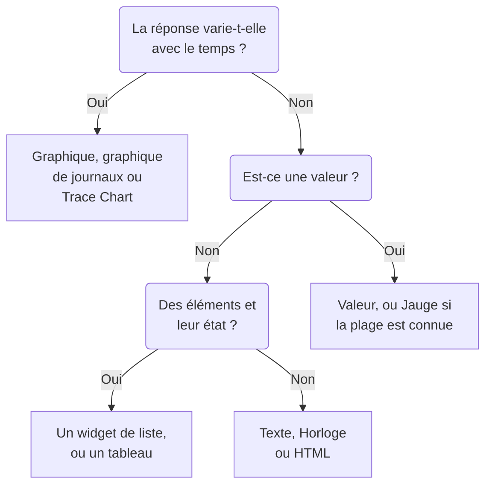

# Widgets de tableau de bord

Un widget est une tuile d'un tableau de bord. Cette page liste chaque widget du catalogue **Ajouter un widget**, ce qu'il affiche et les paramètres qui comptent, dans les groupes du catalogue. Pour placer des widgets sur la grille et les enregistrer, voir [Créer un tableau de bord](/docs/dashboards/authoring).

:::cards
- [Quel widget choisir ?](#quel-widget-choisir): Choisir selon la question à laquelle la tuile répond.
- [Graphiques et nombres](#graphiques-et-nombres): Graphique, Valeur, Jauge et Tableau, à partir d'une requête de métriques.
- [Journaux, traces et sécurité](#journaux-traces-et-sécurité): Graphiques de volume, flux en direct et listes.
- [Trier les listes et les tableaux](#trier-les-listes-et-les-tableaux): Trier selon une colonne, et fixer l'ordre que tout le monde voit.
- [Quand un widget ne peut pas être affiché](#quand-un-widget-ne-peut-pas-être-affiché): Ce qu'affiche un widget défaillant, et comment le réparer.
:::

## Quel widget choisir ?

Partez de la question à laquelle la tuile doit répondre :

| La question | Le widget |
| --- | --- |
| Comment une métrique a-t-elle évolué dans le temps ? | **Graphique** |
| Combien de journaux, de quelle gravité, dans le temps ? | **Graphique de journaux** |
| À quelle vitesse vont les requêtes, et combien échouent, dans le temps ? | **Graphique de traces** |
| Quelle est une valeur en ce moment ? | **Valeur**, ou **Jauge** quand elle a une plage connue |
| Quels hôtes, services ou points de terminaison se démarquent ? | **Tableau** ou **Tableau des traces** |
| Que se passe-t-il en ce moment ? | **Flux de journaux**, **Liste des traces**, **Liste des incidents** ou **Liste des alertes** |
| Tous nos sites sont-ils en ligne ? | **Liste des moniteurs** |
| Tenons-nous la fiabilité promise ? | **SLO** ou **Liste des SLO** |
| Dans quel état sont nos clusters et nos hôtes ? | Un widget du groupe Infrastructure |
| Où est notre réseau dans le monde, et qu'est-ce qui est en panne ? | **Carte du réseau** |
| Un titre, une note, l'heure dans un autre bureau ? | **Texte** ou **Horloge** |
| Des données conservées hors de OneUptime ? | Un widget du groupe External Data Sources |
| Quelque chose qu'aucun widget ne couvre ? | **HTML**, une fois sûr qu'aucun autre widget ne le fait |



La plupart des tableaux de bord en combinent quelques-uns : un graphique en haut, une ou deux valeurs à côté, un titre en texte, et une ou deux listes en dessous.

## Graphiques et nombres

Ces quatre widgets lisent une requête de métriques, construite comme dans l'explorateur de métriques : choisissez une métrique et une agrégation, ajoutez des filtres d'attributs, et regroupez par un attribut pour obtenir une série par valeur.

### Graphique

Une série temporelle d'une ou plusieurs requêtes de métriques sur la plage temporelle du tableau de bord. **Chart Type** la dessine en lignes, en barres, en aires, en aires empilées ou en secteurs. **Additional Queries** superposent d'autres métriques sur les mêmes axes, et **Formules** les combinent avec `+`, `-`, `*`, `/`, `%`, `^` et des parenthèses, comme `(1 - a) * 100`. Les réglages d'affichage de chaque requête ajoutent une légende et une unité, une couleur, des lignes d'avertissement et critique, et un taux par seconde pour les compteurs qui ne font que croître.

Utilisez-le quand la forme de la courbe raconte l'histoire : latence, erreurs, débit ou profondeur de file d'attente.

### Valeur

Un grand nombre avec une sparkline : la valeur de la requête sur toute la plage temporelle, additionnée pour une somme ou un comptage, la plus haute pour un maximum, la plus basse pour un minimum, et la moyenne sinon. Une flèche compare la seconde moitié de la plage à la première, chaque moitié calculée de la même façon, colorée selon **Trend Direction** : si une valeur plus haute est meilleure ou pire, ou déduit du nom de la métrique. Pointez sur la flèche pour voir la valeur de chaque moitié, et sur la sparkline pour lire la valeur et l'heure de n'importe quel point. **Warning Threshold** colore le fond en jaune et **Seuil critique** en rouge dès que la valeur les atteint.

Utilisez-la quand un nombre répond à la question : le taux d'erreur, la latence P95 ou les requêtes servies aujourd'hui.

### Jauge

Un cadran entre un minimum et un maximum, 0 et 100 sauf si vous les fixez, avec une zone jaune à partir de **Warning Threshold** et une zone rouge à partir de **Seuil critique**.

Utilisez-la quand la valeur se situe dans une plage connue : l'utilisation du CPU ou du disque en pourcentage, ou la capacité d'une file d'attente.

### Tableau

Des valeurs de métriques en lignes. **Regrouper par attributs** donne une ligne par valeur, par exemple une par `host.name` ; sans regroupement, chaque ligne est un intervalle de temps. **Metrics & Columns** définit les colonnes : des métriques, et des formules sur elles, comme la disponibilité en pourcentage. Quand vous regroupez, **Reduce across time** ramène la série de chaque ligne à une valeur : la dernière valeur, la moyenne, la somme, le minimum ou le maximum.

Utilisez-le pour une ventilation plutôt qu'une tendance : les hôtes les plus bruyants, les erreurs par service, les requêtes par point de terminaison.

## Texte, horloge et HTML

Ces widgets n'ont besoin d'aucune source de données.

### Texte

Une ligne ou un bloc de texte, pour un titre, une note ou des liens vers vos runbooks. Activez **Markdown** pour afficher titres, liens, listes, code et tableaux ; sinon le texte s'affiche tel que saisi, en gras, en italique ou souligné si vous le souhaitez.

### Horloge

L'heure actuelle dans n'importe quel fuseau horaire, en chiffres ou sur un cadran analogique, avec un libellé comme « Sydney Office ». Sans fuseau horaire, elle affiche celui de chaque personne qui la regarde. Ajoutez-en une par bureau pour voir qui est réveillé.

### HTML

Votre propre HTML, CSS et JavaScript, rendus comme un widget. Ses paramètres sont le corps HTML, une feuille de style facultative, un script facultatif et trois interrupteurs d'autorisation.

Utilisez-le quand vous avez besoin de quelque chose qu'aucun widget intégré ne couvre : un badge tiers intégré, un tableau tiré d'une API interne, une légende personnalisée, ou un ensemble de liens stylés vers vos propres outils.

#### Ce qu'il peut faire et ne peut pas faire

Le widget s'affiche dans un cadre isolé, sur sa propre origine isolée. Dans ce cadre, votre code peut faire à peu près tout : construire du DOM, lancer des minuteurs, appeler n'importe quelle URL, dessiner sur un canvas.

Ce qu'il ne peut pas faire, c'est atteindre la page OneUptime qui l'entoure. Il n'a accès ni au DOM du tableau de bord, ni à ses cookies, ni au stockage local, ni à la session d'API, et il ne peut pas faire quitter l'onglet du navigateur. C'est vrai que le tableau de bord soit privé ou partagé publiquement.

Deux conséquences à connaître avant de coller quelque chose :

- Un `fetch` depuis le widget est une requête cross-origin issue d'une origine opaque : le serveur appelé doit donc l'autoriser par CORS. Appeler l'API OneUptime d'ici n'est pas pris en charge.
- Le widget démarre transparent. Définissez un arrière-plan sur `body` dans votre CSS si vous voulez qu'il remplisse la carte. Dans le thème sombre, son texte démarre clair et son élément `<html>` porte la classe `dark` : commencez une règle CSS par `html.dark` pour styliser uniquement le thème sombre.

#### Utiliser les variables du tableau de bord

Écrivez `{{variableName}}` n'importe où dans le HTML, le CSS ou le JavaScript, et il est remplacé par la valeur actuelle de cette variable avant l'affichage du widget. Choisir une nouvelle valeur réaffiche le widget. Un espace réservé qui nomme une variable inexistante est laissé tel quel.

Les scripts reçoivent les mêmes valeurs, plus la plage temporelle du tableau de bord, dans `window.ONEUPTIME` :

```javascript title="window.ONEUPTIME"
window.ONEUPTIME.variables.environment; // current value, or "" if unset
window.ONEUPTIME.startDate; // ISO 8601 string, start of the dashboard's time range
window.ONEUPTIME.endDate; // ISO 8601 string, end of it
```

Le widget se recharge à chaque actualisation du tableau de bord, si bien qu'un widget qui récupère ses propres données suit l'intervalle d'actualisation.

#### Autorisations

**Run JavaScript** (activé par défaut) exécute votre script. Désactivez-le pour n'afficher que le balisage et les styles — le script est alors entièrement retiré du widget, et pas seulement bloqué.

**Open links in a new tab** (activé par défaut) permet aux liens et à `window.open` d'ouvrir un onglet du navigateur. Les liens s'ouvrent toujours dans un nouvel onglet ; le widget ne peut jamais faire naviguer le tableau de bord lui-même.

**Allow forms to submit** (désactivé par défaut) permet à un `<form>` du widget d'être envoyé.

Quiconque peut modifier le tableau de bord décide de ce que ce widget exécute, et toute personne qui consulte le tableau de bord l'exécute — sur un tableau de bord public, cela inclut les visiteurs anonymes. Traitez l'accès en modification à un tableau de bord qui porte un widget HTML comme l'accès à n'importe quel autre code que vous livrez.

## Journaux, traces et sécurité

| Widget | Ce qu'il affiche | Paramètres importants |
| --- | --- | --- |
| **Graphique de journaux** | Le volume de journaux dans le temps, une série par gravité, en barres, lignes ou aires. | Gravités, texte contenu dans le corps, filtres d'attributs. |
| **Flux de journaux** | Les dernières lignes de journal qui correspondent à un filtre. | Gravité, texte contenu dans le corps, filtres d'attributs comme `@service.name:checkout`, nombre de lignes. |
| **Graphique de traces** | Le nombre de requêtes, le nombre d'erreurs ou le temps de réponse (moyenne, minimum, maximum, P50 à P99) dans le temps. | La métrique, les spans à compter, et un attribut selon lequel répartir les séries. |
| **Liste des traces** | Les dernières traces, avec leur durée et leur statut. | Statut, nombre de lignes. |
| **Tableau des traces** | Les principaux noms de span, statuts ou valeurs d'attribut par nombre de requêtes, avec les temps de réponse médian, moyen, minimum et maximum. | Le regroupement des lignes, et les spans à compter. |
| **Événements de sécurité** | Les derniers événements de sécurité, avec gravité, classe d'événement et hôte. | Gravités, classes d'événements, texte contenu dans le message. |
| **Flux des événements de sécurité** | Un flux d'événements de sécurité, de leur source à leur gravité en passant par leur classe d'événement. | Gravités, nombre d'événements. |

Les widgets de traces ne comptent que les spans racines, comme l'explorateur de traces, sauf si vous incluez les spans enfants dans leurs paramètres. Un schéma courant est un graphique de latence en haut avec une liste de traces lentes en dessous.

## Incidents, alertes et moniteurs

| Widget | Ce qu'il affiche | Filtres |
| --- | --- | --- |
| **Liste des incidents** | Les incidents avec leur état et leur gravité. | Non résolus, acquittés ou résolus ; gravité, état, moniteurs et étiquettes. |
| **Liste des alertes** | Les alertes avec leur état et leur gravité. | Non résolues, acquittées ou résolues ; gravité, état, moniteurs et étiquettes. |
| **Liste des moniteurs** | Les moniteurs avec leur statut actuel. | Opérationnel ou non, statut, type de moniteur et étiquettes, ou une **Variable d'étiquette** que les personnes choisissent dans la barre d'outils. |

Comme la plupart des widgets de liste, ces trois-là peuvent dessiner un nid d'abeilles de cellules colorées selon le statut au lieu d'un tableau : choisissez-le sous **Mode d'affichage**. Ils montrent l'état actuel, quelle que soit la plage temporelle du tableau de bord.

## Objectifs de niveau de service

### SLO

Un objectif de niveau de service, dessiné soit comme un seul nombre, soit comme une courbe dans le temps.

**Paramètres** : quel SLO, ou le SLO choisi dans une variable du tableau de bord ; lequel de ses trois nombres (SLI, Error Budget Remaining ou Burn Rate) ; l'affichage en Tile ou en Graphique ; et un titre facultatif.

- **Tile** affiche le nombre actuel, plus une seconde ligne quand il y en a une — l'objectif sous le SLI, les minutes restantes sous le budget d'erreur. Une pastille de statut colore l'ensemble.
- **Graphique** dessine le même nombre sur la plage temporelle du tableau de bord, avec l'objectif marqué en pointillés sur la série du SLI. L'historique est écrit toutes les quelques minutes par le worker d'évaluation, donc un SLO tout neuf apparaît vide jusqu'à sa première évaluation.

Utilisez-le quand le tableau de bord répond à « tenons-nous ce que nous avons promis ? » plutôt qu'à « que se passe-t-il en ce moment ? ».

Le widget SLO fonctionne sur les [tableaux de bord publics](/docs/dashboards/sharing). Ce qui est publié, ce sont les chiffres clés du SLO — son nom, son objectif, le SLI actuel, le budget d'erreur restant, le burn rate et le statut — quel que soit celui que le widget dessine. Sa définition reste privée : les moniteurs qu'il observe, ses étiquettes, sa description, sa requête et son planning d'évaluation ne sont jamais envoyés à un visiteur public. Un widget Tile ne publie que ces chiffres actuels ; un widget Graphique publie aussi l'historique de la seule série qu'il dessine, et rien d'autre.

### SLO List

Chaque SLO avec son statut, son SLI, son budget d'erreur et son burn rate, celui qui a le moins de budget en premier. Filtrez-la par statut ou par étiquettes, ou par une **Variable d'étiquette** que les personnes choisissent dans la barre d'outils. [Métriques et tableaux de bord des SLO](/docs/slo/metrics) montre les deux widgets SLO à l'œuvre.

## Infrastructure

Chacun de ces widgets liste les ressources qu'un agent ou un collecteur signale à OneUptime. Restreignez-les par cluster, hôte ou namespace dans leurs filtres, et affichez-les en liste ou en nid d'abeilles.

| Groupe | Widgets | Alimentés par |
| --- | --- | --- |
| **Hôtes** | **Hôtes**, avec leur état de connexion, OS, CPU et mémoire | Tout collecteur OpenTelemetry qui envoie `host.name` |
| **Kubernetes** | **Pods**, **Nœuds**, **Espaces de noms**, **Déploiements**, **StatefulSets**, **DaemonSets**, **Tâches**, **CronJobs** | L'[agent Kubernetes](/docs/monitor/kubernetes-agent) |
| **Docker** | **Hôtes**, **Conteneurs**, **Images**, **Réseaux**, **Volumes** | L'agent Docker |
| **Docker Swarm** | **Nœuds**, **Services** | L'agent Docker Swarm |
| **Podman** | **Hôtes**, **Conteneurs**, **Images**, **Réseaux**, **Volumes** | L'agent Podman |
| **Proxmox** | **Nœuds**, **Invités** | L'agent Proxmox |
| **VMware** | **Hôtes**, **Machines virtuelles** | L'agent VMware, ou un vCenter que vous connectez |
| **Ceph** | **OSDs**, en mur coloré selon l'état, et **Pools** | L'agent Ceph |
| **Baies de stockage** | **Volumes**, et **Matériel** en mur coloré selon le statut | L'agent Storage Array |

Utilisez-les pour une page qui réunit l'état de votre infrastructure et la télémétrie des charges de travail qui tournent dessus.

### Carte du réseau

Vos sites réseau dessinés sur la carte du monde, chacun épinglé à sa propre latitude et longitude et coloré selon le statut des moniteurs qui lui est remonté. Les sites proches partagent un marqueur avec leur nombre inscrit dedans ; un marqueur qui représente un seul site ouvre ce site quand vous cliquez dessus.

La carte se cadre sur les sites qu'elle a dessinés — un parc dans un seul pays remplit le cadre avec ce pays, un parc réparti sur plusieurs continents s'ouvre sur le monde. Il n'y a pas de commandes de zoom ni de déplacement : une tuile de tableau de bord est une image, et la page Carte du réseau sous Réseau est l'endroit où parcourir la hiérarchie.

Au-dessus de la carte s'affiche le nombre de sites en panne, car un point rouge de deux pixels parmi deux cents verts n'est lu par personne à distance de tableau de bord. En dessous, une ligne de couverture dit ce que la carte ne montre pas : les sites sans coordonnées, et si le plafond de lignes a été atteint.

**Paramètres** : titre, vue carte ou liste, nombre maximal de sites dessinés, affichage ou non des noms de sites, et filtres par type de site et par statut. Les noms de sites disparaissent automatiquement quand la carte devient trop chargée pour qu'on les lise ; l'infobulle nomme toujours chaque marqueur.

Un site n'apparaît que s'il a des coordonnées. Ajoutez une latitude et une longitude sur le site (ou importez-les par CSV) pour l'épingler.

## Sources de données externes

Le groupe External Data Sources dessine un **Graphique**, une **Valeur**, une **Jauge** ou un **Tableau** à partir d'un système qui n'appartient pas à OneUptime : Prometheus, PostgreSQL, MySQL, SQL Server, ClickHouse, Loki, Elasticsearch ou n'importe quelle API REST. Vous connectez le système une fois, puis vous écrivez la requête de chaque widget dans le langage de ce système. [Sources de données externes](/docs/dashboards/data-sources) explique comment.

## Trier les listes et les tableaux

Cliquez sur l'en-tête d'une colonne pour trier une liste ou un tableau selon elle : un premier clic trie comme l'indique le tableau ci-dessous, le clic suivant dans l'autre sens, et celui d'après remet le widget dans son propre ordre. Sur la colonne selon laquelle le widget est déjà trié, un clic inverse l'ordre. Une flèche marque la colonne selon laquelle les lignes sont triées.

| Colonne | Premier clic | Clic suivant |
| --- | --- | --- |
| Un statut, un état ou une gravité | Pires d'abord | Meilleurs d'abord |
| Une heure | Plus récents d'abord | Plus anciens d'abord |
| Un nombre | Plus élevés d'abord | Plus bas d'abord |
| Texte | De A à Z | De Z à A |

Le pire suit l'ordre propre à votre projet : un statut de moniteur selon sa priorité, la gravité et l'état d'un incident ou d'une alerte selon l'ordre dans lequel vous les rangez, et une ressource arrêtée, pas prête ou éteinte avant une ressource saine. La phase d'un pod trie Failed, puis Unknown, puis Pending, puis Running et Succeeded. Le SLI et le budget d'erreur d'un SLO, ainsi que le VMID d'un invité Proxmox, trient les plus bas d'abord.

Toute la liste est triée, pas seulement les lignes à l'écran : une liste qui affiche 25 lignes, triée avec les pires d'abord, affiche les 25 pires de toutes. Les lignes à égalité gardent l'ordre propre du widget. Une colonne selon laquelle une liste ne peut pas être triée en entier, comme le message d'un événement de sécurité, ne se trie pas.

### Votre propre tri

Votre tri n'appartient qu'à vous : votre navigateur s'en souvient pour ce widget sur ce tableau de bord, si bien qu'un rechargement ou le redémarrage d'un écran mural le conserve, et personne d'autre ne le voit. Le clic qui remet le widget dans son propre ordre oublie votre tri, et le widget suit ensuite son propre ordre, même quand un éditeur le change plus tard.

### L'ordre que tout le monde voit

Pour fixer l'ordre dans lequel un widget s'ouvre pour tout le monde, modifiez-le et choisissez l'ordre sous **Trier**, ou cliquez sur un en-tête de colonne dans son **Aperçu en direct**, puis cliquez sur **Enregistrer les modifications**. Vous voyez le nouvel ordre tout de suite ; un lecteur qui a trié le widget à sa façon garde son tri.

Les modèles de tableau de bord ouvrent leurs listes d'hôtes, de nœuds, de pods, de services Swarm et d'équipements réseau avec les pires d'abord.

Par l'API et Terraform, l'ordre est le `arguments.sort` du widget : une colonne et un sens, par exemple `status:desc`. Un widget de liste refuse une colonne qu'il n'a pas, et l'erreur énumère les tris qu'il propose.

## Sur un tableau de bord public

Un [tableau de bord public](/docs/dashboards/sharing) dessine la plupart des widgets pour ses visiteurs, chacun ne montrant que ce pour quoi il a été configuré. Quelques-uns ne peuvent pas s'afficher sans session connectée :

- **Graphique de journaux**, **Graphique de traces**, **Tableau des traces**, **Événements de sécurité** et **Flux des événements de sécurité** indiquent à leur place qu'ils ne sont pas disponibles sur les tableaux de bord publics.
- Les widgets du groupe External Data Sources sont entièrement retirés d'un tableau de bord public, car leurs paramètres sont la requête elle-même.

## Quand un widget ne peut pas être affiché

Un widget qui ne peut pas être dessiné affiche **Ce widget n'a pas pu être affiché** à sa place, et le reste du tableau de bord continue de fonctionner. Cela arrive quand OneUptime n'a aucun widget de ce type (un widget supprimé, mal orthographié lors de l'écriture du tableau de bord par l'API, ou ajouté par une version plus récente), ou quand le widget échoue pendant son affichage, par exemple parce que ses paramètres enregistrés sont incomplets.

Si vous pouvez modifier le tableau de bord, cliquez sur **Modifier le widget** dessus. Le tableau de bord passe en modification avec les paramètres de ce widget ouverts : corrigez-les, ou cliquez sur **Supprimer le widget**, puis sur **Enregistrer les modifications**. Un widget qui a échoué pendant son affichage propose aussi **Réessayer**, et il est redessiné à la prochaine actualisation automatique ou quand vous changez la plage temporelle.

Les visiteurs d'un tableau de bord public apprennent seulement que le widget n'a pas pu être affiché.

## Prochaines étapes

:::cards
- [Variables et filtres de tableau de bord](/docs/dashboards/variables): Laisser les personnes orienter les widgets vers un service, un hôte ou un client.
- [Sources de données externes](/docs/dashboards/data-sources): Afficher Prometheus, SQL, Loki et d'autres à côté de vos propres données.
- [Créer un tableau de bord](/docs/dashboards/authoring): Ajouter, disposer et enregistrer des widgets.
- [Partage et tableaux de bord publics](/docs/dashboards/sharing): Partager le tableau de bord hors de votre équipe.
:::
